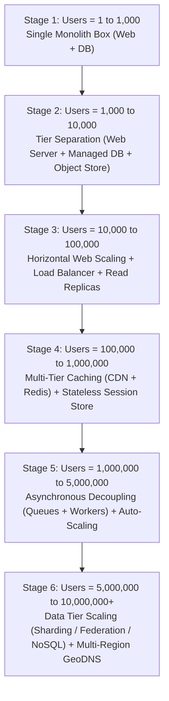
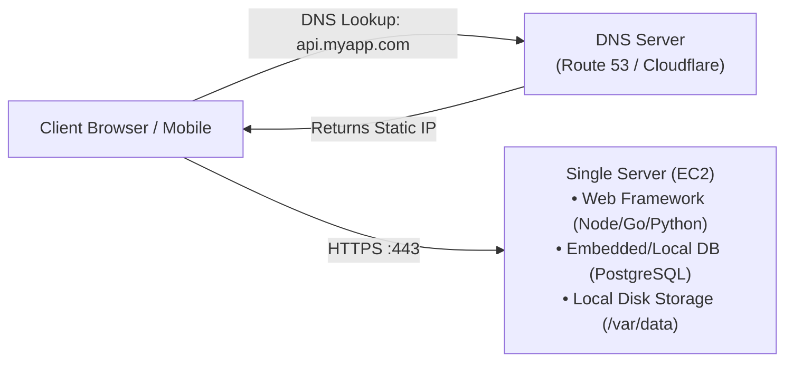
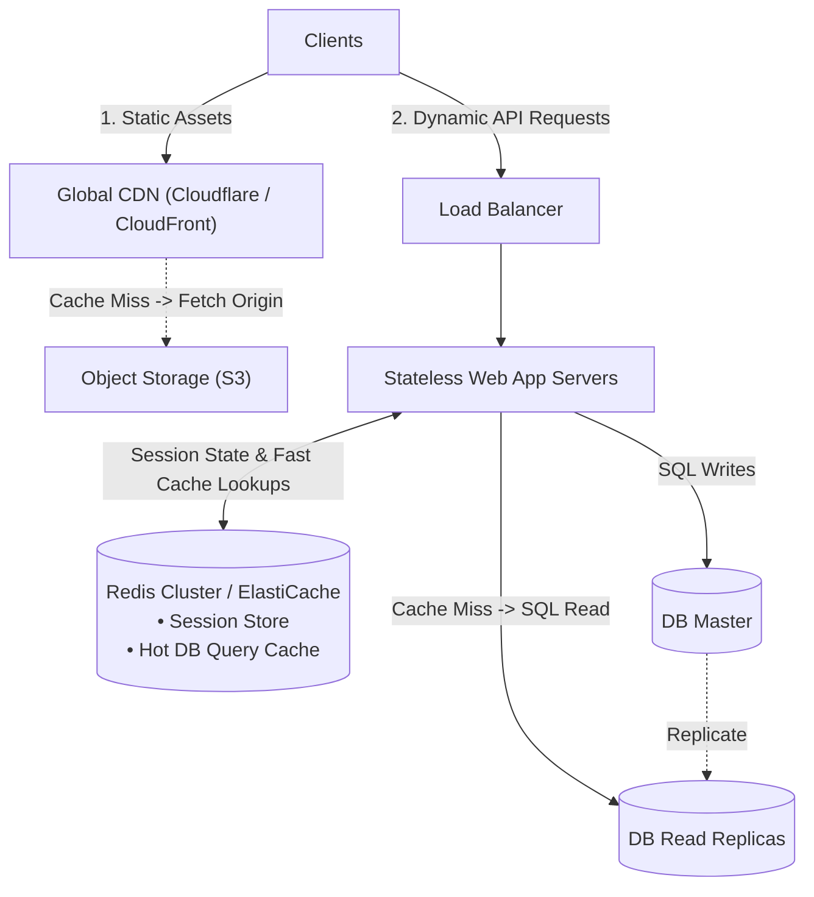
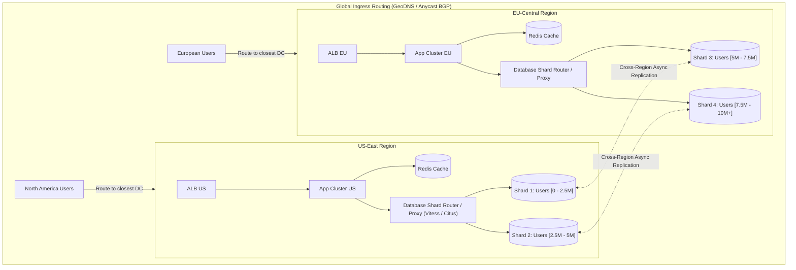

# Chapter 01: Scale from Zero to Millions of Users (The Definitive Architecture Evolution)

## Guarantees and assumptions
Mutations succeed after the authoritative database commit; replicas and caches update asynchronously. Clients reuse operation IDs across retries and load-balancer changes.
**Principal IC exercise:** Define a read-your-writes contract during primary failover; quantify the latency and availability cost of bypassing stale replicas.

**Sources & Foundational References:**
- [The System Design Primer: Scaling to Millions of Users on AWS (Donne Martin)](https://github.com/donnemartin/system-design-primer/blob/master/solutions/system_design/scaling_aws/README.md)
- [System Design Interview – An Insider's Guide, Vol 1 (Alex Xu)](https://bytebytego.com/)
- [Designing Data-Intensive Applications (Martin Kleppmann)](https://dataintensive.net/)

---

## 1. Executive Interview Framing & Staff-Level Bar

Scaling an architecture from a single user to 10M+ users is the archetype of the systems design interview. While junior and mid-level candidates jump straight to "put Redis in front of the database and use Kafka," **Staff and Principal Engineers (L6+, P60) are evaluated on their ability to demonstrate iterative, cost-aware evolution guided by profiling, precise trade-off justification across 2–3 alternatives at each bottleneck, and deep mechanical empathy for storage and networking physics**:

```
┌────────────────────────────────────────────────────────────────────────────────────────┐
│                                 THE INTERVIEW SPECTRUM                                 │
├────────────────────────────────────────┬───────────────────────────────────────────────┤
│ L5 / Senior Engineer                   │ L6+ / Staff & Principal Engineer              │
├────────────────────────────────────────┼───────────────────────────────────────────────┤
│ • Proposes complex microservices &     │ • Starts with simple modular monolith; splits │
│   distributed queues on Day 1          │   components only when profiling shows bounds │
│ • "Just use Redis for caching"         │ • Evaluates Cache-Aside vs Write-Through;      │
│                                        │   analyzes cache stampede & invalidation cost │
│ • "Add read replicas to scale SQL"     │ • Quantifies replication lag; solves the      │
│                                        │   "read-your-own-writes" causal anomaly       │
│ • "Shard by user_id"                   │ • Identifies celebrity hot partitions; plans   │
│                                        │   resharding, cross-shard joins & 2PC cost    │
│ • Treats NoSQL as a silver bullet      │ • Compares SQL federation vs sharding vs      │
│                                        │   LSM/Wide-Column NoSQL by access patterns    │
│ • Silently applies technologies        │ • Surfaces operational cost, SLOs, failure    │
│                                        │   domains, multi-region latency & blast radius│
└────────────────────────────────────────┴───────────────────────────────────────────────┘
```

---

## 2. The 5-Pillar Staff Assessment Rubric for Scaling

When interviewers assess your performance on architectural evolution, they map your answers directly to five core behavioral and technical pillars:

```
┌────────────────────────────────────────────────────────────────────────────────────────────────────────┐
│                                      5-PILLAR EVALUATION RUBRIC                                        │
├─────────────────────────┬──────────────────────────────────────────────────────────────────────────────┤
│ Pillar                  │ What the Interviewer Listens For (Evidence)                                  │
├─────────────────────────┼──────────────────────────────────────────────────────────────────────────────┤
│ 1. Decision Making      │ • Clarifies constraints (read/write ratio, data volume, latency SLO) first. │
│                         │ • Compares 2–3 credible options (e.g. Read Replicas vs Redis Cache vs       │
│                         │   CQRS) before selecting one; articulates the accepted architectural debt.   │
│                         │ • Revisits choices as scale increases ($1\text{k} \to 100\text{k} \to 10\text{M}$).│
├─────────────────────────┼──────────────────────────────────────────────────────────────────────────────┤
│ 2. Technical            │ • Explains underlying mechanics (e.g. B+ Tree page splits, OS page cache,    │
│    Proficiency          │   TCP handshake latency, connection pool starvation).                        │
│                         │ • Grounds SQL vs NoSQL in access patterns (relational ACID vs high-write     │
│                         │   append-only LSM trees), completely avoiding marketing slogans.             │
├─────────────────────────┼──────────────────────────────────────────────────────────────────────────────┤
│ 3. Problem Solving &    │ • Decomposes system into clean functional tiers (Edge, Ingress, App, Data).  │
│    Analytical Thinking  │ • Runs back-of-the-envelope napkin math (QPS, IOPS, RAM sizing, bandwidth)  │
│                         │   with explicit units and napkin shortcuts ($86.4\text{k} \approx 100\text{k}$).│
├─────────────────────────┼──────────────────────────────────────────────────────────────────────────────┤
│ 4. Operational          │ • Proactively raises security (VPC subnets, TLS termination, egress filters).│
│    Mindset              │ • Designs observability (RED metrics, distributed tracing, health checks).   │
│                         │ • Plans failure modes (circuit breakers, dead letter queues, failover).      │
│                         │ • Considers cost efficiency (server utilization, autoscaling cold starts).   │
├─────────────────────────┼──────────────────────────────────────────────────────────────────────────────┤
│ 5. Adaptability &       │ • Welcomes curveballs ("traffic surges 50x due to a viral event").          │
│    Collaboration        │ • Balances Day 1 simplicity (fast time-to-market) with long-term scaling.    │
│                         │ • Explains architecture clearly using high-level executive summaries.        │
└─────────────────────────┴──────────────────────────────────────────────────────────────────────────────┘
```

---

## 3. The Evolutionary Scaling Roadmap: Zero to 10M+ Users



---

### Stage 1: Zero to 1,000 Users (The Single Server Architecture)

#### Architecture Overview
All services—Web server (e.g. Django, Spring Boot, Node.js), relational database (MySQL/PostgreSQL), and file storage—run on a single virtual server (e.g. AWS EC2 `t4g.small` or digital ocean droplet).



#### Bottlenecks & Failure Modes
1. **Single Point of Failure (SPOF):** If the OS crashes, disk fails, or process runs out of memory, the entire business is offline.
2. **Resource Contention:** Web requests (CPU-heavy) compete directly with database queries (I/O and RAM-heavy) for the same page cache and CPU cores.
3. **Hard Vertical Limits:** Scaling means buying a larger instance. Vertical scaling follows a law of diminishing returns and requires downtime during resize.

#### 5-Pillar Decision Justification
* **Pillar 1 (Decision Making):** Deliberately reject microservices and distributed caching at Stage 1. Developing a distributed system when customer demand and domain boundaries are unvalidated burns runway without operational payoff.
* **Pillar 4 (Operational Mindset):** Configure an automated daily backup snapshot to off-site cloud storage and set up an external health check ping (e.g. UptimeRobot) with basic email alerts.

---

### Stage 2: 1,000 to 10,000 Users (Separation of Tiers)

#### Architecture Overview
1. **Move Database to a Managed Service:** Separate the database onto its own dedicated instance (e.g. AWS RDS PostgreSQL). Managed RDS provides automated multi-AZ replication, automated point-in-time backups, and maintenance patching.
2. **Move Static & User Media to Object Storage:** Remove image and asset serving from web server disk to an object store (e.g. Amazon S3 / Google Cloud Storage).
3. **Security Isolation (VPC Subnets):** Place the web server in a Public Subnet (accessible via Internet Gateway) and the database in a Private Subnet (accessible *only* from the web server's security group).

```mermaid
flowchart TD
    Client["Client Browser / Mobile"] -->|HTTPS| Web["Web Server (EC2 in Public Subnet)"]
    Web -->|Static Asset Upload/Download| S3["Object Storage (S3 / GCS)<br/>• Images, PDFs, CSS, JS"]
    Web -->|SQL Queries (Port 5432)| RDS["Managed DB (RDS in Private Subnet)<br/>• Primary Instance (AZ 1)<br/>• Standby Sync Replica (AZ 2)"]
```

#### Bottlenecks & Failure Modes
1. **Single Web Server Bottleneck:** While the database has breathing room, a surge in HTTP traffic or a slow blocking route can saturate web server worker threads.
2. **Static Asset Egress Cost & Latency:** Serving large files from S3 across cross-continental networks increases time-to-first-byte (TTFB) and bandwidth bills.

---

### Stage 3: 10,000 to 100,000 Users (Horizontal Web Scaling & Read Replicas)

#### Architecture Overview
1. **Load Balancer (L4 / L7):** Place a redundant Load Balancer (e.g. AWS ALB, HAProxy, NGINX) in front of multiple stateless web servers across Availability Zones.
2. **SSL/TLS Termination:** Terminate HTTPS certificates at the load balancer to free backend CPU cycles from expensive cryptographic handshakes.
3. **Database Read Replicas (Master-Replica):** Most web applications have a **10:1 to 100:1 read-to-write ratio**. Configure the primary database for writes and provision asynchronous read replicas for read queries.

```mermaid
flowchart TD
    Client["Clients"] -->|HTTPS| LB["Load Balancer (ALB)<br/>• TLS Termination<br/>• Health Checks & Sticky Sessions"]
    
    subgraph WebTier["Stateless Web Tier (Multi-AZ)"]
        LB --> Web1["Web Server 1 (AZ-a)"]
        LB --> Web2["Web Server 2 (AZ-b)"]
        LB --> Web3["Web Server 3 (AZ-c)"]
    end

    subgraph DataTier["Database Tier (RDS)"]
        Web1 & Web2 & Web3 -->|Writes (INSERT/UPDATE/DELETE)| Master["Primary Master DB (AZ-a)<br/>Handles all Writes"]
        Master -.->|Asynchronous Binlog Replication| Replica1["Read Replica 1 (AZ-b)<br/>Handles Reads"]
        Master -.->|Asynchronous Binlog Replication| Replica2["Read Replica 2 (AZ-c)<br/>Handles Reads"]
        Web1 & Web2 & Web3 -->|Reads (SELECT)| Replica1 & Replica2
    end
```

#### Critical Technical Nuance: The Replication Lag Anomaly (Read-Your-Own-Writes)
* **The Problem:** Asynchronous binlog replication between Primary and Replica introduces a $50\text{ms} - 2000\text{ms}$ delay under load. If a user posts a comment and immediately refreshes the page, their read request lands on a read replica that has not yet applied the write. The user sees their comment disappear, resulting in support tickets and duplicate writes.
* **Staff-Level Mitigations:**
  1. **User-Action Stickiness (Read-Your-Own-Writes Window):** If user $U$ makes a write, route all reads from $U$ to the **Primary database** for the next 5 seconds (tracking `last_write_timestamp` in their session or JWT).
  2. **Replication Position Checking:** Pass the transaction commit log sequence number (LSN) to the client as an opaque token; the read router ensures the replica has caught up to that LSN before executing the query.

---

### Stage 4: 100,000 to 1,000,000 Users (Multi-Tier Caching & Stateless Sessions)

#### Architecture Overview
At 100k+ users, querying disk-based databases—even with read replicas—becomes a primary latency bottleneck. Memory lookups ($100\text{ns}$) are $1000\times$ faster than NVMe SSD seeks ($100\mu\text{s}$) and $80,000\times$ faster than spinning disks.

1. **Edge Caching via CDN (Cloudflare / CloudFront):** Cache static assets (images, stylesheets, videos) and edge-cacheable API responses globally close to users.
2. **Distributed In-Memory Cache (Redis / Memcached):** Cache expensive database query results, computed aggregations, and hot user profiles in RAM.
3. **Stateless Web Tier (Session Offload):** Remove session state from web server memory (which previously required sticky sessions) and store active sessions in Redis or encrypted client-side JWTs. Now web servers are completely interchangeable and can autoscale instantaneously.



#### Cache Strategy Selection Matrix
```
┌────────────────────────────────────────────────────────────────────────────────────────┐
│                              CACHING STRATEGY COMPARISON                               │
├─────────────────────┬──────────────────┬──────────────────┬────────────────────────────┤
│ Strategy            │ Write Latency    │ Read Latency     │ Consistency & Risk Profile │
├─────────────────────┼──────────────────┼──────────────────┼────────────────────────────┤
│ 1. Cache-Aside      │ Normal           │ Fast (on Hit),   │ Data can become stale;     │
│    (Lazy Loading)   │ (Writes go to DB)│ Slow (on Miss)   │ App code manages cache.    │
│                     │                  │                  │ RECOMMENDED for most apps. │
├─────────────────────┼──────────────────┼──────────────────┼────────────────────────────┤
│ 2. Write-Through    │ Slower           │ Always Fast      │ Zero stale reads; double   │
│                     │ (Sync writes to  │ (Cache is always │ write penalty on every     │
│                     │ cache + DB)      │ primed)          │ update; unused data cached.│
├─────────────────────┼──────────────────┼──────────────────┼────────────────────────────┤
│ 3. Write-Behind     │ Ultra-Fast       │ Always Fast      │ RISK OF DATA LOSS if cache │
│    (Write-Back)     │ (Writes to cache;│                  │ crashes before flushing to │
│                     │ async flushes DB)│                  │ persistent disk.           │
├─────────────────────┼──────────────────┼──────────────────┼────────────────────────────┤
│ 4. Refresh-Ahead    │ Normal           │ Consistently     │ Complex prediction logic;  │
│                     │                  │ Fast (Predictive)│ ideal for hot timed events.│
└─────────────────────┴──────────────────┴──────────────────┴────────────────────────────┘
```

#### Mitigating Production Cache Pitfalls
* **Cache Stampede (Thundering Herd):** When a hot cache key expires, thousands of concurrent requests miss simultaneously and slam the database.
  - *Fix:* Use **Mutual Exclusion Locks (Mutex / Singleflight)** so only 1 worker queries the database while others wait, or implement **Probabilistic Early Expiration (XFetch)** to refresh the key asynchronously before it expires.
* **Cache Penetration:** Attackers or buggy clients query non-existent IDs, bypassing cache and hitting the database every time.
  - *Fix:* Cache `null` values with a short TTL (e.g. 60 seconds) or deploy a **Bloom Filter** at the gateway to drop invalid IDs immediately.

---

### Stage 5: 1,000,000 to 5,000,000 Users (Asynchronous Decoupling & Auto-Scaling)

#### Architecture Overview
Synchronous HTTP request-response cycles fail when dealing with heavy processing (video encoding, report generation, PDF invoices, sending bulk emails, fraud scoring). If a client must wait 5 seconds for an image to resize, the web server connection pool is tied up.

1. **Message Queues & Stream Buffers (Kafka / RabbitMQ / AWS SQS):** Decouple producers from consumers. Producers enqueue tasks in $< 2\text{ms}$ and return HTTP `202 Accepted` with a job ID.
2. **Background Worker Fleet:** Autonomous worker processes pull jobs from the queue and execute them at their own pace.
3. **Autoscaling Groups:** Use metric-based autoscaling (e.g. CloudWatch alerts on CPU $> 70\%$ or Queue Depth $> 500$) to dynamically add and remove instances based on diurnal traffic patterns.

```mermaid
flowchart TD
    Client["Client App"] -->|1. POST /orders| API["API Web Server"]
    API -->|2. ACID Insert Order 'PENDING'| DB[("Relational DB")]
    API -->|3. Publish Event: OrderCreated| SQS["Message Queue (SQS / Kafka)"]
    API -->>|4. Return HTTP 202 Accepted| Client

    subgraph AsyncWorkerFleet["Decoupled Background Workers"]
        SQS -->|Pull Job| W1["Payment Worker"]
        SQS -->|Pull Job| W2["Inventory Worker"]
        SQS -->|Pull Job| W3["Notification Worker"]
        
        W1 -->|Execute Charge| Stripe["Stripe PSP"]
        W2 -->|Deduct Stock| DB
        W3 -->|Send Push/Email| FCM["FCM / SendGrid"]
    end
```

#### Operational Resilience Patterns
* **Backpressure:** If downstream workers slow down, the message queue acts as an elastic buffer. Producers do not crash.
* **Dead Letter Queues (DLQ):** Messages that fail processing after $N$ retry attempts (with exponential backoff and jitter) are shunted to a DLQ for offline inspection rather than poison-pilling the pipeline.
* **Idempotency Keys:** Distributed networks deliver messages with *at-least-once* semantics. Every worker must check a unique `idempotency_key` in Redis/SQL before executing an action to prevent duplicate charges or emails.

---

### Stage 6: 5,000,000 to 10,000,000+ Users (Data Tier Scaling & Multi-Region)

When active user counts exceed 5M, a single database write master cannot sustain the IOPS and storage volume, regardless of how many read replicas or caches sit above it.



#### The 4 Database Scaling Approaches Compared

```
┌────────────────────────────────────────────────────────────────────────────────────────┐
│                               DATABASE SCALING PATTERNS                                │
├─────────────────────┬──────────────────┬──────────────────┬────────────────────────────┤
│ Approach            │ Mechanics        │ Advantages       │ Major Disadvantages        │
├─────────────────────┼──────────────────┼──────────────────┼────────────────────────────┤
│ 1. Federation       │ Split database   │ Keeps schemas    │ Cannot perform JOINs across│
│    (Functional      │ by domain        │ clean; simple    │ domains (e.g. User and     │
│    Splitting)       │ (User DB, Forum  │ horizontal step  │ Product tables); joins move│
│                     │ DB, Billing DB)  │ from monolith.   │ to slow application layer. │
├─────────────────────┼──────────────────┼──────────────────┼────────────────────────────┤
│ 2. Sharding         │ Partition same   │ Virtually        │ Extreme complexity:        │
│    (Horizontal      │ table across     │ unlimited write  │ resharding data, hot keys  │
│    Partitioning)    │ multiple DBs by  │ scalability;     │ (celebrities), cross-shard │
│                     │ sharding key.    │ smaller datasets.│ transactions require 2PC.  │
├─────────────────────┼──────────────────┼──────────────────┼────────────────────────────┤
│ 3. Move to NoSQL    │ Migrate high-    │ Built-in auto-   │ Loss of ACID transactions; │
│    (LSM / Cassandra/│ write / unstruc- │ sharding, ultra- │ eventual consistency; weak │
│    DynamoDB)        │ tured data.      │ high write IOPS. │ ad-hoc query capabilities. │
├─────────────────────┼──────────────────┼──────────────────┼────────────────────────────┤
│ 4. NewSQL           │ Distributed ACID │ Full SQL + ACID; │ High operational cost;     │
│    (CockroachDB /   │ relational DB    │ automatic Raft/  │ higher commit latency      │
│    Google Spanner)  │ using Raft/Paxos.│ Paxos sharding.  │ due to consensus overhead. │
└─────────────────────┴──────────────────┴──────────────────┴────────────────────────────┘
```

#### Sharding Deep Dive: The Sharding Key Dilemma
Choosing a sharding key is an irreversible architectural commitment:
* **Hash-Based Sharding:** `shard_id = hash(user_id) % num_shards`.
  - *Advantage:* Uniform distribution of data across shards.
  - *Disadvantage:* Adding new shards requires redistributing keys unless **Consistent Hashing** is used.
* **Range-Based Sharding:** Shard by range (e.g. IDs 1–1M on Shard 1, 1M–2M on Shard 2).
  - *Advantage:* Range queries (`WHERE id BETWEEN 100 AND 500`) stay on a single shard.
  - *Disadvantage:* The latest shard takes 100% of new write traffic (**Write Hotspotting**).
* **The Celebrity / Supernode Trap:** If sharding Twitter/Instagram by `creator_id`, a celebrity with 100M followers lands on Shard 4. That shard collapses under write amplification and read spikes.
  - *Mitigation:* Split celebrity accounts across multiple secondary shards, or route celebrity posts through an out-of-band caching and read-merge layer.

---

## 4. Master Technology Summary Matrix

To rapidly recall architectural components during an interview, memorize the primary role, optimal choice, and failure mode of each tier:

```
┌────────────────────────────────────────────────────────────────────────────────────────┐
│                              SYSTEM TIER REFERENCE MATRIX                              │
├──────────────────┬──────────────────────┬────────────────────┬─────────────────────────┤
│ Tier             │ Primary Technologies │ Scaling Mechanism  │ Primary Failure Domain  │
├──────────────────┼──────────────────────┼────────────────────┼─────────────────────────┤
│ DNS & Routing    │ Route 53, Cloudflare │ Anycast, GeoDNS,   │ DNS TTL caching slows   │
│                  │                      │ Health check flips │ emergency failover      │
├──────────────────┼──────────────────────┼────────────────────┼─────────────────────────┤
│ Edge / CDN       │ Cloudflare, Akamai,  │ Geo-distributed PoP│ Cache stampede on origin│
│                  │ Fastly, CloudFront   │ edge caching       │ when TTL expires        │
├──────────────────┼──────────────────────┼────────────────────┼─────────────────────────┤
│ Load Balancer    │ AWS ALB, NGINX,      │ L4 (TCP) / L7      │ Health check flapping;  │
│                  │ HAProxy, Envoy       │ round-robin, least │ connection pool exhaust │
│                  │                      │ connections        │                         │
├──────────────────┼──────────────────────┼────────────────────┼─────────────────────────┤
│ Web Application  │ Go, Java/Spring,     │ Horizontal         │ Memory leaks; slow CPU- │
│                  │ Node.js, Python      │ autoscaling groups │ bound operations block  │
│                  │                      │ (stateless)        │ worker thread pool      │
├──────────────────┼──────────────────────┼────────────────────┼─────────────────────────┤
│ Caching Tier     │ Redis Cluster,       │ Consistent hashing,│ Network saturation;     │
│                  │ Memcached            │ read replicas      │ OOM evictions (maxmemory│
├──────────────────┼──────────────────────┼────────────────────┼─────────────────────────┤
│ Asynchronous     │ Apache Kafka, AWS    │ Partitioning,      │ Consumer lag buildup;   │
│ Messaging        │ SQS, RabbitMQ        │ consumer groups    │ poison-pill crashes     │
├──────────────────┼──────────────────────┼────────────────────┼─────────────────────────┤
│ Relational DB    │ PostgreSQL, MySQL,   │ Read replicas,     │ Replication lag; disk   │
│                  │ AWS Aurora           │ federation, sharding│ write IOPS saturation   │
├──────────────────┼──────────────────────┼────────────────────┼─────────────────────────┤
│ NoSQL / Storage  │ DynamoDB, Cassandra, │ Consistent hashing,│ Eventual consistency;   │
│                  │ S3, ScyllaDB         │ masterless gossip  │ hot partition throttling│
└──────────────────┴──────────────────────┴────────────────────┴─────────────────────────┘
```

---

## 5. Staff-Level Interviewer Curveballs & Adaptability Playbook

In a real interview, the interviewer will disrupt your design with sudden constraints to test **Pillar 5 (Adaptability & Collaboration)**. Here is how to counter them:

### Curveball 1: "Our flash sale starts in 10 minutes and write traffic is 50x higher than estimated. The database primary is pegged at 100% CPU. What do you do?"
* **Wrong Answer:** "We immediately shard the database or migrate to Cassandra." *(Takes weeks of migration planning; impossible in 10 minutes).*
* **Staff Answer:**
  1. **Triage & Shed Load:** Enable rate limiting at the API gateway to reject bot traffic and non-critical read routes.
  2. **Short-Circuit Writes via Asynchronous Buffering:** Switch the order checkout write path from synchronous SQL `INSERT` to appending into Kafka / Redis Stream. Return `HTTP 202 Accepted` to users.
  3. **Scale Consumers Gradually:** Throttle background DB write workers to drain the queue at exactly the maximum write rate the primary database can digest without crashing.

### Curveball 2: "A network partition cuts off the connection between your US and EU datacenters for 4 hours. How does your system behave?"
* **Wrong Answer:** "Our distributed database ensures everything stays strongly consistent everywhere." *(Violates the CAP Theorem).*
* **Staff Answer:**
  1. **Identify Partition Mode:** State the trade-off explicitly—**AP (Availability) vs CP (Consistency)**:
     - For social features (likes, comments, feed posts): Operate in **AP mode**. Serve writes locally in both datacenters using Conflict-Free Replicated Data Types (CRDTs) or Last-Write-Wins (LWW), and reconcile asynchronously when the partition heals.
     - For monetary and inventory operations (payments, seat reservations): Operate in **CP mode**. Confine writes to the designated single-leader region. The disconnected region rejects writes or operates in read-only mode to prevent double-spending.

### Curveball 3: "The CFO demands we reduce cloud infrastructure spend by 40% next quarter without hurting SLAs. Where do you look?"
* **Staff Answer:**
  1. **Evaluate CDN Offload Ratio:** Increasing CDN cache hit ratio from 80% to 95% drastically cuts expensive cloud egress bandwidth and reduces required EC2 instance counts.
  2. **Autoscaling Sizing & Spot Instances:** Move stateless background queue workers from on-demand EC2 to AWS Spot instances (saving 60–80% cost). Implement aggressive scale-down rules for non-peak night hours.
  3. **Tiered Data Lifecycle:** Configure automated S3 lifecycle rules to transition media older than 90 days from S3 Standard to S3 Infrequent Access or Glacier Deep Archive. Move cold database audit tables to parquet files in S3 queried via Athena.
