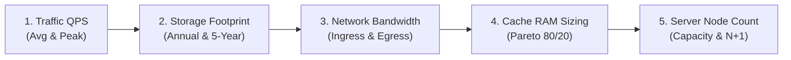

# Chapter 02: Back-of-the-Envelope Capacity Estimation & Hardware Sizing

## Guarantees and assumptions
Capacity calculations include peak traffic, retries, compression, retention, replication, indexes and failure headroom. Latency budgets separate database commit, replication and client response.
**Principal IC exercise:** Recompute capacity with one zone unavailable, twice the retry traffic, and a tenfold increase in distinct keys; identify the first saturated resource.

**Sources & Foundational References:**
- [Latency Numbers Every Programmer Should Know (Colin Scott / Jeff Dean)](https://gist.github.com/jboner/2841832)
- [The System Design Primer: Back-of-the-Envelope Calculations (Donne Martin)](https://github.com/donnemartin/system-design-primer#powers-of-two-table)
- [Designs, Lessons and Advice from Building Large Distributed Systems (Jeff Dean, Google Keynote)](http://www.cs.cornell.edu/projects/ladis2009/talks/dean-keynote-ladis2009.pdf)
- [System Design Interview – An Insider's Guide (Alex Xu, Vol 1 & 2)](https://bytebytego.com/)

---

## 1. Executive Framing & Staff-Level Bar

In system design interviews, back-of-the-envelope estimation is **not a math quiz**. Interviewers do not care about precision down to the 4th decimal place. 

What Staff/Principal interviewers evaluate is **Pillar 3 (Problem Solving & Analytical Thinking)**:
1. **Can you ground architectural decisions in hardware physics?** (e.g., choosing memory vs. NVMe vs. network based on realistic latency and cost).
2. **Can you identify the dominant system constraint?** (Is this system **CPU-bound, memory-bound, network bandwidth-bound, or disk I/O-bound**?).
3. **Do you use explicit units, conversion shortcuts, and reasonable assumptions?**

---

## 2. Latency Numbers Every Systems Engineer Must Know

### The Benchmark Comparison Table
```
┌────────────────────────────────────────┬─────────────┬──────────────┬────────────────────────────┐
│ Operation                              │ Latency     │ Normalized   │ Scaled to Human Time       │
│                                        │ (Time)      │ Nanoseconds  │ (1 CPU Cycle = 1 Second)   │
├────────────────────────────────────────┼─────────────┼──────────────┼────────────────────────────┤
│ 1 CPU L1 cache reference               │ 0.5 ns      │ 0.5 ns       │ 1 second (1 heartbeat)     │
│ Branch mispredict                      │ 5 ns        │ 5 ns         │ 10 seconds                 │
│ L2 cache reference                     │ 7 ns        │ 7 ns         │ 14 seconds                 │
│ Mutex lock / unlock                    │ 25 ns       │ 25 ns        │ 50 seconds                 │
│ Main memory (RAM) reference            │ 100 ns      │ 100 ns       │ 3.3 minutes                │
│ Compress 1 KB with Zstandard / Snappy  │ 10 µs       │ 10,000 ns    │ 5.5 hours                  │
│ Send 1 KB over 10 Gbps network         │ 10 µs       │ 10,000 ns    │ 5.5 hours                  │
│ Read 4 KB randomly from NVMe SSD       │ 100 µs      │ 100,000 ns   │ 2.3 days                   │
│ Read 1 MB sequentially from RAM        │ 250 µs      │ 250,000 ns   │ 5.8 days                   │
│ Round-trip within same datacenter      │ 500 µs      │ 500,000 ns   │ 11.6 days                  │
│ Read 1 MB sequentially from NVMe SSD   │ 1 ms        │ 1,000,000 ns │ 23.1 days                  │
│ Disk seek (Mechanical HDD)             │ 10 ms       │ 10,000,000 ns│ ~8 months                  │
│ Read 1 MB sequentially from HDD        │ 20 ms       │ 20,000,000 ns│ ~1.3 years                 │
│ Cross-continent round-trip (SF to NY)  │ 40 ms       │ 40,000,000 ns│ ~2.5 years                 │
│ Transatlantic round-trip (SF to London)│ 150 ms      │150,000,000 ns│ ~9.5 years                 │
└────────────────────────────────────────┴─────────────┴──────────────┴────────────────────────────┘
```

> [!TIP]
> **The Human Scale Mental Model:**
> If a CPU instruction is equivalent to a **1-second heartbeat**, reading from RAM is grabbing a cup of coffee (**3 minutes**), reading from NVMe SSD is a weekend trip (**2.3 days**), a traditional disk seek is waiting **8 months**, and a cross-continent network round-trip is waiting **2.5 years**!

#### 4 Core Engineering Takeaways from Latency:
1. **Memory is $\approx 1,000\times$ faster than SSD random reads, and $\approx 100,000\times$ faster than disk seeks.**
2. **Sequential disk I/O is dramatically faster than random I/O** (1 MB sequential NVMe read is only $1\text{ ms}$, which is why LSM-Trees and Kafka log files dominate high-throughput write architectures).
3. **Always compress data before network transit:** Compressing 1 KB takes $\approx 10\text{ µs}$, but saves hundreds of microseconds of network latency.
4. **Cross-region round-trips ($100\text{--}150\text{ ms}$) dominate latency:** No software optimization can overcome the speed of light in fiber optics.

---

## 3. Data Scale & Powers of Two

Computers calculate capacity in binary powers of two ($2^{10} = 1,024$). In back-of-the-envelope napkin math, round to decimal approximations to compute values mentally in seconds:

```
┌─────────┬───────────────────┬───────────────────┬─────────────┬───────────────────────────┐
│ Power   │ Exact Bytes       │ Approximate Value │ Abbr        │ Real-World Scale          │
├─────────┼───────────────────┼───────────────────┼─────────────┼───────────────────────────┤
│ 2^10    │ 1,024             │ 1 Thousand (10^3) │ 1 KB        │ Small text file, DNS packet│
│ 2^20    │ 1,048,576         │ 1 Million (10^6)  │ 1 MB        │ Web page, small image     │
│ 2^30    │ 1,073,741,824     │ 1 Billion (10^9)  │ 1 GB        │ 1 hour of compressed video│
│ 2^40    │ 1,099,511,627,776 │ 1 Trillion (10^12)│ 1 TB        │ Single server hard drive  │
│ 2^50    │ 1,125,899,906...  │ 1 Quadrillion     │ 1 PB        │ Netflix daily streaming   │
│ 2^60    │ 1,152,921,504...  │ 1 Quintillion     │ 1 EB        │ Google total data storage │
└─────────┴───────────────────┴───────────────────┴─────────────┴───────────────────────────┘
```

---

## 4. The Interview Napkin Math Shortcuts

### Shortcut 1: Seconds per Day (The 100k Approximation)
$$\text{Seconds in a day} = 24 \times 60 \times 60 = 86,400\text{ seconds}$$

> [!IMPORTANT]
> **Staff Engineer Napkin Rule:**  
> In interviews, **round $86,400$ up to $100,000$ ($10^5$)** for rapid mental math! It introduces only a $13\%$ error margin, which is completely acceptable for back-of-the-envelope sizing. (Or use $86,400$ if using a calculator/scratchpad).

$$\text{Average QPS} \approx \frac{\text{Daily Requests}}{100,000}$$

### Shortcut 2: QPS to Monthly & Daily Conversions (Donne Martin Rules)
* **$1\text{ QPS}$** $\approx 86,400\text{ requests/day} \approx \mathbf{2.5\text{ Million requests/month}}$
* **$40\text{ QPS}$** $\approx 3.5\text{ Million requests/day} \approx \mathbf{100\text{ Million requests/month}}$
* **$400\text{ QPS}$** $\approx 35\text{ Million requests/day} \approx \mathbf{1\text{ Billion requests/month}}$
* **$4,000\text{ QPS}$** $\approx 350\text{ Million requests/day} \approx \mathbf{10\text{ Billion requests/month}}$

### Shortcut 3: Bits vs. Bytes in Bandwidth
* **Storage** is measured in **Bytes** ($B$).
* **Network Bandwidth** is measured in **bits per second** ($bps$).
* **Conversion:** $1\text{ Byte} = 8\text{ bits}$.
  $$\text{A 1 Gbps NIC card can transmit: } \frac{1,000\text{ Mbps}}{8} \approx \mathbf{125\text{ MB/sec}}$$
  $$\text{A 10 Gbps NIC card can transmit: } \frac{10,000\text{ Mbps}}{8} \approx \mathbf{1.25\text{ GB/sec}}$$

---

## 5. High Availability Nines & Downtime Budgets

Availability is quantified in "nines". Each additional nine multiplies engineering complexity and infrastructure cost exponentially:

```
┌────────────────────────┬─────────────────────┬───────────────────┬───────────────────────────┐
│ Availability %         │ Downtime per Year   │ Downtime per Month│ Typical Systems           │
├────────────────────────┼─────────────────────┼───────────────────┼───────────────────────────┤
│ 99.0% (Two Nines)      │ 3.65 days           │ 7.2 hours         │ Non-critical internal apps│
│ 99.9% (Three Nines)    │ 8.76 hours          │ 43.8 minutes      │ Standard SaaS APIs        │
│ 99.99% (Four Nines)    │ 52.6 minutes        │ 4.38 minutes      │ E-commerce, Payments, DBs │
│ 99.999% (Five Nines)   │ 5.26 minutes        │ 26.3 seconds      │ Telephony, Cloud infra    │
│ 99.9999% (Six Nines)   │ 31.5 seconds        │ 2.6 seconds       │ Financial exchanges, Space│
└────────────────────────┴─────────────────────┴───────────────────┴───────────────────────────┘
```

> **Staff Engineer Rule on SLAs:** Never blindly promise "five nines" ($99.999\%$). Five nines allows only **5 minutes of total downtime per year across all deploys, network cuts, and failovers**, requiring multi-region active-active zero-downtime architecture. Most tier-1 enterprise services target **$99.99\%$ (Four Nines)**.

---

## 6. The Complete 6-Step Hardware Sizing Template

Whenever you perform estimations in an interview, follow this structured template:



### Formula Checklist:
1. **Throughput (QPS):**
   $$\text{Avg QPS} = \frac{\text{Daily Events}}{86,400} \quad \text{and} \quad \text{Peak QPS} = \text{Avg QPS} \times \text{Peak Factor (2x to 5x)}$$
2. **Primary Storage:**
   $$\text{Annual Storage} = \text{Daily Writes} \times \text{Row Size (Bytes)} \times 365$$
   $$\text{Total Raw Persistent Storage} = (\text{Annual Storage} \times \text{Retention Years}) \times \underbrace{3}_{\text{Replication}} \times \underbrace{1.4}_{\text{Indexes \& Headroom}}$$
3. **Network Bandwidth:**
   $$\text{Ingress Bandwidth} = \text{Write QPS} \times \text{Average Inbound Payload Size} \times 8\text{ bits}$$
   $$\text{Egress Bandwidth} = \text{Read QPS} \times \text{Average Outbound Payload Size} \times 8\text{ bits}$$
4. **Cache RAM Sizing (Pareto 80/20 Rule):**
   * $20\%$ of the content generates $80\%$ of read traffic.
   $$\text{Cache RAM} = 0.20 \times (\text{Daily Read Items} \times \text{Object Size})$$
5. **Server Node Count:**
   $$\text{App Server Count} = \left\lceil \frac{\text{Peak QPS}}{\text{Max Safe QPS per Node (e.g. 5,000 QPS)}} \right\rceil + \underbrace{2}_{\text{N+2 Redundancy}}$$

---

## 7. End-to-End Real Interview Walkthrough: Twitter / X Timeline

Let’s execute the full estimation template for **Twitter / X Timeline**:

### 1. Assumptions:
* **Active Users:** $300\text{ Million Daily Active Users (DAU)}$.
* **Read-to-Write Ratio:** Heavily read-dominated, $\mathbf{50 : 1}$.
* **Writing:** Each user posts an average of $2\text{ tweets/day} \implies 600\text{M tweets/day}$.
* **Reading:** Each user views their home timeline $10\text{ times/day} \implies 3\text{ Billion timeline reads/day}$.
* **Average Tweet Size:** $250\text{ bytes}$ text + metadata (assume $10\%$ tweets contain an image of $200\text{ KB}$).

---

### 2. Throughput Math (QPS):
* **Write QPS:**
  $$\text{Avg Write QPS} = \frac{600,000,000}{86,400} \approx \mathbf{6,944\text{ writes/sec}}$$
  $$\text{Peak Write QPS (2x)} \approx \mathbf{14,000\text{ writes/sec}}$$
* **Read QPS:**
  $$\text{Avg Read QPS} = \frac{3,000,000,000}{86,400} \approx \mathbf{34,722\text{ reads/sec}}$$
  $$\text{Peak Read QPS (2x)} \approx \mathbf{70,000\text{ reads/sec}}$$

---

### 3. Storage Footprint (5 Years):
* **Text & Metadata per Tweet:** $250\text{ bytes}$.
* **Media per Tweet (amortized):** $10\% \times 200\text{ KB} = 20\text{ KB/tweet}$.
* **Daily Storage:**
  $$\text{Text Storage} = 600\text{M} \times 250\text{ B} = \mathbf{150\text{ GB/day}}$$
  $$\text{Media Storage} = 600\text{M} \times 20\text{ KB} = \mathbf{12\text{ TB/day}}$$
* **5-Year Persistent Storage:**
  $$\text{Text Storage (5 Yrs)} = 150\text{ GB/day} \times 365 \times 5 \approx \mathbf{273.75\text{ TB}}$$
  $$\text{Media Storage (5 Yrs)} = 12\text{ TB/day} \times 365 \times 5 \approx \mathbf{21.9\text{ PB}}$$
* With 3x replication across availability zones:
  $$\text{Total Text Storage} \approx \mathbf{821\text{ TB}} \quad \text{and} \quad \text{Total Media (S3)} \approx \mathbf{65.7\text{ PB}}$$

---

### 4. Network Bandwidth (Egress vs Ingress):
* **Ingress (Incoming Traffic):**
  $$\text{Bandwidth}_{\text{in}} = 14,000\text{ peak writes/sec} \times 20.25\text{ KB} \approx 283.5\text{ MB/s} = \mathbf{2.27\text{ Gbps}}$$
* **Egress (Outgoing Timeline Traffic):**
  * Average timeline read delivers 20 tweets $= 20 \times 20.25\text{ KB} \approx 405\text{ KB/read}$.
  $$\text{Bandwidth}_{\text{out}} = 70,000\text{ peak reads/sec} \times 405\text{ KB} \approx 28.35\text{ GB/s} = \mathbf{226.8\text{ Gbps}}$$
* **Staff Insight:** Egress is **$100\times$ larger** than Ingress! Media **must** be offloaded to a global Content Delivery Network (CDN) to avoid overwhelming the datacenter network edge.

---

### 5. Memory & Cache Sizing (Pareto 80/20 Rule):
* **Target:** Cache 20% of the daily tweets in memory (generating 80% of read hits).
* **Daily Text & Metadata:** $150\text{ GB/day}$.
* **Memory Required:**
  $$\text{Cache RAM} = 0.20 \times 150\text{ GB} = \mathbf{30\text{ GB of RAM}}$$
* **Staff Insight:** $30\text{ GB}$ easily fits into a single medium Redis instance (or a small Redis cluster of three 32 GB nodes for high availability), proving that **caching the entire hot text working set in RAM is cheap and trivial**!

---

### 6. App Server Provisioning:
* A modern non-blocking Go or Java Netty service can easily handle **$5,000\text{ concurrent requests/sec}$** for lightweight JSON serialization.
* **Nodes required for Peak Read Load (70,000 QPS):**
  $$\text{Nodes} = \frac{70,000}{5,000} = 14\text{ servers} + 2\text{ (N+2 redundancy)} = \mathbf{16\text{ Application Servers}}$$

---

## 8. Summary: The Staff-Level Interview Checklist

When delivering estimations in an interview:
1. **Always ask for DAU or MAU first** before estimating anything.
2. **State your read:write ratio explicitly** (e.g. *"Assuming Twitter is read-heavy at 50:1"*).
3. **Round 86,400 to 100,000** for instant mental division.
4. **Bifurcate Metadata from Media Blobs:** Never store 200 KB images in relational or NoSQL database tables; route binary blobs directly to Object Storage (S3) behind a CDN.
5. **Apply Pareto 80/20 to Cache Sizing:** Show that caching hot data in RAM takes gigabytes, not petabytes.
