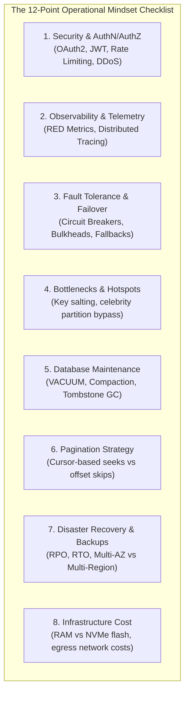
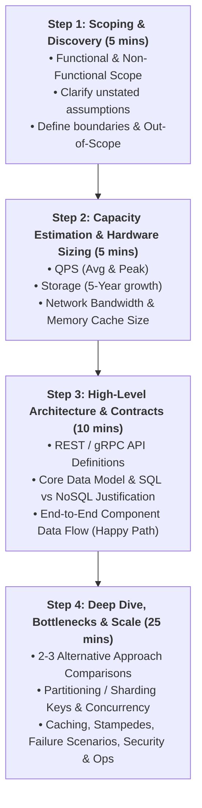

# Chapter 03: The Staff-Level System Design Interview Framework & 5-Pillar Assessment Rubric

## Guarantees and assumptions
For each mutation API, define the commit point, durable store, retry identity and recovery path. Use the workload and failure model to choose components.
**Principal IC exercise:** Choose one ambiguous timeout in your design and specify the recovery owner, reconciliation evidence, and business-visible outcome.

**Sources & Foundational References:**
- [The System Design Primer (Donne Martin)](https://github.com/donnemartin/system-design-primer#how-to-approach-a-system-design-interview-question)
- [System Design Interview – An Insider's Guide (Alex Xu, Vol 1 & 2)](https://bytebytego.com/)
- [Staff & Principal Engineering Interview Rubrics (Google, Meta, Stripe, Uber)](https://www.hellointerview.com/)

---

## 1. Executive Framing: What Interviewers Actually Evaluate

In Junior and Mid-level (L4/L5) interviews, success is often measured by whether the candidate can assemble standard boxes on a whiteboard (Load Balancer $\to$ Web App $\to$ Database $\to$ Cache). 

In **Staff, Principal, and Senior Staff (L6/L7+, P60/P70)** interviews, drawing boxes is table stakes. Interviewers evaluate candidates against a rigorous **5-Pillar Assessment Rubric**:

```
┌────────────────────────────────────────────────────────────────────────────────────────────────┐
│                        THE STAFF-LEVEL 5-PILLAR EVALUATION RUBRIC                              │
├────────────────────────────────┬───────────────────────────────────────────────────────────────┤
│ Pillar                         │ What the Interviewer is Evaluating (Evidence)                 │
├────────────────────────────────┼───────────────────────────────────────────────────────────────┤
│ 1. Decision Making             │ • Clarifies requirements before committing to architecture    │
│                                │ • Compares 2–3 credible approaches at a high level            │
│                                │ • Selects and justifies one; explicitly names accepted        │
│                                │   tradeoffs; revisits choices as constraints change           │
├────────────────────────────────┼───────────────────────────────────────────────────────────────┤
│ 2. Technical Proficiency       │ • Concise, accurate technology explanations linked to         │
│                                │   constraints and access patterns (SQL vs NoSQL)              │
│                                │ • Explains internal mechanisms when asked; avoids slogans/    │
│                                │   buzzwords ("we just use Kafka" is an automatic red flag)     │
├────────────────────────────────┼───────────────────────────────────────────────────────────────┤
│ 3. Problem Solving &           │ • Breaks the problem into logical modular components          │
│    Analytical Thinking         │ • Elicits functional & non-functional requirements            │
│                                │ • Identifies unstated assumptions; connects APIs, data models,│
│                                │   workflows, and scale                                        │
│                                │ • Estimates capacity with explicit inputs, formulas, and units│
├────────────────────────────────┼───────────────────────────────────────────────────────────────┤
│ 4. Operational Mindset         │ • Independently raises security, observability (metrics, logs,│
│                                │   traces), reliability, scalability, bottlenecks, failures,   │
│                                │   blast radius, cost, pagination, testing, and DB operations  │
│                                │ • Evaluates mitigations realistically against the problem     │
├────────────────────────────────┼───────────────────────────────────────────────────────────────┤
│ 5. Adaptability &              │ • Responds constructively to new constraints / pushbacks      │
│    Collaboration               │ • Unblocks reasoning and communicates clearly to leadership   │
│                                │ • Balances immediate MVP scope with long-term extensibility   │
└────────────────────────────────┴───────────────────────────────────────────────────────────────┘
```

> [!IMPORTANT]
> **Staff Engineer Rule:** The interview is not a presentation or a monologue; it is a **collaborative design session with a peer Staff Engineer**. Your goal is to guide the discussion, surface technical trade-offs transparently, and lead the architecture toward production reality.

---

## 2. Time Management: The 45-Minute Interview Roadmap

A classic pitfall for senior candidates is getting bogged down in edge cases early and running out of time before addressing scale, operations, and trade-offs.

```
┌─────────────────────────────────────────────────────────────────────────┐
│                    THE 45-MINUTE TIME BUDGET                            │
├──────────────┬────────────────────────┬─────────────────────────────────┤
│ Time Elapsed │ Phase                  │ Primary Objective               │
├──────────────┼────────────────────────┼─────────────────────────────────┤
│ 00:00–05:00  │ 1. Scoping & Discovery │ Clarify Functional/Non-Func     │
│              │    (Pillars 1, 3, 5)   │ Requirements & Boundaries       │
├──────────────┼────────────────────────┼─────────────────────────────────┤
│ 05:00–10:00  │ 2. Back-of-the-Envelope│ Establish Scale, QPS, Storage,  │
│              │    (Pillar 3)          │ Bandwidth & Cache Footprint     │
├──────────────┼────────────────────────┼─────────────────────────────────┤
│ 10:00–18:00  │ 3. High-Level Design   │ API Contracts, Data Model,      │
│              │    (Pillars 1, 2, 3)   │ Core Component Flow (MVP)       │
├──────────────┼────────────────────────┼─────────────────────────────────┤
│ 18:00–35:00  │ 4. Deep Dive & Scaling │ Bottlenecks, Sharding, Caching, │
│              │    (Pillars 1, 2, 4)   │ Concurrency, Hard Problems      │
├──────────────┼────────────────────────┼─────────────────────────────────┤
│ 35:00–45:00  │ 5. Operational Reality │ Observability, Failures, Cost,  │
│              │    & Evolution (4, 5)  │ Curveballs, Future Extensibility│
└──────────────┴────────────────────────┴─────────────────────────────────┘
```

---

## 3. Deep-Dive: Mastering the 5 Pillars in Real Dialogues

### Pillar 1: Decision Making (Trade-Off Articulation)
Mid-level engineers pick a technology because *"it's popular"* or *"Netflix uses it"*. Staff Engineers pick a technology because **its specific access pattern and failure modes match the application constraints**.

#### What Evaluators Look For:
1. **Never commit without alternatives:** When choosing between two core architectures (e.g., Fanout-on-Write vs Fanout-on-Read; Relational vs Document Store; Kafka vs SQS), always present **2 to 3 credible options**.
2. **Explicitly state accepted downsides:** Every choice has an architectural tax. State it proactively:
   > *"I am choosing Cassandra for writes because our write QPS is 200,000 and we need masterless uptime. However, the trade-off I am consciously accepting is that we forfeit cross-entity ACID transactions and range queries across non-clustering keys, requiring us to denormalize into secondary query tables."*
3. **Revisit choices as constraints shift:** If the interviewer says: *"What if the write volume drops by 90% but we now require multi-statement accounting balance consistency?"*, immediately pivot:
   > *"Under those constraints, a masterless NoSQL store is the wrong tool. I would replace Cassandra with PostgreSQL with read replicas or CockroachDB to guarantee serializable ACID."*

---

### Pillar 2: Technical Proficiency (Mechanics Over Slogans)
Avoid slogans. Anyone can say *"we cache it in Redis"* or *"we put a Kafka queue in front of it"*. A Staff Engineer explains **how the physics of the system work**.

```
┌────────────────────────────────────────────────────────────────────────┐
│                        SLOGAN VS. PROFICIENCY                          │
├───────────────────────────────────┬────────────────────────────────────┤
│ Junior / Slogan Response          │ Staff-Level Mechanical Response    │
├───────────────────────────────────┼────────────────────────────────────┤
│ "We use Redis for caching."       │ "We use Redis as a Cache-Aside     │
│                                   │  layer using packed Hashes (HSET)  │
│                                   │  to minimize pointer overhead. We  │
│                                   │  apply an allkeys-lru eviction     │
│                                   │  policy with randomized TTL jitter │
│                                   │  to prevent cache stampedes."      │
├───────────────────────────────────┼────────────────────────────────────┤
│ "We put it in a relational DB."   │ "We use PostgreSQL with a B+ Tree  │
│                                   │  composite index on (user_id,      │
│                                   │  created_at DESC) so chronological │
│                                   │  feed queries perform an index-only│
│                                   │  sequential leaf page scan without │
│                                   │  hitting table heap pages."        │
├───────────────────────────────────┼────────────────────────────────────┤
│ "Kafka handles the messaging."    │ "We partition Kafka by customer_id │
│                                   │  to preserve strict per-account    │
│                                   │  FIFO order, sizing partitions to  │
│                                   │  keep consumer group lag under     │
│                                   │  5,000 ms during traffic spikes."  │
└───────────────────────────────────┴────────────────────────────────────┘
```

#### Core Mechanics Candidates Must Be Able to Explain:
* **Storage Engines:** B+ Tree (read-optimized, in-place random writes, page splits) vs. LSM-Tree (write-optimized, append-only WAL + MemTable, SSTables, background compaction, Bloom filters).
* **Isolation Levels:** Read Committed vs Repeatable Read vs Serializable; anomalies like Dirty Reads, Non-repeatable Reads, Phantom Reads, and Write Skew.
* **Network & Sockets:** HTTP/1.1 pipelining vs HTTP/2 multiplexing vs WebSockets vs gRPC (HTTP/2 framing + Protocol Buffers); Linux `epoll` socket scalability.
* **Consistency Models:** Linearizability (Strict Serializability via TrueTime/Paxos) vs Sequential Consistency vs Causal Consistency (Vector Clocks) vs Eventual Consistency (LWW).

---

### Pillar 3: Problem Solving & Analytical Thinking (Structure & Sizing)
A Staff Engineer approaches an ambiguous problem by methodically decomposing it into clean, isolated subsystems.

#### 1. Requirements Scoping Checklist
Always bifurcate requirements immediately:
* **Functional Requirements (The Core Product):**
  * What are the 2–3 mission-critical user workflows?
  * What is explicitly **out of scope** for the 45-minute discussion?
* **Non-Functional Requirements (The Operational Contract):**
  * **Scale:** Daily Active Users (DAU), Peak QPS.
  * **Latency:** Read p99 SLA (e.g. $< 100\text{ ms}$), Write p99 SLA.
  * **Availability:** $99.99\%$ (Four Nines $= 52\text{ min/year}$ downtime) vs $99.999\%$ (Five Nines).
  * **Consistency:** Strict Consistency (Financial Ledger / Booking) vs Eventual Consistency (Feed / Social Likes).
  * **Data Retention:** 30 days vs 5 years vs forever; compliance (GDPR right to be forgotten).

#### 2. The Estimation Template (Explicit Inputs & Units)
Never throw out random numbers without stating the formula:

$$\text{Throughput (QPS)} = \frac{\text{Total Requests per Day}}{86,400\text{ seconds}} \approx \frac{\text{Total Requests}}{100,000} \text{ (Conservative napkin math)}$$

$$\text{Peak QPS} = \text{Average QPS} \times \text{Peak Factor (2x to 5x)}$$

$$\text{Storage Footprint} = \text{Daily Writes} \times \text{Average Payload Size} \times 365 \times \text{Retention Years} \times \text{Replication Factor (3x)}$$

$$\text{Bandwidth Ingress} = \text{Write QPS} \times \text{Write Payload Size}$$

$$\text{Bandwidth Egress} = \text{Read QPS} \times \text{Read Payload Size}$$

$$\text{Cache Sizing (Pareto 80/20)} = 20\% \times (\text{Daily Read Requests} \times \text{Item Size})$$

---

### Pillar 4: Operational Mindset (Production Reality)
Junior candidates treat systems as static diagrams that run in a happy path forever. Staff Engineers design systems that survive **catastrophic real-world failures, partial outages, and operational toil**.



#### The Staff Operational Arsenal:
1. **Security & Identity:** Where does TLS terminate? How are APIs authenticated (JWT at Edge Gateway)? How are malicious payloads sanitized?
2. **Observability (The RED & USE Methods):**
   * **RED:** Rate (req/sec), Errors (count/sec), Duration (p50, p95, p99 latency).
   * **USE:** Utilization (% busy), Saturation (queue depth), Errors.
3. **Graceful Degradation (Circuit Breakers & Bulkheads):** If the ML ranking recommendation service times out, does the feed crash with HTTP 500? No! Fall back to a cached chronological feed.
4. **Data Pagination:** Never use SQL `OFFSET / LIMIT` for large datasets ($O(N)$ scan overhead). Always implement **keyset/cursor pagination** (`WHERE id > :last_seen_id ORDER BY id ASC LIMIT 20`).
5. **Database Maintenance:** LSM-Trees need compaction budgeting; Postgres requires VACUUM tuning; Cassandra requires tombstone garbage collection (`gc_grace_seconds`).

---

### Pillar 5: Adaptability & Collaboration (Handling Curveballs)
Interviewers frequently throw unexpected curveballs midway through the design:
* *"The marketing team just announced an influencer with 80M followers is joining the platform tomorrow."*
* *"Cross-datacenter WAN latency between US and Europe is spiking to 300ms."*
* *"Cloud infrastructure budget was slashed by 60%."*

#### How a Staff Engineer Responds:
* **Stay calm and unblock reasoning:** Do not panic or defend your original diagram defensively. Treat the curveball as a welcome engineering constraint.
* **Identify the bottleneck created by the new constraint:**
  > *"An 80M-follower user breaks our Fanout-on-Write model because writing one tweet generates 80 million Redis push updates, creating a multi-minute write queue backup."*
* **Propose a hybrid architectural pivot:**
  > *"To adapt, we implement **Celebrity Fanout Bypass**: Users with $> 50,000$ followers are excluded from the write-fanout pipeline. When their followers open their feed, their timeline service dynamically fetches the celebrity's recent tweets and merges them in memory at read time."*

---

## 4. The Unified 4-Step Interview Execution Playbook

Combining the best of **Alex Xu's structured flow**, **Donne Martin's analytical rigor**, and the **5-Pillar Staff Rubric**:



---

## 5. Candidate Mistakes vs. Staff-Level Demonstrations

| Trap / Anti-Pattern | Junior / Mid-Level Behavior | Staff-Level Demonstration |
| :--- | :--- | :--- |
| **Premature Solutioning** | Starts drawing boxes and picking technologies within 60 seconds of hearing the problem prompt. | Spends the first 5 minutes clarifying scope, query access patterns, SLAs, and data retention before placing a single box. |
| **Technology Brand-Dropping** | "I will use Kafka, MongoDB, and ElasticSearch because they scale really well." | Explains *why* the access pattern demands the technology: "We use an inverted index (Elasticsearch) because queries filter across 15 arbitrary dynamic attributes." |
| **Ignoring the Read/Write Asymmetry** | Treats reads and writes with identical architecture. | Decouples read and write paths immediately: CQRS, read replicas, cache-aside for 100:1 reads; append-only write buffering for write spikes. |
| **Assuming Hardware is Infinite** | Caches everything in RAM forever without sizing calculations or eviction policies. | Calculates 80/20 cache size, calculates RAM cost, specifies LRU eviction, and budgets cache warming. |
| **Silent Failure Blindspot** | Designs an architecture that assumes networks never partition and nodes never crash. | Details failure modes: leader election delays, dead letter queues (DLQs), idempotent retries, circuit breakers, and rate limiting. |
| **Defensive Arguing** | Argues with the interviewer when a flaw is pointed out. | Welcomes feedback constructively: "That's a great edge case. Here are two ways we can mitigate that race condition..." |

---

## 6. Master Interview Readiness Checklist

Before walking into any Staff-level system design interview, verify you can execute all 5 pillars:

- [ ] **Pillar 1 (Decision Making):** Can I compare at least 2 architectures for every core component (e.g. Polling vs SSE vs WebSockets; 2PC vs Sagas; B+ Tree vs LSM; Push vs Pull CDN) and state accepted trade-offs?
- [ ] **Pillar 2 (Technical Proficiency):** Can I explain the internal mechanics of database indexes, replication lag, clock skew, and partition rebalancing without hand-waving?
- [ ] **Pillar 3 (Problem Solving):** Can I perform back-of-the-envelope calculations with explicit units, powers of two, and convert QPS to daily/monthly volume in 3 minutes?
- [ ] **Pillar 4 (Operational Mindset):** Did I mention security (auth/TLS), observability (RED metrics), failure mitigation (circuit breakers/DLQ), and database maintenance (vacuum/compaction)?
- [ ] **Pillar 5 (Adaptability):** Can I calmly handle curveballs and design pivots when the interviewer changes the scale, latency, or consistency requirements?
