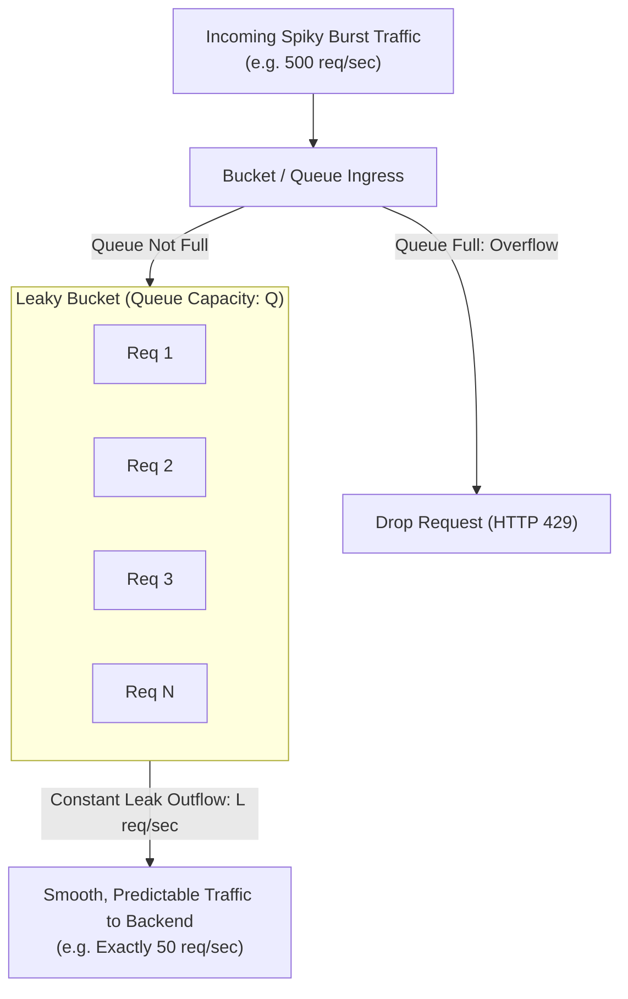
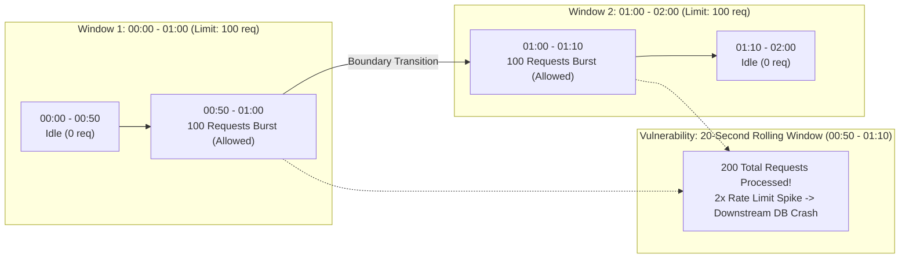
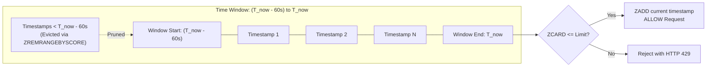
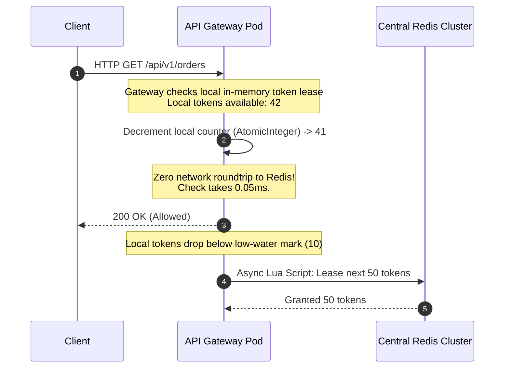
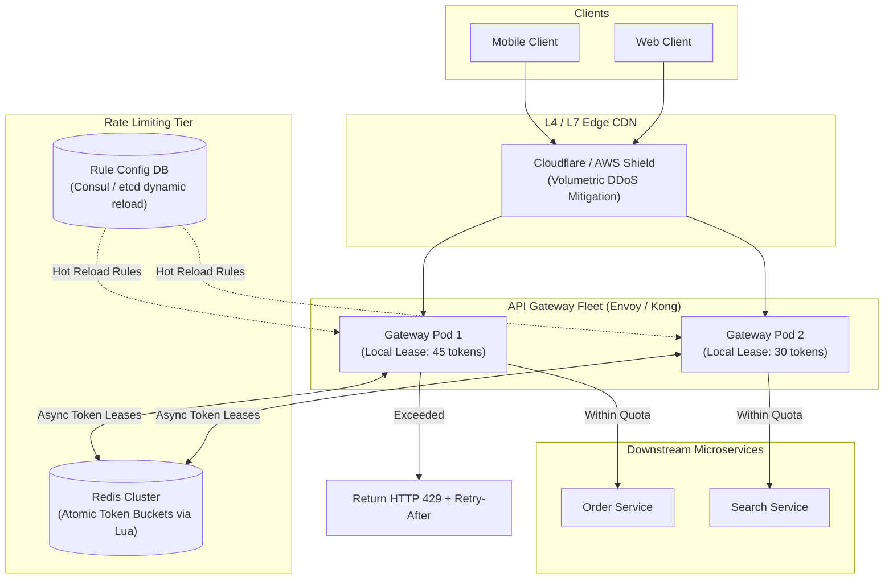

# Chapter 04: Design an API Rate Limiter (Production & Edge Gateway)

---

## 1. Executive Interview Framing & Staff-Level Bar

Rate limiting is an omnipresent infrastructure building block required in almost every distributed system. Because junior and senior engineers can readily describe the Token Bucket algorithm, **Staff and Principal Engineers (L6+, P60) are evaluated on their ability to eliminate Redis network roundtrip bottlenecks via Token Leasing, write production-grade atomic Redis Lua scripts, design multi-tier rate limiting defenses (L4 Edge to L7 Application), implement jittered client retry protocols, and handle distributed clock drift**:

```
┌────────────────────────────────────────────────────────────────────────────────────────┐
│                                 THE INTERVIEW SPECTRUM                                 │
├────────────────────────────────────────┬───────────────────────────────────────────────┤
│ L5 / Senior Engineer                   │ L6+ / Staff & Principal Engineer              │
├────────────────────────────────────────┼───────────────────────────────────────────────┤
│ • Mentions Token Bucket or Leaky Bucket│ • Mathematical derivation of all 5 algorithms │
│ • "Just query Redis on every request"  │ • Local in-memory Token Leasing / Batching to │
│ • Standard 429 Too Many Requests       │   eliminate 95% of Redis network hops         │
│ • Ignores concurrent race conditions   │ • Production atomic Redis Lua scripts         │
│ • Ignores clock drift across nodes     │ • Multi-tier defense (Cloudflare L4 -> Envoy  │
│ • Ignores client thundering herds      │   L7 -> Per-tenant Application limits)        │
│                                        │ • Exponential Backoff with Full Jitter SDKs   │
│                                        │ • RateLimit RFC headers & Soft vs Hard caps   │
└────────────────────────────────────────┴───────────────────────────────────────────────┘
```

---

## 2. The 5-Pillar Staff Assessment Rubric for Rate Limiting

```
┌────────────────────────────────────────────────────────────────────────────────────────────────────────┐
│                                      5-PILLAR EVALUATION RUBRIC                                        │
├─────────────────────────┬──────────────────────────────────────────────────────────────────────────────┤
│ Pillar                  │ What the Interviewer Listens For (Evidence)                                  │
├─────────────────────────┼──────────────────────────────────────────────────────────────────────────────┤
│ 1. Decision Making      │ • Edge Gateway (Envoy/Cloudflare) vs App Middleware vs Dedicated Service.    │
│                         │ • In-Memory Token Leasing vs Centralized Redis on every request.             │
│                         │ • Token Bucket vs Sliding Window Counter vs Leaky Bucket based on traffic.   │
├─────────────────────────┼──────────────────────────────────────────────────────────────────────────────┤
│ 2. Technical            │ • Atomic Redis Lua scripts (`EVALSHA`) to eliminate concurrent race conditions│
│    Proficiency          │ • Local in-memory token leasing ($B = 100$ tokens) eliminating 95% of RTTs.  │
│                         │ • NTP clock drift handling via Redis server-side time (`redis.call('TIME')`).│
├─────────────────────────┼──────────────────────────────────────────────────────────────────────────────┤
│ 3. Problem Solving &    │ • Decomposes rate limiting into L4 (DDoS), L7 (Gateway), and Tenant tiers.   │
│    Analytical Thinking  │ • Calculates memory footprint ($100\text{M keys} \times 24\text{ bytes}       │
│                         │   \approx 2.4\text{ GB RAM}$) and network bandwidth overhead.                │
├─────────────────────────┼──────────────────────────────────────────────────────────────────────────────┤
│ 4. Operational          │ • Fail-Open (preserve customer revenue) vs Fail-Closed (protect auth/login). │
│    Mindset              │ • Returns standard RFC headers (`RateLimit-Remaining`, `Retry-After`).       │
│                         │ • Mandates Exponential Backoff with Full Jitter on client SDKs.              │
├─────────────────────────┼──────────────────────────────────────────────────────────────────────────────┤
│ 5. Adaptability &       │ • Mitigates sudden bot waves without throttling legitimate active users.     │
│    Collaboration        │ • Balances strict enforcement with VIP enterprise tenant quota overrides.    │
│                         │ • Communicates rate-limiting degradation policies clearly to partner teams.  │
└─────────────────────────┴──────────────────────────────────────────────────────────────────────────────┘
```

---

## 3. Requirements & System Scope

### Functional Requirements
1. **Accurate Throttling:** Limit requests based on client IP, authenticated User ID, API Key, or internal tenant tier.
2. **Low Latency Overhead:** Rate limiting checks must add $< \mathbf{2ms}$ of overhead to the request path.
3. **Informative HTTP Headers:** Return standard RFC headers informing clients of remaining quota and reset timestamps (`X-RateLimit-Remaining`, `Retry-After`).
4. **Multi-Tier Rule Configuration:** Support configurable rules across different endpoints (e.g., `/auth/login`: 5 req/min; `/search`: 100 req/min).
5. **Graceful Failure (Fail-Open vs Fail-Closed):** If the rate limiter infrastructure degrades, default to allowing legitimate traffic rather than taking down production.

### Non-Functional Requirements (SLAs & SLOs)
* **Scale:** Handle **1 Million QPS** global ingress traffic.
* **Fault Tolerance:** Distributed rate limiter nodes must not become a single point of failure (SPOF).
* **Minimal Memory Footprint:** Efficient counter structures supporting 100 Million active client keys within modest RAM bounds.

---

## 3. Deep Dive into the 5 Rate Limiting Algorithms

```
┌────────────────────────────────────────────────────────────────────────────────────────┐
│                                ALGORITHM TRADEOFF MATRIX                               │
├─────────────────────┬──────────────────┬──────────────────┬────────────────────────────┤
│ Algorithm           │ Memory Overhead  │ Burst Tolerance  │ Staff Engineering Verdict  │
├─────────────────────┼──────────────────┼──────────────────┼────────────────────────────┤
│ 1. Token Bucket     │ Minimal          │ Excellent        │ RECOMMENDED for general    │
│                     │ (2 numbers/key)  │ (Allows burst up │ APIs (AWS, Stripe). Simple │
│                     │                  │ to bucket capacity) to tune, highly optimal.  │
├─────────────────────┼──────────────────┼──────────────────┼────────────────────────────┤
│ 2. Leaky Bucket     │ Low              │ Zero burst       │ Ideal for steady-rate      │
│                     │ (FIFO Queue)     │ (Smoothed stable │ egress dispatch (e.g. push │
│                     │                  │ outflow rate)    │ notifications to Twilio).  │
├─────────────────────┼──────────────────┼──────────────────┼────────────────────────────┤
│ 3. Fixed Window     │ Extremely Low    │ Flawed at edges  │ Unacceptable for public    │
│    Counter          │ (1 integer/key)  │ (2x burst spike  │ APIs; allows 2x limit at   │
│                     │                  │ across boundary) │ boundary transitions.      │
├─────────────────────┼──────────────────┼──────────────────┼────────────────────────────┤
│ 4. Sliding Window   │ CATASTROPHIC     │ Perfect          │ Prohibitive memory cost    │
│    Log              │ (Stores every    │ (Zero boundary   │ ($O(N)$ memory). Unusable  │
│                     │ timestamp)       │ spikes)          │ for high-traffic APIs.     │
├─────────────────────┼──────────────────┼──────────────────┼────────────────────────────┤
│ 5. Sliding Window   │ Minimal          │ Excellent        │ RECOMMENDED for strict     │
│    Counter          │ (2 counters/key) │ (Weighted memory │ rolling windows (Cloudflare│
│                     │                  │ approximation)   │ style). Low memory footprint│
└─────────────────────┴──────────────────┴──────────────────┴────────────────────────────┘
```

---

### Algorithm 1: Token Bucket (The Gold Standard)
* **Parameters:** Bucket Capacity ($B$), Refill Rate ($R$ tokens/second).
* **Mechanics:**
  - Instead of running a background cron timer to add tokens every millisecond (which burns massive CPU), **calculate refills lazily on request arrival**:
    $$\text{Tokens to Add} = (\text{Current Time} - \text{Last Refill Time}) \times R$$
    $$\text{Current Tokens} = \min(B, \text{Stored Tokens} + \text{Tokens to Add})$$
  - If $\text{Current Tokens} \ge 1$: Decrement 1 token, update `Last Refill Time = Current Time`, and **ALLOW** request.
  - Else: **REJECT** request with HTTP `429 Too Many Requests`.

---

### Algorithm 2: Leaky Bucket (Traffic Shaping & Smooth Outflow)
* **Parameters:** Bucket Capacity ($Q$, queue size), Leak/Processing Rate ($L$ requests/second).
* **Mechanics:**
  - Requests enter a FIFO queue (the "bucket").
  - A background processor or consumer pulls requests from the queue at a constant, fixed rate ($L$ req/sec).
  - If the queue is full when a new request arrives, the request overflows and is dropped (**REJECT** with HTTP `429 Too Many Requests`).
  - *Alternative (Virtual Leaky Bucket / Meter without Queuing):* Track dynamic water level lazily without maintaining an actual queue in memory:
    $$\text{Water Level} = \max\big(0, \text{Stored Water} - (\text{Current Time} - \text{Last Leak Time}) \times L\big)$$
    $$\text{If } \text{Water Level} + 1 \le Q \implies \text{ALLOW and update } \text{Water Level} = \text{Water Level} + 1$$



* **Staff Tradeoffs & Real-World Use Cases:**
  - **Pros:** Guarantees a perfectly stable, constant-rate outflow. Completely prevents downstream database connection starvation and protects legacy systems that cannot handle bursts.
  - **Cons:** Bursts are delayed rather than executed immediately. If the queue fills up with slow requests, fresh requests face queue latency (head-of-line blocking).
  - **Production Use Case:** Egress traffic shaping (e.g. Uber's `uber-go/ratelimit`, or dispatching SMS notifications to third-party APIs like Twilio/Stripe that enforce strict hard limits).

---

### Algorithm 3: The Fixed Window Edge Flaw (The 2x Spike)
Why Staff engineers reject Fixed Window Counters in high-stakes interviews:
* Rule: 100 requests per minute.
* An attacker sends 100 requests between `00:50` and `01:00` (allowed in Window 1).
* The attacker sends another 100 requests between `01:00` and `01:10` (allowed in Window 2).
* **The Vulnerability:** 200 requests were processed within a 20-second rolling window — **double the allowed limit** — causing downstream backend database saturation!



---

### Algorithm 4: Sliding Window Log (Exact Timestamp Precision)
* **Parameters:** Window Size ($W$ seconds, e.g. 60s), Limit ($L$ requests, e.g. 100 req).
* **Mechanics (Redis Sorted Set `ZSET`):**
  - Track every individual request timestamp as a member in a Redis Sorted Set (`ZSET`).
  - When a request arrives at timestamp $T_{\text{now}}$:
    1. **Prune Expired Entries:** Remove all timestamps older than the sliding window start:
       `ZREMRANGEBYSCORE key -inf (T_now - W)`
    2. **Count Active Requests:** Query the cardinality of the remaining set:
       `count = ZCARD key`
    3. **Evaluate Limit:**
       - If $\text{count} < L$: Add current request to log via `ZADD key T_now T_now:<req_id>`, set `EXPIRE key W`, and **ALLOW** request.
       - If $\text{count} \ge L$: **REJECT** request with HTTP `429 Too Many Requests`.



* **Staff Tradeoffs & Real-World Use Cases:**
  - **Pros:** 100% mathematical precision. Completely eliminates the Fixed Window 2x boundary spike and avoids the approximation errors of Sliding Window Counters.
  - **Cons:** **Catastrophic Memory Overhead ($O(N)$)**. Storing 64-bit epoch timestamps for every request across millions of users consumes tens of gigabytes of RAM in Redis. Even rejected requests may consume memory if added before checking.
  - **Production Use Case:** Low-throughput, high-security endpoints (e.g., banking transfer limits, password reset attempts, or enterprise fraud protection) where strict mathematical adherence is required and request volumes are modest.

---

### Algorithm 5: Sliding Window Counter (Memory-Efficient Approximation)
* Calculates a weighted average between the previous window and the current window:
  $$\text{Requests in Current Window} = \text{Current Count} + \text{Previous Count} \times (1 - \text{Overlap Ratio})$$
* **Example:**
  - Window size: 1 minute. Limit: 100 requests.
  - Previous minute count: 80 requests.
  - Current minute has reached 30 seconds (50% through the window). Current count: 30 requests.
  - Estimated requests in rolling 60s:
    $$\text{Estimate} = 30 + 80 \times (1 - 0.5) = 30 + 40 = 70 \text{ requests}$$
  - Since $70 < 100$, the request is permitted.
* **Memory:** Requires only 2 integer counters per client key!

---

## 4. Production Redis Lua Script (Atomic Execution)

In a distributed environment, executing `GET counter` followed by `INCR counter` from application servers introduces a classic **Check-Then-Act Race Condition**. Two concurrent requests reading counter value 99 will both increment to 100, allowing both through and violating the limit.

By executing the logic inside a **Redis Lua Script**, Redis guarantees strict atomicity because Lua scripts execute as an uninterrupted single transaction:

```lua
-- KEYS[1]: Rate limit key (e.g., "ratelimit:user_102")
-- ARGV[1]: Max tokens / capacity (e.g., 100)
-- ARGV[2]: Refill rate in tokens per second (e.g., 10)
-- ARGV[3]: Current epoch timestamp in seconds
-- ARGV[4]: Requested tokens (usually 1)

local key = KEYS[1]
local capacity = tonumber(ARGV[1])
local refill_rate = tonumber(ARGV[2])
local now = tonumber(ARGV[3])
local requested = tonumber(ARGV[4])

-- Fetch current state: [tokens, last_refilled]
local data = redis.call("HMGET", key, "tokens", "last_refilled")
local current_tokens = tonumber(data[1])
local last_refilled = tonumber(data[2])

if current_tokens == nil then
    current_tokens = capacity
    last_refilled = now
else
    -- Lazy refill calculation
    local elapsed = math.max(0, now - last_refilled)
    local tokens_to_add = elapsed * refill_rate
    current_tokens = math.min(capacity, current_tokens + tokens_to_add)
    last_refilled = now
end

if current_tokens >= requested then
    current_tokens = current_tokens - requested
    redis.call("HMSET", key, "tokens", current_tokens, "last_refilled", last_refilled)
    redis.call("EXPIRE", key, math.ceil(capacity / refill_rate) * 2)
    return {1, math.floor(current_tokens)} -- Allowed
else
    return {0, math.floor(current_tokens)} -- Rejected
end
```

---

## 5. Architectural Deep Dives: Staff & SDFC Insights

### 5.1 Eliminating the Redis Network Bottleneck: Local Token Leasing

A major system design vulnerability: *"Every single incoming HTTP request calls Redis."*
* **The Problem:**
  - At **1,000,000 QPS**, calling Redis on every request requires 1M network roundtrips per second.
  - Even over low-latency AWS VPC links (1ms RTT), network socket overhead and context switches degrade API gateway throughput.
* **The Staff Solution: Token Leasing / Batch Decrementing**
  - Gateway pods do not ask Redis for 1 token at a time.
  - A gateway pod requests a **Batch Lease** (e.g. 50 tokens at once) from Redis:
    ```
    Gateway Node 1 acquires 50 tokens from Redis.
    Gateway Node 1 decrements locally in memory (AtomicInteger).
    ```
  - Subsequent 49 requests are rate-limited in **0 milliseconds in local RAM** with zero network chatter!
  - When the local lease drops below 10 tokens, the gateway asynchronously fetches the next batch.
  - *Tradeoff:* In the worst case of a sudden gateway crash, at most 50 tokens are lost (a tiny, acceptable price for eliminating 98% of Redis traffic!).



---

### 5.2 Multi-Tier Rate Limiting Architecture (Defense in Depth)

A production rate limiter is never a single monolithic filter. It is structured into multiple defensive layers:

```
[Layer 1: Edge CDN (Cloudflare / AWS CloudFront)]
  - IP-based DDoS mitigation
  - Geo-blocking & volumetric syn-flood filtering
          │
          ▼
[Layer 2: API Gateway Tier (Envoy Proxy / NGINX)]
  - Client API Key / Global IP token bucket (e.g., 5,000 req/sec)
  - Coarse-grained service protection
          │
          ▼
[Layer 3: Application & Per-Tenant Service Tier]
  - Granular business logic throttling
  - B2B Tenant Tiering (Enterprise vs Standard vs Free)
  - Critical endpoint defense (/login: 5/min, /checkout: 10/min)
```

---

### 5.3 Client-Side SDK Integration: Exponential Backoff with Full Jitter

When a rate limiter returns `HTTP 429 Too Many Requests`, an aggressive client will immediately retry, creating an amplified **Retry Storm** that exacerbates the outage.

The client SDK must enforce **Full Jitter Exponential Backoff**:

```python
import time
import random

def request_with_retry(url, max_retries=5, base_delay=1.0, max_delay=32.0):
    for attempt in range(max_retries):
        response = http.get(url)
        if response.status_code != 429:
            return response
            
        # Extract Retry-After header if present, else calculate jittered backoff
        retry_after = response.headers.get("Retry-After")
        if retry_after:
            sleep_duration = float(retry_after)
        else:
            # Exponential backoff ceiling
            temp = min(max_delay, base_delay * (2 ** attempt))
            # Full Jitter formula: uniform distribution between 0 and temp
            sleep_duration = random.uniform(0, temp)
            
        time.sleep(sleep_duration)
        
    raise Exception("Max rate limit retries exceeded")
```

---

### 5.4 Standard HTTP Response Headers (RFC 6585)

Always communicate rate limit state transparently to clients:

```http
HTTP/1.1 429 Too Many Requests
Content-Type: application/json
Retry-After: 35
X-RateLimit-Limit: 100
X-RateLimit-Remaining: 0
X-RateLimit-Reset: 1774345260

{
  "error": "RATE_LIMIT_EXCEEDED",
  "message": "Quota exceeded. Please retry after 35 seconds.",
  "retry_after_seconds": 35
}
```

---

## 6. End-to-End System Architecture



---

## 7. Edge Cases, Failure Modes & Operational Realities

### 7.1 Redis Cluster Node Outage (Fail-Open vs Fail-Closed)
* **The Dilemma:** Redis experiences a failover in `us-east-1` and is unreachable for 3 seconds. Does the rate limiter block all traffic or allow it through?
* **The Staff Decision:**
  - **Non-Financial / Standard APIs:** **Fail Open**. Log an alert and allow requests through to protect core availability. Uptime is more important than strict rate adherence.
  - **High-Risk Financial / Auth Endpoints (`/login`, `/transfer`):** **Fail Closed**. Reject requests to prevent credential stuffing attacks or automated double-spending attempts.

### 7.2 Distributed Clock Skew Across Nodes
* If rate limiting depends on system clocks, clock drift between different application servers (NTP drift) can cause erratic bucket refills.
* **Mitigation:** Rely on **Redis Server Time (`redis.call('TIME')`)** rather than client/application server timestamps inside the Lua script!

---

## 8. Interview Wrap-Up: Staff-Level Decision Matrix

| Problem Space | Junior / Senior Approach | Staff / Principal Approach |
| :--- | :--- | :--- |
| **Algorithm Choice** | Token Bucket or Fixed Window | **Token Bucket for general APIs; Sliding Window Counter for strict SLA boundaries.** |
| **Concurrency** | Separate `GET` and `INCR` in app | **Atomic Redis Lua Script:** Guarantees atomic check-and-decrement. |
| **High QPS Overhead**| 1 Redis call per HTTP request | **In-Memory Token Leasing:** Gateway batches 50 tokens locally; eliminates 95% of Redis roundtrips. |
| **Client Retry Logic**| Immediate retry on 429 | **Full Jitter Exponential Backoff:** Eliminates retry storms and server thundering herds. |
| **Failure Policy** | Unspecified / system crash | **Configurable Fail-Open vs Fail-Closed Policy:** Fail-open for search; fail-closed for auth/payments. |
| **Clock Consistency**| Server `System.currentTimeMillis()`| **Redis Server Time (`TIME` command):** Prevents distributed NTP clock drift bugs. |
