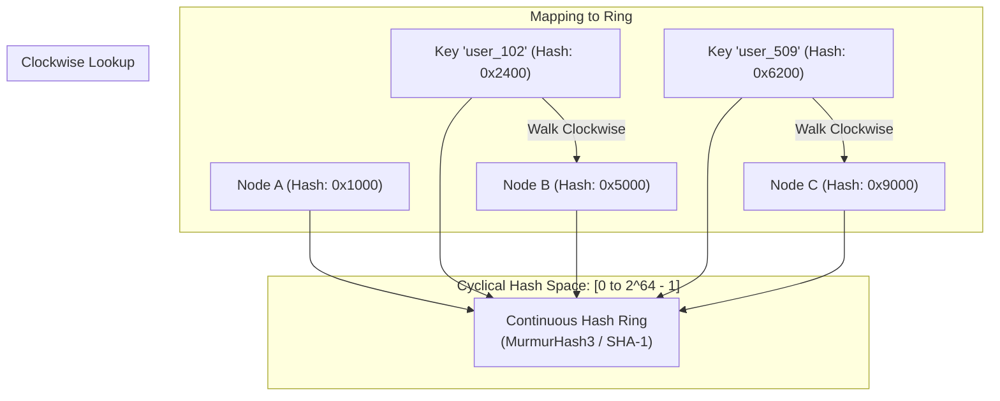
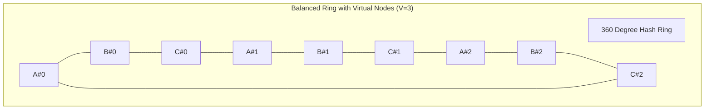
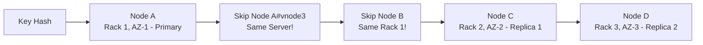
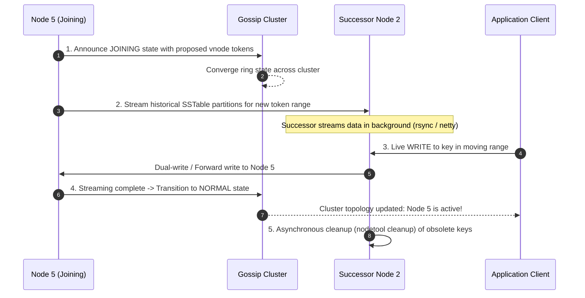

# Chapter 05: Consistent Hashing (Cassandra, DynamoDB, Maglev)

---

## 1. Executive Interview Framing & Staff-Level Bar

Consistent Hashing is the architectural backbone of modern distributed storage, caching tiers, and network load balancers (Amazon DynamoDB, Apache Cassandra, Memcached Ketama, Google Maglev). While junior engineers draw a circle and mention "clockwise lookup", **Staff and Principal Engineers (L6+, P60) are evaluated on their mathematical mastery of virtual node distribution variance, binary search tree lookup mechanics ($O(\log M)$), rack-aware replication traversal, zero-downtime data streaming during ring joins, and $O(1)$ table-based alternatives like Google Maglev**:

```
┌────────────────────────────────────────────────────────────────────────────────────────┐
│                                 THE INTERVIEW SPECTRUM                                 │
├────────────────────────────────────────┬───────────────────────────────────────────────┤
│ L5 / Senior Engineer                   │ L6+ / Staff & Principal Engineer              │
├────────────────────────────────────────┼───────────────────────────────────────────────┤
│ • Basic hash ring modulo circle        │ • Mathematical proof of key redistribution:   │
│ • "Walk clockwise to find server"      │   K/N keys moved vs 100% in modulo hashing    │
│ • Mentions virtual nodes vaguely       │ • Vnode variance math: sigma proportional     │
│ • Ignores replication across racks     │   to 1/sqrt(V); heterogeneous capacity weights│
│ • Ignores lookup data structure        │ • In-memory TreeMap / Binary search O(log M)  │
│ • Ignores live node join data streaming│ • Rack-aware physical node deduplication      │
│                                        │ • Google Maglev O(1) permutation lookup table │
│                                        │ • SSTable streaming & gossip ring updates     │
└────────────────────────────────────────┴───────────────────────────────────────────────┘
```

---

## 2. The 5-Pillar Staff Assessment Rubric for Consistent Hashing

```
┌────────────────────────────────────────────────────────────────────────────────────────────────────────┐
│                                      5-PILLAR EVALUATION RUBRIC                                        │
├─────────────────────────┬──────────────────────────────────────────────────────────────────────────────┤
│ Pillar                  │ What the Interviewer Listens For (Evidence)                                  │
├─────────────────────────┼──────────────────────────────────────────────────────────────────────────────┤
│ 1. Decision Making      │ • Modulo Hashing vs Consistent Hash Ring (Ketama) vs Google Maglev O(1).     │
│                         │ • Jump Consistent Hash for fixed storage vs Cyclical Ring for dynamic tiers. │
│                         │ • Evaluates trade-offs between virtual node count and memory lookup bounds.  │
├─────────────────────────┼──────────────────────────────────────────────────────────────────────────────┤
│ 2. Technical            │ • In-Memory Binary Search ceiling lookup ($O(\log M)$ on Red-Black Tree).    │
│    Proficiency          │ • Virtual node load variance math ($\sigma \propto \frac{1}{\sqrt{V}}$).     │
│                         │ • Rack-aware physical node traversal for replica sets (skipping co-located). │
│                         │ • Zero-downtime data migration streaming during node ring joins.             │
├─────────────────────────┼──────────────────────────────────────────────────────────────────────────────┤
│ 3. Problem Solving &    │ • Mathematical proof of key redistribution: only $K/N$ keys remapped vs 100%.│
│    Analytical Thinking  │ • Balances heterogeneous server capacity weights ($V_i \propto \text{RAM}_i$).│
│                         │ • Models replication across independent failure domains (availability zones).│
├─────────────────────────┼──────────────────────────────────────────────────────────────────────────────┤
│ 4. Operational          │ • Gossip protocol failure detection (Phi Accrual threshold tuning).          │
│    Mindset              │ • Minimizes network churn during split-brain temporary network partitions.   │
│                         │ • Graceful degradation when multiple consecutive nodes on the ring fail.     │
├─────────────────────────┼──────────────────────────────────────────────────────────────────────────────┤
│ 5. Adaptability &       │ • Adapts ring topology to heterogeneous hardware without cluster restart.    │
│    Collaboration        │ • Mitigates sudden celebrity key hotspotting via local key replication.      │
│                         │ • Explains cache miss blast radius clearly to backend and database teams.    │
└─────────────────────────┴──────────────────────────────────────────────────────────────────────────────┘
```

---

## 3. The Rehashing Disaster: Why Modulo Hashing Collapses Production

In a naive distributed caching tier with $N$ servers, keys are mapped to servers using:
$$\text{Server Index} = \text{hash}(\text{key}) \pmod N$$

### The Catastrophic Failure on Scale-Out
Imagine you have $N = 100$ cache servers holding millions of database cache items. You add 1 new server to handle increased traffic ($N = 101$):
* **Percentage of Keys Invalidated:**
  $$\text{Keys Remaining on Same Server} = \frac{1}{100 \times 101} \approx 1\%$$
  $$\text{Keys Re-mapped to Wrong Servers} \approx \mathbf{99\%!}$$
* **The Production Fallout (Cache Stampede):**
  - Instantaneously, 99% of all cache lookups result in cache misses!
  - 100% of incoming production traffic collapses directly onto downstream relational databases.
  - The database experiences connection exhaustion and crashes (**Cascading System Failure**).

### The Consistent Hashing Guarantee
Consistent hashing maps both servers and keys onto a continuous cyclical hash space (e.g. $[0, 2^{32}-1]$ or $[0, 2^{64}-1]$):
* When a node is added or removed, **only $\frac{K}{N}$ keys are redistributed** (where $K$ is total keys, $N$ is number of servers).
* All other $1 - \frac{1}{N}$ keys remain untouched on their original servers!

---

## 3. Core Mechanics & Data Structure Selection



### 3.1 Lookup Data Structure: $O(\log M)$ Binary Search
How does a client or gateway find the target server for `hash(key)` in memory?
* Store all server/virtual node hash positions in a **Self-Balancing Binary Search Tree (Red-Black Tree)** or **Sorted Dynamic Array**:
  - In Java: `TreeMap<Long, Node>`
  - In Go: Sorted slice with `sort.Search()` (binary search)
  - In C++: `std::map<uint64_t, Node>`
* **Lookup Algorithm:**
  1. Calculate $H = \text{hash}(\text{key})$.
  2. Find the smallest server hash $S \ge H$ using binary search ceiling (`std::upper_bound` or `TreeMap.ceilingEntry(H)`).
  3. If $H$ is greater than all server hashes on the ring, wrap around to the first entry in the sorted array (index `0`).
* **Time Complexity:** $\mathbf{O(\log M)}$ where $M = N \times V$ (total virtual nodes). Since $M \approx 50,000$, binary search takes $< \mathbf{16 \text{ comparisons}} \approx \mathbf{0.001\text{ms}}$!

---

## 4. Virtual Nodes (Vnodes) & Load Variance Mathematics

### 4.1 The Flaw of Basic Ring Hashing
When only physical nodes are placed on the ring:
* With $N = 5$ physical servers, the arcs between servers are highly non-uniform.
* One server can easily be assigned an arc covering **70% of the ring**, while another owns only 5%!
* **Hot-Spotting:** Server 2 receives 14x more traffic than Server 4, leading to memory exhaustion and CPU throttling.

### 4.2 The Virtual Node Solution
Instead of placing each physical server once, map each physical server to **$V$ virtual nodes** distributed pseudorandomly across the ring:
$$\text{Virtual Node Hash} = \text{hash}(\text{Server\_IP} + \text{"\#vnode\_"} + i) \quad \text{for } i \in [0, V-1]$$



#### The Variance Formula
The standard deviation $\sigma$ of the fraction of keys assigned to any server is inversely proportional to the square root of the number of virtual nodes:
$$\sigma \propto \frac{1}{\sqrt{V}}$$
* With $V = 100$ vnodes: Key distribution variance drops to $< 10\%$.
* With $V = 256$ vnodes: Key distribution variance drops to $< 5\%$!

#### Heterogeneous Server Capacities
Virtual nodes elegantly solve hardware heterogeneity:
* If Server A has **64 GB RAM** and Server B has **256 GB RAM** (4x capacity):
  - Assign **100 vnodes** to Server A.
  - Assign **400 vnodes** to Server B.
* Server B naturally absorbs exactly 4x more traffic and data without complex manual sharding!

---

## 5. Architectural Deep Dives: Staff & SDFC Insights

### 5.1 Replication on the Ring: Rack & AZ Awareness

In production databases (Cassandra / DynamoDB), data must be replicated to $R = 3$ nodes.
* **The Fatal Junior Mistake:** *"Walk clockwise and store replicas on the next 2 virtual nodes."*
  - Because of virtual nodes, the next 2 virtual nodes on the ring might belong to the **exact same physical server**!
  - Furthermore, all 3 nodes might sit in the same AWS Availability Zone (`us-east-1a`). If that AZ loses power, all replicas are destroyed!
* **The Staff Solution: Rack-Aware Physical Node Deduplication**
  - Walk clockwise from the coordinator node.
  - Maintain a set of visited physical machine IDs and visited Availability Zones / Racks.
  - Select the first $R$ virtual nodes that belong to **distinct physical servers situated in distinct failure domains / racks**.



---

### 5.2 Zero-Downtime Ring Membership Changes (Gossip & State Transfer)

When Node 5 joins a Cassandra ring, how are keys migrated without dropping live traffic?



1. **State Announcement:** The joining node announces `JOINING` via Gossip protocol.
2. **Background Data Streaming:** The node streams historical partition SSTables from predecessor/successor nodes.
3. **Dual-Writing:** In-flight client writes to the affected range are forwarded to both the old owner and the joining node.
4. **Ring Transition:** Once streaming reaches 100%, the node transitions to `NORMAL`.
5. **Lazy Cleanup:** The old owner runs background compaction (`nodetool cleanup`) to reclaim disk space.

---

### 5.3 Google Maglev Hashing: $O(1)$ Lookup Table Alternative

At massive packet-forwarding scales (Google Maglev, Envoy load balancers at 100Gbps network line rates), binary search $O(\log M)$ in a tree is too slow and causes CPU cache misses.

Google Maglev replaces the ring with an **$O(1)$ Fixed Lookup Table of Permutations**:
1. Allocate a lookup table of prime size $M$ (e.g. $M = 65,537$).
2. Each backend server generates a unique pseudo-random permutation sequence across all $M$ slots.
3. Backends fill the table in round-robin fashion until all $M$ slots are populated.
4. **Packet Lookup:**
   $$\text{Target Server} = \text{LookupTable}\big[\text{hash}(\text{packet 5-tuple}) \pmod M\big]$$
5. **Execution:** Instantaneous **$O(1)$ single memory array dereference**! Zero binary search tree walks.

---

## 6. Real-World Applications

* **Amazon DynamoDB & Apache Cassandra:** Partitions partition keys (`PK`) across distributed storage nodes using consistent hashing rings with vnodes.
* **Akamai & Cloudflare CDN:** Distributes cached web assets across edge servers; cache keys stay valid when edge nodes fail.
* **Discord Voice Gateway:** Routes millions of simultaneous voice chat channels to media gateway servers using consistent hashing rings with minimal channel reassignment.
* **Google Maglev & Envoy Proxy:** High-speed network packet load balancing with connection-affinity preservation.

---

## 7. Interview Wrap-Up: Staff-Level Decision Matrix

| Problem Space | Junior / Senior Approach | Staff / Principal Approach |
| :--- | :--- | :--- |
| **Partitioning Logic** | Modulo $hash(key) \pmod N$ | **Consistent Hash Ring:** Guarantees only $\frac{K}{N}$ keys move on scale-out. |
| **Load Balancing** | Direct physical nodes on ring | **Virtual Nodes ($V=256$):** Slashes standard deviation to $< 5\%$; handles heterogeneous hardware. |
| **Lookup Performance** | Linear search around ring | **In-Memory Binary Search Tree (Red-Black / TreeMap):** $O(\log M)$ lookup in $< 0.001\text{ms}$. |
| **Replication Strategy**| Next 2 clockwise nodes | **Rack & AZ-Aware Physical Node Deduplication:** Prevents co-locating replicas in same failure domain. |
| **Ultra-High Speed L4** | Standard ring binary search | **Google Maglev Permutation Table:** $O(1)$ direct array index lookup for 100Gbps line rates. |
| **Node Join Migration**| Immediate cutover | **Gossip JOINING Phase + Background SSTable Streaming + Dual-Writing:** Zero downtime. |
