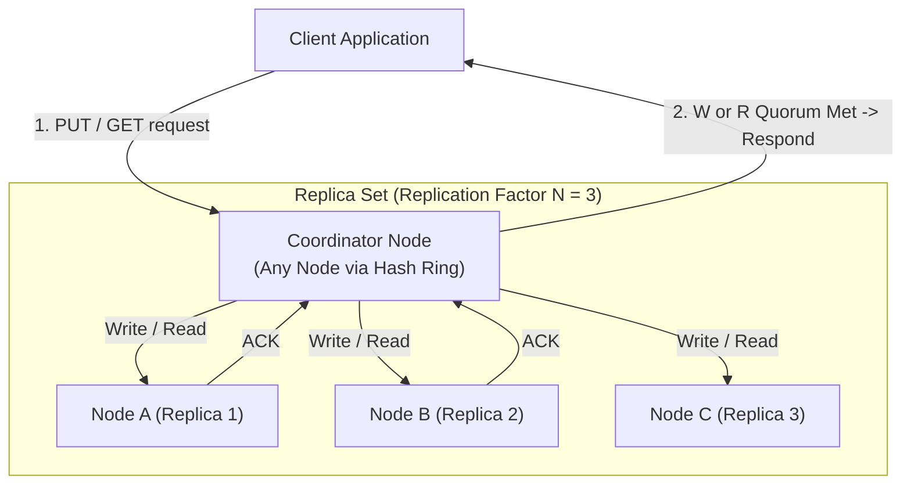
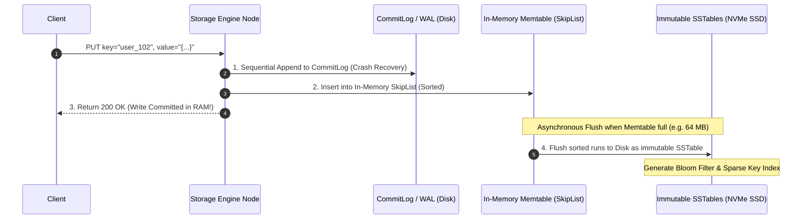
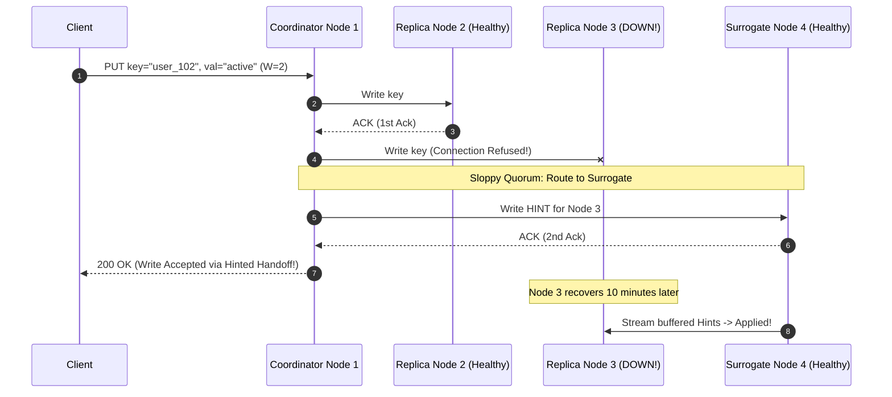
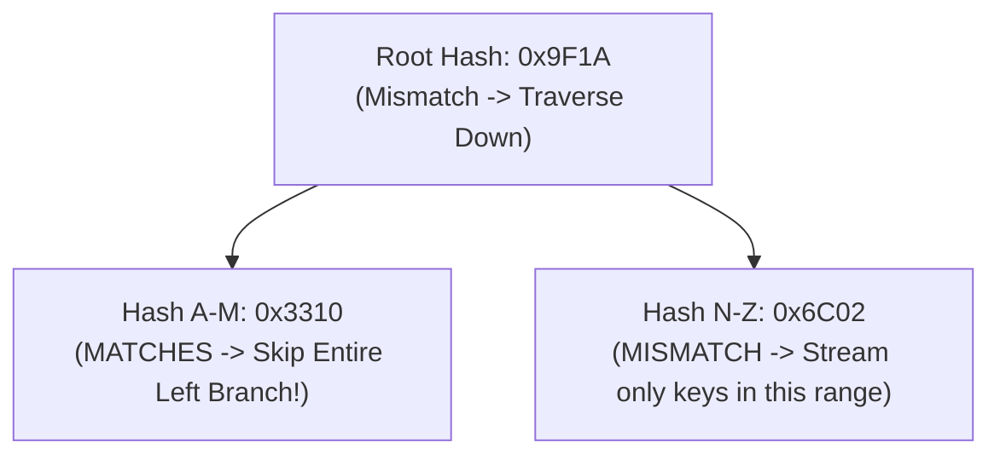
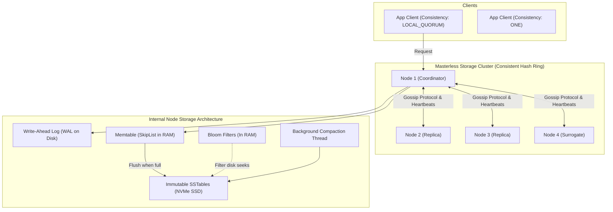

# Chapter 06: Design a Distributed Key-Value Store (DynamoDB / Cassandra / RocksDB)

---

## 1. Executive Interview Framing & Staff-Level Bar

Designing a distributed, masterless Key-Value store (Amazon DynamoDB, Apache Cassandra, ScyllaDB, CockroachDB, RocksDB) is the definitive test of distributed storage internals. While mid-level candidates recite the CAP theorem and draw a basic quorum equation ($W + R > N$), **Staff and Principal Engineers (L6+, P60) are evaluated on their mechanical knowledge of LSM-Tree storage engines (WAL, Memtable, SSTable, Compaction), the RUM Conjecture, Phi Accrual failure detection, Sloppy Quorums with Hinted Handoff, and Merkle-tree anti-entropy synchronization**:

```
┌────────────────────────────────────────────────────────────────────────────────────────┐
│                                 THE INTERVIEW SPECTRUM                                 │
├────────────────────────────────────────┬───────────────────────────────────────────────┤
│ L5 / Senior Engineer                   │ L6+ / Staff & Principal Engineer              │
├────────────────────────────────────────┼───────────────────────────────────────────────┤
│ • Basic CAP theorem mention            │ • PACELC Theorem (Latency vs Consistency in   │
│ • Simple Quorum: W + R > N             │   the absence of network partitions)          │
│ • "Write to disk and index in memory"  │ • LSM-Tree Storage Engine mechanics (WAL ->   │
│ • Heartbeat timeouts for failure check │   Memtable -> Bloom Filter -> SSTable)        │
│ • Vector clocks described in theory    │ • Compaction strategies (Size-Tiered vs Level)│
│ • Ignores long-term replica drift      │ • Phi-Accrual adaptive failure detection      │
│                                        │ • Sloppy Quorum & Hinted Handoff for AP mode  │
│                                        │ • Anti-Entropy repair using Merkle Trees      │
│                                        │ • RUM Conjecture (Read/Update/Memory tradeoff)│
└────────────────────────────────────────┴───────────────────────────────────────────────┘
```

---

## 2. Requirements & System Scope

### Functional Requirements
1. **Core Operations:**
   - `put(key, value)`: Insert or update the value mapped to `key`.
   - `get(key)`: Retrieve the latest value associated with `key`.
   - `delete(key)`: Tombstone deletion of the key-value mapping.
2. **Configurable Tunable Consistency:** Clients can configure read and write consistency levels per operation (`ONE`, `QUORUM`, `ALL`).
3. **Automatic Data Partitioning & Rebalancing:** Data automatically partitions across storage nodes via consistent hashing.

### Non-Functional Requirements (SLAs & SLOs)
* **Ultra-Low Latency:** p99 read and write latency $< \mathbf{10ms}$ under heavy concurrent load.
* **High Availability:** **99.999%** uptime (AP-biased; writes must succeed even during partial network partitions).
* **Massive Scalability:** Linearly scale to petabytes of data and tens of millions of QPS by adding commodity hardware nodes.
* **Fault Tolerance:** Tolerate concurrent node failures without data loss or downtime.

---

## 3. High-Level Architecture & Quorum Consensus



### 3.1 The Quorum Consistency Equation
* $N$: Total number of replicas for a partition.
* $W$: Write quorum size (number of successful replica ACKs required for write success).
* $R$: Read quorum size (number of replica responses compared for read success).

$$\mathbf{W + R > N} \implies \text{Strong Consistency Guarantee}$$

* **Why $W + R > N$ Guarantees Freshness (The Pigeonhole Principle):**
  - The set of nodes written to ($W$) and the set of nodes read from ($R$) must overlap by at least **one node** ($W \cap R \neq \emptyset$).
  - That overlapping node is mathematically guaranteed to hold the latest version!
* **Production Tunings:**
  - $N=3, W=2, R=2$: Strong consistency, balanced latency.
  - $N=3, W=1, R=3$: Fast writes, expensive reads (ideal for write-heavy telemetry).
  - $N=3, W=3, R=1$: Fast reads, slow writes (ideal for read-heavy catalogs).

---

## 4. The Storage Engine Deep Dive: LSM-Tree vs B-Tree

Understanding the storage engine is where Staff and Principal candidates distinguish themselves from junior engineers:

```
┌────────────────────────────────────────────────────────────────────────────────────────┐
│                              STORAGE ENGINE COMPARISON                                 │
├─────────────────────┬──────────────────┬──────────────────┬────────────────────────────┤
│ Engine Type         │ Random Write     │ Random Read      │ Compaction / Amplification │
├─────────────────────┼──────────────────┼──────────────────┼────────────────────────────┤
│ B+ Tree             │ Slow (Random I/O │ Ultra-Fast       │ In-place updates cause high│
│ (PostgreSQL/MySQL)  │ & Page Splits)   │ (Single page seek│ write amplification and    │
│                     │                  │ in O(log N))     │ index fragmentation.       │
├─────────────────────┼──────────────────┼──────────────────┼────────────────────────────┤
│ LSM-Tree (Log-      │ BLAZING FAST     │ Slower (Requires │ Background compaction      │
│ Structured Merge)   │ (Sequential disk │ Bloom filter +   │ merges SSTables; zero      │
│ (Cassandra/RocksDB) │ append only)     │ multi-SSTable)   │ in-place random writes!    │
└─────────────────────┴──────────────────┴──────────────────┴────────────────────────────┘
```

### 4.1 The LSM-Tree Write Path (Sub-5ms Latency)



1. **CommitLog / Write-Ahead Log (WAL):** Appends operation sequentially to disk. Sequential I/O on NVMe SSD achieves **hundreds of MB/s** (zero head seek latency).
2. **Memtable:** Stores key-values sorted by key in an in-memory **SkipList** or Red-Black Tree.
3. **SSTable (Sorted String Table):** When the Memtable reaches threshold capacity (e.g., 64 MB), it freezes and flushes sequentially to disk as an immutable SSTable file.

---

### 4.2 The LSM-Tree Read Path & Bloom Filter Defense

Because data is spread across multiple immutable SSTables, reading a key could require scanning dozens of disk files (**Read Amplification**).

```mermaid
flowchart TD
    Req["GET key='user_102'"] --> CheckMem["1. Check Active Memtable in RAM"]
    CheckMem -->|Found| ReturnVal["Return Value Immediately (0ms)"]
    
    CheckMem -->|Not Found| CheckFlushing["2. Check Immutable Flushing Memtables"]
    CheckFlushing -->|Found| ReturnVal
    
    CheckFlushing -->|Not Found| BloomCheck{"3. Check Bloom Filter<br/>for each SSTable"}
    BloomCheck -->|Bloom says NO (Definite Miss)| SkipSST["Skip SSTable! Zero Disk I/O!"]
    
    BloomCheck -->|Bloom says YES (Possible Hit)| ReadIndex["4. Read Sparse Key Index in RAM"]
    ReadIndex --> ReadDisk["5. Seek SSTable Data Block on SSD"]
    ReadDisk --> ScanBlock["Scan 4KB Block & Return Latest Timestamp"]
```

#### The Bloom Filter Magic
* A **Bloom Filter** in RAM answers: *"Is this key definitely NOT in this SSTable?"*
* If the Bloom filter returns `false`, the database **completely skips reading that multi-gigabyte SSTable from disk**.
* This eliminates 99% of unnecessary disk seeks, preserving sub-10ms read latencies!

---

### 4.3 Compaction Strategies: Size-Tiered vs Leveled Compaction

As SSTables accumulate on disk, old versions and tombstone deletions waste storage. **Compaction** merges multiple SSTables in the background:

```
┌────────────────────────────────────────────────────────────────────────────────────────┐
│                              COMPACTION STRATEGY TRADEOFF                              │
├─────────────────────┬──────────────────────────────────┬───────────────────────────────┤
│ Compaction Strategy │ Mechanics                        │ Staff Engineering Recommendation│
├─────────────────────┼──────────────────────────────────┼───────────────────────────────┤
│ Size-Tiered         │ Merges SSTables of similar sizes │ RECOMMENDED for write-heavy   │
│ Compaction (STCS)   │ into larger SSTables. Fast writes│ workloads (telemetry, logs).  │
│                     │ but requires 50% free disk space!│ High space overhead.          │
├─────────────────────┼──────────────────────────────────┼───────────────────────────────┤
│ Leveled Compaction  │ Divides disk into levels (L0,    │ RECOMMENDED for read-heavy or │
│ (LCS - RocksDB)     │ L1, L2). Each level is 10x larger│ read-write balanced stores.   │
│                     │ and has zero key overlap!        │ 90% disk efficiency; fast read│
└─────────────────────┴──────────────────────────────────┴───────────────────────────────┘
```

---

## 5. Architectural Deep Dives: Staff & SDFC Insights

### 5.1 Failure Detection: The $\Phi$-Accrual Failure Detector

In masterless clusters (Cassandra / Dynamo), nodes continuously monitor each other using a **Gossip Protocol**.
* **The Flaw of Fixed Timeouts:** If a node doesn't reply in 5 seconds, declaring it "dead" is dangerous during transient network congestion, triggering massive unnecessary data re-replications.
* **The Staff Solution: $\Phi$-Accrual Failure Detector (Hayashibara et al.)**
  - Instead of a binary `ALIVE` or `DEAD`, the detector outputs a continuous suspicion value $\Phi$ based on historical heartbeat interval distributions:
    $$\Phi = -\log_{10}\big(P_{\text{later}}(t - t_{\text{last}})\big)$$
  - Where $P_{\text{later}}(t)$ is the probability that a heartbeat will arrive more than $t$ time units after the previous one.
  - If $\Phi > 8$: Node is suspected degraded $\implies$ route client traffic elsewhere.
  - If $\Phi > 12$: Node is definitively dead $\implies$ trigger automated replica failover.
  - Adapts automatically to network jitter without manual operator tuning!

---

### 5.2 Sloppy Quorum & Hinted Handoff (Maximizing Availability)

What happens if Node 3 is down or partitioned, and the client executes a write with $W = 2$?
* **Strict Quorum:** Rejects the write because Node 3 cannot be reached. Availability is compromised.
* **Sloppy Quorum (The AP Choice):**
  - The coordinator routes the write to a **surrogate healthy node** (Node 4) on the ring.
  - Node 4 stores the record locally in a special **Hint Directory**:
    `"HINT for Node 3: key=user_102, val={...}, timestamp=1774345200"`
  - The client receives a successful `200 OK` write ACK!
* **Hinted Handoff:** When Node 3 recovers and rejoins the gossip ring, Node 4 detects its return and streams all buffered hints to Node 3.



---

### 5.3 Anti-Entropy Repair via Merkle Trees

What happens if Node 3 was offline for 3 weeks (hints expired or disk was replaced)?
How do replicas reconcile out-of-sync keys without transferring petabytes of raw data over the network?
* **The Staff Solution: Merkle Tree Synchronization**
  - Each replica builds a **Merkle Tree (Hash Tree)** for its assigned key range:
    - Leaves = cryptographic hashes of individual key-values.
    - Parent nodes = hash of their children.
  - Two replicas compare their root hashes:
    - If root hashes match $\implies$ **Replicas are identical in 1 network packet!**
    - If root hashes differ: Replicas traverse down the tree comparing children.
  - Only the exact sub-branches with hash mismatches are streamed across the network, resolving differences in $O(\log N)$ time and bandwidth!



---

### 5.4 The PACELC Theorem (Beyond CAP)

In 2012, Daniel Abadi proved that the CAP theorem is incomplete because network partitions are rare:
$$\text{If } \mathbf{P} \text{ (Partition)} \implies \text{Choose between } \mathbf{A} \text{ (Availability) and } \mathbf{C} \text{ (Consistency)}$$
$$\text{ELSE } (\mathbf{E}) \implies \text{Choose between } \mathbf{L} \text{ (Latency) and } \mathbf{C} \text{ (Consistency)}$$

* **DynamoDB / Cassandra:** **PA/EL Systems**
  - During partition: Choose Availability (Sloppy Quorum).
  - Normal operation: Choose Latency (eventual consistency, asynchronous replication).
* **Spanner / CockroachDB / Bigtable:** **PC/EC Systems**
  - During partition: Choose Consistency.
  - Normal operation: Choose Consistency (wait for Paxos/Raft consensus before responding).

---

## 6. End-to-End System Architecture



---

## 7. Interview Wrap-Up: Staff-Level Decision Matrix

| Problem Space | Junior / Senior Approach | Staff / Principal Approach |
| :--- | :--- | :--- |
| **Storage Engine** | Relational B+ Tree or Hash Map | **LSM-Tree (Log-Structured Merge-Tree):** Sequential disk writes (WAL) + in-memory Memtable + immutable SSTables. |
| **Read Amplification**| Scan disk files directly | **Bloom Filters in RAM:** Guarantees zero disk I/O on missing keys. |
| **Consistency Model** | Basic CAP theorem | **PACELC Theorem + Tunable Quorums ($W + R > N$):** Balances network latency against consistency per operation. |
| **Failure Detection** | Static timeout (e.g. 5 seconds) | **$\Phi$-Accrual Adaptive Failure Detector:** Statistical heartbeat probability adjusts to network jitter. |
| **Transient Node Outage**| Reject writes | **Sloppy Quorum with Hinted Handoff:** Accepts writes on surrogates; replays upon recovery. |
| **Long-Term Drift** | Full data re-streaming | **Anti-Entropy Merkle Trees:** Identifies out-of-sync key ranges in $O(\log N)$ network bandwidth. |
