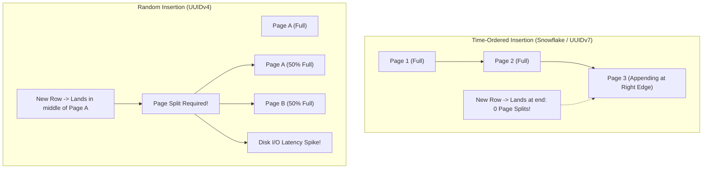
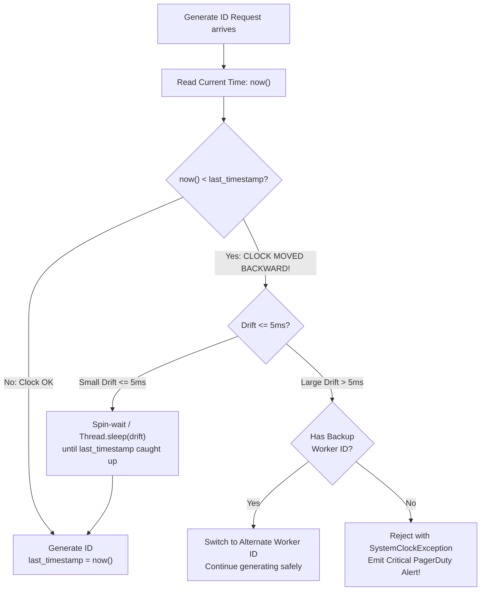
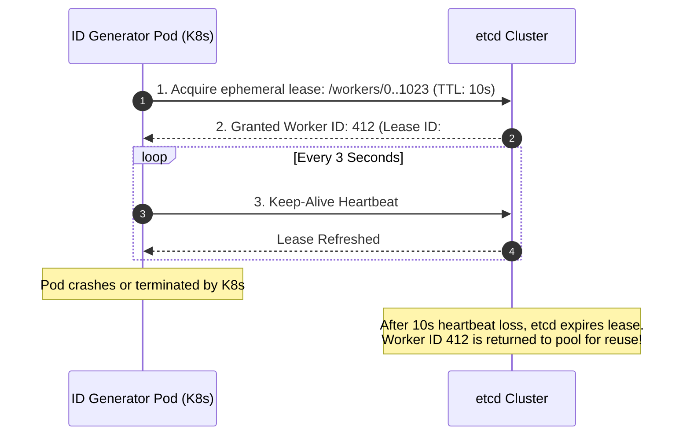
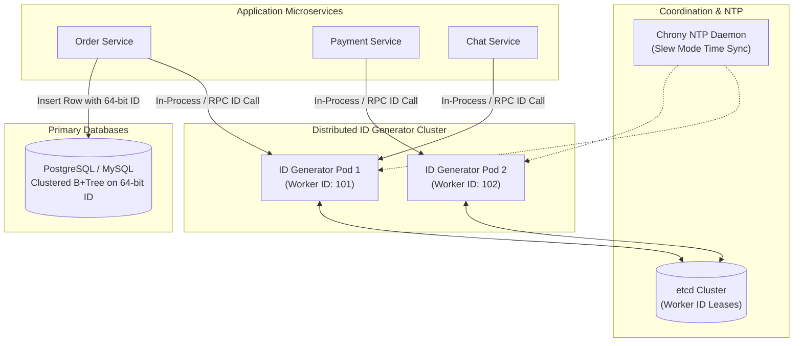

# Chapter 07: Design a Distributed Unique ID Generator (Snowflake / UUIDv7)

---

## 1. Executive Interview Framing & Staff-Level Bar

Designing a distributed unique ID generator is a foundational interview topic that directly impacts database indexing performance, network bandwidth, and causal event ordering. While junior engineers regurgitate Twitter Snowflake bit-allocations, **Staff and Principal Engineers (L6+, P60) are evaluated on their understanding of B-Tree index page-split penalties (UUIDv4 vs UUIDv7), NTP clock backward drift mitigations, Kubernetes dynamic worker ID lease allocation, and sequence counter overflow handling**:

```
┌────────────────────────────────────────────────────────────────────────────────────────┐
│                                 THE INTERVIEW SPECTRUM                                 │
├────────────────────────────────────────┬───────────────────────────────────────────────┤
│ L5 / Senior Engineer                   │ L6+ / Staff & Principal Engineer              │
├────────────────────────────────────────┼───────────────────────────────────────────────┤
│ • Basic Twitter Snowflake bit breakdown│ • B-Tree index fragmentation & random I/O     │
│ • "Just use UUIDv4"                    │   analysis (Why UUIDv4 destroys InnoDB/PG)    │
│ • "NTP handles clock synchronization"  │ • UUIDv7 (RFC 9562) timestamp locality        │
│ • Static server IDs in config file     │ • NTP step adjustment & clock skew defense    │
│ • Ignores >4096 req/ms bursts          │ • Kubernetes dynamic worker ID lease in etcd  │
│                                        │ • Sequence overflow spin-wait & wait loops    │
│                                        │ • Google TrueTime (GPS + Atomic bounded drift)│
└────────────────────────────────────────┴───────────────────────────────────────────────┘
```

---

## 2. The 5-Pillar Staff Assessment Rubric for Unique ID Generators

```
┌────────────────────────────────────────────────────────────────────────────────────────────────────────┐
│                                      5-PILLAR EVALUATION RUBRIC                                        │
├─────────────────────────┬──────────────────────────────────────────────────────────────────────────────┤
│ Pillar                  │ What the Interviewer Listens For (Evidence)                                  │
├─────────────────────────┼──────────────────────────────────────────────────────────────────────────────┤
│ 1. Decision Making      │ • UUIDv4 vs UUIDv7 (RFC 9562) vs Snowflake vs Centralized Ticket DB vs etcd. │
│                         │ • 64-bit integer (BigInt) vs 128-bit string based on storage & network cost. │
│                         │ • Evaluates trade-offs between coordination overhead and sequence ordering.  │
├─────────────────────────┼──────────────────────────────────────────────────────────────────────────────┤
│ 2. Technical            │ • B+ Tree index page-split penalties caused by non-sequential UUIDv4 inserts.│
│    Proficiency          │ • Snowflake bit layout (1 sign + 41 time ms + 10 worker ID + 12 sequence).   │
│                         │ • Sequence overflow spin-wait loop handling bursts $> 4,096 \text{ IDs/ms}$. │
│                         │ • Clock drift defense: detects NTP backward time steps and pauses/slews.     │
├─────────────────────────┼──────────────────────────────────────────────────────────────────────────────┤
│ 3. Problem Solving &    │ • Derives bit allocation lifespans: $2^{41} \approx 69\text{ years}$,         │
│    Analytical Thinking  │   $2^{10} = 1,024\text{ workers}$, $2^{12} = 4.096\text{M IDs/sec per node}$.│
│                         │ • Quantifies storage tax: 8 bytes vs 16 bytes over 10 Billion DB rows.       │
├─────────────────────────┼──────────────────────────────────────────────────────────────────────────────┤
│ 4. Operational          │ • Dynamic worker ID lease management in etcd/ZooKeeper for ephemeral pods.   │
│    Mindset              │ • Monitors NTP synchronization offset via adjtimex / chrony.                 │
│                         │ • Enforces zero cross-node network dependencies on the critical write path.  │
├─────────────────────────┼──────────────────────────────────────────────────────────────────────────────┤
│ 5. Adaptability &       │ • Adapts to cloud VM live-migration clock jumps without duplicate IDs.      │
│    Collaboration        │ • Balances strict sequence monotonic ordering with multi-region independence.│
│                         │ • Explains primary key indexing physics clearly to application developers.   │
└─────────────────────────┴──────────────────────────────────────────────────────────────────────────────┘
```

---

## 3. Requirements & System Scope

### Functional Requirements
1. **Global Uniqueness:** No two entities generated across any datacenter or node can ever have the same ID.
2. **Time-Sortable (K-Ordered):** IDs must sort roughly chronologically to enable efficient database indexing and range queries.
3. **Numerical 64-Bit Preference:** IDs should fit within a 64-bit integer (`BIGINT` in SQL) to minimize index storage overhead.
4. **High Throughput:** Capable of generating **over 10,000 IDs / second per node** (millions/sec cluster-wide).
5. **Decentralized Generation:** ID generation must not require a synchronous network roundtrip per ID to avoid latency bottlenecks.

### Non-Functional Requirements (SLAs & SLOs)
* **Latency:** ID generation latency $< \mathbf{0.05ms}$ (in-memory execution).
* **Availability:** **99.9999%** availability (ID service failure blocks all write paths across the enterprise).
* **Clock Skew Resilience:** The generator must detect and safely mitigate NTP backwards time adjustments without duplicate generation.

---

## 3. Technology Tradeoff Matrix: The ID Evolution

```
┌────────────────────────────────────────────────────────────────────────────────────────┐
│                                ID GENERATION TRADEOFFS                                 │
├─────────────────────┬──────────┬──────────────┬────────────────────────────────────────┤
│ Approach            │ Size     │ Sortable?    │ Staff Engineering Evaluation           │
├─────────────────────┼──────────┼──────────────┼────────────────────────────────────────┤
│ UUIDv4              │ 128 bits │ NO (Random)  │ CATASTROPHIC for primary keys: causes  │
│ (Random)            │ (String) │              │ massive B-Tree random page splits and  │
│                     │          │              │ index bloat. High storage cost.        │
├─────────────────────┼──────────┼──────────────┼────────────────────────────────────────┤
│ UUIDv7              │ 128 bits │ YES          │ EXCELLENT for modern microservices:    │
│ (RFC 9562)          │ (UUID)   │ (48-bit time)│ 48-bit UNIX ms timestamp prefix fixes  │
│                     │          │              │ B-Tree page splits; zero coordination. │
├─────────────────────┼──────────┼──────────────┼────────────────────────────────────────┤
│ Centralized Ticket  │ 64 bits  │ YES          │ Single point of failure; network RTT   │
│ (Flickr DB)         │ (Bigint) │              │ per ID; operational failure at scale.  │
├─────────────────────┼──────────┼──────────────┼────────────────────────────────────────┤
│ Central Range Chunk │ 64 bits  │ YES          │ Great for batch jobs: Nodes lease 1M   │
│ (etcd / ZK Leases)  │ (Bigint) │              │ ID blocks at once; zero RTT per write. │
├─────────────────────┼──────────┼──────────────┼────────────────────────────────────────┤
│ Twitter Snowflake   │ 64 bits  │ YES          │ INDUSTRY STANDARD for 64-bit BigInt:   │
│ (Epoch+Worker+Seq)  │ (Bigint) │              │ 4.096M IDs/sec per node; compact 8-byte│
│                     │          │              │ storage; requires worker ID management.│
└─────────────────────┴──────────┴──────────────┴────────────────────────────────────────┘
```

---

## 4. Deep Dive: Why UUIDv4 Destroys Database Performance (The B-Tree Penalty)

A frequent Principal Engineer interview trap: *"Why not just use standard UUIDs (`UUIDv4`) for all database primary keys?"*

#### The B-Tree Index Fragmentation Anatomy
Relational databases (PostgreSQL, MySQL InnoDB) store tables ordered by their clustered primary key inside a **B+ Tree**.
* **Sequential / Time-Ordered IDs (Snowflake / UUIDv7):**
  - New records are always inserted into the right-most leaf page of the B+ Tree.
  - Leaf pages fill cleanly up to 100% capacity.
  - Zero disk random I/O; cache hit rates stay near 99%.
* **Random IDs (UUIDv4):**
  - New records land uniformly at **random positions** across the entire B+ Tree.
  - When an insert lands on an already-full page, the database must execute an expensive **B-Tree Page Split**:
    1. Allocate a new 16 KB disk page.
    2. Move 50% of the existing rows from the full page to the new page.
    3. Update parent index pointers and write transaction log entries.
  - **The Real-World Consequence:** Database write latency spikes by **10x to 50x**, index size balloons by **40% (fragmentation air)**, and the working set no longer fits in memory, forcing thrashing disk I/O!



---

## 5. Architectural Deep Dives: Staff & SDFC Insights

### 5.1 Twitter Snowflake Bit Allocation & Mechanics

A standard Snowflake ID fits in a signed 64-bit integer (`int64_t`):

```
 0                   1                   2                   3
 0 1 2 3 4 5 6 7 8 9 0 1 2 3 4 5 6 7 8 9 0 1 2 3 4 5 6 7 8 9 0 1
+-+-+-+-+-+-+-+-+-+-+-+-+-+-+-+-+-+-+-+-+-+-+-+-+-+-+-+-+-+-+-+-+
|0|                      Timestamp (41 bits)                    |
+-+-+-+-+-+-+-+-+-+-+-+-+-+-+-+-+-+-+-+-+-+-+-+-+-+-+-+-+-+-+-+-+
|    Timestamp (cont.)  | Datacenter (5b) | Worker ID (5b)      |
+-+-+-+-+-+-+-+-+-+-+-+-+-+-+-+-+-+-+-+-+-+-+-+-+-+-+-+-+-+-+-+-+
|       Worker ID       |          Sequence Number (12 bits)    |
+-+-+-+-+-+-+-+-+-+-+-+-+-+-+-+-+-+-+-+-+-+-+-+-+-+-+-+-+-+-+-+-+
```

1. **Sign Bit (1 bit):** Always `0`. Ensures the number is positive across all programming languages (Java `long` is signed).
2. **Timestamp (41 bits):** Milliseconds since a custom project epoch (e.g., `2026-01-01T00:00:00Z`).
   $$\text{Max Lifespan} = \frac{2^{41} \text{ ms}}{1000 \times 3600 \times 24 \times 365} \approx \mathbf{69.7 \text{ Years}}$$
3. **Datacenter ID (5 bits):** Supports up to $2^5 = 32$ datacenters/regions.
4. **Worker / Machine ID (5 bits):** Supports up to $2^5 = 32$ worker generator nodes per datacenter (or 10 bits combined $= 1,024$ nodes cluster-wide).
5. **Sequence Number (12 bits):** Supports up to $2^{12} = \mathbf{4,096 \text{ IDs per millisecond}}$ per worker node.
   - Resets to `0` every millisecond.
   - Theoretical throughput per node: $4,096 \times 1,000 = \mathbf{4.096 \text{ Million IDs / second / node}}$!

---

### 5.2 The Clock Skew Nightmare: NTP Drift & Backward Steps

Snowflake assumes time moves forward monotonically. What happens when the operating system's **Network Time Protocol (NTP)** synchronizes with an external atomic clock and steps backward by 20 milliseconds?



#### Production Clock Skew Defenses
1. **Configure Slew Mode instead of Step Mode:** Configure NTP / Chrony with `makestep 0` to gradually slew clock adjustments (stretching microseconds) rather than making sudden backward jumps.
2. **Small Drift Spin-Wait ($\le 5\text{ms}$):** If the clock moved backward by a tiny delta, spin-wait or sleep until `now >= last_timestamp`.
3. **Alternate Worker ID Failover ($> 5\text{ms}$):** If the clock moved backward significantly, the node immediately switches its 10-bit Worker ID to a pre-allocated backup ID (e.g. `Worker_ID + 512`), guaranteeing non-overlapping IDs.

---

### 5.3 Dynamic Worker ID Allocation in Kubernetes (etcd / ZooKeeper)

In modern containerized deployments, Kubernetes pods spin up and terminate dynamically. How do ephemeral pods automatically claim a unique 10-bit Worker ID ($0$ to $1023$) without manual configuration?



---

### 5.4 Sequence Counter Overflow

What happens if a worker receives more than 4,096 requests in the **exact same millisecond**?
* If the 12-bit sequence reaches 4,095:
  ```go
  sequence = (sequence + 1) & 4095
  if sequence == 0 {
      // Overflown in the same millisecond!
      for now <= lastTimestamp {
          now = timeGen() // Busy-wait until next millisecond
      }
  }
  ```
* The generator pauses in a tight loop until the system clock ticks to the next millisecond, resetting the sequence counter cleanly to 0.

---

## 6. End-to-End System Architecture



---

## 7. Interview Wrap-Up: Staff-Level Decision Matrix

| Problem Space | Junior / Senior Approach | Staff / Principal Approach |
| :--- | :--- | :--- |
| **ID Format** | UUIDv4 (Random string) | **Snowflake (64-bit integer) or UUIDv7 (128-bit time-prefixed):** Eliminates B-Tree index page-split penalties. |
| **Throughput** | Central database auto-increment | **Decentralized In-Memory Generation:** 4 Million IDs/second per worker node. |
| **Clock Backward Drift**| Assumes NTP never drifts | **Multi-tier Skew Defense:** Slew-mode NTP + Spin-wait ($\le 5\text{ms}$) + Alternate Worker ID switch ($> 5\text{ms}$). |
| **Worker ID Management**| Hardcoded in config file | **Dynamic Ephemeral Leases via etcd / ZooKeeper:** Auto-registers and reclaims IDs in Kubernetes. |
| **Burst Overflow** | Unhandled / Duplicate IDs | **Sequence Exhaustion Spin-Wait:** Gracefully sleeps until the next millisecond arrives. |
