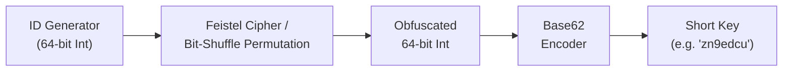
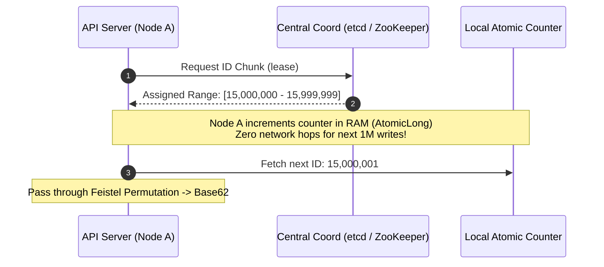
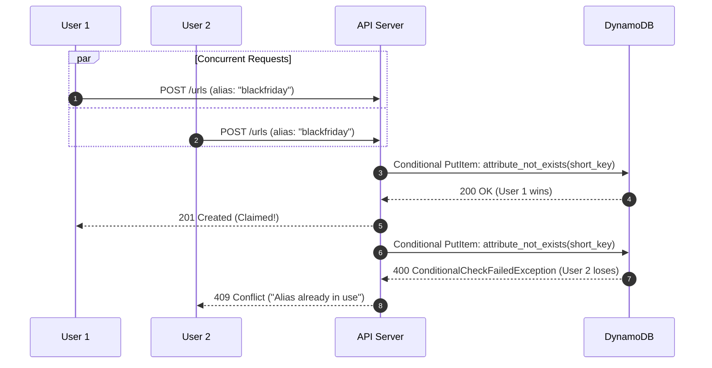
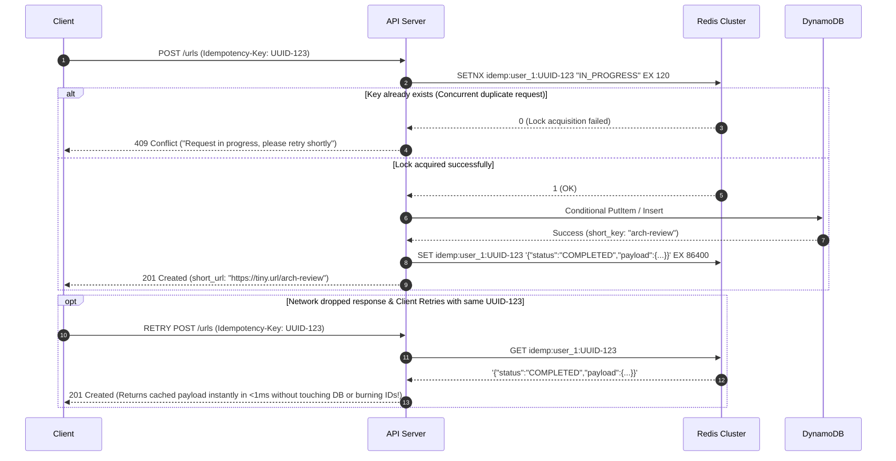

# Chapter 08: Design a URL Shortener (TinyURL / Bitly)

---

## 1. Executive Interview Framing & Staff-Level Bar

A URL Shortener (like TinyURL or Bitly) is deceptively simple at first glance: map a long URL to a short alphanumeric key and redirect users. Because junior and mid-level engineers can easily sketch a basic database and Base62 converter in 10 minutes, **interviewers at Staff and Principal levels (L6/L7+, P60) use this problem to grill candidates on production-grade systems realities**:

```
┌────────────────────────────────────────────────────────────────────────────────────────┐
│                                 THE INTERVIEW SPECTRUM                                 │
├────────────────────────────────────────┬───────────────────────────────────────────────┤
│ L5 / Senior Engineer                   │ L6+ / Staff & Principal Engineer              │
├────────────────────────────────────────┼───────────────────────────────────────────────┤
│ • MD5/SHA-256 hash or DB auto-increment│ • Base62 of 64-bit distributed ID with        │
│ • "Just use Redis for caching"         │   Feistel cipher (prevents URL scraping)      │
│ • Simple 301 vs 302 mention            │ • Edge worker termination (Cloudflare/Lambda) │
│ • Relational DB with a unique index    │ • 301 caching trap vs 302 analytics fidelity  │
│ • Ignores concurrent alias claiming    │ • Asynchronous decoupled analytics (Kafka -> │
│ • Ignores malware / phishing abuse     │   ClickHouse) with zero-cost redirect path    │
│                                        │ • Race-condition proof custom vanity aliases  │
│                                        │ • Google Safe Browsing async malware scanning │
└────────────────────────────────────────┴───────────────────────────────────────────────┘
```

---

## 2. The 5-Pillar Staff Assessment Rubric for URL Shorteners

```
┌────────────────────────────────────────────────────────────────────────────────────────────────────────┐
│                                      5-PILLAR EVALUATION RUBRIC                                        │
├─────────────────────────┬──────────────────────────────────────────────────────────────────────────────┤
│ Pillar                  │ What the Interviewer Listens For (Evidence)                                  │
├─────────────────────────┼──────────────────────────────────────────────────────────────────────────────┤
│ 1. Decision Making      │ • Hash-then-truncate (MD5/SHA256) vs Base62 of 64-bit distributed ID.       │
│                         │ • HTTP 301 Permanent Redirect (client caching) vs HTTP 302 (analytics data). │
│                         │ • Edge Worker Redirection (Cloudflare/Lambda@Edge) vs Origin App Cluster.    │
│                         │ • Idempotency-Key header vs long_url deduplication for write-path retries.   │
│                         │ • Asynchronous out-of-band edge telemetry (event.waitUntil / CDN Logpush)   │
│                         │   vs synchronous origin request hopping.                                     │
├─────────────────────────┼──────────────────────────────────────────────────────────────────────────────┤
│ 2. Technical            │ • Base62 encoding math ($62^7 \approx 3.5 \text{ Trillion URLs}$).           │
│    Proficiency          │ • Feistel cipher / pseudo-random permutation preventing sequential scraping. │
│                         │ • Independent socket model: edge redirects client while async logging.       │
│                         │ • Redis SETNX lock & response caching state machine (IN_PROGRESS/COMPLETED). │
│                         │ • Distributed locking & atomic unique constraints for custom vanity slugs.   │
├─────────────────────────┼──────────────────────────────────────────────────────────────────────────────┤
│ 3. Problem Solving &    │ • Decomposes into Shorten Ingress, Redirect Engine, Analytics, & Scanner.    │
│    Analytical Thinking  │ • Calculates 100M writes/day, 10B reads/day, 128 TB storage, and 300 GB RAM. │
│                         │ • Derives network egress bandwidth (1.15 Gbps peak) under 100:1 read ratio.  │
│                         │ • Shows why deduplicating by long_url destroys marketing campaign metrics.  │
├─────────────────────────┼──────────────────────────────────────────────────────────────────────────────┤
│ 4. Operational          │ • Safe client retries via Idempotency-Key (prevents burned IDs & false 409s).│
│    Mindset              │ • In-memory edge batching to defeat viral link telemetry ingestion storms.   │
│                         │ • Pre-filters malware & phishing links via async Google Safe Browsing API.   │
│                         │ • Automated TTL expiration cleanup (Redis keyspace events + DB partitions).  │
│                         │ • Filters crawler preview bots (Slackbot, Twitterbot) from human analytics.  │
├─────────────────────────┼──────────────────────────────────────────────────────────────────────────────┤
│ 5. Adaptability &       │ • Mitigates viral link thundering herds via singleflight cache warming.      │
│    Collaboration        │ • Balances enterprise vanity slug flexibility with global namespace safety.  │
│                         │ • Communicates link retirement and audit compliance policies to legal teams. │
└─────────────────────────┴──────────────────────────────────────────────────────────────────────────────┘
```

---

## 3. Requirements & System Scope

### Functional Requirements
1. **URL Shortening:** Given a long URL, return a unique, short URL (e.g., `https://tiny.url/zn9edcu`).
2. **URL Redirection:** Accessing the short URL quickly redirects the user to the original destination.
3. **Custom Vanity Aliases:** Allow enterprise/authenticated users to specify a custom short slug (e.g., `https://tiny.url/blackfriday2026`).
4. **Configurable Expiration (TTL):** Links can expire after a user-defined timeframe or default to 5 years.
5. **Real-time Click Analytics:** Track click count, referring domain, user geography (country/city), device/OS, and timestamp.
6. **Security & Abuse Mitigation:** Detect and block phishing, malware links, and recursive shortening spam.

### Non-Functional Requirements (SLAs & SLOs)
* **Ultra-Low Latency:** Redirection p99 latency < **15ms**; cached edge redirection < **5ms**.
* **High Availability:** **99.999%** availability for the read path (redirects must never fail even if analytics pipelines back up).
* **High Read-to-Write Ratio:** Heavily read-dominated (~100:1 to 50:1 read-to-write).
* **Zero Guessability / Enumeration Resistance:** Short URLs must not be sequential to prevent malicious scraping of private/unlisted enterprise links.

---

## 3. Capacity Estimation & Hardware Reality (Back-of-the-Envelope)

Let's establish concrete production numbers:

```
Writes: 100 Million new URLs / day
Reads:  10 Billion redirects / day (100:1 read:write ratio)
Retention: 5 Years
```

### 3.1 Throughput Math
* **Write QPS:**
  $$\text{Daily Writes} = 100,000,000 / 86,400 \approx 1,160 \text{ writes/sec}$$
  $$\text{Peak Write QPS (2.5x)} \approx 2,900 \text{ writes/sec}$$
* **Read QPS:**
  $$\text{Daily Reads} = 10,000,000,000 / 86,400 \approx 115,740 \text{ reads/sec}$$
  $$\text{Peak Read QPS (2x)} \approx 230,000 \text{ reads/sec}$$

### 3.2 Storage Math (5-Year Window)
* Total URLs over 5 years:
  $$100 \text{M/day} \times 365 \times 5 = 182.5 \text{ Billion records}$$
* Size per record:
  - `short_key`: 7 bytes
  - `long_url`: 500 bytes (average)
  - `user_id`: 16 bytes (UUIDv4)
  - `created_at`: 8 bytes (epoch ms)
  - `expires_at`: 8 bytes
  - Indexes & B-tree/LSM metadata overhead: ~150 bytes
  - **Total per record:** $\approx 700 \text{ bytes}$
* Total Primary Storage:
  $$182.5 \times 10^9 \times 700 \text{ bytes} \approx 127.75 \text{ TB}$$
  *(With 3x replication across availability zones: $\approx 383 \text{ TB}$)*.

### 3.3 Cache Sizing (Pareto 80/20 Rule)
* 20% of the daily read URLs generate 80% of daily redirect traffic.
* Daily unique active links accessed:
  $$20\% \times (100\text{M writes/day} \times 30\text{ active days}) \approx 600\text{M links}$$
* Memory footprint to cache top hot links in Redis:
  $$600\text{M} \times 500 \text{ bytes} \approx 300 \text{ GB RAM}$$
  *(A cluster of 10 nodes with 64 GB RAM easily accommodates the hot working set with plenty of headroom).*

### 3.4 Bandwidth Egress Math
* Egress on Redirects:
  $$116,000 \text{ reads/sec} \times 500 \text{ bytes (HTTP 302 Header)} \approx 58 \text{ MB/sec} = 464 \text{ Mbps}$$
  Peak egress $\approx 1.15 \text{ Gbps}$ — fits comfortably within standard 10Gbps AWS/GCP cloud egress interfaces.

---

## 4. API Design

### 4.1 Shorten URL
```http
POST /api/v1/urls
Content-Type: application/json
Authorization: Bearer <jwt_token>
Idempotency-Key: 7b56a1b0-9b4e-4f51-b841-a1288e7a0f62

{
  "long_url": "https://company.internal.atlassian.net/wiki/spaces/ENG/pages/91823910/Architecture-Review",
  "custom_alias": "arch-review", // Optional
  "ttl_seconds": 604800          // Optional (7 days)
}
```

**Response (`201 Created`):**
```json
{
  "short_url": "https://tiny.url/arch-review",
  "short_key": "arch-review",
  "long_url": "https://company.internal.atlassian.net/wiki/spaces/ENG/pages/91823910/Architecture-Review",
  "created_at": 1774345200000,
  "expires_at": 1774950000000
}
```

### 4.2 Redirect (Resolve URL)
```http
GET /{short_key}
```

**Response (`302 Found` or `307 Temporary Redirect`):**
```http
HTTP/1.1 302 Found
Location: https://company.internal.atlassian.net/wiki/spaces/ENG/pages/91823910/Architecture-Review
Cache-Control: private, max-age=90
```

---

## 5. Architectural Deep Dives: Staff & SDFC Insights

### 5.1 The Redirect Status Code Debate: 301 vs 302 vs 307

One of the quickest ways interviewers probe your depth is asking: *"Why not return HTTP 301 Permanent Redirect?"*

```
┌────────────────────────────────────────────────────────────────────────────────────────┐
│                              HTTP STATUS CODE COMPARISON                               │
├────────────────────┬───────────────────────────────────┬───────────────────────────────┤
│ Status Code        │ Browser Behavior                  │ Engineering Tradeoff          │
├────────────────────┼───────────────────────────────────┼───────────────────────────────┤
│ 301 Moved          │ Browser caches destination in     │ • Saves massive origin traffic│
│ Permanently        │ disk cache permanently. Next time │ • DESTROYS real-time click    │
│                    │ user clicks, browser bypasses     │   analytics and attribution.  │
│                    │ TinyURL completely!               │ • Impossible to revoke/edit.  │
├────────────────────┼───────────────────────────────────┼───────────────────────────────┤
│ 302 Found          │ Temporary redirect. Browser       │ • 100% accurate click metrics.│
│ (Default)          │ re-queries TinyURL edge on every  │ • Enables link revocation and │
│                    │ single click.                     │   malware blocking instantly. │
│                    │                                   │ • Higher origin / edge load.  │
├────────────────────┼───────────────────────────────────┼───────────────────────────────┤
│ 307 Temporary      │ Guarantees the HTTP request method│ • Prevents HTTP method mutate │
│ Redirect           │ (POST/PUT/GET) is NOT rewritten.  │   (e.g., POST mutating to GET)│
└────────────────────┴───────────────────────────────────┴───────────────────────────────┘
```

> [!IMPORTANT]
> **Staff-Level Recommendation:** Return **`302 Found`** (or `307`) with a short `Cache-Control: private, max-age=90` header. This allows downstream browser caching for 90 seconds (mitigating rapid double-clicking thundering herds) while retaining near-perfect analytics fidelity and instant link takedown capability.

---

### 5.2 Encoding & ID Generation Mechanics

#### Why MD5/SHA-256 Truncation Fails
A common junior mistake: *"Hash the long URL using MD5 or SHA-256 and take the first 7 characters."*
* **The Math Behind the Failure (The Birthday Paradox):**
  - Base62 character set: $[0-9, a-z, A-Z] \implies 62 \text{ characters}$.
  - A 7-character string has $62^7 \approx 3.52 \text{ Trillion combinations}$.
  - By the Birthday Paradox, the collision probability reaches $50\%$ at:
    $$N \approx \sqrt{2 \times 62^7 \times \ln(2)} \approx 1.87 \text{ Million hashes!}$$
  - At **100 Million writes/day**, you will encounter collisions within **hours of launch**! Resolving collisions via iterative rehashing causes catastrophic database write latency amplification.

#### The Staff Solution: Base62 of a 64-Bit Distributed Monotonic ID
Instead of hashing the payload, generate a unique 64-bit integer and convert it directly to Base62:

$$\text{ID: } 2009215674938 \xrightarrow{\text{Base62}} \text{"zn9edcu"}$$

$$\begin{aligned}
2009215674938 &= 14 \cdot 62^6 + 49 \cdot 62^5 + 9 \cdot 62^4 + 14 \cdot 62^3 + 13 \cdot 62^2 + 12 \cdot 62^1 + 50 \cdot 62^0 \\
&= \text{'z', 'n', '9', 'e', 'd', 'c', 'u'}
\end{aligned}$$



#### Mitigating Sequential Enumeration (The Security Trap)
If you directly encode sequential IDs (`1000001` $\to$ `1000002` $\to$ `1000003`), attackers can trivially scrape your entire URL repository by incrementing numbers.
* **The Solution:** Pass the 64-bit integer through a **Pseudo-Random Permutation (Feistel Cipher or Skip32)** before Base62 encoding.
* A Feistel cipher is a bijective (1-to-1) reversible permutation: zero collisions, perfectly deterministic, but visually scrambles consecutive IDs into pseudorandom numbers!

---

### 5.3 Distributed ID Generation Architecture

How do we generate 1,160 to 3,000 unique 64-bit IDs per second without a single point of failure?

```
┌────────────────────────────────────────────────────────────────────────────────────────┐
│                          DISTRIBUTED ID GENERATION STRATEGIES                          │
├────────────────────┬───────────────────────────────────┬───────────────────────────────┤
│ Strategy           │ Mechanics                         │ Staff Tradeoff Evaluation     │
├────────────────────┼───────────────────────────────────┼───────────────────────────────┤
│ Range Allocation   │ Central coordination (etcd / ZK)  │ RECOMMENDED for TinyURL. Zero │
│ (Ticket / Chunk)   │ hands out 1,000,000 ID ranges     │ cross-node network chatter    │
│                    │ (e.g. Node 1 gets 1M-2M, Node 2   │ during URL generation. If a   │
│                    │ gets 2M-3M). Nodes allocate       │ node crashes, unallocated IDs │
│                    │ locally from memory.              │ are burned (acceptable loss). │
├────────────────────┼───────────────────────────────────┼───────────────────────────────┤
│ Snowflake ID       │ 41-bit timestamp + 10-bit node ID │ Excellent, but 64-bit range is│
│ (Twitter Style)    │ + 12-bit sequence counter.        │ unevenly distributed; requires│
│                    │                                   │ NTP clock synchronization.    │
├────────────────────┼───────────────────────────────────┼───────────────────────────────┤
│ Database Auto-Inc  │ Multiple DBs with step increment  │ Operational nightmare to scale│
│ (Flickr Ticket)    │ (Server 1: 1, 3, 5; Server 2: 2,  │ or re-shard; creates single   │
│                    │ 4, 6).                            │ point of failure bottlenecks. │
└────────────────────┴───────────────────────────────────┴───────────────────────────────┘
```



---

### 5.4 Database Architecture & Schema Design

TinyURL's access pattern is pure key-value lookup:
* **Write:** Given `short_key`, insert `<short_key, long_url, user_id, created_at, expires_at>`.
* **Read:** Given `short_key`, fetch `long_url`.
* **Zero multi-row transactions or table joins required.**

#### Database Selection: DynamoDB / ScyllaDB vs PostgreSQL
* **Why NoSQL (DynamoDB / Cassandra / ScyllaDB) Wins:**
  - Partition key: `short_key` guarantees $O(1)$ single-digit millisecond primary index seeks.
  - Native **Time-To-Live (TTL)** support: DynamoDB automatically purges expired links asynchronously in the background without needing scheduled cron batch sweeps that lock database tables!
  - Linear horizontal scaling to petabytes without manual sharding scripts.

#### Concrete NoSQL Schema (DynamoDB / ScyllaDB)
```sql
-- ScyllaDB / Cassandra CQL Equivalent
CREATE TABLE urls (
    short_key text,
    long_url text,
    user_id uuid,
    created_at timestamp,
    expires_at timestamp,
    click_count counter,
    PRIMARY KEY (short_key)
);

-- Secondary Index for Reverse Lookup (Optional / Enterprise)
CREATE INDEX idx_user_urls ON urls (user_id, created_at) 
    WITH CLUSTERING ORDER BY (created_at DESC);
```

#### Long-URL Deduplication: To Deduplicate or Not?
*"What if User A and User B submit `https://google.com`?"*
* **Option 1 (Deduplicate):** Store only one record.
  - *Tradeoff:* Requires a global reverse index on `hash(long_url)`. Every write requires a read-before-write, doubling write latency. Furthermore, if User A deletes their link or requests custom TTL/analytics, it breaks User B's link!
* **Option 2 (No Deduplication - Recommended):** Each request generates a new short URL.
  - *Tradeoff:* Consumes an extra 700 bytes of cheap disk storage ($127 TB over 5 years is under \$3,000/month on AWS S3/DynamoDB). Protects user isolation, custom vanity names, and private analytics.

---

### 5.5 Handling Custom Vanity Aliases & Concurrent Race Conditions

When an enterprise customer requests `custom_alias: "blackfriday2026"`:
Two concurrent requests attempt to claim the exact same alias at the same millisecond. How do we prevent race condition overwrites?



* **Implementation:** Use atomic conditional writes at the database layer (`attribute_not_exists(short_key)` in DynamoDB, or `INSERT ... ON CONFLICT DO NOTHING` in PostgreSQL). Never do a check-then-insert in application memory!

---

### 5.6 Write-Path Idempotency & The Double-Submit Problem

In Section 4.1, the link creation endpoint accepts an `Idempotency-Key` header:
`Idempotency-Key: 7b56a1b0-9b4e-4f51-b841-a1288e7a0f62`

#### 1. Why Can't We Just Deduplicate by `long_url`?
A frequent mid-level interview mistake is assuming: *"Just check `SELECT short_key FROM urls WHERE long_url = ?` before inserting."*
In a production URL shortener, this assumption is fatally flawed:
- **Campaign Attribution:** A growth team needs 5 different short links pointing to the exact same landing page (`https://myapp.com/signup`) to measure conversion across Twitter, LinkedIn, Google Ads, and email newsletters independently.
- **Multi-Tenancy & Privacy:** User A and User B both shortening `https://google.com` must have isolated links so User A's custom expiration or click analytics cannot leak to User B.
- **Write Amplification:** Querying a global reverse index on `hash(long_url)` on every creation turns every write into a read-before-write, doubling latency.

#### 2. The Network Retry Disaster (Without Idempotency-Key)
Due to network drops, client timeouts, or users double-clicking "Shorten", the client SDK frequently retries `POST /api/v1/urls`.
- **Failure Mode A (Generated URLs):** The server generates a *second* short key (`tiny.url/m2Q4b`), wasting an ID from the pre-allocated chunk and giving the user two different URLs for one intended action.
- **Failure Mode B (Custom Vanity Aliases):** If the user requested `custom_alias: "arch-review"`, the first attempt already committed `"arch-review"` to DynamoDB right before the connection dropped. The client's automatic retry hits the server, encounters the unique constraint, and fails with `409 Conflict: "Alias already in use"`. The client falsely believes link creation failed when it actually succeeded!

#### 3. The Redis Lock & Cached Response State Machine
Using the pattern pioneered by Stripe:



---

### 5.7 Edge Redirects & Asynchronous Telemetry Ingestion (The Edge Dilemma)

Serving redirects from an **Edge Cache / CDN** (Cloudflare Workers, Fastly Compute@Edge, AWS CloudFront) delivers global sub-10ms latency. But if the edge server intercepts the request and never touches origin, **how does click telemetry (geo, referrer, timestamps, device type) reach the analytics pipeline?**

#### 1. Can Edge Load Balancers and Caches Do Both?
**Yes, absolutely.** The misconception arises from viewing an HTTP proxy as a single-turn synchronous pipe. An Edge server is an independent compute host managing **two separate, independent network sockets**:
1. **Client Socket (Inbound):** The edge server writes the HTTP `302 Found` (with `Location: target_url`) and flushes it immediately. The user's browser is unblocked in $<5\text{ ms}$.
2. **Telemetry Socket / Buffer (Outbound/Internal):** The edge server dispatches the telemetry event out-of-band without making the client wait.

```
[ User Browser ]                                [ Edge Server (CDN/LB) ]                       [ Origin Telemetry Gateway ]
       │                                                    │                                                │
       │ ── 1. GET /arch-review ──────────────────────────> │                                                │
       │    (Client Socket)                                 │                                                │
       │                                                    ├─ Finds URL in Edge KV / RAM                    │
       │                                                    │                                                │
       │ <─ 2. HTTP 302 Found (Location: target) ────────── ┤ (Edge closes client socket immediately!)       │
       │    (User redirected in <5ms!)                      │                                                │
       │                                                    │                                                │
       │                                                    ├─ 3. Asynchronous background dispatch           │
       │                                                    │                                                │
       │                                                    │ ── 4. Independent Outbound Socket ───────────> │
       │                                                    │    (POST /clicks or Kafka Logpush stream)      │
```

#### 2. Three Production Edge Telemetry Mechanisms

| Mechanism | Architecture & Technology | Latency Impact | Operational Tradeoff |
| :--- | :--- | :--- | :--- |
| **A. Edge Background Tasks** | **`event.waitUntil` (Cloudflare Workers / Lambda@Edge):** Returns the 302 response over the client socket, but keeps the execution isolate alive in the background just long enough to execute an asynchronous `fetch()` to an event collector or write to an edge queue. | **$0\text{ ms}$** | Lightweight; ideal for real-time edge enrichment (adding custom session headers). |
| **B. CDN Real-Time Logpush** | **Log Streaming (Cloudflare Logpush / Fastly Streaming):** Every edge redirect automatically appends a structured JSON access log to a local memory buffer. A background daemon continuously flushes compressed batches to **Kafka, AWS Kinesis, or S3** every 1–5 seconds. | **$0\text{ ms}$** | **Zero edge compute cost**; standard choice for hyper-scale systems ($>100\text{k}$ QPS). |
| **C. Reverse Proxy Mirroring** | **Nginx `post_action` / Envoy `request_mirror_policies`:** Traditional L7 reverse proxies serve the cached 302 to the client and asynchronously mirror a subrequest to an internal telemetry cluster. | **$0\text{ ms}$** | Simple configuration on self-managed infrastructure. |

#### 3. Mitigating Viral Hotspots at Edge (In-Memory Coalescing)
If a shortened link goes viral (e.g. 50,000 clicks/sec on a single edge PoP), emitting 50,000 outbound HTTP telemetry calls would overwhelm ingestion servers.
- **Edge Micro-Batching:** Each Edge PoP maintains a lightweight sliding-window counter in memory.
- Instead of firing 1,000 individual events for `arch-review`, the PoP flushes **one coalesced message** every 2 seconds:
  ```json
  {
    "short_key": "arch-review",
    "clicks_in_batch": 1000,
    "time_window": "2026-10-25T09:30:00Z",
    "edge_colo": "SFO"
  }
  ```
- Reduces telemetry stream ingress bandwidth by **95–99%** while preserving 100% click count accuracy.

#### 4. Downstream Analytics Pipeline (ClickHouse + Bot Filtering)
Once telemetry events enter Kafka:
1. **Crawler & Bot Filtering (Apache Flink):** Over $40\%$ of click events are preview bots (Slackbot, Twitterbot, LinkedIn unfurlers) scraping the page for metadata. Flink checks the `User-Agent` and IP against known crawler signatures and tags them as bot traffic so customer dashboards show authentic human clicks.
2. **Real-Time OLAP Storage (ClickHouse):** ClickHouse uses the **`AggregatingMergeTree`** engine to pre-aggregate clicks by dimensions (`short_key`, `country`, `referrer`, `browser`). Analytical queries like *"Show daily clicks by country for the last 30 days"* run in $<15\text{ ms}$ across billions of historical clicks.

---

## 6. End-to-End System Architecture

```mermaid
flowchart TD
    subgraph Clients["Clients & Edge Tier"]
        Browser["User Browser / Client"]
        Cloudflare["Cloudflare / Edge Workers<br/>(Edge KV Cache)"]
    end

    subgraph Ingress["Ingress Tier"]
        ALB["Application Load Balancer"]
        APIGW["API Gateway (Rate Limiting & Auth)"]
    end

    subgraph Services["Core Microservices Tier"]
        ReadSvc["Redirect Service<br/>(Stateless Go/Rust)"]
        WriteSvc["Shortening Service<br/>(Stateless)"]
        MalwareSvc["Malware Scanner<br/>(Google Safe Browsing)"]
    end

    subgraph StorageTier["Data & Cache Tier"]
        RedisCluster[("Redis Cluster<br/>(Hot Working Set & Idempotency)")]
        PrimaryDB[("DynamoDB / ScyllaDB<br/>(Primary Key: short_key)")]
        Coord["etcd / ZooKeeper<br/>(ID Chunk Allocator)"]
    end

    subgraph AnalyticsPipeline["Async Analytics Pipeline"]
        Kafka["Kafka Event Stream<br/>(click-events)"]
        Flink["Apache Flink<br/>(Bot/Crawler Filter & Windows)"]
        ClickHouse[("ClickHouse OLAP<br/>(Real-Time Analytics)")]
    end

    Browser -->|1. Click Short URL| Cloudflare
    Cloudflare -->|1a. Edge Cache Hit: 302 Redirect| Browser
    Cloudflare -.->|1b. Async Telemetry (event.waitUntil / Logpush)| Kafka
    Cloudflare -->|Cache Miss| ALB
    ALB --> APIGW
    APIGW --> ReadSvc
    ReadSvc -->|2. Check Cache| RedisCluster
    RedisCluster -.->|Cache Miss| PrimaryDB
    ReadSvc -->|3. Emit Click Event (Async)| Kafka
    ReadSvc -->|4. HTTP 302 Redirect| Browser

    Browser -->|POST Shorten URL (Idempotency-Key)| APIGW
    APIGW -->|Check/Lock Idempotency| RedisCluster
    APIGW --> WriteSvc
    WriteSvc -->|Get ID Range| Coord
    WriteSvc -->|Write Mapping| PrimaryDB
    WriteSvc -->|Cache Short URL & Save Idempotency Result| RedisCluster
    WriteSvc -->|Async Security Scan| MalwareSvc
    
    Kafka --> Flink
    Flink --> ClickHouse
```

---

## 7. Deep Dive: Write & Read Path Mechanics

### 7.1 Write Path Step-by-Step
1. **Idempotency Check:** API Gateway inspects `Idempotency-Key: <uuid>`. It runs an atomic `SETNX idemp:<user_id>:<key> "IN_PROGRESS" EX 120` in Redis. If key already exists with status `"COMPLETED"`, the gateway immediately returns the cached `201 Created` response payload in $<1\text{ ms}$ without generating duplicate keys or touching the primary database.
2. **Authentication & Rate Limiting:** API Gateway validates JWT and checks client token-bucket quota (e.g. 100 writes/min).
3. **Malware / Phishing Check:** Long URL domain is verified against an in-memory Bloom filter of known malicious domains.
4. **ID Generation:**
   - If `custom_alias` provided: Execute atomic conditional insert directly to Primary DB.
   - If auto-generated: Grab next 64-bit integer from memory (pre-allocated chunk from etcd), apply Feistel permutation, encode to Base62 (7 chars).
5. **Primary Persistence:** Write `<short_key, long_url, user_id, expires_at>` into DynamoDB with TTL enabled.
6. **Cache Warming & Idempotency Commit:** 
   - Populate Redis with key `short_key` and value `long_url` (with TTL).
   - Atomically update idempotency record in Redis: `SET idemp:<user_id>:<key> '{"status":"COMPLETED","payload":{...}}' EX 86400`.
7. **Return `201 Created`** with full short URL payload.

### 7.2 Read Path Step-by-Step (Sub-15ms p99)
1. User clicks `https://tiny.url/zn9edcu`.
2. **Edge Worker Execution (Cloudflare Workers / Lambda@Edge):**
   - Check local Edge KV cache.
   - **On Edge Cache Hit:**
     - The edge node closes the client socket immediately with `HTTP 302 Found` ($\approx 2-5\text{ms}$ global latency).
     - Concurrently, the edge node dispatches click telemetry asynchronously (via `event.waitUntil()` or streaming CDN Logpush) directly into Kafka without delaying browser redirection.
3. **Origin Cache Check:** On edge miss, request hits Load Balancer $\to$ Redirect Service $\to$ Redis Cluster:
   - Redis hit: Return HTTP 302 immediately, asynchronously push click event to Kafka.
4. **Origin Database Check:** On Redis miss, query DynamoDB by `short_key`:
   - If not found or `expires_at < now()`: Return `404 Not Found`.
   - If found: Asynchronously backfill Redis, return HTTP 302, and emit Kafka event.
5. **Asynchronous Telemetry Ingestion & Bot Filtering:**
   - Redirect service pushes a lightweight event to Kafka without blocking the response:
     ```json
     {
       "short_key": "zn9edcu",
       "timestamp": 1774345200000,
       "ip": "203.0.113.195",
       "user_agent": "Mozilla/5.0 (iPhone; CPU OS 17_4)...",
       "referrer": "https://twitter.com"
     }
     ```
   - Redirect service **never waits** for Kafka ack or database click increments; response is returned to the user instantly.
   - Downstream Apache Flink consumers filter crawler preview bots (Slackbot, Twitterbot, LinkedIn unfurlers) by matching `User-Agent` and IP headers.
   - Clean human click events are written to ClickHouse **`AggregatingMergeTree`** for multi-dimensional analytics and to Redis for real-time live counters.

---

## 8. Failure Modes, Resilience & Edge Cases

### 8.1 Thundering Herd / Cache Stampede
* **Scenario:** A celebrity tweets a shortened link (`tiny.url/superbowl`). 50,000 requests hit the redirect service at the exact millisecond when the Redis cache key expires.
* **Failure:** All 50,000 requests bypass cache and hammer DynamoDB, causing read throttling exceptions.
* **Mitigations:**
  1. **Probabilistic Early Expiration (XFetch algorithm):** Refresh cache before it actually expires using probabilistic background worker refreshes.
  2. **Mutex Locking in Gateway:** Use a distributed lock or singleflight pattern (e.g. Go `singleflight`) so only ONE upstream request fetches from the database while the other 49,999 wait on the local channel.

### 8.2 Database Outage & Edge Caching Resiliency
* If DynamoDB experiences an outage in `us-east-1`, read path survives via **Redis Multi-AZ replicas** and **Cloudflare Edge KV**.
* The Read path is completely decoupled from the Write path: read service is stateless and reads from local read replicas.

### 8.3 Spider & Bot Filtering in Analytics
* Over 40% of public URL clicks originate from web scrapers, crawler bots (Googlebot, Twitterbot unfurling previews), and health checkers.
* If written directly to analytics, customer click graphs will be wildly inaccurate.
* **Mitigation:** The stream consumer pipeline checks `User-Agent` against an updated crawler database (e.g., ua-parser) and filters automated bot traffic into a separate `bot_clicks` table in ClickHouse.

### 8.4 Recursive Redirection Loop Attack
* Malicious user attempts to shorten a URL that points back to the shortener: `POST long_url = "https://tiny.url/loop"`.
* **Mitigation:** Strict domain validation at the API Gateway. Disallow any `long_url` whose host matches the service's own domain or known affiliate shortening domains.

---

## 9. Interview Wrap-Up: Staff-Level Decision Matrix

| Dimension | Junior / Mid-Level Choice | Staff / Principal Choice | Justification |
| :--- | :--- | :--- | :--- |
| **Redirect Code** | `301 Moved Permanently` | **`302 Found` with `Cache-Control: 90s`** | Balances micro-caching against 100% analytics fidelity and instant revocation. |
| **ID Generation** | MD5 hash truncated to 7 chars | **64-bit ID from etcd chunk + Feistel cipher + Base62** | Eliminates hash collisions and prevents URL enumeration scraping attacks. |
| **Write Idempotency** | Deduplicate by `long_url` (or none) | **`Idempotency-Key` + Redis `SETNX` State Machine** | Preserves marketing campaign attribution; eliminates burned IDs and false 409s. |
| **Primary Storage** | MySQL / PostgreSQL | **ScyllaDB / DynamoDB (Key: `short_key`)** | Constant $O(1)$ read latency, seamless horizontal scaling, native TTL background purge. |
| **Edge Telemetry** | Synchronous origin redirect | **Dual-Socket Edge: Async `event.waitUntil` / Logpush** | Sub-5ms redirects at edge while preserving 100% click, geo, and referrer telemetry. |
| **Analytics Write** | Synchronous DB counter increment | **Asynchronous Kafka $\to$ Flink $\to$ ClickHouse** | Zero impact on critical read latency; rich multi-dimensional analytics. |
| **Edge Optimization** | None (Origin only) | **Cloudflare / CloudFront Edge Workers + KV** | Sub-5ms redirect globally without touching origin infrastructure. |
