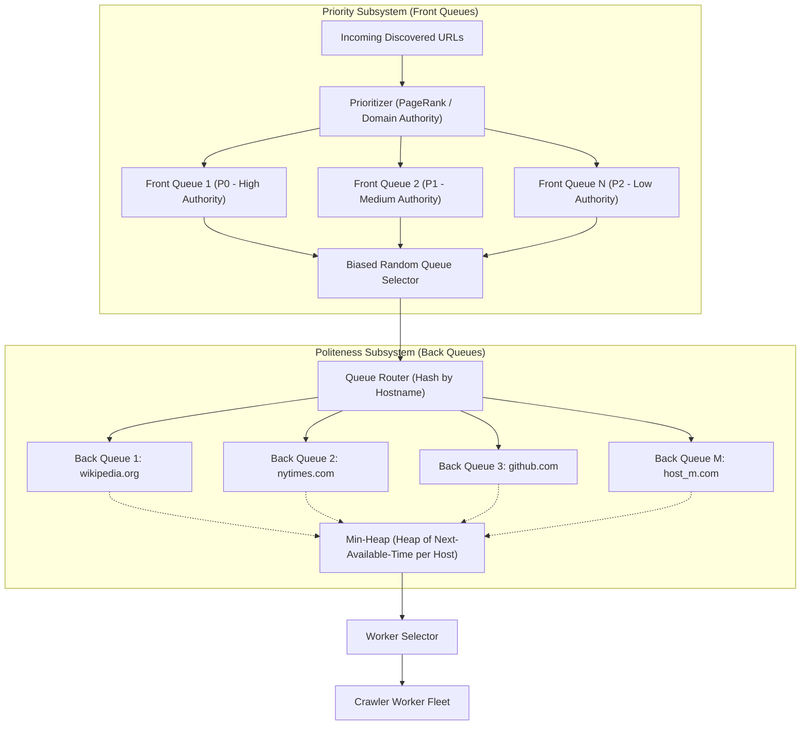
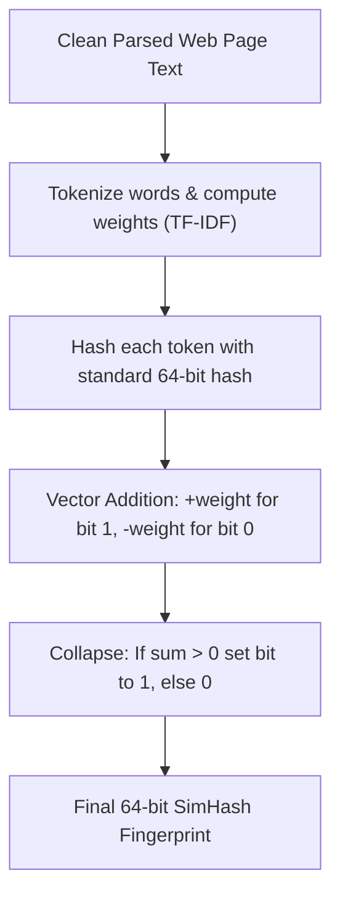
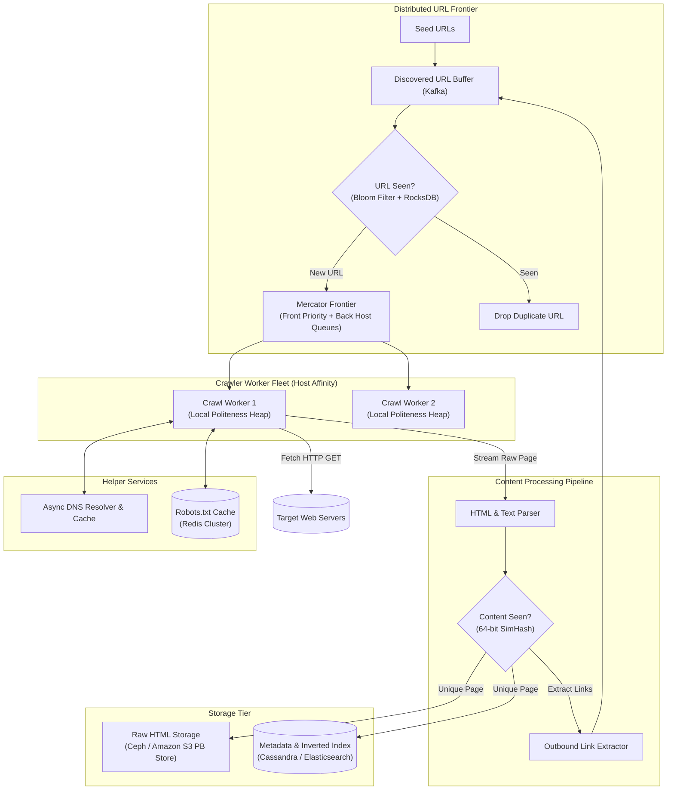

# Chapter 09: Design a Scalable Distributed Web Crawler (Googlebot / Archiver)

---

## 1. Executive Interview Framing & Staff-Level Bar

Designing a web crawler (Googlebot, Bingbot, Internet Archive) is the definitive distributed systems problem testing asynchronous I/O, graph traversal, and distributed coordination. While a junior candidate sketches a single-threaded BFS queue and an MD5 hash check, **Staff and Principal Engineers (L6+, P60) are evaluated on their ability to solve the Mercator dual-tier URL Frontier (Politeness vs Priority), asynchronous non-blocking DNS resolution bottlenecks, SimHash locality-sensitive deduplication, and spider trap defense**:

```
┌────────────────────────────────────────────────────────────────────────────────────────┐
│                                 THE INTERVIEW SPECTRUM                                 │
├────────────────────────────────────────┬───────────────────────────────────────────────┤
│ L5 / Senior Engineer                   │ L6+ / Staff & Principal Engineer              │
├────────────────────────────────────────┼───────────────────────────────────────────────┤
│ • Standard BFS queue                   │ • Mercator Dual-Tier Frontier Architecture     │
│ • "Check robots.txt on each URL"       │   (Front Priority Queues + Back Host Queues)  │
│ • Synchronous DNS lookup               │ • Asynchronous non-blocking DNS cache fleet   │
│ • Exact MD5 hash for content dedup     │ • 64-bit SimHash (Locality-Sensitive Hashing) │
│ • Ignores spider traps & loop bombs    │   for near-duplicate content detection        │
│ • Ignores server politeness throttling │ • Bloom Filters + NVMe RocksDB for URL seen   │
│                                        │ • Spider trap mitigation (depth & regex caps) │
│                                        │ • Host-affinity consistent hash partitioning  │
└────────────────────────────────────────┴───────────────────────────────────────────────┘
```

---

## 2. Requirements & System Scope

### Functional Requirements
1. **HTML & Metadata Crawling:** Fetch web pages, parse HTML, extract clean text, and discover outbound links.
2. **Search Engine Index Storage:** Persist raw HTML in object storage and extracted metadata in document stores.
3. **URL Politeness:** Strictly enforce rate limits per host (e.g., maximum 1 request per second per domain; honor `Crawl-delay` and `robots.txt`).
4. **URL Prioritization:** Prioritize high-value authoritative pages (high PageRank, fresh news domains) over low-quality spam.
5. **Deduplication:** Filter both duplicate URLs and *near-duplicate* content (syndicated news articles with minor layout diffs).
6. **Spider Trap Defense:** Automatically detect and prune infinite URL loops and dynamic query traps.

### Non-Functional Requirements (SLAs & SLOs)
* **Scale:** Crawl **1 Billion web pages / month** ($\approx 400\text{ pages/sec}$, peak $1,500\text{ QPS}$).
* **Network Throughput:** Ingress bandwidth of **1.6 Gbps to 6 Gbps** continuous stream.
* **Storage Capacity:** Store **30 PB** of raw and compressed content over 5 years.
* **Fault Tolerance:** Distributed worker failures must not lose crawl state or breach host politeness boundaries.

---

## 3. Capacity Estimation & Real Hardware Reality (SDFC Math)

Let's calculate the system metrics for a scale of 1 Billion pages / month:

```
Monthly Crawl Target: 1 Billion pages / month
Crawl Window: 30 days = 2,592,000 seconds
Average HTML Page Size: 500 KB (uncompressed HTML + inline resources)
Compressed HTML Size: 100 KB (gzip/Zstandard)
```

### 3.1 Throughput & Bandwidth Math
* **Crawl Throughput:**
  $$\text{Average QPS} = \frac{1,000,000,000}{2,592,000} \approx 386 \text{ pages/sec}$$
  $$\text{Peak Crawl QPS (3x)} \approx 1,200 \text{ pages/sec}$$
* **Network Ingress Bandwidth:**
  $$\text{Average Ingress} = 386 \text{ pages/sec} \times 500 \text{ KB} \approx 193 \text{ MB/sec} = \mathbf{1.54 \text{ Gbps}}$$
  $$\text{Peak Ingress} = 1,200 \times 500 \text{ KB} \approx 600 \text{ MB/sec} = \mathbf{4.8 \text{ Gbps}}$$
  *Staff Takeaway:* Bandwidth fits comfortably within a cluster of 10Gbps AWS/GCP instances, but socket limits and DNS lookups become severe bottlenecks.

### 3.2 Storage Math (5-Year Retention)
* **Monthly Compressed Storage:**
  $$1,000,000,000 \times 100 \text{ KB} = 100 \text{ TB / month}$$
* **5-Year Primary Storage:**
  $$100 \text{ TB/month} \times 60 \text{ months} = \mathbf{6 \text{ PB}}$$
  *(With 3x replication in Ceph / AWS S3: $\approx 18 \text{ PB}$)*.

### 3.3 URL Visited Storage (Memory vs Disk)
* 1 Billion unique URLs crawled + 5 Billion candidate URLs discovered in the Frontier:
  - Average URL length: 80 bytes.
  - Raw storage for 5 Billion URLs: $5 \times 10^9 \times 80 \text{ bytes} = 400 \text{ GB}$.
  - Storing 400 GB in memory is expensive.
* **Bloom Filter Sizing:**
  - Capacity $N = 5 \text{ Billion}$, false positive probability $p = 0.01\%$ ($0.0001$):
    $$M = -\frac{N \ln(p)}{(\ln 2)^2} \approx 11.98 \text{ GB RAM}$$
  - A compact **12 GB Bloom Filter** in RAM eliminates 99.99% of duplicate database lookups!

---

## 4. Architectural Deep Dives: Staff & SDFC Insights

### 4.1 The URL Frontier: Mercator Dual-Tier Architecture

The most critical component of a production crawler is the **URL Frontier**. A single FIFO queue will either crush target servers with thousands of simultaneous hits (violating politeness) or get stuck crawling low-value spam domains.

The gold standard is the **Mercator Crawler Architecture**, which separates **Priority** from **Politeness**:



#### How the Dual-Tier Frontier Operates
1. **Front Queues (Priority Management):**
   - URLs enter the prioritizer, which assigns a score based on PageRank, refresh rate, and domain trust.
   - URLs are pushed into Front Queues $F_1, F_2, \dots, F_K$.
   - A biased random selector picks URLs from higher priority queues with higher probability.
2. **Back Queues (Politeness Management):**
   - Each Back Queue $B_1, B_2, \dots, B_M$ contains URLs for **exactly ONE hostname** (e.g. `B_1` only has `wikipedia.org`).
   - A **Min-Heap** tracks `(host_id, next_allowed_crawl_time)`.
   - When a worker requests a URL:
     - The heap pops the host whose `next_allowed_crawl_time \le \text{current_time}`.
     - Worker pulls the top URL from that host's back queue.
     - The heap updates the host's record: `next_allowed_crawl_time = current_time + politeness_delay` (e.g. 1,000ms).
   - This mathematically guarantees that **no web server is ever hit more than once per second**!

---

### 4.2 Eliminating the DNS Bottleneck: Asynchronous Resolvers

A classic SDFC systems killer: *"Workers make a standard `gethostbyname()` or `net.LookupIP()` call before fetching each page."*
* **The Penalty:**
  - Standard libc DNS lookups are **synchronous blocking calls**.
  - Average DNS lookup takes **20ms to 200ms**. If an authoritative nameserver is slow or down, the call blocks for **5 to 30 seconds**.
  - If 500 worker threads block on DNS, the entire crawl fleet grinds to a halt!
* **The Staff Solution:**
  1. **Local Async DNS Fleet:** Use non-blocking async DNS libraries (e.g. `c-ares` or Go `net.Resolver` with Goroutines).
  2. **In-Memory DNS Cache:** Cache resolved DNS A-records with custom TTLs (e.g. 6 hours). Since a crawler hits the same top 100,000 domains repeatedly, the in-memory DNS hit rate exceeds **95%**, dropping average lookup time to $< 0.1\text{ms}$.
  3. **DNS Prefetching:** When extracting URLs from HTML, immediately trigger asynchronous background DNS prefetch jobs before the URL even reaches the front of the queue!

---

### 4.3 Near-Duplicate Content Detection: 64-Bit SimHash

A major problem in web indexing is **near-duplicate content**: news syndication (the same AP/Reuters article posted across 500 newspaper domains with different ads and navigation headers) or slight copyright date changes.
* Standard cryptographic hashes (MD5, SHA-256) exhibit the **Avalanche Effect**: changing a single character flips 50% of the bits, making similarity detection impossible.
* **The Staff Solution: 64-Bit SimHash (Locality-Sensitive Hashing)**:
  - Similar documents produce almost identical hash values!



#### Hamming Distance Comparison
- To check if Document $A$ and Document $B$ are duplicates, calculate their **Hamming Distance** (number of differing bits):
  $$\text{Distance} = \text{popcount}(\text{SimHash}_A \oplus \text{SimHash}_B)$$
- If $\text{Distance} \le 3 \text{ bits}$, the documents are near-duplicates ($> 95\%$ identical content). The crawler discards the body and indexes only the canonical link!

---

### 4.4 Spider Traps & Infinite Loop Mitigation

Malicious or poorly configured servers can trap crawlers in infinite recursion:
1. **Dynamic Calendar Traps:** `/calendar?year=2026&month=1` $\to$ `/calendar?year=2026&month=2` $\dots$
2. **Directory Mirroring Loops:** `/store/category/items/category/items/...`
3. **Symbolic Link Loops:** File systems pointing back to parent directories.

#### Staff Defensive Protections
* **URL Length Threshold:** Hard cap maximum URL length at **256 characters**. Any URL exceeding this is dropped.
* **Directory Depth Limit:** Reject paths with more than **8 subdirectory segments** (e.g. `/a/b/c/d/e/f/g/h/i`).
* **Repeating Segment Regex:** Detect repeating directory patterns like `/([^/]+)/\1/`.
* **Per-Host Crawl Quotas:** Enforce a hard ceiling on the total pages crawled per domain (e.g., maximum 50,000 pages per domain per crawl cycle unless manually whitelisted).

---

### 4.5 Distributed Coordination & Partitioning: Host Affinity

How do we distribute crawling across 100 worker machines without cross-worker lock contention?
* **The Solution: Host-Affinity Partitioning via Consistent Hashing**
  - Partition the web by **hostname**, not by individual URL:
    $$\text{Worker ID} = \text{ConsistentHash}(\text{url.hostname}) \pmod N$$
  - All URLs for `wikipedia.org` are routed to **Worker Pod 14**.
  - *Benefits:*
    1. Politeness queues and rate limits are managed locally in memory on Pod 14 with **zero cross-network distributed locks**.
    2. Robots.txt and DNS records are cached locally on Pod 14 with maximum cache locality.

---

## 5. End-to-End System Architecture



---

## 6. Edge Cases, Failure Modes & Operational Realities

### 6.1 Robots.txt Parsing & Cache Invalidation
* Before fetching any URL from a host, the worker must check `https://hostname/robots.txt`.
* Cache the parsed `robots.txt` rules in Redis with a 24-hour TTL.
* If a web server returns `404 Not Found` for `robots.txt`, assume all paths are allowed. If it returns `5xx Server Error`, be polite and **pause all crawling on that domain** until the server recovers.

### 6.2 Worker Crash & Orphaned Host Queues
* **Scenario:** Worker Pod 14 dies while holding the back queues for 2,000 domains.
* **Mitigation:**
  - Worker state is coordinated via **etcd / ZooKeeper ephemeral leases**.
  - When Pod 14's heartbeat expires, the Frontier Controller redistributes its assigned host hash rings to surviving worker pods.
  - In-flight unacknowledged URLs are re-queued from the Kafka ingress buffer.

### 6.3 Handling Dynamic JavaScript-Rendered Pages (AJAX / React)
* Over 30% of modern websites require JavaScript execution to render content.
* Running headless Chromium (Puppeteer/Playwright) on every page is 50x slower and CPU prohibitive.
* **The Staff Solution:**
  - Two-tier crawling pipeline:
    1. Standard lightweight HTTP worker (Fast path, 90% of web).
    2. If page has minimal text and contains `<div id="root"></div>` or `<script>` bundles: route to a specialized **Headless Browser Pool** (Slow path) for full DOM evaluation.

---

## 7. Interview Wrap-Up: Staff-Level Decision Matrix

| Problem Space | Junior / Senior Approach | Staff / Principal Approach |
| :--- | :--- | :--- |
| **Frontier Queue** | Single FIFO Queue | **Mercator Dual-Tier Architecture:** Priority Front Queues + Host-specific Back Queues with Min-Heap politeness. |
| **DNS Resolution** | Blocking `gethostbyname()` call | **Async Non-Blocking Resolver + In-Memory DNS Cache + Background DNS Prefetching.** |
| **URL Deduplication** | Relational DB query or memory Set | **12 GB Scalable Bloom Filter in RAM + NVMe RocksDB for backing store.** |
| **Content Deduplication**| Exact MD5/SHA256 hashing | **64-bit SimHash (Locality-Sensitive Hashing):** Hamming distance $\le 3$ catches syndicated duplicates. |
| **Spider Traps** | None or simple timeout | **Multi-layer Defenses:** Max 256 char length, max 8 directory depth, regex loop detection, and per-host crawl quotas. |
| **Worker Coordination**| Central DB locking | **Host-Affinity Consistent Hashing:** One worker owns all queues for a domain; zero distributed lock contention. |
