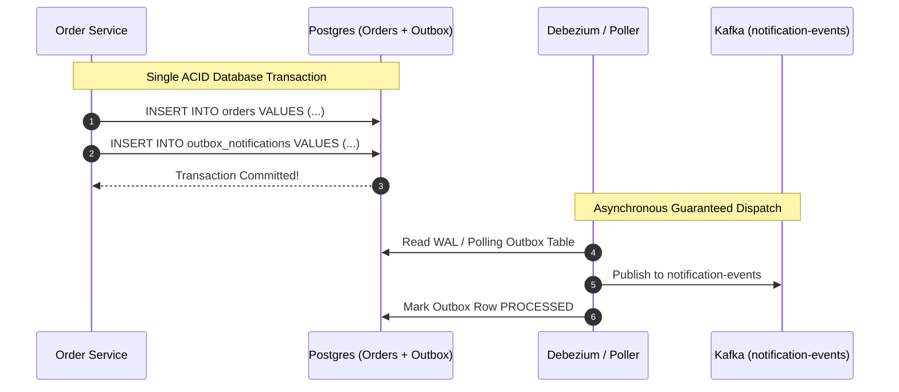
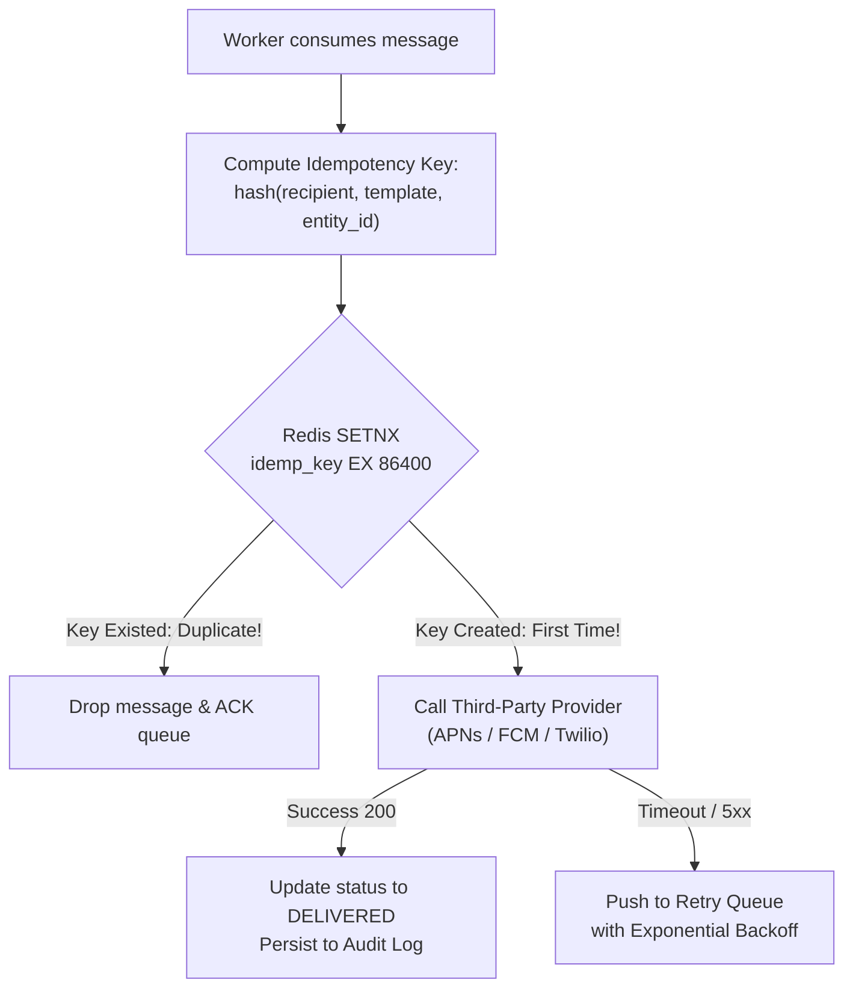
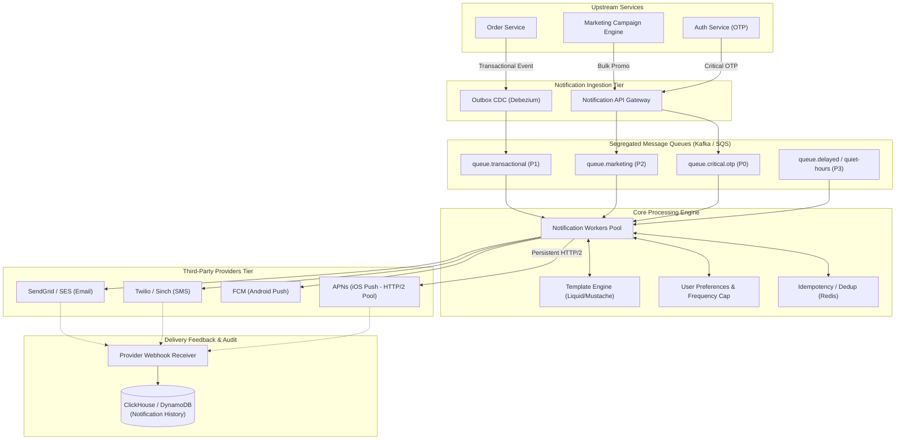

# Chapter 10: Design a Distributed Notification System

---

## 1. Executive Interview Framing & Staff-Level Bar

Designing a scalable notification system (like Amazon SNS/SES, Courier, or Twilio/SendGrid infrastructure) seems simple until you consider the reality of third-party outages, duplicate message prevention, strict rate limits, and quiet-hour timezone compliance. **At the Staff and Principal level (L6+, P60), interviewers evaluate your ability to protect the system against data loss, prevent runaway SMS billing loops, ensure strict priority isolation, and implement idempotent delivery**:

```
┌────────────────────────────────────────────────────────────────────────────────────────┐
│                                 THE INTERVIEW SPECTRUM                                 │
├────────────────────────────────────────┬───────────────────────────────────────────────┤
│ L5 / Senior Engineer                   │ L6+ / Staff & Principal Engineer              │
├────────────────────────────────────────┼───────────────────────────────────────────────┤
│ • Put everything into one RabbitMQ     │ • Priority-segregated Kafka/SQS queues (OTP   │
│ • Send push, email, SMS immediately    │   vs Marketing) to prevent head-of-line block │
│ • Basic retry loop on failure          │ • Transactional Outbox Pattern for 0 data loss│
│ • Simple user opt-out flag in database │ • Timezone-aware quiet hours & frequency caps │
│ • Ignores third-party provider outages │ • Distributed idempotency keys & deduplication│
│ • Ignores SMS cost runaway risks       │ • Provider failover & circuit breaker routing │
│                                        │ • Persistent HTTP/2 multiplexing for APNs     │
│                                        │ • Digesting / windowed notification bundling   │
└────────────────────────────────────────┴───────────────────────────────────────────────┘
```

---

## 2. The 5-Pillar Staff Assessment Rubric for Notification Systems

```
┌────────────────────────────────────────────────────────────────────────────────────────────────────────┐
│                                      5-PILLAR EVALUATION RUBRIC                                        │
├─────────────────────────┬──────────────────────────────────────────────────────────────────────────────┤
│ Pillar                  │ What the Interviewer Listens For (Evidence)                                  │
├─────────────────────────┼──────────────────────────────────────────────────────────────────────────────┤
│ 1. Decision Making      │ • Third-Party Gateways (APNs/FCM/Twilio/SendGrid) vs In-House Carriers.       │
│                         │ • Priority Queue Segregation (P0 Transactional OTP vs P1 Marketing Bulk).    │
│                         │ • Synchronous Dispatch vs Asynchronous Distributed Queues with DLQs.         │
├─────────────────────────┼──────────────────────────────────────────────────────────────────────────────┤
│ 2. Technical            │ • Distributed deduplication via event hash (`user_id + template_id + data`) │
│    Proficiency          │   stored in Redis with short TTL.                                            │
│                         │ • Persistent HTTP/2 connection pooling with APNs to avoid TLS handshake churn│
│                         │ • User opt-out preference matrices & local timezone quiet hour calculation.  │
├─────────────────────────┼──────────────────────────────────────────────────────────────────────────────┤
│ 3. Problem Solving &    │ • Decomposes into API Gateway, Fanout Router, Priority Queues, Dispatchers.  │
│    Analytical Thinking  │ • Calculates 10M notifications/day (peak 10,000 QPS) & handles 1:1,000,000   │
│                         │   fanout amplification during breaking news broadcasts.                      │
├─────────────────────────┼──────────────────────────────────────────────────────────────────────────────┤
│ 4. Operational          │ • Mitigates vendor outages via dynamic fallback circuits (Twilio -> Sinch).  │
│    Mindset              │ • Dead Letter Queue (DLQ) processing for expired/invalid APNs device tokens. │
│                         │ • Rate-limiting & frequency capping to prevent notification fatigue.         │
├─────────────────────────┼──────────────────────────────────────────────────────────────────────────────┤
│ 5. Adaptability &       │ • Shields critical OTP security codes from marketing campaign queue jams.    │
│    Collaboration        │ • Balances high-cost SMS delivery against low-cost Push notification fallback│
│                         │ • Communicates delivery SLAs and bounce rate metrics clearly to leadership.  │
└─────────────────────────┴──────────────────────────────────────────────────────────────────────────────┘
```

---

## 3. Requirements & System Scope

### Functional Requirements
1. **Multi-Channel Delivery:** Support iOS Push (APNs), Android Push (FCM), SMS (Twilio/Sinch), Email (SendGrid/Amazon SES), and In-App WebSockets.
2. **Priority Segregation:** High-priority transactional alerts (OTP codes, fraud alerts) must bypass all marketing queues and deliver in $< 5\text{ seconds}$.
3. **User Preferences & Opt-Out:** Granular preference matrix (e.g. Email: Opt-In, SMS: Opt-Out, Push: Opt-In for orders only).
4. **Rate Limiting & Frequency Capping:** Prevent spamming (e.g., maximum 3 marketing notifications per user per day).
5. **Timezone-Aware Quiet Hours:** Promotional messages must not be sent between 10 PM and 8 AM in the recipient's local timezone.
6. **Notification Bundling / Digesting:** Aggregate multiple repetitive events (e.g., *"Alice and 4 others liked your photo"*) within a sliding time window.
7. **Delivery Analytics:** Track dispatch, delivery receipts, bounces, opens, and clicks.

### Non-Functional Requirements (SLAs & SLOs)
* **Zero Data Loss for Transactional Alerts:** $100\%$ delivery guarantee for critical alerts (at-least-once with downstream idempotency).
* **Latency:**
  - High-Priority (OTP / Fraud): p99 $< \mathbf{3\text{ seconds}}$.
  - Low-Priority (Marketing / Newsletters): Deliver within minutes to hours.
* **Throughput:** Support **100 Million notifications / day** with spiky holiday workloads (up to $10,000\text{ notifications/sec}$).
* **Deduplication:** Exactly-once user perception (users must never receive duplicate OTPs or payment notifications).

---

## 3. Capacity Estimation & Real Hardware Numbers

Let's establish concrete production numbers:

```
Daily Notification Volume: 100 Million
  - Push Notifications: 70 Million (70%)
  - Emails:             20 Million (20%)
  - SMS:                10 Million (10%)
```

### 3.1 Throughput Math
* **Average Delivery Rate:**
  $$\text{Average QPS} = \frac{100,000,000}{86,400} \approx 1,160 \text{ notifications/sec}$$
* **Peak Delivery Rate (Black Friday / Flash Sales / Breaking News):**
  $$\text{Peak QPS (8x)} \approx 10,000 \text{ notifications/sec}$$
  - Peak Push QPS: $\approx 7,000\text{/sec}$
  - Peak Email QPS: $\approx 2,000\text{/sec}$
  - Peak SMS QPS: $\approx 1,000\text{/sec}$

### 3.2 Financial & Hardware Constraints (SDFC Reality Check)
* **SMS Cost Reality:** Unlike push notifications (which are free), SMS costs approximately **\$0.007 to \$0.02 per message**.
  $$10,000,000 \text{ SMS/day} \times \$0.01 \approx \$100,000 \text{ / day!}$$
  *Staff Takeaway:* An infinite retry loop or lack of rate limiting on SMS can cause hundreds of thousands of dollars in accidental cloud bills within hours! Strict SMS throttling and circuit breakers are non-negotiable.
* **Storage Footprint (Notification History & Logs):**
  - Average log entry: 500 bytes (UUID, user_id, channel, template_id, status, timestamps).
  - Daily storage: $100\text{M} \times 500 \text{ bytes} = 50 \text{ GB / day}$.
  - Yearly storage: $\approx 18.25 \text{ TB / year}$ (ideal for ClickHouse or DynamoDB with 90-day TTL).

---

## 4. API & Data Contracts

### 4.1 Internal Notification Ingestion API
```http
POST /v1/notifications/dispatch
Authorization: Bearer <service_jwt_token>
Content-Type: application/json
Idempotency-Key: ord_98214_payment_success_user_5521

{
  "recipient_id": "usr_99104",
  "category": "TRANSACTIONAL", // or "PROMOTIONAL"
  "priority": "HIGH",          // or "LOW"
  "channels": ["PUSH", "EMAIL"],
  "template_id": "tpl_payment_confirmed",
  "template_params": {
    "order_id": "ord_98214",
    "amount": "$49.99",
    "currency": "USD"
  },
  "dedup_window_seconds": 300 // Reject duplicate events within 5 mins
}
```

**Response (`202 Accepted`):**
```json
{
  "notification_id": "ntf_819204918239",
  "status": "QUEUED",
  "estimated_delivery_ms": 1200
}
```

---

## 5. Architectural Deep Dives: Staff & SDFC Insights

### 5.1 The Transactional Outbox Pattern: Eliminating Notification Loss

A common junior flaw: *"The Order Service updates the database and then directly makes an HTTP call to the Notification Service."*
* **The Dual-Write Problem:** If the database commits but the network blips before calling the Notification Service, the user is charged but **receives no confirmation**. If the notification call succeeds but the database transaction rolls back, the user receives a confirmation for an order that **does not exist**!



* **Staff Solution:** Write the business entity and the notification event in the **exact same ACID transaction** to an `outbox` table. A Change Data Capture (CDC) engine like **Debezium** tails the Postgres Write-Ahead Log (WAL) and publishes guaranteed events into Kafka with zero dual-write vulnerabilities.

---

### 5.2 Queue Architecture: Channel & Priority Segregation

Never throw all notifications into a single shared message queue!
If a marketing campaign suddenly queues 20 million holiday discount emails, transactional One-Time Passwords (OTPs) and fraud alerts will be trapped behind millions of promotional messages (**Head-of-Line Blocking**).

```
┌────────────────────────────────────────────────────────────────────────────────────────┐
│                              QUEUE SEGREGATION STRATEGY                                │
├─────────────────────┬──────────────────┬───────────────────────────────────────────────┤
│ Queue Name          │ Priority Tier    │ SLA & Worker Scaling Strategy                 │
├─────────────────────┼──────────────────┼───────────────────────────────────────────────┤
│ `queue.otp.sms`     │ P0 - Critical    │ Latency < 3s. Dedicated auto-scaled workers.  │
│                     │                  │ Zero concurrency limits.                      │
├─────────────────────┼──────────────────┼───────────────────────────────────────────────┤
│ `queue.push.high`   │ P1 - Transact.   │ Order updates, security alerts. Workers never │
│                     │                  │ shared with marketing.                        │
├─────────────────────┼──────────────────┼───────────────────────────────────────────────┤
│ `queue.email.promo` │ P2 - Marketing   │ Rate-limited to respect SendGrid/SES domain   │
│                     │                  │ reputation limits. Max throughput bounded.    │
├─────────────────────┼──────────────────┼───────────────────────────────────────────────┤
│ `queue.delayed`     │ P3 - Scheduled   │ Redis ZSET / SQS Delay queue for quiet hours  │
│                     │                  │ and windowed digest notifications.            │
└─────────────────────┴──────────────────┴───────────────────────────────────────────────┘
```

---

### 5.3 Deduplication & Idempotent Delivery Mechanics

Networks are unreliable. Third-party providers timeout. Message brokers offer **at-least-once delivery**, which means worker retries can result in duplicate dispatches unless strictly guarded.



#### Deduplication Rules
1. **Idempotency Key Construction:** Combine `recipient_id`, `template_id`, and `business_entity_id` (e.g. `usr_91_pwd_reset_req_1092`).
2. **Atomic In-Flight Lock:** Worker executes `SET idemp:{key} "PROCESSING" NX EX 300` in Redis:
   - If returns `0`: Another worker is currently processing this exact notification. Drop or wait.
   - If returns `1`: Acquired lock; proceed to third-party delivery.
3. **Downstream Idempotency:** Pass the idempotency key in the HTTP header when calling downstream providers that support it (e.g. Stripe, SendGrid `X-Entity-ID`).

---

### 5.4 Notification Windowing & Digest Aggregation

Instead of bombarding a user with 20 individual notifications when their post goes viral, the system aggregates them:

```
[Event 1: Alice liked your post] ─┐
[Event 2: Bob liked your post]   ─┼──> Aggregator (5-min window) ──> "Alice, Bob and 3 others
[Event 3: Dave liked your post]  ─┘                                   liked your post"
```

#### Implementation via Redis Streams & Delayed Execution
1. When an aggregatable event occurs, worker executes:
   ```redis
   -- Add to user's pending digest set
   SADD digest:usr_102:post_991 "Alice"
   -- Schedule dispatch job for (now + 300 seconds) in Redis ZSET
   ZADD scheduled_digests 1774345500 "usr_102:post_991"
   ```
2. A lightweight scheduler sweeps `scheduled_digests` using `ZRANGEBYSCORE scheduled_digests 0 <current_time>`:
   - Fetches the set members (`Alice`, `Bob`, `Dave`).
   - Renders the composite template: *"Alice, Bob and 1 other liked your post"*.
   - Dispatches a single combined notification!

---

### 5.5 High-Throughput Push Mechanics: APNs & FCM Connection Pooling

A classic SDFC systems failure: *"Opening a new TLS/TCP connection to Apple Push Notification Service (APNs) for every push notification."*
* **The Penalty:** Setting up a TLS 1.3 handshake takes **50-100ms** of latency and intensive CPU crypto handshakes. APNs will aggressively throttle or ban IP addresses that execute thousands of TLS handshakes per second.
* **The Staff Solution:**
  - APNs runs over **HTTP/2**.
  - A single persistent HTTP/2 connection supports **hundreds of multiplexed concurrent streams** over one long-lived TCP socket!
  - Maintain a dedicated worker connection pool with persistent, pre-warmed HTTP/2 connections to APNs and FCM gateway endpoints (`api.push.apple.com:443`).

---

### 5.6 Timezone-Aware Quiet Hours & Frequency Capping

Promotional notifications must never buzz a user's phone at 3 AM:
1. **Timezone Resolution:** Every user profile maintains their resolved IANA timezone (e.g., `America/New_York`), resolved via their mobile app heartbeat or IP address.
2. **Quiet Hour Validation:**
   - If message category == `PROMOTIONAL`:
   - Calculate current local time in user's timezone.
   - If local time is between `22:00` and `08:00`:
     - Reschedule notification for `08:05 AM` local time by enqueuing into a **Delayed Execution Queue** (e.g., AWS SQS DelaySeconds or Redis Sorted Set).
3. **Frequency Capping:**
   - Maintain an atomic counter in Redis: `INCR promo_count:{user_id}:{date}` with a 24-hour TTL.
   - If count $> 3$, discard the message and log `DROPPED_FREQUENCY_CAP`.

---

## 6. End-to-End System Architecture



---

## 7. Failure Modes, Resilience & Provider Failover

### 7.1 Third-Party Outage & Circuit Breaker Routing
* **Scenario:** Twilio experiences a major network degradation in North America, returning HTTP 504 timeouts on 40% of SMS dispatches.
* **Failure:** Workers block on timeouts, exhausting worker threads; SMS queue backs up.
* **Mitigation:**
  - Wrap downstream provider clients in a **Circuit Breaker** (e.g. Resilience4j / Netflix Hystrix pattern).
  - If error rate exceeds $15\%$ over a 30-second rolling window, open circuit.
  - Automatically route traffic to fallback secondary providers (e.g., failover from Twilio to Sinch or AWS SNS).

```mermaid
flowchart LR
    A["SMS Worker"] --> B{"Circuit Breaker<br/>State?"}
    B -->|Closed (Healthy)| C["Twilio Primary Gateway"]
    B -->|Open (Degraded)| D["Sinch Fallback Gateway"]
    C -->|5xx / Timeout Spike| E["Trip Breaker -> Open"]
    D -->|Success| F["Message Delivered"]
```

### 7.2 Poison Pill Messages & Dead Letter Queues (DLQ)
* **Scenario:** A notification payload contains malformed parameters that cause the template engine or provider SDK to throw an unhandled `NullPointerException`.
* **Failure:** The worker crashes without acknowledging the message. The message broker redelivers it indefinitely, taking down worker after worker (**Poison Pill Loop**).
* **Mitigation:**
  - Cap retries at **3 attempts** with exponential backoff and jitter.
  - After 3 failures, route message to a dedicated **Dead Letter Queue (DLQ)**.
  - Emit alert to PagerDuty/Datadog; engineers can inspect the DLQ payload, fix the template bug, and replay messages safely.

---

## 8. Interview Wrap-Up: Staff-Level Decision Matrix

| Architectural Dilemma | Junior / Senior Approach | Staff / Principal Approach |
| :--- | :--- | :--- |
| **Data Loss Prevention** | Direct HTTP call between services | **Transactional Outbox Pattern with CDC (Debezium):** Guarantees zero lost alerts during crashes. |
| **Queue Design** | Single shared queue for all messages | **Segregated Priority Queues:** OTPs never get stuck behind promotional marketing blasts. |
| **Duplicate Prevention** | Database lookup on event ID | **Distributed Idempotency Keys in Redis (`SETNX`) + Downstream Provider Idempotency Headers.** |
| **APNs Connection** | New TLS connection per push | **Persistent HTTP/2 Multiplexed Connection Pool:** Prevents socket exhaustion and IP bans. |
| **Spam & Annoyance** | Single boolean opt-out flag | **Granular Matrix + Timezone-Aware Quiet Hours + Sliding Window Event Digesting.** |
| **SMS Cost runaway** | Infinite retry loop on failure | **Strict SMS Frequency Caps + Circuit Breaker with Fallback Provider Routing.** |
