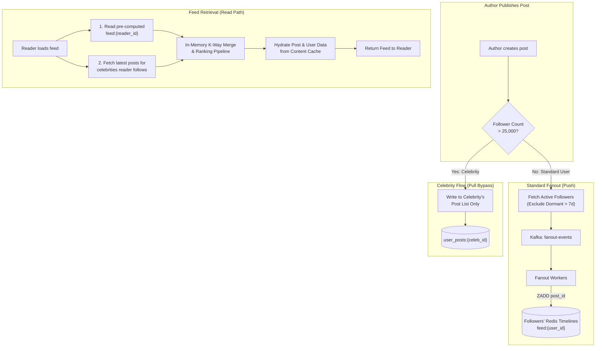
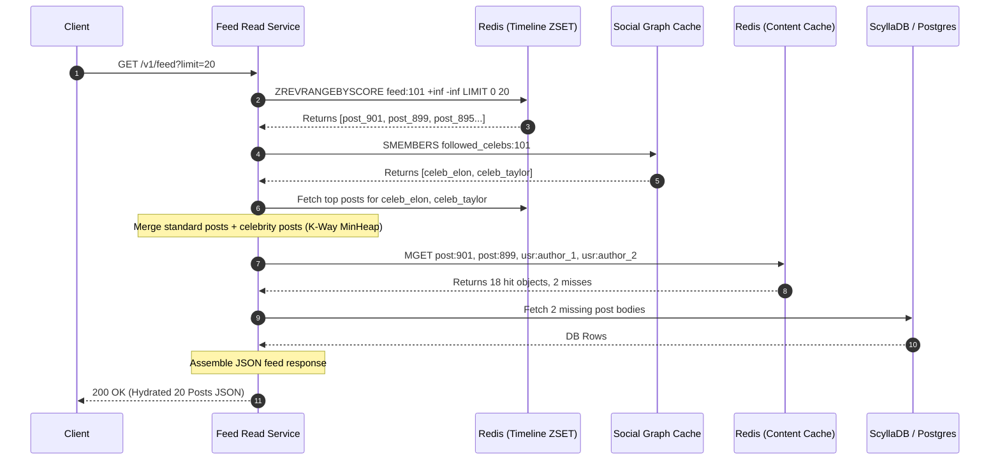
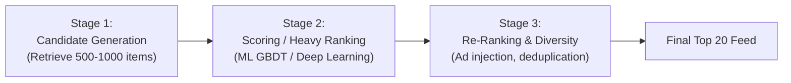
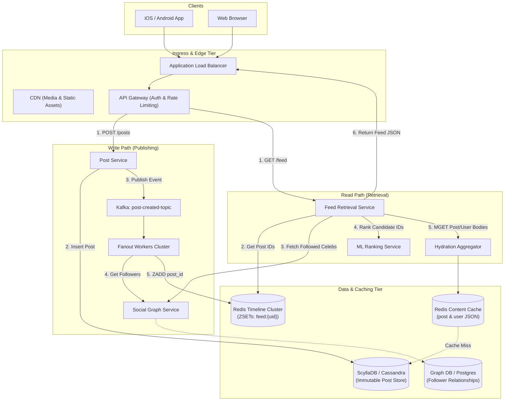

# Chapter 11: Design a News Feed / Activity Stream System

---

## 1. Executive Interview Framing & Staff-Level Bar

Designing a News Feed (Facebook News Feed, Twitter/X Timeline, LinkedIn Feed, Instagram Feed) is the quintessential test of a distributed systems engineer. While a junior candidate describes basic CRUD tables and fanout bullet points, **Staff and Principal Engineers (L6+, P60) are evaluated on how they solve extreme write amplification, supernode hot-spotting, multi-tier caching architectures, and cursor-based pagination consistency**:

```
┌────────────────────────────────────────────────────────────────────────────────────────┐
│                                 THE INTERVIEW SPECTRUM                                 │
├────────────────────────────────────────┬───────────────────────────────────────────────┤
│ L5 / Senior Engineer                   │ L6+ / Staff & Principal Engineer              │
├────────────────────────────────────────┼───────────────────────────────────────────────┤
│ • Basic Fanout-on-write vs read        │ • Dynamic Hybrid Fanout based on follower     │
│ • "Store everything in Redis"          │   count & user activity (active vs dormant)   │
│ • Reverse chronological sort only      │ • Multi-stage ML Ranking Pipeline (Candidate  │
│ • Offset-based SQL pagination          │   Retrieval -> Scoring -> Diversity Filter)   │
│ • Ignores celebrity / supernodes       │ • Cursor-based pagination with stable seeks   │
│ • Ignores post deletion & un-follows   │ • Celebrity post isolation (fanout bypass)     │
│                                        │ • Lazy feed materialization & cache warming   │
│                                        │ • Memory-capped Redis ZSETs (ZREMRANGEBYRANK) │
│                                        │ • Handling post deletions, unfollows & blocks │
└────────────────────────────────────────┴───────────────────────────────────────────────┘
```

---

## 2. The 5-Pillar Staff Assessment Rubric for News Feeds

```
┌────────────────────────────────────────────────────────────────────────────────────────────────────────┐
│                                      5-PILLAR EVALUATION RUBRIC                                        │
├─────────────────────────┬──────────────────────────────────────────────────────────────────────────────┤
│ Pillar                  │ What the Interviewer Listens For (Evidence)                                  │
├─────────────────────────┼──────────────────────────────────────────────────────────────────────────────┤
│ 1. Decision Making      │ • Fanout-on-Write (Push) vs Fanout-on-Read (Pull) vs Dynamic Hybrid Fanout.  │
│                         │ • Caches lightweight Post IDs (Redis ZSET) vs heavy denormalized Post blobs. │
│                         │ • Evaluates trade-offs between reverse-chronological and ML ranked feeds.    │
├─────────────────────────┼──────────────────────────────────────────────────────────────────────────────┤
│ 2. Technical            │ • Cursor-based pagination using composite Base64 (timestamp + post_id).      │
│    Proficiency          │ • Memory-capped Redis Sorted Sets via atomic `ZREMRANGEBYRANK` (top 800).    │
│                         │ • Celebrity post isolation: completely bypasses fanout-on-write; merged on read│
│                         │ • Handles unfollows, post deletions, and blocks via asynchronous feed purging.│
├─────────────────────────┼──────────────────────────────────────────────────────────────────────────────┤
│ 3. Problem Solving &    │ • Decomposes into Feed Publishing, Fanout Workers, Timeline Cache, Delivery. │
│    Analytical Thinking  │ • Calculates fanout write amplification: 700 posts/sec * 200 followers =     │
│                         │   140k writes/sec (peak 420k); sizes Redis cluster memory (7.68 TB RAM).     │
├─────────────────────────┼──────────────────────────────────────────────────────────────────────────────┤
│ 4. Operational          │ • Protects Redis from OOM crashes using strict ZSET length caps & LRU policies│
│    Mindset              │ • Circuit breaker on ML ranker: automatically falls back to chronological.   │
│                         │ • Lazy cache warming: only warms feeds for users active in the last 7 days.  │
├─────────────────────────┼──────────────────────────────────────────────────────────────────────────────┤
│ 5. Adaptability &       │ • Shields the system from viral supernodes (100M+ followers) without lag.    │
│    Collaboration        │ • Balances instant post delivery freshness with backend infrastructure cost. │
│                         │ • Explains ranking fairness, algorithmic transparency, and pagination SLOs.  │
└─────────────────────────┴──────────────────────────────────────────────────────────────────────────────┘
```

---

## 3. Requirements & System Scope

### Functional Requirements
1. **Feed Publishing:** A user can publish posts (text, images, video links).
2. **Feed Retrieval:** A user can view their aggregated feed consisting of posts from people and pages they follow.
3. **Feed Ranking:** Feeds support both chronological order and algorithmic relevance (engagement-weighted).
4. **Pagination:** Infinite scrolling without duplicate or missing items as new posts arrive.
5. **Real-time Indicators:** Notify active users when new posts are available (e.g. "New Tweets" banner) without disruptive UI jumping.
6. **Social Actions:** Likes, comments, post deletions, and unfollow actions immediately propagate or reconcile in feeds.

### Non-Functional Requirements (SLAs & SLOs)
* **Feed Retrieval Latency:** p99 < **150ms** for the initial 20 feed items.
* **Post Publication Latency:** New post visible to standard followers within **5 seconds**.
* **Availability:** **99.99%** for feed generation (reads must not fail if downstream ranking services degrade).
* **Scalability:** Support **300 Million Daily Active Users (DAU)**.

---

## 3. Capacity Estimation & Real Hardware Numbers

Let's calculate the system metrics for a scale of 300M DAU:

```
DAU: 300 Million users
Feed Reads: 5 views/day per user = 1.5 Billion feed queries / day
Post Writes: 0.2 posts/day per user = 60 Million posts / day
Average Follower Count: 200 followers per user
```

### 3.1 Throughput Math
* **Read QPS:**
  $$\text{Feed Read QPS} = \frac{1,500,000,000}{86,400} \approx 17,360 \text{ QPS}$$
  $$\text{Peak Read QPS (2x)} \approx 35,000 \text{ QPS}$$
* **Write QPS:**
  $$\text{Post Creation QPS} = \frac{60,000,000}{86,400} \approx 700 \text{ writes/sec}$$
  $$\text{Peak Write QPS (3x)} \approx 2,100 \text{ writes/sec}$$
* **Fanout Write QPS (The Bottleneck):**
  $$\text{Average Fanout Rate} = 700 \text{ posts/sec} \times 200 \text{ followers} \approx 140,000 \text{ writes/sec}$$
  $$\text{Peak Fanout Rate} = 2,100 \times 200 \approx 420,000 \text{ timeline updates/sec!}$$

### 3.2 Storage Math
* **Post Metadata Storage (Daily):**
  - Post ID: 8 bytes (Snowflake 64-bit int)
  - Author ID: 8 bytes
  - Text content: 300 bytes average
  - Media URLs / Metadata: 100 bytes
  - Created timestamp: 8 bytes
  - Overhead: 76 bytes
  - **Total per post:** $\approx 500 \text{ bytes}$
  $$\text{Daily Post Storage} = 60\text{M} \times 500 \text{ bytes} \approx 30 \text{ GB / day}$$
  $$\text{Yearly Storage} \approx 11 \text{ TB / year}$$

### 3.3 Cache Storage Math (The Big Number)
* Only cache the feed for **Active Users** (users active within the last 7 days $\approx 50\%$ of DAU = 150M users).
* Cache the top **800 Post IDs** per active user in a Redis Sorted Set (`ZSET`):
  - Post ID: 8 bytes
  - Score (Timestamp): 8 bytes
  - Redis ZSET node overhead (skiplist + dict): $\approx 48 \text{ bytes}$
  - Total per item: $\approx 64 \text{ bytes}$
  - Per user feed memory: $800 \times 64 \text{ bytes} \approx 51.2 \text{ KB}$
* **Total Redis Memory Required:**
  $$\text{Total Feed Cache RAM} = 150,000,000 \times 51.2 \text{ KB} \approx 7.68 \text{ TB RAM}$$
  *(A cluster of 32 Redis nodes with 256 GB RAM each provides 8 TB+ RAM with ample room for replicas and failover).*

---

## 4. API & Data Contracts

### 4.1 Publish Post API
```http
POST /v1/posts
Authorization: Bearer <jwt_token>
Content-Type: application/json
Idempotency-Key: c9d8e7b6-5a4f-3e2d-1c0b-9a8b7c6d5e4f

{
  "content": "Excited to share our new distributed systems architecture!",
  "media_ids": ["med_829104", "med_829105"],
  "visibility": "PUBLIC"
}
```

### 4.2 Fetch News Feed API
```http
GET /v1/feed?limit=20&cursor=MTc3NDM0NTIwMDAwMF9wb3N0XzkyODEwNA==
Authorization: Bearer <jwt_token>
```

**Response (`200 OK`):**
```json
{
  "items": [
    {
      "post_id": "928104819201945",
      "author": {
        "user_id": "usr_1029",
        "username": "martin_kleppmann",
        "avatar_url": "https://cdn.example.com/avatars/usr_1029.jpg"
      },
      "content": "Excited to share our new distributed systems architecture!",
      "media": [{"type": "IMAGE", "url": "https://cdn.example.com/img1.jpg"}],
      "likes_count": 1420,
      "comments_count": 89,
      "created_at": 1774345200000
    }
  ],
  "next_cursor": "MTc3NDM0NTEwMDAwMF9wb3N0XzkyODEwMA==",
  "has_more": true
}
```

---

## 5. Architectural Deep Dives: The Staff-Level Mechanics

### 5.1 The Fanout Architecture: Push vs Pull vs Dynamic Hybrid

The central architectural dilemma of any feed system is how new posts propagate from authors to followers:

```
┌────────────────────────────────────────────────────────────────────────────────────────┐
│                              FANOUT STRATEGY COMPARISON                                │
├─────────────────────┬──────────────────────────────────┬───────────────────────────────┤
│ Model               │ Mechanics                        │ Failure Modes & Tradeoffs     │
├─────────────────────┼──────────────────────────────────┼───────────────────────────────┤
│ Fanout-on-Write     │ When user posts, asynchronously  │ • Pros: O(1) feed retrieval.  │
│ (Push Model)        │ push post_id into every          │ • Catastrophic on celebrities:│
│                     │ follower's Redis timeline.       │   1 tweet = 100M DB writes!   │
│                     │                                  │ • Wastes CPU/RAM on dormant   │
│                     │                                  │   users who never log in.     │
├─────────────────────┼──────────────────────────────────┼───────────────────────────────┤
│ Fanout-on-Read      │ Do not push on write. When user  │ • Pros: Zero write fanout lag.│
│ (Pull Model)        │ loads feed, fetch all followees' │ • Catastrophic on reads:      │
│                     │ posts and merge in memory.       │   User following 3,000 friends│
│                     │                                  │   requires 3,000 DB queries & │
│                     │                                  │   in-memory K-way merge!      │
├─────────────────────┼──────────────────────────────────┼───────────────────────────────┤
│ Dynamic Hybrid      │ Split users into Standard vs     │ • RECOMMENDED (Staff Choice): │
│ (The Gold Standard) │ Celebrities (>25k followers).    │   Eliminates celebrity write  │
│                     │ Push standard posts. Pull        │   amplification while keeping │
│                     │ celebrity posts at read time.    │   read path sub-50ms.         │
└─────────────────────┴──────────────────────────────────┴───────────────────────────────┘
```

#### How the Dynamic Hybrid Model Executes
1. **Standard Users ($\le 25,000$ followers):**
   - Use **Fanout-on-Write**.
   - Workers query the social graph, filter for *active* followers (active within the last 7 days), and push `post_id` to their Redis timelines via `ZADD feed:{follower_id} <timestamp> <post_id>`.
2. **Celebrity / Supernodes ($> 25,000$ followers, e.g. Elon Musk, Taylor Swift):**
   - **Bypass Fanout-on-Write completely!**
   - The post is written *only* to the celebrity's own post list: `user_posts:{celebrity_id}`.
3. **Feed Construction at Read Time:**
   - Client requests feed for `User A`.
   - Query `User A`'s Redis timeline (contains all pre-computed posts from standard friends).
   - Query social graph for the list of *celebrities* `User A` follows.
   - Fetch the latest top-20 posts from each celebrity's cached post list.
   - Perform an in-memory **$K$-Way Merge** (using a Min-Heap) of the standard feed and celebrity posts.
   - Return the top $N$ items to the client.



---

### 5.2 Database Schemas: Cassandra / ScyllaDB + Redis

```sql
-- ScyllaDB / Cassandra Table for Posts (Write-optimized, immutable)
CREATE KEYSPACE newsfeed WITH replication = {'class': 'NetworkTopologyStrategy', 'us-east': 3, 'us-west': 3};

CREATE TABLE newsfeed.posts (
    post_id bigint,
    author_id bigint,
    content text,
    media_urls list<text>,
    created_at timestamp,
    PRIMARY KEY (author_id, post_id)
) WITH CLUSTERING ORDER BY (post_id DESC);

-- Secondary lookup table by post_id
CREATE TABLE newsfeed.posts_by_id (
    post_id bigint PRIMARY KEY,
    author_id bigint,
    content text,
    media_urls list<text>,
    created_at timestamp
);

-- Social Graph Table
CREATE TABLE newsfeed.follows (
    follower_id bigint,
    followee_id bigint,
    created_at timestamp,
    PRIMARY KEY (follower_id, followee_id)
);
```

> [!NOTE]
> **Why Two Post Tables (`posts` vs. `posts_by_id`)? (Query-Driven Modeling in NoSQL)**
> In distributed databases like Cassandra/ScyllaDB, queries **must** include the partition key to avoid cluster-wide scatter-gather scans. Because relational joins don't exist, we denormalize into two tables based on query patterns:
> 1. **`posts` (`PK: author_id, SK: post_id DESC`):** Optimized for **User Profile Timelines** (`WHERE author_id = ? LIMIT 20`). All posts for an author live on one physical node and are pre-sorted on disk, executing in a single sequential disk seek ($<2\text{ ms}$).
> 2. **`posts_by_id` (`PK: post_id`):** Optimized for **Feed Hydration** (`WHERE post_id IN (...)`). When the feed service retrieves a list of post IDs from Redis, it looks up their contents in $O(1)$ single-node seeks without knowing the authors.
> * **Why not a Secondary Index (`CREATE INDEX`)?** Cassandra secondary indexes are local to each node. Querying by `post_id` on the `posts` table would force a query to **every node in the cluster**, destroying P99 latency. Dual-writing both tables via Cassandra Logged Batches trades cheap disk space for predictable sub-millisecond reads.

#### Redis Data Structures
1. **User News Feed Timeline:**
   - Type: `Sorted Set (ZSET)`
   - Key: `feed:{user_id}`
   - Score: `created_at` (epoch timestamp in milliseconds)
   - Value: `post_id` (string/int)
   - Truncation Command: `ZREMRANGEBYRANK feed:{user_id} 0 -801` (keeps exactly 800 freshest items).
2. **Celebrity Post List:**
   - Type: `List` or `ZSET`
   - Key: `user_posts:{celebrity_id}`
   - Score: `created_at`
   - Value: `post_id`

---

### 5.3 The Feed Hydration & Multi-Tier Cache Architecture

A critical SDFC optimization: **Never store full post JSON or user avatars in the timeline cache!**
Storing full post JSON in 800 timeline entries across 150M users multiplies memory requirements by 20x.

Instead, timelines store only **`post_id`s**. The read service performs a fast multi-key hydration (`MGET`) against a dedicated **Content Cache Tier**:

```
┌────────────────────────────────────────────────────────────────────────────────────────┐
│                               MULTI-TIER CACHE HIERARCHY                               │
├────────────────────┬───────────────────────┬───────────────────────────────────────────┤
│ Cache Tier         │ Technology            │ Stored Contents                           │
├────────────────────┼───────────────────────┼───────────────────────────────────────────┤
│ 1. Timeline Cache  │ Redis Cluster (ZSET)  │ Capped list of `post_id`s sorted by score │
├────────────────────┼───────────────────────┼───────────────────────────────────────────┤
│ 2. Content Cache   │ Memcached / Redis     │ `post_id -> {text, media_urls, author_id}`│
├────────────────────┼───────────────────────┼───────────────────────────────────────────┤
│ 3. User Cache      │ Memcached / Redis     │ `user_id -> {name, handle, avatar_url}`   │
├────────────────────┼───────────────────────┼───────────────────────────────────────────┤
│ 4. Social Graph    │ Redis Sets / Neo4j    │ `user_id -> set of followed celebrity IDs`│
├────────────────────┼───────────────────────┼───────────────────────────────────────────┤
│ 5. Counter Cache   │ Redis Hashes          │ `post_id -> {likes: 412, comments: 85}`   │
└────────────────────┴───────────────────────┴───────────────────────────────────────────┘
```



---

### 5.4 Pagination Mechanics: Why Offset Pagination is a Critical Flaw

#### The Flaw of Offset Pagination (`LIMIT 20 OFFSET 40`)
Imagine a user is viewing Page 1 (Posts 1-20). While they read, 5 new posts are published to their feed.
The client now requests Page 2 (`LIMIT 20 OFFSET 20`):
* Because 5 new posts were prepended to the top of the feed, the offset shifted by 5!
* Posts 16-20 from Page 1 now appear as Posts 21-25 in Page 2.
* **The user sees duplicate posts!** Conversely, if posts are deleted, items are silently skipped. Furthermore, SQL `OFFSET 100000` requires scanning and discarding 100,000 index entries ($O(N)$ execution).

#### The Staff Solution: Composite Keyset / Cursor Pagination
The cursor encodes the position of the last viewed item as an opaque Base64 string:
$$\text{Cursor} = \text{Base64}\big(\text{"created\_at:post\_id"}\big)$$

When requesting the next page:
```http
GET /v1/feed?limit=20&cursor=MTc3NDM0NTIwMDAwMF85MjgxMDQ=
```
The server decodes the cursor into `(timestamp = 1774345200000, post_id = 928104)` and executes:
```redis
-- Redis ZSET seek: find items with score strictly LESS THAN cursor timestamp
ZREVRANGEBYSCORE feed:101 (1774345200000 -inf LIMIT 0 20
```
This guarantees:
1. **Zero Duplicates:** Newly inserted posts have higher timestamps and are naturally ignored.
2. **$O(\log N)$ Execution:** Redis skiplist directly jumps to the cursor score in logarithmic time.

---

### 5.5 Algorithmic Feed Ranking Pipeline (Beyond Reverse Chronological)

In production, modern feeds pass candidate posts through a 3-stage ranking pipeline:



1. **Stage 1: Candidate Generation (Retrieval)**
   - Pull the latest 500 post IDs from the user's timeline and followed sources.
2. **Stage 2: Scoring & Ranking (ML Inference)**
   - Score each post using a predictive model:
     $$\text{Score} = w_1 \cdot P(\text{click}) + w_2 \cdot P(\text{like}) + w_3 \cdot P(\text{comment}) - w_4 \cdot \text{AgeDecay}$$
   - Features: User historical engagement affinity with author, post media type (video vs image), current network connection speed (don't rank 4K videos first on slow 3G).
3. **Stage 3: Re-Ranking & Diversity Rules**
   - Author capping: Never display more than 2 consecutive posts from the same author.
   - Content diversity: Interleave text, images, and short video.
   - Ad Insertion: Inject sponsored posts at deterministic intervals (e.g. slot 3, slot 8).

---

## 6. End-to-End System Architecture



---

## 7. Edge Cases, Failure Modes & Operational Realities

### 7.1 Cache Eviction & Feed Rebuild (Cold Start / Cache Miss)
* **Scenario:** A user has been inactive for 30 days. Their Redis feed key was evicted by the LRU policy to save RAM. They suddenly open the app.
* **Failure:** Redis returns `nil` for `feed:{user_id}`.
* **The Solution (Lazy Feed Materialization):**
  1. The Feed Service detects the cache miss.
  2. Queries the Social Graph Service to retrieve all accounts the user follows.
  3. Executes a multi-partition fetch across ScyllaDB for the latest 10 posts from each followee.
  4. Merges and sorts the top 800 posts into a new Redis ZSET.
  5. Sets the standard TTL and returns the first 20 items to the user.

### 7.2 Post Deletion & Tombstone Handling
* **Scenario:** An author deletes a post that was already fanned out to 5,000 followers' Redis timelines.
* **Problem:** Iterating through 5,000 Redis keys to call `ZREM` is slow and wastes network bandwidth.
* **The Staff Solution (Lazy Invalidation via Tombstone):**
  - Delete the post from the primary Post DB and set a tombstone in the Content Cache (`SET post:928104 "DELETED" EX 86400`).
  - As followers scroll their feeds and fetch their `post_id`s, the Hydration Service checks the Content Cache.
  - When it sees the `"DELETED"` tombstone, it silently drops the post from the returned JSON and issues an asynchronous background `ZREM` to clean up that user's timeline.

### 7.3 Unfollowing & Blocking Mechanics
* When User A unfollows User B:
  - Immediate: Update the Social Graph DB.
  - Asynchronous: Dispatch an event to Kafka `unfollow-topic`. Workers query User A's timeline and remove all `post_id`s where `author_id == User B`.
* Alternatively, filter dynamically during hydration if the candidate set is small.

### 7.4 Real-Time Feed Invalidation: The "New Posts" Pill
* Never inject new incoming posts directly into the user's active viewport while they are reading! This causes the UI to violently jump, destroying user experience.
* **Mitigation:** Deliver notification via Server-Sent Events (SSE) or WebSocket: `{"event": "NEW_POSTS_AVAILABLE", "count": 3}`.
* The client UI renders a floating pill: *"3 New Posts"*. Clicking the pill scrolls the viewport to top and requests the latest posts using `cursor=top`.

---

## 8. Interview Wrap-Up: Staff-Level Decision Matrix

| Architectural Problem | Junior / Senior Approach | Staff / Principal Approach |
| :--- | :--- | :--- |
| **Fanout Strategy** | Pure Push or Pure Pull | **Dynamic Hybrid:** Push for standard users, Pull bypass for celebrities (>25k followers), filter out dormant users (>7 days). |
| **Feed Storage in Cache** | Full Post JSON in Redis | **ID-Only Caching:** Store only 64-bit `post_id` in Redis ZSET; hydrate bodies via batch `MGET` from content cache. |
| **Feed Pagination** | `LIMIT 20 OFFSET 40` | **Opaque Composite Cursor:** Base64 encoded `(timestamp, post_id)` with logarithmic index seek. |
| **Timeline Retention** | Unlimited growing list | **Hard Memory Cap:** Enforce `ZREMRANGEBYRANK feed:{uid} 0 -801` to strictly bound RAM at 51 KB per user. |
| **Post Deletions** | Synchronous mass deletion across all follower feeds | **Tombstone in Content Cache + Lazy Drop on Read:** Zero fanout overhead on deletion. |
| **Ranking** | SQL `ORDER BY created_at DESC` | **3-Stage Funnel:** Candidate Generation (500 items) $\to$ ML Scoring $\to$ Re-ranking & Diversity Filtering. |
