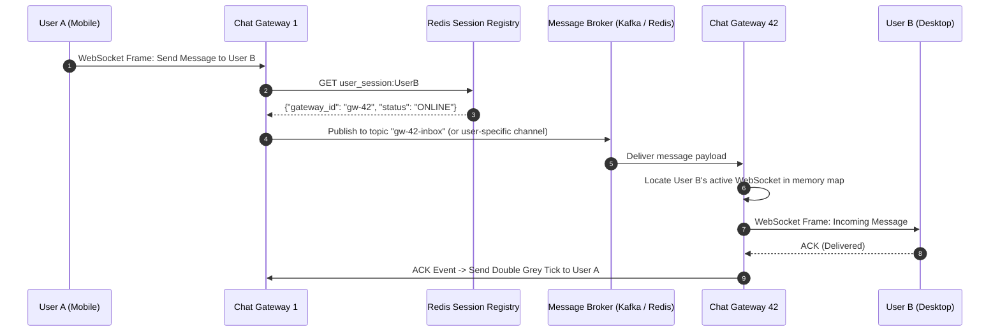
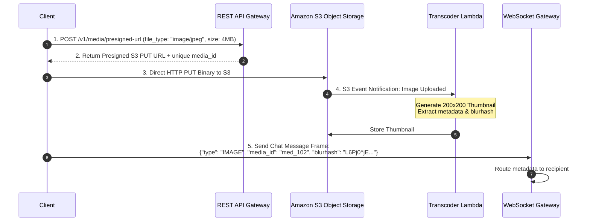
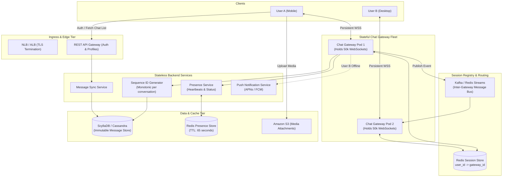

# Chapter 12: Design a Real-Time Distributed Chat System (WhatsApp / Slack / Discord)

## Guarantees and assumptions
Server acceptance follows durable message and per-conversation sequence assignment. Reuse client message IDs, fence sequencers by leader epoch, and let clients buffer gaps and backfill history; delivery/read receipts are separate states.
**Principal IC exercise:** Fail over a sequencer after persisting a message but before returning its sequence; recover without duplicate assignment or permanent gaps.

---

## 1. Executive Interview Framing & Staff-Level Bar

Designing a large-scale real-time chat application (WhatsApp, Slack, Discord, Facebook Messenger) is one of the ultimate tests of systems knowledge. A junior engineer discusses basic WebSockets and polling; **Staff and Principal Engineers (L6+, P60) are evaluated on network socket mechanics, ephemeral presence fanout at scale, conversation sequence ordering under clock skew, multi-device state synchronization, and small-group vs mega-channel architectural divergence**:

```
┌────────────────────────────────────────────────────────────────────────────────────────┐
│                                 THE INTERVIEW SPECTRUM                                 │
├────────────────────────────────────────┬───────────────────────────────────────────────┤
│ L5 / Senior Engineer                   │ L6+ / Staff & Principal Engineer              │
├────────────────────────────────────────┼───────────────────────────────────────────────┤
│ • "Just use WebSockets for everything" │ • HTTP for stateless metadata + persistent    │
│ • Fanout messages to all group members │   WebSockets for duplex push streaming        │
│ • Wall-clock timestamp for ordering    │ • Linux Epoll socket limits & file descriptors│
│ • Polling / frequent presence updates  │ • Monotonic sequence IDs per conversation     │
│ • Media sent over WebSocket socket     │ • WhatsApp fanout-on-write vs Discord channel │
│ • Single Redis for presence            │   broadcast (100k members in a room)          │
│                                        │ • On-demand presence fetch vs fanout flood    │
│                                        │ • Presigned S3 URLs for decoupled media flow  │
│                                        │ • Multi-device cursor sync (last_sync_seq_id) │
└────────────────────────────────────────┴───────────────────────────────────────────────┘
```

---

## 2. The 5-Pillar Staff Assessment Rubric for Real-Time Chat

```
┌────────────────────────────────────────────────────────────────────────────────────────────────────────┐
│                                      5-PILLAR EVALUATION RUBRIC                                        │
├─────────────────────────┬──────────────────────────────────────────────────────────────────────────────┤
│ Pillar                  │ What the Interviewer Listens For (Evidence)                                  │
├─────────────────────────┼──────────────────────────────────────────────────────────────────────────────┤
│ 1. Decision Making      │ • WebSockets vs Server-Sent Events (SSE) vs Long Polling for 2-way traffic.   │
│                         │ • Cassandra/ScyllaDB Wide-Column vs Relational SQL for message history.       │
│                         │ • Message Fanout Model: Recipient Queues (small) vs Pub/Sub Channel (large).  │
├─────────────────────────┼──────────────────────────────────────────────────────────────────────────────┤
│ 2. Technical            │ • Ephemeral Presence Tracking using Redis heartbeat leases with short TTLs.   │
│    Proficiency          │ • Monotonic sequence IDs per conversation thread for strict message ordering. │
│                         │ • End-to-End Encryption (E2EE Signal Protocol Double Ratchet) architecture.  │
│                         │ • Multi-device synchronization via `last_sync_seq_id` cursors.               │
├─────────────────────────┼──────────────────────────────────────────────────────────────────────────────┤
│ 3. Problem Solving &    │ • Decomposes into Gateway, Session Manager, Message Router, History, Push.   │
│    Analytical Thinking  │ • Calculates 500M DAU, 10B msgs/day, 50M concurrent WebSocket connections,    │
│                         │   and gateway RAM footprint (50M * 10KB = 500 GB RAM).                       │
├─────────────────────────┼──────────────────────────────────────────────────────────────────────────────┤
│ 4. Operational          │ • Mitigates reconnect thundering herds on gateway restarts via random jitter. │
│    Mindset              │ • Monitors message delivery receipts (Sent, Delivered, Read ACK pipeline).   │
│                         │ • Seamless fallback to Push Notifications (APNs/FCM) for offline users.      │
├─────────────────────────┼──────────────────────────────────────────────────────────────────────────────┤
│ 5. Adaptability &       │ • Adapts to client network switches (WiFi to 5G) without losing message state.│
│    Collaboration        │ • Balances high-frequency typing indicators with mobile battery constraints. │
│                         │ • Communicates message retention policies and data privacy compliance.       │
└─────────────────────────┴──────────────────────────────────────────────────────────────────────────────┘
```

---

## 3. Requirements & System Scope

### Functional Requirements
1. **1-on-1 Real-Time Messaging:** Ultra-low latency two-way text communication.
2. **Group Chats:**
   - Small private groups (up to 200 members, e.g., WhatsApp / iMessage).
   - Large public channels (up to 100,000 members, e.g., Discord / Slack).
3. **Message Delivery Receipts:** Three-state delivery tracking:
   - *Sent* (1 tick: acknowledged by server).
   - *Delivered* (2 grey ticks: delivered to recipient's active device).
   - *Read* (2 blue ticks: recipient viewed conversation).
4. **Online Presence System:** Real-time online/offline and last-seen indicators.
5. **Multi-Device Synchronization:** Messages and read states seamlessly synchronize across mobile, desktop, and web clients.
6. **Media Sharing:** Send images, voice notes, and videos with thumbnail previews.
7. **Offline Storage & History:** Store chat history permanently; deliver unread messages upon reconnection.

### Non-Functional Requirements (SLAs & SLOs)
* **Latency:** Real-time delivery p99 $< \mathbf{100ms}$ across active WebSocket connections.
* **Scale:** Support **50 Million Daily Active Users (DAU)** with **10 Million concurrent active WebSocket connections**.
* **Ordering Guarantee:** Render a durable per-conversation sequence in order, buffering/backfilling gaps. This is server acceptance order; causal ordering additionally requires clients to carry observed-sequence/dependency metadata.
* **High Availability:** $99.99\%$ uptime; chat gateways must gracefully drain and reconnect without message loss during rolling deployments.

---

## 3. Capacity Estimation & Real Hardware Reality (SDFC Math)

Let's establish concrete production numbers:

```
DAU: 50 Million users
Concurrent Active WebSocket Connections (Peak): 10 Million connections
Messages Sent: 1 Billion messages / day (average 20 messages / user / day)
Average Message Payload: 200 bytes (text + JSON metadata)
```

### 3.1 Throughput Math
* **Average Message Ingestion:**
  $$\text{Average QPS} = \frac{1,000,000,000}{86,400} \approx 11,570 \text{ messages/sec}$$
* **Peak Message Ingestion (3x):**
  $$\text{Peak QPS} \approx 35,000 \text{ messages/sec}$$
* **Fanout Delivery Rate (Assuming average group size of 5):**
  $$\text{Peak Egress Message Deliveries} = 35,000 \times 5 \approx 175,000 \text{ pushes/sec}$$

### 3.2 Linux Socket & Gateway Sizing (The Epoll Reality)
* **The OS Constraint:** Every active WebSocket connection holds an open TCP socket and an operating system File Descriptor (`FD`).
* In modern Linux kernels with `epoll`, each open socket consumes $\approx 4\text{ KB}$ of kernel TCP buffer memory (`tcp_wmem`, `tcp_rmem` tuned).
* **RAM per 100,000 connections:**
  $$100,000 \text{ connections} \times 4\text{ KB} \approx 400 \text{ MB kernel memory}$$
  With application state overhead, each gateway pod safely manages **50,000 to 100,000 concurrent sockets**.
* **Gateway Fleet Sizing:**
  $$\text{Total Pods Required} = \frac{10,000,000 \text{ concurrent users}}{50,000 \text{ conn/server}} = \mathbf{200 \text{ Gateway Pods}}$$

### 3.3 Storage Math
* Daily Message Storage:
  $$1,000,000,000 \times 200 \text{ bytes} = 200 \text{ GB / day}$$
* Yearly Storage:
  $$\approx 73 \text{ TB / year}$$
  *(With 3x replication in ScyllaDB / Cassandra: $\approx 220 \text{ TB / year}$)*.

---

## 4. Communication Protocol Selection

```
┌────────────────────────────────────────────────────────────────────────────────────────┐
│                              PROTOCOL TRADEOFF EVALUATION                              │
├─────────────────────┬──────────────────┬───────────────────────────────────────────────┤
│ Protocol            │ Direction        │ Staff Engineering Evaluation                  │
├─────────────────────┼──────────────────┼───────────────────────────────────────────────┤
│ HTTP/REST Polling   │ Client -> Server │ UNACCEPTABLE. Massive header overhead, burns  │
│                     │ (Simulated push) │ server CPU on empty 304 responses.            │
├─────────────────────┼──────────────────┼───────────────────────────────────────────────┤
│ HTTP Long-Polling   │ Unidirectional   │ Better than polling, but reconnections after  │
│                     │ Server -> Client │ every message cause severe socket churn.      │
├─────────────────────┼──────────────────┼───────────────────────────────────────────────┤
│ Server-Sent Events  │ Unidirectional   │ Excellent for read-only feeds; requires a     │
│ (SSE)               │ Server -> Client │ second HTTP connection for client sends.      │
├─────────────────────┼──────────────────┼───────────────────────────────────────────────┤
│ WebSockets (ws/wss) │ Full-Duplex      │ RECOMMENDED. Single TCP handshake upgraded to │
│                     │ Bi-directional   │ bi-directional framed stream. Minimal 2-byte  │
│                     │                  │ frame overhead; sub-5ms push latency.         │
└─────────────────────┴──────────────────┴───────────────────────────────────────────────┘
```

> [!IMPORTANT]
> **Staff Architecture Recommendation:** Use **WebSockets** for real-time duplex streaming (message delivery, typing indicators, delivery receipts, presence heartbeats) and **HTTP/REST** for initial authentication, profile updates, and heavy media attachment uploads.

---

## 5. Architectural Deep Dives: Staff & SDFC Insights

### 5.1 WebSocket Session Management & Message Routing

When User A is connected to **Chat Gateway Node 3** and sends a message to User B (who is connected to **Chat Gateway Node 42**), how does the system route the message to the correct socket?



#### The Two Session Registry Approaches
1. **Centralized Redis Session Store (Recommended for WhatsApp / 1-on-1):**
   - When a user connects to a gateway, the gateway sets:
     `SET user_session:{user_id} "gateway_pod_42" EX 120`
   - Gateways periodically refresh this TTL via WebSocket heartbeats.
2. **Distributed Pub/Sub Routing (Discord / Slack style):**
   - Each Gateway Pod subscribes to its own unique Kafka/Redis channel (`channel.gw-42`).
   - The sending gateway writes directly to the destination gateway's queue.

---

### 5.2 Message Ordering Without Clock Skew (Monotonic Sequences)

A critical systems trap: *"Sort messages by client timestamp or server wall-clock time (`System.currentTimeMillis()`)."*
* **Why Wall-Clock Time Fails:**
  - Client clocks can be manipulated, out of sync, or set to the wrong timezone.
  - Server clocks experience **Clock Drift** and NTP backward jumps (leap seconds). Two concurrent messages arriving at different servers can receive scrambled timestamps, displaying responses *before* the questions in the UI!
* **The Staff Solution: Monotonic Sequence IDs per Conversation**
  - Assign a durable acceptance sequence within each conversation/channel.
  - Conceptually allocate a monotonic counter per conversation:
    $$\text{seq\_id} = \text{INCR conversation\_seq:}\{\text{conv\_id}\}$$
  - The composite primary key in the database is:
    $$\mathbf{\big(\text{conversation\_id}, \text{sequence\_id}\big)}$$
  - Commit `(conversation_id, client_message_id) → sequence_id + message` atomically in the authoritative log/store before ACK. Fence the sequencer with a leader epoch; recover its committed high-water mark on failover. A standalone volatile Redis `INCR` followed by a separate database write is insufficient.
  - Retries return the same assignment. If reservation of sequence ranges allows holes, record skipped positions or expose a committed high-water mark so clients do not wait forever for nonexistent messages. Carry the last observed sequence for causally dependent sends; define timeout/backfill behavior when a dependency is unavailable.

```
Conversation 101:
  [seq_id: 1] Alice: "Are we launching today?"
  [seq_id: 2] Bob:   "Yes, waiting on QA."
  [seq_id: 3] Alice: "Approved!"
```
Every client renders messages strictly sorted by `sequence_id`. If a client receives `seq_id: 3` before `seq_id: 2`, it buffers the message and requests the missing gap (`seq_id: 2`) from the sync service.

---

### 5.3 Small Groups (WhatsApp) vs Mega-Channels (Discord / Slack)

One of the most profound architectural splits in chat systems is group scale:

```
┌────────────────────────────────────────────────────────────────────────────────────────┐
│                               GROUP ARCHITECTURE SPLIT                                 │
├─────────────────────┬──────────────────┬───────────────────────────────────────────────┤
│ Dimension           │ Small Group Chat (WhatsApp)      │ Mega-Channel (Discord / Twitch)│
├─────────────────────┼──────────────────┼───────────────────────────────────────────────┤
│ Group Size          │ 2 to 200 members                 │ 1,000 to 100,000+ members     │
├─────────────────────┼──────────────────┼───────────────────────────────────────────────┤
│ Fanout Strategy     │ **Fanout-on-Write:** Copy post   │ **Channel Broadcast:** Write   │
│                     │ ID into each member's private    │ ONCE to channel partition.     │
│                     │ inbox sync queue.                │ Broadcast only to *active* WS. │
├─────────────────────┼──────────────────┼───────────────────────────────────────────────┤
│ Storage Model       │ Per-user message sync queue.     │ Single channel message log.    │
├─────────────────────┼──────────────────┼───────────────────────────────────────────────┤
│ Delivery Receipts   │ Full 3-tick delivery tracking    │ Disabled (would cause 100,000  │
│                     │ per member.                      │ ACKs per message!).            │
├─────────────────────┼──────────────────┼───────────────────────────────────────────────┤
│ Presence Mechanism  │ Full presence of all members.    │ Scoped presence (only render   │
│                     │                                  │ visible users in viewport).    │
└─────────────────────┴──────────────────┴───────────────────────────────────────────────┘
```

#### Why Fanout-on-Write Fails at Mega-Scale
If a user posts in a Discord server with **100,000 members**:
- Fanout-on-write requires generating **100,000 message copies** in message queues.
- Generating 100,000 delivery receipts generates another **100,000 write operations**.
- *Discord's Solution:* Treat the channel as an append-only log in ScyllaDB. The Gateway determines which of the 100,000 members currently have an active WebSocket in that specific channel and fans out only in memory to connected sockets!

---

### 5.4 High-Performance Storage Schema: ScyllaDB / Cassandra

Chat history requires **high-throughput sequential writes**, ultra-fast recent message reads, and horizontal scaling. LSM-Tree databases (ScyllaDB / Cassandra) outperform B-Tree relational databases:

```sql
CREATE KEYSPACE chat_system WITH replication = {
    'class': 'NetworkTopologyStrategy', 
    'us-east': 3, 
    'us-west': 3
};

-- Messages Table: Partitioned by conversation, clustered by sequence_id
CREATE TABLE chat_system.messages (
    conversation_id uuid,
    sequence_id bigint,
    message_id bigint,        -- Snowflake ID for global idempotency
    sender_id uuid,
    content text,
    media_url text,
    created_at timestamp,
    PRIMARY KEY (conversation_id, sequence_id)
) WITH CLUSTERING ORDER BY (sequence_id DESC);

-- Conversation Metadata Table
CREATE TABLE chat_system.conversations (
    conversation_id uuid PRIMARY KEY,
    type text,                -- 'DIRECT' or 'GROUP'
    name text,
    last_sequence_id bigint,
    updated_at timestamp
);

-- User Conversation Mapping (For loading the chat list)
CREATE TABLE chat_system.user_conversations (
    user_id uuid,
    last_read_sequence_id bigint,
    conversation_id uuid,
    unread_count int,
    updated_at timestamp,
    PRIMARY KEY (user_id, updated_at, conversation_id)
) WITH CLUSTERING ORDER BY (updated_at DESC);
```

---

### 5.5 Online Presence Architecture: The Fanout Bomb

A naive presence design: *"Every time a user goes online or offline, broadcast their status to all their friends."*
* **The Math of the Presence Bomb:**
  - 50 Million DAU, each with 300 friends.
  - If users connect/disconnect or ping every minute:
    $$\frac{50,000,000 \times 300}{60\text{ seconds}} = \mathbf{250,000,000 \text{ presence updates/sec!}}$$
  - This thundering herd will completely incinerate your Redis clusters and message brokers.

#### The Staff Solution: Heartbeats + On-Demand Pull
1. **Heartbeat over Existing WebSocket:**
   - Client sends an empty ping frame every 30 seconds over the established WebSocket.
   - The Gateway refreshes Redis: `SET presence:{user_id} "ONLINE" EX 65`.
   - If no heartbeat arrives within 65 seconds, the key automatically expires $\implies$ user is offline.
2. **On-Demand Presence Fetching (No Global Fanout):**
   - **Upon App Open:** The client queries presence *only* for the top 20 visible friends in the chat list (`MGET presence:friend_1 presence:friend_2 ...`).
   - **Inside Active Chat View:** The client subscribes to presence changes *only* for the active conversation partner.
   - Zero background fanout to inactive or background users!

---

### 5.6 Decoupled Media Upload Architecture

Never stream large binary images or video payloads over persistent WebSockets! Doing so blocks the gateway event loop and exhausts network bandwidth.



---

### 5.7 Multi-Device Synchronization & Catch-Up Protocol

When a user opens their laptop after being offline for 3 days:
1. Client connects to WebSocket Gateway and announces:
   `{"action": "SYNC", "last_sync_seq_id": 4102}`
2. The Gateway queries the sync service:
   `SELECT * FROM messages WHERE conversation_id = ? AND sequence_id > 4102 ORDER BY sequence_id ASC`
3. Delta messages are pushed down in a single compressed batch, bringing the laptop client to current state without re-downloading entire chat histories.

---

## 6. End-to-End System Architecture



---

## 7. Edge Cases, Failure Modes & Operational Realities

### 7.1 Chat Gateway Node Crash & The Reconnect Thundering Herd
* **Scenario:** Gateway Pod 12 crashes, abruptly disconnecting **50,000 active WebSocket connections**.
* **Failure:** All 50,000 mobile clients immediately attempt to reconnect simultaneously, overwhelming remaining gateway pods and downstream authentication services (**Thundering Herd**).
* **Mitigations:**
  1. **Client Exponential Backoff with Full Jitter:** Clients must wait $T = \text{random}(0, \min(M, T_0 \cdot 2^{\text{attempt}}))$ before reconnecting.
  2. **Service Discovery / Envoy Rate Limiting:** The edge load balancer throttles new WebSocket handshake requests per second.

### 7.2 Zombie Connections & Half-Open Sockets
* **Scenario:** A mobile user drives into a subway tunnel. The cell connection is severed without sending a TCP `FIN` packet. The gateway still considers the socket open and attempts to push messages.
* **Mitigation:**
  - Enforce strict **WebSocket Ping/Pong frames** at the protocol layer.
  - If a client fails to respond to 2 consecutive server pings (e.g. 60 seconds), the gateway forcibly closes the socket and updates the Redis session registry to `OFFLINE`.

### 7.3 Delivery Receipt Reconciliation
* If a recipient is offline when a message is sent:
  - Gateway detects no active WebSocket.
  - Dispatches an asynchronous push notification via FCM/APNs.
  - When recipient opens app, the catch-up sync protocol pulls the message and fires back an asynchronous `ACK_DELIVERED` event to the sender.

---

## 8. Interview Wrap-Up: Staff-Level Decision Matrix

| Architectural Problem | Junior / Senior Approach | Staff / Principal Approach |
| :--- | :--- | :--- |
| **Connection Protocol** | Polling or raw HTTP | **WebSockets for Duplex Streaming + REST for Media & Auth.** |
| **Message Ordering** | Client / Server wall clock | **Monotonic Sequence ID per conversation** (`conversation_id, sequence_id`). |
| **Group Fanout** | Fanout-on-write for all groups | **Dynamic Model:** Fanout-on-write for small groups ($\le 200$); Channel-based log partition for mega-channels. |
| **Presence System** | Global broadcast to all friends | **Heartbeat with Redis TTL + On-Demand viewport pull:** Zero broadcast storm. |
| **Media Handling** | Stream binary through socket | **Direct Presigned S3 Upload + Lightweight blurhash metadata frame.** |
| **Storage Engine** | MySQL / MongoDB | **ScyllaDB / Cassandra (LSM-Tree):** Ultra-high write throughput with sequential clustering key scans. |
