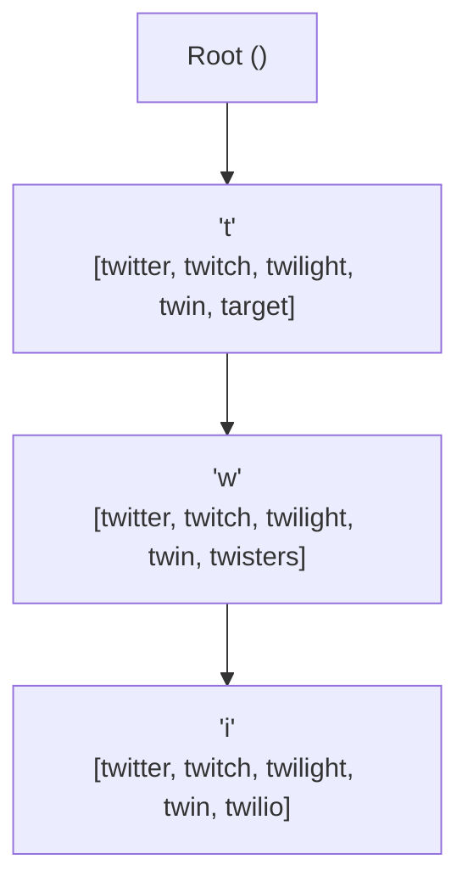
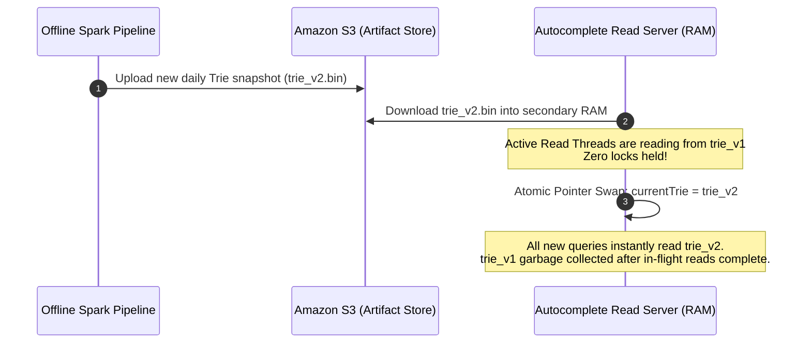
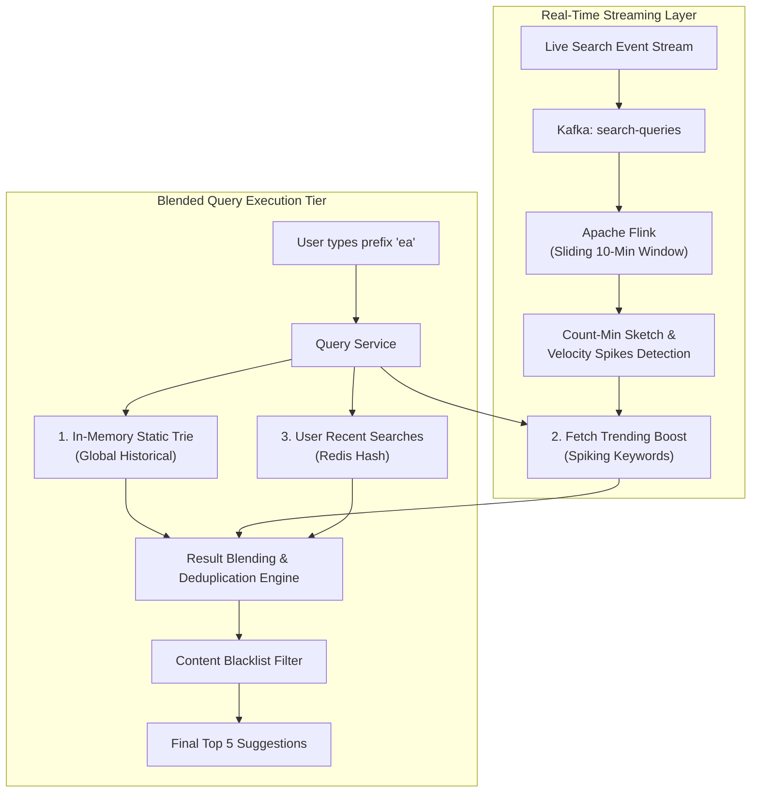
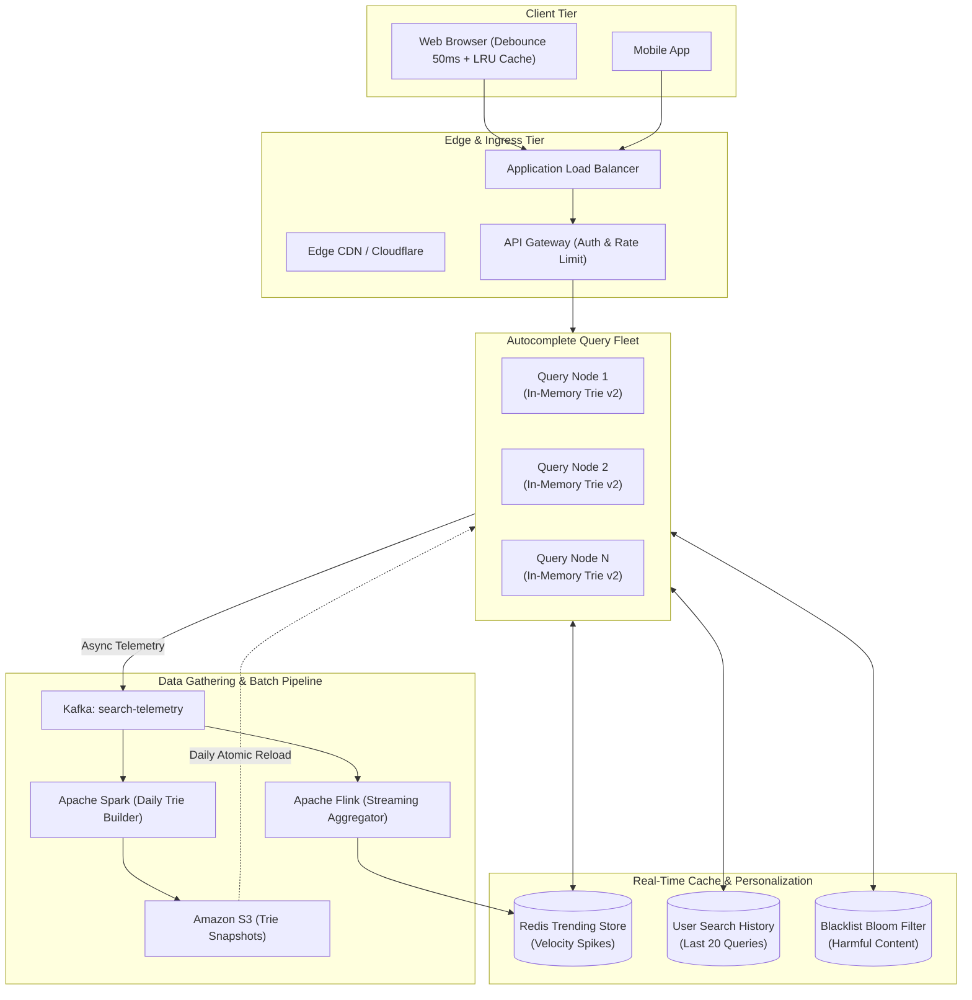

# Chapter 13: Design a Search Autocomplete System (Typeahead Suggestions)

---

## 1. Executive Interview Framing & Staff-Level Bar

Typeahead / Autocomplete is a core feature in Google, Amazon, YouTube, and Jira. While mid-level candidates describe a standard Trie data structure, **Staff and Principal Engineers (L6+, P60) are evaluated on how they handle read-heavy ultra-low latency SLAs (p99 $< 15\text{ms}$), atomic zero-lock Trie memory updates, hybrid trending stream integration, and client-side network traffic reduction**:

```
┌────────────────────────────────────────────────────────────────────────────────────────┐
│                                 THE INTERVIEW SPECTRUM                                 │
├────────────────────────────────────────┬───────────────────────────────────────────────┤
│ L5 / Senior Engineer                   │ L6+ / Staff & Principal Engineer              │
├────────────────────────────────────────┼───────────────────────────────────────────────┤
│ • Basic Trie with DFS traversal        │ • In-memory Trie with precomputed Top-K at    │
│ • Update Trie directly on every search │   each node (O(L) retrieval, independent of N)│
│ • Shard by first letter (A-Z)          │ • Double Buffering & Atomic Pointer Swaps     │
│ • Suggests weekly batch processing     │   (zero write locks on live read paths)       │
│ • Ignores client-side keystroke flood  │ • Skew-resistant sharding via prefix hashing  │
│ • Ignores breaking news / trending     │ • Hybrid Architecture: Weekly Batch Trie +    │
│                                        │   Real-time Flink / Count-Min Sketch trending │
│                                        │ • Client debouncing, abort controllers & LRU  │
│                                        │ • Personalization blending (history + global) │
└────────────────────────────────────────┴───────────────────────────────────────────────┘
```

---

## 2. Requirements & System Scope

### Functional Requirements
1. **Prefix Matching:** Return relevant suggestions based on the user's input prefix.
2. **Top-K Ranking:** Return the top 5 most relevant/popular suggestions ranked by query frequency and recency.
3. **Personalization:** Blend user-specific recent search history with global popular queries.
4. **Trending Query Integration:** Capture breaking events (e.g., "World Cup score", "Earthquake California") within minutes, not weeks.
5. **Harmful Content Filtering:** Instantly suppress hate speech, illegal terms, and blacklisted keywords.

### Non-Functional Requirements (SLAs & SLOs)
* **Ultra-Low Latency:** p99 response time $< \mathbf{15ms}$ from server; keystroke to UI update $< \mathbf{30ms}$.
* **High Availability:** **99.999%** availability (autocomplete failures must fail open without blocking the user from submitting a regular search).
* **Massive Read Scalability:** Handle **1 Billion autocomplete queries / day** with spiky keystroke bursts.
* **Data Freshness:** Global historical frequencies updated daily/weekly; trending breaking topics updated within 5 minutes.

---

## 3. Capacity Estimation & Real Hardware Reality

Let's establish concrete production numbers:

```
Daily Active Users (DAU): 50 Million
Average Searches per User / Day: 4 searches
Average Characters Typed per Query: 10 keystrokes
1 Search = 10 Autocomplete Requests
Total Autocomplete Requests / Day: 50M * 4 * 10 = 2 Billion queries / day
```

### 3.1 Throughput Math
* **Average Autocomplete QPS:**
  $$\text{Average QPS} = \frac{2,000,000,000}{86,400} \approx 23,150 \text{ QPS}$$
* **Peak Autocomplete QPS (2.5x):**
  $$\text{Peak QPS} \approx 60,000 \text{ QPS}$$

### 3.2 Client-Side Traffic Optimization (Debouncing)
If every single keypress triggers a backend HTTP call, 60,000 peak QPS hits the load balancers.
* **Debouncing & Minimum Length Optimization:**
  1. Do not trigger requests for prefixes shorter than 2 characters (`length < 2`).
  2. Implement **50ms Client-Side Debouncing**: if the user types rapidly (e.g. 5 keystrokes in 200ms), only the final keystroke fires an HTTP request.
  3. **Traffic Reduction:** Reduces actual backend request volume by **over 60%** ($\approx 24,000 \text{ Peak QPS}$).

### 3.3 Trie Storage Sizing (RAM Math)
Assume we index the top **100 Million unique search queries**:
* Average query length: 20 characters (bytes).
* Total unique words / phrases: 100,000,000.
* A standard compressed Trie node:
  - Character / edge label: 1 byte
  - Children pointers (hash map or sparse array): $\approx 24 \text{ bytes}$
  - Precomputed Top-5 suggestions stored at node: $5 \times 8 \text{ bytes (string pointers)} \approx 40 \text{ bytes}$
  - Approximate memory per node: $\approx 65 \text{ bytes}$
* Total nodes across 100M queries (with common prefix sharing): $\approx 300\text{ Million nodes}$.
* **Total Trie Memory Footprint:**
  $$300,000,000 \text{ nodes} \times 65 \text{ bytes} \approx 19.5 \text{ GB RAM}$$
  *Staff Takeaway:* **The entire global autocomplete Trie easily fits into the RAM of a single 32 GB or 64 GB cloud instance!** We replicate this in-memory Trie across a cluster of 10-20 read servers for high availability and load distribution.

---

## 4. API Design

### 4.1 Autocomplete Suggestion API
```http
GET /v1/search/suggestions?q=tw&limit=5
Authorization: Bearer <user_jwt_token>
```

**Response (`200 OK`):**
```json
{
  "prefix": "tw",
  "suggestions": [
    {"query": "twitter", "source": "GLOBAL_POPULAR", "score": 982041},
    {"query": "twitch", "source": "PERSONAL_HISTORY", "score": 851920},
    {"query": "twilight", "source": "GLOBAL_POPULAR", "score": 312019},
    {"query": "twitter stock", "source": "TRENDING", "score": 290140},
    {"query": "twin peaks", "source": "GLOBAL_POPULAR", "score": 142091}
  ]
}
```

---

## 5. Architectural Deep Dives: Staff & SDFC Insights

### 5.1 Data Structure Tradeoffs: In-Memory Trie vs ElasticSearch vs Redis

```
┌────────────────────────────────────────────────────────────────────────────────────────┐
│                              STORAGE ENGINE COMPARISON                                 │
├─────────────────────┬──────────────────┬───────────────────────────────────────────────┤
│ Technology          │ Query Latency    │ Staff Engineering Tradeoff                    │
├─────────────────────┼──────────────────┼───────────────────────────────────────────────┤
│ ElasticSearch       │ 25ms - 50ms      │ • Too slow for sub-15ms p99 SLA. Lucene       │
│ (Edge-Ngrams)       │ (Disk / Inverted)│   inverted index lookups suffer disk & CPU    │
│                     │                  │   overhead on high QPS keystroke bursts.      │
├─────────────────────┼──────────────────┼───────────────────────────────────────────────┤
│ Redis Sorted Sets   │ 5ms - 10ms       │ • Fast, but memory inefficient. Prefix seek   │
│ (`ZRANGEBYLEX`)     │ (RAM Skiplist)   │   via lexical ranges doesn't easily store     │
│                     │                  │   hierarchical Top-K at every prefix branch.  │
├─────────────────────┼──────────────────┼───────────────────────────────────────────────┤
│ In-Memory Trie with │ 1ms - 3ms        │ • RECOMMENDED (Gold Standard): Traverses only │
│ Precomputed Top-K   │ (Direct RAM)     │   depth $L$ (length of prefix). Completely    │
│                     │                  │   independent of total queries in system ($N$)│
└─────────────────────┴──────────────────┴───────────────────────────────────────────────┘
```

#### Why Precomputing Top-K at Every Node is Mandatory
* **Naive Trie Retrieval:**
  1. Traverse down to prefix node (e.g., node `'w'` in `"tw"`): $O(L)$ where $L$ is prefix length.
  2. Perform a tree traversal (DFS/BFS) across the entire subtree to collect all possible terminal words: $O(C)$ where $C$ can be millions of children.
  3. Sort all children using a Min-Heap to find top 5: $O(C \log K)$.
  4. *Result:* Latency spikes to **200ms+**, completely failing the SLA!
* **Optimized Precomputed Node:**
  - Store the top 5 suggestions directly inside each node during offline Trie construction:
    ```go
    type TrieNode struct {
        children map[rune]*TrieNode
        topK     []Suggestion // Fixed size: 5 elements
    }
    ```
  - At query time: Walk down to the prefix node in $L$ steps. Return `node.topK` immediately in **$O(1)$**!
  - **Total Search Time:** $O(L)$ where $L \le 20 \implies < 1\text{ millisecond}$.



---

### 5.2 The Write Path: Atomic Zero-Lock Pointer Swapping (Double Buffering)

A classic junior pitfall: *"When new queries arrive, update the Trie node counters in real time."*
* **The Lock Contention Disaster:** If a Trie server is handling 30,000 reads/sec, acquiring a write lock on the root node to update query frequencies causes severe **read thread starvation and latency spikes**.
* **The Staff Solution: Atomic Pointer Swap (Double Buffering in RAM)**
  1. The offline data pipeline builds a brand new immutable Trie in the background.
  2. The new Trie snapshot is saved to S3/persistent storage.
  3. The query server downloads the new Trie into a secondary memory buffer.
  4. The server executes an **Atomic Pointer Swap** using language memory barriers (e.g. Go `atomic.StorePointer` or C++ `atomic_store`):
     ```go
     atomic.StorePointer(&activeTriePointer, unsafe.Pointer(newTrie))
     ```
  5. Active read threads reading the old Trie finish uninterrupted; all subsequent queries immediately read the new Trie. Zero locks, zero downtime!



---

### 5.3 Capturing Breaking News: The Real-Time Trending Stream

A weekly or daily batch update is completely blind to breaking news (e.g., a sudden natural disaster or viral celebrity scandal). If users search for an earthquake, the autocomplete cannot wait 24 hours for the next Spark batch!



#### How Real-Time Velocity Boosting Works
1. Search queries are streamed into **Kafka**.
2. **Apache Flink** calculates the *velocity of change* over a 10-minute sliding window using a **Count-Min Sketch**:
   $$\text{Velocity} = \frac{\text{Current 10-min Frequency}}{\text{Historical Baseline Frequency}}$$
3. If an unrecognized query experiences an explosive velocity spike ($> 20\text{x}$ baseline), it is added to the **Redis Trending Sorted Set** with a 1-hour TTL.
4. The Query Service fetches static Trie candidates and injects the trending keywords into the top slot.

---

### 5.4 Sharding the Trie: Avoiding the Skew Trap

If the Trie grows too large to fit on a single machine or needs multi-region partitioning:
* **The Flaw of Alphabetical Sharding (`A-M` vs `N-Z`):**
  - Search distributions are wildly skewed. In English, words starting with `S`, `T`, `C`, and `A` account for over **50% of all searches**, while `Q`, `X`, `Z` account for $< 1\%$.
  - Servers holding `S` and `T` will experience CPU meltdown while `X` and `Z` sit completely idle!
* **The Staff Solution: Consistent Prefix Hashing with Historical Weighting**
  - Shard based on the hash of the first 2 characters:
    $$\text{Partition} = \text{ConsistentHash}(\text{prefix}[:2]) \pmod N$$
  - For high-volume prefixes (e.g., `"s"` or `"t"`), shard deeper: partition by first 3 characters (`"sta"`, `"str"`, `"the"`).

---

### 5.5 Client-Side Edge Optimizations

A world-class autocomplete system pushes heavy intelligence to the client browser / mobile app:
1. **Debouncing (50-100ms):** Delays network dispatch until the user pauses typing.
2. **AbortController (Cancelling Stale Requests):**
   - If a user types `"g"`, then immediately types `"go"` before the `"g"` response returns:
   - The client cancels the `"g"` HTTP request via `AbortController.abort()`.
   - Prevents stale responses from overwriting newer query results.
3. **Local Client-Side LRU Cache:**
   - Store responses for the last 50 typed prefixes in client memory.
   - If a user backspaces from `"googl"` back to `"goo"`, the result is rendered instantly from browser RAM in **0 milliseconds** without touching the network!

---

## 6. End-to-End System Architecture



---

## 7. Edge Cases, Failure Modes & Operational Realities

### 7.1 Instant Blacklist Suppression (Takedown Requests)
* **Scenario:** A legal takedown or hate-speech violation requires removing a term immediately.
* **The Problem:** The batch Trie will contain this term until tomorrow's Spark rebuild.
* **The Solution (The Bloom Filter & Redis Blacklist):**
  - Maintain a Redis Set and local in-memory Bloom filter of banned terms.
  - Before returning suggestions to the user, filter the Top-5 results:
    ```go
    filtered := make([]Suggestion, 0)
    for _, s := range suggestions {
        if !blacklistFilter.Contains(s.Query) {
            filtered = append(filtered, s)
        }
    }
    ```
  - Terms are suppressed in $< 1\text{ millisecond}$ globally without rebuilding the Trie.

### 7.2 Personalization Cold Start
* When an unauthenticated or brand new user queries autocomplete:
  - System bypasses user history lookups.
  - Blends **Geo-Localized Top Queries** (e.g., users in the UK see UK-specific retail suggestions) with the global historical Trie.

---

## 8. Interview Wrap-Up: Staff-Level Decision Matrix

| Problem Space | Junior / Senior Approach | Staff / Principal Approach |
| :--- | :--- | :--- |
| **Data Structure** | ElasticSearch or raw Trie traversal | **In-memory Trie with precomputed Top-K at every node:** Constant $O(L)$ latency. |
| **Trie Updates** | Mutex write locks on live nodes | **Atomic Pointer Swap (Double Buffering):** Background rebuild with zero read locks. |
| **Breaking Topics** | Weekly MapReduce batch | **Hybrid Pipeline:** Batch Spark Trie + Flink real-time velocity stream with Count-Min Sketch. |
| **Client Ingress** | Network call on every keystroke | **Client Debouncing (50ms) + Request AbortController + Local LRU Cache:** 60% traffic reduction. |
| **Sharding** | Alphabetical (A-Z) | **Consistent Prefix Hashing with Historical Weighting:** Prevents hot-spot skew. |
| **Moderation** | Rebuild Trie on delete | **In-Memory Bloom Filter / Redis Blacklist:** Immediate sub-millisecond term suppression. |
