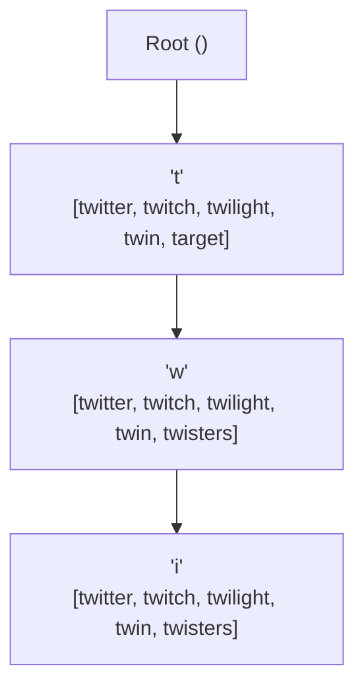
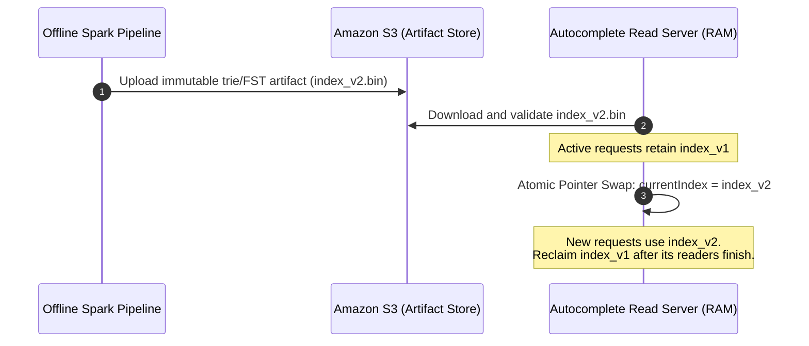
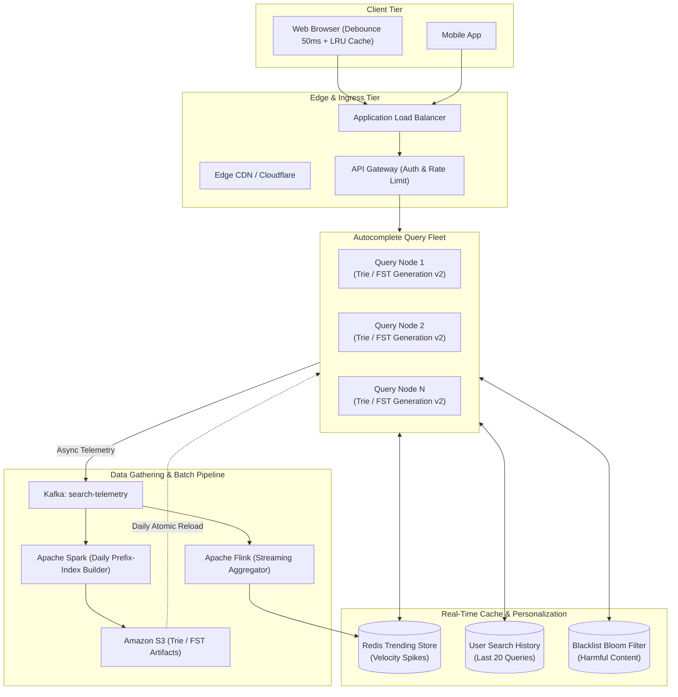

# Chapter 13: Design a Search Autocomplete System (Typeahead Suggestions)

## Guarantees and assumptions
Each query reads one immutable prefix-index generation, implemented as a top-K trie or weighted FST. Build jobs persist validated artifacts and activation records, publish the version pointer atomically, and retain old generations until their readers finish.
**Principal IC exercise:** Roll back a corrupt index snapshot while readers span two generations; specify reference/epoch-based reclamation and freshness monitoring.

---

## 1. Executive Interview Framing & Staff-Level Bar

Typeahead / Autocomplete is a core feature in Google, Amazon, YouTube, and Jira. While mid-level candidates describe a standard Trie data structure, **Staff and Principal Engineers (L6+, P60) are evaluated on how they handle read-heavy ultra-low latency SLAs (p99 $< 15\text{ms}$), trie/FST memory and ranking trade-offs, immutable index publication, hybrid trending stream integration, and client-side network traffic reduction**:

```
┌────────────────────────────────────────────────────────────────────────────────────────┐
│                                 THE INTERVIEW SPECTRUM                                 │
├────────────────────────────────────────┬───────────────────────────────────────────────┤
│ L5 / Senior Engineer                   │ L6+ / Staff & Principal Engineer              │
├────────────────────────────────────────┼───────────────────────────────────────────────┤
│ • Basic Trie with DFS traversal        │ • In-memory Trie with precomputed Top-K at    │
│ • Update Trie directly on every search │   each node (O(L) retrieval, independent of N)│
│ • Shard by first letter (A-Z)          │ • Double Buffering & Atomic Pointer Swaps     │
│ • Suggests weekly batch processing     │   (zero write locks on live read paths)       │
│ • Ignores client-side keystroke flood  │ • Skew-resistant sharding via prefix hashing  │
│ • Ignores breaking news / trending     │ • Hybrid Architecture: Weekly Batch Trie +    │
│                                        │   Real-time Flink / Count-Min Sketch trending │
│                                        │ • Client debouncing, abort controllers & LRU  │
│                                        │ • Personalization blending (history + global) │
└────────────────────────────────────────┴───────────────────────────────────────────────┘
```

---

## 2. The 5-Pillar Staff Assessment Rubric for Search Autocomplete

```
┌────────────────────────────────────────────────────────────────────────────────────────────────────────┐
│                                      5-PILLAR EVALUATION RUBRIC                                        │
├─────────────────────────┬──────────────────────────────────────────────────────────────────────────────┤
│ Pillar                  │ What the Interviewer Listens For (Evidence)                                  │
├─────────────────────────┼──────────────────────────────────────────────────────────────────────────────┤
│ 1. Decision Making      │ • Top-K trie vs weighted FST / completion suggester vs DB `LIKE` queries.     │
│                         │ • Batch Offline Trie Build vs Real-Time Streaming Ingestion.                 │
│                         │ • Evaluates trade-offs between global search popularity and personalized history│
├─────────────────────────┼──────────────────────────────────────────────────────────────────────────────┤
│ 2. Technical            │ • Precomputed trie lists vs weighted FST traversal and ranked enumeration.  │
│    Proficiency          │ • Double Buffering & Atomic Pointer Swapping in RAM for zero-lock updates.   │
│                         │ • Count-Min Sketch / Sliding Window Flink for tracking real-time trends.     │
│                         │ • Client debouncing (300ms), abort controllers, and prefix LRU caching.      │
├─────────────────────────┼──────────────────────────────────────────────────────────────────────────────┤
│ 3. Problem Solving &    │ • Decomposes into Data Collection, Trie Build, Trie Cache, & Query Service.  │
│    Analytical Thinking  │ • Calculates 2 Billion queries/day (peak 70,000 QPS) and sizes Trie in RAM   │
│                         │   and compares trie allocations with a compiled FST's memory footprint.   │
├─────────────────────────┼──────────────────────────────────────────────────────────────────────────────┤
│ 4. Operational          │ • Trie snapshotting to S3 and fast cold-start in-memory rehydration.         │
│    Mindset              │ • Immediate suppression filter for offensive/blacklisted keywords.           │
│                         │ • Graceful degradation: falls back to empty suggestions if Trie times out.   │
├─────────────────────────┼──────────────────────────────────────────────────────────────────────────────┤
│ 5. Adaptability &       │ • Captures breaking viral news queries within 5 minutes without rebuilding.  │
│    Collaboration        │ • Balances strict sub-15ms server latency with client network bandwidth cost.│
│                         │ • Explains autocomplete ranking transparency and quality metrics to product. │
└─────────────────────────┴──────────────────────────────────────────────────────────────────────────────┘
```

---

## 3. Requirements & System Scope

### Functional Requirements
1. **Prefix Matching:** Return relevant suggestions based on the user's input prefix.
2. **Top-K Ranking:** Return the top 5 most relevant/popular suggestions ranked by query frequency and recency.
3. **Personalization:** Blend user-specific recent search history with global popular queries.
4. **Trending Query Integration:** Capture breaking events (e.g., "World Cup score", "Earthquake California") within minutes, not weeks.
5. **Harmful Content Filtering:** Instantly suppress hate speech, illegal terms, and blacklisted keywords.

### Non-Functional Requirements (SLAs & SLOs)
* **Ultra-Low Latency:** p99 response time $< \mathbf{15ms}$ from server; keystroke to UI update $< \mathbf{30ms}$.
* **High Availability:** **99.999%** availability (autocomplete failures must fail open without blocking the user from submitting a regular search).
* **Massive Read Scalability:** Handle **1 Billion autocomplete queries / day** with spiky keystroke bursts.
* **Data Freshness:** Global historical frequencies updated daily/weekly; trending breaking topics updated within 5 minutes.

---

## 3. Capacity Estimation & Real Hardware Reality

Let's establish concrete production numbers:

```
Daily Active Users (DAU): 50 Million
Average Searches per User / Day: 4 searches
Average Characters Typed per Query: 10 keystrokes
1 Search = 10 Autocomplete Requests
Total Autocomplete Requests / Day: 50M * 4 * 10 = 2 Billion queries / day
```

### 3.1 Throughput Math
* **Average Autocomplete QPS:**
  $$\text{Average QPS} = \frac{2,000,000,000}{86,400} \approx 23,150 \text{ QPS}$$
* **Peak Autocomplete QPS (2.5x):**
  $$\text{Peak QPS} \approx 60,000 \text{ QPS}$$

### 3.2 Client-Side Traffic Optimization (Debouncing)
If every single keypress triggers a backend HTTP call, 60,000 peak QPS hits the load balancers.
* **Debouncing & Minimum Length Optimization:**
  1. Do not trigger requests for prefixes shorter than 2 characters (`length < 2`).
  2. Implement **50ms Client-Side Debouncing**: if the user types rapidly (e.g. 5 keystrokes in 200ms), only the final keystroke fires an HTTP request.
  3. **Traffic Reduction:** Reduces actual backend request volume by **over 60%** ($\approx 24,000 \text{ Peak QPS}$).

### 3.3 Trie Storage Sizing (RAM Math)
Assume we index the top **100 Million unique search queries**:
* Average query length: 20 characters (bytes).
* Total unique words / phrases: 100,000,000.
* A standard compressed Trie node:
  - Character / edge label: 1 byte
  - Children pointers (hash map or sparse array): $\approx 24 \text{ bytes}$
  - Precomputed Top-5 suggestions stored at node: $5 \times 8 \text{ bytes (string pointers)} \approx 40 \text{ bytes}$
  - Approximate memory per node: $\approx 65 \text{ bytes}$
* Total nodes across 100M queries (with common prefix sharing): $\approx 300\text{ Million nodes}$.
* **Total Trie Memory Footprint:**
  $$300,000,000 \text{ nodes} \times 65 \text{ bytes} \approx 19.5 \text{ GB RAM}$$
  *Staff Takeaway:* The node estimate is **19.5 GB**. Budget query strings, scores, allocator overhead, and simultaneous old/new generations during reloads as well. A weighted FST reduces duplicated suffix structure and per-prefix suggestion lists; size it from the compiled artifact plus serving buffers. Replicate the chosen index across read servers for availability and throughput.

---

## 4. API Design

### 4.1 Autocomplete Suggestion API
```http
GET /v1/search/suggestions?q=tw&limit=5
Authorization: Bearer <user_jwt_token>
```

**Response (`200 OK`):**
```json
{
  "prefix": "tw",
  "suggestions": [
    {"query": "twitter", "source": "GLOBAL_POPULAR", "score": 982041},
    {"query": "twitch", "source": "PERSONAL_HISTORY", "score": 851920},
    {"query": "twilight", "source": "GLOBAL_POPULAR", "score": 312019},
    {"query": "twitter stock", "source": "TRENDING", "score": 290140},
    {"query": "twin peaks", "source": "GLOBAL_POPULAR", "score": 142091}
  ]
}
```

---

## 5. Architectural Deep Dives: Staff & SDFC Insights

### 5.1 Choosing the Prefix Index: Top-K Trie vs Weighted FST

The base index maps a prefix to popular query candidates. A **trie with precomputed top-K lists** favors direct retrieval for a fixed result budget. A **weighted Finite State Transducer (FST)** favors a compact vocabulary with ranked traversal. Both feed the same trending, personalization and moderation pipeline.

#### Precomputed Top-K Trie
* **Naive Trie Retrieval:**
  1. Traverse down to prefix node (e.g., node `'w'` in `"tw"`): $O(L)$ where $L$ is prefix length.
  2. Traverse the subtree to collect terminal queries: $O(C)$ for $C$ visited descendant nodes.
  3. Select the top 5 using a size-K min-heap: up to $O(C \log K)$.
  4. Retrieval work grows with the number of matching completions, especially for short prefixes.
* **Optimized Precomputed Node:**
  - Store the top 5 suggestions directly inside each node during offline Trie construction:
    ```go
    type TrieNode struct {
        children map[rune]*TrieNode
        topK     []Suggestion // Fixed size: 5 elements
    }
    ```
  - At query time: Walk to the prefix node in $O(L)$, then read the stored list and emit $K$ entries.
  - **Total retrieval work:** $O(L + K)$, or $O(L)$ with fixed $K$, plus the bytes needed to return the suggestion strings.



#### Weighted FST: Shared Suffixes and Ranked Paths

A finite state transducer maps an input string to an output. For weighted autocomplete, the input is a normalized query and the output encodes its ranking cost. Convert popularity weights to costs with **smaller cost = stronger suggestion**, for example `cost = C - weight` with a fixed `C` at least as large as the maximum weight. Decode `weight = C - cost` before blending with trending and history scores.

1. **Share prefixes and equivalent suffix states.** A trie shares beginnings. A minimized FST also merges states whose remaining suffixes and residual outputs match. Queries such as `monday`, `someday` and `sunday` can reuse the final `day` path.
2. **Factor costs across the path.** Numeric outputs are distributed over arcs and final states; adding them reconstructs each query's cost. With costs `sunday=1`, `someday=3` and `monday=5`, the shared `s` path can carry cost `1`, the branch toward `omeday` adds `2`, and the branch toward `unday` adds `0`. The shared ending preserves each query's distinct total.
3. **Traverse the prefix, then enumerate the best completions.** After matching `s`, a best-first traversal explores the lowest-cost paths and returns `sunday` before `someday`. Cost pushing factors the best reachable cost into earlier outputs, giving the search a lower bound for unfinished paths. The queue stops once it has the requested top-K complete paths under the base ranking.
4. **Compile a compact, immutable artifact.** Aggregate and normalize queries, sort the inputs, then compile and minimize the FST. Lucene's compiler builds incrementally from sorted terms and writes a compact serialized representation.

Lucene's [WFSTCompletionLookup](https://lucene.apache.org/core/9_12_3/suggest/org/apache/lucene/search/suggest/fst/WFSTCompletionLookup.html) implements prefix traversal followed by shortest-path completion lookup. Its [FSTCompiler](https://lucene.apache.org/core/9_12_3/core/org/apache/lucene/util/fst/FSTCompiler.html) documents sorted-input construction and serialization.

#### Trie vs FST: The Design Decision

| Dimension | Trie with top-K per node | Weighted FST |
| :--- | :--- | :--- |
| **Sharing** | Common prefixes | Common prefixes and equivalent suffix/output states |
| **Ranking storage** | A precomputed list at each prefix node | Factored path outputs, with ranked enumeration at lookup |
| **Memory** | Nodes, child links and repeated top-K references | Compact states/arcs and outputs; traversal uses a candidate queue |
| **Lookup** | $O(L + K)$ to reach the node and emit its cached results | Prefix traversal plus best-first search; work depends on branching and requested K |
| **Result budget** | K is bounded by the list size chosen at build time | K can vary at lookup time |
| **Build** | Insert queries, aggregate scores and compute each node's top-K | Sort query/cost pairs, factor outputs and minimize states |
| **Updates in this design** | Build and publish a new immutable generation | Build and publish a new immutable generation |
| **Best fit** | Fixed small K, direct lookup and enough RAM for cached lists | Large vocabulary, tighter memory budget or variable K |

**Serving options:**
* **Custom query fleet:** Start with the precomputed trie for the fixed top-5 API; use a weighted FST when compactness or variable candidate counts become important. Both use the publication protocol in Section 5.2.
* **Elasticsearch completion suggester:** Its dedicated in-memory completion index uses Lucene's FST-based suggestion machinery. Index inputs and weights; newly indexed suggestions become visible on **refresh**. Segment merges consolidate indexes, while refresh controls near-real-time visibility. See [Elasticsearch completion](https://www.elastic.co/docs/reference/elasticsearch/rest-apis/search-suggesters#completion-suggester) and [Lucene NRTSuggester](https://lucene.apache.org/core/9_12_3/suggest/org/apache/lucene/search/suggest/document/NRTSuggester.html).
* **Edge n-grams:** Use an inverted-index search path when autocomplete needs broader text-query behavior and relevance scoring.
* **Redis sorted sets:** `ZRANGEBYLEX` retrieves lexicographic prefixes from an equal-score set; popularity ranking needs a separate candidate-ranking step or precomputed per-prefix lists.

---

### 5.2 The Write Path: Immutable Generations and Atomic Pointer Swapping

A classic junior pitfall: *"When new queries arrive, update the Trie node counters in real time."*
* **The Lock Contention Disaster:** If a Trie server is handling 30,000 reads/sec, acquiring a write lock on the root node to update query frequencies causes severe **read thread starvation and latency spikes**.
* **The Staff Solution: Atomic Pointer Swap (Double Buffering in RAM)**
  1. The offline pipeline aggregates query frequencies and builds a new immutable index. For a trie, compute top-K lists; for an FST, sort normalized query/cost pairs and compile the artifact.
  2. Save an immutable versioned artifact plus checksum, schema/tokenizer version, source cutoff, ranking-policy version and score/cost encoding; validate before publishing the activation manifest.
  3. The query server downloads and validates the named generation into a secondary memory buffer. Reserve peak memory for both generations plus readers still holding older ones.
  4. The server executes an **Atomic Pointer Swap** using language memory barriers (e.g. Go `atomic.StorePointer` or C++ `atomic_store`):
     ```go
     atomic.StorePointer(&activeIndexPointer, unsafe.Pointer(newIndex))
     ```
  5. Each request captures one generation pointer for its entire lookup. Reclaim the old trie/FST after its readers finish, using garbage-collected strong references or explicit reference counts/epochs/RCU.
  6. Record the active generation per replica; activation is atomic **per process**, not globally simultaneous. Idempotently retry the same manifest version and retain a known-good prior artifact for rollback.



---

### 5.3 Capturing Breaking News: The Real-Time Trending Stream

A weekly or daily batch update is completely blind to breaking news (e.g., a sudden natural disaster or viral celebrity scandal). If users search for an earthquake, the autocomplete cannot wait 24 hours for the next Spark batch!


#### How Real-Time Velocity Boosting Works
1. Search queries are streamed into **Kafka**.
2. **Apache Flink** calculates the *velocity of change* over a 10-minute sliding window using a **Count-Min Sketch**:
   $$\text{Velocity} = \frac{\text{Current 10-min Frequency}}{\text{Historical Baseline Frequency}}$$
3. If an unrecognized query experiences an explosive velocity spike ($> 20\text{x}$ baseline), it is added to the **Redis Trending Sorted Set** with a 1-hour TTL.
4. The Query Service fetches base candidates from the trie/FST, blends them with trending keywords and user history, then deduplicates, filters and ranks the final suggestions. The base index supplies historical popularity; the live overlay supplies freshness between rebuilds.

---

### 5.4 Sharding the Prefix Index: Avoiding the Skew Trap

If the trie/FST grows too large for a single machine or needs multi-region partitioning:
* **The Flaw of Alphabetical Sharding (`A-M` vs `N-Z`):**
  - Search distributions are wildly skewed. In English, words starting with `S`, `T`, `C`, and `A` account for over **50% of all searches**, while `Q`, `X`, `Z` account for $< 1\%$.
  - Servers holding `S` and `T` will experience CPU meltdown while `X` and `Z` sit completely idle!
* **The Staff Solution: Consistent Prefix Hashing with Historical Weighting**
  - Shard based on the hash of the first 2 characters:
    $$\text{Partition} = \text{ConsistentHash}(\text{prefix}[:2]) \pmod N$$
  - For high-volume prefixes (e.g., `"s"` or `"t"`), shard deeper: partition by first 3 characters (`"sta"`, `"str"`, `"the"`).

---

### 5.5 Client-Side Edge Optimizations

A world-class autocomplete system pushes heavy intelligence to the client browser / mobile app:
1. **Debouncing (50-100ms):** Delays network dispatch until the user pauses typing.
2. **AbortController (Cancelling Stale Requests):**
   - If a user types `"g"`, then immediately types `"go"` before the `"g"` response returns:
   - The client cancels the `"g"` HTTP request via `AbortController.abort()`.
   - Prevents stale responses from overwriting newer query results.
3. **Local Client-Side LRU Cache:**
   - Store responses for the last 50 typed prefixes in client memory.
   - If a user backspaces from `"googl"` back to `"goo"`, the result is rendered instantly from browser RAM in **0 milliseconds** without touching the network!

---

## 6. End-to-End System Architecture



---

## 7. Edge Cases, Failure Modes & Operational Realities

### 7.1 Instant Blacklist Suppression (Takedown Requests)
* **Scenario:** A legal takedown or hate-speech violation requires removing a term immediately.
* **The Problem:** The base trie/FST will contain this term until the next Spark rebuild.
* **The Solution (The Bloom Filter & Redis Blacklist):**
  - Maintain a Redis Set and local in-memory Bloom filter of banned terms.
  - Before returning suggestions to the user, filter the Top-5 results:
    ```go
    filtered := make([]Suggestion, 0)
    for _, s := range suggestions {
        if !blacklistFilter.Contains(s.Query) {
            filtered = append(filtered, s)
        }
    }
    ```
  - Query-time suppression applies as blacklist updates reach each serving replica, independently of the trie/FST rebuild schedule.

### 7.2 Personalization Cold Start
* When an unauthenticated or brand new user queries autocomplete:
  - System bypasses user history lookups.
  - Blends **Geo-Localized Top Queries** (e.g., users in the UK see UK-specific retail suggestions) with the global historical trie/FST.

---

## 8. Interview Wrap-Up: Staff-Level Decision Matrix

| Problem Space | Junior / Senior Approach | Staff / Principal Approach |
| :--- | :--- | :--- |
| **Data Structure** | Raw prefix scan or full subtree traversal | **Precomputed top-K trie** for fixed-size direct lookup; **weighted FST** for compact storage and ranked enumeration. |
| **Index Updates** | Mutex write locks on live nodes | **Immutable generations + atomic publication:** Build off-path, validate and reclaim after readers finish. |
| **Breaking Topics** | Weekly MapReduce batch | **Hybrid Pipeline:** Batch trie/FST + Flink real-time velocity stream with Count-Min Sketch. |
| **Client Ingress** | Network call on every keystroke | **Client Debouncing (50ms) + Request AbortController + Local LRU Cache:** 60% traffic reduction. |
| **Sharding** | Alphabetical (A-Z) | **Consistent Prefix Hashing with Historical Weighting:** Prevents hot-spot skew. |
| **Moderation** | Rebuild the base index on delete | **Query-time blacklist overlay:** Suppress terms as updates reach serving replicas. |