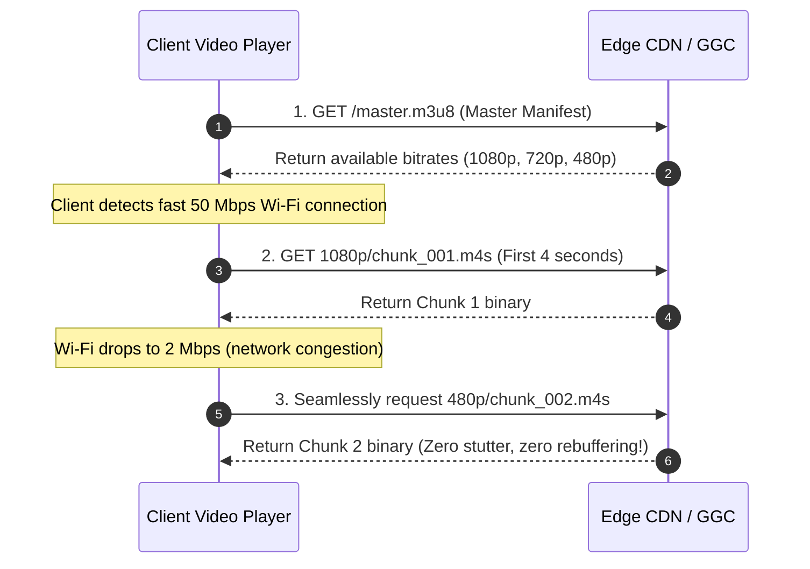
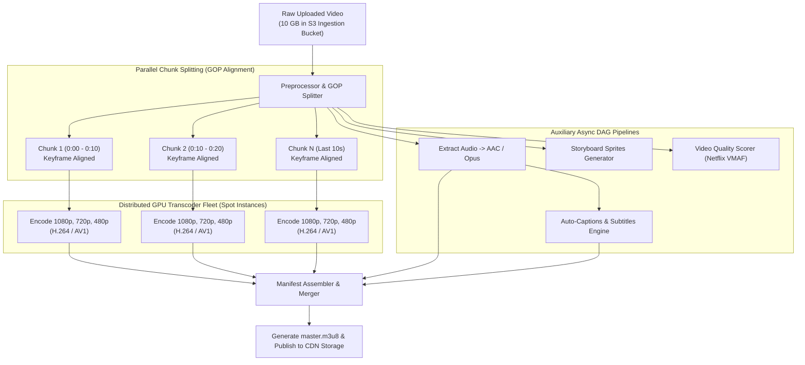
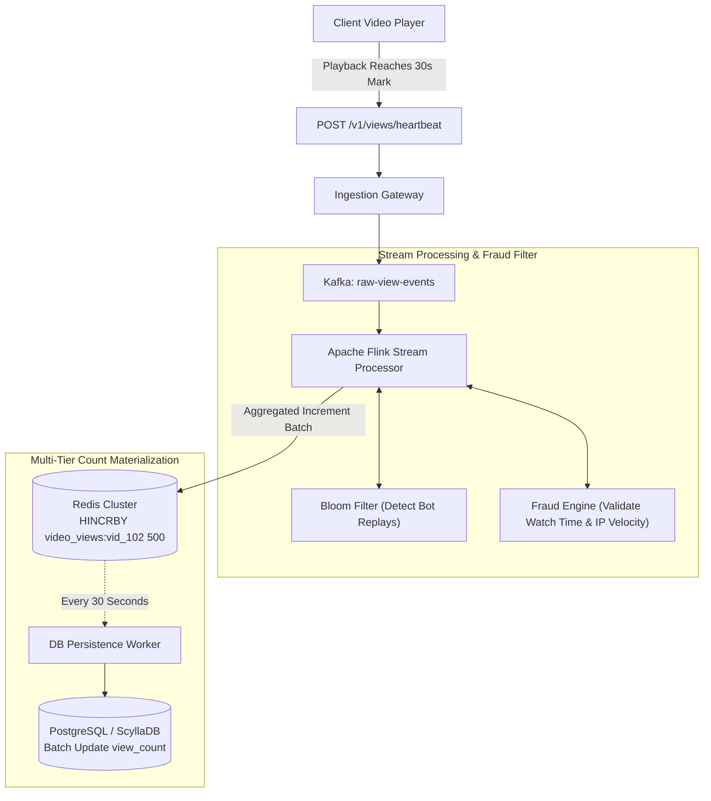
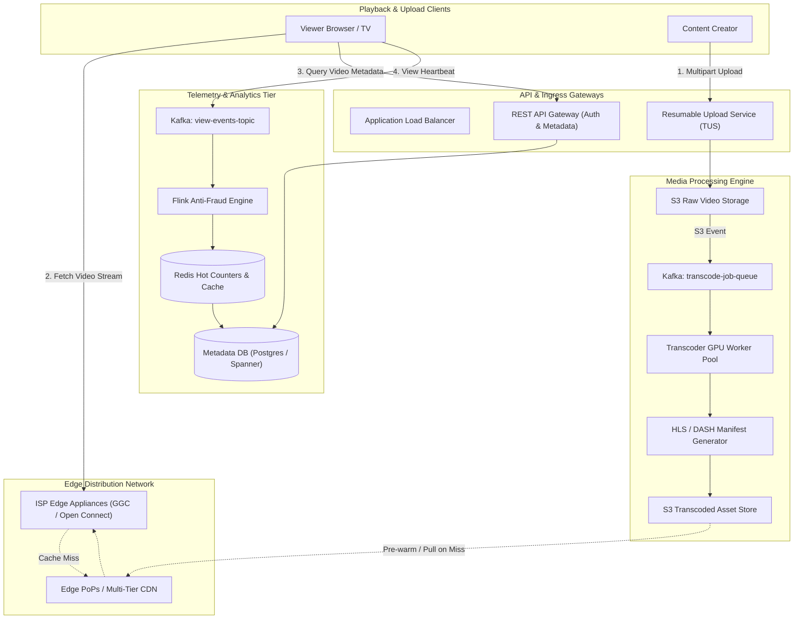

# Chapter 14: Design a Global Video Streaming Platform (YouTube / Netflix)

---

## 1. Executive Interview Framing & Staff-Level Bar

Designing a planetary-scale video platform like YouTube or Netflix is the ultimate test of media processing, edge networking, and cost optimization. While junior candidates draw a simple S3 bucket and a CDN box, **Staff and Principal Engineers (L6+, P60) are evaluated on their mastery of chunked resumable upload protocols (TUS / S3 Multipart), parallelized DAG transcoding pipelines with GOP alignment, Adaptive Bitrate (ABR) streaming ladders, multi-tier ISP edge caching (Open Connect / GGC), and fraud-resistant asynchronous view count aggregation**:

```
┌────────────────────────────────────────────────────────────────────────────────────────┐
│                                 THE INTERVIEW SPECTRUM                                 │
├────────────────────────────────────────┬───────────────────────────────────────────────┤
│ L5 / Senior Engineer                   │ L6+ / Staff & Principal Engineer              │
├────────────────────────────────────────┼───────────────────────────────────────────────┤
│ • Upload video via single HTTP POST    │ • Resumable Multipart Uploads (TUS Protocol)  │
│ • "Convert to MP4 with FFmpeg"         │   with client-side chunking and checksums     │
│ • Static CDN delivery                  │ • Distributed DAG Transcoding Engine with     │
│ • Direct SQL `view_count = count + 1`  │   Group of Pictures (GOP) parallel splitting  │
│ • Ignores massive CDN egress costs     │ • Adaptive Bitrate Streaming (HLS / MPEG-DASH)│
│ • Ignores mobile network disconnects   │ • Multi-tier CDN & ISP Edge Peering (IXP/GGC) │
│                                        │ • Decoupled Kafka -> Flink view count stream  │
│                                        │   with bot filtering & batch reconciliation   │
└────────────────────────────────────────┴───────────────────────────────────────────────┘
```

---

## 2. Requirements & System Scope

### Functional Requirements
1. **Video Ingestion:** Users can reliably upload high-resolution videos (up to 4K/8K, 50 GB) even over unstable mobile network connections.
2. **Adaptive Bitrate Playback:** Smooth, instant-start streaming that dynamically shifts resolutions (144p to 4K) based on client network bandwidth and device capabilities.
3. **Multi-Platform Support:** Seamless playback on mobile (iOS/Android), desktop browsers, and Smart TVs without proprietary player plugins.
4. **Fast Scrubbing & Thumbnails:** Instant scrubber preview filmstrips (storyboards) during fast-forward/rewind.
5. **Real-time Accurate View Counts:** Scale to viral videos with millions of views per minute while preventing bot view fraud.

### Non-Functional Requirements (SLAs & SLOs)
* **Playback Startup Time (Time-to-First-Frame):** p99 $< \mathbf{800ms}$.
* **Rebuffering Ratio:** $< 0.5\%$ of total playback time spent buffering.
* **Scale:** Support **2 Billion Monthly Active Users**, **500 hours of video uploaded every minute**, and **1 Billion hours watched / day**.
* **Global Availability:** $99.999\%$ uptime for video playback.

---

## 3. Capacity Estimation & Real Hardware Numbers (The Exabyte Scale)

Let's calculate the system metrics for YouTube-scale operations:

```
Daily Videos Uploaded: 500 hours/min * 60 min * 24 hrs = 720,000 hours of video / day
Average Raw Upload Bitrate: 20 Mbps (4K / 1080p raw upload)
Daily Video Watch Time: 1 Billion hours / day
Average Playback Bitrate: 3 Mbps (Blended mobile 720p / desktop 1080p)
```

### 3.1 Ingestion & Transcoding Math
* **Raw Upload Ingress Bandwidth:**
  $$\text{Upload Rate} = 500 \text{ hours/min} \times 60 \text{ min} = 30,000 \text{ hours/hour} = 8.33 \text{ hours of video / second}$$
  $$\text{Ingress Bandwidth} = 8.33 \times 3600 \text{ seconds} \times 20 \text{ Mbps} \approx \mathbf{600 \text{ Gbps}}$$
* **Storage Incurred per Day (Raw + Transcoded Multi-Resolution Ladder):**
  - Raw video storage: $720,000 \text{ hours} \times 3600 \text{ s} \times 20 \text{ Mbps} / 8 \approx 6.48 \text{ PB / day}$.
  - After encoding into the full ABR ladder (4K, 1080p, 720p, 480p, 360p with AV1/VP9/H.264), total transcoded asset footprint is $\approx 1.5\text{x}$ the original raw size.
  - **Daily Storage Growth:** $\approx \mathbf{9.7 \text{ PB / day}} \approx \mathbf{3.5 \text{ Exabytes / year}}$!

### 3.2 Streaming Egress & The Multi-Million Dollar CDN Dilemma
* **Streaming Egress Bandwidth:**
  $$\text{Daily Watch Time} = 1,000,000,000 \text{ hours} = 3.6 \times 10^{12} \text{ seconds}$$
  $$\text{Average Continuous Egress} = \frac{3.6 \times 10^{12} \text{ s} \times 3 \text{ Mbps}}{86,400 \text{ s}} \approx \mathbf{125 \text{ Terabits / second (Tbps)}}$$
* **The CDN Cost Catastrophe:**
  - If 125 Tbps is delivered via commercial public CDNs (e.g. AWS CloudFront at $\$0.02\text{/GB}$):
    $$\text{Daily Egress Data} \approx 40.5 \text{ Petabytes / day} \implies \$810,000 \text{ / day} \approx \mathbf{\$24.3 \text{ Million / month!}}$$
* **The Staff Engineering Solution:**
  1. Build a proprietary **Private CDN & ISP Edge Cache Fleet** (like Netflix Open Connect or Google Global Cache - GGC).
  2. Deploy custom storage appliances directly inside ISP partner data centers at Internet Exchange Points (IXPs), bypassing public transit costs completely for 95% of hot streaming traffic!

---

## 4. Video Streaming Protocols & Adaptive Bitrate (ABR)

```
┌────────────────────────────────────────────────────────────────────────────────────────┐
│                              STREAMING PROTOCOL COMPARISON                             │
├─────────────────────┬──────────────────┬───────────────────────────────────────────────┤
│ Protocol            │ Delivery Method  │ Staff Engineering Evaluation                  │
├─────────────────────┼──────────────────┼───────────────────────────────────────────────┤
│ Legacy RTMP / RTSP  │ Stateful TCP/UDP │ OBSOLETE for distribution. Blocked by corporate│
│                     │ streaming sockets│ firewalls, requires dedicated streaming server│
│                     │                  │ software; zero CDN caching compatibility.     │
├─────────────────────┼──────────────────┼───────────────────────────────────────────────┤
│ Apple HLS           │ HTTP chunking    │ INDUSTRY STANDARD. Master `.m3u8` playlist    │
│ (HTTP Live Stream)  │ (.m3u8 + .ts/m4s)│ points to variant bitrate streams containing  │
│                     │                  │ 2-to-6 second media segments.                 │
├─────────────────────┼──────────────────┼───────────────────────────────────────────────┤
│ MPEG-DASH           │ HTTP chunking    │ OPEN STANDARD. XML `.mpd` manifest file. Widely│
│                     │ (.mpd + .mp4)    │ used on Android, Smart TVs, and Chrome.       │
├─────────────────────┼──────────────────┼───────────────────────────────────────────────┤
│ WebRTC              │ Peer-to-Peer UDP │ Ultra-low latency (<500ms) for video calls,   │
│                     │ streaming        │ but too expensive and complex for mass VOD.   │
└─────────────────────┴──────────────────┴───────────────────────────────────────────────┘
```

#### How Adaptive Bitrate (ABR) Operates Under the Hood
An HLS master playlist provides the client with a menu of resolutions and bitrates:

```m3u8
#EXTM3U
#EXT-X-STREAM-INF:BANDWIDTH=6000000,RESOLUTION=1920x1080,CODECS="avc1.640028"
1080p/index.m3u8
#EXT-X-STREAM-INF:BANDWIDTH=3000000,RESOLUTION=1280x720,CODECS="avc1.4d401f"
720p/index.m3u8
#EXT-X-STREAM-INF:BANDWIDTH=1000000,RESOLUTION=854x480,CODECS="avc1.4d401f"
480p/index.m3u8
```



---

## 5. Architectural Deep Dives: Staff & SDFC Insights

### 5.1 Reliable Chunked Video Uploads: The TUS Protocol

Uploading a 10 GB 4K video over mobile connections will experience network packet drops. If you rely on a single HTTP `POST`, a network blip at 98% forces the user to start the entire 10 GB upload from zero.

#### The Staff Solution: Resumable Multipart Upload (Tus.io / S3 Multipart)
1. **Initiate Session:** Client calls `POST /api/v1/uploads` with file size and SHA-256 hash. Server generates an upload ID.
2. **Chunking:** Client splits the raw file into **16 MB chunks**.
3. **Offset-Based Upload:**
   ```http
   PATCH /files/upload_981249
   Upload-Offset: 33554432
   Content-Type: application/offset+octet-stream
   Content-Length: 16777216
   
   <binary chunk bytes>
   ```
4. **Network Drop Recovery:** If the connection drops, client queries:
   `HEAD /files/upload_981249` $\implies$ Server responds `Upload-Offset: 50331648`.
   The client resumes uploading from byte 50,331,648! Zero duplicate bandwidth wasted.

---

### 5.2 The Distributed Video Transcoding Pipeline (DAG Engine)

Raw camera uploads are encoded in uncompressed codecs (e.g. Apple ProRes) consuming gigabytes of disk. They must be transcoded into device-optimized codecs (**H.264** for broad compatibility, **VP9 / AV1** for 40% higher compression efficiency).

Transcoding a 2-hour 4K video on a single server takes hours. To deliver videos in minutes, the system breaks the video down into a **Directed Acyclic Graph (DAG)** of parallel tasks:



#### Why Group of Pictures (GOP) Alignment is Mandatory
* Video frames consist of:
  - **I-Frames (Intra-frames / Keyframes):** Complete self-contained images.
  - **P-Frames & B-Frames (Predicted / Bi-directional):** Store only the delta/movement changes relative to neighboring frames.
* You **cannot** slice a video at an arbitrary timestamp (e.g. exactly 10.000 seconds) if it falls on a B-frame, because that frame requires data from earlier frames!
* **The Rule:** The Preprocessor must split video files strictly at **I-Frame boundaries (GOP boundaries)**. This ensures every individual 10-second chunk can be transcoded in complete isolation by independent spot GPU worker nodes without data dependency!

---

### 5.3 Asynchronous Fraud-Resistant View Count Aggregation

When a global music video or trailer drops, **100,000 views arrive per second**.
A naive `UPDATE videos SET views = views + 1 WHERE id = ?` creates catastrophic database row-lock contention and instantly crashes relational databases.

#### SDFC View Count Architecture: Kafka -> Flink -> Redis -> Database


1. **The 30-Second Rule:** A view event is only emitted after the user has watched at least 30 seconds of the video (prevents click-farming).
2. **Kafka Event Decoupling:** The ingestion gateway writes to a high-throughput Kafka topic.
3. **Flink Stream Deduplication & Anti-Fraud:**
   - Filters out rapid-fire automated bot requests from identical IPs.
   - Computes 10-second tumbling window aggregations.
4. **Redis Hot Counter:**
   - Flink issues batch increments to Redis: `HINCRBY video_views vid_102 1250`.
   - The query service reads hot view counts directly from Redis.
5. **Periodic Database Flush:**
   - A reconciliation worker flushes aggregated counts from Redis to the primary PostgreSQL/ScyllaDB database every 30-60 seconds.

---

### 5.4 Video Scrubber Previews: Storyboard Sprites

When users hover over the playback bar, they expect instant visual preview thumbnails:
* **The Anti-Pattern:** Firing a separate HTTP request for every individual 1-second preview thumbnail generates thousands of HTTP requests per scrub.
* **The Staff Solution (Storyboard Sprite Sheets):**
  - The video pipeline extracts 1 frame every 5 seconds and tiles them into a single large **2048x2048 JPEG sprite image** (e.g. containing a $10 \times 10$ grid of 100 thumbnail frames).
  - The player downloads a single sprite image.
  - When the user scrubs, the client player displays the appropriate sub-region using CSS background offsets (`background-position: -160px -90px`).
  - Zero network latency during scrubbing!

---

## 6. End-to-End System Architecture



---

## 7. Edge Cases, Failure Modes & Operational Realities

### 7.1 Transcoder Worker Spot Instance Eviction
* **Scenario:** A cloud provider terminates a spot GPU instance midway through encoding a 10-minute chunk.
* **Mitigation:**
  - The Transcode Task Controller maintains task leases in Redis/etcd with heartbeats.
  - When a worker dies, the unfinished GOP chunk task is immediately re-queued from Kafka and reassigned to a healthy worker. Because chunks are small (10s), wasted compute is minimal ($< 5\text{ seconds}$).

### 7.2 CDN Cache Stampede on Global Live Streams
* **Scenario:** 20 Million users tune in to watch the World Cup live final. Every 4 seconds, a new HLS media chunk (`chunk_982.m4s`) is published.
* **Failure:** All 20 Million players request `chunk_982.m4s` at the exact same millisecond. If the edge CDN cache does not have it yet, 20 Million requests collapse onto origin storage (**Cache Stampede**).
* **Mitigations:**
  1. **Origin Request Coalescing (Collapsed Forwarding):** The CDN edge server allows only **one request** to fetch the missing chunk from origin while holding all other requests in memory until the chunk arrives, then broadcasting to all.
  2. **Proactive Push Caching:** The manifest assembler actively pushes new live chunks to top-tier CDN edge nodes before the manifest file referencing them is released to clients.

---

## 8. Interview Wrap-Up: Staff-Level Decision Matrix

| Problem Space | Junior / Senior Approach | Staff / Principal Approach |
| :--- | :--- | :--- |
| **Upload Protocol** | Monolithic HTTP `POST` | **Resumable Multipart Upload (TUS Protocol):** Chunked offsets with automatic disconnect resumption. |
| **Video Transcoding** | Single server FFmpeg command | **Distributed DAG Pipeline:** GOP-aligned keyframe splitting across spot GPU fleets. |
| **Playback Delivery** | Static MP4 download | **Adaptive Bitrate Streaming (HLS / MPEG-DASH):** Dynamic multi-bitrate ladder switching. |
| **CDN Economics** | Public cloud CDN only | **Multi-Tier CDN + ISP Edge Peering (GGC / Open Connect):** Bypasses 90% of public transit costs. |
| **View Counting** | Synchronous SQL increments | **Kafka $\to$ Flink Anti-Fraud Stream $\to$ Redis Hot Buffer $\to$ Batch DB Persistence.** |
| **Scrubber Preview** | Download individual JPEG frames | **Storyboard Sprite Sheets:** Single tiled $10 \times 10$ JPEG image rendered via CSS background coordinates. |
