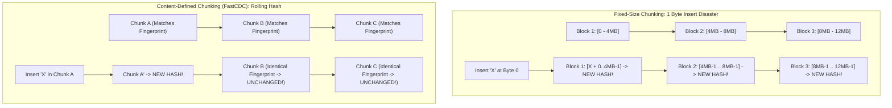
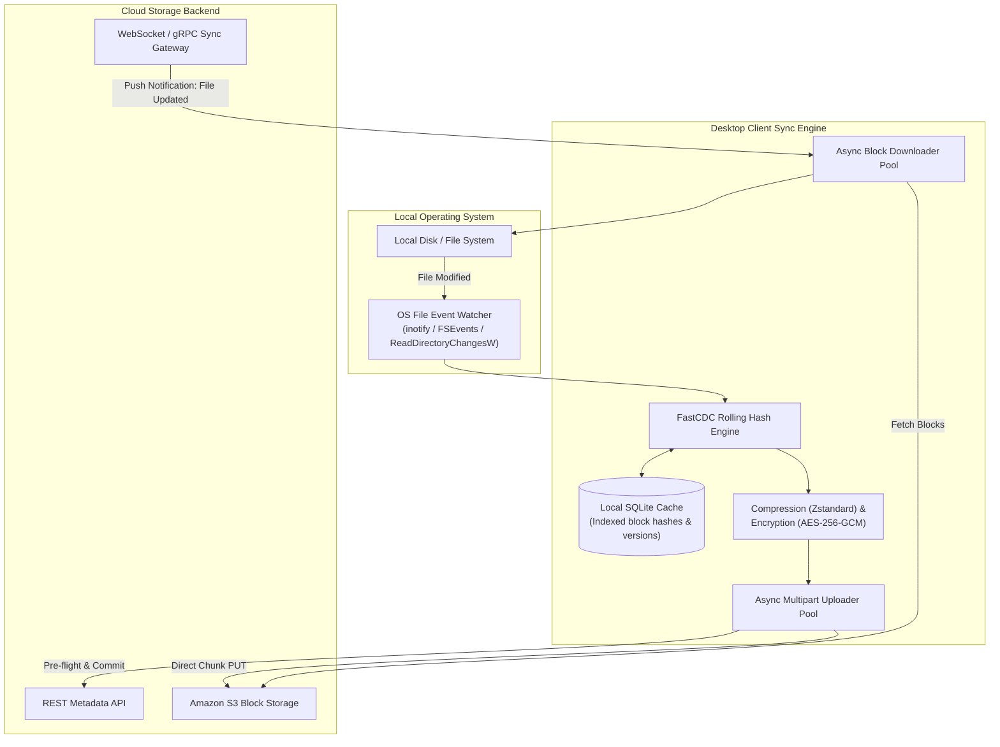
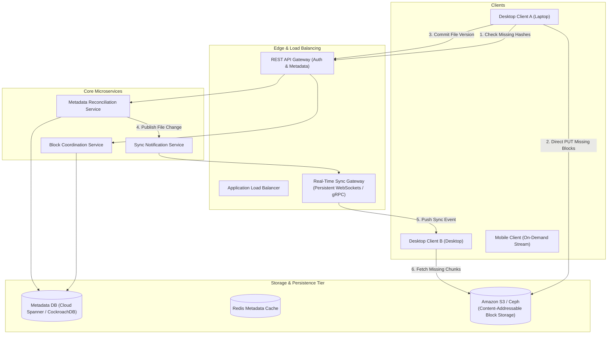

# Chapter 15: Design a Cloud Storage & Multi-Device File Sync System (Google Drive / Dropbox)

---

## 1. Executive Interview Framing & Staff-Level Bar

Designing a cloud file storage and cross-device sync platform (Google Drive, Dropbox, Box, OneDrive) goes far beyond uploading blobs to an Amazon S3 bucket. A junior engineer describes basic file uploads with fixed-size chunks; **Staff and Principal Engineers (L6+, P60) are evaluated on their deep understanding of Content-Defined Chunking (Rabin Fingerprints / FastCDC) to avoid the byte-shift trap, differential delta sync protocols, optimistic concurrency conflict branching, and global Content-Addressable Storage (CAS) deduplication**:

```
┌────────────────────────────────────────────────────────────────────────────────────────┐
│                                 THE INTERVIEW SPECTRUM                                 │
├────────────────────────────────────────┬───────────────────────────────────────────────┤
│ L5 / Senior Engineer                   │ L6+ / Staff & Principal Engineer              │
├────────────────────────────────────────┼───────────────────────────────────────────────┤
│ • Fixed 4MB chunking                   │ • Content-Defined Chunking (FastCDC / Rabin   │
│ • Re-upload whole file on minor edit   │   Fingerprints) to solve the byte-shift trap  │
│ • Last-Write-Wins overwrites           │ • Differential Delta Sync (upload diff chunks)│
│ • Upload everything through API server │ • Content-Addressable Storage (CAS): SHA-256  │
│ • Simple polling for sync              │ • Optimistic concurrency version branching    │
│ • Ignores client OS file watchers      │ • Direct client-to-S3 presigned uploads       │
│                                        │ • OS file event monitoring (inotify/FSEvents) │
│                                        │ • Bidirectional streaming notification sync   │
└────────────────────────────────────────┴───────────────────────────────────────────────┘
```

---

## 2. Requirements & System Scope

### Functional Requirements
1. **File Upload & Download:** Support large files (up to 50 GB) with automatic pause and resume.
2. **Differential Delta Synchronization:** When a 500 MB file is edited by 10 KB, only the modified blocks are transferred over the network.
3. **Multi-Device Real-Time Sync:** File updates made on a laptop immediately reflect on connected mobile and desktop clients within seconds.
4. **Conflict Resolution:** If two users edit the same file simultaneously, prevent silent data loss and create a deterministic conflicted copy.
5. **File Versioning & Revision History:** Restore any previous file revision up to 30 days (infinite for enterprise tiers).
6. **Granular Permissions & Sharing:** Public links, view-only, edit access, and folder inheritance.

### Non-Functional Requirements (SLAs & SLOs)
* **Zero Data Loss (Durability):** **99.999999999% (11 9's)** durability for stored blocks.
* **Sync Latency:** File update propagation p99 $< \mathbf{3\text{ seconds}}$ across active desktop clients.
* **Bandwidth & Storage Efficiency:** Minimize network egress and duplicate storage via client-side block hashing and global deduplication.
* **Scale:** Support **50 Million Daily Active Users**, **100 Million daily file updates**, and **500 PB** of block storage.

---

## 3. Capacity Estimation & Real Hardware Reality (SDFC Math)

Let's calculate concrete production metrics:

```
Daily Active Users (DAU): 50 Million
Daily File Sync Events: 100 Million updates / day
Average File Size: 2 MB
Modified Delta per Sync: 10% on average (200 KB)
```

### 3.1 Throughput & Bandwidth Math
* **Daily Ingress Data (With Delta Sync):**
  $$100,000,000 \times 200 \text{ KB} = 20 \text{ TB / day}$$
  *(Without Delta Sync, transferring full 2 MB files would consume 200 TB/day — 10x network cost!)*
* **Average Sync Ingestion QPS:**
  $$\text{Average QPS} = \frac{100,000,000}{86,400} \approx 1,160 \text{ sync commits/sec}$$
  $$\text{Peak QPS (3x)} \approx 3,500 \text{ commits/sec}$$
* **Network Ingress Bandwidth:**
  $$1,160 \times 200 \text{ KB} \approx 232 \text{ MB/sec} \approx \mathbf{1.85 \text{ Gbps}}$$

### 3.2 Storage Math (Primary Blobs vs Metadata)
* **Primary Block Storage:**
  - 500 Million total registered users $\times$ average 10 GB stored $= \mathbf{5 \text{ Petabytes (PB)}}$.
* **Metadata Database Sizing:**
  - Files Table: 5 Billion records $\times 300\text{ bytes} \approx 1.5 \text{ TB}$.
  - Blocks Table (Manifest): Average file has 5 blocks $\implies 25 \text{ Billion records} \times 64\text{ bytes} \approx \mathbf{1.6 \text{ TB}}$.
  - The metadata fits comfortably inside a distributed relational database cluster (e.g. Google Cloud Spanner, CockroachDB, or sharded PostgreSQL).

---

## 4. API & Data Contracts

### 4.1 Check Existing Chunks API (Client Pre-Flight)
Before uploading bytes, the client checks which blocks already exist in the global Content-Addressable Storage (CAS):

```http
POST /v1/files/check-blocks
Authorization: Bearer <jwt_token>
Content-Type: application/json

{
  "file_path": "/Documents/architecture.pdf",
  "block_hashes": [
    "e3b0c44298fc1c149afbf4c8996fb92427ae41e4649b934ca495991b7852b855",
    "ca978112ca1bbdcafac231b39a23dc4da786eff8147c4e72b9807785afee48bb",
    "4e07408562bedb8b60ce05c1decfe3ad16b72230967de01f640b7e4729b49fce"
  ]
}
```

**Response (`200 OK`):**
```json
{
  "missing_blocks": [
    {
      "hash": "ca978112ca1bbdcafac231b39a23dc4da786eff8147c4e72b9807785afee48bb",
      "upload_url": "https://s3.us-west-2.amazonaws.com/blocks/ca978112...?signature=..."
    }
  ],
  "existing_blocks": [
    "e3b0c44298fc1c149afbf4c8996fb92427ae41e4649b934ca495991b7852b855",
    "4e07408562bedb8b60ce05c1decfe3ad16b72230967de01f640b7e4729b49fce"
  ]
}
```

### 4.2 Commit File Version API
```http
POST /v1/files/commit
Authorization: Bearer <jwt_token>

{
  "file_id": "fl_98124901",
  "parent_folder_id": "fld_102",
  "expected_version": 4, // Optimistic concurrency check
  "file_name": "architecture.pdf",
  "file_size": 12582912,
  "block_manifest": [
    "e3b0c44298fc1c149afbf4c8996fb92427ae41e4649b934ca495991b7852b855",
    "ca978112ca1bbdcafac231b39a23dc4da786eff8147c4e72b9807785afee48bb",
    "4e07408562bedb8b60ce05c1decfe3ad16b72230967de01f640b7e4729b49fce"
  ]
}
```

---

## 5. Architectural Deep Dives: Staff & SDFC Insights

### 5.1 Chunking Algorithms: The Byte-Shift Disaster & Content-Defined Chunking (CDC)

How a system divides files into blocks dictates its entire network and storage efficiency:

```
┌────────────────────────────────────────────────────────────────────────────────────────┐
│                              CHUNKING STRATEGY COMPARISON                              │
├─────────────────────┬──────────────────┬───────────────────────────────────────────────┤
│ Algorithm           │ Chunk Boundaries │ Staff Engineering Tradeoff                    │
├─────────────────────┼──────────────────┼───────────────────────────────────────────────┤
│ Fixed-Size Chunking │ Slices file at   │ CATASTROPHIC FLAW: Inserting 1 byte at the    │
│ (e.g. 4 MB static)  │ exact byte offsets: start shifts EVERY subsequent block boundary!│
│                     │ 0-4MB, 4-8MB...  │ All blocks receive new hashes; entire 100MB   │
│                     │                  │ file is re-uploaded. 0% deduplication.        │
├─────────────────────┼──────────────────┼───────────────────────────────────────────────┤
│ Content-Defined     │ Calculates a     │ RECOMMENDED (Dropbox / FastCDC): Slices       │
│ Chunking (CDC /     │ rolling hash     │ boundaries based on internal file content.    │
│ Rabin Fingerprint)  │ (Rabin / Gear).  │ Inserting 1 byte shifts only the current      │
│                     │ Cuts boundary on │ chunk; all other 24 chunks maintain identical │
│                     │ bit pattern match│ hashes! 95%+ delta upload savings.            │
└─────────────────────┴──────────────────┴───────────────────────────────────────────────┘
```

#### How FastCDC (Content-Defined Chunking) Works
1. A small sliding window (e.g. 48 bytes) rolls across the file stream.
2. The client calculates a fast rolling hash (e.g. Gear hash).
3. When the lowest $N$ bits of the hash match a predetermined pattern (e.g. `hash & 0x1FFF == 0` for an average 8 KB target chunk size), a **chunk boundary** is cut!
4. Even if bytes are inserted or deleted in the middle of a document, the boundary trigger condition is preserved down the stream, preventing boundary shift propagation.



---

### 5.2 Content-Addressable Storage (CAS) & Global Deduplication

In modern cloud storage, files are not stored as named files on disk. They are stored as **immutable, content-addressable chunks**:
* Each block's address/key is its cryptographic hash:
  $$\text{Block ID} = \text{SHA-256}(\text{Block Bytes})$$
* **Global Multi-Tenant Deduplication:**
  - If 5,000 corporate employees in different folders all save a copy of the same 50 MB company handbook PDF:
  - The client calculates the chunk hashes.
  - The pre-flight check detects that all chunks already exist in S3 CAS.
  - **Zero bytes are uploaded!** The server simply creates a new metadata pointer pointing to the existing block IDs.

---

### 5.3 Concurrency & Sync Conflict Resolution (The Branching Model)

What happens when Alice and Bob edit the same document (`quarterly_report.docx`) offline on an airplane, and both connect to Wi-Fi at the same time?

```mermaid
sequenceDiagram
    autonumber
    participant Alice as Alice (Client)
    participant Bob as Bob (Client)
    participant MetaDB as Cloud Spanner (Metadata DB)

    Note over Alice,Bob: Both start with File Version: 3
    Alice->>MetaDB: Commit Version 4 (Expected Version = 3)
    MetaDB-->>Alice: 200 OK (Committed! Current Version = 4)
    
    Bob->>MetaDB: Commit Version 4 (Expected Version = 3)
    Note over MetaDB: Optimistic Concurrency Check Fails!<br/>Current Version is already 4.
    MetaDB-->>Bob: 409 Conflict (Sync Conflict Detected)
    
    Note over Bob: Bob's Client initiates Conflict Branching
    Bob->>MetaDB: Create File: "quarterly_report (Bob's conflicted copy 2026-10-23).docx"
    MetaDB-->>Bob: 201 Created
    Note over Bob: Bob sees both versions in folder;<br/>Zero data loss!
```

#### The Staff Conflict Rules
1. **Never Silently Overwrite (Last-Write-Wins is Unacceptable):** For collaborative documents, silently overwriting a user's work is a catastrophic product failure.
2. **Optimistic Locking via Version Columns:** Every file row contains an integer `version`. The update is conditioned on `expected_version`:
   ```sql
   UPDATE files 
   SET version = 5, updated_at = NOW() 
   WHERE file_id = 'fl_109' AND version = 4;
   ```
3. **Automatic Conflict Branching:** If the update fails (0 rows affected), the client automatically saves the local changes under a branched name: `filename (User's conflicted copy Date).ext`, alerting the user in the UI.

---

### 5.4 The Desktop Client Sync Engine Architecture

A robust desktop daemon (Google Drive for Desktop / Dropbox Client) contains three modular subsystems:



1. **OS Watcher:** Listens to kernel file system notifications (`inotify` on Linux, `FSEvents` on macOS, `ReadDirectoryChangesW` on Windows).
2. **Debounce Timer:** When a user is typing in Word, Word saves temporary files every 2 seconds. The client waits for a **2-second idle debounce** before initiating sync.
3. **Local SQLite Cache:** Tracks the local file path, modification timestamp, file size, and the list of SHA-256 block hashes. If only the file timestamp changed but block hashes match, zero network traffic is fired!

---

### 5.5 High-Performance Metadata Database Schema

The metadata layer must support hierarchical folder trees, file versions, and chunk manifests:

```sql
-- Cloud Spanner / CockroachDB Schema

CREATE TABLE files (
    file_id STRING(36) NOT NULL,
    user_id STRING(36) NOT NULL,
    parent_folder_id STRING(36),
    name STRING(255) NOT NULL,
    is_directory BOOL NOT NULL,
    current_version INT64 NOT NULL,
    size_bytes INT64 NOT NULL,
    deleted_at TIMESTAMP,
    created_at TIMESTAMP NOT NULL,
    updated_at TIMESTAMP NOT NULL
) PRIMARY KEY (user_id, file_id);

CREATE TABLE file_versions (
    file_id STRING(36) NOT NULL,
    version INT64 NOT NULL,
    size_bytes INT64 NOT NULL,
    created_at TIMESTAMP NOT NULL,
    PRIMARY KEY (file_id, version)
);

-- Many-to-Many mapping of File Version to Content-Addressable Blocks
CREATE TABLE file_version_blocks (
    file_id STRING(36) NOT NULL,
    version INT64 NOT NULL,
    block_index INT64 NOT NULL,
    block_hash STRING(64) NOT NULL, -- SHA-256 hash
    PRIMARY KEY (file_id, version, block_index)
);

-- Global Content-Addressable Block Registry
CREATE TABLE blocks (
    block_hash STRING(64) NOT NULL, -- SHA-256
    size_bytes INT64 NOT NULL,
    ref_count INT64 NOT NULL,       -- For Garbage Collection
    created_at TIMESTAMP NOT NULL,
    PRIMARY KEY (block_hash)
);
```

---

## 6. End-to-End System Architecture



---

## 7. Edge Cases, Failure Modes & Operational Realities

### 7.1 Garbage Collection of Orphaned Blocks
* When a file is permanently deleted or revision history exceeds 30 days, its blocks may no longer be referenced by any file version.
* **The Ref-Count Problem:**
  - Maintaining real-time reference counts across millions of concurrent uploads creates distributed lock bottlenecks.
* **The Staff Solution: Mark-and-Sweep Batch Garbage Collection:**
  - Chunks in S3 are never deleted synchronously.
  - A weekly offline Spark / MapReduce job reads the `file_version_blocks` table and the S3 inventory report.
  - Generates the set difference: $\text{Orphaned Blocks} = \text{S3 Blocks} - \text{Referenced Blocks}$.
  - Issues bulk batch deletion calls for blocks with zero references older than 7 days.

### 7.2 Mobile Client Storage Constraints (Smart Sync)
* Unlike laptops with 1 TB SSDs, mobile devices cannot mirror 500 GB of drive files.
* **Smart Sync (On-Demand Hydration):**
  - Mobile clients sync **metadata only** (directory structure, file names, sizes, thumbnails).
  - The actual file blocks are downloaded and cached only when the user explicitly taps to open the file.

---

## 8. Interview Wrap-Up: Staff-Level Decision Matrix

| Problem Space | Junior / Senior Approach | Staff / Principal Approach |
| :--- | :--- | :--- |
| **Chunking Logic** | Fixed 4 MB boundaries | **Content-Defined Chunking (FastCDC / Rabin Fingerprints):** Solves byte-shift; achieves 90%+ delta sync savings. |
| **Block Storage** | S3 bucket keyed by file path | **Content-Addressable Storage (CAS):** Keyed by `SHA-256(bytes)`; enables global multi-tenant deduplication. |
| **Upload Pipeline** | Stream whole file through API server | **Pre-flight Hash Check + Direct Client-to-S3 Presigned URL PUTs:** Zero server proxy bottleneck. |
| **Conflict Handling** | Last-Write-Wins (overwrites) | **Optimistic Concurrency Control + Automatic Conflicted Copy Branching:** Zero silent data loss. |
| **Cross-Device Sync**| Client polling every 30 seconds | **Persistent WebSocket / gRPC Sync Gateways:** Sub-3-second cross-device push notifications. |
| **Block Deletion** | Delete from S3 on file delete | **Offline Mark-and-Sweep Garbage Collection:** Decouples critical path from slow deletion sweeps. |
