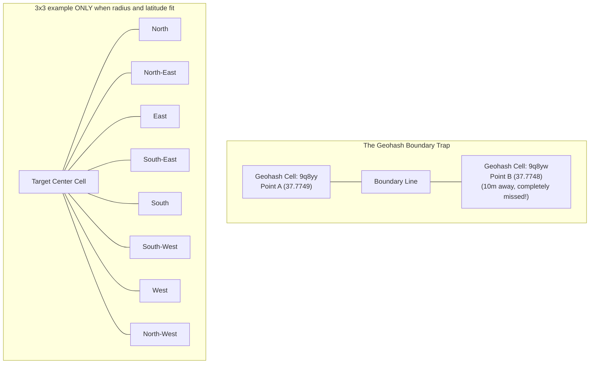
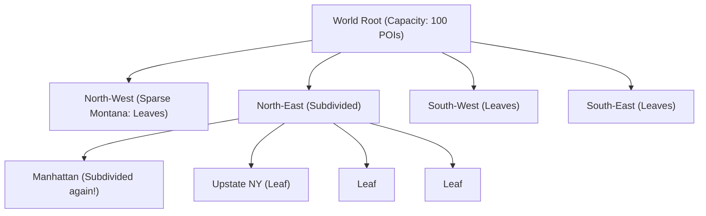

# Chapter 16: Design a Proximity Service (Yelp / Google Places)

## Guarantees and assumptions
Business updates ACK at the durable catalog commit; spatial indexes update asynchronously using stable IDs and versions. Radius searches cover every intersecting cell and apply exact-distance filtering.
**Principal IC exercise:** Prove candidate coverage for a large radius near the antimeridian and quantify fan-out when the selected precision is too fine.

---

## 1. Executive Interview Framing & Staff-Level Bar

Designing a Proximity Service (Yelp, Google Places, TripAdvisor) requires indexing hundreds of millions of static Points of Interest (POIs) across the globe and answering radial queries (`Find coffee shops within 2 miles`) in single-digit milliseconds. While mid-level candidates mention basic Geohashes, **Staff and Principal Engineers (L6+, P60) are evaluated on their mathematical mastery of spatial indexing (Geohash vs Quadtree vs Google S2 vs PostGIS GiST), the 8-neighbor boundary crossing dilemma, dynamic density-based Quadtree splitting, geographic read-cache sharding, and hotspot mitigation in ultra-dense urban centers**:

```
┌────────────────────────────────────────────────────────────────────────────────────────┐
│                                 THE INTERVIEW SPECTRUM                                 │
├────────────────────────────────────────┬───────────────────────────────────────────────┤
│ L5 / Senior Engineer                   │ L6+ / Staff & Principal Engineer              │
├────────────────────────────────────────┼───────────────────────────────────────────────┤
│ • SQL `WHERE lat BETWEEN ...` query    │ • Compares Geohash vs Quadtree vs Google S2   │
│ • Basic Geohash prefix lookup          │   vs PostGIS GiST (R-Tree) index mechanics    │
│ • Ignores boundary edge cases          │ • The 8-neighbor bounding box expansion to    │
│ • Uniform grid assumption              │   solve the Geohash boundary split flaw       │
│ • Relational DB read replicas only     │ • Dynamic Quadtree splitting on node capacity │
│ • Ignores Manhattan vs Montana density │ • Spatial sharding by Geohash prefix with     │
│                                        │   hotspot load shedding in dense metros       │
│                                        │ • Redis Geospatial multi-cell cache tier      │
└────────────────────────────────────────┴───────────────────────────────────────────────┘
```

---

## 2. The 5-Pillar Staff Assessment Rubric for Proximity Services

```
┌────────────────────────────────────────────────────────────────────────────────────────────────────────┐
│                                      5-PILLAR EVALUATION RUBRIC                                        │
├─────────────────────────┬──────────────────────────────────────────────────────────────────────────────┤
│ Pillar                  │ What the Interviewer Listens For (Evidence)                                  │
├─────────────────────────┼──────────────────────────────────────────────────────────────────────────────┤
│ 1. Decision Making      │ • Google S2 Geometry (64-bit Hilbert) vs Geohash vs PostGIS vs Quadtree.     │
│                         │ • In-Memory Spatial Cache (Redis Geospatial) vs Read-Only Spatial DB.        │
│                         │ • Evaluates trade-offs between fixed geohash precision and boundary overlaps.│
├─────────────────────────┼──────────────────────────────────────────────────────────────────────────────┤
│ 2. Technical            │ • S2 spherical Hilbert curve projection yielding 1D integer range B-tree scans│
│    Proficiency          │ • Geohash 8-neighbor lookup algorithm mitigating boundary clipping errors.   │
│                         │ • Read-heavy architecture: caches top POIs per spatial cell in Redis.        │
│                         │ • Separation of spatial index (`business_id, s2_cell_id`) from rich metadata.│
├─────────────────────────┼──────────────────────────────────────────────────────────────────────────────┤
│ 3. Problem Solving &    │ • Decomposes into Spatial Query Service, Business CRUD, CDN, & Search Index. │
│    Analytical Thinking  │ • Calculates 100M DAU, 200M businesses, and sizes spatial index ($< 10\text{ │
│                         │   GB RAM}$) to fit entirely in memory; calculates search QPS.                │
├─────────────────────────┼──────────────────────────────────────────────────────────────────────────────┤
│ 4. Operational          │ • Mitigates dense city center hotspots (Manhattan vs Montana density skew).  │
│    Mindset              │ • Monitors p99 spatial query latency ($< 50\text{ms}$) under peak meal hours. │
│                         │ • Read replicas across availability zones to handle read-heavy traffic.      │
├─────────────────────────┼──────────────────────────────────────────────────────────────────────────────┤
│ 5. Adaptability &       │ • Adapts search radius dynamically if POI density in cell is below threshold. │
│    Collaboration        │ • Balances spatial accuracy with mobile battery/network bandwidth usage.     │
│                         │ • Explains spatial query mechanics transparently to frontend and mobile teams│
└─────────────────────────┴──────────────────────────────────────────────────────────────────────────────┘
```

---

## 3. Requirements & System Scope

### Functional Requirements
1. **Nearby POI Search:** Return nearby businesses given user coordinates `(latitude, longitude)`, search radius (e.g. 500m to 20km), and optional category filters (e.g. "Sushi", "Gas Station").
2. **Business Metadata:** Provide rich business details (name, photos, operating hours, ratings, reviews).
3. **Business Management (CRUD):** Business owners can add, update, or remove listings (changes can reflect within minutes; strict real-time write propagation is not required).

### Non-Functional Requirements (SLAs & SLOs)
* **Ultra-Low Latency:** Search query p99 latency $< \mathbf{20ms}$.
* **High Availability:** **99.999%** availability (read queries must never fail even if business editing services are undergoing maintenance).
* **Massive Read Scalability:** Handle **100 Million Daily Active Users** and **25,000 Search QPS**.
* **Scale:** Index **200 Million businesses** worldwide.

---

## 3. Capacity Estimation & Real Hardware Reality

Let's establish concrete production numbers:

```
Total Businesses Worldwide: 200 Million
Daily Active Users (DAU): 100 Million
Average Searches / Day: 5 searches / user
Total Search Queries / Day: 500 Million queries / day
Average Business Record Size: 2.5 KB (name, address, hours, photos, ratings)
```

### 3.1 Throughput Math
* **Average Search QPS:**
  $$\text{Average QPS} = \frac{500,000,000}{86,400} \approx 5,780 \text{ QPS}$$
* **Peak Search QPS (Lunch / Dinner Rush 4x):**
  $$\text{Peak QPS} \approx \mathbf{25,000 \text{ QPS}}$$

### 3.2 Storage Math (Metadata vs Spatial Index)
* **Business Metadata Storage:**
  $$200,000,000 \times 2.5 \text{ KB} \approx \mathbf{500 \text{ GB}}$$
* **Geospatial Index Memory Footprint:**
  - Index record: `business_id` (8 bytes) + `geohash_int64` (8 bytes) + `lat/lon` (16 bytes) $= 32 \text{ bytes}$.
  - Total Spatial Index RAM:
    $$200,000,000 \times 32 \text{ bytes} \approx \mathbf{6.4 \text{ GB RAM!}}$$
  - *Staff Takeaway:* **The entire world's geospatial index easily fits into the RAM of a single small server!** The bottleneck is not memory volume; it is handling **25,000 concurrent radial search QPS** without lock contention.

---

## 4. Geospatial Indexing Deep Dive: The 4 Competing Approaches

```
┌────────────────────────────────────────────────────────────────────────────────────────┐
│                              GEOSPATIAL INDEXING COMPARISON                            │
├─────────────────────┬──────────────────┬──────────────────┬────────────────────────────┤
│ Indexing Model      │ Data Structure   │ Update Speed     │ Staff Engineering Verdict  │
├─────────────────────┼──────────────────┼──────────────────┼────────────────────────────┤
│ 1. PostGIS (R-Tree  │ B-Tree on 2D     │ Fast             │ Standard for small-to-mid  │
│    / GiST Index)    │ Bounding Boxes   │ (Native SQL)     │ scale. Degrades under      │
│                     │                  │                  │ 25,000 QPS concurrent read.│
├─────────────────────┼──────────────────┼──────────────────┼────────────────────────────┤
│ 2. Geohash          │ Base32 / Int64   │ Extremely Fast   │ RECOMMENDED for Key-Value &│
│    (Z-Order Curve)  │ String Prefix    │ (Simple string/  │ Redis caches. Fast prefix  │
│                     │                  │ integer key)     │ queries; requires 8-box fix│
├─────────────────────┼──────────────────┼──────────────────┼────────────────────────────┤
│ 3. Quadtree         │ Hierarchical     │ Complex          │ EXCELLENT for in-memory    │
│    (In-Memory Tree) │ 4-way Tree       │ (Requires tree   │ density balancing. Adapts  │
│                     │                  │ locks on write)  │ Manhattan vs Montana!      │
├─────────────────────┼──────────────────┼──────────────────┼────────────────────────────┤
│ 4. Google S2        │ 64-bit Hilbert   │ Extremely Fast   │ INDUSTRY GOLD STANDARD:    │
│    (Hilbert Curve)  │ Curve Projection │ (Bitwise ops)    │ Projects Earth onto cube;  │
│                     │                  │                  │ zero polar distortion.     │
└─────────────────────┴──────────────────┴──────────────────┴────────────────────────────┘
```

---

### 4.1 Approach 1: Geohash (Z-Order Curve)

Geohash recursively divides the Earth into quadrants, interleaving bits of latitude and longitude:
* Level 4: $\approx 39.1\text{ km} \times 19.5\text{ km}$ (Metropolitan area)
* Level 5: $\approx 4.9\text{ km} \times 4.9\text{ km}$ (City district)
* Level 6: $\approx 1.2\text{ km} \times 0.6\text{ km}$ (Neighborhood)

#### The Fatal Geohash Flaw: The Boundary Cliff
Two points separated by only **10 meters** can sit on opposite sides of a Geohash boundary:
- Point A: `9q8yy`
- Point B: `9q8yw`
- If you only execute `SELECT * FROM places WHERE geohash LIKE '9q8yy%'`, you **completely miss Point B** right across the street!



> [!IMPORTANT]
> **Geohash coverage:** Enumerate **all cells intersecting the search region**, handle antimeridian wraparound and polar boundaries, then apply an exact-distance filter. A 3×3 neighborhood works when it covers the full region at the selected precision, radius and latitude; a 5 km radius over 100 m cells requires a larger covering.

---

### 4.2 Approach 2: In-Memory Quadtree (Density-Aware Balancing)

Unlike fixed Geohashes, a **Quadtree** adapts dynamically to geographic density:



* **The Subdivision Rule:**
  - A node starts as a leaf holding up to 100 business IDs.
  - When the 101st business is inserted in that geographic box:
  - The node splits into **4 quadrants (NW, NE, SW, SE)**.
  - The 101 businesses are redistributed to the 4 child nodes.
* **The Result:**
  - In sparse rural areas (Montana), a single leaf spans an entire county.
  - In ultra-dense urban centers (Manhattan / Tokyo), leaf nodes split down to individual street blocks.
  - Balanced-tree point descent has expected depth around $O(\log_4 N)$ under suitable spatial distributions; clustered/coincident points can force deep or repeated subdivision. Bound depth/minimum cell size, keep overflow buckets, and include visited cells plus returned candidates in range-query cost.

---

## 5. Architectural Deep Dives: Staff & SDFC Insights

### 5.1 Database Schema & Indexing (PostgreSQL + PostGIS vs Cassandra)

```sql
-- PostgreSQL with PostGIS Geography Index
CREATE EXTENSION IF NOT EXISTS postgis;

CREATE TABLE businesses (
    business_id UUID PRIMARY KEY DEFAULT gen_random_uuid(),
    name VARCHAR(255) NOT NULL,
    category VARCHAR(100) NOT NULL,
    latitude DOUBLE PRECISION NOT NULL,
    longitude DOUBLE PRECISION NOT NULL,
    location GEOGRAPHY(POINT, 4326) NOT NULL, -- WGS 84
    geohash_level6 VARCHAR(6) NOT NULL,
    rating NUMERIC(2, 1) DEFAULT 0.0,
    review_count INT DEFAULT 0,
    created_at TIMESTAMP WITH TIME ZONE DEFAULT NOW()
);

-- Fast Spatial Index using PostGIS GiST (Generalized Search Tree)
CREATE INDEX idx_businesses_location ON businesses USING GIST(location);

-- Secondary Index for Geohash 9-Cell Lookups
CREATE INDEX idx_businesses_geohash ON businesses (geohash_level6, category);
```

#### Radial Proximity Query (Using PostGIS ST_DWithin)
```sql
SELECT business_id, name, latitude, longitude,
       ST_Distance(location, ST_MakePoint(-122.4194, 37.7749)::geography) AS distance_meters
FROM businesses
WHERE ST_DWithin(location, ST_MakePoint(-122.4194, 37.7749)::geography, 2000) -- 2km radius
ORDER BY distance_meters ASC
LIMIT 20;
```

---

### 5.2 Redis Geospatial Caching Architecture

Executing PostGIS spatial queries on primary databases at 25,000 QPS will exhaust database CPU. We deploy an in-memory **Redis Geospatial Cache**:

```redis
-- Add business coordinates to Redis Sorted Set via GEOADD
GEOADD places:restaurants -122.4194 37.7749 "biz_102"
GEOADD places:restaurants -122.4180 37.7755 "biz_103"

-- Query nearby businesses within 2000 meters in sub-2ms!
GEOSEARCH places:restaurants FROMLONLAT -122.4194 37.7749 BYRADIUS 2000 m ASC WITHDIST WITHCOORD COUNT 20
```

* **Under the Hood:** Redis encodes coordinates into a **52-bit integer Geohash** and stores them as the score of a standard Redis Sorted Set (`ZSET`). Queries use fast bitwise score seeks!

---

### 5.3 Sharding & Hotspot Mitigation in Dense Metros

If you shard by `geohash_prefix` (e.g. all `9q8y` businesses on Node 1):
* Node 1 (covering San Francisco) will receive 10,000x more read traffic than Node 42 (covering the Nevada desert).
* **Staff Sharding Strategy (Two-Tier Sharding):**
  1. **Primary Sharding by `business_id`:** Distribute raw business metadata evenly across database shards using consistent hashing.
  2. **Spatial Index Replicated Globally:** Because the entire global spatial index is only **6.4 GB**, replicate the complete Quadtree / S2 index across **every regional read node**!
  3. Nodes evaluate the spatial query in local memory ($< 2\text{ms}$), then execute an `MGET` against the distributed metadata tier.

---

## 6. End-to-End System Architecture

```mermaid
flowchart TD
    subgraph Clients["Clients"]
        UserApp["Mobile User (Searching Nearby)"]
        OwnerPortal["Business Owner Dashboard"]
    end

    subgraph IngressTier["Edge & Ingress Tier"]
        CDN["Edge CDN (Static Images & Cache)"]
        ALB["Application Load Balancer"]
        APIGW["API Gateway (Auth & Rate Limiting)"]
    end

    subgraph Microservices["Core Microservices Tier"]
        LBS["Location-Based Service (LBS)<br/>(Stateless Read Engine)"]
        BizSvc["Business Management Service<br/>(Write Path)"]
    end

    subgraph CachingTier["In-Memory Spatial Caches"]
        RedisGeo[("Redis Geospatial Cluster<br/>(GEOSEARCH in <2ms)")]
        LocalQuadtree["In-Memory Quadtree / S2 Fleet"]
    end

    subgraph PersistenceTier["Primary Database Tier"]
        PostgresPrimary[("PostgreSQL / PostGIS Primary<br/>(Master Write DB)")]
        PostgresReplica[("PostgreSQL Read Replicas<br/>(GiST Spatial Indexes)")]
    end

    UserApp --> ALB
    OwnerPortal --> ALB
    ALB --> APIGW

    %% Read Path
    APIGW -->|1. GET /nearby (lat, lon, 2km)| LBS
    LBS -->|2. Fast Spatial Seek| RedisGeo
    RedisGeo -.->|Cache Miss| LocalQuadtree
    LocalQuadtree -.->|Cache Miss| PostgresReplica
    LBS -->|3. Hydrate Top 20 Metadata| PostgresReplica
    LBS -->|4. Return Ranked POIs JSON| ALB

    %% Write Path
    APIGW -->|POST /businesses| BizSvc
    BizSvc -->|Insert / Update| PostgresPrimary
    PostgresPrimary -.->|Replication| PostgresReplica
    BizSvc -->|Invalidate / Update| RedisGeo
```

---

## 7. Edge Cases, Failure Modes & Operational Realities

### 7.1 Radius Expansion Strategy (Sparse Rural Areas)
* **Scenario:** A user searches in the middle of rural Alaska with a default 1-mile radius.
* **Failure:** Query returns 0 results.
* **Mitigation:**
  - If the search returns $< 5$ results:
  - System automatically initiates an exponential radius expansion:
    $$r \to 2r \to 4r \quad (\text{e.g. } 1\text{km} \to 5\text{km} \to 20\text{km})$$
  - The UI informs the user: *"No coffee shops found within 1 mile; showing results within 10 miles."*

### 7.2 Result Ranking Beyond Pure Distance
* Pure distance ordering is often suboptimal: a 1-star diner 50 meters away shouldn't rank higher than a 5-star Michelin restaurant 200 meters away.
* **Staff Ranking Score:**
  $$\text{Score} = w_1 \cdot \frac{1}{\text{Distance}} + w_2 \cdot \text{Rating} + w_3 \cdot \log(\text{ReviewCount}) + w_4 \cdot \text{IsOpenNow}$$

---

## 8. Interview Wrap-Up: Staff-Level Decision Matrix

| Problem Space | Junior / Senior Approach | Staff / Principal Approach |
| :--- | :--- | :--- |
| **Spatial Query** | SQL `WHERE lat BETWEEN ...` | **PostGIS GiST index or Redis GEOSEARCH:** Sub-5ms spatial seeks. |
| **Boundary Flaw** | Query single Geohash cell | **8-Neighbor Geocell Expansion:** Queries target cell + 8 adjacent cells to solve boundary clips. |
| **Density Variation** | Uniform grid | **Dynamic In-Memory Quadtree:** Recursively splits dense blocks (Manhattan) while keeping rural zones large. |
| **Cache Architecture** | SQL query caching | **Redis Geospatial Cluster (52-bit Geohash in ZSET):** Absorbs 25,000 QPS with sub-2ms response. |
| **Index Sizing** | Assume petabytes of data | **Mathematical Proof of 6.4 GB Index:** Complete global spatial index fits in RAM of every query node. |
| **Sparse Areas** | Return empty list | **Adaptive Exponential Radius Expansion:** Expands search bounding box automatically. |
