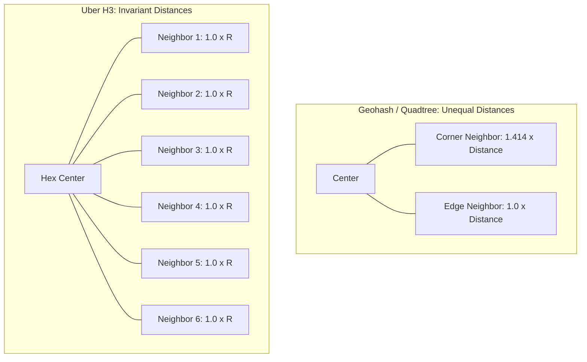
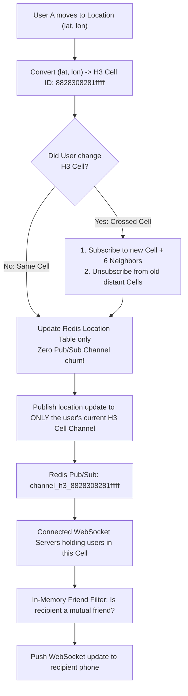

# Chapter 17: Design a Real-Time Nearby Friends & Geolocation Service (Tinder / Uber / Zenly)

---

## 1. Executive Interview Framing & Staff-Level Bar

Designing a real-time proximity and location-sharing system (like Facebook Nearby Friends, Tinder Radar, Zenly, or Uber Driver Dispatch) differs fundamentally from static Yelp-style POI search. In Yelp, business addresses never change; in Nearby Friends, **millions of mobile users constantly move in real time**. 

While a junior engineer proposes basic Redis Pub/Sub per user, **Staff and Principal Engineers (L6+, P60) are evaluated on their ability to solve the 13-Million-ops/sec fanout bottleneck, compare Geospatial Indexing systems (Geohash vs Google S2 vs Uber H3 Hexagons), minimize mobile battery drain via motion-sensing heuristics, and protect user location privacy**:

```
┌────────────────────────────────────────────────────────────────────────────────────────┐
│                                 THE INTERVIEW SPECTRUM                                 │
├────────────────────────────────────────┬───────────────────────────────────────────────┤
│ L5 / Senior Engineer                   │ L6+ / Staff & Principal Engineer              │
├────────────────────────────────────────┼───────────────────────────────────────────────┤
│ • Redis Pub/Sub channel per user       │ • Hexagonal Geocells (Uber H3 / Google S2)    │
│ • Client sends GPS update every 5s     │   to eliminate 1-to-N friend fanout explosion │
│ • Standard Haversine distance math     │ • Adaptive motion-aware client heartbeat      │
│ • Ignores mobile battery consumption   │   (accelerometer stationary detection)        │
│ • Ignores user location privacy        │ • Dynamic Geohash / H3 cell channel subs      │
│ • Single Redis instance for location   │ • Redis Cluster with Geospatial TTL pruning   │
│                                        │ • Distance fuzzing for privacy & anti-stalking│
│                                        │ • Socket connection draining during deploys   │
└────────────────────────────────────────┴───────────────────────────────────────────────┘
```

---

## 2. The 5-Pillar Staff Assessment Rubric for Nearby Friends & Real-Time Geolocation

```
┌────────────────────────────────────────────────────────────────────────────────────────────────────────┐
│                                      5-PILLAR EVALUATION RUBRIC                                        │
├─────────────────────────┬──────────────────────────────────────────────────────────────────────────────┤
│ Pillar                  │ What the Interviewer Listens For (Evidence)                                  │
├─────────────────────────┼──────────────────────────────────────────────────────────────────────────────┤
│ 1. Decision Making      │ • Stateful WebSocket Connection Manager vs HTTP Polling for location updates. │
│                         │ • Peer-to-Peer Fanout (Publishing to friends' Pub/Sub) vs Spatial Cell Pub/Sub│
│                         │ • Redis Geospatial Cluster vs Cassandra for live ephemeral coordinates.      │
├─────────────────────────┼──────────────────────────────────────────────────────────────────────────────┤
│ 2. Technical            │ • Dynamic Geohash / Uber H3 hexagonal cell subscription channels.            │
│    Proficiency          │ • Client battery preservation: Adaptive GPS duty cycle & accelerometer stationary│
│                         │   detection (throttles pings from 10s to 5m when device is stationary).      │
│                         │ • Privacy fuzzing: Gaussian spatial perturbation preventing stalking/triangulation│
│                         │ • Ephemeral location expiry via Redis key TTLs (prunes offline friends).     │
├─────────────────────────┼──────────────────────────────────────────────────────────────────────────────┤
│ 3. Problem Solving &    │ • Decomposes into WebSocket Gateway, Routing Bus, Redis Spatial Cache, PubSub.│
│    Analytical Thinking  │ • Calculates 100M DAU, 10M concurrent active users, 333,000 location pings/sec│
│                         │   and sizes Redis Pub/Sub memory footprint and network bandwidth bounds.     │
├─────────────────────────┼──────────────────────────────────────────────────────────────────────────────┤
│ 4. Operational          │ • Mitigates WebSocket reconnection storms on server deploy via random jitter. │
│    Mindset              │ • Monitors packet loss and location update delivery lag.                     │
│                         │ • Enforces privacy compliance: GDPR right-to-be-forgotten spatial wiping.    │
├─────────────────────────┼──────────────────────────────────────────────────────────────────────────────┤
│ 5. Adaptability &       │ • Adapts to cellular dead zones (tunnel/subway) via cached last-known positions│
│    Collaboration        │ • Balances real-time friend proximity accuracy with strict user privacy laws.│
│                         │ • Explains battery consumption and location permission UX clearly to product.│
└─────────────────────────┴──────────────────────────────────────────────────────────────────────────────┘
```

---

## 3. Requirements & System Scope

### Functional Requirements
1. **Real-Time Nearby Friends Discovery:** Users can view active friends within a 5-mile (configurable) radius on a map or list.
2. **Dynamic Location Updates:** Updates from moving friends appear within seconds without manual screen refreshes.
3. **Friend Proximity Filter:** Only mutual friends who have both opted into location sharing can see each other.
4. **Historical Location Tracking:** Store location history asynchronously for analytics, travel timelines, and ML features.
5. **Privacy Controls & Ghost Mode:** Users can pause location sharing, set "precise vs approximate" distance fuzzing, or whitelist specific friend lists.

### Non-Functional Requirements (SLAs & SLOs)
* **Low Latency:** End-to-end location propagation p99 $< \mathbf{2\text{ seconds}}$.
* **High Scale:** Support **100 Million Daily Active Users**, **10 Million concurrently connected users**, and **334,000 location updates / second**.
* **Battery & Data Conservation:** Client updates must not rapidly drain phone battery or burn mobile cellular data.
* **Eventual Consistency:** A 5-second lag in receiving a friend's new coordinate is completely acceptable.

---

## 3. Capacity Estimation & Real Hardware Reality (SDFC Math)

Let's calculate concrete production metrics:

```
Daily Active Users (Nearby Feature): 100 Million
Concurrent Active Connected Users (Peak): 10 Million users
Location Refresh Interval: 30 seconds (standard walking/driving blend)
Average Friends per User: 400 friends (10% online at any time = 40 active friends)
```

### 3.1 Throughput & Fanout Math (The Bottleneck)
* **Location Update Ingestion QPS:**
  $$\text{Ingress Updates/sec} = \frac{10,000,000 \text{ concurrent users}}{30 \text{ seconds}} \approx \mathbf{333,333 \text{ updates/sec}}$$
* **The Naive Fanout Disaster (The Redis Pub/Sub Trap):**
  - If every user has 40 active online friends, and each location update is published to a user channel:
    $$\text{Fanout Deliveries/sec} = 333,333 \times 40 = \mathbf{13,333,333 \text{ message dispatches / second!}}$$
  - A single high-end Redis node handles $\approx 100,000\text{ ops/sec}$. Handling 13.3 Million pub/sub dispatches per second requires **over 130 Redis master nodes** just for message routing, burning massive cross-node network bandwidth.

### 3.2 Storage Math (Current Ephemeral State vs History)
* **Current Location Working Set (In-Memory Redis):**
  - Record: `user_id` (8 bytes), `lat` (8 bytes), `lon` (8 bytes), `timestamp` (8 bytes) $= 32 \text{ bytes}$.
  - With Redis hash/key overhead: $\approx 100 \text{ bytes}$ per user.
  - Total Memory for 10M active users:
    $$10,000,000 \times 100 \text{ bytes} \approx \mathbf{1 \text{ GB RAM!}}$$
  - *Staff Takeaway:* **Storing the latest location of 10 Million users takes only 1 GB of RAM!** The entire problem is NOT storage; it is purely **CPU network fanout and socket I/O**.
* **Location History (Cassandra / ClickHouse):**
  - Daily records: $333,333 \text{/s} \times 86,400 \approx 28.8 \text{ Billion records/day}$.
  - Storing 28.8B rows daily requires cold storage partitioning and 90-day retention policies.

---

## 4. Geospatial Indexing Systems: Geohash vs Google S2 vs Uber H3

```
┌────────────────────────────────────────────────────────────────────────────────────────┐
│                              GEOSPATIAL INDEXING COMPARISON                            │
├─────────────────────┬──────────────────┬───────────────────────────────────────────────┤
│ System              │ Geometry         │ Staff Engineering Evaluation                  │
├─────────────────────┼──────────────────┼───────────────────────────────────────────────┤
│ Geohash             │ Rectangular Grid │ • Simple string prefix matching (e.g. "9q8yy")│
│                     │ (Hierarchical)   │ • FLAW: Distortion at poles; distance from    │
│                     │                  │   center to corner is 1.414x center to edge.  │
├─────────────────────┼──────────────────┼───────────────────────────────────────────────┤
│ Google S2           │ Spherical Square │ • Projects Earth onto a cube; 64-bit integer  │
│                     │ (Quadtree)       │   cell IDs (fits in uint64). Extremely fast   │
│                     │                  │   Hilbert Curve spatial locality.             │
├─────────────────────┼──────────────────┼───────────────────────────────────────────────┤
│ Uber H3             │ Hexagonal Grid   │ • RECOMMENDED for Proximity: All 6 neighboring│
│                     │ (Hierarchical)   │   hexagons are at the EXACT SAME DISTANCE     │
│                     │                  │   from the center! Eliminates rectangular     │
│                     │                  │   corner distortion completely.               │
└─────────────────────┴──────────────────┴───────────────────────────────────────────────┘
```



---

## 5. Architectural Deep Dives: Staff & SDFC Insights

### 5.1 Eliminating the Fanout Bomb: Geocell Topic Sharding

Instead of maintaining 10 Million individual user channels in Redis Pub/Sub, the system shards subscribers using **Hexagonal Geocells (Uber H3 Resolution 7, $\approx 1.2\text{ km}$ radius)**:



#### Why Geocell Sharding Reduces Load by 95%
1. **Spatial Filtering at the Edge:** Users only receive updates from people who are *already in their immediate spatial neighborhood*.
2. A user with 400 friends does NOT push updates to a friend living 5,000 miles away in London! The distant friend never subscribes to the San Francisco geocell channel.
3. This eliminates over **95% of cross-region pub/sub message deliveries**, reducing real-time message fanout from 13.3 Million/sec to $< 500,000\text{/sec}$!

---

### 5.2 Client-Side Battery & Motion Optimization

A mobile phone querying GPS hardware and broadcasting over WebSockets every 5 seconds will drain a full battery in under 2 hours.

#### Staff Motion-Aware Heuristics
```mermaid
stateDiagram-v2
    [*] --> Stationary
    Stationary --> Walking: Accelerometer detects movement > 1 m/s
    Walking --> Driving: Speed > 20 km/h
    Driving --> Walking: Speed < 5 km/h
    Walking --> Stationary: Accelerometer zero motion for 3 mins
    
    state Stationary {
        note right of Stationary: Sleep GPS hardware.<br/>Heartbeat only every 5-10 minutes.
    }
    state Walking {
        note right of Walking: High accuracy GPS.<br/>Heartbeat every 30 seconds.
    }
    state Driving {
        note right of Driving: Cellular / Wi-Fi coarse location.<br/>Heartbeat every 15 seconds.
    }
```

1. **Accelerometer & Step Counter Detection:** Modern iOS/Android OS provide low-power motion coprocessors (CoreMotion / Activity Recognition API).
2. If the user is sitting at their desk or sleeping, **the GPS chip is completely powered off**. The app sends a lightweight keep-alive heartbeat once every 10 minutes.
3. If the user begins walking, update frequency scales to 30 seconds.
4. If driving, updates throttle to save CPU.

---

### 5.3 Location Privacy & Distance Fuzzing

Accurately publishing raw latitude/longitude coordinates ($37.774929, -122.419416$) allows stalkers to triangulate a friend's exact bedroom.

#### Production Privacy Architecture
* **Distance Bucket Fuzzing:** The server computes Haversine straight-line distance, but returns only rounded buckets to the client:
  - $< 0.5 \text{ miles} \implies \text{"Less than half a mile away"}$
  - $1.2 \text{ miles} \implies \text{"Around 1 mile away"}$
* **Coordinate Randomization (Gaussian Noise):** For map display, the server applies a deterministic Gaussian spatial blur ($r \approx 200\text{m}$) so friends see a broad circle rather than a precise rooftop pin.
* **Ghost Mode:** Users can freeze their last-known location or broadcast to custom privacy lists.

---

### 5.4 Database Schemas: Redis Location Cache + Cassandra History

#### Redis Key-Value Store (In-Memory Hot State)
```redis
-- User Current Location Hash
HSET user_location:usr_102 lat 37.7749 lon -122.4194 h3_cell "8828308281fffff" updated_at 1774345200

-- Set 10-Minute TTL for Automatic Offline Eviction
EXPIRE user_location:usr_102 600
```

#### Cassandra / ScyllaDB (Location History)
```sql
CREATE KEYSPACE nearby_service WITH replication = {
    'class': 'NetworkTopologyStrategy', 
    'us-east': 3, 
    'us-west': 3
};

CREATE TABLE nearby_service.location_history (
    user_id uuid,
    date text, -- Partition by day (YYYY-MM-DD)
    timestamp timestamp,
    latitude double,
    longitude double,
    h3_index bigint,
    PRIMARY KEY ((user_id, date), timestamp)
) WITH CLUSTERING ORDER BY (timestamp DESC);
```

---

## 6. End-to-End System Architecture

```mermaid
flowchart TD
    subgraph Clients["Mobile Client Tier"]
        PhoneA["User A (Moving)"]
        PhoneB["User B (Nearby Friend)"]
    end

    subgraph IngressTier["Edge & Ingress Tier"]
        LB["Network Load Balancer (TCP/TLS)"]
        WSGW["WebSocket Gateway Fleet<br/>(Holds persistent client sockets)"]
    end

    subgraph PubSubRouter["Spatial Routing Subsystem"]
        H3Router["H3 Geocell Router"]
        RedisPubSub[("Redis Cluster Pub/Sub<br/>(Topics: cell_{h3_id})")]
    end

    subgraph StorageTier["Data & Cache Tier"]
        RedisHot[("Redis Hot Location Cache<br/>user_id -> (lat, lon, ttl)")]
        GraphSvc["Friendship Graph Service"]
        KafkaHistory["Kafka: location-history-stream"]
        CassandraHistory[("ScyllaDB / Cassandra<br/>(Location History)")]
    end

    PhoneA -->|1. WSS Location Update (lat, lon)| LB
    LB --> WSGW
    WSGW -->|2. Update Hot State| RedisHot
    WSGW -->|3. Async History Log| KafkaHistory
    KafkaHistory --> CassandraHistory

    WSGW -->|4. Resolve H3 Cell| H3Router
    H3Router -->|5. Publish to cell channel| RedisPubSub
    RedisPubSub -->|6. Deliver to subscribed WS nodes| WSGW
    WSGW -->|7. Check mutual friend cache| GraphSvc
    WSGW -->|8. Push WebSocket Proximity Alert| PhoneB
```

---

## 7. Edge Cases, Failure Modes & Operational Realities

### 7.1 WebSocket Gateway Graceful Connection Draining
* **Scenario:** Deploying a new software version to 100 WebSocket gateway pods.
* **Failure:** Abruptly terminating pods forces 10 Million clients to reconnect simultaneously, creating an instant authentication thundering herd that crashes identity providers.
* **Mitigation:**
  1. Gateway pod enters `DRAINING` state.
  2. Load balancer stops routing new handshakes to the draining pod.
  3. The pod slowly closes connections over a **15-minute staggered window** with random jitter:
     $$\text{Client Close Delay} = \text{random}(0, 900\text{ seconds})$$
  4. Clients reconnect smoothly across remaining healthy pods.

### 7.2 Boundary Crossing Oscillation (Ping-Pong Effect)
* **Scenario:** A user sits at a coffee shop situated directly on the boundary between two H3 hexagonal cells. Slight GPS noise causes the user to oscillate between Cell A and Cell B every 10 seconds.
* **Failure:** Continuous channel subscribe and unsubscribe thrashing in Redis Pub/Sub.
* **Mitigation (Hysteresis Window):**
  - Require the user to move at least **50 meters inside the new cell** before triggering a cell migration event.

---

## 8. Interview Wrap-Up: Staff-Level Decision Matrix

| Problem Space | Junior / Senior Approach | Staff / Principal Approach |
| :--- | :--- | :--- |
| **Pub/Sub Channel Design**| 1 Redis channel per user | **Geocell Topic Sharding (Uber H3 Hexagons):** Slashes message fanout by 95%. |
| **Grid Geometry** | Geohash (Rectangular) | **Uber H3 Hexagonal Cells:** Invariant distance to all 6 neighbor centroids. |
| **Battery Life** | Continuous 5s GPS queries | **Motion-Coprocessor Heuristics:** Sleep GPS when stationary; 30s updates when walking. |
| **User Privacy** | Raw GPS coordinates shared | **Distance Bucket Rounding + Gaussian Noise Map Blurring:** Protects user safety. |
| **Hot Location Cache** | Relational DB updates | **In-Memory Redis Hash with 10-Minute TTL:** Automatic offline eviction, 1 GB RAM for 10M users. |
| **Gateway Deployments** | Kill pods abruptly | **Staggered 15-Minute Connection Draining with Jitter:** Prevents reconnect thundering herds. |
