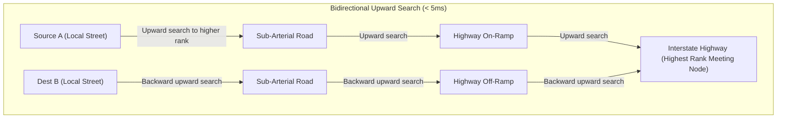
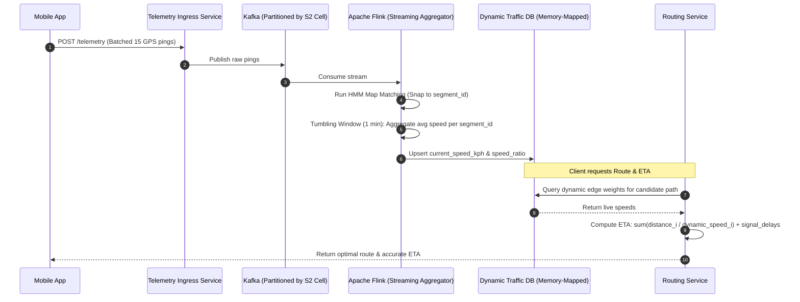

# Chapter 18: Design Google Maps & Real-Time Navigation (Routing, ETAs, Map Rendering)

**Sources & Foundational References:**
- [System Design Interview – An Insider's Guide: Vol 2 (Alex Xu & Sahn Lam)](https://bytebytego.com/)
- [Google S2 Geometry Library Documentation](http://s2geometry.io/)
- [Fast Routing in Road Networks with Contraction Hierarchies (Geisberger et al.)](https://algo2.iti.kit.edu/documents/routeplanning/geisberger_dipl.pdf)
- [Hidden Markov Map Matching for Noisy and Sparse GPS Data (Newson & Krumm)](https://www.microsoft.com/en-us/research/publication/hidden-markov-map-matching-noise-sparse-gps-data/)

---

## 1. Executive Interview Framing & Staff-Level Bar

Designing Google Maps is one of the most intellectually demanding systems design challenges because it bridges **computational geometry, massive streaming telemetry, graph theory, and edge mobile constraints**. While a mid-level candidate talks about basic Dijkstra on a road graph and serving static map pictures, **Staff and Principal Engineers (L6+, P60) are evaluated on their ability to solve continental graph partitioning via Contraction Hierarchies, convert raw noisy GPS pings to road segments using Hidden Markov Models (HMM), serve Mapbox Vector Tiles (MVT) via S2 cell pyramids, and prevent traffic oscillation herds during real-time re-routing**:

```
┌────────────────────────────────────────────────────────────────────────────────────────┐
│                                 THE INTERVIEW SPECTRUM                                 │
├────────────────────────────────────────┬───────────────────────────────────────────────┤
│ L5 / Senior Engineer                   │ L6+ / Staff & Principal Engineer              │
├────────────────────────────────────────┼───────────────────────────────────────────────┤
│ • Basic Dijkstra / A* in memory        │ • Hierarchical Graph Partitioning with        │
│   (Collapses on transcontinental paths)│   Contraction Hierarchies (CH) shortcuts      │
│ • Raster PNG image tiles (heavy egress)│ • Mapbox Vector Tiles (MVT / Protobuf) with   │
│                                        │   GPU client rendering & S2 64-bit cells      │
│ • Naive snap-to-nearest road node      │ • Hidden Markov Model (HMM) Viterbi map-      │
│   (Fails on overpasses and tunnels)    │   matching to correct noisy GPS coordinates   │
│ • Raw GPS pings streamed every second  │ • Client-side dead-reckoning & batched        │
│   (Drains battery and bandwidth)       │   adaptive GPS duty cycle (15-30s intervals)  │
│ • Static routing without live traffic  │ • Real-time Apache Flink streaming pipeline to│
│                                        │   dynamically update graph edge weights       │
│ • Blind re-routing sends 10,000 cars   │ • Congestion herd prevention (Probabilistic   │
│   to the same narrow side street       │   traffic split routing across alternatives)  │
└────────────────────────────────────────┴───────────────────────────────────────────────┘
```

---

## 2. The 5-Pillar Staff Assessment Rubric for Google Maps

```
┌────────────────────────────────────────────────────────────────────────────────────────────────────────┐
│                                      5-PILLAR EVALUATION RUBRIC                                        │
├─────────────────────────┬──────────────────────────────────────────────────────────────────────────────┤
│ Pillar                  │ What the Interviewer Listens For (Evidence)                                  │
├─────────────────────────┼──────────────────────────────────────────────────────────────────────────────┤
│ 1. Decision Making      │ • Justifies Vector Tiles (Protobuf) over Raster PNGs (5x bandwidth savings,  │
│                         │   dynamic rotation/styling, client-side zooming).                            │
│                         │ • Compares Dijkstra vs A* vs Contraction Hierarchies (CH) for routing latency│
│                         │   under millisecond bounds; selects CH with accepted precomputation tax.     │
│                         │ • Evaluates S2 Geometry vs Geohash; selects S2 for distortion-free cells.    │
├─────────────────────────┼──────────────────────────────────────────────────────────────────────────────┤
│ 2. Technical            │ • Explains S2 spherical projection (Cube mapping + Hilbert space-filling     │
│    Proficiency          │   curve) yielding 64-bit integer IDs for $O(1)$ spatial B-Tree indexing.     │
│                         │ • Dissects Hidden Markov Model (Emission probabilities for GPS noise +       │
│                         │   Transition probabilities for road network topology).                       │
│                         │ • Formulates edge weight functions ($W = \frac{\text{Distance}}{\text{Speed}(t)}$).│
├─────────────────────────┼──────────────────────────────────────────────────────────────────────────────┤
│ 3. Problem Solving &    │ • Decomposes architecture into Map Rendering, Ingress Telemetry, and Routing.│
│    Analytical Thinking  │ • Calculates tile pyramid bounds ($4^z$), peak GPS ingestion QPS (1M+ QPS),  │
│                         │   and cache sizes using napkin formulas with explicit units.                 │
├─────────────────────────┼──────────────────────────────────────────────────────────────────────────────┤
│ 4. Operational          │ • Employs 99%+ CDN edge caching for static vector tiles.                     │
│    Mindset              │ • Preserves mobile device battery via client-side sensor fusion & batching.  │
│                         │ • Designs offline navigation via client-side LRU bounding box tile packs.    │
│                         │ • Establishes graceful degradation when real-time traffic Flink jobs stall.  │
├─────────────────────────┼──────────────────────────────────────────────────────────────────────────────┤
│ 5. Adaptability &       │ • Mitigates traffic oscillation / thundering herd rerouting during crashes.  │
│    Collaboration        │ • Balances driver selfish routing (Wardrop User Equilibrium) with system     │
│                         │   optimal efficiency to avoid gridlocking residential neighborhoods.         │
└─────────────────────────┴──────────────────────────────────────────────────────────────────────────────┘
```

---

## 3. Requirements & System Scope

### Functional Requirements
1. **Location Updating & Telemetry:** Continuously ingest client GPS coordinates to power real-time traffic speeds and road telemetry.
2. **Map Rendering:** Serve responsive map tiles across zoom levels ($0 \dots 21$) globally with smooth panning and zooming.
3. **Turn-by-Turn Navigation & Routing:** Compute fast, accurate driving routes from point $A$ to point $B$ factoring in real-time traffic conditions, road closures, and turn restrictions.
4. **Accurate ETA Predictions:** Continuously predict travel duration and arrival time based on historical speeds, live congestion, and upcoming signals.

### Non-Functional Requirements & Performance SLOs
* **Scale:** Support **1 Billion Daily Active Users (DAU)**, with **35 Million concurrent active drivers** navigating simultaneously.
* **Routing Latency:** Compute end-to-end driving route in $< \mathbf{200ms}$ (p99).
* **Map Rendering Latency:** Map tile delivery from edge CDN $< \mathbf{25ms}$ (p99).
* **Navigation Accuracy:** Zero phantom turns or incorrect one-way street violations.
* **Battery & Bandwidth Efficiency:** Mobile client must not drain battery or exceed cellular data plans; location updates must be batched and compressed.

---

## 4. Back-of-the-Envelope Capacity Estimation

```
DAU: 1 Billion users
Concurrent Navigating Drivers (Peak): 35 Million active drivers
GPS Ping Interval: Batched every 15 seconds (1 ping represents 15 aggregated 1-sec records)
Map World Coverage: Zoom levels 0 to 21
```

### 4.1 Telemetry Ingestion Math (GPS Stream)
* **Ingress Request QPS:**
  $$\text{Average Ingestion QPS} = \frac{35,000,000 \text{ drivers}}{15 \text{ seconds}} \approx \mathbf{2.33 \text{ Million QPS}}$$
* **Ingress Bandwidth:**
  - Each batched GPS ping contains: `driver_id` (16 bytes) + 15 location tuples `(lat, lng, heading, speed, timestamp)` (15 × 20 bytes = 300 bytes) $\approx 350 \text{ bytes}$.
  $$\text{Ingress Bandwidth} = 2.33\text{M req/sec} \times 350 \text{ bytes} \approx 815 \text{ MB/sec} \approx \mathbf{6.52 \text{ Gbps}}$$
  *Staff Takeaway:* Easily manageable across a clustered Kafka ingress fleet partitioned by geographic S2 cells.

### 4.2 Map Tile Storage & Bandwidth Math (Vector vs Raster)
* The world map is partitioned into an **image pyramid**. At zoom level $z$, the world is divided into $4^z$ tiles ($2^z \times 2^z$ grid):
  - Zoom 0 (Entire Planet): $4^0 = 1$ tile.
  - Zoom 15 (City Street Level): $4^{15} \approx 1.07 \text{ Billion tiles}$.
  - Zoom 18 (Building Footprints): $4^{18} \approx 68.7 \text{ Billion tiles}$.
* **The Raster vs Vector Comparison:**
  - Raster Tiles (PNG): Average 100 KB per tile. Storing 68B tiles requires **6.8 PB** of raw storage, and mobile clients download 1 MB+ per screen view.
  - **Vector Tiles (Protobuf / MVT):** Average 20 KB per tile (compressed lines, polygons, and labels). Vector rendering is performed on the client's GPU (OpenGL/Metal).
  - High-zoom tiles (deserts, oceans) are empty and deduplicated. Precomputed inhabited vector tiles $\approx \mathbf{100 \text{ TB}}$.
  - **CDN Edge Cache Hit Ratio:** $> 99\%$ for map tiles, reducing origin requests to trivial numbers.

---

## 5. End-to-End High-Level Architecture

```mermaid
flowchart TD
    Client["Mobile Client (Google Maps App)"] -->|1. Fetch Vector Tiles (CDN Cached)| CDN["Global Edge CDN (Cloudflare / CloudFront)"]
    CDN -.->|Cache Miss| TileService["Tile Rendering & Storage Origin (S3 / GCS)"]

    Client -->|2. Batched GPS Pings (every 15s)| IngressLB["L4/L7 Load Balancer"]
    IngressLB --> TelemetryService["Telemetry Ingestion Service"]
    TelemetryService --> KafkaGPS["Kafka Topic: raw-telemetry"]

    subgraph StreamingPipeline["Live Traffic & Map-Matching Pipeline"]
        KafkaGPS --> FlinkMapMatch["Apache Flink: HMM Map Matching<br/>(Snap GPS to Road Segment)"]
        FlinkMapMatch --> KafkaSnapped["Kafka Topic: snapped-speed-updates"]
        KafkaSnapped --> TrafficAggregator["Traffic Aggregator Engine<br/>(Compute Real-Time Edge Speeds)"]
        TrafficAggregator --> DynamicTrafficDB[("In-Memory Dynamic Graph Store<br/>(Edge Speed Overrides)")]
    end

    Client -->|3. Request Route: A to B| RouteLB["Route API Gateway"]
    RouteLB --> NavService["Navigation & Routing Service"]
    NavService --> RoutingEngine["Contraction Hierarchies Engine<br/>(Static Road Graph + Dynamic Edge Overrides)"]
    DynamicTrafficDB -.->|Inject live edge weights| RoutingEngine
    RoutingEngine --> NavService
    NavService -->>|Return Route Polyline + ETA + Steps| Client
```

---

## 6. Map Representation & Spatial Indexing: S2 Geometry

Spatial indexing cannot use naive latitude/longitude bounding boxes because degrees distort drastically towards the poles ($1^\circ$ longitude is 111 km at the equator, but 0 km at the poles).

### 6.1 Why Google S2 Geometry Dominates Geohash and Quadtrees

```
┌────────────────────────────────────────────────────────────────────────────────────────┐
│                              SPATIAL INDEXING COMPARISON                               │
├─────────────────────┬──────────────────┬──────────────────┬────────────────────────────┤
│ Technology          │ Projection Model │ Cell Identifier  │ Key Strengths & Flaws      │
├─────────────────────┼──────────────────┼──────────────────┼────────────────────────────┤
│ 1. Geohash          │ Cylindrical 2D   │ Base32 String    │ Severe polar distortion;   │
│                     │ Mercator         │ (e.g. '9q8yy')   │ neighbor lookup requires   │
│                     │                  │                  │ string prefix gymnastics.  │
├─────────────────────┼──────────────────┼──────────────────┼────────────────────────────┤
│ 2. Quadtree         │ Planar 2D        │ Tree pointers    │ Dynamic tree in memory;    │
│                     │ Recursive Split  │ in RAM           │ expensive to serialize &   │
│                     │                  │                  │ share across distributed DB│
├─────────────────────┼──────────────────┼──────────────────┼────────────────────────────┤
│ 3. Google S2        │ 3D Sphere onto   │ 64-bit Integer   │ MINIMAL DISTORTION. Hilbert│
│    (Industry SOTA)  │ Cube + Hilbert   │ (`uint64_t`)     │ space-filling curve preserves│
│                     │ Curve            │                  │ 1D locality; $O(1)$ B-Tree │
│                     │                  │                  │ range scans in PostgreSQL. │
└─────────────────────┴──────────────────┴──────────────────┴────────────────────────────┘
```

### 6.2 S2 Spatial Mechanics
1. **Cube Projection:** Project the spherical Earth onto the 6 faces of a circumscribed cube.
2. **Hilbert Curve Mapping:** Subdivide each face quadtree-style down to level 30 (centimeter-level resolution). Traverse the quadrants using a continuous **Hilbert Space-Filling Curve**.
3. **64-bit Integer Index:** Every point on Earth is represented by a single unsigned 64-bit integer (`uint64_t`). Two points close on Earth have IDs close to each other on the 1D Hilbert curve.
4. **Fast Range Queries:** A circular bounding query (e.g. *"find all traffic incidents within 5 km of my car"*) translates directly into a sequence of **contiguous 1D integer range scans** (`WHERE s2_cell_id BETWEEN min_val AND max_val`) executed at hardware speed over database B+ Trees!


---

## 7. Routing Algorithms: Contraction Hierarchies & Graph Partitioning

### 7.1 Why Classical Dijkstra and A* Fail at Continental Scale
* A continental road network (North America) contains **50 Million intersections (nodes) and 120 Million road segments (edges)**.
* **Classical Dijkstra:** Explores in concentric circles, evaluating millions of residential side streets even if the destination is 3,000 miles away. Query time: **10 to 30 seconds** (unacceptable).
* **A\* with Euclidean Heuristic:** Prunes backwards search, but still expands millions of nodes around bridges, mountains, and rivers. Query time: **1 to 5 seconds**.

### 7.2 The SOTA Solution: Contraction Hierarchies (CH)
Contraction Hierarchies preprocess the static road graph by introducing **shortcut edges**, dividing the problem into an offline precomputation step and an ultra-fast query step ($< \mathbf{5ms}$):

```
┌────────────────────────────────────────────────────────────────────────────────────────┐
│                        CONTRACTION HIERARCHIES (CH) MECHANICS                          │
├────────────────────────────────────────────────────────────────────────────────────────┤
│ 1. Node Ordering: Order all nodes by "importance" (residential dead-ends = lowest      │
│    rank; major highway interchanges = highest rank).                                   │
│ 2. Node Contraction (Preprocessing): Remove nodes one by one in order of rank. If the  │
│    shortest path between two remaining neighbors u and w passed through contracted     │
│    node v, insert a permanent "Shortcut Edge" (u -> w) with weight = weight(u,v) +     │
│    weight(v,w).                                                                        │
│ 3. Bidirectional Upward Search (Online Query):                                         │
│    • From Source A: Run forward Dijkstra ONLY exploring edges leading to HIGHER-ranked │
│      nodes.                                                                            │
│    • From Destination B: Run backward Dijkstra ONLY exploring edges leading to HIGHER- │
│      ranked nodes.                                                                     │
│    • Meeting Point: The two searches meet at a high-ranking highway node in the middle! │
│    • Query Time: Explores only ~1,000 nodes instead of 50,000,000! Runs in < 3ms.      │
└────────────────────────────────────────────────────────────────────────────────────────┘
```



### 7.3 Dynamic Edge Updates (Live Traffic & Tolls)
Static Contraction Hierarchies require hours to recompute shortcuts if graph weights change. How does Google Maps incorporate live traffic jams?
* **Customizable Contraction Hierarchies (CCH):** Separates the graph topology (shortcuts) from metric weights. When traffic slows down an edge, only a fast numeric update step runs across the shortcut tree ($< \mathbf{100ms}$) without rebuilding the entire graph hierarchy!

---

## 8. Telemetry Ingestion & Map-Matching (Hidden Markov Model)

Raw GPS chips in mobile phones have an error margin of **5 to 20 meters**, exacerbated by tall buildings (urban canyons) and satellite multipath reflection. If you plot raw GPS points directly, the car appears to drive through buildings, jump across parallel roads, or drive backwards on an elevated overpass.

### 8.1 The Hidden Markov Model (HMM) Viterbi Map-Matching Engine
We model map-matching as an HMM where:
* **Hidden States ($S_i$):** The actual road segment and position the car is traversing.
* **Observations ($O_t$):** The noisy GPS coordinates reported by the phone.

$$\text{Optimal Path} = \arg\max \prod_{t=1}^T \mathbf{P(O_t \mid S_t)} \times \mathbf{P(S_t \mid S_{t-1})}$$

```
┌────────────────────────────────────────────────────────────────────────────────────────┐
│                                 HMM PROBABILITY MODELS                                 │
├──────────────────────────┬─────────────────────────────────────────────────────────────┤
│ Component                │ Mathematical Formulation & Physical Intuition               │
├──────────────────────────┼─────────────────────────────────────────────────────────────┤
│ 1. Emission Probability  │ P(O_t | S_t) ~ Gaussian distribution N(0, sigma_gps^2):     │
│    (GPS Error Distance)  │ Probability that a car on road segment S_t produces a GPS   │
│                          │ reading O_t at perpendicular Euclidean distance d.          │
│                          │ P(O_t | S_t) = (1 / sqrt(2*pi*sigma^2)) * exp(-d^2 / 2sigma^2)│
├──────────────────────────┼─────────────────────────────────────────────────────────────┤
│ 2. Transition Probability│ P(S_t | S_{t-1}) ~ Exponential distribution:                │
│    (Network Topology)    │ Compares the Great Circle Euclidean distance between two GPS│
│                          │ points vs the shortest routable driving distance along the  │
│                          │ road network between candidates.                            │
│                          │ |GreatCircle(O_{t-1}, O_t) - RouteDist(S_{t-1}, S_t)|        │
│                          │ If the road network route requires an impossible U-turn or  │
│                          │ detour, transition probability drops to near zero!          │
└──────────────────────────┴─────────────────────────────────────────────────────────────┘
```

The **Viterbi Algorithm** evaluates the candidate trellis dynamically in $O(T \times K^2)$ time inside Apache Flink, reliably snapping cars to the correct highway overpass even when parallel frontage roads run directly underneath!

---

## 9. Real-Time ETA Calculation & Streaming Traffic Architecture



### 9.1 ETA Formulation & Machine Learning Blending
ETA is not a simple physics calculation of $\frac{\text{Distance}}{\text{Speed}}$. Google Maps blends multiple predictive signals:
$$\mathbf{\text{ETA}} = \sum_{e \in \text{Edges}} \left( \alpha \cdot \frac{\text{length}(e)}{V_{\text{live}}(e)} + \beta \cdot \frac{\text{length}(e)}{V_{\text{historical}}(e, \text{day}, \text{time})} \right) + T_{\text{turns}} + T_{\text{signals}}$$

* **Live Speed ($V_{\text{live}}$):** Aggregated median speed from drivers on that segment in the past 5 minutes.
* **Historical Speed ($V_{\text{historical}}$):** Machine learning model trained on years of historical data for that exact road segment on rainy Tuesday mornings at 08:30 AM.
* **Turn & Signal Penalties ($T_{\text{turns}}, T_{\text{signals}}$):** Left turns across traffic without dedicated green arrows add 45s; active traffic signal cycles add calibrated queuing delays.

---

## 10. Staff-Level Interviewer Curveballs & Adaptability Playbook

### Curveball 1: "A major highway accident blocks 4 lanes. Your system instantly detects it and re-routes 15,000 cars onto a quiet two-lane residential street, causing catastrophic gridlock. How do you prevent this (The Traffic Oscillation / Thundering Herd Problem)?"
* **Wrong Answer:** "We just update the map and let the navigation algorithm find the fastest route for each user." *(Classic candidate failure).*
* **Staff Answer:**
  1. **Identify the Phenomenon:** This is the **Braess's Paradox / Route Flapping Oscillation** caused by greedy, uncoordinated individual routing (Wardrop Equilibrium).
  2. **Probabilistic Traffic Splitting:** When computing alternative routes during congestion:
     - Route $40\%$ of affected drivers onto Alternate Route A (Arterial Avenue).
     - Route $30\%$ onto Alternate Route B (Secondary Parkway).
     - Keep $30\%$ on the Highway (predicting that as cars peel off, clearance will accelerate).
  3. **Capacity-Constrained Edge Penalties:** Track the number of vehicles currently routed onto each local road segment. As the assigned flow approaches physical road capacity ($C_{\text{max}}$), exponentially increase the edge cost penalty:
     $$\text{Cost}(e) = \text{BaseCost}(e) \times \left( 1 + \gamma \left( \frac{\text{AssignedCars}}{\text{Capacity}} \right)^4 \right)$$
     This automatically prices out the quiet neighborhood street before the first car even arrives!

### Curveball 2: "A user drives into a 3-mile mountain tunnel with zero cellular and GPS signal. How does the app maintain smooth navigation without crashing or freezing?"
* **Staff Answer:**
  1. **Pre-Cached Route Bounding Box:** When navigation begins, the client downloads the complete route polyline along with a **5-mile buffer strip of vector tiles** cached locally in SQLite / FlatBuffers on the phone.
  2. **Sensor Fusion Dead-Reckoning:** When GPS signal loss is detected:
     - Read the phone's **hardware accelerometer and gyroscope (IMU)** to detect vehicle acceleration and heading turns.
     - Extrapolate position along the pre-computed route line based on last known velocity and wheel speed (via Apple CarPlay / Android Auto OBD-II integration if available).
  3. **Seamless Resumption:** When exiting the tunnel, run the HMM Viterbi matcher across the first 3 clean GPS pings to snap back to ground truth without jarring UI jumps.

### Curveball 3: "How do you store and serve map tiles when the entire planet requires 70 Petabytes of storage?"
* **Staff Answer:**
  1. **Tiling Compression & Deduplication:** Water, polar ice caps, and deserts represent $> 70\%$ of the globe. Use sparse quadtrees—store a single canonical "ocean blue" tile referenced by pointer across billions of empty coordinates.
  2. **Vector Tiles vs Raster Tiles:** Vector tiles store geometric coordinates instead of raster pixels, cutting storage by $80\%+$.
  3. **Tiered Storage Architecture:**
     - Pre-render and cache zoom levels $0 \dots 14$ in Amazon S3 / Cloudflare edge cache (covers 95% of user views).
     - Generate zoom levels $15 \dots 21$ (building footprints) lazily on-demand or pre-render only populated metropolitan areas (which represent $< 5\%$ of earth's landmass).
