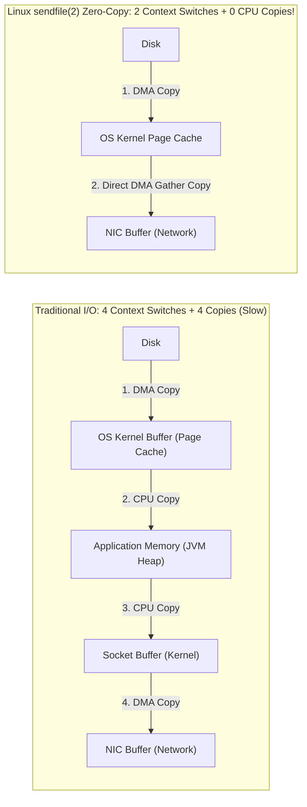
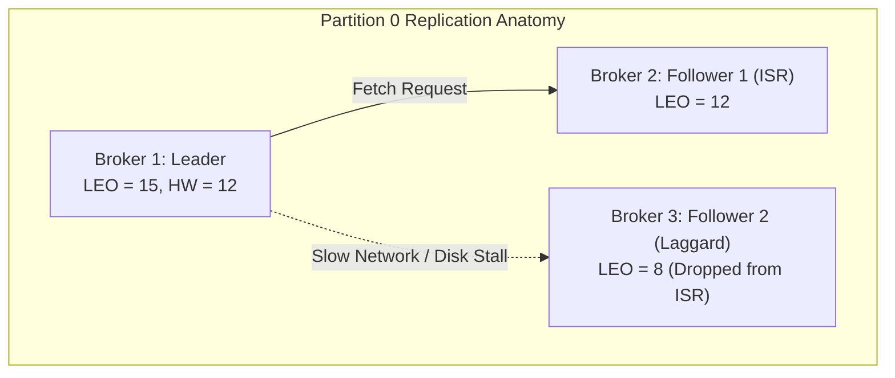
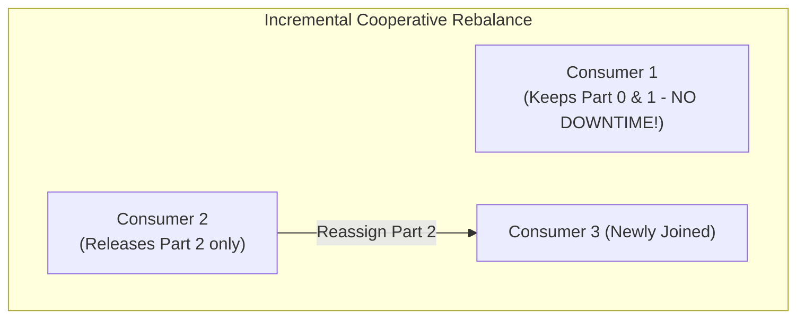
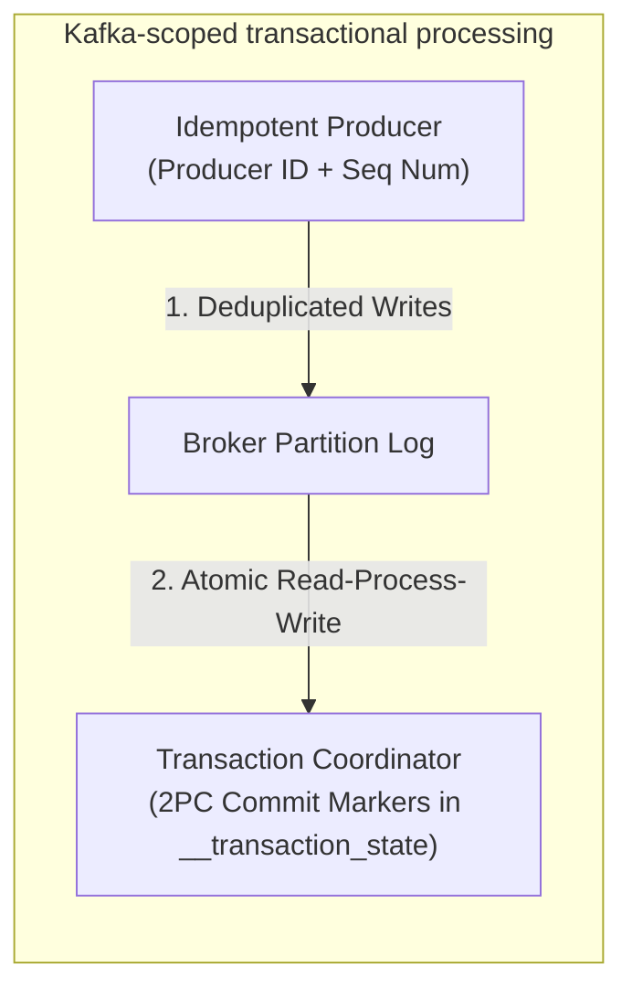

# Chapter 19: Design a Distributed Message Queue & Event Streaming Platform (Apache Kafka / Pulsar)

## Guarantees and assumptions
Broker replication and flush settings define producer ACK durability. Preserve producer identities/sequences across retries; Kafka transactions commit Kafka output and consumer progress together, while external effects use their own idempotency or transaction protocol.
**Principal IC exercise:** Compare losing a broker with losing power to every ISR member; state what `acks=all` and your storage policy actually preserve.

**Sources & Foundational References:**
- [System Design Interview – An Insider's Guide: Vol 2 (Alex Xu & Sahn Lam)](https://bytebytego.com/)
- [Kafka: The Definitive Guide (Gwen Shapira, Neha Narkhede, Todd Palino)](https://www.oreilly.com/library/view/kafka-the-definitive/9781491936153/)
- [The Log: What every software engineer should know about real-time data's unifying abstraction (Jay Kreps)](https://engineering.linkedin.com/distributed-systems/log-what-every-software-engineer-should-know-about-real-time-datas-unifying)
- [Apache Kafka Architecture Internals & Zero-Copy Optimization](https://kafka.apache.org/documentation/)

---

## 1. Executive Interview Framing & Staff-Level Bar

Designing a distributed message queue / event log (Apache Kafka, Apache Pulsar, RabbitMQ) is the premier test of systems-level I/O mechanics, operating system internals, and distributed consensus. While mid-level candidates recite high-level concepts like "producers push, consumers pull, partitions provide parallelism," **Staff and Principal Engineers (L6+, P60) are evaluated on their mechanical knowledge of Linux Zero-Copy (`sendfile`), OS Page Cache vs JVM Heap trade-offs, In-Sync Replica (ISR) High Watermark math, Incremental Cooperative Rebalancing, and Exactly-Once Semantics (EOS) transaction coordinators**:

```
┌────────────────────────────────────────────────────────────────────────────────────────┐
│                                 THE INTERVIEW SPECTRUM                                 │
├────────────────────────────────────────┬───────────────────────────────────────────────┤
│ L5 / Senior Engineer                   │ L6+ / Staff & Principal Engineer              │
├────────────────────────────────────────┼───────────────────────────────────────────────┤
│ • Basic Topic & Partition layout       │ • OS Page Cache & Linux `sendfile(2)` DMA     │
│ • "Just write to disk sequentially"    │   Zero-Copy network bypass (Zero CPU copies)  │
│ • Simple ACK=1 vs ACK=all explanation  │ • High Watermark (HW) vs Log End Offset (LEO) │
│ • Vaguely mentions ZooKeeper           │   and Leader Epochs to prevent log truncation │
│ • Mentions rebalances freeze consumers │ • KRaft (Event-Driven Raft Metadata) replacing│
│ • Explains At-Least-Once delivery      │   ZooKeeper to scale to 1M+ partitions        │
│ • "Scale consumers to match QPS"       │ • Incremental Cooperative Rebalance Protocol  │
│                                        │ • Exactly-Once Semantics (EOS) via Producer ID│
│                                        │   + monotonic sequence counter & 2PC markers  │
└────────────────────────────────────────┴───────────────────────────────────────────────┘
```

---

## 2. The 5-Pillar Staff Assessment Rubric for Message Queues

```
┌────────────────────────────────────────────────────────────────────────────────────────────────────────┐
│                                      5-PILLAR EVALUATION RUBRIC                                        │
├─────────────────────────┬──────────────────────────────────────────────────────────────────────────────┤
│ Pillar                  │ What the Interviewer Listens For (Evidence)                                  │
├─────────────────────────┼──────────────────────────────────────────────────────────────────────────────┤
│ 1. Decision Making      │ • Log-Centric Append-Only Streaming (Kafka) vs AMQP Broker Queue (RabbitMQ).│
│                         │ • Pull vs Push model: selects Pull for consumer self-pacing & batching.      │
│                         │ • ZooKeeper vs KRaft: evaluates metadata scalability and failover recovery.  │
├─────────────────────────┼──────────────────────────────────────────────────────────────────────────────┤
│ 2. Technical            │ • Explains Linux kernel buffer transfers (`read()` + `write()` = 4 context   │
│    Proficiency          │   switches + 4 copies vs `sendfile()` = 2 context switches + 0 CPU copies).  │
│                         │ • Derives Log Segment sparse indexing (`.index` binary search in memory).    │
│                         │ • Formalizes ISR consistency invariants (`min.insync.replicas=2`, `acks=all`).│
├─────────────────────────┼──────────────────────────────────────────────────────────────────────────────┤
│ 3. Problem Solving &    │ • Decomposes system into Ingress, Log Engine, Replication, and Consumer.     │
│    Analytical Thinking  │ • Calculates partition counts from producer/consumer throughput targets.     │
│                         │ • Sizes cluster memory based on OS page cache hot-tail retention requirements.│
├─────────────────────────┼──────────────────────────────────────────────────────────────────────────────┤
│ 4. Operational          │ • Eliminates stop-the-world consumer group rebalances via Cooperative Sticky.│
│    Mindset              │ • Monitors consumer lag, under-replicated partitions, and disk fill ratios.   │
│                         │ • Enforces tiered storage (local NVMe SSD for hot tail $\to$ S3 for cold).  │
│                         │ • Safely drains partitions and decommissions brokers without data loss.      │
├─────────────────────────┼──────────────────────────────────────────────────────────────────────────────┤
│ 5. Adaptability &       │ • Responds to slow "poison pill" consumers without stalling consumer group.   │
│    Collaboration        │ • Balances strict partition ordering with dynamic repartitioning trade-offs.  │
│                         │ • Communicates latency SLAs and hardware sizing constraints to leadership.   │
└─────────────────────────┴──────────────────────────────────────────────────────────────────────────────┘
```

---

## 3. Requirements & System Scope

### Functional Requirements
1. **Producer Publishing:** Producers can publish messages to specified topics with optional partition keys.
2. **Consumer Subscription:** Multiple consumer groups can independently subscribe to topics and read messages with strict per-partition FIFO order.
3. **Repeated Consumption:** Messages are durable and retained on disk for a configurable window (e.g. 14 days), allowing consumers to re-read or replay historical streams.
4. **Configurable Delivery Semantics:** Support **At-Most-Once**, **At-Least-Once**, and **Exactly-Once** delivery semantics.
5. **Message Filtering & Delayed Delivery:** Support header/tag-based topic filtering and scheduled/delayed message dispatch.

### Non-Functional Requirements & Performance SLOs
* **Ultra-High Throughput:** Handle **10 Million messages / second** (Gigabytes/sec bandwidth) cluster-wide.
* **Low Latency Overhead:** End-to-end publish-to-consume latency $< \mathbf{10ms}$ at p99 under normal load.
* **Fault Tolerance & Durability:** Zero data loss upon broker crash ($R = 3$ replication factor with quorum write acks).
* **Linear Horizontal Scalability:** Add brokers and partitions dynamically without service downtime.

---

## 4. Back-of-the-Envelope Capacity Estimation

```
Target Throughput: 10 Million messages / second
Average Message Size: 1 KB
Retention Window: 14 Days
Replication Factor: 3x
```

### 4.1 Bandwidth Math
* **Write Ingress Throughput:**
  $$\text{Write Ingress} = 10,000,000 \text{ msgs/sec} \times 1 \text{ KB} = \mathbf{10 \text{ GB/sec}} = \mathbf{80 \text{ Gbps}}$$
* **Cluster Internal Replication Egress ($R=3$):**
  $$\text{Replication Traffic} = 10 \text{ GB/sec} \times 2 \text{ followers} = \mathbf{20 \text{ GB/sec}} = \mathbf{160 \text{ Gbps}}$$
* **Consumer Egress Throughput (Assuming 4 Consumer Groups):**
  $$\text{Consumer Egress} = 10 \text{ GB/sec} \times 4 = \mathbf{40 \text{ GB/sec}} = \mathbf{320 \text{ Gbps}}$$
* **Total Cluster Network Egress:** $160 + 320 = \mathbf{480 \text{ Gbps}}$.
  *Staff Takeaway:* Bandwidth requires partitioning across **50 to 100 broker nodes** equipped with 25GbE or 100GbE network interfaces.

### 4.2 Storage Math (14-Day Retention)
* **Daily Uncompressed Ingress:**
  $$10 \text{ GB/sec} \times 86,400 \approx 864 \text{ TB / day}$$
  *(With Zstandard/Snappy compression at 50% ratio: $\approx 432 \text{ TB / day}$)*.
* **14-Day Storage ($R=3$ Replicated):**
  $$432 \text{ TB/day} \times 14 \text{ days} \times 3 \approx \mathbf{18.14 \text{ Petabytes}}$$
* *Tiered Storage Strategy:* Keep the most recent **6 hours** of hot data on high-speed NVMe SSDs ($432 \times 0.25 \times 3 \approx 324 \text{ TB}$ across the broker fleet). Automatically offload segments older than 6 hours to **AWS S3 / GCP Cloud Storage** via Tiered Storage.

### 4.3 Partition Sizing Rule of Thumb
* A single partition can sustain $\approx 10 \text{ MB/sec}$ of write throughput (governed by single-thread sequential disk I/O and network limits).
* For $10 \text{ GB/sec}$ ingress:
  $$\text{Minimum Required Partitions} = \frac{10,000 \text{ MB/sec}}{10 \text{ MB/sec}} = \mathbf{1,000 \text{ Partitions}}$$

---

## 5. End-to-End High-Level Architecture

```mermaid
flowchart TD
    subgraph Producers["Producer Fleet"]
        P1["Producer 1 (SDK with in-memory buffer)"]
        P2["Producer 2"]
    end

    subgraph MetadataControl["Metadata & Cluster Consensus"]
        KRaft["KRaft Quorum / ZooKeeper<br/>• Broker Liveness<br/>• Leader Election<br/>• Partition State & Metadata"]
    end

    subgraph BrokerCluster["Broker Cluster (Storage & Replication Tier)"]
        subgraph Broker1["Broker 1"]
            B1_P0["Topic A - Partition 0 (LEADER)"]
            B1_P1["Topic A - Partition 1 (FOLLOWER)"]
        end
        subgraph Broker2["Broker 2"]
            B2_P1["Topic A - Partition 1 (LEADER)"]
            B2_P2["Topic A - Partition 2 (FOLLOWER)"]
        end
        subgraph Broker3["Broker 3"]
            B3_P2["Topic A - Partition 2 (LEADER)"]
            B3_P0["Topic A - Partition 0 (FOLLOWER)"]
        end
    end

    P1 & P2 -->|1. Fetch Metadata & Route| BrokerCluster
    KRaft -.->|Broadcast Cluster State| BrokerCluster

    subgraph Consumers["Consumer Groups (Pull Model)"]
        subgraph GroupA["Consumer Group 1 (Analytics)"]
            C1["Consumer A1 (Reads Part 0)"]
            C2["Consumer A2 (Reads Part 1 & 2)"]
        end
        subgraph GroupB["Consumer Group 2 (Notifications)"]
            C3["Consumer B1 (Reads Part 0, 1, 2)"]
        end
    end

    Broker1 -->|Zero-Copy sendfile() Pull| C1
    Broker2 -->|Zero-Copy sendfile() Pull| C2
    Broker3 -->|Zero-Copy sendfile() Pull| C2
```

---

## 6. The Storage Engine Deep Dive: Operating System Physics

Why is Kafka so fast despite persisting every single message to disk? Mid-level engineers answer "because it appends sequentially." Staff engineers explain the underlying **Linux kernel and hardware physics**:

### 6.1 Sequential Disk I/O vs Random Disk I/O
* **Random Disk Access:** Involves mechanical disk head movement (seek time: ~10ms) or SSD random write block-erase cycles. Throughput: $\approx 1 \text{ to } 10 \text{ MB/sec}$.
* **Sequential Disk Access:** Continuous streaming writes with pre-fetching and OS elevator algorithms. Throughput: $\approx \mathbf{600 \text{ MB/sec (SATA SSD)}}$ to $\mathbf{3,500 \text{ MB/sec (NVMe PCIe)}}$. Sequential disk writes are **faster than random memory writes**!



### 6.2 The Zero-Copy Optimization (`sendfile` system call)
In a traditional web application, serving data from disk to network requires 4 context switches and 4 data copies:
1. `read()` system call: Disk $\to$ OS Page Cache (DMA Copy).
2. OS Page Cache $\to$ JVM Heap (CPU Copy + Context Switch).
3. `write()` system call: JVM Heap $\to$ Socket Buffer in Kernel (CPU Copy + Context Switch).
4. Socket Buffer $\to$ Network Interface Card (NIC) (DMA Copy).

**Kafka's Zero-Copy Mechanics:**
Kafka utilizes the Linux `sendfile(2)` system call (Java `FileChannel.transferTo()`):
- Data is read from disk directly into the **OS Page Cache via DMA**.
- The kernel passes the memory descriptor pointers directly to the **NIC buffer**.
- **Result:** **Zero CPU copies**, zero JVM heap garbage collection overhead, and 50% fewer context switches!

### 6.3 OS Page Cache vs JVM Heap Sizing
* **The Antipattern:** Allocating a 64 GB heap to Kafka brokers. The JVM spends seconds executing full Stop-the-World GC pauses, causing heartbeat timeouts and broker drops.
* **The Staff Architecture:** Size the broker JVM heap to **only 6–8 GB** (just enough to hold connection metadata and active session state). Leave the remaining **90% of host RAM (e.g., 120 GB) for the OS Page Cache**. All active consumer reads hit kernel page cache memory directly without touching disk!

---

## 7. Log Segments, Sparse Indexing & Offset Lookup

A single topic partition is stored on disk as a folder containing a series of immutable **Log Segments** (default size: 1 GB per segment).

```
/data/kafka/topics/orders-0/
├── 00000000000000000000.log         (Raw binary message payloads)
├── 00000000000000000000.index       (Sparse offset index)
├── 00000000000000000000.timeindex   (Timestamp-to-offset index)
├── 00000000000010485760.log
├── 00000000000010485760.index
└── leader-epoch-checkpoint
```

### 7.1 How Sparse Indexing Works ($O(\log N)$ Lookup)
Instead of indexing every single message (which would balloon index size to gigabytes), Kafka writes an index entry **every 4 KB of log data (Sparse Index)**:

```
┌────────────────────────────────────────────────────────────────────────────────────────┐
│                               SPARSE INDEX LOOKUP MECHANICS                            │
├────────────────────────────────────────────────────────────────────────────────────────┤
│ Index Entry Format: (Logical Offset, Physical Byte Position on Disk)                   │
│                                                                                        │
│   Offset Index (.index)                 Message Log (.log)                             │
│   ┌────────────┬─────────────┐          ┌───────────────────────────────────────────┐  │
│   │ Offset: 0  │ Pos: 0      │          │ Pos 0:    [Msg 0: Offset 0]               │  │
│   │ Offset: 4  │ Pos: 1024   │          │ Pos 250:  [Msg 1: Offset 1]               │  │
│   │ Offset: 8  │ Pos: 2150   │          │ Pos 600:  [Msg 2: Offset 2]               │  │
│   │ Offset: 12 │ Pos: 3300   │          │ Pos 1024: [Msg 4: Offset 4]               │  │
│   └────────────┴─────────────┘          │ Pos 1500: [Msg 5: Offset 5]               │  │
│                                         │ Pos 2150: [Msg 8: Offset 8] <── TARGET!   │  │
│ Target: Fetch Offset 9                  └───────────────────────────────────────────┘  │
│ 1. Binary search the .index file in RAM -> finds largest offset <= 9: (Offset 8, Pos 2150)│
│ 2. Seek disk to Byte Position 2150.                                                    │
│ 3. Scan sequentially through raw messages until Offset 9 is reached (< 2 KB scan).     │
└────────────────────────────────────────────────────────────────────────────────────────┘
```

The entire `.index` file is memory-mapped (`mmap`), allowing lookups to complete in nanoseconds.

---

## 8. Replication, In-Sync Replicas (ISR) & Quorum Consensus

Every partition has **1 Leader replica** and $N-1$ **Follower replicas**.
- All writes and reads flow through the Leader replica.
- Followers issue `FetchRequests` (identical to consumers) to continuously replicate data from the leader.



### 8.1 Key Replication Definitions
* **Log End Offset (LEO):** The offset of the next record to be written to a partition replica.
* **High Watermark (HW):** The exclusive boundary of the replicated/committed prefix across the active ISR; readable committed offsets are **below HW**.
  > **Crucial Rule:** Consumers do not read beyond the replicated prefix ($< \text{HW}$). For transactional `read_committed`, the last stable offset can be **below** HW while transactions remain open; replication commitment and transaction commitment are different boundaries.
* **In-Sync Replicas (ISR):** The set of replicas that are actively keeping up with the leader. If a follower falls behind by more than `replica.lag.time.max.ms` (e.g. 30 seconds), the leader ejects it from the ISR.

### 8.2 Producer ACK Guarantees & Durability Formulas
* `acks=0`: Producer fires and forgets; zero waiting. Maximum throughput, high data loss risk.
* `acks=1`: Leader writes to local log and immediately ACKs. If leader crashes before followers pull the log, message is lost.
* `acks=all` (`-1`) + `min.insync.replicas=2`: The leader waits for the **current ISR**; at least two in-sync replicas must be available to accept the write. Below that threshold, writes fail and partial appends can leave an ambiguous outcome. Replication normally acknowledges OS page-cache copies. Flush policy, storage, failure-domain placement and leader-election settings determine survival of correlated power/storage loss.

---

## 9. Consumer Group Rebalance Protocols: Eager vs Cooperative Sticky

When a consumer joins, leaves, or crashes, the partitions assigned to the consumer group must be redistributed (**Consumer Rebalance**).

### 9.1 The Flaw of Eager Rebalancing (The Stop-the-World Problem)
* In the legacy **Eager Protocol**:
  1. All consumers in the group immediately drop their assigned partitions and stop processing.
  2. All consumers rejoin the group.
  3. The group coordinator re-evaluates the partition assignment and broadcasts the new plan.
  4. Consumers re-open connections and resume processing.
* **Real-World Impact:** For a consumer group with 100 nodes, an eager rebalance halts consumption across the entire pipeline for **30 to 90 seconds**!

### 9.2 The SOTA Solution: Incremental Cooperative Rebalancing (KIP-429)
Instead of forcing everyone to drop everything:
1. Rebalances occur in multiple incremental phases.
2. Only consumers whose partitions are being reassigned release their partitions.
3. Consumers whose partition assignments remain unchanged **continue consuming without interruption**.
4. Eliminates the stop-the-world stall entirely!



---

## 10. Exactly-Once Semantics (EOS): Idempotent Producers & 2PC

Kafka transactional consume/process/produce uses producer idempotence, transactional output/offset commits and `read_committed` consumers. External databases, emails and PSP requests use their own idempotency/transaction protocols.



1. **Idempotent Producer (Deduplication at Broker):**
   - Each producer is assigned an internal 64-bit **Producer ID (PID)**.
   - For every message sent to a partition, the producer attaches a monotonically increasing **Sequence Number ($0, 1, 2, \dots$)**.
   - If a network retry occurs, the broker compares the sequence number. If $\text{Seq} \le \text{LastSeenSeq}$, the broker acknowledges the write but **silently discards the duplicate**!
2. **Transactional Coordinator (Atomic Multi-Partition Writes):**
   - For stream processing jobs (Consume $\to$ Transform $\to$ Produce), writes across multiple output topics and consumer offset commits are wrapped in an atomic transaction managed by a **Transactional Coordinator** using a Two-Phase Commit (2PC) protocol with transaction markers written directly to the log.

---

## 11. Metadata Architecture: KRaft vs ZooKeeper

Historically, Apache Kafka relied on Apache ZooKeeper to manage cluster metadata, broker liveness, and topic configurations.
* **The ZooKeeper Bottleneck:** As clusters scaled to $> 200,000$ partitions, ZooKeeper's external hierarchical z-node synchronization became a severe bottleneck. Broker leader elections took minutes, causing cluster-wide hangs.
* **KRaft Mode (Kafka Raft Metadata - KIP-500):** Metadata is managed internally using an event-driven Raft consensus quorum running directly within designated broker controller nodes.
  - Failover recovery dropped from minutes to **$< 200\text{ milliseconds}$**.
  - Scales to **Millions of partitions** per cluster with zero external dependencies.

---

## 12. Staff-Level Interviewer Curveballs & Adaptability Playbook

### Curveball 1: "A single consumer in a group encounters a poison-pill message that throws an unhandled exception. It crashes, restarts, crashes again, triggering infinite rebalance loops. How do you resolve this?"
* **Wrong Answer:** "We increase the timeout so it doesn't crash."
* **Staff Answer:**
  1. **Dead Letter Queue (DLQ) with Bounded Retries:** Wrap consumer processing in a resilient error handler. If a message fails processing after 3 retry attempts with exponential backoff:
     - Catch the exception.
     - Publish the poison-pill message payload along with stack trace and headers to a dedicated `orders-dlq` topic.
     - Commit the offset of the poison-pill message to let the consumer advance.
  2. **Isolate for Operator Inspection:** The main pipeline continues processing at full speed with zero rebalance churn, while operators inspect the DLQ using admin dashboards.

### Curveball 2: "Due to a network partition, the partition leader becomes isolated from its 2 followers. Can it still accept writes?"
* **Staff Answer:**
  1. If the producer configured `acks=1`, the leader will write locally and ACK, but when the cluster heals and a new leader is elected by the followers, those writes will be **lost (unclean leader election data loss)**.
  2. If the cluster is properly configured with `min.insync.replicas=2` and `acks=all`:
     - As soon as the followers drop off, the active ISR count drops from 3 to 1.
     - The isolated leader compares $\text{ISR Count (1)} < \text{min.insync.replicas (2)}$.
     - It immediately **rejects all subsequent writes with `NotEnoughReplicasException`**, preserving absolute data consistency and preventing split-brain writes!

### Curveball 3: "A consumer group has 10 partitions and 10 consumers. Suddenly, traffic on Partition 4 surges by 50x because of a viral event. How do you scale consumers?"
* **Staff Answer:**
  1. **Acknowledge the Fundamental Kafka Invariant:** You cannot assign more than 1 consumer in the same group to a single partition. Adding an 11th consumer will simply leave it idle.
  2. **Staff Mitigations:**
     - **Sub-Partitioning via Worker Thread Pool:** Inside Consumer 4, decouple network polling from message processing. Hand messages off to an in-memory worker thread pool partitioned by sub-key (`hash(item_id) % thread_count`).
     - **Dynamic Repartitioning:** Increase the topic partition count from 10 to 50, re-keying messages to spread the viral traffic evenly across the new partitions.
