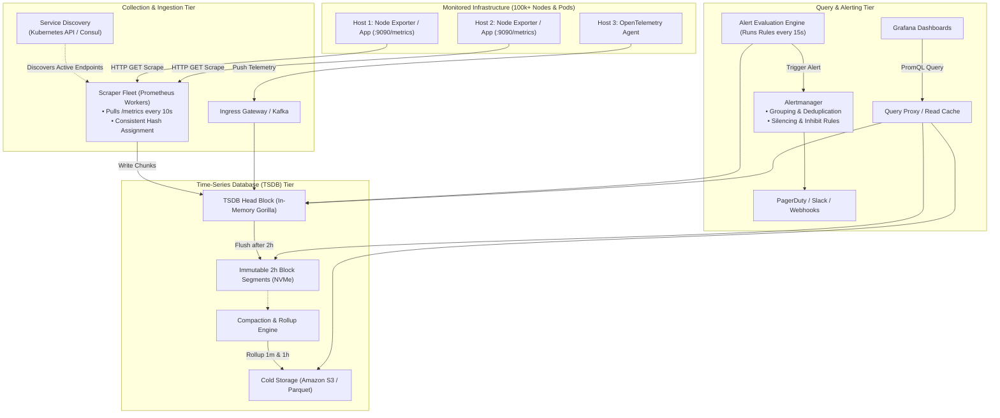
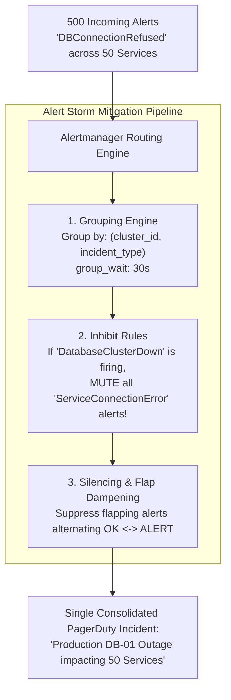

# Chapter 20: Design a Distributed Metrics Monitoring & Alerting System (Prometheus / Datadog / Gorilla)

## Guarantees and assumptions
Ingestion ACK follows the durable buffer/WAL write. Series/timestamp identities deduplicate samples, durable alert-transition IDs deduplicate notifications, and dashboards update asynchronously.
**Principal IC exercise:** Inject a label-cardinality explosion during a zone outage; protect ingestion and distinguish missing data from healthy zero traffic.

**Sources & Foundational References:**
- [System Design Interview – An Insider's Guide: Vol 2 (Alex Xu & Sahn Lam)](https://bytebytego.com/)
- [Gorilla: A Fast, Scalable, In-Memory Time Series Database (Pelkonen et al., Facebook / Meta)](https://www.vldb.org/pvldb/vol8/p1816-pelkonen.pdf)
- [Prometheus: High-Performance Time-Series Database Architecture](https://prometheus.io/docs/prometheus/latest/storage/)
- [Google SRE Book: Monitoring Distributed Systems](https://sre.google/sre-book/monitoring-distributed-systems/)

---

## 1. Executive Interview Framing & Staff-Level Bar

Designing a large-scale metrics collection and alerting pipeline (Prometheus, Datadog, Meta Gorilla, M3DB) is the definitive test of **high-throughput write ingestion, time-series compression, and operational fault resilience**. While mid-level candidates propose writing CPU numbers to MySQL or generic NoSQL databases, **Staff and Principal Engineers (L6+, P60) are evaluated on their mechanical knowledge of Gorilla delta-of-deltas compression (reducing 16 bytes to 1.37 bytes per sample), Pull vs Push collection trade-offs, label-indexed inverted indices, rollup compaction downsampling, and alert storm deduplication**:

```
┌────────────────────────────────────────────────────────────────────────────────────────┐
│                                 THE INTERVIEW SPECTRUM                                 │
├────────────────────────────────────────┬───────────────────────────────────────────────┤
│ L5 / Senior Engineer                   │ L6+ / Staff & Principal Engineer              │
├────────────────────────────────────────┼───────────────────────────────────────────────┤
│ • Relational DB or basic NoSQL store   │ • Specialized Time-Series DB (TSDB) engine    │
│ • "Just write (timestamp, val) to disk"│ • Gorilla XOR delta-of-deltas compression     │
│                                        │   (12x compression: 16 bytes -> 1.37 bytes)   │
│ • Vague on Push vs Pull collection     │ • Scrape Pull (Prometheus + Service Discovery)│
│                                        │   vs Push (StatsD / Pushgateway / OpenTelemetry│
│ • Ignores massive disk storage growth  │ • Tiered Downsampling (Raw 7d -> 1m rollup    │
│                                        │   30d -> 1h rollup 1y) via compaction worker  │
│ • Simple threshold alert (e.g. CPU>80%)│ • Alert Storm Suppression (Grouping, Inhibit  │
│                                        │   rules, Silence, Exponential Dampening)      │
│ • Ignores monitoring of monitor itself │ • Meta-monitoring & Out-of-Band Heartbeats    │
└────────────────────────────────────────┴───────────────────────────────────────────────┘
```

---

## 2. The 5-Pillar Staff Assessment Rubric for Metrics Systems

```
┌────────────────────────────────────────────────────────────────────────────────────────────────────────┐
│                                      5-PILLAR EVALUATION RUBRIC                                        │
├─────────────────────────┬──────────────────────────────────────────────────────────────────────────────┤
│ Pillar                  │ What the Interviewer Listens For (Evidence)                                  │
├─────────────────────────┼──────────────────────────────────────────────────────────────────────────────┤
│ 1. Decision Making      │ • Pull (Scrape via Service Discovery) vs Push (Agent streaming to Ingress).  │
│                         │ • Relational DB vs InfluxDB vs Cassandra vs Gorilla In-Memory TSDB.          │
│                         │ • Evaluates trade-offs between storage resolution and query execution cost.  │
├─────────────────────────┼──────────────────────────────────────────────────────────────────────────────┤
│ 2. Technical            │ • Derives Gorilla timestamp delta-of-deltas variable-length bit packing.     │
│    Proficiency          │ • Derives Gorilla floating-point XOR value compression (leading/trailing 0s).│
│                         │ • Explains TSDB inverted index mapping metric labels $\to$ series IDs.       │
├─────────────────────────┼──────────────────────────────────────────────────────────────────────────────┤
│ 3. Problem Solving &    │ • Decomposes system into Collection, Ingestion, TSDB Storage, Alerting, UI.  │
│    Analytical Thinking  │ • Calculates daily samples ($10\text{M metrics} / 10\text{s} = 1\text{M QPS}$│
│                         │   $= 86.4\text{ Billion samples/day}$) and compressed storage footprint.     │
├─────────────────────────┼──────────────────────────────────────────────────────────────────────────────┤
│ 4. Operational          │ • Mitigates Alert Fatigue: Flap detection, alert routing trees, and grouping.│
│    Mindset              │ • Monitors the monitoring infrastructure (dead-man switches, canary probes). │
│                         │ • Enforces automated data lifecycle retention & rollup compaction.           │
├─────────────────────────┼──────────────────────────────────────────────────────────────────────────────┤
│ 5. Adaptability &       │ • Handles dynamic container churn (short-lived Kubernetes pods / serverless).│
│    Collaboration        │ • Balances strict metric precision with telemetry network bandwidth costs.   │
│                         │ • Articulates difference between Metrics, Logs, and Traces (the 3 Pillars).   │
└─────────────────────────┴──────────────────────────────────────────────────────────────────────────────┘
```

---

## 3. Requirements & System Scope

### Functional Requirements
1. **Metrics Collection:** Ingest system-level metrics (CPU, RAM, disk, network) and application-level metrics (QPS, error rates, p99 latency) from hundreds of thousands of hosts and containers.
2. **Time-Series Querying & Aggregation:** Support sub-second aggregation queries over flexible time windows (e.g. `rate(http_requests[5m]) by (region)`).
3. **Alert Evaluation & Dispatch:** Evaluate alerting rules every 10–30 seconds; route triggered alerts to PagerDuty, Slack, Email, or Webhooks.
4. **Data Downsampling & Retention:** Retain raw high-resolution metrics for 7 days, 1-minute rollups for 30 days, and 1-hour rollups for 1 year.
5. **Dashboard Visualization:** Serve real-time dashboards (Grafana-style) with low query latency.

### Non-Functional Requirements & Performance SLOs
* **Scale:** Ingest **10 Million active metric streams**, collected every **10 seconds** ($\approx \mathbf{1 \text{ Million samples / second}}$).
* **Write Availability:** **99.999%** uptime for write ingestion (metric drops must be near zero).
* **Query Latency:** Dashboard panel query latency $< \mathbf{200ms}$ (p99).
* **Alert Latency:** Alert fired within **30 seconds** of an SLO breach.
* **Storage Efficiency:** Heavy compression ($> 10\times$) to prevent multi-petabyte disk exhaustion.

---

## 4. Back-of-the-Envelope Capacity Estimation

```
Total Active Metric Streams: 10 Million
Sampling Frequency: Every 10 seconds
Retention Window: 1 Year (Tiered)
```

### 4.1 Ingestion Throughput Math
* **Write Samples per Second:**
  $$\text{Write Ingestion QPS} = \frac{10,000,000 \text{ metrics}}{10 \text{ seconds}} = \mathbf{1,000,000 \text{ samples / sec}}$$
  $$\text{Peak Write QPS (2x)} \approx \mathbf{2,000,000 \text{ samples / sec}}$$
* **Daily Metric Samples:**
  $$1,000,000 \text{ samples/sec} \times 86,400 \text{ seconds} \approx \mathbf{86.4 \text{ Billion samples / day}}$$

### 4.2 Storage Math (Raw vs Compressed)
* Uncompressed sample:
  - Timestamp: 8 bytes (64-bit epoch seconds/ms)
  - Value: 8 bytes (64-bit float)
  - Metric Series Pointer: 8 bytes
  - **Uncompressed Sample Size:** $\approx 24 \text{ bytes}$
  $$\text{Daily Raw Storage} = 86.4 \times 10^9 \times 24 \text{ bytes} \approx \mathbf{2.07 \text{ TB / day}} \quad (\mathbf{755 \text{ TB / year}})$$
* **Gorilla-style Sample Compression:**
  - The [Gorilla paper (2015)](https://www.vldb.org/pvldb/vol8/p1816-teller.pdf) reports **1.37 bytes per sample** for its workload, about **17.5×** smaller than the 24-byte model above. Compression depends on sampling regularity and value entropy.
  $$\text{Daily Compressed Storage} = 86.4 \times 10^9 \times 1.37 \text{ bytes} \approx \mathbf{118.4 \text{ GB / day}}$$
  - **7-Day Raw Working Set in RAM / Fast NVMe:**
    $$118.4 \text{ GB/day} \times 7 \text{ days} \approx \mathbf{828 \text{ GB}}$$
* *Staff Takeaway:* The estimated **828 GB** covers compressed sample payload. Total capacity also includes series/label indexes, active-series RAM, chunk headers, WAL, replication, query buffers, compaction overlap and failure headroom.

---

## 5. End-to-End High-Level Architecture



---

## 6. Data Collection Mechanics: Pull vs Push Architecture

The debate between **Pull (Prometheus-style)** and **Push (StatsD / Datadog-style)** is a frequent Staff interview focal point:

```
┌────────────────────────────────────────────────────────────────────────────────────────┐
│                              PULL VS PUSH MODEL COMPARISON                             │
├─────────────────────┬──────────────────┬──────────────────┬────────────────────────────┤
│ Strategy            │ How it Works     │ Advantages       │ Disadvantages / Flaws      │
├─────────────────────┼──────────────────┼──────────────────┼────────────────────────────┤
│ Pull Model          │ Central scrapers │ • Built-in host  │ Difficult across firewalls │
│ (Prometheus /       │ query target     │   liveness check │ / NATs; ephemeral batch   │
│  Google Borgmon)    │ `/metrics` HTTP  │ • Scraper bounds │ jobs (lambdas) die before  │
│                     │ endpoints.       │   system load    │ scrape occurs.             │
├─────────────────────┼──────────────────┼──────────────────┼────────────────────────────┤
│ Push Model          │ Agents stream    │ • Natural for    │ Target can accidentally    │
│ (StatsD / Datadog / │ metrics out to   │   ephemeral /    │ DDoS the collector; no easy│
│  OpenTelemetry)     │ central gateway  │   serverless jobs│ way to know if silent host │
│                     │ via UDP / gRPC.  │ • Works past NATs│ is healthy or dead.        │
├─────────────────────┼──────────────────┼──────────────────┼────────────────────────────┤
│ Hybrid (SOTA)       │ Pull for servers;│ Best of both     │ Minor architectural        │
│                     │ Pushgateway for  │ worlds.          │ complexity increase.       │
│                     │ batch/lambdas.   │                  │                            │
└─────────────────────┴──────────────────┴──────────────────┴────────────────────────────┘
```

---

## 7. The Storage Engine Deep Dive: Meta Gorilla Compression

The definitive Staff-level differentiator is explaining **Gorilla Compression** (VLDB 2015), which powers Facebook Gorilla, Prometheus TSDB, and M3DB.

A metric stream is a sequence of pairs: `(t_0, v_0), (t_1, v_1), (t_2, v_2), ...`

### 7.1 Timestamp Compression: Delta-of-Deltas
Timestamps arrive at roughly constant intervals (e.g., every 10 seconds).
* Let $t_n$ be current time, $D = t_n - t_{n-1}$ be the delta ($10\text{s}$).
* Calculate the **Delta-of-Deltas**:
  $$D' = (t_n - t_{n-1}) - (t_{n-1} - t_{n-2})$$
* **Bit-Packing Rules:**
  - If $D' = 0$ (clock arrived exactly on schedule): Store a single bit **`0`**!
  - If $-63 \le D' \le 64$: Store bits `10` followed by 7 bits of $D'$.
  - If $-255 \le D' \le 256$: Store bits `110` followed by 9 bits of $D'$.
  - If $-2047 \le D' \le 2048$: Store bits `1110` followed by 12 bits of $D'$.
  - Otherwise: Store bits `1111` followed by full 32-bit $D'$.
* **Result:** **96% of timestamps compress to a single `0` bit!**

### 7.2 Value Compression: Floating-Point XOR Bit-Packing
Most metric values (e.g. CPU load: $50.12\% \to 50.14\%$) change very little between samples. When XORed, their IEEE 754 representations share many identical prefix (leading) and suffix (trailing) bits:

```
┌────────────────────────────────────────────────────────────────────────────────────────┐
│                        GORILLA FLOATING-POINT XOR MECHANICS                            │
├────────────────────────────────────────────────────────────────────────────────────────┤
│ 1. Compute XOR with previous float: X = v_n XOR v_{n-1}                                │
│ 2. If X == 0 (Value is identical): Store single bit `0`.                               │
│ 3. If X != 0: Store single bit `1`:                                                    │
│    • Case A: If X has the SAME leading and trailing zeros as previous XOR:            │
│      - Store bit `0`.                                                                  │
│      - Store only the meaningful bits (length = 64 - leading - trailing).              │
│    • Case B: If leading/trailing zeros changed:                                        │
│      - Store bit `1`.                                                                  │
│      - Store 5 bits (leading zero count) + 6 bits (meaningful length) + meaningful bits│
│ 4. Result: Compresses 64-bit IEEE floats down to an average of 1.37 BYTES (11 bits)!  │
└────────────────────────────────────────────────────────────────────────────────────────┘
```

---

## 8. Alerting Pipeline & Alert Storm Deduplication

The hardest operational challenge in metrics monitoring is **Alert Fatigue**. When a core database switch fails, 500 dependent microservices throw connection errors, firing 10,000 alerts to on-call engineers within 60 seconds (**The Alert Storm**).



### The 4 Pillars of Alert Suppression
1. **Grouping (`group_wait = 30s`, `group_interval = 5m`):** Buffers alerts for 30 seconds to combine related alerts into a single unified notification.
2. **Inhibition Rules:** A rule that mutes a set of alerts if another high-priority alert is already active (e.g., if `NodeNetworkDown` is active, suppress `ServiceUnreachable` for all containers on that node).
3. **Flap Detection & Dampening:** If a metric oscillates across the alert threshold repeatedly, the alert manager locks it into "suppressed" state until it stays stable for 15 minutes.
4. **Dead-Man Switch (Canary):** An alert that is configured to fire continuously 24/7. An external monitoring service expects this ping; if the ping stops, it proves the **monitoring system itself has crashed**!

---

## 9. Staff-Level Interviewer Curveballs & Adaptability Playbook

### Curveball 1: "A developer introduces a metric label with high cardinality (e.g. `http_requests_total{user_id="123456"}`). The TSDB crashes within 2 hours. What happened and how do you prevent it?"
* **Wrong Answer:** "We just buy more RAM."
* **Staff Answer:**
  1. **Identify the Root Cause:** The **High Cardinality Explosion**. In a TSDB, every unique combination of key-value labels creates a brand-new time-series entry with its own in-memory inverted index posting list. With 10M users, 10M new time series are created, consuming tens of gigabytes of RAM instantly.
  2. **Ingress Label Filtering & Cardinality Guardrails:** Configure the scraper / ingestion gateway to reject or drop labels known to have unbounded cardinality (`user_id`, `request_id`, `jwt_token`).
  3. **Cluster Hard Quotas:** Impose a hard cap (`max_series_per_metric = 10,000`). If a metric exceeds this threshold, the ingestion pipeline drops new label sets and fires a P2 alert to the offending team.

### Curveball 2: "How do you monitor the monitoring system itself without circular dependencies?"
* **Staff Answer:**
  1. **Out-of-Band Dead-Man Snitch:** The internal Prometheus cluster sends an out-of-band HTTPS ping every 60 seconds to an independent external SaaS provider (e.g., Dead Man's Snitch / Healthchecks.io). If the external service misses two consecutive heartbeats, it pages on-call via cellular SMS.
  2. **Dual-Region Cross-Monitoring:** Deploy two completely independent monitoring stacks in US-East and EU-West. The US stack monitors the EU stack's health endpoint, and vice-versa.

### Curveball 3: "A major network partition isolates the TSDB cluster from the scraper fleet for 2 hours. How does the system handle recovery?"
* **Staff Answer:**
  1. **Scraper Local Buffering:** Scraper agents maintain a local ring buffer in memory (or NVMe SQLite WAL) holding the last 2 hours of collected samples.
  2. **Backpressure & Controlled Ingestion Catchup:** When the network heals, scrapers stream buffered historical samples to the TSDB in batches with low priority, while prioritizing real-time live samples to prevent alerting blind spots.
