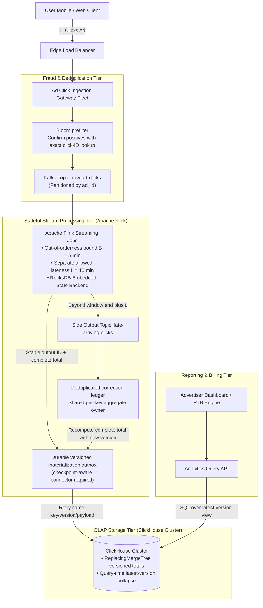
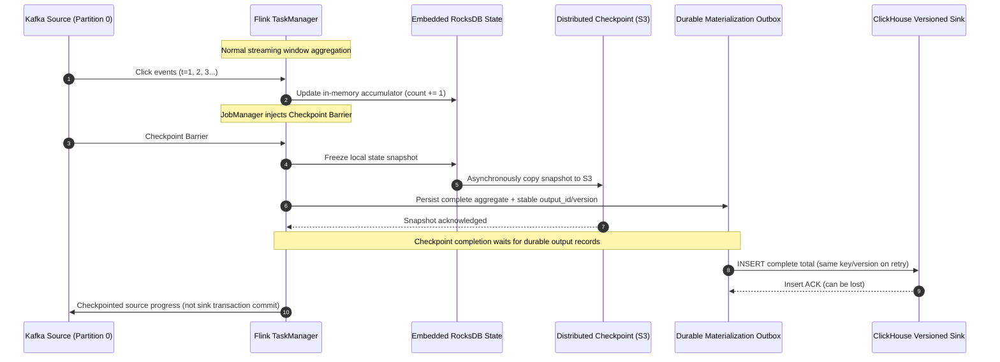

# Chapter 21: Design a Real-Time Ad Click Event Aggregation Pipeline (Flink / Kafka / ClickHouse)

## Guarantees and assumptions
Event ACK follows durable broker acceptance. Stable click IDs and versioned complete window totals support replay-safe ClickHouse materialization; watermark progress, allowed lateness and correction handling are configured separately.
**Principal IC exercise:** Crash after a sink INSERT succeeds but before checkpoint completion; prove how retries avoid double billing beyond the sink deduplication retention window.

**Sources & Foundational References:**
- [System Design Interview – An Insider's Guide: Vol 2 (Alex Xu & Sahn Lam)](https://bytebytego.com/)
- [Streaming Systems: The What, Where, When, and How of Large-Scale Data Processing (Tyler Akidau et al., Google)](https://www.oreilly.com/library/view/streaming-systems/9781491983874/)
- [Apache Flink Architecture: State Management, Watermarks, and Checkpointing](https://nightlies.apache.org/flink/flink-docs-stable/)
- [ClickHouse Architecture: Ultra-Fast Real-Time Columnar Analytics](https://clickhouse.com/docs/)

---

## 1. Executive Interview Framing & Staff-Level Bar

Designing an ad click aggregation pipeline at Google or Meta scale ($1\text{B}+$ clicks/day) is the quintessential test of **stateful stream processing, distributed windowing mechanics, event-time semantics, and financial billing accuracy**. While mid-level candidates propose basic cron aggregations or batching into PostgreSQL, **Staff and Principal Engineers (L6+, P60) are evaluated on their mastery of Event Time vs Processing Time, Watermarking algorithms for late-arriving mobile clicks, Chandy-Lamport distributed checkpointing, Kappa vs Lambda architecture tradeoffs, and columnar OLAP query engines (ClickHouse / StarRocks)**:

```
┌────────────────────────────────────────────────────────────────────────────────────────┐
│                                 THE INTERVIEW SPECTRUM                                 │
├────────────────────────────────────────┬───────────────────────────────────────────────┤
│ L5 / Senior Engineer                   │ L6+ / Staff & Principal Engineer              │
├────────────────────────────────────────┼───────────────────────────────────────────────┤
│ • Uses Server Processing Time          │ • Strictly separates Event Time vs Ingestion │
│   (Distorts billing during delays)     │   Time vs Processing Time                     │
│ • Cron job every minute (`GROUP BY`)   │ • Stateful Streaming Engine (Apache Flink)    │
│   (Suffers boundary lag & race conds)  │   with Tumbling & Sliding Window state        │
│ • Ignores delayed / out-of-order clicks│ • Bounded Out-of-Order Watermarking ($W(t) =  │
│   (Mobile tunnel pings arrive 1hr late)│   \max(T) - \Delta$) + Dead-Letter Side Output│
│ • Classic dual-pipeline Lambda arch    │ • Kappa Architecture (Single streaming log)  │
│   (Requires maintaining 2 codebases)   │   with unified backfill replay                │
│ • "Just write aggregates to DynamoDB"  │ • Columnar OLAP engine (ClickHouse) with      │
│   (Fails ad-hoc multi-dimensional OLAP)│   Versioned complete aggregate snapshots     │
│ • Blind additive sink retries          │ • Checkpointed state + idempotent outputs    │
│   (Double-bills advertisers on crash)  │   Explicit sink/replay/query contract         │
└────────────────────────────────────────┴───────────────────────────────────────────────┘
```

---

## 2. The 5-Pillar Staff Assessment Rubric for Streaming Aggregation

```
┌────────────────────────────────────────────────────────────────────────────────────────────────────────┐
│                                      5-PILLAR EVALUATION RUBRIC                                        │
├─────────────────────────┬──────────────────────────────────────────────────────────────────────────────┤
│ Pillar                  │ What the Interviewer Listens For (Evidence)                                  │
├─────────────────────────┼──────────────────────────────────────────────────────────────────────────────┤
│ 1. Decision Making      │ • Lambda (Batch + Speed) vs Kappa Architecture (Unified Flink stream).       │
│                         │ • Evaluates OLAP Columnar Store (ClickHouse) vs Key-Value Store (Cassandra) │
│                         │   for multi-dimensional slicing (`country`, `device`, `campaign`).           │
│                         │ • Pull-based batching vs Push-based streaming ingestion.                     │
├─────────────────────────┼──────────────────────────────────────────────────────────────────────────────┤
│ 2. Technical            │ • Separates out-of-orderness policy from allowed-lateness retention.        │
│    Proficiency          │ • Explains Chandy-Lamport distributed snapshot barrier alignment.            │
│                         │ • Explains versioned complete totals and query-time replacement semantics. │
│                         │ • Implements deduplication using Bloom filter + Redis sliding TTL cache.     │
├─────────────────────────┼──────────────────────────────────────────────────────────────────────────────┤
│ 3. Problem Solving &    │ • Decomposes system into Click Ingress, Stream Processor, OLAP Store, UI API.│
│    Analytical Thinking  │ • Calculates daily click volume ($1\text{B clicks/day} \approx 11.6\text{k}  │
│                         │   \text{ QPS}$, peak $50\text{k QPS}$) and aggregated row reduction math.     │
├─────────────────────────┼──────────────────────────────────────────────────────────────────────────────┤
│ 4. Operational          │ • Handles late-arriving events via Watermark Side-Outputs and Reprocessing.   │
│    Mindset              │ • Monitors consumer lag, Flink checkpoint alignment duration, & backpressure.│
│                         │ • Implements anti-fraud bot click filtering before the billing pipeline.     │
│                         │ • Enforces output/correction identity and durable replay-safe publication. │
├─────────────────────────┼──────────────────────────────────────────────────────────────────────────────┤
│ 5. Adaptability &       │ • Responds to upstream mobile network outage causing a burst of 1-hour late  │
│    Collaboration        │   clicks without corrupting financial daily ledger totals.                   │
│                         │ • Communicates billing discrepancy bounds transparently to finance & sales.  │
└─────────────────────────┴──────────────────────────────────────────────────────────────────────────────┘
```

---

## 3. Requirements & System Scope

### Functional Requirements
1. **Ad Click Aggregation:** Continuously ingest ad click events and aggregate total click counts per `ad_id` over configurable windows (1-minute, 5-minute, 1-hour).
2. **Top-N Most Clicked Ads:** Query the top 100 most clicked ads across the platform in the last $M$ minutes.
3. **Multi-Dimensional Filtering:** Filter aggregations by geographic `country`, `device_type`, `user_id`, or `campaign_id`.
4. **Late Event Handling:** Accurately process clicks that arrive minutes or hours late due to mobile offline connectivity without losing advertiser attribution.
5. **Click Fraud & Bot Filtering:** Detect and discard bot click spam, automated click farms, and accidental rapid double-taps.

### Non-Functional Requirements & Performance SLOs
* **Scale:** Ingest **1 Billion clicks / day** ($\approx 11,600 \text{ QPS}$ average, peak $\mathbf{50,000 \text{ QPS}}$).
* **Aggregation Latency:** End-to-end latency from ad click to dashboard query visibility $< \mathbf{1 \text{ minute}}$ (near real-time).
* **Financial Billing Correctness:** **Zero Double-Counting (Exactly-Once Semantics)**. Every billed cent must be auditable and mathematically correct.
* **Fault Tolerance:** System must recover state from node crashes without losing in-flight window aggregations.

---

## 4. Back-of-the-Envelope Capacity Estimation

```
Daily Click Volume: 1 Billion clicks / day
Total Unique Active Ads: 2 Million ads
Peak Traffic Multiplier: 5x
Retention: Raw events = 14 days, Aggregated data = 3 years
```

### 4.1 Throughput Math
* **Average Ingress QPS:**
  $$\text{Average QPS} = \frac{1,000,000,000}{86,400} \approx \mathbf{11,574 \text{ clicks / sec}}$$
* **Peak Ingress QPS (5x):**
  $$\text{Peak QPS} = 11,574 \times 5 \approx \mathbf{57,870 \text{ clicks / sec}}$$
* *Staff Takeaway:* 60,000 QPS is easily digested by a partitioned Kafka topic (e.g. 32 partitions).

### 4.2 Storage Math (Raw vs Aggregated)
* **Raw Click Event Size:**
  - `ad_id`: 8 bytes, `click_timestamp`: 8 bytes, `user_id`: 16 bytes, `ip`: 16 bytes, `country`: 4 bytes, `metadata`: 48 bytes $\approx 100 \text{ bytes}$.
  $$\text{Daily Raw Ingress} = 10^9 \times 100 \text{ bytes} \approx \mathbf{100 \text{ GB / day}} \quad (\mathbf{1.4 \text{ TB for 14-day Kafka retention}})$$
* **Aggregated Storage (1-Minute Windows in ClickHouse):**
  - Assume 2 Million active ads. Each minute produces at most 2 Million aggregated rows:
  - Aggregated row: `ad_id` (8B) + `window_time` (8B) + `click_count` (8B) + `spend_cents` (8B) $\approx 32 \text{ bytes}$.
  $$\text{Daily Aggregated Rows} = 2,000,000 \times 1,440 \text{ minutes} \approx 2.88 \text{ Billion rows/day}$$
  *(With ClickHouse LZ4/ZSTD columnar compression at 5 bytes/row: $\approx \mathbf{14.4 \text{ GB / day}} = \mathbf{5.25 \text{ TB / year}}$)*.
* *Staff Takeaway:* Aggregation reduces raw streaming data into compact, high-speed analytical tables!

---

## 5. End-to-End Kappa Architecture



---

## 6. Time Semantics & Flink Watermarking Mechanics

In distributed networks and mobile environments, messages do not arrive in chronological order:
1. **Event Time:** The attributed click timestamp (`click_timestamp`), validated against the source trust/skew policy before event-time billing.
2. **Ingestion Time:** The timestamp when Kafka persisted the message.
3. **Processing Time:** The local clock of the Flink streaming worker executing the window aggregation.

```mermaid
timeline
    title Event Time vs Processing Time Gap
    Event Occurs on Mobile (12:00:00) : Phone in Tunnel (No signal)
    Drive out of Tunnel (12:03:00) : Network connects
    Ingested at Kafka (12:03:05) : Ingestion Time
    Processed by Flink (12:03:10) : Processing Time (3m 10s Late!)
```

### 6.1 The Watermark Formula
How long should Flink keep a 1-minute window open in memory waiting for late mobile clicks?
* We define a **Bounded-Out-of-Orderness Watermark**:
  $$\mathbf{W_p(t) \approx \max(\text{EventTime seen on partition }p) - \text{Out-of-Orderness Bound } (B)}$$
* If $B = 5 \text{ minutes}$ (conceptual formula; implementation may subtract an additional timestamp tick):
  - When Flink observes an event with timestamp `12:07:00`, it generates a Watermark for `12:02:00`.
  - The watermark estimates event-time progress under the source policy; **older events can still arrive**. Downstream progress is the minimum over active input watermarks; configure idleness carefully so stalled/idle partitions do not block forever or cause unexpected late data.
  - The window `[12:00:00 - 12:01:00]` has triggered, but cleanup is separate: retain state until its end plus **allowed lateness $L$** (for example $L=10$ minutes). Late-but-retained events may produce updated results. Cleanup/trigger boundary details follow the chosen Flink version/API.

### 6.2 Handling Straggler Events: Dead-Letter Side Outputs
Events arriving after the operator watermark passes their window's **end plus allowed lateness** follow the correction path:
* **Wrong Action:** Silently discard it (advertiser under-billed; publisher under-paid).
* **Staff Solution:** Route beyond-retention stragglers to a **Flink Side-Output Topic**. Deduplicate using the original `click_id`, derive a stable `correction_id=(click_id, billing_policy_version)`, and record acceptance in a durable correction ledger. A bare additive `INSERT +1` is **not idempotent**. The correction owner recomputes a complete window total including accepted corrections and publishes a new monotonic aggregate version using the materialization below. Raw retained events/accepted-click identities must bridge the live and correction paths so an event is counted only once.

---

## 7. Checkpoint Recovery and Explicitly Idempotent Sink Materialization

Flink checkpointing can consistently recover source positions and operator state with supported sources/state backends. It does **not** make an arbitrary ClickHouse connector a recoverable two-phase-commit sink. This design instead publishes complete versioned aggregates through a durable materialization outbox.



### Replay-safe sink materialization
1. **Output identity:** Persist immutable complete totals with an `output_id` derived from stable source progress/window identity. A per-key durable sequencer maps that identity to a monotonic `aggregate_version`; repeats return the same version/payload. Newer totals cannot reuse or regress a version after restart. Live and correction writers share this owner.
   The owner also persists the accepted source frontier/correction set: stale replay must not receive a higher version and replace a newer total with an older one. Use deterministic aggregation/input-cut identities and reject conflicting/incomparable updates until recomputed from authoritative retained events.
2. **Checkpoint boundary:** Checkpoint completion requires outputs through that barrier to be durably in the outbox. Replay before a completed checkpoint may repeat an output; the outbox's identity constraint suppresses it. Persisted outputs can become visible before checkpoint completion, so this is not multi-window atomic visibility.
3. **Sink replay:** The relay retries the same complete total and version, never an unkeyed increment. Readers choose the highest version per full aggregate key. Equal key/version must always have identical payload; quarantine mismatches.
4. **Deployment settings:** Use a checkpoint-coordinated Flink source/outbox connector and configure ClickHouse engine replication, insert durability and async-insert acknowledgment. Stable output IDs and latest-version queries handle replay across the block-deduplication retention window.

### Crash/recovery timeline: ad-click streaming sink
| Crash point | Durable evidence | Recovery / retry outcome |
| :--- | :--- | :--- |
| State updated before checkpoint/outbox persistence | Previous checkpoint and retained Kafka input | Replay source; deduplicate click IDs within a retention horizon covering replay. |
| Outbox append succeeds, its ACK lost | Immutable output ID mapped to version/payload | Reappend same ID; return the existing record. Do not allocate a new version for the retry. |
| ClickHouse INSERT succeeds, response/ACK lost | Outbox record; sink may already contain that version | Replay same full aggregate/version; query collapses duplicates even after block-dedup expiry. |
| Sink ACK received, relay crashes before marking delivered | Outbox still pending | Repeat identical insert; no additive double count. |
| Checkpoint completes, sink unavailable | Checkpoint plus durable pending outbox | Drain outbox when recovered; expose reporting lag rather than silently dropping totals. |
| Late correction replayed | Stable correction ID and shared aggregate version owner | Accept correction once, recompute total, publish a newer version; never repeat an anonymous delta. |

---

## 8. OLAP Storage Engine: Why ClickHouse Dominates NoSQL

Why not write aggregations into Apache Cassandra or MongoDB?

```
┌────────────────────────────────────────────────────────────────────────────────────────┐
│                              STORAGE ENGINE COMPARISON                                 │
├─────────────────────┬──────────────────┬──────────────────┬────────────────────────────┤
│ Database            │ Storage Layout   │ Multi-Dim Filter │ Staff Engineering Verdict  │
├─────────────────────┼──────────────────┼──────────────────┼────────────────────────────┤
│ Cassandra / Scylla  │ Row-oriented     │ TERRIBLE:        │ Fast single-key lookups,   │
│                     │ Wide-Column      │ Requires secondary│ but cannot execute ad-hoc │
│                     │ (LSM Tree)       │ indexes; fails on│ multi-column aggregations. │
│                     │                  │ `country + OS`.  │                            │
├─────────────────────┼──────────────────┼──────────────────┼────────────────────────────┤
│ ClickHouse /        │ Vectorized       │ BLAZING FAST:    │ INDUSTRY STANDARD for AdTech│
│ StarRocks           │ Columnar Storage │ Reads ONLY the   │ Compresses 10x; evaluates  │
│                     │ (SIMD execution) │ queried columns; │ billions of rows/sec       │
│                     │                  │ sub-second scans.│ per server node.           │
└─────────────────────┴──────────────────┴──────────────────┴────────────────────────────┘
```

### ClickHouse Versioned Complete-Aggregate Schema

```sql
CREATE TABLE ad_clicks_aggregated (
    window_start DateTime CODEC(DoubleDelta, LZ4),
    ad_id UInt64 CODEC(T64, LZ4),
    country LowCardinality(String),
    device_type LowCardinality(String),
    aggregate_version UInt64,
    total_clicks UInt64,
    total_spend_cents UInt64
) ENGINE = ReplacingMergeTree(aggregate_version)
PARTITION BY toYYYYMM(window_start)
PRIMARY KEY (window_start, ad_id)
ORDER BY (window_start, ad_id, country, device_type);
```

* **Vectorized Execution:** Uses CPU SIMD instructions to aggregate millions of numbers in hardware registers in parallel.
* **Query contract:** Background replacement is eventual. Billing/dashboard readers must collapse versions at query time (for example `FINAL`, evaluated for the deployed version/cost profile) before summing across windows:
  ```sql
  SELECT ad_id, sum(total_clicks), sum(total_spend_cents)
  FROM ad_clicks_aggregated FINAL
  GROUP BY ad_id;
  ```
  The full `ORDER BY` key includes all dimensions; every version of a window lands in the same partition, and equal versions carry identical totals. Production replication uses the corresponding replicated engine and durable insert settings. See [ReplacingMergeTree semantics](https://clickhouse.com/docs/engines/table-engines/mergetree-family/replacingmergetree).

---

## 9. Staff-Level Interviewer Curveballs & Adaptability Playbook

### Curveball 1: "A competitor launches a botnet that generates 200,000 fraudulent clicks per second on an advertiser's banner, attempting to exhaust their daily ad budget. How do you protect the client?"
* **Staff Answer:**
  1. **Edge Rate Limiting & Fingerprinting:** Generate a composite visitor fingerprint (`hash(IP + UserAgent + TLS_Fingerprint)`).
  2. **Sliding Window Token Bucket in Redis:** If a single fingerprint generates $> 10$ clicks within 60 seconds, flag subsequent clicks as `is_fraud = true`.
  3. **Decouple Billing from Analytics:** The raw events still flow into the security telemetry topic for botnet analysis, but the Flink billing job applies a strict filter:
     ```java
     clicksStream.filter(event -> !event.isFraud())
     ```
     The advertiser is **never billed** for bot clicks!

### Curveball 2: "Flink backpressure builds up. Checkpoints are timing out, and memory on TaskManagers is approaching OOM. How do you triage and fix this in production?"
* **Staff Answer:**
  1. **Identify the Bottleneck:** Check Flink Web UI backpressure metric. If the sink operator is 100% busy, the bottleneck is ClickHouse write throughput. If window operators are busy, the issue is data skew (a viral ad is saturating a single worker).
  2. **Mitigate Data Skew via Two-Phase Aggregation (Re-keying):**
     - Phase 1: Pre-aggregate using deterministic salt `(ad_id, hash(click_id) % 10, window)` so replay sends the same event to the same sub-aggregate. This spreads sufficiently diverse clicks across 10 workers; measure actual skew.
     - Phase 2: Run a lightweight final aggregation across the 10 pre-aggregated results.
  3. **Switch State Backend to RocksDB:** Ensure Flink uses the out-of-core **Embedded RocksDB State Backend** rather than the in-memory JVM heap backend, allowing windows to spill safely to local NVMe SSD without crashing from Java OOM.

### Curveball 3: "A major ISP experiences an outage. When restored, 50 Million clicks from 4 hours ago hit the pipeline simultaneously. How do you prevent this from corrupting yesterday's billing numbers?"
* **Staff Answer:**
  1. Compare each window's end plus allowed lateness against the active-input watermark. Once the watermark passes that boundary, these 4-hour-old clicks go to the **Side-Output Topic**.
  2. They bypass the real-time live reporting pipeline, preventing latency spikes for active ads.
  3. A dedicated **Offline Reconciliation Batch Worker** consumes the side-output topic, verifies whether yesterday's billing invoice was already finalized, and either:
     - Applies a ledger credit adjustment to the advertiser's monthly bill.
     - Automatically absorbs the clicks as non-billable traffic if the contractual SLA window (e.g. 2 hours) has lapsed.
