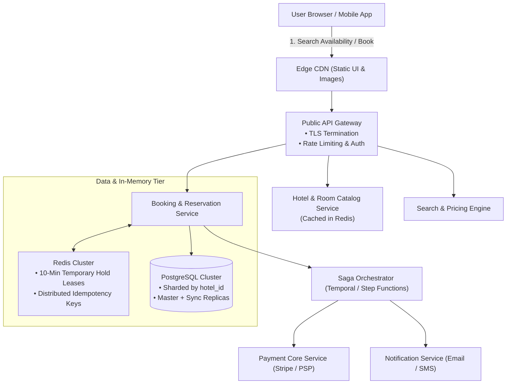
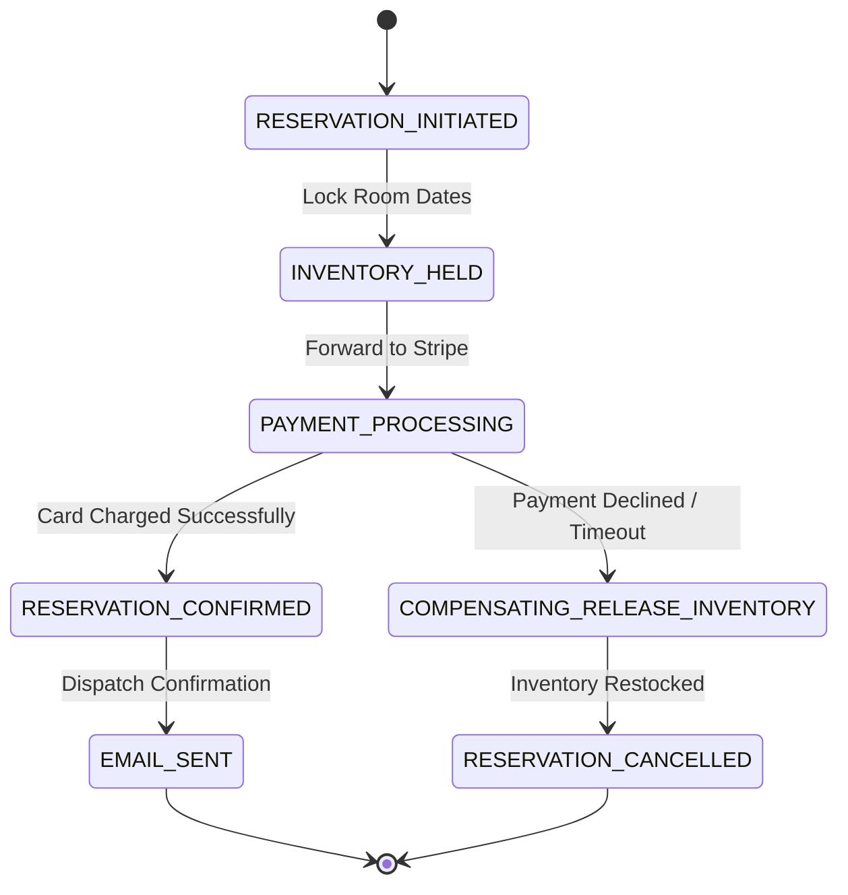

# Chapter 22: Design a Hotel Reservation & Flash Booking System (Marriott / Airbnb / Booking.com)

## Guarantees and assumptions
A hold ACK follows the durable inventory/reservation commit. Stable IDs deduplicate retries; confirmation and expiry serialize on one conditional transition that updates every stay date atomically. Payments received after expiry are refunded or voided.
**Principal IC exercise:** Race an expiry worker against a paid webhook, crash either winner before ACK, and show why inventory changes exactly once.

**Sources & Foundational References:**
- [System Design Interview – An Insider's Guide: Vol 2 (Alex Xu & Sahn Lam)](https://bytebytego.com/)
- [Designing Data-Intensive Applications (Martin Kleppmann)](https://dataintensive.net/)
- [Airbnb Engineering: Unbundling the Hotel Reservation Architecture](https://medium.com/airbnb-engineering)
- [Uber Engineering: Designing Systems for Real-Time Concurrency and Resource Contention](https://www.uber.com/blog/)

---

## 1. Executive Interview Framing & Staff-Level Bar

Designing a hotel reservation or ticketing system (Marriott, Airbnb, Ticketmaster) is the quintessential test of **high-concurrency resource locking, transactional isolation, inventory time-slot modeling, and distributed consistency**. While junior and mid-level candidates jump straight to `SELECT ... FOR UPDATE` or optimistic version columns, **Staff and Principal Engineers (L6+, P60) are evaluated on their ability to solve high-contention flash booking hotspots, manage temporary cart hold TTLs (e.g., 10-minute checkout leases), design distributed Sagas with compensating actions, and enforce overbooking risk boundaries**:

```
┌────────────────────────────────────────────────────────────────────────────────────────┐
│                                 THE INTERVIEW SPECTRUM                                 │
├────────────────────────────────────────┬───────────────────────────────────────────────┤
│ L5 / Senior Engineer                   │ L6+ / Staff & Principal Engineer              │
├────────────────────────────────────────┼───────────────────────────────────────────────┤
│ • Basic `rooms` table with boolean flag│ • Date-range segmented inventory table        │
│   `is_reserved` (fails date range math)│   (`room_type_inventory` with daily rows)    │
│ • Naive pessimistic locking (`FOR UPDATE`) • Dynamic Concurrency Strategy based on      │
│   (Causes DB thread exhaustion & deadlocks) contention: Optimistic locking for normal; │
│ • "Just use Redis for cart holds"      │   Redis Lua atomic pre-allocation for flash   │
│   (Ignores cache-DB reconciliation)    │ • Fencing Token & Lease TTLs for holds        │
│ • Ignores 10-minute hold expiration    │ • Redis Key-Expiration / Delay Queue for      │
│   and abandoned checkout cleanup       │   automatic inventory release                 │
│ • Uncontrolled overbooking             │ • Overbooking risk modeling (Poisson/Gaussian │
│                                        │   cancellation buffer caps e.g. 110%)         │
│ • Distributed 2PC across microservices │ • Orchestrated Saga with state machine &      │
│                                        │   idempotent compensating rollbacks           │
└────────────────────────────────────────┴───────────────────────────────────────────────┘
```

---

## 2. The 5-Pillar Staff Assessment Rubric for Reservations

```
┌────────────────────────────────────────────────────────────────────────────────────────────────────────┐
│                                      5-PILLAR EVALUATION RUBRIC                                        │
├─────────────────────────┬──────────────────────────────────────────────────────────────────────────────┤
│ Pillar                  │ What the Interviewer Listens For (Evidence)                                  │
├─────────────────────────┼──────────────────────────────────────────────────────────────────────────────┤
│ 1. Decision Making      │ • Replaces Room-Centric model with Room-Type-Centric model (hotels sell room │
│                         │   types, not specific physical room numbers, until physical check-in).       │
│                         │ • Evaluates Pessimistic vs Optimistic vs Redis In-Memory Pre-Allocation;      │
│                         │   selects hybrid approach based on contention thresholds.                    │
│                         │ • Chooses Orchestrated Saga over 2PC for cross-service checkout consistency. │
├─────────────────────────┼──────────────────────────────────────────────────────────────────────────────┤
│ 2. Technical            │ • Formulates date-range overlap SQL checks without row locking deadlocks.    │
│    Proficiency          │ • Dissects database isolation levels (`READ COMMITTED` vs `REPEATABLE READ`  │
│                         │   vs `SERIALIZABLE`) and phantom read phenomena.                             │
│                         │ • Implements Redis atomic Lua scripts for flash inventory deduction.         │
├─────────────────────────┼──────────────────────────────────────────────────────────────────────────────┤
│ 3. Problem Solving &    │ • Decomposes architecture into Search/Discovery, Inventory Engine, & Checkout│
│    Analytical Thinking  │ • Calculates inventory storage growth ($5,000\text{ hotels} \times 20\text{  │
│                         │   types} \times 730\text{ days} = 73\text{M rows}$) and flash booking QPS.  │
│                         │ • Sizes Redis memory and evaluates network I/O limits under peak surges.     │
├─────────────────────────┼──────────────────────────────────────────────────────────────────────────────┤
│ 4. Operational          │ • Enforces automated cart expiration using Redis Keyspace events / Kafka DLQ.│
│    Mindset              │ • Monitors inventory drift using nightly reconciliation batch jobs.          │
│                         │ • Implements idempotency keys on reservation checkout API.                   │
│                         │ • Shards database cleanly by `hotel_id` to eliminate cross-shard joins.      │
├─────────────────────────┼──────────────────────────────────────────────────────────────────────────────┤
│ 5. Adaptability &       │ • Mitigates flash surges (World Cup / Taylor Swift concert hotel rush).      │
│    Collaboration        │ • Balances business overbooking profit against walk-in relocation penalties. │
│                         │ • Handles payment gateway drops during inventory hold release gracefully.    │
└─────────────────────────┴──────────────────────────────────────────────────────────────────────────────┘
```

---

## 3. Requirements & System Scope

### Functional Requirements
1. **Hotel & Room Discovery:** Browse hotel details, room amenities, and view dynamic pricing across date ranges.
2. **Room Type Availability Search:** Check room availability for a specified date range (`startDate` to `endDate`) and guest count.
3. **Room Reservation & Temporary Hold:** Temporarily hold a room for **10 minutes** while the user completes payment; release back to inventory if unpaid upon expiration.
4. **Payment & Booking Confirmation:** Process payment, finalize reservation, and generate a confirmed booking receipt.
5. **Overbooking Management:** Support configurable overbooking (e.g., allow up to 110% bookings) to offset historical cancellation rates.
6. **Cancellation & Refunds:** Support self-service cancellations and automatic inventory restock.

### Non-Functional Requirements & Performance SLOs
* **Zero Double-Bookings:** Strict consistency for room allocation. Two users can never successfully confirm the same room on overlapping dates.
* **High Availability:** 99.99% availability for browsing and discovery.
* **Latency SLOs:**
  - Room search query latency: $< \mathbf{150ms}$ (p99).
  - Reservation checkout latency: $< \mathbf{1.5s}$ (bounded by external payment gateway).
* **Scale:** Support a global chain of **5,000 hotels**, **1 Million total rooms**, and handle traffic surges during holiday campaigns and flash events.

---

## 4. Back-of-the-Envelope Capacity Estimation

```
Global Scale: 5,000 Hotels, 1,000,000 Rooms
Average Occupancy: 70%
Average Stay Duration: 3 Days
Lookahead Horizon: 2 Years (730 Days)
```

### 4.1 Reservation QPS Math
* **Daily Reservations:**
  $$\text{Daily Bookings} = \frac{1,000,000 \times 0.70}{3 \text{ days}} \approx \mathbf{233,333 \text{ bookings / day}}$$
* **Average Reservation TPS:**
  $$\text{Average TPS} = \frac{233,333}{86,400} \approx \mathbf{2.7 \text{ bookings / sec}}$$
* **Conversion Funnel Math:**
  - Conversion rate from Hotel Detail Page $\to$ Room Booking $\approx 10\%$.
  - Conversion rate from Search Page $\to$ Hotel Detail Page $\approx 10\%$.
  - Therefore, for every 1 booking, there are 10 detail views and 100 search queries.
* **Search & View QPS:**
  - Detail Page QPS: $2.7 \times 10 \approx \mathbf{27 \text{ QPS}}$ (Peak 5x: $\approx 135 \text{ QPS}$).
  - Search Query QPS: $2.7 \times 100 \approx \mathbf{270 \text{ QPS}}$ (Peak 5x: $\approx 1,350 \text{ QPS}$).
* *Staff Takeaway:* Under normal operations, database load is very modest. The core engineering challenge occurs during **regional flash sales or peak event bookings**, where a single hotel receives 5,000 concurrent booking requests in 2 seconds for only 50 available rooms!

### 4.2 Inventory Storage Math (2-Year Horizon)
* Number of Hotels: 5,000.
* Average Room Types per Hotel: 20 (Standard, Deluxe, Suite, Executive, etc.).
* Days in 2-year Horizon: 730 days.
* **Total Inventory Rows:**
  $$5,000 \text{ hotels} \times 20 \text{ room types} \times 730 \text{ days} = \mathbf{73,000,000 \text{ rows}}$$
* At ~100 bytes per inventory row:
  $$73\text{M} \times 100 \text{ bytes} \approx \mathbf{7.3 \text{ GB}}$$
* *Staff Takeaway:* The entire 2-year global room inventory occupies less than **8 GB of RAM**! It can easily fit into a single PostgreSQL instance or Redis cluster with room to spare.

---

## 5. High-Level Architecture & End-to-End Flow



---

## 6. The Core Inventory Data Model

### 6.1 The Room-Type-Centric Design
A common junior mistake is designing a `rooms` table with an `is_available` boolean. This fails because:
1. Hotels do not assign physical room numbers (e.g., Room 402) at booking time; they assign them at physical front-desk check-in.
2. A single boolean cannot track availability across overlapping future date ranges.

**The Staff Schema:** Track inventory as daily aggregated counts per `(hotel_id, room_type_id, date)`.

```sql
-- 1. Hotel & Room Type Metadata
CREATE TABLE hotels (
    hotel_id BIGSERIAL PRIMARY KEY,
    name VARCHAR(255) NOT NULL,
    address TEXT NOT NULL,
    timezone VARCHAR(64) NOT NULL
);

CREATE TABLE room_types (
    room_type_id BIGSERIAL PRIMARY KEY,
    hotel_id BIGINT NOT NULL REFERENCES hotels(hotel_id),
    name VARCHAR(128) NOT NULL, -- e.g. "Deluxe King Suite"
    base_price_cents INT NOT NULL,
    capacity INT NOT NULL
);

-- 2. Daily Segmented Inventory Table (Pre-populated 2 years ahead)
CREATE TABLE room_type_inventory (
    hotel_id BIGINT NOT NULL,
    room_type_id BIGINT NOT NULL,
    date DATE NOT NULL,
    total_inventory INT NOT NULL,  -- Physical rooms owned
    total_reserved INT NOT NULL DEFAULT 0, -- Confirmed bookings
    total_held INT NOT NULL DEFAULT 0,     -- Temporary 10-minute cart holds
    PRIMARY KEY (hotel_id, room_type_id, date)
);

-- 3. Customer Reservation Record
CREATE TABLE reservations (
    reservation_id UUID PRIMARY KEY,
    user_id BIGINT NOT NULL,
    hotel_id BIGINT NOT NULL,
    room_type_id BIGINT NOT NULL,
    start_date DATE NOT NULL,
    end_date DATE NOT NULL,
    status VARCHAR(32) NOT NULL CHECK (status IN ('PENDING_PAYMENT', 'CONFIRMED', 'CANCELLED', 'EXPIRED')),
    total_amount_cents BIGINT NOT NULL,
    idempotency_key VARCHAR(128) NOT NULL UNIQUE,
    created_at TIMESTAMPTZ NOT NULL DEFAULT NOW(),
    expires_at TIMESTAMPTZ NOT NULL
);
```

### 6.2 Availability Verification Formula with Overbooking Buffer
Hotels deliberately overbook because a predictable percentage of guests cancel or no-show:
$$\mathbf{\text{Available}} = (\text{Total Inventory} \times \text{Overbook Factor}) - (\text{Total Reserved} + \text{Total Held}) \ge \text{Rooms Requested}$$

For example, with 100 rooms and a 110% overbooking factor ($1.10$):
$$\text{Max Allowed Allocations} = 100 \times 1.10 = 110$$

---

## 7. High-Concurrency Reservation Mechanics & Locking Strategies

When 1,000 users attempt to reserve the last 5 rooms for New Year's Eve, how do we guarantee zero double-bookings?

```
┌────────────────────────────────────────────────────────────────────────────────────────┐
│                              LOCKING STRATEGY COMPARISON                               │
├─────────────────────┬──────────────────┬──────────────────┬────────────────────────────┤
│ Strategy            │ Normal Load      │ Flash Surge Load │ Staff Engineering Verdict  │
├─────────────────────┼──────────────────┼──────────────────┼────────────────────────────┤
│ 1. Pessimistic Lock │ Safe, High       │ DISASTEROUS:     │ Avoid for public APIs;     │
│    (`FOR UPDATE`)   │ Latency          │ DB thread pool   │ holding row locks across   │
│                     │                  │ exhaustion, dead-│ dates causes severe        │
│                     │                  │ locks on ranges. │ throughput collapse.       │
├─────────────────────┼──────────────────┼──────────────────┼────────────────────────────┤
│ 2. Optimistic Lock  │ Blazing Fast,    │ High Rollbacks:  │ RECOMMENDED for normal     │
│    (Version Column) │ Zero DB lock     │ 995 of 1,000 reqs│ traffic (< 50 QPS/hotel).  │
│                     │ overhead         │ fail and retry,  │ Still takes DB write locks.│
│                     │                  │ wasting CPU.     │                            │
├─────────────────────┼──────────────────┼──────────────────┼────────────────────────────┤
│ 3. Redis In-Memory  │ Blazing Fast     │ EXCELLENT:       │ RECOMMENDED for Flash Sales│
│    Lua Atomic Hold  │ (< 2ms)          │ Atomic check and │ and High-Contention Hotspots│
│    (Pre-Allocation) │                  │ decrement; zero  │ (Protects DB from crash).  │
│                     │                  │ DB contention.   │                            │
└─────────────────────┴──────────────────┴──────────────────┴────────────────────────────┘
```

### 7.1 Option A: Optimistic Locking for Standard Traffic

```sql
-- Step 1: Query current status and version
SELECT total_inventory, total_reserved, total_held, version 
FROM room_type_inventory 
WHERE hotel_id = 211 AND room_type_id = 1001 
  AND date >= '2026-06-01' AND date < '2026-06-04';

-- Step 2: Atomic update with version check and overbooking invariant
UPDATE room_type_inventory
SET total_held = total_held + 1,
    version = version + 1
WHERE hotel_id = 211 AND room_type_id = 1001
  AND date >= '2026-06-01' AND date < '2026-06-04'
  AND (total_reserved + total_held + 1) <= (total_inventory * 1.10)
  AND version = :expected_version;
```
If rows affected $< 3$ (the 3 days of the stay), the transaction rolls back, indicating an inventory conflict or version change.

### 7.2 Option B: Redis Atomic Lua Pre-Allocation for Flash Surges

For high-demand properties, route inventory checks directly to Redis before touching the relational database.

```lua
-- KEYS: Array of inventory keys for each date: {'inv:211:1001:2026-06-01', 'inv:211:1001:2026-06-02', ...}
-- ARGV[1]: rooms_requested (e.g. 1)
-- ARGV[2]: max_allowed_capacity (e.g. 110)

-- Phase 1: Check availability across ALL requested dates atomically
for i, key in ipairs(KEYS) do
    local current = tonumber(redis.call('GET', key) or "0")
    if (current + tonumber(ARGV[1])) > tonumber(ARGV[2]) then
        return 0 -- Insufficient inventory on date i; abort without changes!
    end
end

-- Phase 2: All dates available! Deduct inventory atomically
for i, key in ipairs(KEYS) do
    redis.call('INCRBY', key, tonumber(ARGV[1]))
end

return 1 -- Admission budget secured; proceed to the reservation transaction
```

The Lua script manages an **admission budget**. Keep keys in one Redis Cluster hash slot, identify each lease/release idempotently, and reconcile after failover. The database transaction checks capacity and creates the hold across all stay dates. For optimistic updates, bind each date's own version and roll back the entire stay if any row fails.

---

## 8. The 10-Minute Cart Hold Lifecycle & Expiration Protocol

When a user selects "Book Room", the system must hold that room for **10 minutes** so they can safely enter payment info without losing the room. If they abandon checkout, the held inventory must automatically restock.

```mermaid
sequenceDiagram
    autonumber
    actor User as Guest
    participant API as Booking Gateway
    participant Redis as Redis (Hold Store)
    participant DB as PostgreSQL DB
    participant DelayQueue as Kafka / Redis Delay Queue
    participant Saga as Saga Orchestrator

    User->>API: POST /v1/reservations (Hold Request)
    API->>Redis: Optional admission check (not inventory authority)
    API->>DB: TX: Check all dates, increment held, INSERT PENDING_PAYMENT + expiry outbox
    DB-->>API: Commit durable hold
    API->>DelayQueue: Outbox relay schedules expiry (retry by reservation_id)
    API-->>User: HTTP 201 Created (Token, 10:00 Timer started)

    alt Happy Path: User completes payment within 10 minutes
        User->>API: POST /v1/checkout (Submit Card)
        API->>Saga: Execute Payment & Finalize
        Saga->>DB: TX: Conditional PENDING_PAYMENT to CONFIRMED before expiry
        Saga->>DB: Only if transition won: all dates reserved += 1, held -= 1; commit + outbox
        Saga->>Redis: Outbox projects committed transition idempotently
        API-->>User: HTTP 200 OK (Booking Confirmed)
    else Unhappy Path: User abandons cart (10 minutes elapse)
        DelayQueue->>API: Trigger HoldExpirationJob(reservation_id)
        API->>DB: TX: Conditional PENDING_PAYMENT to EXPIRED when due
        API->>DB: Only if transition won: all dates held -= 1; commit + outbox
        API->>Redis: Outbox projects committed release idempotently
    end
```

### One serialization point for confirmation and expiry
The diagram's confirmation response is conditional on winning this transition. In PostgreSQL, lock the reservation row in a short transaction shared by both paths (`SELECT ... FOR UPDATE`), then evaluate current database time and execute one conditional transition:

```sql
-- Confirmation path, after verified payment evidence:
UPDATE reservation
SET status = 'CONFIRMED'
WHERE reservation_id = :id AND status = 'PENDING_PAYMENT'
  AND expires_at > clock_timestamp()
RETURNING reservation_id;

-- Expiry path (alternative transaction, same row lock):
UPDATE reservation
SET status = 'EXPIRED'
WHERE reservation_id = :id AND status = 'PENDING_PAYMENT'
  AND expires_at <= clock_timestamp()
RETURNING reservation_id;
```

In the **same transaction**, the path returning a row updates inventory for **every stay date** in a consistent lock order and inserts the outbox event. A zero-row retry returns the existing state. Persist payment evidence under a unique provider event/payment ID; if expiry wins after charging, record and retry a uniquely keyed void/refund. Redis projects committed inventory and supports admission. The SQL uses PostgreSQL clock and [row-lock semantics](https://www.postgresql.org/docs/current/sql-select.html#SQL-FOR-UPDATE-SHARE).

### Crash/recovery timeline: reservation
| Crash point | Durable evidence | Recovery / retry outcome |
| :--- | :--- | :--- |
| Hold transaction commits, API ACK lost | Reservation ID, inventory hold, expiry outbox | Same request ID returns existing hold; relay retries expiry scheduling. |
| PSP payment succeeds, webhook/ACK lost | Provider payment key; possibly unconfirmed booking | Reconcile provider outcome; retry the same confirmation transition, not another charge. |
| Confirmation races expiry | Locked reservation and one winning conditional transition | Winner changes all stay dates once; loser reads committed state. If expiry won, compensate payment. |
| Expiry commits, queue ACK lost | EXPIRED plus inventory/outbox commit | Replayed expiry returns zero rows; no second release. |
| Confirmation commits, client ACK lost | CONFIRMED plus payment reference | Return same booking; outbox notifications deduplicate by transition ID. |

---

## 9. Cross-Service Consistency: The Orchestrated Saga Pattern

In a distributed microservice setup, reservation involves 3 stateful systems:
1. **Inventory Service:** Locks and reserves room days.
2. **Payment Service:** Charges credit card via external PSP.
3. **Notification Service:** Generates booking confirmation email.

Using **Two-Phase Commit (2PC)** causes blocking locks across external PSP network boundaries, creating catastrophic latency spikes. We use an **Orchestrated Saga Pattern**:



### Compensating Actions Invariant
Every forward step in the saga must have an idempotent **Compensating Action**:
* Forward: `HoldInventory()` $\implies$ Compensate: `ReleaseInventory()`.
* Forward: `ChargePayment()` $\implies$ Compensate: `RefundPayment()`.

---

## 10. Staff-Level Interviewer Curveballs & Adaptability Playbook

### Curveball 1: "A major concert is announced. 100,000 fans hit the booking page for a single 150-room hotel within 30 seconds. The database crashes. How do you survive?"
* **Staff Answer:**
  1. **Virtual Waiting Room (Queue-It Pattern):** Place a Cloudflare Edge Waiting Room in front of the booking endpoint. Only admit users into checkout at the exact rate the database can process ($~50 \text{ admissions / sec}$).
  2. **In-Memory Redis Token Bucket:** Allocate 150 inventory claim tokens in Redis. The first 150 users claim a cryptographic checkout token via atomic Lua script. All subsequent requests receive an immediate, friendly *"All rooms currently held"* response without touching the primary database!
  3. **Asynchronous Settlement:** The 150 token holders are routed to a decoupled checkout pipeline that writes to PostgreSQL sequentially.

### Curveball 2: "Due to our 110% overbooking policy, 105 guests show up on Friday night for only 100 physical rooms. How does the architecture handle this operationally?"
* **Staff Answer:**
  1. **Algorithmic Walk-Priority Scoring:** When overbooking risk materializes at check-in time, a ranking service identifies which guests to "walk" (relocate to a partner hotel):
     - Protect VIP / High-tier loyalty members.
     - Select guests who booked last or booked via third-party discount aggregators.
  2. **Automated Partner Booking API:** Automatically provision equivalent or upgraded accommodations at an affiliated sister hotel within a 2-mile radius via B2B hotel APIs.
  3. **Financial Compensation & Retention Credit:** Auto-issue full room refund + $200 travel voucher credited directly to the guest's digital wallet to maintain brand trust.

### Curveball 3: "A user's network drops midway through payment. Stripe charged their card, but your server never received the HTTP 200 callback. How do you resolve this inconsistency?"
* **Staff Answer:**
  1. **Stripe Webhook Listener:** The PSP fires an out-of-band `charge.succeeded` webhook to our payment gateway.
  2. **Transactional Outbox & Idempotency Key Match:** The webhook handler matches the `idempotency_key` (which is the `reservation_id`), sees the reservation is still in `PENDING_PAYMENT`, and promotes it to `CONFIRMED`.
  3. **Edge Case (Hold Expired before Webhook Arrived):** If the 10-minute hold expired and the room was sold to another guest, the webhook handler detects zero available inventory and **immediately triggers an automated full refund API call to Stripe**, accompanied by an apology email explaining the timeout.
