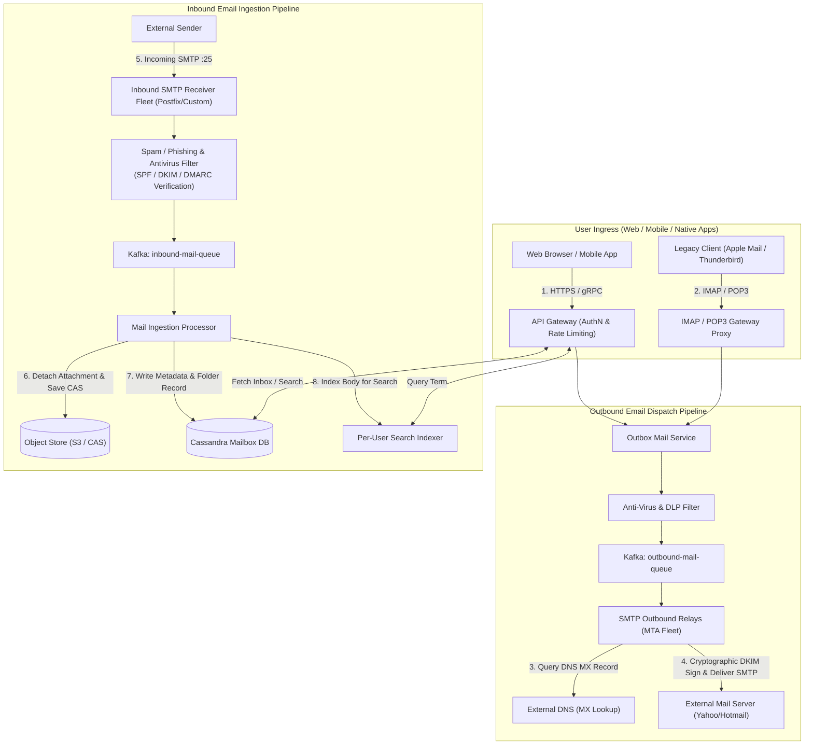

# Chapter 23: Design a Distributed Email Service (Gmail / Outlook)

## Guarantees and assumptions
SMTP acceptance transfers durable responsibility for the message. Internal delivery IDs deduplicate mailbox writes; a lost remote acceptance reply can cause a duplicate on retry.
**Principal IC exercise:** Recover a relay after the remote server accepts DATA but the final reply is lost; document the unavoidable ambiguity and operator evidence.

**Sources & Foundational References:**
- [System Design Interview – An Insider's Guide: Vol 2 (Alex Xu & Sahn Lam)](https://bytebytego.com/)
- [Designing Data-Intensive Applications (Martin Kleppmann)](https://dataintensive.net/)
- [RFC 5321 (SMTP), RFC 5322 (Internet Message Format), RFC 6376 (DKIM), RFC 7208 (SPF), RFC 7489 (DMARC)](https://datatracker.ietf.org/)
- [Apache Cassandra Architecture & Wide-Column Storage Engine](https://cassandra.apache.org/doc/latest/)

---

## 1. Executive Interview Framing & Staff-Level Bar

Designing a planetary-scale distributed email platform (Google Gmail, Microsoft Outlook) is an extraordinary systems challenge spanning **network protocols, multi-petabyte unstructured storage, full-text search indexing, and cryptographic reputation trust**. While mid-level candidates propose basic SQL schemas and IMAP connections, **Staff and Principal Engineers (L6+, P60) are evaluated on their mechanical knowledge of Cassandra wide-column mailbox partitioning, per-user localized inverted Lucene indices, cryptographic deliverability infrastructure (SPF, DKIM, DMARC), content-addressable attachment deduplication, and outbound SMTP reputation management**:

```
┌────────────────────────────────────────────────────────────────────────────────────────┐
│                                 THE INTERVIEW SPECTRUM                                 │
├────────────────────────────────────────┬───────────────────────────────────────────────┤
│ L5 / Senior Engineer                   │ L6+ / Staff & Principal Engineer              │
├────────────────────────────────────────┼───────────────────────────────────────────────┤
│ • Traditional SMTP/IMAP servers        │ • REST/gRPC Edge Gateway for modern clients   │
│   (Collapses under millions of sockets)│   with asynchronous SMTP edge relays          │
│ • Relational DB for email metadata     │ • Wide-Column NoSQL (Cassandra/ScyllaDB) with │
│   (Destructive page splits at PB scale)│   `user_id` partition key (strict single-node)│
│ • "Just use Elasticsearch for search"  │ • Per-user isolated Lucene indices (prevents  │
│   (Global index causes cross-shard lag)│   noisy neighbor cross-shard search collapse) │
│ • Store attachments directly in DB     │ • Content-Addressable Storage (CAS) on S3     │
│   (Causes catastrophic database bloat) │   with SHA-256 deduplication & pre-signed URLs│
│ • Ignores email deliverability & spam  │ • Cryptographic trust infrastructure: SPF,    │
│   (IPs get blacklisted by Spamhaus)    │   DKIM asymmetric signing, DMARC alignment,  │
│                                        │   and automated IP warmup schedules           │
└────────────────────────────────────────┴───────────────────────────────────────────────┘
```

---

## 2. The 5-Pillar Staff Assessment Rubric for Distributed Email

```
┌────────────────────────────────────────────────────────────────────────────────────────────────────────┐
│                                      5-PILLAR EVALUATION RUBRIC                                        │
├─────────────────────────┬──────────────────────────────────────────────────────────────────────────────┤
│ Pillar                  │ What the Interviewer Listens For (Evidence)                                  │
├─────────────────────────┼──────────────────────────────────────────────────────────────────────────────┤
│ 1. Decision Making      │ • HTTP REST/gRPC API for Web/Mobile vs native IMAP/POP3 protocol gateways.   │
│                         │ • Wide-Column Cassandra vs PostgreSQL for mailbox metadata storage.          │
│                         │ • Per-User Localized Search Indices vs Centralized Global Elasticsearch.     │
├─────────────────────────┼──────────────────────────────────────────────────────────────────────────────┤
│ 2. Technical            │ • Dissects cryptographic email authentication (SPF DNS TXT, DKIM RSA header  │
│    Proficiency          │   signature over canonicalized body, DMARC policy enforcement).              │
│                         │ • Explains Cassandra clustering keys (`user_id` as partition key,            │
│                         │   `message_id` UUIDv7 as descending clustering key for fast inbox paging).   │
│                         │ • Employs Content-Addressable Storage (CAS) for attachment deduplication.   │
├─────────────────────────┼──────────────────────────────────────────────────────────────────────────────┤
│ 3. Problem Solving &    │ • Decomposes system into Inbound SMTP, Outbound Delivery, Metadata, Search.  │
│    Analytical Thinking  │ • Calculates daily write IOPS (100k sent/sec), yearly metadata growth        │
│                         │   (730 PB/year), and attachment storage (1.46 Exabytes/year).                │
├─────────────────────────┼──────────────────────────────────────────────────────────────────────────────┤
│ 4. Operational          │ • Protects IP reputation: Outbound rate limiting, IP pool rotation, and      │
│    Mindset              │   handling Hard Bounces (5xx) vs Soft Bounces (4xx).                         │
│                         │ • Monitors Cassandra tombstone accumulation on bulk email deletions.         │
│                         │ • Designs cold archival tiers for emails older than 1 year (S3 Glacier).     │
├─────────────────────────┼──────────────────────────────────────────────────────────────────────────────┤
│ 5. Adaptability &       │ • Mitigates compromised account spam storms via real-time outbound circuits. │
│    Collaboration        │ • Balances strict user privacy with anti-malware attachment sandbox scanning.│
│                         │ • Communicates delivery SLA expectations across external third-party MTAs.   │
└─────────────────────────┴──────────────────────────────────────────────────────────────────────────────┘
```

---

## 3. Requirements & System Scope

### Functional Requirements
1. **Send & Receive Emails:** Users can compose and send emails via web/mobile interfaces; receive incoming emails from external domains (Yahoo, Outlook, iCloud) via SMTP.
2. **Inbox Retrieval & Pagination:** Fast pagination of folder streams (Inbox, Sent, Trash, Drafts) ordered chronologically.
3. **Full-Text Search:** Sub-second search across email subjects, sender addresses, and body text.
4. **Attachments:** Support attachments up to 25 MB with virus scanning and inline preview.
5. **Spam & Security Defense:** Filter incoming phishing/spam; sign outbound emails to guarantee deliverability.

### Non-Functional Requirements & Performance SLOs
* **Scale:** Support **1 Billion active users**, processing **100,000 sent emails / second** and **400,000 received emails / second**.
* **Zero Data Loss:** Once an email is acknowledged by the MTA, it must **never be lost** (RPO = 0).
* **Latency SLOs:**
  - Inbox fetch p99 latency $< \mathbf{100ms}$.
  - Search query p99 latency $< \mathbf{250ms}$.
  - End-to-end delivery latency $< \mathbf{5 \text{ seconds}}$ (internal recipient).
* **High Availability:** **99.99%** uptime for web/mobile client reading and sending.

---

## 4. Back-of-the-Envelope Capacity Estimation

```
Total Registered Users: 1 Billion
Active Sending Users: 100 Million daily active users
Emails Sent per User: 10 emails / day -> 1 Billion emails sent / day
Emails Received per User: 40 emails / day -> 4 Billion emails received / day
Average Metadata Size: 50 KB per email (headers, body text, thread metadata)
Attachment Frequency: 20% of emails carry attachments (average size: 500 KB)
```

### 4.1 Throughput Math
* **Outbound Send QPS:**
  $$\text{Send QPS} = \frac{1,000,000,000}{86,400} \approx \mathbf{11,574 \text{ sent / sec}} \quad (\text{Peak: } \approx \mathbf{35,000 \text{ QPS}})$$
* **Inbound Receive QPS:**
  $$\text{Receive QPS} = \frac{4,000,000,000}{86,400} \approx \mathbf{46,300 \text{ received / sec}} \quad (\text{Peak: } \approx \mathbf{140,000 \text{ QPS}})$$

### 4.2 Storage Math (The Multi-Exabyte Reality)
* **Daily Metadata Ingestion:**
  $$4 \times 10^9 \text{ emails} \times 50 \text{ KB} \approx \mathbf{200 \text{ TB / day}}$$
  $$\text{Yearly Metadata Storage} = 200 \text{ TB} \times 365 \approx \mathbf{73 \text{ Petabytes / year}}$$
  *(With 3x replication across zones: $\approx \mathbf{219 \text{ PB / year}}$)*.
* **Daily Attachment Ingestion:**
  $$4 \times 10^9 \times 20\% \times 500 \text{ KB} = 800\text{M} \times 500 \text{ KB} \approx \mathbf{400 \text{ TB / day}}$$
  $$\text{Yearly Attachment Storage} = 400 \text{ TB} \times 365 \approx \mathbf{146 \text{ Petabytes / year}}$$
  *(Over 5 years with replication: $\approx \mathbf{1.46 \text{ Exabytes}}$!)*.
* *Staff Takeaway:* Email metadata and attachments **MUST be strictly decoupled**. Attachments reside in Content-Addressable Object Storage (S3/Ceph) with global content deduplication, while metadata resides in Cassandra.

---

## 5. End-to-End High-Level Architecture



---

## 6. The Core Storage Engine: Why Cassandra Dominates RDBMS

### 6.1 The Relational Database Failure Mode
In PostgreSQL or MySQL, an `emails` table holding billions of rows requires B+ Tree index updates on every received email. 
* As users delete thousands of emails or move them between folders, index pages become fragmented.
* Running range queries across a user's inbox requires random disk I/O when index pages spill out of RAM.

### 6.2 The Cassandra Wide-Column Mailbox Schema
Cassandra organizes data around a **Partition Key** (which determines the physical node via consistent hashing) and **Clustering Columns** (which determine the physical on-disk sort order within the node's SSTable).

```sql
-- 1. Mailbox Folder Table (Optimized for Sub-Millisecond Inbox Paging)
CREATE TABLE user_folder_emails (
    user_id UUID,
    folder_name VARCHAR,          -- e.g., 'INBOX', 'SENT', 'TRASH', 'STARRED'
    message_id TIMEUUID,          -- Time-sortable UUID (v7/v1): Acts as chronological cursor
    sender_email VARCHAR,
    sender_name VARCHAR,
    subject TEXT,
    preview_snippet VARCHAR,      -- 100-character snippet for rapid inbox view
    has_attachments BOOLEAN,
    is_read BOOLEAN,
    PRIMARY KEY ((user_id, folder_name), message_id)
) WITH CLUSTERING ORDER BY (message_id DESC);

-- 2. Email Content Table (Fetched only when user clicks an individual email)
CREATE TABLE email_contents (
    message_id TIMEUUID PRIMARY KEY,
    body_html TEXT,
    body_plain TEXT,
    attachment_manifest TEXT,     -- JSON array of attachment hashes, names, sizes
    full_headers TEXT
);
```

### 6.3 Why This Schema Is Blazing Fast ($O(1)$ Disk Seek)
* **Partition Key `(user_id, folder_name)`:** All emails belonging to `(Alice, 'INBOX')` are physically colocated on the **exact same storage node** in contiguous disk blocks!
* **Clustering Key `message_id DESC`:** Emails are physically sorted on disk in **reverse chronological order**.
* **Paging with Cursors:** To fetch page 2 of the inbox, the client simply passes the last `message_id`:
  ```sql
  SELECT * FROM user_folder_emails 
  WHERE user_id = 'user_123' AND folder_name = 'INBOX' 
    AND message_id < '018b1234-5678-7000-8000-000000000000' 
  LIMIT 25;
  ```
  This is a single sequential scan on disk—completing in $< \mathbf{2ms}$!

---

## 7. Full-Text Search Architecture: Global Elasticsearch vs Per-User Local Index

Searching across petabytes of private email text is fundamentally different from searching public web pages:
* Public Web Search: 1 shared global index; documents are visible to all users.
* Email Search: **Strict isolation**. User $A$ can **only** search User $A$'s emails.

```
┌────────────────────────────────────────────────────────────────────────────────────────┐
│                              EMAIL SEARCH ARCHITECTURE                                 │
├─────────────────────┬──────────────────┬──────────────────┬────────────────────────────┤
│ Strategy            │ Index Layout     │ Query Execution  │ Staff Engineering Verdict  │
├─────────────────────┼──────────────────┼──────────────────┼────────────────────────────┤
│ 1. Centralized      │ Sharded by       │ HORRIBLE:        │ Severe scatter-gather      │
│    Global Index     │ message_id       │ Query must fan   │ latency penalty. Single    │
│    (Elasticsearch)  │ across 500 nodes.│ out to ALL 500   │ enterprise tenant can lag  │
│                     │                  │ nodes for 1 user!│ the entire cluster.        │
├─────────────────────┼──────────────────┼──────────────────┼────────────────────────────┤
│ 2. Sharded by       │ Route all emails │ Better, but huge │ Large user indexes can skew│
│    User ID          │ of user to 1     │ shard imbalance  │ shard size; index rebuilds │
│    (Elasticsearch)  │ ES shard.        │ on power users.  │ are heavyweight.           │
├─────────────────────┼──────────────────┼──────────────────┼────────────────────────────┤
│ 3. Per-User Local   │ Each user has    │ BLAZING FAST:    │ INDUSTRY SOTA (Gmail /     │
│    Inverted Index   │ an isolated,     │ Query touches    │ Outlook): Zero cross-tenant│
│    (Lucene / CAS)   │ lightweight      │ ONLY that user's │ interference; index can be │
│                     │ Lucene index file│ local file in RAM│ cached on client phone!    │
└─────────────────────┴──────────────────┴──────────────────┴────────────────────────────┘
```

---

## 8. Cryptographic Email Deliverability & Anti-Spam (SPF, DKIM, DMARC)

Anyone on the internet can connect to an SMTP server and claim to send an email from `ceo@apple.com` (SMTP spoofing). How does modern email guarantee sender authenticity?

```mermaid
flowchart TD
    Outbound["Outbound Mail Relay (Our Service)"] -->|1. Sign Body with Private Key| CryptoSign["DKIM Private Key (RSA 2048)"]
    CryptoSign -->|2. Send Email with Header: DKIM-Signature| Receiver["Receiving Mail Server (e.g. Gmail)"]

    Receiver -->|3. Query Sender Domain DNS| DNS["DNS Server: ourdomain.com"]
    DNS -->>|Returns SPF TXT: allowed server IPs| Receiver
    DNS -->>|Returns DKIM Public Key TXT| Receiver
    DNS -->>|Returns DMARC TXT: policy p=reject| Receiver

    subgraph AuthChecks["Verification Engine"]
        Receiver --> CheckSPF{"SPF Check:<br/>Is relay IP in allowed SPF list?"}
        Receiver --> CheckDKIM{"DKIM Check:<br/>Does public key decrypt header signature?"}
        Receiver --> CheckDMARC{"DMARC Alignment:<br/>Do SPF & DKIM domains match 'From' header?"}
    end

    CheckSPF & CheckDKIM & CheckDMARC -->|All PASS| Inbox["Deliver to Recipient INBOX"]
    CheckSPF & CheckDKIM & CheckDMARC -->|FAIL| SpamBox["Drop or Quarantine to SPAM"]
```

### The 3 Core Deliverability Pillars
1. **SPF (Sender Policy Framework):** A DNS `TXT` record published by the sender domain listing authorized outbound MTA IP addresses.
2. **DKIM (DomainKeys Identified Mail):** The outbound MTA hashes the email headers and body, encrypts the hash with its **private RSA/Ed25519 key**, and attaches the signature in the `DKIM-Signature:` header. The receiving MTA fetches the domain's **public key from DNS** to verify cryptographic integrity.
3. **DMARC (Domain-based Message Authentication):** Enforces alignment between the `From:` header and the SPF/DKIM domains, specifying the policy (`p=none`, `p=quarantine`, `p=reject`) if checks fail.

---

## 9. Staff-Level Interviewer Curveballs & Adaptability Playbook

### Curveball 1: "A spammer compromises 50,000 user accounts and blasts 10 Million phishing emails via your outbound SMTP relay within 10 minutes. Spamhaus blacklists your outbound IPs. All legitimate company emails now bounce globally. How do you recover?"
* **Wrong Answer:** "We contact Spamhaus and ask them to remove our IP." *(Takes days; business operations halt).*
* **Staff Answer:**
  1. **Immediate IP Pool Isolation (Subnet Partitioning):** Outbound MTAs must be physically segmented into isolated pools:
     - Pool A (High-Reputation Tier): Established transactional users with low bounce rates.
     - Pool B (Low-Reputation / New Tier): New signups and flagged accounts.
     - Pool C (Marketing / Bulk Mail): Non-critical notifications.
     The compromised blast only dirties Pool B; Pool A remains 100% clean.
  2. **Automated Anomaly Circuit Breaker:** If an account's outbound sending rate spikes by $> 10\times$ baseline or generates $> 5\%$ hard bounces, an automated circuit breaker trips, isolating the account and revoking active OAuth sessions.
  3. **Automated IP Warmup Fleet:** Maintain pre-warmed backup IP subnets operating at low background volumes, allowing instant traffic diversion while remediating blacklists.

### Curveball 2: "A user deletes 100,000 emails from their mailbox in one click. How does this impact your Cassandra database, and how do you prevent performance degradation?"
* **Staff Answer:**
  1. **The Cassandra Tombstone Danger:** In Cassandra (LSM tree), deleting a row does not erase disk data immediately; it writes a **Tombstone marker**. When reading the inbox, Cassandra must scan all tombstones to verify whether rows are live. If tombstones exceed `tombstone_failure_threshold` (default: 100,000), queries crash with `TombstoneOverwhelmingException`!
  2. **Staff Solution:**
     - **Partition-Level Drop:** Instead of deleting 100,000 individual row keys, issue a partition-level truncate or move:
       ```sql
       DELETE FROM user_folder_emails WHERE user_id = 'user_123' AND folder_name = 'OLD_FOLDER';
       ```
     - **Fast Compaction Tuning:** Set `gc_grace_seconds = 86400` (1 day instead of default 10 days) on trash folders and trigger manual Single-SSTable compactions to purge dead tombstones quickly.

### Curveball 3: "A viral marketing company sends an email with a 20 MB video attachment to 5 Million recipients inside your system. How do you prevent your storage tier from exploding by 100 Terabytes?"
* **Staff Answer:**
  1. **Content-Addressable Storage (CAS) Deduplication:** Compute the **SHA-256 hash** of the attachment payload: `hash = sha256(file_bytes)`.
  2. **Single Instance Storage:** Store the 20 MB binary **exactly once** in S3 at key `/attachments/{sha256_hash}`.
  3. **Pointer References:** In all 5 Million recipient mail records, simply insert an 8-byte pointer referencing `{sha256_hash}`.
  4. **Result:** Consumes only **20 MB of object storage** instead of 100 Terabytes (a $5,000,000\times$ storage saving)!
