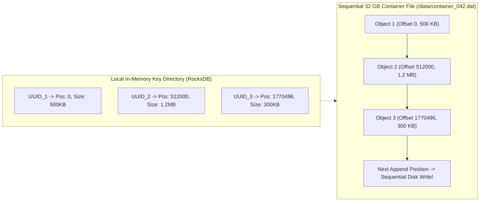
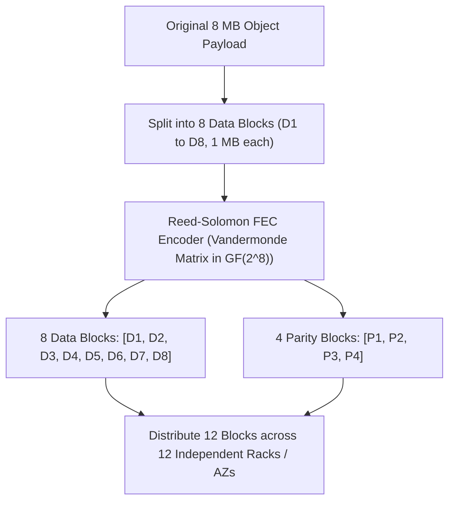
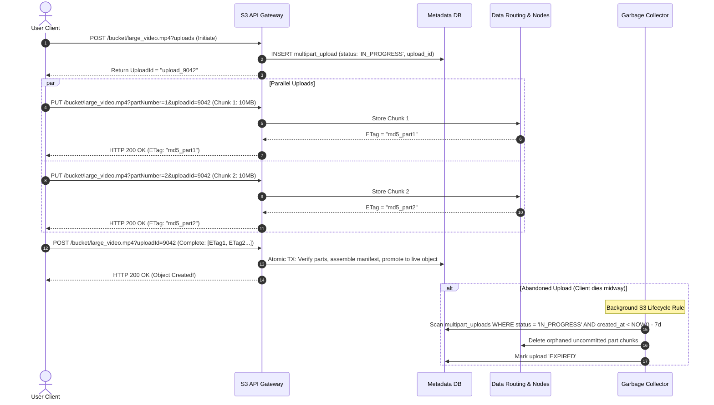

# Chapter 24: Design a Distributed S3-Compatible Object Storage System (Amazon S3 / Ceph / MinIO)

**Sources & Foundational References:**
- [System Design Interview – An Insider's Guide: Vol 2 (Alex Xu & Sahn Lam)](https://bytebytego.com/)
- [Finding a needle in Haystack: Facebook's photo storage (Beaver et al.)](https://www.usenix.org/legacy/event/osdi10/tech/full_papers/Beaver.pdf)
- [Ceph: A Scalable, High-Performance Distributed File System (Weil et al.)](https://www.usenix.org/legacy/event/osdi06/tech/full_papers/weil/weil.pdf)
- [Backblaze: Erasure Coding vs 3x Replication Durability Mathematics](https://github.com/Backblaze/erasure-coding-durability)

---

## 1. Executive Interview Framing & Staff-Level Bar

Designing an S3-compatible distributed object storage platform (Amazon S3, Ceph RADOS, MinIO, Google Cloud Storage) is the ultimate test of **low-level filesystem mechanics, storage tier economics, data durability mathematics, and hardware I/O physics**. While mid-level candidates propose writing files directly to local directories and relying on standard 3x replication, **Staff and Principal Engineers (L6+, P60) are evaluated on their mechanical knowledge of the small-file POSIX inode exhaustion bottleneck (Facebook Haystack / Bitcask append-only container files), Reed-Solomon Erasure Coding ($8+4$ parity math), placement groups using Paxos/Raft consensus, read-after-write strong consistency, and asynchronous background compaction scrubbing**:

```
┌────────────────────────────────────────────────────────────────────────────────────────┐
│                                 THE INTERVIEW SPECTRUM                                 │
├─────────────────────────┬──────────────────────────────────────────────────────────────┤
│ L5 / Senior Engineer    │ L6+ / Staff & Principal Engineer                             │
├─────────────────────────┼──────────────────────────────────────────────────────────────┤
│ • Stores 1 file per     │ • Haystack / Bitcask container file pattern: Appends         │
│   object on local disk  │   millions of small objects into large multi-GB append-only  │
│   (POSIX inode crash)   │   files; indexes byte offsets in local RocksDB/SQLite RAM    │
│ • Simple 3x replication │ • Reed-Solomon Erasure Coding ($8+4$): Delivers 11 Nines of  │
│   (200% storage tax)    │   durability with only 50% storage overhead (massive savings)│
│ • Ignores silent disk   │ • Continuous Bit-Rot Scrubbing: Background verification      │
│   data corruption       │   using CRC32 / SHA-256 with parity reconstruction           │
│ • Eventual consistency  │ • Read-After-Write Strong Consistency: Synchronous primary   │
│   described vaguely     │   quorum write acknowledgment across failure domains         │
│ • Basic HTTP PUT upload │ • S3 Multipart Upload State Machine with parallel chunking,  │
│                         │   ETag validation, and orphan part garbage collection        │
└─────────────────────────┴──────────────────────────────────────────────────────────────┘
```

---

## 2. The 5-Pillar Staff Assessment Rubric for Object Storage

```
┌────────────────────────────────────────────────────────────────────────────────────────────────────────┐
│                                      5-PILLAR EVALUATION RUBRIC                                        │
├─────────────────────────┬──────────────────────────────────────────────────────────────────────────────┤
│ Pillar                  │ What the Interviewer Listens For (Evidence)                                  │
├─────────────────────────┼──────────────────────────────────────────────────────────────────────────────┤
│ 1. Decision Making      │ • Storage Paradigm: Block vs File vs Object Storage tradeoffs.               │
│                         │ • Durability Engine: 3x Replication vs Erasure Coding ($8+4$ Reed-Solomon). │
│                         │ • Architecture: Decouples Metadata Store (DB) from Blob Data Store (Disks).  │
├─────────────────────────┼──────────────────────────────────────────────────────────────────────────────┤
│ 2. Technical            │ • Explains POSIX inode exhaustion & disk seek bottleneck on small files.     │
│    Proficiency          │ • Derives Erasure Coding parity matrix math ($M$ failures tolerated with     │
│                         │   $N+M$ encoding over Galois Fields $GF(2^8)$).                              │
│                         │ • Implements Content-Addressable Storage (CAS) with SHA-256 deduplication.  │
├─────────────────────────┼──────────────────────────────────────────────────────────────────────────────┤
│ 3. Problem Solving &    │ • Decomposes system into API Gateway, Placement Service, Data Nodes, Metadata│
│    Analytical Thinking  │ • Calculates hardware requirements for 100 PB storage, 0.68 Billion objects, │
│                         │   and SATA HDD IOPS limits (100 IOPS random vs 150 MB/s sequential).         │
├─────────────────────────┼──────────────────────────────────────────────────────────────────────────────┤
│ 4. Operational          │ • Mitigates Silent Data Corruption (Bit Rot) via background data scrubbing.  │
│    Mindset              │ • Designs compaction workers to reclaim disk space from tombstoned objects.  │
│                         │ • Enforces multi-AZ failure domain isolation (Cross-Rack, Cross-Switch).    │
│                         │ • Implements S3 lifecycle policies (Transitioning hot to cold S3 Glacier).   │
├─────────────────────────┼──────────────────────────────────────────────────────────────────────────────┤
│ 5. Adaptability &       │ • Handles sudden loss of an entire datacenter rack during peak traffic.      │
│    Collaboration        │ • Balances computational CPU cost of erasure coding with cloud storage spend.│
│                         │ • Explains durability SLAs (11 Nines) mathematically to enterprise customers.│
└─────────────────────────┴──────────────────────────────────────────────────────────────────────────────┘
```

---

## 3. Requirements & System Scope

### Functional Requirements
1. **Bucket Management:** Create, delete, list, and configure access policies for globally unique buckets.
2. **Object Upload & Download:** Upload and download immutable binary objects ranging from 1 KB (small avatars) to 50 GB (large video files) via S3-compatible REST APIs.
3. **Object Versioning:** Support tracking multiple versions of an object under the same key with undelete capabilities.
4. **Bucket Object Listing:** List objects in a bucket sharing a common prefix (e.g., `photos/2026/`) with cursor-based pagination.
5. **Multipart Upload:** Resumable, parallel chunk uploads for objects exceeding 100 MB.

### Non-Functional Requirements & Durability SLOs
* **Scale:** Store **100 Petabytes of data** and support **0.68 Billion objects**.
* **Data Durability:** **11 Nines (99.999999999%)** durability (annual probability of losing an object is $10^{-11}$).
* **Service Availability:** **99.99% (4 Nines)** availability for read and write API endpoints.
* **Storage Cost Efficiency:** Minimize hardware storage overhead while maintaining high read throughput.
* **Consistency Model:** **Strong Read-After-Write Consistency** for `PUT` and `DELETE` requests.

---

## 4. Back-of-the-Envelope Capacity Estimation

```
Total Storage Target: 100 Petabytes (100 * 10^15 Bytes)
Object Distribution:
  - Small Objects (< 1 MB, average 0.5 MB): 20% of storage
  - Medium Objects (1-64 MB, average 32 MB): 60% of storage
  - Large Objects (> 64 MB, average 200 MB): 20% of storage
Hardware Spec: 12 TB 7200 RPM Enterprise SATA HDDs
```

### 4.1 Total Object Count Math
* **Small Objects ($20\% = 20 \text{ PB}$):**
  $$\text{Count}_{\text{small}} = \frac{20 \times 10^{15} \text{ bytes}}{0.5 \times 10^6 \text{ bytes}} = \mathbf{40 \text{ Billion small objects}}$$
* **Medium Objects ($60\% = 60 \text{ PB}$):**
  $$\text{Count}_{\text{medium}} = \frac{60 \times 10^{15} \text{ bytes}}{32 \times 10^6 \text{ bytes}} \approx \mathbf{1.875 \text{ Billion medium objects}}$$
* **Large Objects ($20\% = 20 \text{ PB}$):**
  $$\text{Count}_{\text{large}} = \frac{20 \times 10^{15} \text{ bytes}}{200 \times 10^6 \text{ bytes}} = \mathbf{100 \text{ Million large objects}}$$
* **Total Objects in Metadata Catalog:** $\approx \mathbf{42 \text{ Billion objects}}$!
  - At 1 KB of metadata per object (name, ETag, version, size, placement pointers):
  $$\text{Metadata Storage} = 42 \times 10^9 \times 1 \text{ KB} \approx \mathbf{42 \text{ Terabytes}}$$

### 4.2 Storage Efficiency: 3x Replication vs Erasure Coding
* **Option A: 3x Replication (Replication Factor = 3):**
  - Requires $100 \text{ PB} \times 3 = \mathbf{300 \text{ PB of raw disks}}$ ($200\%$ storage overhead).
  - Annual disk cost is prohibitive.
* **Option B: Reed-Solomon Erasure Coding ($8+4$):**
  - 8 data chunks + 4 parity chunks.
  - Storage overhead: $\frac{12}{8} = 1.5\times$ ($\mathbf{50\% \text{ overhead}}$).
  - Requires only **150 PB of raw disks** (saving **150 PB of physical hardware**)!
  - Delivers **11 Nines of durability**, tolerating the simultaneous failure of any 4 drives across different racks!

---

## 5. End-to-End High-Level Architecture

```mermaid
flowchart TD
    Client["Client Application / SDK"] -->|1. S3 REST API (PUT/GET)| LB["Global Load Balancer"]
    LB --> APIService["Stateless API Service Fleet<br/>• AuthN / IAM Validation<br/>• S3 REST Compatibility<br/>• Multipart Orchestration"]

    subgraph MetadataTier["Metadata Tier"]
        APIService <-->|2. Bucket & Object Metadata| MetadataDB[("Metadata DB Cluster<br/>(CockroachDB / Sharded MySQL)<br/>• bucket_id, object_name, version<br/>• Data placement pointers")]
    end

    subgraph PlacementControl["Cluster Topology & Consensus"]
        PlacementService["Placement Service (Raft Consensus Quorum)<br/>• Monitors Data Node Heartbeats<br/>• Virtual Cluster Map & Failure Domains<br/>• Dispatches Replication & EC Plans"]
    end

    subgraph DataStorageTier["Blob Data Storage Tier"]
        APIService <-->|3. Stream Chunks| DataRouting["Data Routing Service"]
        PlacementService -.->|Broadcast Cluster Map| DataRouting
        
        DataRouting <--> Node1["Data Node 1 (Rack A)"]
        DataRouting <--> Node2["Data Node 2 (Rack B)"]
        DataRouting <--> Node3["Data Node 3 (Rack C)"]
        DataRouting <--> Node4["Data Node 4 (Rack D)"]
    end
```

---

## 6. The Storage Engine Deep Dive: The Small File Problem (Haystack / Bitcask)

A classic Principal Engineer interview trap: *"Why not save each uploaded object as an individual file on the data node filesystem (e.g., `/data/bucket/my_photo.jpg`)?"*

### 6.1 The POSIX File System Collapse
1. **Inode Exhaustion:** A standard Linux ext4 filesystem has a fixed number of inodes allocated at format time. Storing 40 Billion individual files exhausts inodes, crashing the filesystem even when petabytes of free disk space remain!
2. **Random I/O Thrashing:** To read an individual file, the OS must:
   - Read the directory inode.
   - Read directory block pointers.
   - Seek to the file inode.
   - Seek to the actual data block.
   Each seek requires mechanical disk head movement ($\approx 10\text{ms}$). A SATA drive capped at 100 IOPS can only serve **100 small file reads per second**!

### 6.2 The SOTA Solution: Append-Only Container Files
Instead of writing 1 file per object, use the **Facebook Haystack / Bitcask Pattern**:
* The Data Node creates large, sequential, append-only container files (e.g. `/data/container_042.dat`, size: 32 GB).
* Every new object is appended sequentially to the active container file.
* A lightweight local embedded database (RocksDB or SQLite) maps:
  $$\mathbf{\text{Object UUID}} \implies (\text{container\_id}, \text{file\_offset}, \text{object\_size})$$



* **Read Operation:** Lookup `(file_offset, size)` in memory-mapped RocksDB ($< 0.1\text{ms}$), then execute a single direct disk seek (`fseek` + `pread`).
* **Write Operation:** Pure sequential append. Achieves **150 MB/sec continuous write throughput per drive**, eliminating inode bloat completely!

---

## 7. Durability Engine: Reed-Solomon Erasure Coding ($8+4$)

How does erasure coding achieve 11 nines of durability with only 50% overhead?



### 7.1 Mathematical Recovery Guarantee
* We encode $K = 8$ data blocks into $K + M = 12$ total blocks (where $M = 4$ parity blocks).
* **The Fundamental Theorem of Erasure Coding:** **Any $K$ blocks out of the $K + M$ blocks are mathematically sufficient to reconstruct the entire original object!**
* If 4 hard drives, 4 servers, or even 4 complete datacenter racks catch fire simultaneously, the remaining 8 blocks invert the matrix and reconstruct the missing data with zero byte loss!

### 7.2 Durability Comparison Matrix

```
┌────────────────────────────────────────────────────────────────────────────────────────┐
│                              DURABILITY & COST COMPARISON                              │
├─────────────────────┬──────────────────┬──────────────────┬────────────────────────────┤
│ Strategy            │ Durability       │ Storage Overhead │ Recovery Cost / Complexity │
├─────────────────────┼──────────────────┼──────────────────┼────────────────────────────┤
│ 3x Replication      │ 6 Nines (99.9999%│ 200%             │ Trivial: Copy raw file from│
│                     │ annual safety)   │ (100PB -> 300PB) │ any surviving replica node.│
├─────────────────────┼──────────────────┼──────────────────┼────────────────────────────┤
│ Erasure Coding      │ 11 Nines         │ 50%              │ Higher CPU overhead:       │
│ (8+4 Reed-Solomon)  │ (99.999999999%)  │ (100PB -> 150PB) │ Must fetch 8 blocks across │
│                     │                  │                  │ network & run matrix math. │
└─────────────────────┴──────────────────┴──────────────────┴────────────────────────────┘
```

---

## 8. S3 Multipart Upload State Machine & Garbage Collection

For large files ($> 100 \text{ MB}$ to $50 \text{ GB}$), uploading over a single HTTP connection is fragile: a momentary network glitch at 99% forces the user to restart from byte zero.



---

## 9. Silent Data Corruption (Bit Rot) & Compaction

Hard drives occasionally suffer from **Bit Rot** (cosmic rays, magnetic degradation, or firmware bugs flip a bit silently without reporting an OS read error).

### 9.1 Continuous Background Data Scrubbing
1. A low-priority background scrubber daemon continuously scans data blocks on all data nodes.
2. It recomputes the **CRC32C / SHA-256 checksum** of each stored chunk and compares it to the checksum recorded at write time.
3. If a mismatch is detected, the scrubber alerts the Placement Service, downloads the remaining healthy Erasure Coding blocks from peer nodes, reconstructs the pristine block, and overwrites the corrupted drive sector.

### 9.2 Container File Compaction (Garbage Collection)
Because objects are immutable, updating or deleting an object simply appends a **Tombstone record** to the metadata catalog. The data chunk inside the 32 GB container file becomes dead space.
* When dead space in a container exceeds **30%**:
  - The compaction worker reads live objects from `container_042.dat`.
  - Sequentially writes them into a fresh compacted file: `container_042_compacted.dat`.
  - Atomically updates the RocksDB offset pointers.
  - Deletes the old container file, reclaiming gigabytes of disk space!

---

## 10. Staff-Level Interviewer Curveballs & Adaptability Playbook

### Curveball 1: "An entire datacenter rack containing 40 storage servers suddenly loses power. Clients are actively reading objects. What happens to read latency, and does the system panic?"
* **Staff Answer:**
  1. **Zero Data Loss via Failure Domain Placement:** Our Placement Service ensures that the 12 blocks of any Erasure Coded object ($8+4$) are distributed across **12 distinct racks**. Losing 1 rack knocks out at most **1 block per object**.
  2. **Degraded Read Mode (Zero Reconstruct Overhead):** Because $K=8$ blocks are required, and 11 blocks are still online, the Data Routing service simply reads the surviving 8 data blocks directly. **No reconstruction math is executed**, keeping read latency fast!
  3. **Reconstruction Rate Limiter:** The system does **not** immediately initiate emergency parity rebuilds (which would saturate network bandwidth with petabytes of traffic). It initiates a 15-minute grace timer. If the rack power returns, the blocks rejoin instantly. If the rack is dead permanently, throttled background rebuild workers restore parity over hours.

### Curveball 2: "AWS S3 historically offered eventual consistency for overwrites, but switched to strong consistency in 2020. How would you design strong read-after-write consistency in your object store?"
* **Staff Answer:**
  1. **Atomic Metadata Promotion:** An object upload is never considered successful when data hits disk. The API service only returns HTTP `200 OK` after the metadata record is committed to a **distributed ACID metadata store (CockroachDB / Google Spanner)** using Raft consensus.
  2. **Synchronous Quorum Invalidation:** Read requests for an object key are directed to the metadata leader, which guarantees reading the committed version timestamp before fetching blob bytes from storage nodes.

### Curveball 3: "A customer bucket receives 50,000 requests per second targeting objects sharing the exact same prefix (`photos/2026/01/01/img_*.jpg`). The metadata shard crashes. How do you scale prefix access?"
* **Staff Answer:**
  1. **Identify the Partition Hotspot:** Sharding metadata strictly by prefix causes all 50,000 requests to hammer a single metadata database shard.
  2. **Internal Hash Salting (S3 Prefix Auto-Partitioning):**
     - Internally partition metadata by `hash(bucket_id + object_key) % num_shards`, distributing objects uniformly across all database nodes.
     - For prefix-listing queries (`LIST bucket prefix="photos/"`), maintain an asynchronous secondary index or separate denormalized listing table.
