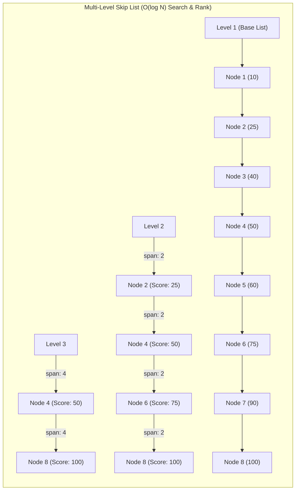
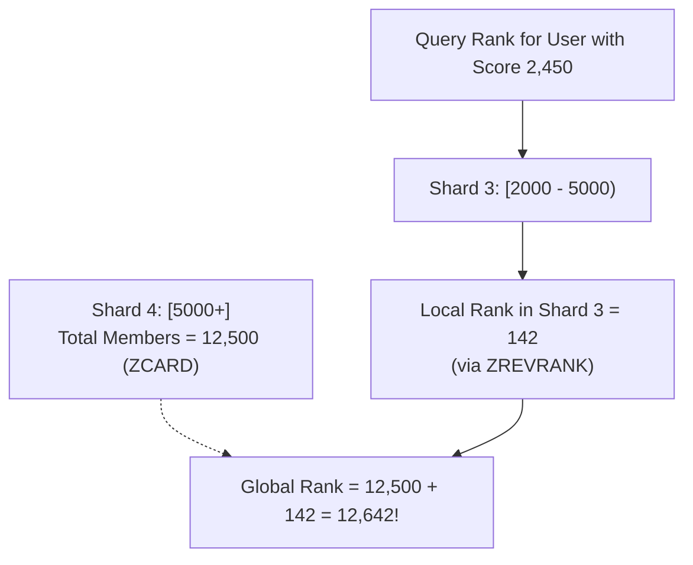
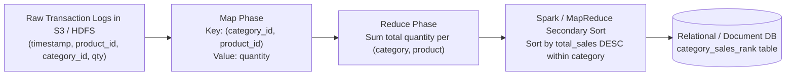

# Chapter 25: Design a Real-Time Gaming Leaderboard & Global Sales Rank (Redis ZSET, Skip Lists, Fenwick Trees)

**Sources & Foundational References:**
- [System Design Interview – An Insider's Guide: Vol 2 (Alex Xu & Sahn Lam)](https://bytebytego.com/)
- [The System Design Primer: Design Amazon's Sales Rank by Category (Donne Martin)](https://github.com/donnemartin/system-design-primer/blob/master/solutions/system_design/sales_rank/README.md)
- [Redis Documentation: Under the Hood of Sorted Sets (Skip List & Dict)](https://redis.io/docs/data-types/sorted-sets/)
- [A Skip List Cookbook (William Pugh)](https://drum.lib.umd.edu/handle/1903/542)

---

## 1. Executive Interview Framing & Staff-Level Bar

Designing a high-throughput, low-latency leaderboard (gaming tournaments, Amazon sales ranks, LeetCode contest rankings) is the classic interview test of **specialized in-memory data structures, sharding tradeoffs, and streaming vs batch aggregation**. While mid-level candidates state "just put scores in a Redis ZSET," **Staff and Principal Engineers (L6+, P60) are evaluated on their mathematical mastery of Skip List pointer levels, tie-breaking score bit-encoding, score-range sharding with $O(1)$ keyspace aggregation, Fenwick Tree / Segment Tree alternatives for 100M+ users, and MapReduce / Spark batch ranking pipelines**:

```
┌────────────────────────────────────────────────────────────────────────────────────────┐
│                                 THE INTERVIEW SPECTRUM                                 │
├────────────────────────────────────────┬───────────────────────────────────────────────┤
│ L5 / Senior Engineer                   │ L6+ / Staff & Principal Engineer              │
├────────────────────────────────────────┼───────────────────────────────────────────────┤
│ • "Just use Redis Sorted Set"          │ • Skip List internal mechanics (probabilistic │
│ • SQL `ORDER BY score DESC LIMIT 10`   │   heights, $O(\log N)$ search/insert/rank)    │
│ • Ignores score tie-breaking           │ • Bit-packed composite scoring for sub-second │
│ • Blind hash-sharding of Redis ZSETs   │   tie-breaking: $S = \text{Score} \ll 32 \mid │
│   (Requires expensive scatter-gather)  │   (\text{MaxTime} - \text{Timestamp})$        │
│ • Ignores cheat prevention / tampering │ • Fixed Score-Range Sharding with fast $O(1)$ │
│ • Real-time only (ignores batch rank)  │   prefix rank summation                       │
│                                        │ • Server-authoritative win verification &     │
│                                        │   HMAC anti-tampering nonces                  │
│                                        │ • Hybrid architecture: Redis for real-time +  │
│                                        │   Apache Spark / MapReduce for weekly ranks   │
└────────────────────────────────────────┴───────────────────────────────────────────────┘
```

---

## 2. The 5-Pillar Staff Assessment Rubric for Leaderboards

```
┌────────────────────────────────────────────────────────────────────────────────────────────────────────┐
│                                      5-PILLAR EVALUATION RUBRIC                                        │
├─────────────────────────┬──────────────────────────────────────────────────────────────────────────────┤
│ Pillar                  │ What the Interviewer Listens For (Evidence)                                  │
├─────────────────────────┼──────────────────────────────────────────────────────────────────────────────┤
│ 1. Decision Making      │ • Relational SQL vs Redis ZSET vs NoSQL (DynamoDB) vs Fenwick Tree.          │
│                         │ • Hash Partitioning (Scatter-Gather) vs Fixed Score-Range Partitioning.      │
│                         │ • Real-time streaming (Redis) vs Scheduled Batch MapReduce (Donne Martin).   │
├─────────────────────────┼──────────────────────────────────────────────────────────────────────────────┤
│ 2. Technical            │ • Explains Skip List pointer arrays ($p = 0.25$ / $0.5$ geometric height    │
│    Proficiency          │   distribution, span counts for $O(\log N)$ `ZRANK` calculation).             │
│                         │ • Bit-encoding score ties without floating-point precision loss.             │
│                         │ • Compares Fenwick Tree ($O(\log M)$ memory-efficient rank prefix sums).     │
├─────────────────────────┼──────────────────────────────────────────────────────────────────────────────┤
│ 3. Problem Solving &    │ • Decomposes architecture into Ingress, Score Validation, & Rank Queries.    │
│    Analytical Thinking  │ • Calculates RAM footprint ($25\text{M MAU} \times 64\text{B} \approx        │
│                         │   1.6\text{ GB}$) and peak write QPS ($2,500\text{ writes/sec}$).            │
├─────────────────────────┼──────────────────────────────────────────────────────────────────────────────┤
│ 4. Operational          │ • Enforces server-authoritative scoring (never accept scores from clients).  │
│    Mindset              │ • Sets up Redis replication (AOF + RDB snapshots) and disaster recovery from │
│                         │   MySQL transactional write logs.                                            │
│                         │ • Employs client-side caching with short TTLs for top-10 hot queries.        │
├─────────────────────────┼──────────────────────────────────────────────────────────────────────────────┤
│ 5. Adaptability &       │ • Scales system 100x when game goes viral (100M+ users across continents).   │
│    Collaboration        │ • Balances strict global ranking with regional / friend-only leaderboards.   │
│                         │ • Presents percentile approximations when exact global rank is too costly.   │
└─────────────────────────┴──────────────────────────────────────────────────────────────────────────────┘
```

---

## 3. Requirements & System Scope

### Functional Requirements
1. **Real-Time Score Updates:** When a player wins a match, their score increments and their global rank updates in real-time.
2. **Top-K Leaderboard Retrieval:** Retrieve the top 10 (or top 100) players globally on demand.
3. **Player Rank Lookup:** Display a specific player's exact rank and score.
4. **Surrounding Neighbors (Bonus):** Display a player's immediate neighbors (e.g., 4 ranks above and 4 ranks below).
5. **Periodic Reset (Tournaments):** Support monthly/weekly leaderboard seasons and historical archive queries.

### Non-Functional Requirements & Performance SLOs
* **Scale:** Support **5 Million Daily Active Users (DAU)** and **25 Million Monthly Active Users (MAU)**.
* **Latency SLOs:**
  - `GET /v1/scores/top10`: $< \mathbf{20ms}$ (p99).
  - `GET /v1/scores/{user_id}` (Rank Lookup): $< \mathbf{20ms}$ (p99).
  - `POST /v1/scores` (Score Update): $< \mathbf{50ms}$ (p99).
* **High Availability & Fault Tolerance:** Leaderboard data must never be lost upon server crash; automated recovery must restore accurate ranks.
* **Anti-Cheat Integrity:** Score updates must be strictly server-authoritative.

---

## 4. Back-of-the-Envelope Capacity Estimation

```
DAU: 5 Million players
MAU: 25 Million players
Matches per User: 10 matches / day
Peak Traffic Multiplier: 5x
```

### 4.1 Throughput Math
* **Score Update QPS:**
  $$\text{Daily Matches} = 5,000,000 \times 10 = 50,000,000 \text{ matches / day}$$
  $$\text{Average Write QPS} = \frac{50,000,000}{86,400} \approx \mathbf{578 \text{ writes / sec}}$$
  $$\text{Peak Write QPS (5x)} \approx \mathbf{2,890 \text{ writes / sec}}$$
* **Leaderboard Read QPS:**
  - Assume each active user checks the leaderboard 2 times a day:
  $$\text{Average Read QPS} = \frac{10,000,000}{86,400} \approx \mathbf{115 \text{ reads / sec}} \quad (\text{Peak: } \approx \mathbf{600 \text{ QPS}})$$
* *Staff Takeaway:* A single Redis master instance can easily process **100,000+ QPS**. A single node with read replicas comfortably sustains 5M DAU. However, when scale reaches **100M+ users or 100,000 QPS**, horizontal sharding becomes mandatory.

### 4.2 In-Memory Storage Math
* Active monthly tournament: 25 Million entries.
* Each entry in Redis Sorted Set:
  - `member` (User ID UUID / string): 24 bytes
  - `score` (64-bit IEEE double): 8 bytes
  - Skip List node pointers & dictionary overhead: $\approx 32 \text{ bytes}$
  - **Total per user:** $\approx 64 \text{ bytes}$
* **Total RAM Footprint:**
  $$25,000,000 \times 64 \text{ bytes} \approx \mathbf{1.6 \text{ GB RAM}}$$
* *Staff Takeaway:* 1.6 GB of memory is trivial for modern cloud instances (e.g. AWS `r6g.large` with 16 GB RAM).

---

## 5. End-to-End High-Level Architecture

```mermaid
flowchart TD
    Client["Game Mobile Client"] -->|1. Submit Game Move / Finish Match| GameServer["Authoritative Game Match Server"]
    
    subgraph AntiCheat["Anti-Cheat & Validation"]
        GameServer -->|2. Validate Game Rules & Win Proof| RulesEngine["Match Validation Engine"]
    end

    RulesEngine -->|3. POST /v1/scores (points, user_id)| LeaderboardService["Leaderboard Service"]
    
    subgraph StorageTier["Hybrid Storage Tier"]
        LeaderboardService -->|4. ZINCRBY (Sub-millisecond update)| RedisCluster[("Redis Cluster / Master-Replica<br/>• Monthly Tournament ZSET<br/>• Top 10 & Rank lookups")]
        LeaderboardService -->|5. Asynchronous Audit Write| MySQL[("PostgreSQL / MySQL<br/>• Transaction Match History<br/>• Cold Season Archives")]
    end

    Client -->|6. GET /v1/scores/top10| APIGateway["API Gateway & Read Cache"]
    APIGateway -->|ZREVRANGE 0 9| RedisCluster
    Client -->|7. GET /v1/scores/me (My Rank)| APIGateway
    APIGateway -->|ZREVRANK user_id| RedisCluster
```

> [!IMPORTANT]
> **Anti-Cheat Protocol:** Clients must **NEVER** call the Leaderboard Service directly. The score update must originate from an **authoritative server-side game match engine** after verifying game mechanics. Allowing client-side score reporting opens the system to trivial proxy tampering.

---

## 6. Storage Engine Deep Dive: Why Redis Sorted Sets Win

### 6.1 The Relational Database Failure Mode
In a relational database (MySQL/PostgreSQL), computing a user's rank requires sorting:
```sql
SELECT user_id, score, 
       RANK() OVER (ORDER BY score DESC) as player_rank
FROM tournament_scores
WHERE user_id = 'user_9042';
```
* **Performance:** Even with a B+ Tree index on `score`, calculating the exact rank of a user with a score of 1,200 requires scanning all rows with $\text{score} > 1200$. In a table with 25M rows, this scan takes **seconds**, locks pages, and pegs database CPU at 100%!

### 6.2 The Skip List Internal Data Structure
Redis Sorted Sets (`ZSET`) combine two data structures:
1. **Hash Table (`dict`):** Maps `user_id` $\to$ `score` for **$O(1)$ score lookups**.
2. **Skip List (`zskiplist`):** A probabilistic multi-level balanced linked list that keeps entries sorted by score.



### 6.3 Why `ZRANK` is $O(\log N)$ (The Span Optimization)
Standard skip lists only store forward pointers. Redis extends each skip list pointer with a **`span` integer**—the number of base-level nodes skipped by that pointer.
* To compute `ZRANK(user_id)`:
  - Traverse down from the highest level.
  - Accumulate the `span` values of all traversed forward pointers until the node is reached.
  - The sum of spans is the **exact 0-based rank**!
  - **Time Complexity:** $\mathbf{O(\log N)}$ comparisons $\approx \mathbf{25 \text{ pointer hops for 25M elements}} \approx \mathbf{0.002ms}$!

### 6.4 Handling Score Ties: Sub-Second Composite Bit-Encoding
When two players have the exact same score, who ranks higher?
* **Business Rule:** The player who reached that score **earlier** must rank higher.
* **The Staff Solution:** Encode the timestamp directly into a 64-bit integer or high-precision composite score:
  $$\mathbf{S_{\text{effective}}} = \text{Score} + \left( 1 - \frac{\text{Timestamp}}{\text{MaxTimestamp}} \right)$$
  - Because `Timestamp` increases over time, the fraction decreases.
  - An earlier timestamp results in a strictly higher fraction, breaking ties deterministically with zero secondary lookups!

---

## 7. Scaling Beyond a Single Redis Node: 100M+ Users

When a game scales to 100M+ users or 200,000 QPS, a single Redis master becomes saturated. How do you shard a sorted set?

```
┌────────────────────────────────────────────────────────────────────────────────────────┐
│                              LEADERBOARD SHARDING MODELS                               │
├─────────────────────┬──────────────────┬──────────────────┬────────────────────────────┤
│ Sharding Strategy   │ Rank Query Time  │ Top-10 Retrieval │ Major Tradeoff             │
├─────────────────────┼──────────────────┼──────────────────┼────────────────────────────┤
│ 1. Hash Sharding    │ HORRIBLE:        │ Slower (Scatter- │ Cannot find user rank      │
│    (hash(user_id))  │ Must query all   │ Gather across    │ without merging all shards │
│                     │ shards to rank.  │ all shards).     │ in application code.       │
├─────────────────────┼──────────────────┼──────────────────┼────────────────────────────┤
│ 2. Fixed Score-     │ ULTRA-FAST:      │ Blazing Fast     │ Uneven shard distribution  │
│    Range Sharding   │ O(log N) inside  │ (Read top shard  │ if score ranges are poorly │
│    ([0-500], etc)   │ shard + O(1) sum.│ only).           │ calibrated.                │
├─────────────────────┼──────────────────┼──────────────────┼────────────────────────────┤
│ 3. Fenwick Tree /   │ Ultra-Fast       │ Ultra-Fast       │ Approximates rank for large│
│    Segment Tree     │ O(log M) math;   │ O(log M) prefix  │ discrete score ranges;     │
│    (Count Array)    │ minimal RAM.     │ sum.             │ perfect for game levels.   │
└─────────────────────┴──────────────────┴──────────────────┴────────────────────────────┘
```

### 7.1 The Production Standard: Fixed Score-Range Sharding

Divide the score space into discrete buckets across independent Redis instances:
* Shard 1: Scores $[0 \dots 1,000)$
* Shard 2: Scores $[1,000 \dots 2,000)$
* Shard 3: Scores $[2,000 \dots 5,000)$
* Shard 4: Scores $[5,000 \dots \infty)$ (Grandmaster Tier)



* **Fetching Top-10:** Directly query Shard 4 (`ZREVRANGE 0 9`). No scatter-gather needed!
* **Fetching User Rank:**
  1. Determine user's current shard from their score ($S = 2450 \implies \text{Shard 3}$).
  2. Compute local rank in Shard 3: `local_rank = ZREVRANK(user_id)`.
  3. Sum the total player counts of all higher shards using `ZCARD`:
     $$\text{Global Rank} = \text{ZCARD}(\text{Shard 4}) + \text{local\_rank}$$
  4. Query completes in $< \mathbf{5ms}$ across network round trips!

---

## 8. Batch Historical Ranking: The MapReduce / Spark Architecture (Donne Martin)

Not all leaderboards require sub-second live updates. For features like **Amazon's Sales Rank by Category** or **Weekly Tournament Final Standings**, calculating rankings over billions of historical transactions is performed via batch pipelines:



### MapReduce Logic for Category Sales Rank
1. **Mapper:** Emits `(category_id, product_id) -> sales_volume`.
2. **Combiner / Reducer 1:** Aggregates total sales per product over the 7-day rolling window.
3. **Reducer 2 (Total Ordering per Category):** Emits top 100 products per category into an indexed read-replica database.

---

## 9. Staff-Level Interviewer Curveballs & Adaptability Playbook

### Curveball 1: "Redis crashes and loses the entire in-memory leaderboard during the final 5 minutes of a $1M esports tournament. How do you recover?"
* **Wrong Answer:** "We wait for Redis RDB snapshot to restore." *(RDB snapshots are taken periodically; the last 5 minutes of writes will be lost!)*
* **Staff Answer:**
  1. **Dual-Write Architecture with Redis AOF:** Configure Redis with `appendonly yes` and `appendfsync everysec`, bounding worst-case unwritten in-memory loss to $< 1\text{ second}$.
  2. **Authoritative Event Log Replay:** Every score update is logged as an immutable, sequenced event in a Kafka topic (`game-match-results`) before being written to Redis.
  3. **Fast Re-materialization:** In the event of catastrophic loss, an in-memory streaming Flink/Go worker replays the Kafka topic from the start of the tournament, re-hydrating the Redis ZSET within 45 seconds.

### Curveball 2: "Our user base grew to 500 Million players. Range sharding is struggling with score drift. Can we avoid Redis altogether?"
* **Staff Answer:**
  1. **Switch to a Fenwick Tree (Binary Indexed Tree) in Memory:**
     - If game scores are integers bounded between $0$ and $100,000$, maintain an array `Count[Score]` storing how many players have each score.
     - A Fenwick Tree updates in $O(\log M)$ and answers prefix sum queries (*"How many players have score $> S$?"*) in $O(\log M)$ where $M = 100,000$ (only 17 operations!).
     - Memory footprint: $100,000 \times 4\text{ bytes} \approx \mathbf{400 \text{ KB RAM}}$ to rank 500 Million players!
  2. **Percentile / Tier Representation:** For players outside the top 10,000, display **percentile buckets** (*"Top 1% Champion Tier"*) rather than exact integer rank.

### Curveball 3: "A player exploits a game client bug and sends a packet claiming they scored 999,999 points in 1 second. How is this blocked?"
* **Staff Answer:**
  1. **Zero Client Authority:** The client only sends player inputs (keystrokes, coordinates, clicks). The match runs inside a headless, authoritative server container.
  2. **Cryptographic Win Attestation:** If the game is peer-to-peer (mobile turn-based), both clients must co-sign the match outcome payload with ephemeral session keys. Mismatched claims are automatically flagged for anti-cheat human review.
