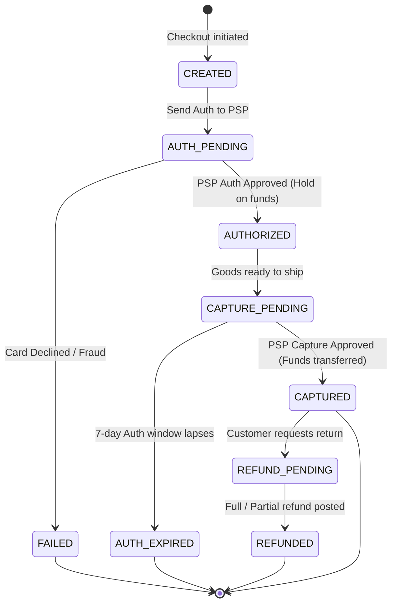
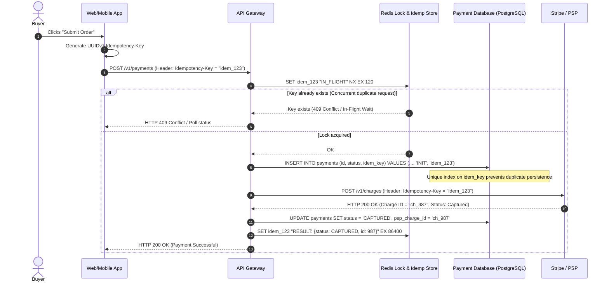
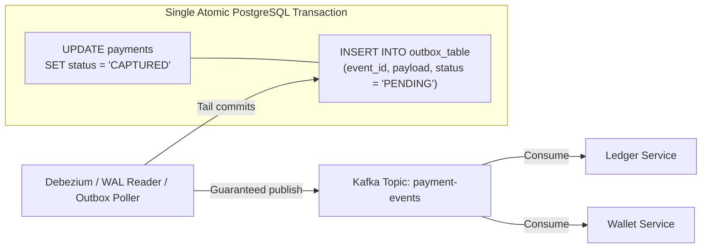
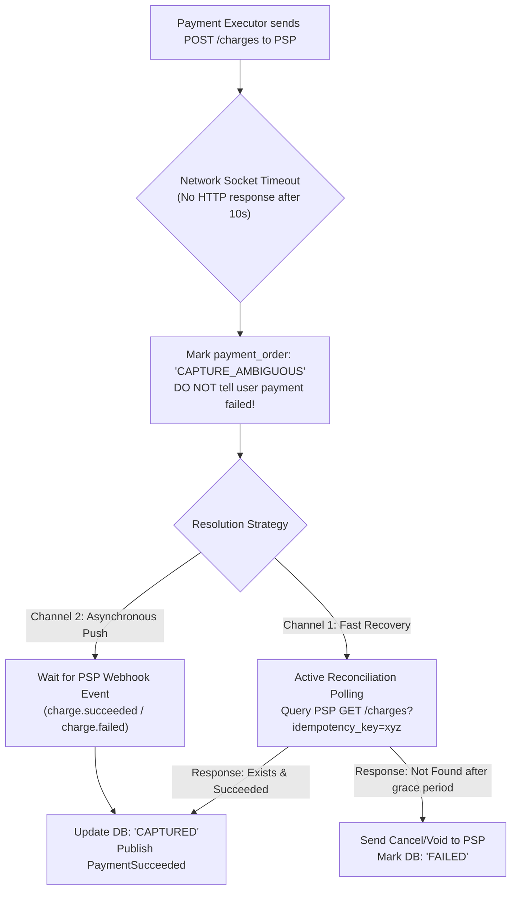

# Chapter 26: Design a Mission-Critical Payment System (Stripe / PayPal / Square)

**Sources & Foundational References:**
- [System Design Interview – An Insider's Guide: Vol 2 (Alex Xu & Sahn Lam)](https://bytebytego.com/)
- [Designing Data-Intensive Applications (Martin Kleppmann)](https://dataintensive.net/)
- [Stripe Engineering: Designing Robust and Predictable APIs with Idempotency](https://stripe.com/blog/idempotency)
- [Uber Engineering: Reliable Processing in a Streaming Payment Platform](https://www.uber.com/blog/reliable-reprocessing/)

---

## 1. Executive Interview Framing & Staff-Level Bar

Designing a financial payment system is the ultimate test of distributed systems correctness, transactional integrity, and edge-case resilience. In social feeds or search engines, eventual consistency and dropped events are tolerable; in a payment system, **a single duplicate transaction or lost debit destroys user trust, violates regulatory compliance (PCI-DSS, SOX), and incurs immediate financial liability**.

While mid-level candidates draw a basic Stripe API call and mention database transactions, **Staff and Principal Engineers (L6+, P60) are evaluated on their mastery of double-entry immutable ledgers, distributed idempotency protocols, transactional outbox patterns, handling ambiguous PSP network timeouts, and automated multi-tier reconciliation engines**:

```
┌────────────────────────────────────────────────────────────────────────────────────────┐
│                                 THE INTERVIEW SPECTRUM                                 │
├────────────────────────────────────────┬───────────────────────────────────────────────┤
│ L5 / Senior Engineer                   │ L6+ / Staff & Principal Engineer              │
├────────────────────────────────────────┼───────────────────────────────────────────────┤
│ • Basic `orders` and `payments` tables │ • Immutable Double-Entry Bookkeeping Ledger   │
│ • Simple single balance column update  │   (Every transaction balances Debits = Credits│
│ • "Just use an idempotency key in DB"  │ • Three-tier Idempotency (Client -> API -> PSP)│
│ • Ignores PSP HTTP 504 Gateway Timeout │ • Treats Network Timeout as AMBIGUOUS;        │
│   (blindly retries and double-charges) │   implements Active Polling & PSP Webhooks    │
│ • Synchronous DB write + Kafka publish │ • Transactional Outbox Pattern + CDC to       │
│   (Dual-write race condition)          │   guarantee zero lost financial events        │
│ • Ignores nightly settlement drift     │ • Automated 3-Way Nightly Batch Reconciliation│
│ • Simple floating-point money amounts  │ • Fixed-point integers / strings (cents/micros│
│   (suffers IEEE 754 precision loss)    │   to prevent decimal rounding discrepancies)  │
└────────────────────────────────────────┴───────────────────────────────────────────────┘
```

---

## 2. The 5-Pillar Staff Assessment Rubric for Payments

```
┌────────────────────────────────────────────────────────────────────────────────────────────────────────┐
│                                      5-PILLAR EVALUATION RUBRIC                                        │
├─────────────────────────┬──────────────────────────────────────────────────────────────────────────────┤
│ Pillar                  │ What the Interviewer Listens For (Evidence)                                  │
├─────────────────────────┼──────────────────────────────────────────────────────────────────────────────┤
│ 1. Decision Making      │ • Justifies ACID Relational DB (PostgreSQL) over NoSQL for ledgers.          │
│                         │ • Evaluates 2PC vs Distributed Saga vs Orchestrated State Machines; selects  │
│                         │   Orchestrated State Machine with accepted trade-off of compensations.       │
│                         │ • Chooses Hosted Payment Fields (Elements) over full PCI scope.              │
├─────────────────────────┼──────────────────────────────────────────────────────────────────────────────┤
│ 2. Technical            │ • Demonstrates double-entry accounting math ($\sum \text{Debits} =           │
│    Proficiency          │   \sum \text{Credits}$).                                                     │
│                         │ • Explains database concurrency control (Optimistic Locking via version vs   │
│                         │   `SELECT FOR UPDATE` pessimism) linked to account contention patterns.     │
│                         │ • Explains exact IEEE 754 floating-point danger (`0.1 + 0.2 != 0.3`).        │
├─────────────────────────┼──────────────────────────────────────────────────────────────────────────────┤
│ 3. Problem Solving &    │ • Decomposes flows into Pay-In (Customer $\to$ Merchant) and Pay-Out.         │
│    Analytical Thinking  │ • Dissects ambiguous external failure states (Success, Failure, Unknown).    │
│                         │ • Connects API contracts, idempotency keys, and state transition graphs.     │
├─────────────────────────┼──────────────────────────────────────────────────────────────────────────────┤
│ 4. Operational          │ • Enforces PCI-DSS tokenization (zero raw PAN on internal servers).          │
│    Mindset              │ • Designs 3-way reconciliation (Internal DB vs PSP Settlement vs Bank MT940).│
│                         │ • Employs Exponential Backoff with Jitter for network recovery.              │
│                         │ • Implements Dead Letter Queues (DLQ) with manual financial operator tooling.│
├─────────────────────────┼──────────────────────────────────────────────────────────────────────────────┤
│ 5. Adaptability &       │ • Responds constructively when PSP drops connection during funds capture.    │
│    Collaboration        │ • Balances automated recovery with human-in-the-loop compliance reviews.     │
│                         │ • Explains risk exposure and financial SLA boundaries clearly to leadership. │
└─────────────────────────┴──────────────────────────────────────────────────────────────────────────────┘
```

---

## 3. Requirements & System Scope

### Functional Requirements
1. **Pay-in Flow:** Accept payments from buyers via credit/debit cards, digital wallets (Apple Pay, Google Pay), and bank transfers on behalf of e-commerce sellers.
2. **Pay-out Flow (Disbursement):** Periodically pay out merchant net balances to their external bank accounts around the world.
3. **Double-Entry Ledger:** Maintain an immutable financial ledger recording every cent of money movement for auditing and compliance.
4. **Third-Party PSP Integration:** Connect to multiple Payment Service Providers (Stripe, Adyen, Braintree, Chase Paymentech) to execute card authorizations and captures.
5. **Automated Reconciliation:** Automatically reconcile internal payment states against external bank and PSP settlement statements, detecting and flagging discrepancies.

### Non-Functional Requirements & Compliance SLAs
* **Reliability & Consistency:** Zero tolerance for double-charges or lost funds (**Exactly-Once Processing Semantics**).
* **High Availability:** **99.999%** uptime for payment intake. Even during database failover or PSP downtime, checkout requests must degrade gracefully.
* **Security & PCI-DSS:** The system must never store or transmit Unencrypted Primary Account Numbers (PAN), CVVs, or PINs. All cardholder data must be tokenized at the edge.
* **Throughput & Latency:**
  - Scale: Support **10 Million transactions / day** (~120 TPS average, peak 1,000 TPS).
  - Latency: Card checkout authorization p99 latency $< \mathbf{2.5\text{ seconds}}$ (bounded by external card networks).

---

## 4. Back-of-the-Envelope Capacity & Storage Estimation

```
Daily Transactions: 10 Million payments / day
Peak Load Multiplier: 8x (Cyber Monday / Flash Sale peak)
Retention: 7 Years (Strict Legal/Tax Compliance Requirement)
```

### 4.1 Throughput Math
* **Average TPS:**
  $$\text{Average TPS} = \frac{10,000,000}{86,400} \approx 116 \text{ transactions / sec}$$
* **Peak TPS:**
  $$\text{Peak TPS} = 116 \times 8 \approx \mathbf{930 \text{ transactions / sec}}$$
* *Staff Takeaway:* 1,000 TPS is trivially handled by a well-tuned relational database cluster (e.g., PostgreSQL / AWS Aurora). The primary engineering bottleneck is **NOT** raw throughput; it is **transactional isolation, failure recovery, and zero data loss**.

### 4.2 Storage Math (7-Year Legal Retention)
* Each transaction creates:
  - 1 Payment Order row (~500 bytes)
  - 1 Payment Event row (~400 bytes)
  - 4 Double-Entry Ledger rows (~250 bytes each = 1,000 bytes)
  - 2 Outbox Event rows (~300 bytes = 600 bytes)
  - **Total per transaction:** $\approx 2.5 \text{ KB}$
* **Annual Storage:**
  $$10\text{M} \times 365 \times 2.5\text{ KB} \approx 9.125 \text{ TB / year}$$
* **7-Year Retained Volume:**
  $$9.125 \text{ TB} \times 7 \approx \mathbf{63.8 \text{ TB}}$$
* *Storage Strategy:* Active data ($< 90\text{ days}$) stays in NVMe SSD Aurora clusters. Partitioned historical ledgers ($> 90\text{ days}$) are archived to write-once-read-many (WORM) compliant S3 Glacier Vaults for audits.

---

## 5. End-to-End High-Level Architecture

```mermaid
flowchart TD
    Client["Buyer Browser / Mobile App"] -->|1. Request Checkout Page| CheckoutService["Checkout Service"]
    CheckoutService -->|2. Register Payment Intent| PaymentService["Payment Core Service"]
    PaymentService -->|3. Generate Tokenized Intent & Client Secret| Client
    
    subgraph PCIBoundary["PCI-DSS Isolation Boundary (Hosted Elements)"]
        Client -->|4. Submit Raw Card Data direct to PSP| PSP_Edge["PSP (Stripe / Adyen Hosted iFrame)"]
        PSP_Edge -->|5. Return Opaque Card Token 'tok_abc123'| Client
    end

    Client -->|6. POST /v1/payments (tok_abc123 + Idempotency-Key)| PaymentService
    
    subgraph InternalServices["Payment Processing Domain"]
        PaymentService -->|7. Write Order & Outbox Event (ACID TX)| PaymentDB[("Payment PostgreSQL DB")]
        PaymentService -->|8. Dispatch Execution| PaymentExecutor["Payment Executor (State Machine)"]
        PaymentExecutor -->|9. Authorize & Capture| PSP["External PSP Gateway"]
        
        CDC["Debezium / Outbox Poller"] -->|Tail DB Outbox| Kafka["Kafka Event Bus"]
        Kafka -->|PaymentCompleted Event| LedgerService["Double-Entry Ledger Service"]
        Kafka -->|PaymentCompleted Event| WalletService["Merchant Wallet Service"]
        
        LedgerService --> LedgerDB[("Immutable Ledger DB")]
        WalletService --> WalletDB[("Merchant Balance DB")]
    end
```

---

## 6. The Core Engine: Double-Entry Bookkeeping Ledger

A critical Staff-level design requirement: **Money never appears or disappears; it only moves from one account to another**. 

A single mutable `balance` column (`UPDATE accounts SET balance = balance + 100`) is unacceptable for financial software because it is vulnerable to lost updates, lacks auditability, and cannot prove whether money was created out of thin air.

### 6.1 The Fundamental Accounting Equation
$$\mathbf{\sum \text{Debits} = \sum \text{Credits}}$$

* **Asset Accounts (e.g. Bank Account, Receivables):** Increase with **Debit (+)**, Decrease with **Credit (-)**.
* **Liability Accounts (e.g. Merchant Balances Owed):** Increase with **Credit (+)**, Decrease with **Debit (-)**.
* **Expense Accounts (e.g. PSP Processing Fees):** Increase with **Debit (+)**.
* **Revenue Accounts (e.g. Platform Commission):** Increase with **Credit (+)**.

### 6.2 Transaction Example: $100 E-Commerce Sale (10% Platform Fee)
When a buyer purchases a $100 item from a merchant with a $10 platform fee:

```
┌────────────────────────────────────────────────────────────────────────────────────────┐
│                        DOUBLE-ENTRY LEDGER TRANSACTION #9042                           │
├───────────────────────────────────┬───────────────┬────────────────┬───────────────────┤
│ Account Name                      │ Account Type  │ Debit (USD)    │ Credit (USD)      │
├───────────────────────────────────┼───────────────┼────────────────┼───────────────────┤
│ Assets:CashInTransit:Stripe       │ Asset         │ $100.00        │                   │
│ Liabilities:MerchantPayable:Nike  │ Liability     │                │ $90.00            │
│ Revenues:PlatformCommission       │ Revenue       │                │ $10.00            │
├───────────────────────────────────┼───────────────┼────────────────┼───────────────────┤
│ TOTALS                            │               │ $100.00        │ $100.00 (BALANCED)│
└───────────────────────────────────┴───────────────┴────────────────┴───────────────────┘
```

### 6.3 Relational SQL Schema with Zero-Balance Invariant

```sql
-- 1. Chart of Accounts Table
CREATE TABLE accounts (
    account_id UUID PRIMARY KEY,
    account_name VARCHAR(128) NOT NULL UNIQUE,
    account_type VARCHAR(32) NOT NULL CHECK (account_type IN ('ASSET', 'LIABILITY', 'EQUITY', 'REVENUE', 'EXPENSE')),
    currency CHAR(3) NOT NULL DEFAULT 'USD',
    created_at TIMESTAMPTZ NOT NULL DEFAULT NOW()
);

-- 2. Financial Journal Transaction (Header)
CREATE TABLE journal_entries (
    entry_id UUID PRIMARY KEY,
    transaction_ref VARCHAR(128) NOT NULL UNIQUE, -- Idempotency key from Payment Order
    description TEXT NOT NULL,
    posted_at TIMESTAMPTZ NOT NULL DEFAULT NOW()
);

-- 3. Individual Postings (Legs) - APPEND ONLY, NO UPDATE, NO DELETE ALLOWED
CREATE TABLE journal_postings (
    posting_id BIGSERIAL PRIMARY KEY,
    entry_id UUID NOT NULL REFERENCES journal_entries(entry_id),
    account_id UUID NOT NULL REFERENCES accounts(account_id),
    amount_cents BIGINT NOT NULL, -- Stored in CENTS as BIGINT (Fixed-Point)
    direction VARCHAR(6) NOT NULL CHECK (direction IN ('DEBIT', 'CREDIT')),
    created_at TIMESTAMPTZ NOT NULL DEFAULT NOW()
);

CREATE INDEX idx_postings_account ON journal_postings(account_id, created_at);
```

> [!IMPORTANT]
> **Staff Rule on Money Representation:** Never use floating-point types (`FLOAT`, `DOUBLE`) for financial amounts. IEEE 754 floating-point numbers cannot accurately represent base-10 decimals (`0.1 + 0.2 = 0.30000000000000004`). Always store currency as **fixed-point integers in the smallest unit** (`BIGINT` in cents or micro-units) alongside an ISO 4217 three-letter currency code (`USD`, `EUR`).

---

## 7. Distributed State Machine & Exactly-Once Semantics

A payment lifecycle is a strict directed acyclic state graph. A payment can never transition backwards or skip critical authorization checks.



### 7.1 Multi-Tier Idempotency Architecture

To prevent duplicate charges when a user rapidly double-clicks the "Pay" button or when a mobile network drops during request transit:



### 7.2 The Dual-Write Problem: Transactional Outbox Pattern

When the payment status changes, downstream services (Ledger, Merchant Wallet, Email Notifications, Analytics) must be notified. 
* **The Naive Approach (Dual Write):** Updating the database and publishing to Kafka in the same application block fails. If the database commits but the Kafka producer times out, the message is lost forever. If Kafka succeeds but the DB commit rolls back, phantom events are published.
* **The Staff Solution:** **The Transactional Outbox Pattern**. The payment update and the event record are written into the **same PostgreSQL transaction**. A Change Data Capture (CDC) worker (Debezium or an asynchronous polling worker reading the WAL) guarantees reliable, ordered publishing to Kafka.



---

## 8. Handling Non-Deterministic PSP Failures & Network Timeouts

In distributed payments, the most dangerous HTTP status code is **NOT** `500 Internal Error` or `400 Bad Request`—it is **`HTTP 504 Gateway Timeout` or a dropped TCP socket**.

### The Golden Rule of Financial Networking
> **A network timeout is NOT a failure. It is an AMBIGUOUS state.** 
> The request may have failed before reaching the PSP, or it may have succeeded at the card network while the response was dropped on the return leg. Blindly retrying without the same idempotency key will double-charge the customer. Blindly failing the order will forfeit revenue while the customer gets charged.



#### Staff Failure Handling Checklist
1. **Exponential Backoff with Full Jitter:** When polling the PSP status, calculate wait interval as:
   $$\text{Sleep} = \text{random}(0, \min(M, B \times 2^{\text{attempt}}))$$
   *(Prevents thousands of timed-out requests from hammering the PSP API simultaneously).*
2. **Reverse / Void Intent:** If the user abandons checkout while a payment is stuck in ambiguous status, issue an explicit **PSP Reverse/Void call** with the original idempotency key to release the card hold.

---

## 9. Automated 3-Way Nightly Batch Reconciliation

Even with perfect code and ACID databases, production payment systems develop data drift due to:
* Undetected database crash-recovery bugs
* PSP internal system errors and chargeback disputes
* Currency exchange rate micro-variances
* Bank clearing batch settlement timing differences

Every financial system must run an automated **3-Way Reconciliation Batch Engine** every night:

```mermaid
flowchart TD
    subgraph DataSources["Three Independent Truth Sources"]
        Source1["1. Internal Ledger DB<br/>(What our system recorded)"]
        Source2["2. PSP Settlement Report<br/>(CSV / JSON from Stripe/Adyen at 02:00 UTC)"]
        Source3["3. Bank Settlement Statement<br/>(ISO 20022 CAMT.053 / BAI2 / MT940 file)"]
    end

    Source1 & Source2 & Source3 --> Reconciler["Distributed Reconciliation Engine<br/>(Apache Spark / Temporal Batch Workflow)"]

    Reconciler --> MatchAlgo{"Match on:<br/>• Idempotency Nonce<br/>• PSP Reference ID<br/>• Amount Cents<br/>• Currency"}

    MatchAlgo -->|Perfect 3-Way Match| Settled["Mark Ledger Entry: RECONCILED"]
    MatchAlgo -->|Amount Diff / Missing Entry| ExceptionQueue["Financial Discrepancy Queue"]

    ExceptionQueue -->|Auto-Resolvable (Timing Lag)| AutoRetry["Re-queue for Next Night"]
    ExceptionQueue -->|Unresolvable (Fee Variance / Fraud)| FinOps["Finance Operations Dashboard<br/>(Human Investigation & Manual Journal Entry)"]
```

### The 3 Discrepancy Classifications
1. **Timing Drift (Benign):** A payment made at 23:59 UTC appears on our ledger on Day 1, but settled on the bank statement on Day 2. *Automated fix:* Extend matching window across 3 consecutive days.
2. **Fee Variance (Systemic):** PSP deducted an undocumented interchange fee (e.g. $0.32 instead of expected $0.30). *Automated fix:* Post an auto-adjusting ledger expense posting to `Expenses:InterchangeVariance`.
3. **Ghost Transaction (Critical):** Transaction exists on bank statement but missing in internal ledger (or vice-versa). *Human escalation:* Generates a high-severity PagerDuty alert for the finance engineering on-call.

---

## 10. Staff-Level Interviewer Curveballs & Adaptability Playbook

### Curveball 1: "The PSP returns HTTP 504 Gateway Timeout during capture. The customer is staring at a loading spinner. What does the UI show, and how do you resolve it?"
* **Wrong Answer:** "We show an error message saying payment failed and tell the user to try again." *(Double-charging trap!)*
* **Staff Answer:**
  1. Transition the client UI to a **Pending Resolution Screen**: *"Your payment is currently being confirmed with your financial institution. Please do not re-submit; we will email you within 2 minutes."*
  2. Put the payment order in `AUTH_AMBIGUOUS` state.
  3. Fire an asynchronous background task to query `GET /v1/charges/{idempotency_key}` from the PSP with jittered polling.
  4. If the PSP confirms authorization, immediately transition to `CAPTURED`, commit the ledger entry, and send a confirmation email/push notification to the user.

### Curveball 2: "Our ledger database crashes midway through processing a $10M corporate wire transfer. How do we ensure zero funds leak?"
* **Staff Answer:**
  1. The wire transfer execution is governed by an **Orchestrated Saga with a Persistent State Machine**.
  2. Every state transition is written to disk before dispatching network calls.
  3. When the database recovers from WAL (Write-Ahead Log), the Saga orchestrator scans for in-flight sagas in `DISPATCHED` state.
  4. It issues an idempotent status query to the banking network. If the wire already executed, it completes the ledger write; if it failed, it executes compensating rollback actions to credit the sender's account.

### Curveball 3: "A malicious insider with database root access modifies the ledger table to credit their personal merchant account with $500,000. How do you detect and prevent this?"
* **Staff Answer:**
  1. **Cryptographic Hash Chaining (Merkle Tree / Tamper-Evident Ledger):** Every posting row in the `journal_postings` table includes a `previous_hash` column:
     $$\text{Row\_Hash}_n = \text{HMAC-SHA256}(\text{Row\_Hash}_{n-1} + \text{Account\_ID} + \text{Amount} + \text{Timestamp})$$
     If an attacker updates a row directly via SQL, the hash chain breaks from that row forward.
  2. **Append-Only Immutable Database Permissions:** Revoke `UPDATE` and `DELETE` SQL privileges for all application and administrative users on the ledger schema. Enforce PostgreSQL `RULE` or triggers that raise exceptions on updates.
  3. **WORM Storage Replicas:** Stream transaction logs synchronously to Amazon S3 Object Lock (Write-Once-Read-Many) storage with Compliance Mode enabled, preventing even AWS root account holders from mutating audit logs for 7 years.
