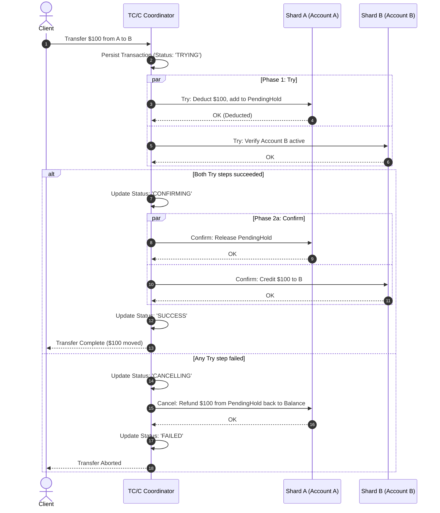
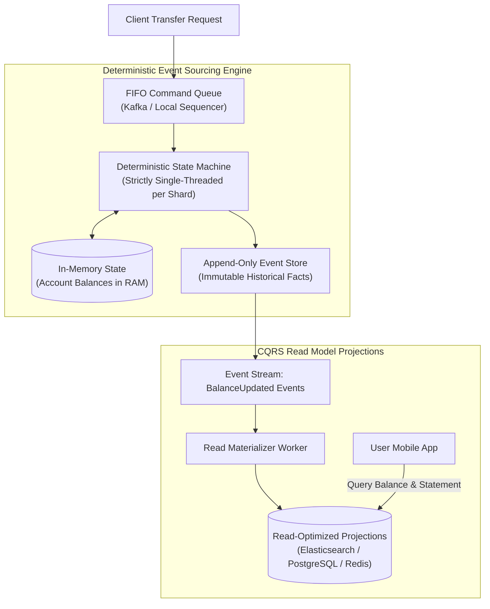
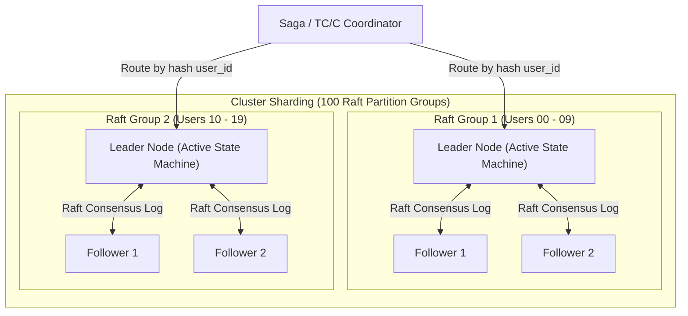

# Chapter 27: Design an Ultra-High-Throughput Digital Wallet (1M+ TPS, Event Sourcing, Raft, TC/C)

**Sources & Foundational References:**
- [System Design Interview – An Insider's Guide: Vol 2 (Alex Xu & Sahn Lam)](https://bytebytego.com/)
- [Designing Data-Intensive Applications (Martin Kleppmann)](https://dataintensive.net/)
- [The LMAX Architecture: How to do 6 Million TPS at sub-millisecond latency (Martin Fowler / LMAX)](https://martinfowler.com/articles/lmax.html)
- [In Search of an Understandable Consensus Algorithm (Ongaro & Ousterhout / Raft)](https://raft.github.io/raft.pdf)

---

## 1. Executive Interview Framing & Staff-Level Bar

Designing an ultra-high-throughput digital wallet (Alipay, WeChat Pay, PayPal Cash, Venmo) processing **1 Million+ Transactions Per Second (TPS)** with strict transactional correctness and zero financial loss is the pinnacle of distributed systems architecture. While mid-level candidates propose sharded MySQL with row-level locks or generic 2PC across databases (which collapses under lock contention at 10,000 TPS), **Staff and Principal Engineers (L6+, P60) are evaluated on their ability to design lock-free in-memory deterministic state machines replicated via Raft, evaluate distributed transaction protocols (2PC vs Try-Confirm/Cancel vs Orchestrated Sagas), implement Event Sourcing with CQRS for historical balance replay and auditability, and optimize single-node disk I/O using RocksDB and `mmap`**:

```
┌────────────────────────────────────────────────────────────────────────────────────────┐
│                                 THE INTERVIEW SPECTRUM                                 │
├────────────────────────────────────────┬───────────────────────────────────────────────┤
│ L5 / Senior Engineer                   │ L6+ / Staff & Principal Engineer              │
├────────────────────────────────────────┼───────────────────────────────────────────────┤
│ • Sharded MySQL with `FOR UPDATE`      │ • In-Memory Sharded State Machine replicated  │
│   (Collapses at 5,000 TPS due to locks)│   via Multi-Raft (1M+ TPS cluster throughput) │
│ • Two-Phase Commit (2PC) everywhere    │ • Try-Confirm/Cancel (TC/C) & Orchestrated    │
│   (Coordinator SPOF, blocking holds)   │   Sagas with idempotent compensating actions  │
│ • Mutable balance updates in DB        │ • Event Sourcing: Commands -> FIFO Log ->     │
│   (Cannot prove how balance was formed)│   Deterministic Events -> Materialized State  │
│ • Ignores out-of-order network calls   │ • Out-of-Order TC/C Defense (handling Cancel  │
│   (Cancel arrives before Try)          │   received before Try via phase status tables)│
│ • Synchronous database transactions    │ • CQRS: Decouples write state machine from    │
│   per leg                              │   real-time push/poll read projections        │
│ • Simple disk writes                   │ • Sequential `mmap` WAL + RocksDB LSM-Tree    │
│                                        │   with periodic distributed snapshots         │
└────────────────────────────────────────┴───────────────────────────────────────────────┘
```

---

## 2. The 5-Pillar Staff Assessment Rubric for Digital Wallets

```
┌────────────────────────────────────────────────────────────────────────────────────────────────────────┐
│                                      5-PILLAR EVALUATION RUBRIC                                        │
├─────────────────────────┬──────────────────────────────────────────────────────────────────────────────┤
│ Pillar                  │ What the Interviewer Listens For (Evidence)                                  │
├─────────────────────────┼──────────────────────────────────────────────────────────────────────────────┤
│ 1. Decision Making      │ • Distributed Transaction Selection: 2PC vs TC/C vs Saga vs Event Sourcing.  │
│                         │ • Relational DB Cluster vs Sharded Raft In-Memory State Groups.              │
│                         │ • Synchronous Coordination vs Asynchronous Event Sourcing with CQRS.         │
├─────────────────────────┼──────────────────────────────────────────────────────────────────────────────┤
│ 2. Technical            │ • Dissects Event Sourcing pipeline (Commands $\to$ Events $\to$ Projections).│
│    Proficiency          │ • Derives TC/C phase tables and handles out-of-order network race conditions.│
│                         │ • Explains Raft consensus log replication, term elections, and commit indexes.│
│                         │ • Leverages Linux memory-mapped I/O (`mmap`) & RocksDB LSM-Tree append files.│
├─────────────────────────┼──────────────────────────────────────────────────────────────────────────────┤
│ 3. Problem Solving &    │ • Decomposes architecture into Ingress, Consensus Groups, State Engine, Read.│
│    Analytical Thinking  │ • Calculates hardware requirements for 1M TPS ($= 2\text{M legs/sec}$):       │
│                         │   sizes 100 Raft groups handling 10,000 TPS each with explicit CPU bounds.   │
├─────────────────────────┼──────────────────────────────────────────────────────────────────────────────┤
│ 4. Operational          │ • Snapshotting Strategy: Takes periodic RocksDB binary snapshots to prevent  │
│    Mindset              │   replaying billions of historical events on cold boot.                      │
│                         │ • Monitors Raft leader heartbeat lag, disk sync latency, and queue depths.   │
│                         │ • Enforces absolute idempotency via UUIDv7 transaction nonces.               │
├─────────────────────────┼──────────────────────────────────────────────────────────────────────────────┤
│ 5. Adaptability &       │ • Recovers gracefully when Raft leader crashes midway through a balance leg. │
│    Collaboration        │ • Balances instant sub-millisecond internal transfers with external bank leg │
│                         │   delays, explaining financial settlement timing to stakeholders.            │
└─────────────────────────┴──────────────────────────────────────────────────────────────────────────────┘
```

---

## 3. Requirements & System Scope

### Functional Requirements
1. **Balance Transfer:** Execute atomic, secure fund transfers from Account $A$ to Account $B$ in the same currency.
2. **Account Balance Lookup:** Query current available and pending balances.
3. **Complete Auditability & Reproducibility:** Historical account balances must be mathematically reconstructible by replaying transactions from the beginning of time or from a verified snapshot.
4. **Idempotency:** Repeated or duplicate API requests must never transfer money more than once.

### Non-Functional Requirements & Performance SLOs
* **Scale:** Support **1 Million Transactions Per Second (1,000,000 TPS)** ($\approx 2,000,000$ balance updates/sec).
* **Ultra-Low Latency:** p99 balance transfer latency $< \mathbf{50ms}$.
* **Zero Financial Discrepancies:** Strict ACID semantics. Under no circumstance can money be created, destroyed, or double-spent ($\sum \text{Deductions} = \sum \text{Additions}$).
* **High Availability:** **99.99%** uptime. Individual node crashes must not interrupt cluster transaction execution.

---

## 4. Back-of-the-Envelope Capacity Estimation

```
Target Scale: 1,000,000 TPS
Each transfer involves 2 legs: Debit Account A, Credit Account B -> 2,000,000 balance operations / sec
Average Record Size: 100 bytes per event
```

### 4.1 Node Sizing & Partitioning Math
* A cloud-managed relational database instance (AWS RDS MySQL / PostgreSQL) running transactional `UPDATE ... WHERE id = ?` achieves $\approx \mathbf{1,000 \text{ TPS}}$ per node under lock contention.
* To reach 1 Million TPS using standard SQL, the cluster would require:
  $$\text{Required DB Nodes} = \frac{1,000,000}{1,000} = \mathbf{1,000 \text{ database instances!}}$$
  *(Managing distributed transactions across 1,000 sharded databases using 2PC causes catastrophic lock contention and coordinator stalls).*
* **The High-Performance In-Memory Sharded State Machine Alternative:**
  - An in-memory, single-threaded deterministic state machine (LMAX Disruptor / Redis / Raft partition) can process **10,000 to 50,000 TPS per core** by eliminating lock contention.
  - Sizing the cluster with **100 Sharded Raft Groups**, each handling $10,000 \text{ TPS}$, comfortably achieves the **1 Million TPS target** on modest hardware!

### 4.2 Storage Math (Event Log Growth)
* Daily Events:
  $$2,000,000 \text{ events/sec} \times 86,400 \approx \mathbf{172.8 \text{ Billion events / day}}$$
* Daily Storage Footprint:
  $$172.8 \times 10^9 \times 100 \text{ bytes} \approx \mathbf{17.28 \text{ TB / day}} \quad (\mathbf{6.3 \text{ PB / year}})$$
* *Storage Strategy:* Local high-speed NVMe drives store active Raft logs and the latest snapshot. Closed segments are compressed and streamed to Amazon S3 for long-term historical audit compliance.

---

## 5. Distributed Transaction Protocols: 2PC vs TC/C vs Orchestrated Saga

When Account $A$ and Account $B$ reside on different database shards, how do we guarantee atomic balance movement?

```
┌────────────────────────────────────────────────────────────────────────────────────────┐
│                        DISTRIBUTED TRANSACTION TRADE-OFF MATRIX                        │
├─────────────────────┬──────────────────┬──────────────────┬────────────────────────────┤
│ Protocol            │ Locking Model    │ Latency / Speed  │ Failure Recovery           │
├─────────────────────┼──────────────────┼──────────────────┼────────────────────────────┤
│ 1. Two-Phase Commit │ Heavy Database   │ SLOW:            │ Catastrophic: Coordinator  │
│    (2PC)            │ Row Locks held   │ Locks held across│ crash during Phase 2 leaves│
│                     │ across network.  │ all shards until │ resources locked           │
│                     │                  │ final commit.    │ indefinitely.              │
├─────────────────────┼──────────────────┼──────────────────┼────────────────────────────┤
│ 2. Try-Confirm /    │ Business-Level   │ FAST:            │ Resilient: Phase status    │
│    Cancel (TC/C)    │ Resource Hold;   │ Two independent  │ tables drive automated     │
│                     │ Zero DB locks.   │ transactions; can│ retries or compensating    │
│                     │                  │ run in parallel. │ cancellation.              │
├─────────────────────┼──────────────────┼──────────────────┼────────────────────────────┤
│ 3. Orchestrated     │ Linear Sequence; │ MODERATE:        │ Highly Resilient: Saga     │
│    Saga             │ Local DB TX per  │ Step-by-step     │ state machine executes     │
│                     │ service step.    │ pipeline; easily │ compensating rollbacks if  │
│                     │                  │ auditable.       │ intermediate step fails.   │
└─────────────────────┴──────────────────┴──────────────────┴────────────────────────────┘
```

### 5.1 Try-Confirm/Cancel (TC/C) Mechanics
Unlike 2PC, which holds low-level database locks, TC/C operates at the **business application tier**:
1. **Try Phase:**
   - Account $A$: Deduct $100 from $A$'s balance; place it in a pending hold account.
   - Account $B$: Verify account $B$ is active (NOP or prepare credit).
2. **Confirm Phase (Success):**
   - Both shards confirm readiness.
   - Move $100 from hold into Account $B$.
3. **Cancel Phase (Failure / Abort):**
   - If Account $B$ is frozen or unreachable, release the $100 from the pending hold back to Account $A$.



### 5.2 The Out-of-Order Execution Trap
In distributed networks, packet reordering can cause a `Cancel` request to arrive at Shard $A$ **before** the `Try` request!
* **Staff Defense:** Every shard maintains a persistent `phase_status` table. If a shard receives `Cancel` for an unknown transaction ID, it writes a tombstone record with `is_out_of_order = true`. When the delayed `Try` request subsequently arrives, it inspects the flag, rejects the operation immediately, and prevents phantom funds deduction!

---

## 6. High-Performance Event Sourcing Architecture

To prove to financial auditors and regulators that the account balance is correct, digital wallets employ **Event Sourcing with Command Query Responsibility Segregation (CQRS)**:



### 6.1 The 4 Core Event Sourcing Concepts
1. **Command:** The user's external intent (e.g. `TransferFunds(from: A, to: B, amount: $100)`). Commands **can fail** validation (insufficient funds, frozen account).
2. **Deterministic State Machine:** Validates commands against current state. If valid, generates one or more immutable **Events**. The state machine must contain **zero external I/O, zero random numbers, and zero system clock calls** to guarantee exact reproducibility!
3. **Event:** An unalterable historical fact that has already occurred (e.g. `FundsDebited(A, $100)`, `FundsCredited(B, $100)`). Events **cannot fail** and **cannot be modified**.
4. **State:** Materialized balance projections derived by applying all events sequentially from the beginning of time.

### 6.2 Why Event Sourcing Wins the Audit
* **Question 1: "What was User A's balance on March 15 at 14:02 UTC?"**
  - Simply replay the event log from the beginning (or from the March 1 snapshot) up to March 15 14:02 UTC. The calculated number is provably identical.
* **Question 2: "Did a software bug alter customer balances?"**
  - Run the new software code against the immutable historical event log and compare the resulting state against the live database. Any divergence identifies the exact buggy commit!

---

## 7. Scaling to 1M+ TPS: Sharded Raft Groups & Storage Optimization

To achieve 1M+ TPS with absolute durability, we cannot store the event log in a central database or external Kafka cluster (network RTTs alone would introduce 5–10ms per transfer).

We deploy **Sharded Raft Groups with Local Append-Only Storage**:



### 7.1 Local Storage Physics: `mmap` + RocksDB
Inside each Raft node:
1. **Memory-Mapped Append-Only Log (`mmap`):** Events are appended to disk using the Linux `mmap` system call. The OS caches log pages in physical RAM and asynchronously flushes dirty pages to NVMe SSD in the background, achieving **sub-microsecond write latency**!
2. **RocksDB Embedded State Store:** Account balances are maintained in an embedded **RocksDB LSM-Tree** on the local host. Reads hit the block cache; writes append sequentially to the memtable.
3. **Periodic Distributed Snapshots:** Every 100,000 transactions, the state machine freezes a point-in-time RocksDB snapshot and uploads the compressed binary checkpoint to Amazon S3. When a node restarts, it loads the snapshot in 5 seconds and only replays the small tail of events committed after the snapshot!

---

## 8. Staff-Level Interviewer Curveballs & Adaptability Playbook

### Curveball 1: "The leader of Raft Group 1 crashes midway through executing Phase 2 (Confirm) of a $50,000 transfer. What happens to the money?"
* **Staff Answer:**
  1. **Raft Term Election:** The two surviving follower nodes detect missed heartbeats and elect a new Raft leader within $150\text{ms}$.
  2. **Consensus Commit Invariant:** Because the prior leader committed the transaction to the Raft log before responding, the log entry was replicated to at least 1 follower. The new leader's log contains the exact transaction.
  3. **Coordinator Retry:** The Saga coordinator observes a temporary network timeout, polls the new leader using the original `idempotency_key`, and the new leader confirms the transaction was already applied. **Zero money is lost or duplicated.**

### Curveball 2: "A user tries to drain their account by rapidly firing 50 concurrent $1,000 transfer requests in parallel when their balance is only $1,000. How do you prevent overdraft?"
* **Staff Answer:**
  1. **Partition-Level Single-Threaded Serialization:** All commands targeting Account $A$ are routed to the specific Raft group owning Account $A$.
  2. Inside that group, the deterministic state machine processes commands for Account $A$ **strictly sequentially** (via an LMAX Disruptor single-threaded ring buffer).
  3. Request 1 succeeds (Balance: $\$1,000 \to \$0$).
  4. Requests 2 through 50 inspect the in-memory balance, evaluate $\text{Balance} < \$1000$, and are **instantly rejected with `InsufficientFundsException`**!

### Curveball 3: "How do you handle a hot account (e.g. Apple or Amazon receiving 50,000 merchant payments per second) without bottlenecking a single Raft group?"
* **Staff Answer:**
  1. **Credit Buffering & Delayed Aggregation:** Merchant receiving accounts do not require sub-second balance reads.
  2. Route payments intended for the merchant into **100 independent temporary accumulator sub-accounts** (`merchant_apple_shard_0` through `merchant_apple_shard_99`), scattering the write load uniformly across all 100 Raft groups!
  3. A background sweeping worker periodically rolls up the balances from the 100 accumulator shards into the master merchant balance once every minute.
