# System Design Building Blocks & Core Technologies

Based on the 31 system design topics in this repository (which cover the classic Alex Xu System Design curriculum and more), you will encounter recurring architectural patterns, data structures, and technologies. 

To master system design, you should build a strong foundational understanding of the following building blocks:

## Architectural Layer Selection Playbooks (Interview Decision Guides)

When designing large-scale systems in Staff/Principal interviews, component choices must be justified through **mechanical first principles** and **hardware trade-offs** (CPU, memory, disk I/O, network). Use these deep-dive decision guides:

* [**Layer 01: Storage & Database Selection Playbook**](./Layer-Playbooks/01-Storage-and-Databases.md) — SQL vs NoSQL, PostgreSQL vs MySQL (Heap/MVCC vs Clustered/Undo), Distributed NewSQL (CockroachDB vs Spanner), Wide-Column (DynamoDB vs Cassandra/ScyllaDB), Time-Series, and Vector DBs.
* [**Layer 02: Caching & In-Memory Storage Playbook**](./Layer-Playbooks/02-Caching-and-In-Memory.md) — Multi-Tier Topology (L1 Local vs L2 Distributed vs CDN), Redis/Valkey vs Memcached, Invalidation Patterns, Stampede (XFetch/Mutex), Penetration (Bloom Filters), and Avalanche (TTL Jitter).
* [**Layer 03: Messaging, Streaming & Event-Driven Systems Playbook**](./Layer-Playbooks/03-Messaging-and-Streaming.md) — Queue vs Commit Log, Kafka vs RabbitMQ vs AWS SQS/SNS vs Pulsar, Zero-Copy & OS Page Cache, Ordering Boundaries, and Exactly-Once via Transactional Outbox + CDC.
* [**Layer 04: Networking, Transport Protocols & API Gateway Playbook**](./Layer-Playbooks/04-Networking-and-Protocols.md) — gRPC (HTTP/2 + Protobuf) vs REST vs GraphQL, WebSockets vs Server-Sent Events (SSE), HTTP/3 QUIC, L4 vs L7 Ingress, and OS Socket Buffer tuning for 1M connections.
* [**Layer 05: Distributed Coordination, Consensus & Identity Playbook**](./Layer-Playbooks/05-Distributed-Coordination.md) — Linearizable Consensus (etcd vs ZooKeeper vs Consul), Quorum Math ($2F + 1$), Distributed Locks (Why Redlock fails vs etcd Leases + Fencing Tokens), and Snowflake vs UUIDv7.
* [**Layer 06: Search & OLAP Analytical Engines Playbook**](./Layer-Playbooks/06-Search-and-OLAP-Engines.md) — Row-Oriented vs Columnar Physics (I/O Projection Pruning & SIMD), Inverted Indexes (Lucene/Roaring Bitmaps), Elasticsearch vs PostgreSQL GIN, ClickHouse vs Trino vs DuckDB, and Apache Iceberg Lakehouse.
* [**Layer 07: Compute, Stream Processing & Orchestration Playbook**](./Layer-Playbooks/07-Compute-and-Async-Execution.md) — True Streaming (Apache Flink) vs Micro-Batch (Spark Streaming), Event-Time Watermarking, Durable Execution (Temporal Sagas) vs Batch Orchestration (Apache Airflow), and Serverless vs K8s Autoscaling.

---

## Core Concept Notes (Embedded)

<details>
<summary><b>Advanced Data Structures</b> (Click to expand)</summary>

# Advanced Data Structures: Aggregation & Verification

**Sources:**
*   [Merkle Tree with real world examples (Gaurav Sen)](https://www.youtube.com/watch?v=qHMLy5JjbjQ)
*   [Segment Tree (GeeksforGeeks)](https://www.geeksforgeeks.org/dsa/segment-tree-data-structure/)
*   [Fenwick Tree / Binary Indexed Tree (GeeksforGeeks)](https://www.geeksforgeeks.org/dsa/binary-indexed-tree-or-fenwick-tree-2/)
*   [Square Root (Sqrt) Decomposition (GeeksforGeeks)](https://www.geeksforgeeks.org/dsa/square-root-sqrt-decomposition-algorithm/)

**TL;DR:** When dealing with massive datasets, doing a linear $O(N)$ scan for every query or update is too slow, and transferring entire datasets across a network just to check for changes is too expensive. The industry relies on specialized data structures to chunk, aggregate, and hash data to achieve $O(\log N)$ or $O(\sqrt{N})$ performance. 

---

## 1. Merkle Trees (Distributed Data Verification)

*   **The Problem (Data Verification across Networks):** Imagine two distributed database nodes (e.g., in Cassandra or DynamoDB) need to check if their 100GB replica files are perfectly in sync. 
    *   *Naive Approach 1 (Send everything):* Sending the entire 100GB over the network just to check for a 1-byte difference is absurdly expensive in terms of bandwidth.
    *   *Naive Approach 2 (Hash the whole file):* If we hash the entire 100GB file into a single 32-byte SHA-256 hash and exchange it, we know *if* a change occurred, but we don't know *where*. We'd still have to send the whole 100GB to fix it.
    *   *Naive Approach 3 (Linear Chunk Hashing):* Divide the 100GB file into 1MB chunks (100,000 chunks). Hash each chunk and send all 100,000 hashes. We can identify the exact 1MB chunk that differs, but sending 100,000 hashes over the network every time we run a check is still too expensive ($O(N)$ bandwidth).

*   **The Solution: Merkle Tree (Hash Tree):**
    A Merkle tree dramatically optimizes Naive Approach 3 by structuring the hashes into a binary tree, reducing the bandwidth required to find a mismatch from $O(N)$ to $O(\log N)$.

### Mechanical Details: Under the Hood

**1. Building the Tree:**
*   The raw data (e.g., the 100GB file) is deterministically chopped into fixed-size blocks (e.g., 1MB chunks).
*   Each block is independently hashed (using a cryptographic hash function like SHA-256, MD5, or MurmurHash depending on security needs). These form the **leaf nodes** of the tree.
*   Pairs of leaf hashes are concatenated together (`Hash_A + Hash_B`) and hashed again to form a **parent node**. 
*   This pairwise concatenation and hashing process repeats recursively upwards until only a single hash remains: the **Root Hash** (or Merkle Root).

**2. The Comparison Protocol (Finding the Difference):**
When Node A and Node B want to sync, they execute a precise recursive network protocol:
1.  **Root Exchange:** Node A sends its 32-byte Root Hash to Node B. If it matches Node B's Root Hash, the files are 100% identical. The check finishes in $O(1)$ time and $O(1)$ bandwidth.
2.  **Traversing the Mismatch:** If the Root Hashes differ, Node A sends the hashes of the root's two children (`Hash L` and `Hash R`).
3.  Node B compares `Hash L` and `Hash R` against its own children. It discovers that `Hash L` matches, but `Hash R` differs.
4.  They now *ignore the entire left half of the file*. Node A sends the children of `Hash R`. 
5.  This ping-pong process continues recursively down the tree, following only the mismatched branches, until they reach the specific leaf node (the 1MB chunk) that differs.
6.  Finally, only the differing 1MB chunk is transferred over the network.

**Result:** Instead of transferring $N$ hashes, they only transfer $2 \times \log_2(N)$ hashes.

### Real-World Applications
*   **Anti-Entropy in Distributed Databases (Cassandra, DynamoDB, Riak):** When a replica node comes back online after a network partition, it builds a Merkle Tree of its token ranges and compares it with a healthy replica. This instantly isolates the missing/updated rows, syncing them without thrashing the network.
*   **BitTorrent (Peer-to-Peer Downloading):** When you download a 10GB movie from untrusted peers, you receive the verified Merkle Root from a trusted tracker. As you download individual chunks from random peers, you request their "Merkle Path" (the sibling hashes all the way to the root). You re-hash them locally; if the final result matches your trusted Root Hash, you know the peer didn't send you malware.
*   **Git & Blockchains (Bitcoin/Ethereum):** In Bitcoin, a block header contains the Merkle Root of all transactions in that block. "Light clients" (SPV nodes) can verify a specific transaction is in a block just by downloading the $\log N$ Merkle path, without downloading the entire blockchain.

### 💡 Interview Tips, Trade-offs & Preferences
*   **The Chunk Size Trade-off (Crucial for Interviews):** 
    *   *If chunks are too large (e.g., 1GB):* The tree is shallow (saving memory), but when a mismatch is found, you have to re-transmit a massive 1GB chunk over the network.
    *   *If chunks are too small (e.g., 1KB):* Re-transmitting the mismatch is cheap, but a 100GB file will generate $100,000,000$ leaves. Storing all these hashes in memory becomes a massive overhead, and building the tree takes significant CPU time. Finding the optimal chunk size is a classic system design balancing act between memory/CPU constraints and network bandwidth.
*   **Cryptographic vs Non-Cryptographic Hashes:** In systems guarding against malicious actors (Bitcoin, BitTorrent), you *must* use cryptographic hashes (SHA-256) to prevent preimage attacks. In internal trusted systems (Cassandra anti-entropy), you can often use faster, non-cryptographic hashes to save CPU cycles, as long as collision resistance is adequate.
*   **Tree Arity:** While usually a binary tree, Merkle trees can technically be $K$-ary (combining $K$ children per parent). However, binary is overwhelmingly the standard due to simplicity in path verification.

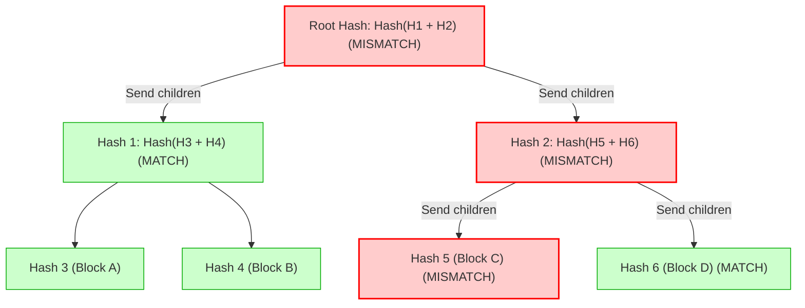
*(Diagram: Node B discovers the root differs. It compares H1 and H2. H1 matches perfectly, so Block A and B are ignored. H2 differs, so it descends to H5 and H6. H6 matches, H5 differs. Only Block C needs to be re-transmitted.)*

---

## 2. Segment Trees (Range Aggregation)

*   **What it does:** Answers math questions over a specific range of an array (e.g., "What is the sum/min/max of elements from index 2 to 8?") in $O(\log N)$ time, while also allowing elements to be updated in $O(\log N)$ time.
*   **How it works:** It is a perfectly balanced binary tree. The leaf nodes contain the raw array values. Every parent node contains the merged aggregate (sum, min, or max) of its children. 
*   **The Query:** When you query a range, the tree doesn't iterate through the raw leaves. Instead, it combines a few pre-calculated internal parent nodes, instantly skipping massive chunks of the array.
*   **Trade-offs:** Requires $O(N)$ build time and takes up exactly `4 * N` space in memory (usually implemented as a flat array where a node at index `i` has children at `2i` and `2i+1`).

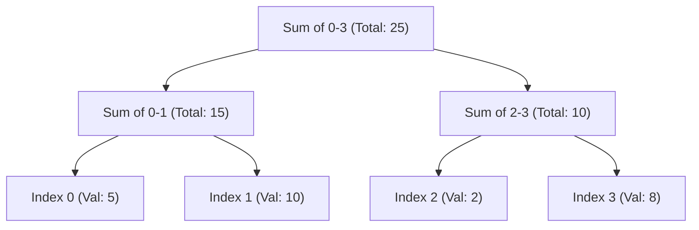

---

## 3. Fenwick Trees / Binary Indexed Trees (BIT)

*   **What it does:** A highly memory-efficient alternative to Segment Trees for calculating prefix sums and updating elements. It achieves the exact same $O(\log N)$ time complexity but is vastly lighter on memory and faster in practice.
*   **How it works:** It is brilliant bitwise wizardry. Instead of a bulky binary tree, a Fenwick Tree uses a single array of the exact same size as the data (`size N`). Each index stores the sum of a specific range of elements, dictated by the lowest set bit of the index's binary representation (extracted using `index & -index`).
*   **The Magic:** To find the sum of the first 13 elements (binary `1101`), the tree instantly breaks the query into:
    *   Sum of the first 8 elements (binary `1000`)
    *   Sum of the next 4 elements (binary `0100`)
    *   Sum of the last 1 element (binary `0001`)
*   **Trade-offs vs Segment Tree:** 
    *   **Pros:** Requires exactly $N$ memory (Segment Trees require $4N$). Incredibly short to code (about 3 lines for an update function). Much smaller constant-time factors (faster in CPU caching).
    *   **Cons:** Extremely difficult to use for non-invertible queries like Range Minimum/Maximum (Segment trees easily handle these).

---

## 4. Square Root (Sqrt) Decomposition

*   **What it does:** An algorithmic technique to break an array of $N$ elements into $\sqrt{N}$ chunks (blocks). It reduces range query time from $O(N)$ down to $O(\sqrt{N})$.
*   **How it works:** 
    1. Divide an array of 10,000 elements into 100 blocks, each containing 100 elements.
    2. Precompute the answer (sum, min, max) for each block.
    3. When querying a range (e.g., from index 150 to 825), you don't iterate through everything.
    4. You iterate through the middle fully-overlapped blocks in $O(1)$ time each. You only do a manual linear scan for the "partial blocks" on the extreme left and right edges.
*   **Trade-offs vs Trees:** 
    *   **Pros:** Incredible flexibility. Trees require the aggregate operation to be strictly associative. Sqrt Decomposition allows you to answer bizarre, complex queries (like finding the most frequent element in a range, commonly paired with **Mo's Algorithm**) because you can manually iterate the partial blocks.
    *   **Cons:** Asymptotically slower than trees ($O(\sqrt{N})$ is much worse than $O(\log N)$ for very large datasets).

</details>


<details>
<summary><b>Authentication and Authorization</b> (Click to expand)</summary>

# Authentication (AuthN) & Authorization (AuthZ)

**Sources:** 
- [7 Authentication Concepts Every Developer Should Know (Hayk Simonyan)](https://www.youtube.com/watch?v=iX8g4LqF8p8)
- [Authorization Explained: When to Use RBAC, ABAC, ACL & More (Hayk Simonyan)](https://www.youtube.com/watch?v=DT6Zy1X3ytM)

**TL;DR:** 
- **Authentication (AuthN)** proves *who you are* (Identity). 
- **Authorization (AuthZ)** determines *what you are allowed to do* (Permissions). 
You must always authenticate a user before you can authorize them.

---

## 1. Authentication (AuthN) Concepts

How do we securely prove the identity of a client, where is the state stored, and what does the network flow look like?

### 1. Session-Based Authentication (Stateful)
The traditional way of handling web application logins. The server maintains active state for every logged-in user.

* **Request Flow:**
  1. Client sends `POST /login` with `{username, password}`.
  2. Server hashes the password and compares it against the Users database table.
  3. If valid, the server generates a cryptographically random, opaque string called a `Session ID`.
  4. The server stores this mapping (`Session ID -> User ID`) in a centralized cache (like Redis) or a database.
  5. The server responds with a `Set-Cookie: session_id=xyz; HttpOnly; Secure` HTTP header.
  6. On subsequent API calls, the browser automatically attaches the `Cookie`.
  7. The server reads the cookie, queries Redis (`GET session:xyz`), retrieves the User ID, and processes the request.
* **Where it is stored:**
  * **Client-side:** In an `HttpOnly` cookie (immune to XSS attacks via JavaScript).
  * **Server-side:** In memory, a database, or a distributed cache (Redis/Memcached).

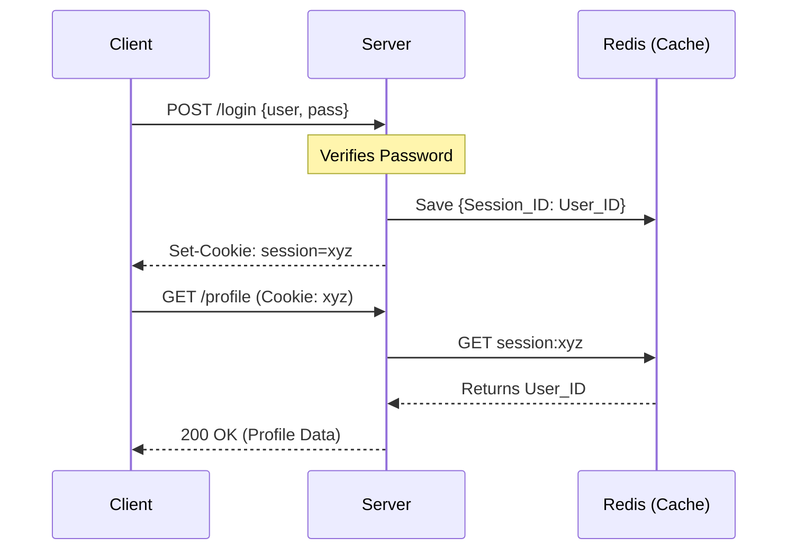

* **Trade-offs:** Secure and allows instant revocation (the server just deletes the key from Redis). However, it requires a database/cache lookup on *every single API request*, which can become a bottleneck at massive scale.

### 2. Token-Based Authentication (Stateless / JWT)
The modern standard for high-scale APIs and microservices, designed to eliminate the database lookup bottleneck.

* **Request Flow:**
  1. Client sends `POST /login` with `{username, password}`.
  2. Server verifies the credentials against the database.
  3. Server generates a JSON Web Token (JWT). It takes a Payload (e.g., `{"user_id": 123}`), and signs it using a cryptographic hashing algorithm (like HMAC SHA-256) and a `SECRET_KEY` that only the server knows.
  4. Server sends the JWT string back to the client. *The server does not save this token anywhere.*
  5. Client stores the token and attaches it to subsequent requests via the `Authorization: Bearer <token>` HTTP header.
  6. Server receives the token, strips the signature, and re-calculates the hash using its own `SECRET_KEY` and the provided Payload. 
  7. If the computed hash matches the token's signature, the server has mathematical proof the token is authentic and hasn't been tampered with. It immediately trusts the `user_id` inside.
* **Where it is stored:**
  * **Client-side:** Either in JavaScript memory (React/Vue state), LocalStorage (vulnerable to XSS), or preferably an `HttpOnly` cookie.
  * **Server-side:** **Nowhere.** It is entirely stateless.

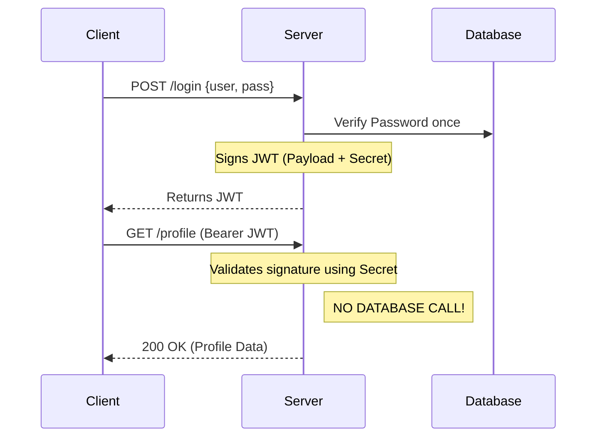

* **Trade-offs:** Immensely scalable and fast, with zero network latency required to verify the user. However, because the server doesn't store the token, it cannot easily revoke it. Once a JWT is issued, it is valid until its expiration time.

### 3. Access Tokens vs Refresh Tokens
To mitigate the inability to revoke stateless JWTs, modern systems use a dual-token architecture.

* **Access Token:** A short-lived JWT (e.g., 15 minutes). Used for all standard API calls.
* **Refresh Token:** A long-lived, opaque string (e.g., valid for 30 days). 
* **Request Flow:**
  1. Upon login, the client receives *both* tokens. 
  2. When the short-lived Access Token expires, API calls return `401 Unauthorized`.
  3. The client hits a specific `/refresh` endpoint, providing the Refresh Token.
  4. The server performs a **stateful database lookup** to verify the Refresh Token hasn't been revoked.
  5. If valid, the server issues a brand new 15-minute Access Token.
* **Where it is stored:**
  * **Client-side:** Refresh tokens *must* be stored securely (e.g., `HttpOnly` cookies or secure mobile enclaves).
  * **Server-side:** Refresh tokens *must* be stored in the database so they can be revoked (e.g., if a user clicks "Log out of all devices", or is banned).

### 4. API Keys (Machine-to-Machine)
If JWTs are so scalable, why do services like AWS or Stripe issue opaque "API Keys"?
* **Use Case:** JWTs are for humans (web/mobile apps). API Keys are for scripts, backend services, or developers.
* **Request Flow:** Client sends the API Key in an `x-api-key` header. The server performs a database or Redis lookup to verify who the key belongs to.
* **Where it is stored:** 
  * **Client-side:** Environment variables (`.env`) or secret managers (AWS Secrets Manager).
  * **Server-side:** Database (often hashed for security) and heavily cached in Redis for speed.
* **Trade-offs:** Machines require strict, instant revocation controls (in case a key is accidentally committed to GitHub). Because machine traffic is generally lower volume and more predictable than millions of human users, the database lookup overhead is an acceptable trade-off for instant revocation.

### 5. OAuth 2.0 vs OpenID Connect (OIDC)
* **OAuth 2.0 (Authorization):** A framework that allows an application to access resources on your behalf (e.g., granting a website access to read your Google Drive files) without giving them your password. It delegates access by issuing an **Access Token**. It does *not* prove your identity.
* **OpenID Connect (Authentication):** An identity layer built on top of OAuth 2.0 (e.g., "Sign in with Google"). During the OAuth flow, OIDC additionally issues an **ID Token** (a JWT containing your user profile, email, etc.), allowing the application to authenticate exactly who you are.

---

## 2. Authorization (AuthZ) Frameworks

Once the server mathematically verifies the JWT (or looks up the Session) and knows *who* you are, how does the codebase and database enforce what you are allowed to access?

### 1. Access Control Lists (ACL)
The most granular approach. A literal database table mapping `User -> Resource -> Permission`.
* **Example:** `User: Alice` has `READ` access to `File: budget.pdf`.
* **Where it is stored:** A many-to-many junction table in an RDBMS (e.g., `user_id`, `file_id`, `permission_type`).
* **Pros:** Extremely precise (file-level or row-level permissions).
* **Cons:** Unmanageable at scale. If you hire 100 new employees, you must insert thousands of rows into the ACL table granting them access to specific files.

### 2. Role-Based Access Control (RBAC)
The industry standard for B2B and SaaS applications. Users are assigned **Roles**, and Roles are assigned **Permissions**.
* **Request Flow:** 
  1. The server extracts the `user_id` from the JWT.
  2. The server queries the DB: `SELECT role FROM users WHERE id = 123` (or the role is simply embedded inside the JWT payload to save a DB call!).
  3. The server checks if the `Manager` role has the `write:financials` permission.
* **Where it is stored:** Usually 3 tables: `Users`, `Roles`, and `Role_Permissions`.

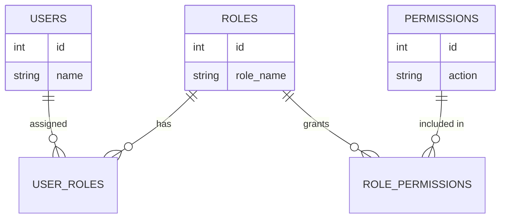

* **Pros:** Highly scalable. When a new employee joins, you just assign them the `Manager` role.
* **Cons:** "Role Explosion." If you need a Manager who can only read financials but not write them, you have to create a new role (`Manager-ReadOnly`). Complex organizations quickly end up with hundreds of hyper-specific roles.

### 3. Attribute-Based Access Control (ABAC)
The most dynamic and complex model. Access is determined by evaluating boolean rules in real-time against the attributes of the User, the Resource, and the Environment.
* **Request Flow:**
  1. User requests access to a file.
  2. A Policy Engine evaluates a rule: `Allow Access IF User.Department == "Finance" AND Resource.Classification == "Confidential" AND Environment.Time < 5:00 PM AND Environment.IP_Address == "Internal_Office"`.
* **Where it is stored:** Policies are often stored as JSON documents or written in specialized policy languages (like Rego for Open Policy Agent / OPA).
* **Pros:** Infinite flexibility. Completely solves the "Role Explosion" problem.
* **Cons:** Complex to engineer, hard to audit (you cannot easily run a SQL query to ask "Who has access to this file?"), and adds latency to every API request because the Policy Engine must dynamically compute multiple rules.

</details>


<details>
<summary><b>CRDTs</b> (Click to expand)</summary>

# Conflict-Free Replicated Data Types (CRDTs)

**Sources:**
- [Conflict Resolution for Eventual Consistency • Martin Kleppmann • GOTO 2016](https://www.youtube.com/watch?v=yCcWpzY8dIA)
- [CRDTs and the Quest for Distributed Consistency • Martin Kleppmann • InfoQ](https://www.youtube.com/watch?v=B5NULPSiOGw)
- [CRDTs: The Hard Parts • Martin Kleppmann](https://www.youtube.com/watch?v=x7drE24geUw)

**TL;DR:** Conflict-Free Replicated Data Types (CRDTs) are mathematically grounded data structures that enable multi-user, active-active, and offline-first distributed systems to replicate data across multiple nodes without centralized coordination. Every replica can execute concurrent writes locally with **zero network latency**, and replicas independently converge to the exact same state once messages arrive, regardless of message reordering, duplication, or network delay. CRDTs come in two mathematical flavors: **State-based (CvRDT)** (merging via monotonic join-semilattices) and **Operation-based (CmRDT)** (broadcasting commutative operations). They power real-time collaborative editors (Figma, Apple Notes, Google Docs alternatives like Automerge and Yjs), distributed databases (Redis Enterprise Active-Active, Riak, Cassandra counters), and peer-to-peer networks.

---

## 1. The Core Problem: Centralized Locks vs. Silent Data Loss

### The Collaboration Dilemma
Imagine multiple clients concurrently updating shared state (e.g., editing a text document, adding items to a shopping cart, or incrementing an ad click counter) across flaky mobile connections or multi-region datacenters.

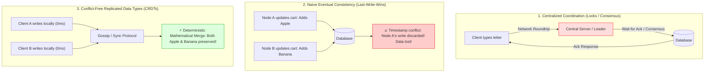

### Why Centralized Locking Fails (The Local-First Imperative)
* **The SSH / Vim Problem:** If every keystroke or local modification requires a synchronous round-trip to a central leader, user latency is tethered to network ping ($100\text{--}300\text{ ms}$). Users on spotty mobile connections or offline on airplanes are blocked completely.
* **The Availability Ceiling:** Under the CAP theorem, systems relying on central consensus (Paxos, Raft, 2PC) sacrifice availability ($A$) during network partitions ($P$). If the leader is unreachable, writes stall.

### Why Last-Write-Wins (LWW) is Dangerous
Many distributed databases (e.g., Apache Cassandra, CouchDB) default to **Last-Write-Wins (LWW)** using wall-clock timestamps:
* If User A adds item $X$ at $t_1$ and User B adds item $Y$ at $t_2$, the database blindly discards User A's update because $t_2 > t_1$.
* **NTP Clock Skew:** Physical server clocks drift by milliseconds. A write that happened physically earlier can overwrite a write that happened physically later simply because of clock skew.
* **Silent Data Loss:** In collaborative workspaces or shopping carts, silently dropping user intent is unacceptable.

### Consensus vs. Convergence: The Fundamental Distinction
Martin Kleppmann outlines the core architectural distinction:
* **Consensus (Raft, Paxos, 2PC, Blockchain):** Needed when you must **prevent double-spending** or pick *one single winner* out of mutually exclusive operations (e.g., spending the same digital dollar, booking the last flight seat). One transaction succeeds, and all conflicting proposals are rejected.
* **Convergence (CRDTs):** Needed when you want **multi-master collaboration**. No user input should be discarded. Every node accepts writes locally and concurrently, and the data structure mathematically merges all concurrent intents without conflicts or central arbiters.

---

## 2. Theoretical Foundations: CvRDT vs. CmRDT

CRDTs are categorized into two primary architectural families based on what information is transmitted over the wire:

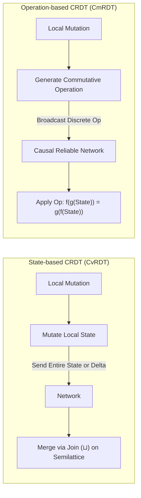

---

### A. State-Based CRDTs (CvRDT - Convergent Replicated Data Types)

In a CvRDT, replicas replicate by sending their **entire local state** (or state deltas) to other replicas. When a node receives a remote state, it merges it with its own state using a **merge function** ($\sqcup$, called *join*).

#### The Mathematical Foundation: Join-Semilattices
For a state-based CRDT to guarantee strong eventual consistency, the state space and the merge function $\sqcup$ must form a **Bounded Join-Semilattice** $(S, \sqcup)$, which satisfies three algebraic properties:
1. **Commutativity:** 
   $$A \sqcup B = B \sqcup A$$
   *(The order in which two states are merged does not matter).*
2. **Associativity:** 
   $$(A \sqcup B) \sqcup C = A \sqcup (B \sqcup C)$$
   *(The grouping of merge operations across multiple network packets does not matter).*
3. **Idempotence:** 
   $$A \sqcup A = A$$
   *(Receiving the same state update twice or replaying dropped packets causes zero side effects).*

#### Partial Order & Monotonicity
A semilattice defines a partial order $\le$ where $A \le B$ if and only if $A \sqcup B = B$.
* Every update must be **monotonically increasing** on the lattice:
  $$S_{new} \ge S_{old}$$
* Because state only ever moves "up" the lattice, concurrent updates merge by finding their **Least Upper Bound (LUB)**.

* **Network Requirement:** Extremely relaxed. Tolerates out-of-order delivery, duplicate messages, and packet loss (as long as messages are eventually retried).
* **Downside:** State payload grows over time. Sending entire states over the wire wastes bandwidth (mitigated by *Delta-based CRDTs*).

---

### B. Operation-Based CRDTs (CmRDT - Commutative Replicated Data Types)

In a CmRDT, replicas do **not** transmit full state. Instead, they execute a local operation and broadcast a **discrete mutation operation** (e.g., `insert_after(char_id, 'x')` or `add_tag(item_id, uuid)`).

#### The Mathematical Foundation: Commutativity
All concurrent operations must **commute** with each other:
$$f(g(S)) = g(f(S))$$
Applying concurrent operations in any order on any replica must produce the identical final state.

#### Network Requirements
* **Causally Ordered Delivery:** If operation $B$ was generated after operation $A$ was observed ($A \to B$), then every node must execute $A$ before executing $B$.
* **At-Most-Once / Exactly-Once Delivery:** Because operations are not necessarily idempotent ($count = count + 1$ applied twice doubles the count), the transport layer must prevent duplicate delivery, or operations must be tagged with unique IDs to achieve idempotent application.

---

### CvRDT vs. CmRDT Comparison Matrix

| Property | State-Based (CvRDT) | Operation-Based (CmRDT) |
| :--- | :--- | :--- |
| **Payload Sent** | Full State (or Delta subset) | Discrete Operation |
| **Merge Primitive** | Join operation ($\sqcup$) on Semilattice | Commutative function execution |
| **Algebraic Constraint** | Associative, Commutative, Idempotent | Commutative (for concurrent ops) |
| **Network Delivery** | Any order, duplicate-tolerant (Unreliable) | Causally ordered, deduplicated |
| **Bandwidth Cost** | High (grows with data size) | Low (proportional to mutation rate) |
| **Memory Overhead** | Low (only current state needed) | Requires causal history/dependency buffers |

---

## 3. Core CRDT Primitives & Under-the-Hood Mechanics

---

### 1. Distributed Counters

#### A. G-Counter (Grow-Only Counter)
Standard integers cannot be incremented concurrently because `count = count + 1` is not idempotent, and simply sending `count = 5` overwrites concurrent increments.

* **Mechanics:**
  * For a cluster of $n$ nodes, the counter is an array of size $n$:
    $$V = [c_1, c_2, \dots, c_n]$$
  * Node $i$ is only permitted to increment its own slot: $V[i] = V[i] + 1$.
  * **Merge Rule:** Take the element-wise maximum across all nodes:
    $$V_{merged}[k] = \max(V_A[k], V_B[k]) \quad \forall k \in [1, n]$$
  * **Value Read:** Sum all elements in the vector:
    $$\text{Value} = \sum_{k=1}^n V[k]$$

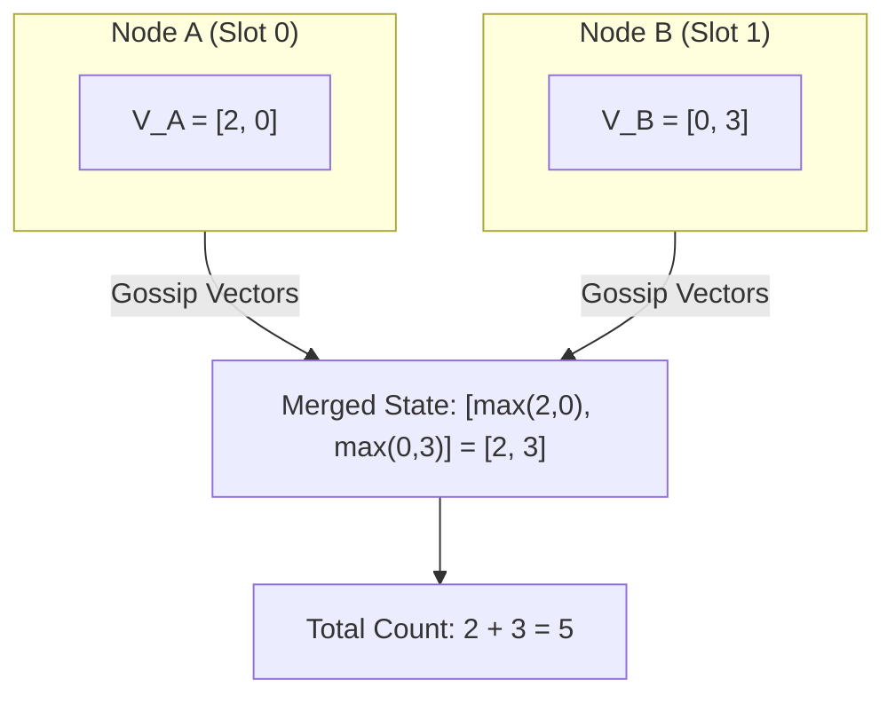

#### B. PN-Counter (Positive-Negative Counter)
Allows both increments and decrements.
* **Mechanics:** Combines two G-Counters:
  1. $P$: Tracks all increments.
  2. $N$: Tracks all decrements.
* **Value Read:**
  $$\text{Value} = \sum P[k] - \sum N[k]$$
* **Merge Rule:** Merge $P$ and $N$ independently using G-Counter element-wise maximum.

---

### 2. Registers (Single Value Storage)

#### A. LWW-Register (Last-Write-Wins Register)
* **Mechanics:** Stores a tuple $(value, timestamp)$.
* **Merge Rule:** On conflict, the value with the higher timestamp replaces the lower one:
  $$\text{Merge}((v_1, t_1), (v_2, t_2)) = \begin{cases} (v_1, t_1) & \text{if } t_1 > t_2 \\ (v_2, t_2) & \text{if } t_2 > t_1 \\ \text{tie-breaker}(v_1, v_2) & \text{if } t_1 = t_2 \end{cases}$$
* ⚠️ **Trade-off:** High risk of silent data loss due to clock skew or concurrent updates.

#### B. MV-Register (Multi-Value Register)
* **Mechanics:** Uses a Version Vector to track causal history.
* **Merge Rule:** If write $B$ causally supersedes write $A$ ($V_A < V_B$), $B$ overwrites $A$. If writes $A$ and $B$ are **concurrent** (neither version vector dominates), the register **retains both values** as a set: $\{v_1, v_2\}$.
* **Application Resolution:** The conflict is surfaced directly to the user or application logic (e.g., Git merge conflict style or shopping cart item union).

---

### 3. Distributed Sets

#### A. G-Set (Grow-Only Set)
* Elements can only be added, never removed.
* Merge Rule: Mathematical Set Union:
  $$S_{merged} = S_A \cup S_B$$

#### B. 2P-Set (Two-Phase Set)
* **Mechanics:** Uses two G-Sets:
  1. **Add Set ($A$):** Tracks added elements.
  2. **Remove Set ($R$):** Tracks removed elements (tombstones).
* **Membership Rule:** An element $e$ is in the set if $e \in A$ and $e \notin R$.
* ❌ **The Fatal Flaw:** Once an element is removed ($e \in R$), **it can never be added back**. Future adds will see $e \in R$ and consider it deleted forever.

#### C. OR-Set (Observed-Remove Set) — *The Production Standard*
The OR-Set solves the 2P-Set flaw by assigning a **unique tag (UUID or Lamport timestamp)** to every add operation.

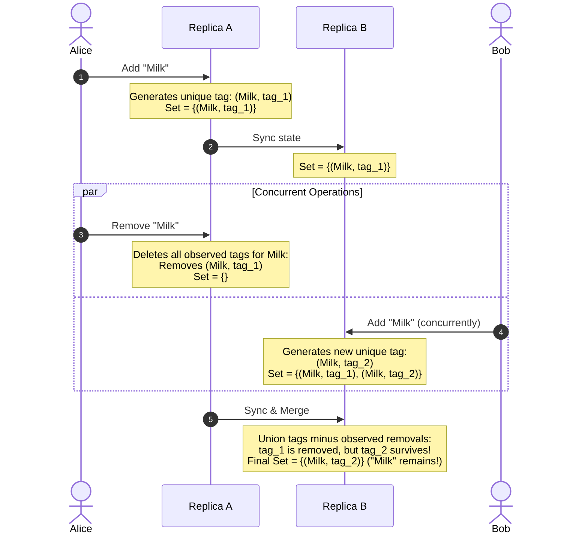

* **Add Operation:** Adding element $e$ creates a new pair $(e, u)$ where $u$ is a globally unique tag.
* **Remove Operation:** Removing element $e$ searches the local replica for all existing pairs $(e, u)$ currently present and moves them to a tombstone set.
* **Merge Rule:**
  $$A_{merged} = (A_1 \cup A_2) \setminus (R_1 \cup R_2)$$
* **Add-Wins Semantics:** If Replica A removes "Milk" (deleting `tag_1`) while Replica B concurrently adds "Milk" (creating `tag_2`), the merged state retains `(Milk, tag_2)`. **The concurrent addition naturally wins over removal** without relying on arbitrary clocks!

---

## 4. Collaborative Sequences & Text Editing (CRDTs vs. OT)

When multiple users collaborate on text (like Google Docs or Notion), documents cannot be treated as simple sets or registers. Text is an **ordered sequence of characters**.

```
Initial Document: "HELO"
User A inserts 'L' at index 2 -> "HELLO"
User B concurrently inserts '!' at index 4 -> "HELO!"
```

---

### Operational Transformation (OT) vs. CRDTs

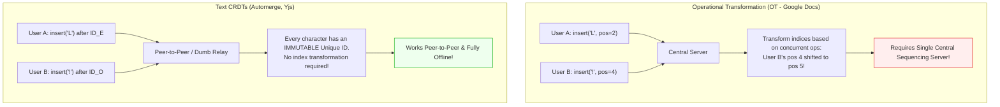

#### Why Operational Transformation (OT) Struggles Without a Central Server:
* OT represents text operations by raw positional indices: `insert(pos, char)` and `delete(pos)`.
* If two users type concurrently, character positions shift. OT requires transformation functions $T(op_1, op_2)$ to rewrite indices.
* **The Centralized Bottleneck:** OT algorithms (like Jupiter, used in Google Docs) require a **single authoritative central server** to linearize all operations into a global total order. Implementing decentralized peer-to-peer OT without a central server has proven notoriously bug-prone and mathematically fragile.

#### The Text CRDT Breakthrough: Immutable Character Identifiers
Instead of identifying characters by transient integer indices ($0, 1, 2 \dots$), a text CRDT assigns **every single character an immutable, globally unique identifier** when it is typed:
$$\text{Char ID} = (\text{Lamport Timestamp}, \text{Client ID})$$

* When inserting a character, the operation specifies the **ID of the preceding character**, not a numerical index:
  $$\text{insert}('L', \text{after}=\text{ID}_E)$$
* Even if thousands of characters are concurrently inserted or deleted elsewhere in the document, the character $\text{ID}_E$ never changes its identity!
* Resolving ties between concurrent insertions at the same position is handled by sorting character IDs by timestamp and client ID deterministically.

---

## 5. "The Hard Parts" of CRDTs (Martin Kleppmann's Breakthroughs)

While basic counters and sets are simple, real-world collaboration software involves complex documents: rich text, nested JSON trees, drag-and-drop lists, and filesystems. Martin Kleppmann highlights the four hardest challenges in production CRDT engineering:

---

### Hard Part 1: The Character Interleaving Problem

When two users insert words at the same location concurrently, naive character-by-character fractional indexing causes words to scramble.

* **The Scenario:**
  * Initial text: `"hello world"`
  * User A types: `"Alice "`
  * User B types: `"dear "`
* **The Scrambling Bug:**
  * If the CRDT interleaves characters based on alternating timestamps or client IDs:
  * Result: `"d e a l i c e a r  world"` (Complete gibberish!)
* **The Solution (Replicated Growable Arrays - RGA):**
  * Modern text CRDTs (RGA, Automerge, Yjs) treat contiguous typing as linked trees/blocks.
  * When a user types a word, each new character points to the immediately preceding character typed by that same user.
  * Sibling branches are ordered deterministically using timestamps, but entire subtrees/words remain intact:
  * Clean Merged Result: `"hello dear Alice world"` (Preserves word boundaries).

---

### Hard Part 2: The Tree Move Problem & Cycle Avoidance

In applications like Notion, Figma (scene graphs), or cloud filesystems (Google Drive), data is organized as a **tree of nodes** (folders, layers, blocks).

#### The Catastrophic Cycle Scenario:
What happens if two users concurrently move folders?
* Initial state: Folder $A$ contains Folder $B$ ($Root \to A \to B$).
* **User 1 (offline):** Moves Folder $A$ inside Folder $B$ ($B \to A$).
* **User 2 (concurrently):** Moves Folder $B$ inside Folder $A$ ($A \to B$).

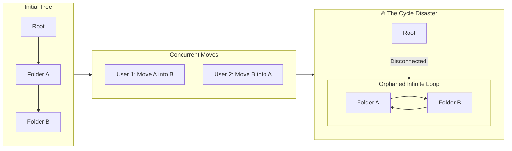

If both operations are naively merged:
1. $A$ becomes a child of $B$, and $B$ becomes a child of $A$.
2. **A cycle is formed ($A \rightleftharpoons B$).**
3. Both folders detach completely from the Root! The entire directory tree vanishes from the user's screen into an unreachable black hole, causing catastrophic data loss.

#### Martin Kleppmann's Algorithmic Solution for Trees:
1. **Total Order of Operations:** Assign each move operation a Lamport timestamp + Client ID.
2. **Cycle Check on Application:** Before applying a move operation $M(\text{item}, \text{new\_parent})$:
   * Walk up the ancestor tree starting from $\text{new\_parent}$.
   * If $\text{item}$ is encountered in the ancestor chain, applying this move would create a cycle!
   * **Rule:** If a cycle is detected, the operation is **deterministically discarded/ignored**.
3. **Speculative Rewind & Replay (Log Rewind):**
   * If an older operation arrives out of order from the network, the replica rolls back subsequent move operations, applies the missing operation (with cycle checking), and replays subsequent operations forward.

---

### Hard Part 3: Garbage Collection & Tombstone Bloat

When an element or character is deleted in a CRDT, it cannot be immediately purged from memory. If Node A simply deleted the record, and Node B later sent an update referencing that record, Node A wouldn't know how to place it or might re-insert it as new data!

* **Tombstones:** Systems leave an invisible marker (a "tombstone") indicating that the item existed and was deleted.
* **The Memory Explosion (The 300,000 Keystroke Case Study):**
  * Martin Kleppmann captured the full keystroke history of writing an academic paper:
  * Final document size: **$100\text{ KB}$** of LaTeX text.
  * Editing history: **300,000+ individual keystrokes and deletions**.
  * Storing every keystroke and tombstone as a JSON object inflated the file to **over 100 Megabytes in RAM** ($1000\times$ overhead)!

#### Production Solutions:
1. **Columnar Binary Compaction (Automerge 2.0 / Yjs):**
   * Characters typed in sequence are compressed into contiguous byte arrays using Run-Length Encoding (RLE) and LEB128 bit-packing.
   * Compresses 300,000 operations down from $100\text{ MB}$ to under **$300\text{ KB}$**.
2. **Stable Version Vector Pruning:**
   * A tombstone can be physically purged from memory **if and only if** every participating replica node in the cluster has acknowledged that it has seen the deletion.
   * If vector clocks show all active nodes have observed the deletion, the tombstone is safely removed forever.

---

### Hard Part 4: Local-First Software & End-to-End Encryption (E2EE)

Because CRDTs are deterministic and require no central transformation logic, they enable a revolutionary paradigm: **Local-First Software**.

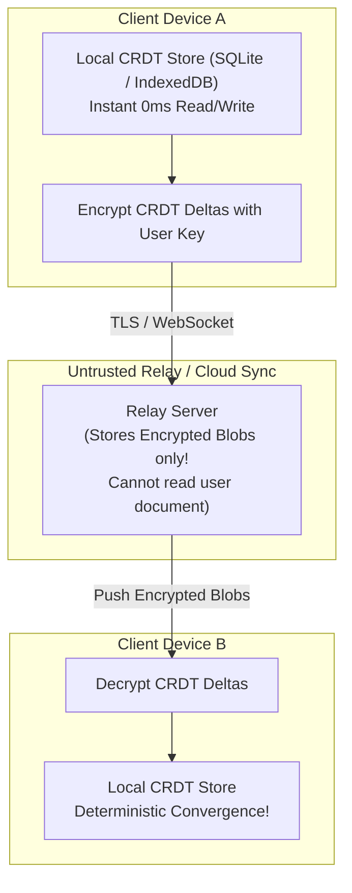

* **Zero Cloud Dependency:** Data lives on the user's local disk (SQLite / IndexedDB). The app starts instantly and works completely offline.
* **Trustless Clouds:** Unlike Google Docs (which must read plaintext on the server to transform OT indices), a CRDT sync server only relays immutable op packets. The client can **encrypt CRDT operations end-to-end (E2EE)** before sending them. The cloud provider cannot read the user's document!

---

## 6. Real-World Production Implementations

| Technology / System | Use Case | CRDT Architecture |
| :--- | :--- | :--- |
| **Figma** | Real-time collaborative design canvas | Custom CRDT for scene graphs, color palettes, and property trees. |
| **Apple Notes** | Offline note-taking synced across iOS/macOS | Uses CRDTs for rich text, checklist merges, and sketch layers. |
| **Redis Enterprise** | Multi-region Active-Active geo-distribution | CRDT-based Redis Hashes, Sets, Sorted Sets, and Counters. |
| **Automerge** | Open-source Local-First JSON / Text library | RGA text sequences, Lamport timestamps, columnar binary encoding. |
| **Yjs** | High-performance shared types for web editors | Struct-based sequence CRDT, powering JupyterLab and Monaco Editor. |
| **Riak KV** | Distributed NoSQL key-value store | Built-in OR-Set, PN-Counter, and LWW-Register data types. |

---

## 7. System Design Interview Playbook & Traps

### When to Propose CRDTs in an Interview

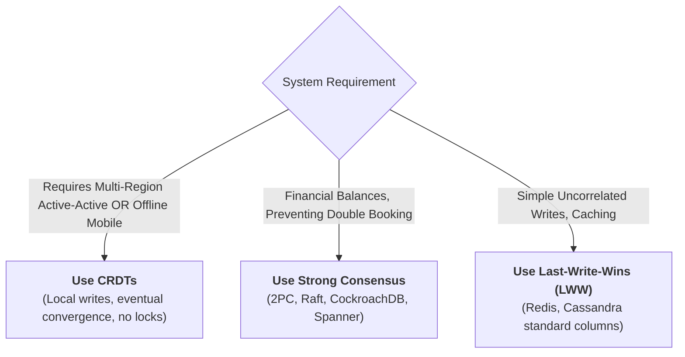

#### Choose CRDTs when:
1. The problem involves **collaborative editing, document synchronization, or live canvas tools** (Google Docs, Figma, Miro, Notion).
2. The system must support **offline mobile clients** that sync changes seamlessly when regaining network connectivity.
3. Multi-datacenter **active-active replication** where cross-region network latency cannot block local write throughput.

---

### The 4 Major Interview Traps

#### 1. The Financial Balance Trap (Counters vs. Bank Accounts)
* **The Candidate Mistake:** *"I will use a PN-Counter CRDT to track a user's bank account balance across multiple regions."*
* **The Failure:** CRDT counters cannot enforce invariants like `balance >= 0`. If Alice has $\$100$ and withdraws $\$80$ in Region 1 while concurrently withdrawing $\$80$ in Region 2, both PN-counters decrement locally. Upon merging, the balance becomes $-\$60$.
* **The Staff Engineer Rule:** CRDTs are for **growth and aggregation**, not constraint enforcement. Financial ledgers and inventory reservations require **Strong Consistency (Consensus / 2PC)** to prevent double-spending.

#### 2. The Clock Skew Trap on LWW Registers
* **The Candidate Mistake:** Proposing wall-clock timestamps (`System.currentTimeMillis()`) to resolve conflicts between concurrent updates in a replicated key-value store.
* **The Staff Engineer Rule:** Explain the risk of physical clock drift (NTP jumps). Recommend **Observed-Remove Sets (OR-Sets)** with unique tags or **Multi-Value Registers (MV-Registers)** with vector clocks.

#### 3. The Tombstone Memory Leak Blindspot
* **The Candidate Mistake:** Storing deletions in a collaborative list without discussing garbage collection.
* **The Staff Engineer Rule:** Mention that CRDT deletions create **tombstones** to preserve causal ordering. Explain how to bound memory using **stable version vectors** or compact run-length encoded columnar formats (Automerge/Yjs).

#### 4. The Tree Move Cycle Trap
* **The Candidate Mistake:** Assuming moving a file/folder in a collaborative filesystem is a simple pointer update.
* **The Staff Engineer Rule:** Explain the **Move Problem**: concurrent moves can introduce circular references ($A \subset B \subset A$), disconnecting subtrees from the root. Explain cycle detection and Lamport total ordering.

</details>


<details>
<summary><b>Caching Strategies</b> (Click to expand)</summary>

# Caching Strategies & Interview Patterns

**Source:** [Caching in System Design Interviews w/ Meta Staff Engineer (Hello Interview)](https://www.youtube.com/watch?v=1NngTUYPdpI)

**TL;DR:** Caching is the ultimate tool for scaling read-heavy systems and reducing latency. It trades a bit of storage and complexity for speed by keeping recently used data in a faster layer. In a system design interview, caching should be brought up during the deep dive (non-functional requirements) to address scale and performance. You must be able to discuss **Where to Cache**, **Architectures**, **Eviction Policies vs TTL**, and **Common Pitfalls**.

---

## 1. The Physics of Caching (Why we do it)
*   **Disk Access (SSD/DB):** ~1 millisecond.
*   **Memory Access (RAM):** ~100 nanoseconds.
*   **The Gap:** Memory is roughly **10,000x faster** than disk. When serving thousands of requests per second, caching takes advantage of this massive difference.

## 2. Where to Cache (The Layers)

1.  **External Caching (Redis / Memcached):** 
    *   The most common in system design interviews. 
    *   Runs on its own server. Multiple application servers share the same global cache, meaning if one server fetches the data, all other servers instantly benefit.
2.  **In-Process Caching (Guava / Local Memory):** 
    *   Stores data directly inside the application server's RAM. 
    *   **Pros:** The absolute fastest caching possible (zero network hops).
    *   **Cons:** State is isolated per server (can lead to inconsistencies and wasted memory). 
    *   **Use Case:** Static config data or lookup tables requiring ultra-low latency.
3.  **CDNs (Content Delivery Networks):** 
    *   Edge caching geographically close to users.
    *   Optimizes for **network latency** rather than disk vs. memory. Drops a global 300ms round-trip down to 20ms.
    *   **Use Case:** Media delivery (images, videos), static assets, public API responses, and HTML.
4.  **Client-Side Caching:** 
    *   Browser HTTP cache, Local Storage, or mobile on-device disk.
    *   **Use Case:** Offline functionality (e.g., Strava syncing runs when offline). You have the least control over data freshness here.

---

## 3. Caching Architectures (How data is updated)

### Cache-Aside (Lazy Loading)
*   **How it works:** The application logic handles everything. On a read, the app checks the cache. If it's a miss, it fetches from the DB, writes it to the cache, and returns it.
*   **Pros:** Resilient (if cache goes down, the app hits the DB). Lean (only requested data gets cached). **This should be your default choice in an interview.**
*   **Cons:** Cache misses have higher latency (3 trips: check cache, query DB, write to cache). 

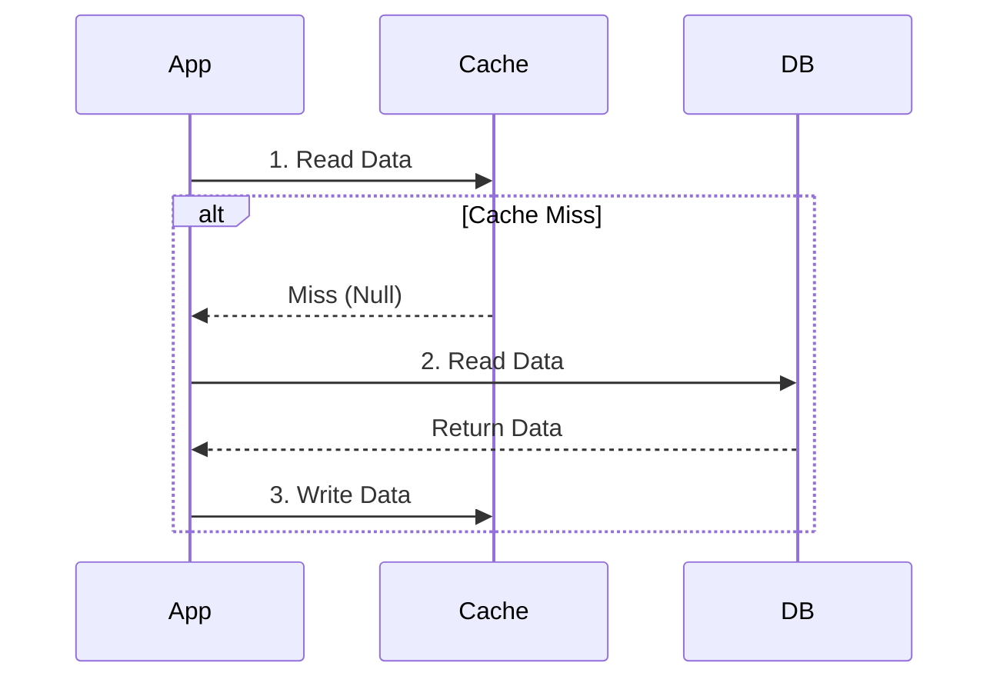

### Write-Through
*   **How it works:** The application only writes to the cache. The caching library then synchronously writes to the database *before* returning success.
*   **Pros:** Strong consistency between Cache and DB.
*   **Cons:** Slower writes. Suffers from the **Dual Write Problem** (if the DB write fails but the cache write succeeds, creating split-brain). Bloats the cache with data that might never be read again.

### Write-Behind (Write-Back)
*   **How it works:** The application writes to the cache and instantly gets a `200 OK`. The cache flushes these updates to the database asynchronously in batches.
*   **Pros:** Blazing fast write throughput (great for metrics/analytics).
*   **Cons:** **Data Loss!** If the cache node crashes before the batch flushes, the data is gone forever. *Interview Tip: Avoid proposing this unless you are highly experienced and can strongly justify the data loss risk.*

### Read-Through
*   **How it works:** Similar to Cache-Aside, but the cache itself transparently orchestrates the DB fallback (the application only ever talks to the Cache). This is exactly how CDNs work.

---

## 4. Cache Eviction vs. Cache Expiration (TTL)

Because memory is expensive and limited, caches must delete old data. There are two entirely different concepts that control data removal: **Eviction** (running out of space) and **Expiration / TTL** (data becoming stale).

### Eviction Policies (When the cache is FULL)
*   **LRU (Least Recently Used):** Evicts the item that hasn't been read or written in the longest time. **This is the most common default in interviews.**
*   **LFU (Least Frequently Used):** Evicts the item with the lowest total access count. Great if access patterns are highly skewed, but can suffer from "historical baggage" (an item was wildly popular a month ago and never gets evicted despite not being read anymore).
*   **FIFO (First In, First Out):** Evicts the oldest item based strictly on insertion time. Rarely the right choice.

### Time To Live (TTL) / Expiration
*   **How it works:** Each cached item has a strict expiration time (e.g., 60 seconds). Once that time passes, the cache automatically deletes it.
*   **When to use it:** Perfect for when **freshness matters more than frequency**. Use it for data that naturally goes stale: user sessions, social media feeds, API responses, or profile images.
*   *Interview Tip:* Be ready to combine these! You can use an LRU cache with a 5-minute TTL, meaning data dies naturally after 5 minutes, but might be evicted sooner if the cache fills up.

---

## 5. The 3 Major Caching Pitfalls (Interview Traps)

There are two hard problems in computer science: naming things, and cache invalidation. Interviewers will drill into these three edge cases:

### Pitfall 1: Cache Consistency (Stale Data)
If a user updates their profile picture in the database, but the old picture is still in the cache, other users will see stale data.
*   **Solution 1 (Invalidate on Write):** Whenever you write to the DB, explicitly send a `DELETE` command to the cache for that key. The next read will force a fresh pull.
*   **Solution 2 (Short TTL / Eventual Consistency):** If it's a social media feed, set a short TTL (e.g., 5 minutes) and explicitly state: *"Some users will see stale data for 5 minutes, and that is an acceptable business trade-off because it's not a critical financial transaction."*

### Pitfall 2: Cache Stampede (Thundering Herd)
A massively popular key (like a homepage feed) has a TTL of 60 seconds. When it expires, 100,000 concurrent user requests suddenly miss the cache and all try to rebuild the cache at the exact same time. This turns 1 query into 100,000 database queries instantly, causing cascading failures and melting down the database.

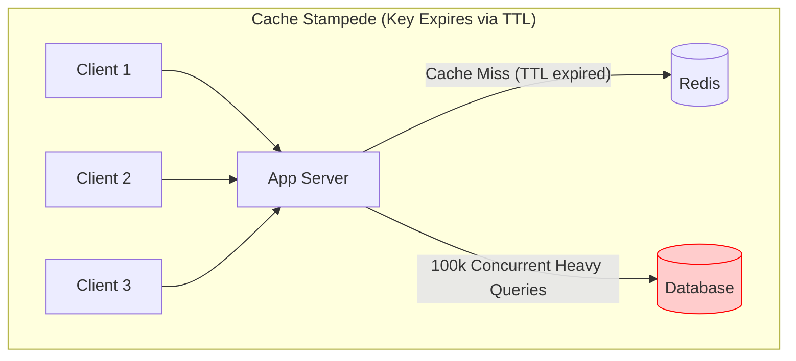

*   **Solution 1: Request Coalescing (Single Flight):** When multiple requests miss the same key, only the *first* request is allowed to go to the database. The other 99,999 requests are forced to wait (usually via a lock or polling mechanism) for the first request to repopulate the cache, and then they all read from the newly refreshed cache.
*   **Solution 2: Cache Warming (Proactive Background Refresh):** Instead of waiting for the popular key to expire at 60 seconds, a background worker proactively refreshes the key at the **55-second mark**. This means the key *never actually expires*, and the cache stampede is physically impossible.

### Pitfall 3: Hot Keys (The Celebrity Problem)
Even if your cache hit rate is perfect, if Taylor Swift's profile gets 99% of the traffic, the single cache shard holding that specific key will be overwhelmed by network bandwidth and crash, leaving the rest of the cluster idle.

*   **Solution 1 (Replication):** Replicate the hot key across *all* cache nodes instead of hashing it to one. The router can then pick any random cache node to serve the data.
*   **Solution 2 (Local In-Memory Cache):** Add a tiny in-process cache (e.g., Guava) directly inside the application servers for the top 10 most popular items to prevent requests from even hitting the Redis cluster.

---

## 6. How to Talk About Caching in Interviews

**Rule #1: NEVER just add a cache for the sake of adding a cache.** 
Dropping a cache into your design without justification is an immediate red flag. Wait for the Deep Dive phase (Non-Functional Requirements) and use this **5-Step Framework**:

1.  **Identify & Quantify the Bottleneck:** Justify the cache. Are you serving 2 billion reads a day? Is computing a newsfeed causing high latency (joins across 5 tables)? Is there a strict 100ms SLA?
2.  **Explicitly Define the Cache Keys:** Do not just say "I'll cache the data." Say exactly what you are caching: *"I will cache the computed newsfeed against the key `feed:{user_id}`."*
3.  **Choose the Architecture:** State your choice (default to Cache-Aside).
4.  **State the Eviction Policy:** Choose LRU or a strict TTL and justify why.
5.  **Address the Downsides:** Proactively bring up how you will handle Consistency, Hot Keys, or Stampedes before the interviewer even asks.

</details>


<details>
<summary><b>Cassandra</b> (Click to expand)</summary>

# Apache Cassandra Deep Dive

**Source:** [Cassandra Deep Dive w/ Ex-Meta Staff Engineer (Hello Interview)](https://www.youtube.com/watch?v=TD3-INhm60Q) | [Hello Interview Written Guide](https://www.hellointerview.com/learn/system-design/deep-dives/cassandra)

**TL;DR:** Apache Cassandra is an open-source, masterless, distributed NoSQL wide-column database engineered for massive write throughput, horizontal elasticity, zero single-point-of-failure (SPOF) availability, and multi-datacenter replication. It blends the decentralized peer-to-peer ring topology and tunable quorum consistency of **Amazon Dynamo** with the Log-Structured Merge-tree (LSM) storage engine and column family model of **Google Bigtable**. In system design interviews, Cassandra is the premier choice for write-heavy (>100k writes/sec), time-series, or messaging applications with predictable, query-driven access patterns.

---

## 1. Lineage & Motivation

### A. Origins at Facebook (2007)
Cassandra was created in 2007 at Facebook by **Avinash Lakshman** (co-inventor of Amazon's Dynamo) and Prashant Malik to solve the **Facebook Inbox Search** problem. 
*   **The Scale Challenge:** Millions of users sending billions of messages per day required an infrastructure capable of absorbing enormous write volume without latency spikes.
*   **The Problem with RDBMS:** Scaling a traditional relational database (MySQL/PostgreSQL) for write loads required manual sharding, complex failover orchestration, master-replica replication lag, and rigid schemas. Adding capacity required painful downtime or complex data migration scripts.
*   **The Solution:** Combine the best distributed system primitives into a single database:
    1.  **Amazon Dynamo Lineage:** Fully peer-to-peer (masterless) ring architecture, consistent hashing with virtual nodes (v-nodes), gossip protocol for decentralized cluster state, and tunable quorum consistency ($R + W > RF$).
    2.  **Google Bigtable Lineage:** Log-Structured Merge-Tree (LSM-tree) storage architecture with sequential write-ahead commit logs, in-memory Memtables, immutable disk-based SSTables, Bloom filters, and sparse wide-column data modeling.

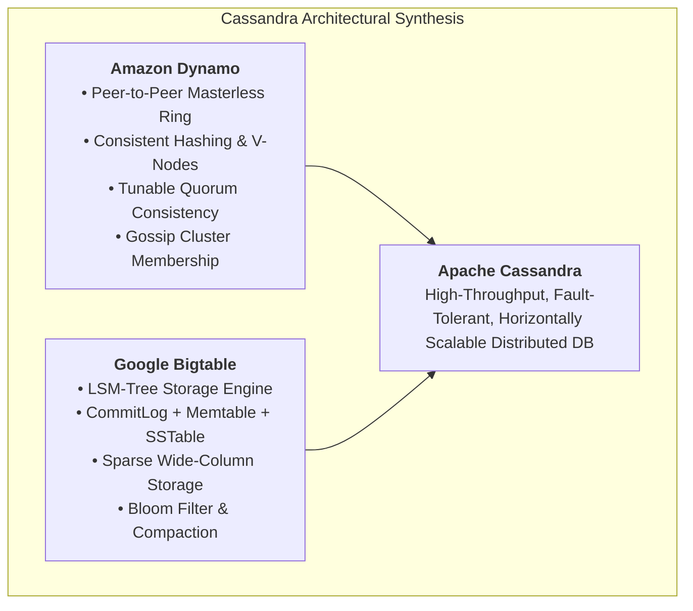

---

## 2. Cassandra Data Model & Hierarchy

Unlike relational databases where storage is normalized across rigid tables, Cassandra uses a sparse, wide-column model that organizes data into a 4-level hierarchy:

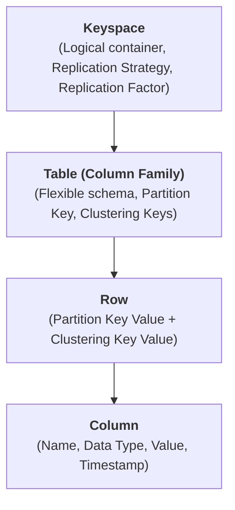

1.  **Keyspace:** The highest-level container (equivalent to an RDBMS `DATABASE` or `SCHEMA`). Defines cluster-wide replication mechanics:
    *   **Replication Strategy:** How copies are placed (e.g., `NetworkTopologyStrategy`).
    *   **Replication Factor ($RF$):** How many physical copies of data exist across the cluster (e.g., $RF = 3$).
2.  **Table:** A collection of partitions defining the primary key and typed columns. Unlike SQL tables, Cassandra tables are **sparse wide-column stores**: rows in the same table do not need to share the same columns, and empty columns take up 0 bytes on disk (no `NULL` storage overhead).
3.  **Row:** A set of columns addressed uniquely by a Primary Key.
4.  **Column:** The atomic unit of storage comprising `(name, value, timestamp)`. The timestamp is supplied by the client or coordinator and is fundamental to Cassandra's Last-Write-Wins (LWW) conflict resolution.

---

## 3. Primary Key Anatomy: Partition Key vs. Clustering Key

In an interview, **data modeling in Cassandra begins and ends with the Primary Key**. Getting the primary key wrong leads to hot nodes, unbounded partitions, or impossible queries.

$$\text{PRIMARY KEY} = (\text{Partition Key}) + [\text{Clustering Key(s)}]$$

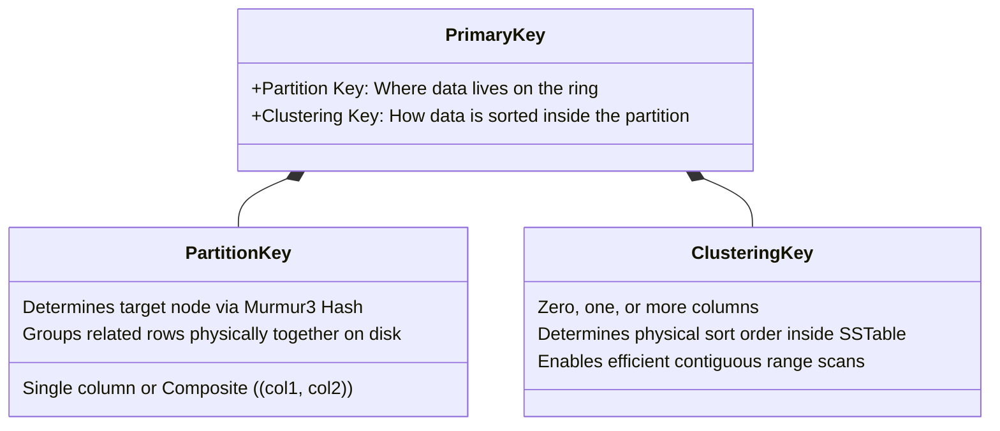

### A. Partition Key (Where it lives)
*   **Role:** Passed through a deterministic hash function (`Murmur3Partitioner`) to produce a 64-bit integer token ($ -2^{63} \text{ to } 2^{63}-1 $). This token dictates which nodes on the consistent hash ring own the partition.
*   **Single vs. Composite Partition Key:**
    *   `PRIMARY KEY (user_id)` $\to$ `user_id` is the partition key.
    *   `PRIMARY KEY ((user_id, bucket_id), message_id)` $\to$ `(user_id, bucket_id)` is a **composite partition key**. Both columns are hashed together to select the partition node.

### B. Clustering Key (How it is sorted)
*   **Role:** Determines the physical on-disk sort order of rows *within* a single partition.
*   **Behavior:** Cassandra stores rows within a partition sorted by the clustering column(s). This makes range queries (e.g., `WHERE message_id > X AND message_id < Y`) blazingly fast because they map to a sequential disk seek rather than random lookups.

```sql
-- Example: User Messages Table
CREATE TABLE user_messages (
    user_id uuid,
    message_id timeuuid,
    sender_id uuid,
    content text,
    PRIMARY KEY (user_id, message_id)
) WITH CLUSTERING ORDER BY (message_id DESC);
```
*   `user_id` is the **Partition Key** (all messages for a user live on the same physical node).
*   `message_id` is the **Clustering Key** (sorted newest first on disk for fast reverse-chronological chat rendering).

### C. Why Cassandra is Fundamentally Bad for Cross-Partition Range Scans (The Murmur3 Dilemma)

A common system design interview trap is attempting to run a range query across partition keys, such as:
```sql
-- DANGEROUS ANTI-PATTERNS IN CASSANDRA:
SELECT * FROM users WHERE user_id >= 100 AND user_id <= 200;
-- OR scanning an entire table without a partition key:
SELECT * FROM users WHERE status = 'ACTIVE' ALLOW FILTERING;
```

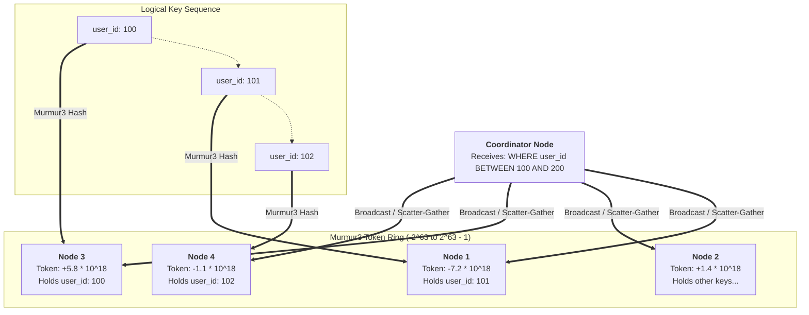

#### 1. The Mechanics: Murmur3 Pseudo-Random Dispersion
Cassandra defaults to the `Murmur3Partitioner`. Murmur3 is an extremely fast, uniform pseudo-random hash function engineered for **maximum entropy and uniform distribution**:
* Logical keys that are numerically or alphabetically adjacent (e.g., `user_id = 100`, `user_id = 101`, `user_id = 102`) produce wildly divergent 64-bit integer tokens.
* As a result, consecutive rows are scattered completely randomly across distinct physical nodes and token ranges across the cluster.

#### 2. The Penalty: Full-Cluster Scatter-Gather
When an application queries a range of partition keys or scans a table without specifying an exact partition key:
1. **Cluster-Wide Broadcast:** The coordinator node cannot perform an indexed seek. It must broadcast the query to **every single replica node in the entire cluster**.
2. **Disk Thrashing & Network Flooding:** Every node scans its local SSTables and streams chunks of data back over the internal network to the coordinator.
3. **Coordinator Bottleneck & OOM:** The coordinator must hold, buffer, deduplicate (via timestamps), and sort all rows in memory before returning them to the client. This frequently triggers Java Garbage Collection (GC) pauses or fatal Out-Of-Memory (`OOMKilled`) crashes.
4. **Tail Latency Explosion ($p99$):** The response time is strictly bound by the single slowest, most overloaded node in the cluster (the straggler effect).

#### 3. Intra-Partition vs. Inter-Partition Range Queries

| Query Type | Example | Execution Path | Performance |
| :--- | :--- | :--- | :--- |
| **Intra-Partition Range Scan** <br/>*(Using Clustering Key)* | `WHERE user_id = 101 AND message_id >= X AND message_id <= Y` | Routes to **one single partition**; executes a sequential forward scan across sorted SSTable blocks. | **Single-digit milliseconds ($<2\text{ ms}$)** |
| **Inter-Partition Range Scan** <br/>*(Across Partition Keys)* | `WHERE user_id >= 100 AND user_id <= 200` | Requires **cluster-wide scatter-gather** across all physical machines. | **Catastrophic (Timeouts / OOM)** |

#### 4. Why Cassandra Abandoned `ByteOrderedPartitioner`
Early versions of Cassandra supported `ByteOrderedPartitioner` (BOP), which preserved lexicographical ordering of partition keys so that range scans across partition keys were possible.

* **Why was it deprecated?** It caused catastrophic **write hot-spotting**.
* If partition keys are sequentially ordered (such as timestamp prefixes, sequential integer IDs, or alphabetic usernames starting with common letters), **all write traffic slams the single node holding that active range**, while the other 99 nodes sit completely idle.
* Cassandra's core design philosophy deliberately sacrificed cross-partition range scans in favor of `Murmur3Partitioner` to guarantee perfect write balancing across massive clusters.

#### 5. Clustering Key vs. DynamoDB Sort Key vs. CockroachDB 64MB Ranges

In system design interviews, candidates are often asked to compare how Cassandra, DynamoDB, and CockroachDB handle range queries:

* **Cassandra & DynamoDB share the same two-tier model:**
  $$\text{Primary Key} = \text{Hash-Based Partition Key (Cluster Placement)} + \text{Range-Based Clustering/Sort Key (Node Placement)}$$
  Both databases reject global range scans across the cluster to avoid write hot-spotting, confining range scans strictly to rows within the same partition key.
* **Where Cassandra Outperforms DynamoDB on Range Modeling:**
  1. **Multi-Column Clustering Keys:** Cassandra natively supports compound clustering keys (e.g., `PRIMARY KEY (tenant_id, year, month, day, event_id)`). You can filter `WHERE tenant_id = 'T1' AND year = 2026 AND month = 10 AND day >= 1 AND day <= 15`. In DynamoDB, you are limited to exactly **one Sort Key**, forcing artificial string concatenation (`2026#10#01`).
  2. **Explicit On-Disk Sort Direction:** Cassandra allows setting physical storage order per column at schema creation:
     `WITH CLUSTERING ORDER BY (created_at DESC)`
     This ensures reverse-chronological queries (e.g., "fetch latest 10 messages") perform a forward sequential disk seek. DynamoDB always stores items in ascending order on disk.
* **Where CockroachDB Differs (Cluster-Wide Range Partitioning):**
  Unlike Cassandra and DynamoDB, CockroachDB uses **Range Partitioning across the entire cluster** (splitting an ordered keyspace into contiguous 64MB ranges). It natively supports global range scans (e.g., `WHERE created_at BETWEEN X AND Y` across all tenants) without full-cluster scatter-gather, at the cost of requiring mitigations (hash-sharded indexes / UUIDs) against sequential write hotspots.

| Architectural Dimension | Apache Cassandra | Amazon DynamoDB | CockroachDB (Distributed SQL) |
| :--- | :--- | :--- | :--- |
| **Cluster Partitioning** | **Hash-Based** (Murmur3 Token Ring) | **Hash-Based** (Consistent Hashing) | **Range-Based** (64MB Contiguous Ranges) |
| **Global Table Range Scans** | ❌ **No** (Dangerous `ALLOW FILTERING`) | ❌ **No** (Dangerous `Scan` API) | ✅ **Yes** (Native SQL multi-range scan) |
| **Single-Partition Range Scans** | ✅ **Yes** (via Clustering Key) | ✅ **Yes** (via Sort Key) | ✅ **Yes** (Standard indexed seek) |
| **Multi-Column Range Keys** | ✅ **Yes** (Compound clustering keys) | ❌ **No** (Only 1 Sort Key allowed) | ✅ **Yes** (Any composite B-Tree index) |
| **On-Disk Sort Direction** | Configurable (`ASC` or `DESC`) | Fixed (ASC only) | Configurable per index column |
| **Write Hotspot on Timestamps** | 🟢 **Low** (Murmur3 scatters writes) | 🟢 **Low** (Hashing spreads writes evenly) | 🔴 **High** (Sequential writes hammer rightmost range) |
| **Cross-Entity Joins & ACID** | ❌ No joins; Row-level LWW | ❌ No joins; Partition-level ACID | ✅ Full relational joins; Serializable ACID |

> **💡 System Design Interview Tip:**
> If an interviewer asks for a query pattern that requires range scans across primary entities (e.g., *"Find all users registered between May 1 and May 10"* or *"Scan orders by price range"*):
> * **DO NOT use Cassandra** with `ALLOW FILTERING` or range scans on partition keys.
> * Use **CockroachDB** or **Google Spanner** (which use Range Partitioning with dynamic 64MB range splitting), or index the ranges into an external search engine (**Elasticsearch**).

---

## 4. Entity-Driven vs. Query-Driven Data Modeling

One of the biggest red flags in a system design interview is modeling Cassandra data as if it were PostgreSQL or MySQL.

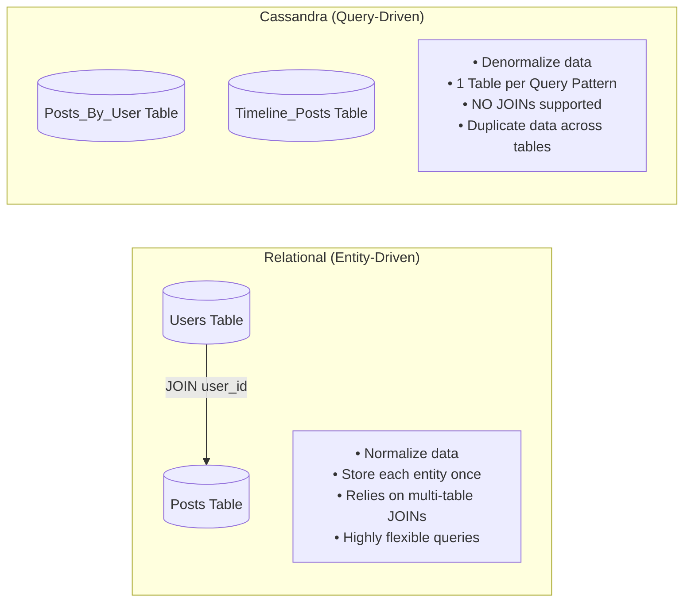

| Dimension | Relational Databases (RDBMS) | Apache Cassandra |
| :--- | :--- | :--- |
| **Philosophy** | **Entity-Driven** (Design around relationships) | **Query-Driven** (Design around queries) |
| **Normalization** | 3NF (Third Normal Form) to eliminate duplication | Deliberate **Denormalization** (duplication is encouraged) |
| **Joins** | Core capability (`INNER`, `LEFT`, `CROSS JOIN`) | **Unsupported**; single-table queries only |
| **Query Flexibility**| Arbitrary `WHERE` filters, `GROUP BY`, dynamic ad-hoc SQL | Queries **must** include the partition key; filtering without it is an anti-pattern (`ALLOW FILTERING`) |
| **Storage vs Compute**| Optimize for minimal disk storage | Optimize for fast, single-node sequential read computation |

> [!IMPORTANT]
> **Interview Rule of Thumb:** In Cassandra, **storage is cheap, but scatter-gather reads across multiple partitions will kill your latency SLAs**. You should happily duplicate data into multiple tables to satisfy distinct query patterns with single-partition reads.

---

## 5. Architecture: The Peer-to-Peer Ring

### A. Masterless Topology (Zero Central Master / Cluster Leader)
Cassandra clusters have **no master, no cluster leader, and no central controller**. Every node is architecturally identical and can accept read/write requests from any client. This eliminates the vulnerability of master failover downtime, split-brain elections, and external consensus dependencies (such as Apache ZooKeeper or etcd).

```mermaid
flowchart TD
    Client[Client Application]
    subgraph TokenRing["Cassandra Consistent Hash Ring"]
        Node1["Node 1<br/>(Token: 0 - 25M)"]
        Node2["Node 2<br/>(Token: 25M - 50M)"]
        Node3["Node 3<br/>(Token: 50M - 75M)"]
        Node4["Node 4<br/>(Token: 75M - 100M)"]
        
        Node1 <-->|Gossip| Node2
        Node2 <-->|Gossip| Node3
        Node3 <-->|Gossip| Node4
        Node4 <-->|Gossip| Node1
    end

    Client -->|Sends Query to ANY node| Node2
    Node2 -->|Acts as Ephemeral Coordinator| Node3
    Node2 -->|Acts as Ephemeral Coordinator| Node4
```

---

### B. Is There a "Leader and Follower" per Key or Partition? (NO!)

A frequent point of confusion in system design interviews is whether Cassandra designates a "leader replica" for each individual partition or key (similar to Kafka partitions, MongoDB replica sets, or Raft consensus groups).

> **In Cassandra, there is NO concept of a leader and follower—neither globally for the cluster, nor locally for any partition or key.** 
> All $N$ replica nodes holding a key (where $N = \text{Replication Factor}$) are **completely equal, active peers**.

```mermaid
flowchart TD
    Client["Client App"] -->|Write or Read Key K| Coord["Any Node (e.g., Node 1)<br/>Acts as Ephemeral Coordinator"]
    
    subgraph Replicas["The N Replicas for Key K (RF = 3)<br/>ALL EQUAL PEERS — ZERO LEADERS"]
        R1["Replica A (Node 3)"]
        R2["Replica B (Node 4)"]
        R3["Replica C (Node 5)"]
    end

    Coord -->|Parallel Fan-Out| R1
    Coord -->|Parallel Fan-Out| R2
    Coord -->|Parallel Fan-Out| R3
```

#### 1. The Role of the Coordinator Node (NOT a Leader)
* **Ephemeral Proxy:** When a client sends a read or write request to any node in the cluster, that node temporarily acts as the **Coordinator** for that single query.
* **Any Node Can Coordinate Any Key:** Node 1 can coordinate a write for User Alice, while Node 4 coordinates a write for User Bob, and Node 2 coordinates a read for User Alice concurrently.
* **The Coordinator Does Not "Own" the Key:** It simply hashes the partition key using `Murmur3Partitioner`, identifies the $N$ physical replica nodes that own the token range, forwards the request to them in parallel, waits for enough replies to satisfy the requested `ConsistencyLevel`, and responds to the client.
* **Token-Aware Client Optimization:** Modern client drivers (e.g., DataStax Java/Go driver) are "token-aware." They maintain a local map of cluster token ranges. Instead of connecting to a random node, the client routes the query directly to one of the actual replicas, letting that replica serve as coordinator and eliminating an extra network hop.

#### 2. How Writes Work Without a Leader
* In leader-based systems (Kafka, MySQL master-slave, Raft), all writes must be processed by the leader to establish a single sequential log order.
* In Cassandra, the coordinator sends the write to **all $N$ replicas concurrently**.
* Every replica writes the mutation directly to its local CommitLog and Memtable.
* Once the coordinator receives acknowledgments from a quorum of replicas (e.g., 2 out of 3 for `QUORUM`), it returns success.
* **Conflict Ordering:** Because there is no leader to assign log sequence numbers, Cassandra relies on **client/coordinator timestamps (Last-Write-Wins / LWW)**. If two concurrent writes touch the same column, the cell with the higher microsecond timestamp wins during compaction and read repair.

#### 3. How Reads Work Without a Leader
* The coordinator does not read from a primary copy.
* At `QUORUM` with $RF = 3$, it sends a **Full Data Read** to the fastest replica (lowest latency) and a **Digest Read** (a lightweight SHA-1 hash of the payload) to a second replica.
* If the data hash matches the digest, the coordinator returns the result immediately.
* **Read Repair:** If the hashes mismatch, the coordinator queries all replicas for their full data, compares timestamps to determine the latest value, returns the newest value to the client, and asynchronously writes the newest value back to the out-of-date replica(s).

#### 4. What About Lightweight Transactions (LWT / `IF NOT EXISTS`)?
When executing conditional writes (`INSERT ... IF NOT EXISTS`), Cassandra uses a leaderless variant of **Paxos**:
* The coordinator acts as the transient **Paxos Proposer** for that single statement round.
* The $N$ replicas act as **Paxos Acceptors**.
* Once the condition is checked and accepted by a quorum of acceptors, the mutation commits. There is still **no permanent or standing leader** for the key.

#### 5. Architectural Comparison Matrix

| Architectural Dimension | Leader-Follower Systems <br/>*(Kafka, MongoDB, MySQL, Raft)* | Masterless / Leaderless Systems <br/>*(Apache Cassandra, Amazon Dynamo)* |
| :--- | :--- | :--- |
| **Leader per Key / Partition?** | **YES.** Exactly 1 leader per partition. All writes must route through it. | **NO.** Zero leaders. All $N$ replicas are identical active peers. |
| **Write Failover Latency** | If the partition leader dies, writes for that key **stall** during leader election. | **Zero failover delay.** Any surviving replica immediately accepts writes if quorum is met. |
| **Ordering & Conflicts** | Leader establishes a strict total order (monotonic log sequence). | **Last-Write-Wins (LWW)** timestamps or ephemeral Paxos rounds. |
| **Replica Responsibilities** | Followers passively mirror the leader. | All replicas actively and concurrently process reads and writes. |

---

### C. Consistent Hashing & Virtual Nodes (V-nodes)
*   **The Modulo Problem:** Traditional sharding ($hash(key) \pmod N$) requires redistributing almost 100% of keys whenever a node joins or leaves.
*   **Consistent Hashing:** Arranges tokens in a continuous ring ($0 \text{ to } 2^{64}-1$). A partition key maps to a point on the ring, and the first node encountered moving clockwise owns the data.
*   **Virtual Nodes (V-nodes):** Instead of assigning a physical machine a single contiguous token range, Cassandra assigns each physical machine multiple small tokens (typically 128 or 256 v-nodes) distributed randomly across the ring.
    *   **Even Load Balancing:** Eliminates data skews caused by uneven hash distribution.
    *   **Fast Parallel Recovery:** When a node crashes, all remaining nodes in the cluster participate equally in reading and rebuilding pieces of its data, preventing any single surviving node from bottlenecking.

### C. Replication Strategies
Replication is configured per keyspace. Cassandra scans clockwise from the owning token to assign replicas:
1.  **SimpleStrategy:** Places subsequent replicas on the next physical nodes clockwise on the ring. Used *strictly* for single-datacenter local development.
2.  **NetworkTopologyStrategy (Production Standard):** Datacenter and rack-aware. It ensures replicas are placed in different racks within each datacenter to survive power strip/top-of-rack switch failures, and replicates data across distinct geographical regions (e.g., `{'us-east': 3, 'eu-central': 3}`).

---

## 6. Cluster Coordination & Fault Tolerance

```mermaid
flowchart TD
    subgraph GossipMechanism["Gossip & State Propagation"]
        G1[Node A] -- "Random Gossip Pings (Every 1s)" --> G2[Node B]
        G2 -- "Gossip Forwarding" --> G3[Node C]
        Seed["<b>Seed Nodes</b><br/>Known bootstrap rendezvous points<br/>Prevents network partition islands"]
        G1 -.-> Seed
        G3 -.-> Seed
    end

    subgraph FailureHandling["Fault Detection & Repair"]
        Phi["<b>Phi Accrual Detector</b><br/>Calculates suspicion level (Phi)<br/>Adapts to network latency shifts"]
        Convict["<b>Convict Node</b><br/>Marked offline; remains on ring<br/>No re-balancing triggered"]
        Hint["<b>Hinted Handoff</b><br/>Coordinator stores mutation locally<br/>Replays when node heartbeats (3h max)"]
        Repair["<b>Anti-Entropy Repair</b><br/>Merkle tree comparison in background<br/>Syncs long-term replica drift"]

        Phi --> Convict
        Convict --> Hint
        Convict --> Repair
    end
```

### A. Gossip Protocol
*   Every node executes a background gossip thread every **1 second**.
*   A node randomly selects 1–3 peer nodes, with a probabilistic preference for **Seed Nodes** (designated bootstrap nodes that prevent split-brain cluster partitions).
*   Nodes exchange lightweight state descriptors including:
    *   Heartbeat state (Generation timestamp + Version counter).
    *   Endpoint state (Tokens owned, schema agreement, node IP/status).
*   **Vector Clocks:** Every node uses generation (time of node startup) and version (monotonic counter) to discard outdated gossip information and converge on a single, global cluster view in $O(\log N)$ time without central locking.

### B. Phi ($\Phi$) Accrual Failure Detector
*   Unlike rigid binary heartbeat systems that falsely declare nodes dead during minor network blips, Cassandra computes a continuous suspicion score ($\Phi$).
*   It tracks historical inter-arrival times of heartbeat messages and calculates the probability that an unreceived heartbeat represents a genuine crash versus transient network congestion.
*   When $\Phi$ exceeds a configured threshold (typically 8 to 12), the node is **convicted** (flagged as down).

### C. Self-Healing Mechanics
1.  **Hinted Handoff:**
    *   If a write succeeds on some replicas but one replica is dead/unreachable, the coordinator stores a temporary **hint** (the write payload + timestamp) on its local disk.
    *   When gossip detects the dead node has returned online, the coordinator replays all accumulated hints to bring it up to date immediately.
    *   *Constraint:* Hints expire after a configurable duration (default: 3 hours) to prevent coordinator disks from filling up during extended outages.
2.  **Read Repair:**
    *   When an application issues a read at `QUORUM`, the coordinator queries all participating replicas.
    *   If replica responses differ, the coordinator returns the row with the newest timestamp to the client, and asynchronously fires a background **Read Repair** mutation to update the out-of-date replicas.
3.  **Anti-Entropy Node Repair (Nodetool Repair):**
    *   A periodic maintenance task where nodes construct **Merkle Trees** (cryptographic hash trees) of their token ranges and compare them over the network.
    *   Only mismatched sub-trees ($O(\log N)$ network payload) are exchanged, repairing silent bit rot or nodes offline beyond the hinted handoff window.

---

## 7. Storage Engine Internals: The Write & Read Paths

Cassandra is an implementation of a **Log-Structured Merge-Tree (LSM)**. Understanding why writes are $O(1)$ and how reads are accelerated is essential.

### A. The Write Path (Blazing Fast, Append-Only)

```mermaid
sequenceDiagram
    autonumber
    actor Client
    participant Coord as Coordinator Node
    participant Log as CommitLog (Disk)
    participant Mem as Memtable (RAM)
    participant SS as SSTables (Disk)

    Client->>Coord: Write Mutation (CQL INSERT / UPDATE)
    Note over Coord: Hashes Partition Key -> Routes to Replicas
    Coord->>Log: 1. Sequential Append to CommitLog
    Coord->>Mem: 2. Insert into sorted Memtable (RAM)
    Coord-->>Client: 3. Return Acknowledged (Fast!)
    
    Note over Mem,SS: Asynchronous Background Flush
    Mem->>SS: Flushes immutable SSTable when full / threshold reached
    Note over Log: Obsolete CommitLog segments deleted
```

1.  **CommitLog (Disk):** Sequential, append-only write-ahead log stored on disk. It provides crash durability. Because sequential disk writes incur zero random-head seek overhead, appending to the CommitLog takes fractions of a millisecond.
2.  **Memtable (RAM):** The mutation is concurrently inserted into an in-memory sorted skip-list or binary search tree. Rows are sorted by partition key and clustering key.
3.  **Client Acknowledgment:** Once written to both CommitLog and Memtable, the node replies with success. **No on-disk table updates or page splits occur during the write path.**
4.  **Flushing to SSTables (Disk):** When the Memtable reaches capacity (or after a time threshold), it flushes sequentially to disk as an immutable **SSTable (Sorted String Table)**. 
5.  **CommitLog Cleanup:** Once an SSTable is safely written to disk, its corresponding CommitLog segments are truncated.

#### Does the Write Follow Two-Phase Commit (2PC)? (NO!)
A critical question in distributed systems interviews is whether Cassandra writes use Two-Phase Commit (2PC).

> **Standard Cassandra writes do NOT use 2PC. They use a 1-Phase, non-blocking quorum fan-out.**

* **Why Cassandra Rejects 2PC:**
  * **2PC is Blocking:** In 2PC, nodes acquire row/table locks during the "Prepare" phase and hold them until the coordinator sends "Commit". If the coordinator crashes or a network partition occurs, locked data becomes completely inaccessible.
  * **2PC Requires Unanimity:** If even one node votes "No" or times out, the entire transaction aborts (zero fault tolerance).
  * **Destroys Throughput:** Multiple network round-trips and locking barriers would reduce Cassandra's 100k+ writes/sec down to a crawl.
* **How Cassandra's 1-Phase Write Operates:**
  * The coordinator immediately forwards the raw mutation to all $N$ replicas in parallel with a microsecond timestamp ($T$).
  * Replicas acquire **zero locks** and perform **no prepare phase**—they directly append to their CommitLog and insert into their Memtable.
  * As soon as $W$ replicas reply (e.g., 2 out of 3 for `QUORUM`), the coordinator responds `Success` to the client.
* **The "No Rollback" Gotcha on Write Timeouts:**
  * In 2PC, a failure triggers an immediate rollback. **Cassandra NEVER rolls back a partially written write.**
  * *Example Scenario:* A client writes at `QUORUM` ($W=2, RF=3$). Replica 1 writes successfully, but Replicas 2 and 3 time out. The coordinator returns a `WriteTimeoutException` to the client.
  * *The Trap:* **Replica 1 still keeps the data!** If another client subsequently reads from Replica 1 at `CONSISTENCY ONE`, it will observe the new data. Furthermore, the coordinator may store a Hinted Handoff for Replicas 2 and 3, eventually propagating the write to the entire cluster.
  * *Staff Engineer Rule:* A `WriteTimeoutException` in Cassandra does **not** mean the write did not happen; it only means the coordinator could not confirm that the requested quorum acknowledged it before the deadline.
* **What About Conditional Writes (`IF NOT EXISTS`)?**
  * Cassandra uses **Paxos (Lightweight Transactions / LWT)**, NOT 2PC.
  * *Paxos vs. 2PC:* While 2PC requires 100% unanimity and blocks on coordinator failure, Paxos requires only a **majority quorum** (e.g., 2 of 3) and remains completely non-blocking and fault-tolerant even if a node crashes.

| Dimension | Cassandra Standard Write | Two-Phase Commit (2PC) | Cassandra LWT (Paxos) |
| :--- | :--- | :--- | :--- |
| **Protocol Type** | Single-Phase Quorum Fan-Out | 2-Phase Centralized Locking | 4-Phase Consensus |
| **Network Round Trips**| **1 RTT** (Client $\to$ Coord $\to$ Replicas) | **2 RTTs** (Prepare + Commit) | **4 RTTs** (Prepare, Propose, Accept, Commit) |
| **Locks Acquired?** | ❌ No | ✅ Yes (blocking) | ❌ No (optimistic timestamps) |
| **Rollback Behavior?** | ❌ Never rolls back | ✅ Full Rollback | ❌ Returns `applied: false` |
| **Write Latency** | **$1\text{--}3\text{ ms}$** | $50\text{--}200\text{ ms}$ | $10\text{--}30\text{ ms}$ |
| **Primary Use Case** | 99% of normal Cassandra writes | Cross-database ACID transactions | Atomic uniqueness (`IF NOT EXISTS`) |

---

#### The "Failed Write Resurrection" Dilemma: Timeout vs. Failure Semantics

A classic distributed systems interview paradox arises from partial write failures:

> **Scenario:** A client writes with `ConsistencyLevel = QUORUM` ($W=2, RF=3$). Node 1 writes successfully, but Node 2 and Node 3 time out. The client receives a write error. Later, a client reads with `QUORUM`. Will the orphan data on Node 1 ever be cleaned up?

```mermaid
flowchart TD
    subgraph WritePhase["Write Phase: Client Receives WriteTimeoutException"]
        W_Client[Client] -->|Write Key K| W_Coord[Coordinator]
        W_Coord -->|Ack 1ms| N1["Node 1 (Data written at T=100)"]
        W_Coord -.->|Timeout 2000ms| N2["Node 2 (Empty)"]
        W_Coord -.->|Timeout 2000ms| N3["Node 3 (Empty)"]
        W_Coord -->>|Error: Only 1 of 2 Acks| W_Client
    end

    subgraph ReadPhase["Read Phase: Client Reads at QUORUM (R=2)"]
        R_Client[Client] -->|Read Key K| R_Coord[Coordinator]
        R_Coord --> N1_R["Node 1 (Has T=100)"]
        R_Coord --> N2_R["Node 2 (Has T=0)"]
        R_Coord -->>|Returns Data! T=100 > T=0| R_Client
        R_Coord -.->|Read Repair: Writes T=100| N2_R
    end

    WritePhase --> ReadPhase
```

##### 1. Will the Orphan Data Ever Be Cleaned Up?
**NO. Cassandra will NEVER delete or roll back that data on Node 1.**
* Node 1 has no idea the coordinator returned an error to the client. To Node 1, it received a valid mutation, appended it to its CommitLog, and inserted it into its Memtable with timestamp $T = 100$.
* There is no undo log, rollback journal, or uncommitted flag. Cassandra moves state strictly forward in time.

##### 2. What Happens During a Quorum Read?
When an application reads at `QUORUM` ($R = 2$), the coordinator picks 2 replicas:
* **Possibility A (Coordinator picks Node 2 & Node 3):** Both nodes are empty ($T = 0$). The query returns **"Key Not Found"**.
* **Possibility B (Coordinator picks Node 1 & Node 2):** 
  * Node 1 returns the data ($T = 100$). Node 2 returns empty ($T = 0$).
  * Cassandra applies **Last-Write-Wins (LWW)**: $100 > 0$.
  * **The "failed" write is returned as valid data to the client!**
  * **Read Repair is Triggered:** The coordinator asynchronously writes the data with timestamp $T = 100$ to Node 2 to fix the mismatch.
  * **Result:** Now 2 out of 3 replicas have the data—**the failed write has been resurrected to Quorum on the read path!**

##### 3. What Happens During Background Repair (Merkle Trees)?
Even if a read never touches Node 1, background anti-entropy repair will ensure the orphan data survives:
* Periodic **Anti-Entropy Repair (`nodetool repair`)** compares token ranges between replicas using **Merkle Trees**.
* Node 1 compares its hash with Node 2 and Node 3, discovering a mismatch.
* Node 1 presents its row with timestamp $T = 100$, while Nodes 2 and 3 have nothing.
* By LWW rules, **Node 2 and Node 3 adopt the row**. The "failed" write is now permanently stored on 100% of the cluster!
* Furthermore, if the coordinator stored **Hinted Handoffs** for Nodes 2 and 3 during the original write, it will replay those hints the moment Nodes 2 and 3 respond to heartbeats.

##### 4. How Is This Scenario "Valid" in Cassandra?
Why did the architects of Dynamo and Cassandra design the system this way?
1. **Timeout $\neq$ Failure:** In distributed systems, a network timeout is an **indeterminate state (Ambiguous Outcome)**, not a failure.
2. **What the Error Actually Means:** Cassandra's error is explicitly `WriteTimeoutException: Cannot achieve consistency level QUORUM (1 acknowledged, 2 required)`. It does **not** state that the mutation was aborted; it warns the client that the coordinator cannot guarantee quorum within the deadline.
3. **The Two Generals' Problem:** When Node 2 times out, the coordinator cannot distinguish whether Node 2 dropped the packet, or wrote the data and dropped the acknowledgment. Attempting to roll back would require another network round-trip that could also fail or partition.
4. **The Price of Write Scale:** Ensuring a timed-out write never appears requires distributed locking (2PC), which destroys write availability during network partitions and caps throughput. Cassandra deliberately trades this away for $500\text{k}+$ writes/sec append-only performance.

##### 5. Production Mitigation Patterns
* **Idempotent Retries (Standard Policy):** Because Cassandra writes are timestamped upserts, the standard client policy upon receiving `WriteTimeoutException` is to **retry the exact same write**. The retry populates the remaining replicas, turning the partial write into a clean quorum write.
* **Compensating Deletes:** If an application requires a failed write to not persist, it must catch `WriteTimeoutException` and explicitly send a **`DELETE`** (which writes a **Tombstone** with timestamp $T_{delete} > T_{write}$).
* **State Machines:** Write state changes as `status = 'PENDING'`. A background reaper expires pending rows that never transitioned to `'CONFIRMED'`.

---

#### Does Cassandra Have ACID? (BASE vs. ACID)

Cassandra is fundamentally a **BASE system** (*Basically Available, Soft-state, Eventual consistency*), not an ACID database.

```mermaid
flowchart LR
    subgraph ACID["ACID Invariants in Cassandra"]
        A["<b>A - Atomicity</b><br/>✅ Single-Partition: YES<br/>❌ Multi-Partition: Eventual (Batchlog)"]
        C["<b>C - Consistency</b><br/>❌ ACID Invariants: NO<br/>(No Foreign Keys / Checks)"]
        I["<b>I - Isolation</b><br/>❌ Transactions: NO<br/>(Read Uncommitted)"]
        D["<b>D - Durability</b><br/>✅ CommitLog: YES<br/>(Survives power loss)"]
    end
```

##### 1. Atomicity: Partial (Single Partition Only)
* **Single Partition:** **YES.** Mutations to a single partition (even across multiple columns or multiple rows in that partition) are atomic. Either all columns update or none do.
* **Multi-Partition:** **NO.** Logged batches (`BEGIN BATCH ... APPLY BATCH`) provide **eventual atomicity** via the internal `system.batches` batchlog (retrying forward until all statements apply), but they do not provide instantaneous atomic rollback.

##### 2. Consistency: NO (in the ACID Sense)
* *Note: Do not confuse ACID Consistency with CAP Theorem Consistency!*
* In ACID, Consistency means **application invariants and relational integrity**: foreign keys, `CHECK` constraints, cascade deletes, or enforcing `balance >= 0`.
* Cassandra supports **none of these**. It only validates data types and primary key uniqueness. All application business invariants must be enforced in application code.

##### 3. Isolation: NO (Operates at Read Uncommitted)
* Cassandra has **no row locks** and **no multi-version concurrency control (MVCC) snapshots**.
* Reads operate at **Read Uncommitted**: a concurrent read query can observe intermediate partial column updates of an executing batch.
* There are no SQL transaction isolation levels (`READ COMMITTED`, `REPEATABLE READ`, `SERIALIZABLE`).
* *Exception:* Paxos Lightweight Transactions (LWT) provide linearizability for a single conditional statement, but do not provide multi-statement isolation.

##### 4. Durability: YES
* Writes are appended to an on-disk sequential **CommitLog** before acknowledging the client.
* If a machine loses power a millisecond after acknowledging, it replays the CommitLog on reboot and repopulates the Memtable in memory. Zero committed data is lost.
* Defaults to `commitlog_sync: periodic` (flushed every 10 seconds, buffered in OS page cache) for maximum write throughput, or `commitlog_sync: batch` (`fsync` on every write) for strict hardware durability.

##### Comprehensive ACID vs. BASE Comparison

| Property | Relational Databases <br/>*(PostgreSQL, MySQL)* | Distributed ACID Databases <br/>*(CockroachDB, Google Spanner)* | Apache Cassandra |
| :--- | :--- | :--- | :--- |
| **Atomicity** | Full Multi-Table Atomicity | Full Multi-Node Atomicity (2PC over Raft) | **Single-Partition Only** |
| **Consistency** | Foreign Keys, Triggers, Checks | Foreign Keys, Strict Serializability | ❌ **None** (Application enforced) |
| **Isolation** | Read Committed, Repeatable Read, Serializable | Strict Serializable (MVCC + Locks) | ❌ **None** (Read Uncommitted) |
| **Durability** | WAL on Disk | Distributed Consensus WAL | ✅ **CommitLog on Disk** |
| **Rollback Capability** | ✅ Full `ROLLBACK` support | ✅ Full `ROLLBACK` support | ❌ **NEVER rolls back** |
| **Primary Trade-off** | Vertical scale limit | Higher write latency ($20\text{--}50\text{ ms}$) | **Blazing Writes ($1\text{ ms}$), AP Scale** |

> **🚨 The Golden Staff Engineer Rule:**
> If a system requires that a failed write **must never take effect**, or requires multi-row atomic invariants (like bank account transfers or inventory booking), **NEVER USE CASSANDRA**. Choose a distributed ACID database with rollback support (such as **CockroachDB**, **Google Spanner**, or **PostgreSQL**).

---

### B. The Read Path (Multi-Tier Retrieval & Reconciliation)

Because data for a single row may be split across the in-memory Memtable and multiple on-disk SSTables, reading is inherently more complex than writing.

```mermaid
flowchart TD
    Start[Read Request] --> CheckMem[Check In-Memory Memtable]
    CheckMem --> KeyCache{Key in Key Cache?}
    
    KeyCache -->|Hit| JumpSSTable[Jump Directly to SSTable Offset]
    KeyCache -->|Miss| Bloom{Bloom Filter Check}
    
    Bloom -->|Negative: Not in SSTable| Skip[Skip SSTable Completely]
    Bloom -->|Positive: Might be in SSTable| PartSummary[Check Partition Summary in RAM]
    
    PartSummary --> PartIndex[Check Partition Index on Disk]
    PartIndex --> JumpSSTable
    
    JumpSSTable --> Merge[Merge Results from Memtable + SSTables]
    Skip --> Merge
    Merge --> Resolve[Reconcile Conflicts by Timestamp]
    Resolve --> Return[Return Latest Record]
```

1.  **Memtable Lookup:** Check active memory for the most recent unflushed writes.
2.  **Key Cache (RAM):** An LRU cache mapping partition keys directly to exact byte offsets in SSTables. If hit, skips index lookups entirely.
3.  **Bloom Filter (RAM):** A probabilistic, ultra-fast data structure per SSTable that determines with 100% certainty if a partition key **does not** exist in the SSTable, or if it **might** exist. It eliminates 95%+ of unnecessary disk reads.
4.  **Partition Summary (RAM):** An in-memory index sampling every $N$-th entry of the on-disk Partition Index.
5.  **Partition Index (Disk):** Locates the exact byte offset of the partition within the SSTable data file.
6.  **SSTable Data Read:** Reads the requested columns off disk.
7.  **Timestamp Reconciliation:** The coordinator merges fragments from Memtable and SSTables, picking the newest value for each column based on client timestamp.
8.  **Read Repair:** If any queried replica returned stale data, the coordinator fires an asynchronous background update.

### C. Compaction & Tombstones

```mermaid
flowchart LR
    subgraph Before["Before Compaction (Disk Bloat)"]
        S1["SSTable 1<br/>User A: Age=30<br/>User B: Age=22"]
        S2["SSTable 2<br/>User A: Age=31 (Update)<br/>User C: Deleted (Tombstone)"]
    end
    
    subgraph Process["Compaction Execution"]
        MergeSort["Sequential Merge-Sort<br/>Purge Overwritten Data<br/>Remove Expired Tombstones"]
    end

    subgraph After["After Compaction (Consolidated)"]
        S3["SSTable 3 (Optimized)<br/>User A: Age=31<br/>User B: Age=22"]
    end

    Before --> Process --> After
```

*   **Compaction:** In the background, Cassandra merges multiple immutable SSTables using a sequential merge-sort algorithm into a single consolidated SSTable. It discards superseded values and reclaims disk space.
    *   *Size-Tiered Compaction Strategy (STCS):* Default; optimized for write-heavy workloads.
    *   *Leveled Compaction Strategy (LCS):* Organizes SSTables into fixed-size hierarchical tiers (L0, L1, L2...); optimized for read-heavy workloads (reduces the number of SSTables checked per read to $\sim 1$).
    *   *Time-Window Compaction Strategy (TWCS):* Bins data into time windows; ideal for time-series data with TTLs.
*   **The Tombstone Trap:** In an append-only engine, you cannot "delete" a row in place. Deleting a row writes a **Tombstone** (a record stating "Key X was deleted at Timestamp T"). 
    *   *The Trap:* If an application frequently creates and deletes rows, reading that partition requires scanning through thousands of tombstones. If the tombstone count exceeds 100,000, Cassandra aborts the query with a `ReadFailureException` to protect node memory!

---

## 8. Tunable Consistency & The CAP Theorem

Cassandra is fundamentally an **AP system** (Available and Partition-Tolerant), favoring high availability and low latency over immediate global consistency. However, consistency is **tunable per query**.

### A. Supported Consistency Levels (Can You Use Arbitrary Numbers?)

In Cassandra, **you CANNOT pass an arbitrary number** (such as `CONSISTENCY 4` or `CONSISTENCY 7`). Doing so triggers a syntax error. Cassandra uses a **closed set of predefined keyword constants**:

#### 1. Fixed Numeric Counts (`ONE`, `TWO`, `THREE`)
* The only fixed integer keywords Cassandra supports are literal constants: `ONE`, `TWO`, and `THREE`.
* There is no `FOUR`, `FIVE`, etc. For higher counts, use dynamic quorums or `ALL`.

#### 2. Dynamic Quorum Levels (Relative Majority)
Quorums automatically scale with your keyspace Replication Factor ($RF$):
$$\text{QUORUM} = \left\lfloor \frac{RF}{2} \right\rfloor + 1$$
* `QUORUM`: A strict majority across **all datacenters globally**.
* `LOCAL_QUORUM`: A strict majority within the **coordinator's local datacenter**. (**The de facto production standard** for multi-datacenter deployments).
* `EACH_QUORUM`: A quorum of replicas in **each and every datacenter** independently (Writes only).

#### 3. Full Cluster & Single-Node Levels
* `ALL`: Every replica across all datacenters must acknowledge. (100% consistent, but 0% fault tolerant—fails if a single node is down).
* `LOCAL_ONE`: Exactly 1 replica in the local datacenter must respond.
* `ANY`: Lowest possible write level. Succeeds if any node accepts a Hinted Handoff, even if all actual replicas are down. (Writes only; cannot be read).

#### 4. Serial Consistency (For Paxos LWT)
* `SERIAL`: Global Paxos consensus across all datacenters.
* `LOCAL_SERIAL`: Paxos consensus restricted to the local datacenter.

#### Complete Consistency Level Matrix

| Consistency Level | Valid for Reads? | Valid for Writes? | Replicas Required | Cross-Datacenter WAN Latency? |
| :--- | :---: | :---: | :--- | :---: |
| **`ANY`** | ❌ No | ✅ Yes | 1 (Can be a hinted handoff on a non-replica) | No |
| **`ONE`** | ✅ Yes | ✅ Yes | 1 replica anywhere | Possible (if coordinator picks remote replica) |
| **`LOCAL_ONE`** | ✅ Yes | ✅ Yes | 1 replica in local DC | ❌ Never |
| **`TWO`** | ✅ Yes | ✅ Yes | 2 replicas anywhere | Possible |
| **`THREE`** | ✅ Yes | ✅ Yes | 3 replicas anywhere | Possible |
| **`QUORUM`** | ✅ Yes | ✅ Yes | $\lfloor RF_{Total} / 2 \rfloor + 1$ | ⚠️ Yes (crosses WAN) |
| **`LOCAL_QUORUM`** | ✅ Yes | ✅ Yes | $\lfloor RF_{Local} / 2 \rfloor + 1$ | ❌ Never (**Industry Default**) |
| **`EACH_QUORUM`** | ❌ No | ✅ Yes | Quorum in each DC independently | ⚠️ Yes |
| **`ALL`** | ✅ Yes | ✅ Yes | All $RF$ replicas in all DCs | ⚠️ Yes (0% fault tolerance) |
| **`LOCAL_SERIAL`** | ✅ Yes (LWT) | ✅ Yes (LWT) | Local Paxos Quorum | ❌ Never |
| **`SERIAL`** | ✅ Yes (LWT) | ✅ Yes (LWT) | Global Paxos Quorum | ⚠️ Yes |

---

### B. Datacenter Topology & Quorum in Action: The 5-DC Deep Dive

To understand how datacenter topology and quorums interact, consider an enterprise global deployment with **5 Datacenters (DCs)**:
`us-east` (N. Virginia), `us-west` (Oregon), `eu-west` (Frankfurt), `ap-south` (Mumbai), and `ap-northeast` (Tokyo).

```sql
-- Production Multi-Datacenter Keyspace
CREATE KEYSPACE global_ecommerce WITH replication = {
    'class': 'NetworkTopologyStrategy',
    'us-east': 3,
    'us-west': 3,
    'eu-west': 3,
    'ap-south': 3,
    'ap-northeast': 3
};
```

* **Local Replication Factor ($RF_{Local}$):** **3 replicas** per DC.
* **Total Global Replication Factor ($RF_{Total}$):** 
  $$RF_{Total} = 3 \times 5 = \mathbf{15\text{ physical copies of every row}}$$

```mermaid
flowchart TD
    subgraph USEast["us-east (Local DC)"]
        Coord["Coordinator Node"]
        R1["Replica 1"]
        R2["Replica 2"]
        R3["Replica 3"]
        Coord --- R1 & R2 & R3
    end

    subgraph RemoteDCs["4 Remote Datacenters (Across Ocean WAN)"]
        USW["us-west (3 Replicas)"]
        EUW["eu-west (3 Replicas)"]
        APS["ap-south (3 Replicas)"]
        APN["ap-northeast (3 Replicas)"]
    end

    Coord -.->|WAN 40ms| USW
    Coord -.->|WAN 100ms| EUW
    Coord -.->|WAN 180ms| APS
    Coord -.->|WAN 160ms| APN
```

#### What Happens When a Client in `us-east` Executes a Query?

1. **Global `QUORUM` ($\lfloor 15/2 \rfloor + 1 = \mathbf{8\text{ replicas}}$):**
   * Even if all 3 local replicas in `us-east` reply immediately ($<2\text{ ms}$), the coordinator only has 3 acknowledgments.
   * To reach **8**, it **must wait for at least 5 remote replicas** across trans-oceanic WAN links.
   * **Latency:** Bottlenecked at **$120\text{--}180\text{ ms}$**.
   * **Failure Impact:** If undersea cables are cut between the US and Europe/Asia, the query fails completely.
2. **`LOCAL_QUORUM` ($\lfloor 3/2 \rfloor + 1 = \mathbf{2\text{ replicas}}$):**
   * Requires only **2 out of the 3 local `us-east` replicas**.
   * **Latency:** Local gigabit rack latency: **$1\text{--}3\text{ ms}$**.
   * **Cross-DC Write Optimization:** The coordinator does *not* flood the WAN with 12 separate messages. It sends **one single message per remote DC** to an elected "remote coordinator" in that DC, which then fans out locally over its own LAN.
   * **Failure Impact:** Even if **4 out of the 5 datacenters are completely down or isolated**, clients in `us-east` continue reading and writing at full speed!
3. **`EACH_QUORUM` ($2 \times 5 = \mathbf{10\text{ replicas}}$):**
   * Requires 2 acks in `us-east`, 2 in `us-west`, 2 in `eu-west`, 2 in `ap-south`, and 2 in `ap-northeast`. If any single DC degrades, the write fails globally.
4. **`ALL` ($\mathbf{15\text{ replicas}}$):**
   * All 15 replicas worldwide must respond. Zero fault tolerance.

#### 5-DC Quorum Comparison Matrix

| Consistency Level | Replicas Required | Where do they come from? | Typical Latency | Can survive a cross-ocean fiber cut? |
| :--- | :---: | :--- | :---: | :---: |
| **`LOCAL_ONE`** | **1** | Local DC only | $\sim 1\text{ ms}$ | ✅ Yes |
| **`LOCAL_QUORUM`** | **2** | Local DC only ($\lfloor 3/2 \rfloor + 1$) | $\sim 2\text{ ms}$ | ✅ **Yes (Survives 4 dead DCs!)** |
| **`QUORUM`** | **8** | Any 8 out of 15 globally ($\lfloor 15/2 \rfloor + 1$) | $\sim 150\text{ ms}$ | ❌ No |
| **`EACH_QUORUM`** | **10** | 2 in each of the 5 DCs ($2 \times 5$) | $\sim 180\text{ ms}$ | ❌ No |
| **`ALL`** | **15** | Every single replica globally | $\sim 250\text{ ms}$ | ❌ No (0% fault tolerance) |

---

### C. Strong Consistency Quorum Formula

$$\text{Read Quorum} + \text{Write Quorum} > \text{Replication Factor} \quad (R + W > RF)$$

If the sum of read and write replicas exceeds the replication factor, the read set and write set are guaranteed to overlap on at least one replica node, guaranteeing **Strong Consistency** (Read-Your-Writes).

```mermaid
graph TD
    subgraph Cluster["Replication Factor (RF = 3)"]
        N1[Node 1]
        N2[Node 2]
        N3[Node 3]
    end

    W["Write (W = QUORUM = 2)"] -->|Writes to| N1
    W -->|Writes to| N2

    R["Read (R = QUORUM = 2)"] -->|Reads from| N2
    R -->|Reads from| N3

    style N2 fill:#d4edda,stroke:#28a745,stroke-width:3px;
    Note["Node 2 is the guaranteed overlap!<br/>Returns latest write timestamp."]
```

*   **Single-DC Guarantee ($RF = 3$):**
    *   $W = \text{LOCAL\_QUORUM} = 2$
    *   $R = \text{LOCAL\_QUORUM} = 2$
    *   $R + W = 4 > 3 \implies$ **Strong Consistency guaranteed within the region** at $<3\text{ ms}$ latency.
*   **Cross-DC Guarantee:** Updates propagate asynchronously between regions. Cross-region consistency is **eventual**, resolved deterministically via Last-Write-Wins (LWW) timestamps.

---

## 9. Real-World Case Studies & CQL Modeling

### Case Study 1: Discord Message Storage (Snowflake IDs + Time Bucketing)
*   **Context:** Discord migrated from MongoDB to Cassandra to store billions of chat messages across millions of channels.
*   **The Naive Schema:**
    ```sql
    CREATE TABLE messages (
        channel_id bigint,
        message_id bigint,
        author_id bigint,
        content text,
        PRIMARY KEY (channel_id, message_id)
    ) WITH CLUSTERING ORDER BY (message_id DESC);
    ```
*   **The Problem:** Partitions in Cassandra must remain small (<100MB). Active channels run continuously for years, accumulating millions of messages. This causes a **Monotonically Growing Partition** that degrades compaction, increases read latency, and exhausts heap memory.
*   **Discord's Solution:**
    1.  **Snowflake IDs:** 64-bit unique IDs encoding a millisecond timestamp. This guarantees chronological sorting without primary key collision risks inherent in raw timestamps.
    2.  **Time Bucketing:** Introduce a `bucket` integer representing 10 days of elapsed time into the partition key.

```sql
-- Production Discord Schema
CREATE TABLE messages_by_channel (
    channel_id bigint,
    bucket int,
    message_id bigint,
    author_id bigint,
    content text,
    PRIMARY KEY ((channel_id, bucket), message_id)
) WITH CLUSTERING ORDER BY (message_id DESC);
```
*   **Result:** 
    *   A busy channel's messages are physically chopped into distinct 10-day partitions.
    *   Reading recent messages hits only the current bucket partition `((channel_id, current_bucket))`.
    *   Partitions are bounded in size and never grow indefinitely.

---

### Case Study 2: Ticketmaster Seat Browsing UI
*   **Context:** Millions of fans browse seat maps during major concert on-sales. Availability changes dynamically; eventual consistency is acceptable for browsing (the checkout step uses an ACID transaction in a separate SQL DB).
*   **The Naive Schema:**
    ```sql
    CREATE TABLE tickets (
        event_id bigint,
        seat_id bigint,
        price bigint,
        PRIMARY KEY (event_id, seat_id)
    );
    ```
    *   *Problem:* An event with 80,000 seats stores all seats in a single partition. Querying section-level availability or high-level price minimums requires scanning the entire 80,000-seat partition and aggregating in application memory.
*   **The Query-Driven Redesign:**
    *   Observe the UX: Users browse by **Section** first, then zoom in to individual **Seats**.
    *   Split into two complementary, denormalized tables:

```sql
-- 1. Table to render high-level venue overview map
CREATE TABLE event_sections (
    event_id bigint,
    section_id bigint,
    available_tickets int,
    price_floor int,
    PRIMARY KEY (event_id, section_id)
);

-- 2. Table to render detailed seats within a clicked section
CREATE TABLE section_seats (
    event_id bigint,
    section_id bigint,
    seat_id bigint,
    is_available boolean,
    price int,
    PRIMARY KEY ((event_id, section_id), seat_id)
);
```
*   **Result:**
    *   `event_sections` has only $\sim 50\text{--}100$ rows per event (tiny partition, instant venue map rendering).
    *   `section_seats` distributes the 80,000 seats across 100 distinct section partitions across the cluster, eliminating hot nodes and enabling sub-millisecond drill-down queries.

---

## 10. Advanced Cassandra Features

1.  **Storage Attached Indexes (SAI):**
    *   Historically, Cassandra Secondary Indexes were a known anti-pattern because they required scatter-gather queries across every node in the cluster.
    *   SAI is a modern indexing architecture that indexes data column-by-column directly alongside SSTables on disk with minimal memory overhead, making secondary column lookups viable for low-frequency queries without creating a whole new denormalized table.
2.  **Materialized Views:**
    *   Allows Cassandra to automatically maintain secondary tables partitioned by different columns under the hood.
    *   *Caveat for Interviews:* Mention that Materialized Views in Cassandra have known performance pitfalls during node failures because multi-table updates are asynchronous and lack distributed 2PC locking.
3.  **Lightweight Transactions (LWT / Paxos):**
    *   Supports `IF NOT EXISTS` conditional writes (e.g., `INSERT INTO users (username) VALUES ('alice') IF NOT EXISTS;`).
    *   Uses a 4-phase Paxos consensus protocol under the hood.
    *   *Trade-off:* Adds significant round-trip latency; use strictly for unique constraint enforcement, not general transactional flows.

---

## 11. System Design Interview Playbook

```mermaid
flowchart TD
    Decision{Should I use Cassandra?}
    
    Decision -->|High write throughput >100k TPS?| Check1[Yes]
    Decision -->|Need ACID across multiple tables?| No1[NO: Use Postgres / Spanner]
    Decision -->|Ad-hoc analytics or JOINs?| No2[NO: Use ClickHouse / BigQuery]
    
    Check1 --> Check2{Predictable Access Patterns?}
    Check2 -->|Yes| Check3{Multi-Region / High Availability?}
    Check2 -->|No: Dynamic complex queries| No3[NO: Use Relational or Document DB]
    
    Check3 -->|Yes| PickCassandra[<b>CHOOSE CASSANDRA</b>]
```

### When to Use Cassandra
1.  **Massive Write Throughput:** Ingestion rates exceeding 50,000–100,000 writes/sec (e.g., IoT sensor telemetry, clickstream logs, chat messages, financial audit trails).
2.  **Predictable Access Patterns:** Applications with a handful of well-defined query paths that can be modeled via specific primary keys.
3.  **Active-Active Multi-Region Deployment:** Seamless global replication where writes must succeed locally in EU, US, and APAC without cross-region locking.
4.  **Zero Downtime SLA:** Systems that cannot tolerate master failover elections or cloud provider maintenance windows.

### When NOT to Use Cassandra (Red Flags)
1.  **Financial Ledger / Atomic Balances:** Transferring money between accounts requires multi-row atomic transactions. Cassandra lacks ACID transactions across partitions.
2.  **Ad-Hoc Business Intelligence & Reporting:** Any workload requiring arbitrary `GROUP BY`, `JOIN`, or variable `WHERE` clauses will fail on Cassandra.
3.  **Small / Low-Scale Systems:** If data fits on a single managed PostgreSQL RDS instance (<1TB, <5k QPS), proposing Cassandra adds unnecessary operational complexity.

### Critical Interview Traps to Avoid
*   **Trap 1: The Monolithic Partition:** Choosing a partition key like `date` or `status` that aggregates millions of rows into a single node. Keep partitions strictly **under 100MB and fewer than 100,000 rows**.
*   **Trap 2: `ALLOW FILTERING` in Production:** Proposing queries with `ALLOW FILTERING` scans all cluster nodes sequentially. Always design primary keys to satisfy queries natively.
*   **Trap 3: Neglecting Multi-DC Quorum:** Saying `QUORUM` in a multi-region design means cross-region latency on every write. Always explicitly specify **`LOCAL_QUORUM`**.
*   **Trap 4: Normalized Relational Tables:** Showing two tables connected by an implied foreign key. If you propose Cassandra, you must show the **denormalized table** tailored to the query.

</details>


<details>
<summary><b>CockroachDB</b> (Click to expand)</summary>

# CockroachDB & Distributed SQL Architecture

**Sources:**
- [Everything you need to know about CockroachDB w/ Ben Darnell (Co-Founder & Chief Architect) \| Ep 6 (Arpit Bhayani)](https://www.youtube.com/watch?v=yhqW82Ka-gw)
- [CockroachDB Architecture & Design Documentation](https://www.cockroachlabs.com/docs/stable/architecture/overview)
- [Google Spanner: Becoming a SQL System (David F. Bacon et al.)](https://research.google/pubs/spanner-becoming-a-sql-system/)

**TL;DR:** CockroachDB is an open-source, cloud-native **Distributed SQL** database designed to combine the familiar relational semantics and strict ACID guarantees of PostgreSQL with the horizontal scalability, multi-region survivability, and zero-downtime elasticity of NoSQL systems. Architecturally, CockroachDB translates high-level SQL tables into an **ordered global key-value keyspace**, partitions the keyspace into contiguous **64MB Ranges**, replicates each range via an independent **Multi-Raft consensus group**, and stores immutable data locally using its custom pure-Go LSM engine, **Pebble**. Unlike traditional RDBMS that require fragile manual sharding, or NoSQL databases like Cassandra that abandon ACID transactions and rollbacks, CockroachDB guarantees **Strict Serializable Isolation** across arbitrary multi-node distributed transactions using **Two-Phase Commit over Multi-Raft** and **Hybrid Logical Clocks (HLC)**.

---

## 1. Motivation: Why Not Just Shard MySQL or PostgreSQL?

In system design interviews, candidates often propose: *"If PostgreSQL or MySQL runs out of capacity, we will just shard it across 10 machines."*

Ben Darnell (Co-Founder & Chief Architect of CockroachDB) highlights why manual sharding becomes an operational nightmare:

```mermaid
flowchart TD
    subgraph ShardedRDBMS["Manual RDBMS Sharding (MySQL / PostgreSQL)"]
        S_App["Application Layer"]
        S_App -->|Complex routing logic| Shard1[(Shard 1: DB)]
        S_App -->|Complex routing logic| Shard2[(Shard 2: DB)]
        S_App -->|Complex routing logic| Shard3[(Shard 3: DB)]
        
        P1["🔥 Operational Tax: Managing N independent DBs"]
        P2["🔥 Schema Drift: Migrations fail midway across shards"]
        P3["🔥 Cross-Shard Joins & 2PC: App must implement manual distributed transactions"]
        P4["🔥 Rebalancing Agony: Resharding requires downtime and manual resharding scripts"]
        Shard1 & Shard2 & Shard3 --- P1 & P2 & P3 & P4
    end

    subgraph DistributedSQL["CockroachDB (Unified Distributed SQL)"]
        C_App["Application Layer"] -->|Standard PostgreSQL Protocol| LB["Any CockroachDB Node"]
        LB --> Engine["Automated Sharding + Multi-Raft Consensus + Distributed ACID"]
        Engine --> D1[(Node A)] & D2[(Node B)] & D3[(Node C)]
        Success["⚡ Transparent horizontal scaling, automated rebalancing, strict serializability"]
        D1 & D2 & D3 --- Success
    end
```

### The 4 Fatal Pitfalls of Manual Sharding:
1. **The Operational Tax:** Managing 64 independent MySQL/Postgres instances multiplies operational cost. Each shard requires separate backup configurations, read replicas, connection poolers, and failover automation.
2. **Schema Drift & Migrations:** Running `ALTER TABLE` across 64 shards without downtime is terrifying. If shard 12 locks or fails while shard 13 succeeds, the schema diverges, breaking application queries.
3. **Cross-Shard Transactions & Distributed Joins:** Relational queries like `SELECT * FROM orders JOIN users` become unusable if users and orders sit on different shards. The application layer must execute distributed scatter-gather queries in memory and write fragile custom two-phase commit logic.
4. **Rebalancing Pain:** When a single shard runs hot or exhausts its NVMe SSD, splitting that shard and moving data requires complex custom replication scripts, write-pauses, and high risk of data corruption.

**The Distributed SQL Promise:** Present a single, standard PostgreSQL-compatible SQL interface to the application, while the database engine automatically handles range slicing, consensus replication, distributed transactions, and rebalancing under the hood.

---

## 2. The 5-Layer Architectural Stack

CockroachDB is structured as a 5-layer decoupled system, executing top-to-bottom:

```mermaid
graph TD
    L1["<b>Layer 1: SQL Layer</b><br/>• PostgreSQL Wire Protocol<br/>• Cost-Based Optimizer (CBO)<br/>• Maps Relational Tables to Ordered KV Keys"]
    L2["<b>Layer 2: Distributed Execution Layer</b><br/>• Vectorized Query Engine<br/>• Distributed Flow Engine (Scatter-Gather / Hash Joins)"]
    L3["<b>Layer 3: Distributed KV Layer & Ranges</b><br/>• Flat, Monolithic 64-bit Keyspace<br/>• Partitioned into 64MB Sorted Ranges<br/>• Auto-Splitting & Rebalancing via Gossip"]
    L4["<b>Layer 4: Multi-Raft Consensus Layer</b><br/>• Every 64MB Range = Independent Raft Group<br/>• Leaseholder Optimization (0-RTT Local Reads)"]
    L5["<b>Layer 5: Storage Engine (Pebble)</b><br/>• Pure-Go LSM-Tree Engine<br/>• Fast Range Deletions & Splitting<br/>• MVCC Time-Suffixed Keys"]

    L1 --> L2 --> L3 --> L4 --> L5
```

---

## 3. How SQL Maps to an Ordered Key-Value Store

CockroachDB does not store tables as rigid row files on disk. Instead, **the entire database is an Ordered Key-Value Store**.

### A. The Key Encoding Anatomy
Every row in a table is mapped to one or more sorted key-value pairs. Keys are formatted as binary-encoded tuples:

```text
Key = /<TableID>/<IndexID>/<IndexedValues>/<ColumnFamilyID>/<Timestamp>
```

```
Example: A Table 'users' (Table ID: 51) with Primary Key 'user_id'
SQL Schema:
CREATE TABLE users (
    user_id INT PRIMARY KEY,
    name STRING,
    balance DECIMAL
);

Row Insert: (user_id=101, name="Alice", balance=250.00)

Underlying Ordered KV Pair in Pebble:
Key:   /51/1/101/0@1697548800000000000
Value: {"name": "Alice", "balance": 250.00}
```

* **Why an Ordered KV Store?**
  * Because keys are ordered lexicographically, a SQL range query like:
    ```sql
    SELECT * FROM users WHERE user_id BETWEEN 100 AND 200;
    ```
    maps directly to a sequential seek and forward scan in the storage engine from `/51/1/100` to `/51/1/200` without contacting unrelated ranges.
  * **Contrast with DynamoDB & Cassandra (Why NoSQL Chose Hash Partitioning):**
    Unlike CockroachDB, NoSQL databases like DynamoDB and Cassandra partition their clusters via **Consistent Hashing / Murmur3**. While hashing guarantees zero write hotspots by scattering keys uniformly across nodes, it fundamentally destroys global ordering—making global range queries impossible without an expensive full-table scan (`Scan` in DynamoDB, `ALLOW FILTERING` in Cassandra). CockroachDB preserves global ordering to enable native multi-range SQL scans across 64MB Ranges, while mitigating the sequential write hotspot problem via hash-sharded indexes (`USING HASH WITH BUCKETS`) or UUIDs.

---

### B. Column Families: Sub-Row Storage Optimization in Pebble

In CockroachDB, a **Column Family** is a group of columns in a table that are stored together in a **single Key-Value (KV) pair** in the underlying Pebble storage engine.

In the key encoding format:
```text
Key = /<TableID>/<IndexID>/<IndexedValues>/<ColumnFamilyID>/<Timestamp>
```
The `<ColumnFamilyID>` integer indicates which bundle of columns this KV entry contains for that row.

#### 1. The Problem: Naive Storage Pitfalls
How should a distributed SQL engine map a table row with 10 columns into an underlying Key-Value store?
* **Naive Approach 1 (One KV pair per column):** A row with 10 columns creates 10 separate KV entries in Pebble. 
  * *Flaw:* Extreme write amplification, bloated storage metadata, and slow multi-key row reads. *(CockroachDB used this in early pre-v1.0 prototypes).*
* **Naive Approach 2 (One KV pair for the entire row):** Serialize all 10 columns into a single byte blob.
  * *Flaw:* If a row contains frequently updated small fields (`status`, `login_count`) alongside large, rarely modified fields (`profile_photo_blob`, `audit_log_json`), updating the integer forces the database to **re-read and rewrite the entire multi-megabyte payload** on every single update!

#### 2. The Solution: Column Families
CockroachDB allows grouping columns so that hot, frequently updated columns are physically isolated from cold, heavy payloads:

```mermaid
flowchart TD
    subgraph Row["Single SQL Row (user_id = 101)"]
        direction TB
        F0["<b>Column Family 0: 'primary' (Frequent / Small)</b><br/>user_id: 101<br/>name: 'Alice'<br/>balance: 250.00"]
        F1["<b>Column Family 1: 'heavy' (Rare / Large)</b><br/>avatar_image: 2MB JPEG<br/>kyc_document: 5MB PDF"]
    end

    subgraph Pebble["Underlying Pebble KV Store"]
        direction TB
        KV0["<b>Key:</b> /51/1/101/<b>0</b>@t1<br/><b>Val:</b> {'name': 'Alice', 'balance': 250.00}"]
        KV1["<b>Key:</b> /51/1/101/<b>1</b>@t1<br/><b>Val:</b> {'avatar_image': 0xFFD8..., 'kyc_document': 0x2550...}"]
    end

    F0 --> KV0
    F1 --> KV1
```

* **Default Behavior:** By default, all columns belong to a single family named `primary` (`ColumnFamilyID = 0`).
* **Custom Families:** Users can declare custom column families in SQL DDL:

```sql
CREATE TABLE accounts (
    account_id INT PRIMARY KEY,
    name STRING,
    balance DECIMAL,
    status STRING,
    profile_photo BYTES,
    audit_history_json JSONB,
    
    -- Fast, frequently modified columns
    FAMILY f_frequent (account_id, name, balance, status),
    
    -- Heavy, rarely modified columns
    FAMILY f_heavy (profile_photo, audit_history_json)
);
```

#### Under the Hood in Pebble:
Inserting row `account_id = 101` writes **two** distinct KV pairs into Pebble:
1. **Family 0 (`f_frequent`):**
   * **Key:** `/51/1/101/0@1697548800000000000`
   * **Value:** `{"name": "Alice", "balance": 250.00, "status": "ACTIVE"}`
2. **Family 1 (`f_heavy`):**
   * **Key:** `/51/1/101/1@1697548800000000000`
   * **Value:** `{"profile_photo": <2MB bytes>, "audit_history_json": {...}}`

#### 3. Key Advantages

1. **Zero Write Amplification on Hot Updates:**
   * Executing `UPDATE accounts SET balance = balance + 50 WHERE account_id = 101` writes a new MVCC entry **only to Key `/51/1/101/0`** (50 bytes).
   * The 7 MB photo and PDF in Family 1 are completely untouched.
2. **Read I/O Pruning (Column Projection):**
   * Executing `SELECT balance FROM accounts WHERE account_id = 101` fetches only the 50-byte KV pair from disk/cache. It never transfers the 7 MB payload over the network or into RAM.
3. **Transaction Conflict Reduction:**
   * Because MVCC latching and lock intents operate at the column family level, concurrent transactions modifying *different* column families of the same row do not trigger serializability conflict aborts.

#### 4. Terminology Distinction: CockroachDB vs. Cassandra

| Concept | Apache Cassandra | CockroachDB |
| :--- | :--- | :--- |
| **What is a "Column Family"?** | A **Table** (historically, a whole keyspace collection). | A **sub-row storage optimization** within a single SQL table. |
| **Scope** | Global schema definition across the cluster. | Grouping of columns into distinct KV pairs in Pebble. |
| **Primary Purpose** | Define tabular data structure. | Minimize LSM-tree write amplification & prune disk I/O. |

---

### C. Secondary Indexes: Ordered Key Inversions
* Stored as additional keys where the indexed column is in the key prefix:
  ```text
  Key = /<TableID>/<SecondaryIndexID>/<email_val>/<PrimaryKeyVal>
  ```
* An index lookup reads the secondary index key, extracts the `<PrimaryKeyVal>`, and fetches the primary row.

---

## 4. Distributed KV Ranges & Multi-Raft

### A. Range Partitioning (64MB Sorted Chunks)
Unlike Apache Cassandra (which hashes keys using Murmur3 to scatter them randomly around a ring, making range scans impossible), CockroachDB uses **Range Partitioning**:
* The entire global keyspace is sorted alphabetically/lexicographically from `[\x00, \xFF...)`.
* It is divided into contiguous, non-overlapping slices called **Ranges** (target size: **64MB**).
* **Automatic Range Splitting:** When a range exceeds 64MB, it dynamically splits at its median key into two adjacent 32MB ranges: $[A, M)$ and $[M, Z)$.

```mermaid
flowchart LR
    subgraph GlobalKeyspace["Continuous Lexicographical Keyspace"]
        R1["Range 1<br/>['/a' - '/f')<br/>64MB"]
        R2["Range 2<br/>['/f' - '/m')<br/>64MB"]
        R3["Range 3<br/>['/m' - '/z')<br/>64MB"]
    end
    R1 --> R2 --> R3
    R2 -->|Exceeds 64MB| Split["Automatic Split:<br/>Range 2A ['/f' - '/i') & Range 2B ['/i' - '/m')"]
```

---

### B. Multi-Raft Architecture

Why not run a single Raft consensus group across the entire cluster?
* A single Raft leader would become a catastrophic bottleneck, serializing all writes cluster-wide.
* Instead, CockroachDB runs **Multi-Raft**: **Every single 64MB range is its own independent Raft consensus group!**

```mermaid
flowchart TD
    subgraph Cluster["3-Node CockroachDB Cluster"]
        subgraph Node1["Node 1"]
            R1_L["Range 1 (Raft Leader)"]
            R2_F1["Range 2 (Follower)"]
            R3_F1["Range 3 (Follower)"]
        end
        subgraph Node2["Node 2"]
            R1_F1["Range 1 (Follower)"]
            R2_L["Range 2 (Raft Leader)"]
            R3_F2["Range 3 (Follower)"]
        end
        subgraph Node3["Node 3"]
            R1_F2["Range 1 (Follower)"]
            R2_F2["Range 2 (Follower)"]
            R3_L["Range 3 (Raft Leader)"]
        end
    end

    R1_L -.->|Raft Replicate| R1_F1 & R1_F2
    R2_L -.->|Raft Replicate| R2_F1 & R2_F2
    R3_L -.->|Raft Replicate| R3_F1 & R3_F2
```

* A cluster with 100TB of data contains $\sim 1.5\text{ million}$ independent Raft groups running concurrently across the fleet.
* Leaders are distributed evenly: Node 1 leads Range 1, Node 2 leads Range 2, etc., allowing writes across different ranges to execute completely in parallel with zero lock contention.

---

### C. The Leaseholder Optimization (0-RTT Local Reads)

In standard Raft, reads require contacting a majority of followers to confirm leadership (preventing a partitioned, stale leader from returning outdated data). This introduces a network round-trip on every read.

CockroachDB solves this with **Leases**:
* **The Leaseholder:** For every 64MB range, one replica holds a time-based lease (typically the Raft leader).
* **0-RTT Reads:** The leaseholder is guaranteed that no other node can write to that range during the lease period. Therefore, **the Leaseholder can serve read queries locally from memory with ZERO network consensus round-trips!**
* **Follower Reads:** For multi-region latency optimization, non-leaseholder nodes can serve historical reads (`AS OF SYSTEM TIME`) locally without contacting the leaseholder.

---

## 5. Storage Engine: Why Pebble Replaced RocksDB

CockroachDB originally used **RocksDB** (C++ LSM engine created by Facebook). Over a multi-year engineering effort, Ben Darnell and the team replaced RocksDB with **Pebble**, a custom LSM-tree engine written in 100% pure Go.

```mermaid
flowchart LR
    subgraph RocksDB_Era["Previous Architecture (RocksDB)"]
        GoApp1["CockroachDB (Go)"] -->|cgo context-switch penalty| CppLib["RocksDB (C++)"]
        CppLib --> Disk1[(Disk)]
        Bottleneck["• High Cgo call overhead<br/>• Fragmented memory tracking<br/>• Hard to profile with pprof"]
    end

    subgraph Pebble_Era["Modern Architecture (Pebble)"]
        GoApp2["CockroachDB (Go)"] -->|Native Go Function Calls| GoPebble["Pebble (Pure Go)"]
        GoPebble --> Disk2[(Disk)]
        Advantage["• Zero Cgo overhead<br/>• Unified Go runtime memory<br/>• Optimized for 64MB Range Splits & MVCC"]
    end
```

### Why Pure-Go Pebble Won:
1. **Elimination of Cgo Overhead:** Crossing the Go-to-C++ boundary (`cgo`) incurs substantial CPU context-switch and stack-alignment overhead on every single read/write. Pure Go eliminates this boundary entirely.
2. **Unified Memory Management:** In the RocksDB era, Go's runtime garbage collector and C++'s `jemalloc` fought over physical RAM. Pebble allows the Go runtime to profile and size heap memory holistically.
3. **Tailored for Range Slicing:** RocksDB is a general-purpose engine with hundreds of tuning knobs. Pebble was purpose-built for CockroachDB's exact primitives:
   * **Fast Range Deletions:** When ranges split or move during rebalancing, Pebble can instantly truncate or delete entire key ranges via SSTable boundary markers rather than writing individual tombstones.

---

## 6. Time Synchronization: Google Spanner (TrueTime) vs. CockroachDB (HLC)

Distributed transactions require knowing whether Transaction A happened before Transaction B.

```mermaid
flowchart TD
    subgraph Spanner["Google Spanner: TrueTime"]
        HW["Custom Hardware: GPS Antennas + Atomic Clocks in every DC"]
        Bound["Bounded Uncertainty: [t - 7ms, t + 7ms]"]
        Wait["Write-Wait: Transactions wait out 7ms before committing"]
        HW --> Bound --> Wait
    end

    subgraph Cockroach["CockroachDB: Hybrid Logical Clocks (HLC)"]
        NTP["Commodity Hardware: Standard NTP (Clock Drift 10ms - 250ms)"]
        HLC["HLC = (Physical Wall Time, Logical Counter)"]
        Restart["Read-Restart: If read hits uncertainty window, restart at higher timestamp"]
        NTP --> HLC --> Restart
    end
```

### A. Google Spanner's TrueTime
* **Hardware:** Google installed GPS receivers and atomic clocks into every datacenter rack.
* **The Guarantee:** TrueTime exposes an API returning $[t_{earliest}, t_{latest}]$ where clock uncertainty $\epsilon \le 7\text{ ms}$.
* **Commit-Wait:** To guarantee external consistency, Spanner deliberately pauses execution and **waits out the $7\text{ ms}$ uncertainty window** before acknowledging a write. Any subsequent transaction is mathematically guaranteed to observe a higher timestamp.

### B. CockroachDB's Hybrid Logical Clocks (HLC)
CockroachDB was designed to run on **commodity infrastructure** (AWS, Azure, GCP, bare metal) where atomic clocks do not exist and NTP clocks can drift by $50\text{--}250\text{ ms}$.
* **HLC Structure:** Every node maintains a clock tuple:
  $$\text{HLC} = (\text{Physical Time } l, \text{Logical Counter } c)$$
* If a node receives a message with an HLC higher than its own physical clock, it advances its logical counter $c$ while keeping physical time bounded.
* **The Uncertainty Window & Read Restart:**
  * When a transaction reads a key, it defines a maximum clock offset uncertainty window: $[t_{read}, t_{read} + \text{max\_offset}]$.
  * If the reader encounters a value written inside this uncertainty window, it cannot determine whether the write occurred before or after the transaction started.
  * **The Fix:** The transaction performs a transparent **Read Restart**: it bumps its read timestamp above the encountered value and restarts its execution. This maintains strict serializability without requiring atomic clock hardware.

---

## 7. Distributed ACID Transactions: Two-Phase Commit over Multi-Raft

Unlike Cassandra (which has no 2PC, no multi-partition atomicity, and no rollback mechanism), CockroachDB provides **full ACID transactions** across arbitrary numbers of tables, keys, and ranges.

It accomplishes this **without global distributed locks**. Instead, it synthesizes three core primitives:
1. **Multi-Raft Consensus:** Independent consensus groups per 64MB range.
2. **Hybrid Logical Clocks (HLC):** Monotonic ordering without atomic clock hardware.
3. **Write Intents & Transaction Records:** Staged MVCC values that point to a central transaction status record.

---

### A. The Write Journey (Distributed 2PC over Multi-Raft)

When a client executes a multi-row or multi-range transaction:
```sql
BEGIN;
UPDATE accounts SET balance = balance - 100 WHERE account_id = 'Alice'; -- Range 2
UPDATE accounts SET balance = balance + 100 WHERE account_id = 'Bob';   -- Range 3
COMMIT;
```

```mermaid
sequenceDiagram
    autonumber
    actor Client
    participant GW as Gateway Node (Coordinator)
    participant Anchor as Range 1 (Anchor Range: Holds Txn Record)
    participant R2 as Range 2 (Alice: Leaseholder)
    participant R3 as Range 3 (Bob: Leaseholder)

    Client->>GW: BEGIN & UPDATE Alice, Bob
    Note over GW: 1. Assigns TxnID & HLC Timestamp (t1)

    Note over GW,Anchor: Step 1: Create Transaction Record (Lazy/Staged)
    GW->>Anchor: Raft Write: Create Txn Record (Status: PENDING)
    Anchor-->>GW: Ack Record Created

    Note over GW,R3: Step 2: Stage Write Intents via Raft (Phase 1)
    GW->>R2: Stage Write Intent on Alice (Points to Txn Record)
    Note over R2: R2 replicates Intent to Raft Quorum
    R2-->>GW: Ack Intent Placed

    GW->>R3: Stage Write Intent on Bob (Points to Txn Record)
    Note over R3: R3 replicates Intent to Raft Quorum
    R3-->>GW: Ack Intent Placed

    Client->>GW: COMMIT
    Note over GW,Anchor: Step 3: The Atomic Commit Switch (Phase 2)
    GW->>Anchor: Raft Write: Flip Txn Record from PENDING -> COMMITTED
    Anchor-->>GW: Ack Committed!

    GW-->>Client: COMMIT OK (Client is Released Instantly!)

    Note over GW,R3: Step 4: Asynchronous Background Intent Resolution
    GW-)R2: Resolve Intent (Convert to permanent MVCC value)
    GW-)R3: Resolve Intent (Convert to permanent MVCC value)
```

#### Detailed Step-by-Step Write Lifecycle:

1. **SQL Gateway & Range Discovery:**
   * The client connects to **any node** in the cluster (acting as the stateless **SQL Gateway / Coordinator**).
   * The Gateway generates a unique **`TxnID`** (UUID) and assigns an initial timestamp from its local **Hybrid Logical Clock**: $T_{txn} = \text{HLC}_{coord}$.
   * It inspects its local **Range Cache** (a 2-level B-tree index) to locate the leaseholders for Range 2 (`Alice`) and Range 3 (`Bob`).
2. **Transaction Record Creation on the Anchor Range:**
   * CockroachDB designates the range holding the first modified key as the **Anchor Range** (Range 1).
   * It writes a **Transaction Record** via Raft:
     ```text
     Key:    /Local/TxnRecord/<TxnID>
     Status: PENDING
     HLC:    T_txn
     ```
   * The Gateway sends periodic heartbeats to this record. If the Gateway dies, other transactions can detect the stale heartbeat and abort it.
3. **Staging "Write Intents" (Phase 1 of 2PC):**
   * The Gateway sends commands to the **Leaseholders** of Range 2 and Range 3.
   * The Leaseholders acquire local in-memory row latches and propose a Raft log entry: a **Write Intent**.
   * **What is a Write Intent physically in Pebble?**
     * It is written to disk as an MVCC value at timestamp $T_{txn}$:
       ```text
       Key:   /accounts/Alice@T_txn
       Value: {balance: 900, Pointer: "TxnRecord on Range 1"}
       ```
     * It serves a dual purpose: (1) stages the proposed new value, and (2) acts as an inline lock warning readers that a write is in-flight.
   * Each Leaseholder replicates this intent to its **Raft Quorum (2 out of 3 replicas)** and writes it to Pebble.
4. **The Atomic Commit Switch (Phase 2 of 2PC):**
   * When the client sends `COMMIT`, the Gateway sends **one single write** to the Anchor Range:
     * Proposes a Raft write to flip `TxnRecord.Status` from **`PENDING` $\to$ `COMMITTED`**.
   * **THE ATOMIC POINT:** As soon as that single record flip reaches Raft quorum on Range 1, **the entire distributed transaction is permanently committed!**
   * The Gateway immediately returns `COMMIT OK` to the client. The client is unblocked without waiting for Range 2 or Range 3 to be touched.
5. **Asynchronous Write Intent Resolution:**
   * In the background, the Gateway sends asynchronous cleanup RPCs to Range 2 and Range 3:
     * Strips the pointer to the `TxnRecord` from the Pebble keys.
     * Promotes the intents to plain, permanent MVCC rows.
     * Releases in-memory row latches.

---

### B. The Read Journey (0-RTT Leases & MVCC Evaluation)

When a client queries:
```sql
SELECT balance FROM accounts WHERE account_id = 'Alice';
```

```mermaid
flowchart TD
    Client[Client Query] --> GW[SQL Gateway]
    GW -->|Hash / Route| R2[Range 2 Leaseholder]
    
    subgraph Leaseholder["Range 2 Leaseholder (Zero Network Round-Trips)"]
        direction TB
        CheckLease["Is Lease Active?"] -->|Yes (0-RTT)| SeekPebble["Seek Pebble LSM at T <= T_read"]
        
        SeekPebble --> Hit{"Encountered Object?"}
        
        Hit -->|Clean MVCC Row| ReturnFast["Return Row to Gateway"]
        
        Hit -->|Write Intent| CheckIntent{"Inspect Intent's TxnRecord"}
        
        CheckIntent -->|Status: COMMITTED| ReadIntent["Treat Intent as Valid Committed Data!<br/>(Fire Async Read-Repair)"]
        CheckIntent -->|Status: ABORTED| DropIntent["Ignore Intent & Seek Older MVCC Row"]
        CheckIntent -->|Status: PENDING| Conflict["Concurrency Conflict!<br/>Wait in Queue or PushTxn"]
        
        Hit -->|Value written in Uncertainty Window| ReadRestart["Read-Restart:<br/>Bump T_read to T_value and Restart"]
    end

    ReturnFast --> GW --> Client
    ReadIntent --> GW --> Client
    DropIntent --> GW --> Client
    ReadRestart -->|Transparent to Client| GW
```

#### Detailed Step-by-Step Read Lifecycle:

1. **0-RTT Local Reads via the Range Leaseholder:**
   * The query hits the Gateway, which routes the read to the **Range 2 Leaseholder**.
   * **Does the read go through Raft consensus? NO!**
     * Standard Raft requires contacting a quorum of followers on every read to ensure the leader wasn't partitioned.
     * CockroachDB uses **Range Leases**: Only the Leaseholder can serve reads or propose writes for that time window.
     * Therefore, the Leaseholder serves the read **directly out of local memory and Pebble with ZERO network round-trips (0-RTT)!**
2. **MVCC Snapshot Seek in Pebble:**
   * The Leaseholder queries Pebble's MemTable and Block Cache for keys with $T \le T_{read}$.
   * **Clean Read:** If the latest value is a regular MVCC row, the Leaseholder returns it immediately ($<1\text{ ms}$).
3. **Resolving Encountered Write Intents (Concurrency Control):**
   * If a concurrent transaction recently wrote to `Alice`, the reader encounters a Write Intent with a pointer to that writer's `TxnRecord`.
   * The reader inspects the `TxnRecord`:

| TxnRecord Status | Reader Action | Result |
| :--- | :--- | :--- |
| **`COMMITTED`** | The background worker hasn't cleaned the intent yet, but the commit is official. The reader **reads the intent value as valid committed data**, returns it to the client, and fires a background job to convert it to a permanent MVCC key (**Inline Read Repair**). | **Zero dirty reads, zero blocking.** |
| **`ABORTED`** | The writer transaction rolled back. The reader **ignores the intent**, steps backwards in Pebble to read the older MVCC version ($T < T_{intent}$), and triggers background deletion of the dead intent. | **Returns prior valid state instantly.** |
| **`PENDING`** | The writer transaction is actively running. A read/write conflict exists. | Reader enters the **Latch Queue** to wait, or uses **`PushTxn`** to break deadlocks (higher priority pushes lower priority). |

4. **The HLC Uncertainty Window & Read-Restarts:**
   * If a value has timestamp $T_{val}$ within the node's HLC clock uncertainty window ($T_{read} < T_{val} \le T_{read} + \text{max\_offset}$):
   * CockroachDB cannot be sure whether $T_{val}$ was committed before or after this read began in physical real time.
   * **The Fix:** The engine triggers a transparent **Read Restart**: it bumps $T_{read} = T_{val}$ and re-evaluates the query. The application client never sees an error.

---

### C. The Rollback Journey (Atomic Aborts & Intent Garbage Collection)

What happens if a transaction aborts? (e.g. client issues `ROLLBACK`, balance check fails, or deadlock occurs):

```mermaid
sequenceDiagram
    autonumber
    actor Client
    participant GW as Gateway Node
    participant Anchor as Range 1 (Holds Txn Record)
    participant R2 as Range 2 (Alice: Holds Write Intent)
    participant Reader as Concurrent Reader Node

    Client->>GW: ROLLBACK (or Deadlock Abort)
    
    Note over GW,Anchor: Step 1: The Atomic Abort Switch
    GW->>Anchor: Raft Write: Flip Txn Record from PENDING -> ABORTED
    Anchor-->>GW: Ack Aborted
    GW-->>Client: ROLLBACK OK (Client Released)

    Note over R2: NOTICE: The Write Intent on Alice is STILL physically on disk!

    Note over Reader,R2: Step 2: What happens if a Reader arrives right now?
    Reader->>R2: Read Alice
    R2-->>Reader: Encounters Write Intent (Points to Txn Record on Range 1)
    Reader->>Anchor: Check Status of Txn Record
    Anchor-->>Reader: Status: ABORTED!
    Note over Reader,R2: Reader ignores Intent, reads previous MVCC row, and deletes Intent!

    Note over GW,R2: Step 3: Asynchronous Background Cleanup
    GW-)R2: Clean up dead Write Intents (Pebble Tombstones)
```

#### Detailed Step-by-Step Rollback Lifecycle:

1. **The Trigger:**
   * Can happen due to an explicit client command (`ROLLBACK;`), a serialization conflict/deadlock, or coordinator heartbeat expiration.
2. **The Atomic Abort Switch:**
   * The Gateway sends a single write to the Anchor Range:
     * Flips `TxnRecord.Status` from **`PENDING` $\to$ `ABORTED`**.
   * **THE ATOMIC ABORT POINT:** The moment this single Raft write commits on Range 1, **the entire distributed transaction is 100% rolled back globally and permanently.**
   * The client receives `ROLLBACK OK`.
3. **Why Orphan Write Intents Never Cause Dirty Reads (Contrast with Cassandra):**
   * In Apache Cassandra, a failed/timed-out write leaves orphan data on disk that gets resurrected by quorum reads or read repairs because Cassandra has no rollback mechanism.
   * In CockroachDB, after a rollback, **the Write Intents for Alice and Bob are still physically sitting on disk in Pebble!**
   * **Why does this NOT corrupt data?**
     * An intent is *conditional*: it only has meaning through its pointer to the `TxnRecord`.
     * If a concurrent reader visits `Alice` 1 millisecond after the rollback:
       1. It sees the Write Intent.
       2. It follows the pointer to the `TxnRecord` on Range 1 and sees **`Status: ABORTED`**.
       3. The reader **completely disregards the intent**, steps backward in the LSM-tree to the previous valid MVCC row ($T < T_{aborted}$), and serves the original pre-transaction balance!
     * **Dirty reads are mathematically impossible.**
4. **Asynchronous Cleanup & Compaction:**
   * **Active Cleanup:** The Gateway asynchronously contacts Range 2 and Range 3 to remove the dead intents and write Pebble deletion tombstones.
   * **Passive (Self-Healing) Cleanup:** If the Gateway crashes before it can clean up, the first reader that encounters the aborted intent cleans it up on the spot.
   * **Pebble Compaction:** Pebble's background LSM compaction merges the SSTables and physically reclaims disk space.

---

### D. Summary Matrix: The Three Paths

| Dimension | The Write Path | The Read Path | The Rollback Path |
| :--- | :--- | :--- | :--- |
| **Consensus Incurred** | **Multi-Raft Quorum** (on data intents + 1 on Txn Record) | **ZERO Raft Quorum** (0-RTT via Range Leaseholder) | **1 Raft Quorum** (only on the Txn Record) |
| **Commit/Abort Point**| Flip `TxnRecord` $\to$ `COMMITTED` | N/A (Snapshot at $T \le T_{read}$) | Flip `TxnRecord` $\to$ `ABORTED` |
| **Locking Mechanism** | Write Intents (inline locks in Pebble) | Non-blocking MVCC (Latches for pending intents) | Unlocked immediately when record flips to `ABORTED` |
| **Downstream Cleanup**| Asynchronous intent resolution | Inline read-repair if committed intent met | Asynchronous intent deletion / reader-driven cleanup |
| **Worst-Case Latency**| 2 Raft Round Trips (Phase 1 + Phase 2) | Sub-millisecond ($<1\text{ ms}$) local disk seek | 1 Raft Round Trip (client unblocked immediately) |

---

## 8. Why CockroachDB ONLY Supports Serializable Isolation

In PostgreSQL and MySQL, engineers configure isolation levels (`READ COMMITTED`, `REPEATABLE READ`, or `SERIALIZABLE`).

Ben Darnell explains why CockroachDB made the radical architectural choice to **exclusively support Strict Serializable Isolation**:

1. **Distributed Latency Dominance:**
   * On a single-node database, `Read Committed` is noticeably faster than `Serializable` because single-node memory locks are cheap.
   * In a distributed database, **network round-trips over Raft dominate $>95\%$ of total latency**. The CPU performance difference between `Read Committed` and `Serializable` is negligible.
2. **Preventing Catastrophic Financial Bugs:**
   * Lower isolation levels suffer from concurrency anomalies: **Write Skew**, **Phantom Reads**, and **Read Skew**.
   * In banking, inventory management, and digital wallets, write skew allows concurrent users to overdraw accounts or double-book resources.
   * CockroachDB eliminates this entire class of bugs by defaulting exclusively to **Serializable Isolation**.

---

## 9. Comprehensive Architectural Comparison Matrix

| Architectural Dimension | Apache Cassandra | Amazon DynamoDB | CockroachDB | Google Spanner | Sharded PostgreSQL |
| :--- | :--- | :--- | :--- | :--- | :--- |
| **Data Model** | Wide-Column NoSQL | Key-Value / Document | **Relational Distributed SQL** | Relational Distributed SQL | Relational SQL |
| **Partitioning Strategy**| Consistent Hash Ring | Consistent Hash Ring | **Ordered 64MB Ranges** | Ordered 64MB Splits | Manual Hash/Range Sharding |
| **Consensus Engine** | Masterless / Gossip | Paxos per partition | **Multi-Raft per Range** | Multi-Paxos per Split | None (Master-Replica) |
| **Clock Synchronization**| Client Timestamps (LWW) | Server Time / NTP | **Hybrid Logical Clocks (HLC)**| **TrueTime (Atomic + GPS)**| System Wall Clock |
| **Transaction Isolation**| None (Read Uncommitted) | None / Single-Partition | **Strict Serializable** | Strict Serializable | Configurable per query |
| **Rollback Capability** | ❌ **Never rolls back** | ❌ No rollback | ✅ **Full Rollback Support** | ✅ Full Rollback Support | ✅ Full Rollback Support |
| **Zero-RTT Reads** | ❌ No | ❌ No | ✅ **Via Range Leaseholder** | ✅ Via Leader Leases | N/A |
| **Storage Engine** | LSM (CommitLog/SSTables) | Internal SSD B-Trees | **Pebble (Pure-Go LSM)** | RocksDB-like LSM | Heap Pages + B-Trees |

---

## 10. System Design Interview Playbook & Traps

### When to Choose CockroachDB
* **Financial Ledgers & Banking:** Account transfers requiring strict ACID transactions and absolute prevention of negative balances.
* **Global Multi-Region Relational Workloads:** Systems requiring low-latency local reads in Europe, Asia, and the US with automated regulatory data domiciling (`LOCALITY` rules).
* **Replacing Sharded Relational Databases:** When an existing PostgreSQL cluster is outgrowing vertical scaling and the team refuses to rewrite applications for NoSQL.

### When NOT to Choose CockroachDB
* **High-Velocity Telemetry & Metrics ($>500\text{k}$ writes/sec):** Where Cassandra, ClickHouse, or a TSDB provides $10\times$ higher write density because they skip consensus and ACID coordination.
* **Pure Low-Latency Caching ($<1\text{ ms}$):** Use Redis or Memcached.

### Critical Interview Traps to Avoid

#### 1. The Monotonic Primary Key Hotspot Trap
* **The Candidate Mistake:** Defining a table with an auto-incrementing integer or sequential timestamp primary key:
  ```sql
  CREATE TABLE events (id SERIAL PRIMARY KEY, data text);
  ```
* **The Failure:** Because CockroachDB uses **Range Partitioning**, all sequential IDs `1001, 1002, 1003...` map to the **same 64MB range on a single machine**. That single node absorbs 100% of cluster writes while other nodes sit idle.
* **The Staff Engineer Rule:** Always use **UUIDv4** or **Hash-Sharded Indexes** (`USING HASH WITH BUCKETS = N`) for high-throughput write tables to scatter writes evenly across all ranges.

#### 2. Confusing Multi-Raft with Global Raft
* Do not say *"CockroachDB uses Raft to elect a leader for the database."*
* Say: *"CockroachDB uses **Multi-Raft**, running independent Raft consensus groups per 64MB range. A 100-node cluster runs hundreds of thousands of independent micro-consensus groups concurrently."*

#### 3. Explaining Spanner vs. CockroachDB Time
* When asked how CockroachDB achieves linearizability without Google's atomic clocks, explain **Hybrid Logical Clocks (HLC)** and the **Read-Restart Uncertainty Window**.

</details>


<details>
<summary><b>Consistent Hashing</b> (Click to expand)</summary>

# Consistent Hashing

**Sources:**
*   [Consistent Hashing | Algorithms You Should Know #1 (ByteByteGo)](https://www.youtube.com/watch?v=UF9Iqmg94tk)
*   [Consistent Hashing: Easy Explanation for System Design Interviews (Hello Interview)](https://www.youtube.com/watch?v=vccwdhfqIrI)
*   [Consistent Hashing - A Common Mistake in Choosing Partitioning Keys (System Design Fight Club)](https://www.youtube.com/watch?v=sLbOz2QBZgc)

**TL;DR:** When distributing data across multiple servers, traditional modulo hashing (`hash(key) % N`) causes a massive "rehashing storm" whenever a server is added or removed, forcing almost all data to be migrated. Consistent Hashing solves this by placing both servers and data on a circular "Hash Ring" (typically an array in code), ensuring that adding or removing a server only affects a tiny fraction of the data ($1/N$). **Virtual Nodes** are used to keep the distribution perfectly balanced.

---

## 1. Interview Tip: When to Mention Consistent Hashing
According to *Hello Interview*, while many of your favorite services use consistent hashing behind the scenes, you should calibrate how deeply you discuss it:
*   **Standard App Design:** You might give a quick "nod" to consistent hashing if you are simply introducing technologies like Redis, Cassandra, or a CDN.
*   **Deep Dive:** You only need to explain the mechanics of the hash ring algorithm if you are explicitly asked to design a **single scaled backend component** (e.g., "Design a Distributed Cache", "Design a Distributed Database", or "Design a Distributed Message Queue").

---

## 2. Real-World Use Cases
Consistent hashing is ubiquitous in horizontal scaling. Real-world examples include:
*   **NoSQL Databases (DynamoDB, Apache Cassandra):** Used for data partitioning. It minimizes data movement during rebalancing when nodes are added or fail.
*   **Content Delivery Networks (Akamai CDN):** Distributes web content evenly across edge servers.
*   **Load Balancers (Google Load Balancers):** Distributes persistent connections evenly across backend servers. If a server goes down, only the connections to that specific server need to be reestablished.
*   **Messaging Apps (Discord):** Used for routing and session management.

---

## 3. The Problem: Modulo Hashing & The Rehashing Storm

Imagine we host an events website (like TicketMaster) and need to scale from 1 database to 3. We use a simple hash function (like MD5 or MurmurHash) to assign an event to a server:
`server_index = hash("event_1234") % 3` 
Let's say this equals `2`, so the event is stored on Database 2.

**What happens if we add a 4th database?**
Our pool is now 4 servers. The formula changes to `hash("event_1234") % 4`. The math entirely changes, and this might now equal `3`. 

Because the modulo (`N`) changed, almost every single key in the database will hash to a new server. You now have to migrate roughly 75% of your data across the network to its new home. This causes a massive surge in database reads and writes known as a **Rehashing Storm**, which can severely slow down or completely crash your site. The same issue occurs if a database is removed.

---

## 4. The Solution: The Hash Ring

Consistent hashing fixes this by completely abandoning the modulo operation based on the number of servers.

### The Mechanics Under the Hood
1.  **The Hash Space:** The hash function maps inputs to a massive, fixed range of numerical values (e.g., $0$ to $2^{32} - 1$ for a 32-bit hash).
2.  **The Ring:** Imagine connecting both ends of this hash space to form a continuous circle or ring. In code, this is not a literal circle; it is a **mathematical construct**, typically implemented as a **sorted array**.
3.  **Place the Servers:** Hash the server's IP address or name (e.g., `hash("192.168.1.1")`) and place it on the ring.
4.  **Place the Keys:** Hash the data key (e.g., `hash("event_1234")`) using the **exact same hash function** and place it on the ring.
5.  **The Rule (Walking Clockwise):** To find which server a key belongs to, start at the key's position on the ring and walk **clockwise** until you hit a server. In an array implementation, this is a binary search (`O(log N)`) to find the next highest hash value.

### Why It Works (Scaling Up/Down)
If you add a new database to the ring, it simply intercepts keys that would have gone to the next database in the clockwise direction. Only the keys strictly between the new server and the preceding server need to be moved. All other keys stay exactly where they are. Adding or removing a server only requires redistributing a fraction ($1/N$) of the keys!

---

## 5. The Edge Case: Uneven Distribution & Virtual Nodes (V-Nodes)

Consistent hashing has a flaw: **Cascading Failures due to Uneven Distribution**. 

If we pick random points on the ring for our servers, we are very unlikely to get a perfect partition into equally sized segments. Furthermore, if **Server 2** crashes and is removed, all of its data walks clockwise and hits **Server 3**. Server 3 suddenly absorbs 2x the traffic (the segments of Server 2 + its own). If Server 3 gets overwhelmed and crashes, its traffic goes to Server 4, crashing it too. 

### The Fix: Virtual Nodes (V-Nodes)
Instead of placing a physical server on the ring exactly *once*, we place it *multiple times* (e.g., 100 times). 
*   `hash("Server_A_vnode_0")`, `hash("Server_A_vnode_1")`, ..., `hash("Server_A_vnode_99")`

Now, the servers are beautifully interleaved across the ring. If Server A crashes, its 100 virtual nodes disappear. The traffic that was hitting those 100 spots will gracefully fall onto the adjacent virtual nodes belonging to all the other servers evenly. No single physical server takes the full brunt of the failure.

**The Trade-off:** Having more virtual nodes means a perfectly balanced distribution, but it takes more memory space to store the metadata mapping all those virtual nodes back to their physical servers. This is a tunable parameter based on your system requirements.

---

## 6. Pseudocode Implementation

```python
import hashlib
import bisect

class ConsistentHashRing:
    def __init__(self, num_virtual_nodes=100):
        # Trade-off: Higher num_virtual_nodes = better distribution but more memory for metadata
        self.num_virtual_nodes = num_virtual_nodes
        self.ring = []         # Sorted array simulating the "ring"
        self.server_map = {}   # Maps a virtual node hash value back to the physical server IP

    def _hash(self, key):
        # MD5 or MurmurHash provides a massive integer hash space
        return int(hashlib.md5(key.encode('utf-8')).hexdigest(), 16)

    def add_server(self, server_ip):
        # Add multiple virtual nodes to the ring for this physical server
        for i in range(self.num_virtual_nodes):
            vnode_key = f"{server_ip}_vnode_{i}"
            hash_val = self._hash(vnode_key)
            
            self.ring.append(hash_val)
            self.server_map[hash_val] = server_ip
            
        # Keep the array sorted to allow binary search (clockwise walking)
        self.ring.sort()

    def remove_server(self, server_ip):
        # Remove all virtual nodes for this physical server
        for i in range(self.num_virtual_nodes):
            vnode_key = f"{server_ip}_vnode_{i}"
            hash_val = self._hash(vnode_key)
            
            self.ring.remove(hash_val)
            del self.server_map[hash_val]

    def get_server(self, data_key):
        if not self.ring:
            return None
            
        hash_val = self._hash(data_key)
        
        # Binary search: find the first server hash >= the data hash
        # This simulates walking "clockwise" around the ring
        index = bisect.bisect_left(self.ring, hash_val)
        
        # If we reached the end of the array, wrap around to the first server (index 0)
        if index == len(self.ring):
            index = 0
            
        return self.server_map[self.ring[index]]
```

---

## 7. The Scatter-Gather Trap: Hash vs Range Partitioning

A common mistake in system design interviews is blindly applying **Hash Partitioning** (like Consistent Hashing) to solve a **"Hot Partition"** problem without analyzing the query access pattern.

### The Scenario: E-Commerce Inventory (e.g., Amazon)
Imagine a database where the primary key is `Category + Product_ID`, partitioned by `Category`.
You have a hot partition because a "celebrity attribute" (e.g., the "Electronics" category) is queried vastly more than others. 

To "fix" this uneven distribution, you decide to switch the partition key to something evenly distributed (e.g., hashing the `Product_ID`). 
*   **Result:** The electronics are now beautifully scattered across every server in your cluster.

### The Difference: Key-Value vs Key-Range Queries

**1. Key-Value Access Pattern (Hash Partitioning Works!)**
If the application only does point queries (`GET /products/123`), Hash Partitioning solves the hot partition brilliantly. The load is perfectly balanced across all nodes.

**2. Key-Range Access Pattern (The Trap!)**
If the business frequently performs **key-range queries** (e.g., "Get all products in the Electronics category"), Hash Partitioning completely destroys your system. 
*   Because "Electronics" products are now randomly hashed across every server, the request router cannot uniquely identify a single node to query. 
*   It must send the query to **EVERY SINGLE PARTITION** and merge the results. This is called **Scatter-Gather**.
*   You "solved" the hot partition by absolutely hosing every partition with every single range request. As the System Design Fight Club video jokes: *"It's like communism; if everyone is starving together, nobody in particular is starving."*

### The Solution: Dynamic Partitioning
If your application relies on Range Queries, you **must use Range Partitioning**, which preserves data locality (keeping related items on the same server). 

If Range Partitioning creates a hot partition, mitigate it with **Dynamic Partitioning** (where the database detects a hot range and dynamically splits it into two smaller ranges on different servers) rather than destroying locality with Hash Partitioning. While not all databases support dynamic partitioning out of the box, it is the more acceptable solution for range queries.

```mermaid
flowchart TD
    subgraph "Hash Partitioning (Scattered Data)"
        H_Query["Query: GET Category=Electronics"]
        H_Router{"Request Router\n(Cannot identify single node)"}
        
        H_Node1[("Node 1\n(TV, Shoes, Apple)")]
        H_Node2[("Node 2\n(Laptop, Shirt, Banana)")]
        H_Node3[("Node 3\n(Camera, Pants, Orange)")]

        H_Query --> H_Router
        H_Router -->|Scatter| H_Node1
        H_Router -->|Scatter| H_Node2
        H_Router -->|Scatter| H_Node3
        
        style H_Router fill:#ffcccc,stroke:#ff0000
    end

    subgraph "Range Partitioning (Preserved Locality)"
        R_Query["Query: GET Category=Electronics"]
        R_Router{"Request Router\n(Identifies correct node)"}
        
        R_Node1[("Node 1\nCategories: A - F\n(Electronics, Clothing)")]
        R_Node2[("Node 2\nCategories: G - M\n(Home, Kitchen)")]
        R_Node3[("Node 3\nCategories: N - Z\n(Toys, Zoology)")]

        R_Query --> R_Router
        R_Router -->|Targeted Query| R_Node1
        
        style R_Router fill:#ccffcc,stroke:#00cc00
    end
```

</details>


<details>
<summary><b>DNS and CDN</b> (Click to expand)</summary>

# DNS and CDNs (Content Delivery Networks)

**TL;DR:** 
- **DNS** is the phonebook of the internet; it translates human-readable domain names (like `google.com`) into machine-readable IP addresses.
- **CDNs** are geographically distributed networks of servers that cache static content closer to users, minimizing latency and reducing the load on the origin server. DNS is the mechanism used to route users to the nearest CDN edge server.

---

## 1. Domain Name System (DNS)

Humans remember names (like `amazon.com`), but computers and routers (operating at Layer 3 of the OSI model) only understand IP addresses (like `192.0.2.1`). DNS bridges this gap.

### The Hierarchical Resolution Process
When you type `google.com` into your browser, finding the IP address is not a single database lookup. It is a highly distributed, hierarchical process:

1. **Browser Cache & OS Cache:** The browser checks its own cache. If it misses, it asks the Operating System.
2. **DNS Resolver (ISP):** The OS sends a query to the DNS Resolver (usually provided by your Internet Service Provider, or a public one like Google's `8.8.8.8` or Cloudflare's `1.1.1.1`).
3. **Root Name Server:** If the Resolver doesn't have it cached, it queries the Root Server. The Root Server says, *"I don't know the exact IP, but here is the IP for the `.com` TLD Server."*
4. **TLD (Top-Level Domain) Server:** The Resolver asks the `.com` server. The TLD server says, *"I don't know the exact IP, but here is the Authoritative Server that manages `google.com`."*
5. **Authoritative Name Server:** The Resolver asks the Authoritative Server (often managed by AWS Route53 or Cloudflare). This server holds the actual mapping and returns the exact IP address.
6. **Caching:** The Resolver caches this IP (for a time defined by the TTL - Time To Live) and passes it back to your browser, which also caches it. 

```mermaid
sequenceDiagram
    participant User as Browser
    participant OS as OS Cache
    participant Resolver as ISP Resolver
    participant Root as Root Server (.)
    participant TLD as TLD Server (.com)
    participant Auth as Authoritative Server

    User->>OS: 1. Get IP for google.com
    OS->>Resolver: 2. Cache Miss. Ask Resolver.
    Resolver->>Root: 3. Where is .com?
    Root-->>Resolver: 4. Here is the TLD Server IP
    Resolver->>TLD: 5. Where is google.com?
    TLD-->>Resolver: 6. Here is the Auth Server IP
    Resolver->>Auth: 7. What is the A Record for google.com?
    Auth-->>Resolver: 8. The IP is 142.250.190.46
    Resolver-->>OS: 9. Cache IP and Return
    OS-->>User: 10. Cache IP and Return
```

### Common DNS Record Types
*   **A Record:** Maps a domain to an **IPv4** address.
*   **AAAA Record:** Maps a domain to an **IPv6** address.
*   **CNAME (Canonical Name):** Maps a domain to another domain (an alias). For example, mapping `blog.example.com` to `example.wordpress.com`. *Note: You cannot put a CNAME on the root domain (example.com).*
*   **NS (Name Server):** Indicates which Authoritative server manages the domain.
*   **MX (Mail Exchange):** Directs email to a mail server.

### Advanced DNS Routing (Traffic Management)
Authoritative servers don't just return static IPs; they can perform intelligent load balancing:
*   **Weighted Routing:** Send 80% of traffic to Server A, 20% to Server B (great for A/B testing or canary deployments).
*   **Geolocation Routing:** If the user is in Europe, return the IP of the European datacenter.
*   **Latency-Based Routing:** Continuously measure network latency and return the IP of the server that will respond fastest to that specific user.

---

## 2. Content Delivery Networks (CDNs)

If your origin server is in New York, a user in Tokyo will experience high latency (the physical time it takes light to travel through fiber optic cables across the globe). 

### How CDNs Work
A CDN places "Edge Servers" (also called Points of Presence or PoPs) in hundreds of cities worldwide. 
1.  **Caching:** These edge servers cache static assets (HTML, CSS, JavaScript, Images, Videos).
2.  **DNS Routing:** When a user in Tokyo types in your URL, the DNS dynamically resolves to the IP address of the Tokyo Edge Server, not the New York Origin Server.
3.  **Delivery:** The user downloads the image directly from the server in their own city, drastically cutting load times.

```mermaid
flowchart TD
    User([User in Tokyo])
    Edge[CDN Edge Server Tokyo]
    Origin[(Origin Server NY)]

    User -- "1. Request image.jpg" --> Edge
    Edge -- "2. Check Cache" --> Edge
    
    alt Cache Miss
        Edge -- "3. Fetch from Origin" --> Origin
        Origin -- "4. Return image.jpg" --> Edge
        Edge -- "5. Cache it & Serve User" --> User
    else Cache Hit
        Edge -- "3. Serve instantly from Cache" --> User
    end
```

### Push vs. Pull CDNs
*   **Pull CDN (Most Common):** The edge server starts empty. When the first user requests an image, the edge server fetches it from the Origin Server, serves it to the user, and caches it. Subsequent users get the cached version until the TTL expires. *Best for heavy traffic where only a fraction of content is requested frequently.*
*   **Push CDN:** You proactively upload (push) all your content directly to the CDN. The CDN then replicates it to all its edge servers immediately. *Best for smaller datasets where you want 100% cache hits.*

### Why use a CDN?
1.  **Lower Latency:** Physical proximity to the user means faster page loads.
2.  **Reduced Origin Load:** Because the CDN absorbs 90%+ of the traffic for static assets, your application servers and databases don't have to work as hard, saving you compute costs.
3.  **DDoS Protection:** CDN edge networks are massive and can absorb enormous Distributed Denial of Service attacks before they ever reach your origin server. Cloudflare is famous for this capability.
4.  **SSL/TLS Termination:** The edge server handles the expensive cryptographic handshake, freeing up your backend servers.

---

## 3. How DNS and CDNs Work Together
When you set up a CDN (like Cloudflare or AWS CloudFront), you usually change your domain's **Name Servers (NS)** to point to the CDN provider. 

Because the CDN now acts as your Authoritative DNS Server, it can dynamically inspect where a DNS request is coming from and intelligently return the IP address of the CDN Edge Server closest to that specific user.

</details>


<details>
<summary><b>Data Structures for Big Data</b> (Click to expand)</summary>

# Data Structures for Big Data: Probabilistic & Streaming Approximations

**Sources:** [Data Structures for Big Data in Interviews (Hello Interview)](https://www.youtube.com/watch?v=IgyU0iFIoqM) | [Hello Interview Written Guide](https://www.hellointerview.com/learn/system-design/deep-dives/data-structures-for-big-data)

**TL;DR:** When dataset sizes scale into billions or trillions of records, exact deterministic data structures (like HashSets, TreeMaps, or raw arrays) become physically impossible to maintain in memory or synchronize across network boundaries. Probabilistic data structures surrender absolute certainty in exchange for **orders-of-magnitude reduction in space ($O(1)$ constant bounded memory)** and sub-millisecond execution. In system design interviews, these structures solve otherwise intractable bottlenecks in web crawlers, real-time analytics, database storage engines, and latency telemetry.

---

## 1. The Big Data Paradox & Staff Engineer Caveat

In standard applications, standard data structures (`HashSet`, `HashMap`, SQL `B-Trees`) work perfectly. However, at extreme scale, their memory requirements scale linearly with cardinality:

$$\text{Memory Overhead} = O(N \times \text{Item Size})$$

*Example:* Storing 1 billion 64-character URL strings (1 KB each) in a hash set to detect duplicate crawls requires **1 Terabyte of pure RAM** just for a deduplication index.

```mermaid
flowchart LR
    subgraph Exact["Deterministic Data Structures"]
        direction TB
        E1["HashSet / HashMap"]
        E2["100% Exact Precision"]
        E3["Memory scales linearly: O(N)"]
        E4["Fails at Billions of Elements"]
        E1 --- E2 --- E3 --- E4
    end

    subgraph Probabilistic["Probabilistic Data Structures"]
        direction TB
        P1["Bloom Filter / Count-Min / HLL"]
        P2["Configurable Error (1-2%)"]
        P3["Fixed Memory Footprint: O(1)"]
        P4["Scales to Trillions of Elements"]
        P1 --- P2 --- P3 --- P4
    end
```

> [!WARNING]
> ### ⚠️ The Over-Engineering Red Flag in Interviews
> Reaching for a probabilistic data structure when standard RAM fits the data is an **automatic interview red flag**. A candidate who jumps straight to a Bloom filter or Count-Min Sketch without doing back-of-the-envelope calculations shows poor engineering pragmatism.
> 
> **The Golden Rule:** Always start with the simplest exact solution (e.g., in-memory HashMap or Redis Set). Only introduce probabilistic data structures when:
> 1.  **Back-of-the-envelope math proves memory is intractable** (e.g., terabytes required for a simple filter).
> 2.  **Predictable, constant-time performance is non-negotiable** (e.g., embedded devices, network routers, database storage engines).
> 3.  **The problem domain inherently tolerates small approximation errors** (e.g., web crawling, viral trending counters, distinct visitor metrics, caching).

---

## 2. Core Comparison Cheatsheet

| Data Structure | Primary Problem Solved | Return Value / Guarantees | Space Complexity | Error Characteristics | Canonical Production Use Case |
| :--- | :--- | :--- | :--- | :--- | :--- |
| **Bloom Filter** | **Set Membership** (*"Is item $X$ in the set?"*) | "Definitely Not" OR "Probably Yes" | $O(m)$ bits ($\sim 10\text{ bits/item}$ for $1\%$ error) | **Zero False Negatives**; bounded False Positive rate ($\epsilon$) | Cassandra/RocksDB SSTable read bypass; Web crawler URL deduplication |
| **Count-Min Sketch** | **Frequency Estimation** (*"How many times did $X$ occur?"*) | Upper-bound frequency estimate | $O(w \times d)$ integer registers | **Never underestimates**; overestimates due to hash collisions | Heavy Hitters (Top-K trending); Caffeine Cache admission (TinyLFU) |
| **HyperLogLog (HLL)** | **Cardinality Estimation** (*"How many distinct elements exist?"*) | Approximate unique count | $O(m)$ registers (e.g., **12 KB** in Redis for billions of items) | Typical standard error $\approx \pm 0.81\%$; mathematically mergeable | Daily Active Users (DAU); Distinct search queries; Port scan detection |
| **Approximate Quantiles** | **Latency Percentiles** (*"What is p50, p95, p99 latency?"*) | Quantile / Percentile estimate | $O(B)$ histogram buckets | Bounded relative error across long-tail distributions | Prometheus / OpenTelemetry microservice SLO monitoring |

---

## 3. Bloom Filter (Approximate Set Membership)

### A. The Intuition: "The Villager Stamps"
Imagine a town where 1,000 villagers each have a unique rubber stamp with specific geometric grooves. When villagers attend a town meeting, they all stamp the same single piece of paper.
*   **Checking attendance:** To check if Alice attended, look at the paper. If any groove of Alice's stamp is missing ink, **she definitely did not attend** (Zero False Negatives).
*   **The Catch:** If all grooves of Alice's stamp have ink, she *probably* attended. However, it is possible that Bob and Charlie's overlapping stamps coincidentally inked all the spots corresponding to Alice's stamp (**False Positive**).

### B. Mechanics Under the Hood

```mermaid
flowchart TD
    subgraph InsertPath["Write Path: Insert Element X ('albert')"]
        direction TB
        InX["Input: 'albert'"]
        H1["Hash 1: h1('albert') -> Bit 3"]
        H2["Hash 2: h2('albert') -> Bit 7"]
        H3["Hash 3: h3('albert') -> Bit 12"]
        InX --> H1 & H2 & H3
        H1 --> Set1["Set Bit 3 = 1"]
        H2 --> Set2["Set Bit 7 = 1"]
        H3 --> Set3["Set Bit 12 = 1"]
    end

    subgraph QueryPath["Read Path: Query Element Y"]
        direction TB
        InY["Query: 'zed'"]
        QH1["h1('zed') -> Bit 3 (Value = 1)"]
        QH2["h2('zed') -> Bit 5 (Value = 0)"]
        QH3["h3('zed') -> Bit 12 (Value = 1)"]
        InY --> QH1 & QH2 & QH3
        Verdict{"Any Bit == 0?"}
        QH1 & QH2 & QH3 --> Verdict
        Verdict -->|YES: Bit 5 is 0| DefNot["<b>DEFINITELY NOT IN SET</b><br/>(100% Certain - 0% False Negatives)"]
        Verdict -->|NO: All Bits are 1| ProbIn["<b>PROBABLY IN SET</b><br/>(May be a False Positive)"]
    end
```

1.  **Structure:** An array of $m$ bits, all initialized to 0.
2.  **Hash Functions:** $k$ independent, uniform cryptographic or non-cryptographic hash functions (e.g., MurmurHash3, CityHash, xxHash).
3.  **Insert:**
    *   Feed element $x$ into all $k$ hash functions to get $k$ array positions: $h_1(x), h_2(x), \dots, h_k(x) \pmod m$.
    *   Set the bits at all these positions to `1`.
4.  **Query:**
    *   Feed query element $y$ into all $k$ hash functions.
    *   Check the bit values at all positions:
        *   If **at least one bit is 0**: The element was **definitely never added**. (A bit can only become 1, never 0).
        *   If **all bits are 1**: The element is **probably in the set**.

### C. Mathematical Sizing Formulas

The probability of a false positive $\epsilon$ after inserting $n$ elements into an $m$-bit array with $k$ hash functions is:

$$\epsilon \approx \left( 1 - e^{-kn/m} \right)^k$$

For a given number of expected items $n$ and desired false positive probability $\epsilon$:

1.  **Optimal Bit Array Size ($m$):**
    $$m = -\frac{n \ln \epsilon}{(\ln 2)^2} \approx -1.44 \cdot n \cdot \log_2 \epsilon$$
2.  **Optimal Number of Hash Functions ($k$):**
    $$k = \frac{m}{n} \ln 2 \approx 0.693 \cdot \frac{m}{n}$$

> [!TIP]
> **Staff Engineer Rule of Thumb for Interviews:**
> *   Allocating **$10$ bits per item** ($m/n = 10$) with **$k = 7$ hash functions** yields a **$\sim 1\%$ false positive rate**.
> *   $1$ billion items $\times 10\text{ bits} = 10\text{ billion bits} \approx \mathbf{1.19\text{ GB RAM}}$ (compared to 1 TB for a raw HashSet!).

### D. System Design Production Use Cases
1.  **Web Crawlers (URL Deduplication):**
    *   Before downloading a discovered URL, check the Bloom filter. If it returns false, crawl the page and insert the URL. If it returns true (probably crawled), drop it. Occasional false positive skips are harmless compared to saving 99% of crawler RAM.
2.  **Database Storage Engines (Cassandra, RocksDB, Bigtable):**
    *   In LSM-tree engines, each on-disk SSTable has an associated in-memory Bloom filter.
    *   When servicing a read query, the node checks the Bloom filter in RAM before issuing an expensive disk seek. If the Bloom filter says the key is absent, the SSTable disk read is completely avoided.
3.  **Google Chrome Malicious URL Checker:**
    *   Downloading millions of phishing URLs to every browser is infeasible. Instead, Chrome downloads a compact Bloom filter of known malicious URLs. If a visited site hits the Bloom filter, the browser makes a secure API call to Google's backend to verify the exact status.
4.  **Cache Admission (Filtering "One-Hit Wonders"):**
    *   Many web assets are requested only once and never again, thrashing LRU caches. A Bloom filter tracks requested IDs; an asset is only admitted to the expensive Redis cache on its *second* request.

### E. Pitfalls & The Deletion Trap
*   **Deletions are Impossible:** You cannot clear a bit back to 0 because that bit may be shared by other elements.
*   **The Fix (Counting Bloom Filter):** Replace each single bit with a small 4-bit integer counter. Inserts increment the counter; deletes decrement it. *Trade-off:* Consumes $4\times$ the memory of a standard Bloom filter.
*   **Saturation:** As more items are added beyond capacity $n$, the bit array fills with 1s until the false positive rate approaches 100%. Bloom filters cannot be resized dynamically—you must allocate a new larger filter or use a **Scalable Bloom Filter** (a chain of increasing-capacity Bloom filters).

---

## 4. Count-Min Sketch (Frequency Estimation & Heavy Hitters)

### A. The Intuition
A Bloom filter answers a binary question: *"Did we see it?"* A **Count-Min Sketch** answers a quantitative question: *"How many times did we see it?"*
It acts like a 2D matrix of integer counters. Multiple keys may hash to the same bucket and artificially inflate the counter, but by taking the **minimum** across multiple independent hash rows, we eliminate the collision noise.

### B. Mechanics Under the Hood

```mermaid
flowchart TD
    subgraph Update["Increment: Add Event 'User_A'"]
        direction TB
        In["Event: 'User_A'"]
        R1["Row 1: h1('User_A') -> Col 3 | sketch[1][3]++"]
        R2["Row 2: h2('User_A') -> Col 1 | sketch[2][1]++"]
        R3["Row 3: h3('User_A') -> Col 5 | sketch[3][5]++"]
        In --> R1 & R2 & R3
    end

    subgraph Query["Query: Get Count of 'User_A'"]
        direction TB
        QIn["Query: 'User_A'"]
        QR1["sketch[1][3] = 45"]
        QR2["sketch[2][1] = 42"]
        QR3["sketch[3][5] = 48"]
        QIn --> QR1 & QR2 & QR3
        MinOp["Take Minimum: min(45, 42, 48)"]
        QR1 & QR2 & QR3 --> MinOp
        Result["Estimated Count = <b>42</b><br/>(Guaranteed Upper Bound)"]
        MinOp --> Result
    end
```

1.  **Structure:** A 2D array of counters with depth $d$ (rows) and width $w$ (columns).
2.  **Hash Functions:** $d$ distinct pairwise independent hash functions: $h_1, h_2, \dots, h_d$, where each $h_i(x) \in [0, w-1]$.
3.  **Update($x, c$):**
    *   For each row $i$ from $1$ to $d$:
        $$\text{sketch}[i][h_i(x)] \leftarrow \text{sketch}[i][h_i(x)] + c$$
4.  **Query Point Estimate($x$):**
    *   Look up the counter value in every row and return the minimum:
        $$\hat{c}(x) = \min_{1 \le i \le d} \left( \text{sketch}[i][h_i(x)] \right)$$

### C. Mathematical Precision Guarantees
Count-Min Sketch provides rigorous statistical bounds based on dimensions $w$ and $d$:
1.  **Width ($w$):** Controls error factor $\epsilon$.
    $$w = \left\lceil \frac{e}{\epsilon} \right\rceil \approx \left\lceil \frac{2.718}{\epsilon} \right\rceil$$
2.  **Depth ($d$):** Controls confidence probability $1 - \delta$.
    $$d = \left\lceil \ln\left(\frac{1}{\delta}\right) \right\rceil$$

**The Core Guarantee:**
$$\hat{c}(x) \ge c(x) \quad \text{and} \quad \hat{c}(x) \le c(x) + \epsilon N \quad \text{with probability } \ge 1 - \delta$$
*(Where $N$ is the total sum of all increments added to the sketch).*
*   **It NEVER underestimates:** Counters are only incremented, never decremented.
*   **Overestimation is bounded:** Collisions can only make the count larger, but the minimum operation ensures we get closest to the true value.

### D. The Heavy Hitters (Top-K) Architecture Pattern
In streaming interviews (e.g., *"Find the Top 100 trending hashtags on Twitter"* or *"Detect Top 10 IP addresses producing 90% of traffic"*), you cannot use a Count-Min Sketch alone because **the sketch cannot iterate over stored keys** (it only holds numeric counters).

**The Solution:** Pair the Count-Min Sketch with a bounded **Min-Heap (Priority Queue)**.

```mermaid
flowchart LR
    EventStream["Stream of Events (Hashtags)"] --> CMS["Count-Min Sketch<br/>(O(1) Memory Count)"]
    CMS --> Count["Estimated Frequency: c"]
    Count --> Heap{"Is c > Min-Heap Root?"}
    Heap -->|Yes| UpdateHeap["Update Min-Heap<br/>(Capacity = K elements)"]
    Heap -->|No| Drop["Discard Event"]
    UpdateHeap --> API["Query Top-K Instantly in O(1)"]
```

1.  Incoming stream event arrives: `#viral`.
2.  Increment `#viral` in Count-Min Sketch $\to$ retrieve current estimated frequency $\hat{c}$.
3.  Compare $\hat{c}$ against the root of a Min-Heap of size $K$:
    *   If $\hat{c}$ exceeds the root: update or insert `#viral` into the heap.
    *   Otherwise: discard.
4.  **Result:** Bounded $O(K)$ heap memory and $O(1)$ constant sketch memory, servicing live Top-K queries without memory leaks.

### E. Other Production Use Cases
1.  **DDoS & Network Security:** Tracking packets per source IP address in network switches with hardware-limited TCAM memory.
2.  **Caffeine Cache (Window TinyLFU):** Uses a 4-bit Count-Min Sketch to estimate the historical frequency of cache entries, admitting newly requested items only if their frequency exceeds the victim item being evicted.

---

## 5. HyperLogLog (Cardinality & Distinct Counting)

### A. The Intuition: The Coin-Flip Streak
How can you estimate how many unique people visited a website without recording their user IDs?
Imagine someone flips a fair coin repeatedly and records the longest consecutive streak of **Heads** observed:
*   Streak of 1 Head (`H...`): Probability $= 1/2 \implies$ You likely flipped $\sim 2$ times.
*   Streak of 3 Heads (`HHH...`): Probability $= (1/2)^3 = 1/8 \implies$ You likely flipped $\sim 8$ times.
*   Streak of 10 Heads (`HHHHHHHHHH...`): Probability $= (1/2)^{10} = 1/1024 \implies$ You likely flipped $\sim 1,024$ times.

**Translating to Computer Science:**
When we hash an item uniformly, its binary output is functionally equivalent to random coin flips (0 = Tails, 1 = Heads).
By hashing unique elements and tracking the **maximum number of consecutive leading (or trailing) zeros**, we can estimate the total number of unique elements:

$$\text{Estimated Unique Items} \approx 2^{\text{Max Consecutive Zeros}}$$

*Crucial Property:* If the same user visits 1,000 times, their user ID hashes to the **exact same binary value**, producing the exact same streak of zeros. Duplicates have **zero effect** on the maximum!

### B. Mechanics Under the Hood

```mermaid
flowchart TD
    subgraph HashSplit["Step 1: Hash Input & Partition Bits"]
        direction TB
        Input["Input: 'user_98745'"]
        HashVal["64-Bit Hash: 01011 000101100..."]
        P_Bits["First p Bits (e.g., 5 bits: '01011' = Register 11)"]
        W_Bits["Remaining Bits: '000101100...' (Count Leading Zeros = 3)"]
        Input --> HashVal
        HashVal --> P_Bits
        HashVal --> W_Bits
    end

    subgraph RegisterUpdate["Step 2: Update Bounded Register Array"]
        direction TB
        RegArray["Array of m = 2^p Registers (M[0] to M[31])"]
        UpdateReg["Register 11: M[11] = max(M[11], 3 + 1)"]
        P_Bits & W_Bits --> UpdateReg
        UpdateReg --> RegArray
    end

    subgraph Aggregation["Step 3: Query Unique Cardinality"]
        direction TB
        Harmonic["<b>Harmonic Mean</b> across all m Registers<br/>(Neutralizes single lucky outlier streaks)"]
        RegArray --> Harmonic
        Formula["E = alpha * m^2 * (Sum of 2^-M[j])^-1"]
        Harmonic --> Formula
        Estimate["Cardinality Estimate: <b>4,281,000 DAU</b><br/>(Standard Error: +/- 0.81%)"]
        Formula --> Estimate
    end
```

#### 1. Stochastic Averaging (Bucketing)
A single user whose hash happens to end in 25 zeros by sheer chance would wildly distort the estimate ($2^{25} \approx 33\text{ million}$).
To prevent outlier distortion, HyperLogLog partitions the hash into **$m = 2^p$ independent registers**:
*   The first $p$ bits select the register index $j \in [0, m-1]$.
*   The remaining bits are evaluated to count leading zeros $\rho(w)$.
*   Register $M[j]$ is updated:
    $$M[j] \leftarrow \max(M[j], \rho(w))$$

#### 2. Harmonic Mean Estimation
Instead of computing the arithmetic mean (which is vulnerable to extreme outliers), HyperLogLog computes the **Harmonic Mean** of $2^{M[j]}$ across all $m$ registers:

$$E = \alpha_m \cdot m^2 \cdot \left( \sum_{j=0}^{m-1} 2^{-M[j]} \right)^{-1}$$

*(Where $\alpha_m$ is a known bias correction constant).*

### C. Space Efficiency & Redis Implementation
*   In Redis (`PFADD`, `PFCOUNT`), HyperLogLog uses **$m = 16,384$ registers** ($p = 14$ bits).
*   Each register only needs to store numbers from 0 to 64 (the maximum possible leading zeros in a 64-bit hash). Since $2^6 = 64$, **each register requires exactly 6 bits**.
*   **Total Fixed Size:**
    $$\text{Total Memory} = 16,384 \text{ registers} \times 6 \text{ bits} = 98,304 \text{ bits} = \mathbf{12\text{ KB}}$$
*   **Standard Error:**
    $$\text{SE} = \frac{1.04}{\sqrt{m}} = \frac{1.04}{\sqrt{16,384}} \approx \mathbf{0.81\%}$$
*   *Conclusion:* **Redis can count up to billions of unique daily active users with $\pm 0.81\%$ error using only 12 KB of RAM!**

### D. The Distributed Superpower: Lossless Mergeability
Because registers only store the maximum streak of zeros observed, **two HyperLogLog sketches can be merged element-wise with zero loss of accuracy**:

$$M_{\text{merged}}[j] = \max(M_A[j], M_B[j])$$

```mermaid
flowchart TD
    Shard1["HLL Shard 1 (US-East)<br/>M1: [3, 5, 2, 7...]"]
    Shard2["HLL Shard 2 (EU-West)<br/>M2: [4, 5, 1, 9...]"]
    Shard3["HLL Shard 3 (APAC)<br/>M3: [2, 6, 4, 3...]"]

    Merge["<b>Element-wise Parallel Merge: max(M1, M2, M3)</b><br/>Zero Network Shuffle of Raw IDs!"]
    Final["Global HLL: [4, 6, 4, 9...]<br/>Instant Global MAU Query!"]

    Shard1 & Shard2 & Shard3 --> Merge --> Final
```

*   **Interview Application:** In a globally distributed system (e.g., counting global Unique Visitors across 5 data centers), each regional server computes its local 12 KB HLL sketch. At midnight, nodes simply send their 12 KB array to an aggregator that runs an element-wise `max()`. There is **zero cross-datacenter transmission of raw user IDs**!

---

## 6. Approximate Quantiles & Histograms (SLO Telemetry)

### A. The Latency Fallacy: Why You Cannot Average Percentiles
In systems monitoring (Prometheus, Datadog), engineers track percentiles like p50, p95, p99, and p99.9 latency to enforce Service Level Objectives (SLOs).
*   **The Trap:** **You cannot mathematically average percentiles across servers.**
    *   If Server A has a p99 of $10\text{ ms}$ over 1,000 requests, and Server B has a p99 of $100\text{ ms}$ over 10 requests, their true combined p99 is *not* $(10 + 100) / 2 = 55\text{ ms}$. Doing so masks catastrophic tail latency outages.
*   **The Constraint:** Storing every individual raw latency float value across millions of requests per second causes storage explosions.

### B. Histogram Strategies

```mermaid
flowchart TD
    subgraph FixedWidth["1. Fixed-Width Buckets"]
        direction TB
        F1["[0-10ms] | [10-20ms] | [20-30ms]"]
        F2["Poor tail resolution; burns space on empty ranges"]
    end

    subgraph Exponential["2. Exponential Buckets (OpenTelemetry / Prometheus)"]
        direction TB
        E1["[0-1ms] | [1-2ms] | [2-4ms] | [4-8ms] | [8-16ms]..."]
        E2["High resolution at low latency; fixed relative error at tails"]
    end

    subgraph Dynamic["3. Dynamic Sketches (T-Digest / DDSketch)"]
        direction TB
        D1["Adaptive centroids cluster around high-density zones"]
        D2["Extreme accuracy at p99.9 and p99.99 with bounded memory"]
    end
```

1.  **Exponential Buckets (Prometheus / OTel standard):**
    *   Bucket boundaries scale by a multiplier factor $\gamma$ (e.g., $\text{Bucket}_i = [b_0 \cdot 2^{i-1}, b_0 \cdot 2^i]$).
    *   Maintains a constant relative error (e.g., within 5% of actual latency) across both fast paths ($1\text{ ms}$) and catastrophic tail spikes ($10\text{ seconds}$).
    *   *Mergeability:* Histograms with matching bucket boundaries can be summed together across distributed nodes with simple addition: $\text{Bucket}_{\text{total}}[i] = \sum \text{Bucket}_{\text{node}}[i]$.
2.  **T-Digest & DDSketch:**
    *   Advanced streaming algorithms that dynamically maintain a cluster of weighted centroids.
    *   Used in Datadog and Elasticsearch to compute accurate p99.99 latencies on streaming telemetry.

---

## 7. System Design Interview Playbook & Traps

```mermaid
flowchart TD
    Start{What does your system need?}

    Start -->|Set Membership: 'Was X visited/stored?'| Q1{Can you tolerate false positives?}
    Q1 -->|Yes: Memory is constrained| BF[<b>Bloom Filter</b><br/>Web crawler dedup, SSTable check]
    Q1 -->|No: Exact answer required| HS[<b>Standard HashSet / DB Index</b>]

    Start -->|Counting Frequency: 'How often did X occur?'| Q2{Need to find Top-K or Heavy Hitters?}
    Q2 -->|Yes: Streaming stream| CMS[<b>Count-Min Sketch + Min-Heap</b><br/>Trending hashtags, DDoS IPs]
    Q2 -->|No: Exact financial billing| HM[<b>PostgreSQL / Redis Counter</b>]

    Start -->|Unique Count: 'How many distinct visitors?'| Q3{Billions of items & distributed shards?}
    Q3 -->|Yes: Can tolerate ~1% error| HLL[<b>HyperLogLog</b><br/>DAU/MAU analytics, Redis PFADD]
    Q3 -->|No: Exact count required| RD[<b>Bitmap / HyperLogLog + ClickHouse</b>]

    Start -->|Latency Percentiles: 'What is p99 SLO?'| Hist[<b>Exponential Histograms / T-Digest</b><br/>Prometheus / OpenTelemetry]
```

### Critical Interview Traps to Avoid
1.  **The "Raspberry Pi" Gotcha:** If an interviewer asks to design a system under artificial memory constraints (e.g., *"Design a web crawler that runs on a machine with 512MB RAM"*), this is your immediate trigger to introduce Bloom filters and Count-Min Sketches.
2.  **Trying to Delete from a Bloom Filter:** If the design requires removing items, explicitly state: *"Standard Bloom filters do not support deletion because zeroing a bit affects overlapping keys. I will instead use a Counting Bloom Filter or a Cuckoo Filter."*
3.  **Treating Count-Min Sketch as a Key-Value Store:** Candidates often say *"I'll query Count-Min Sketch to get all viral posts."* You cannot! The sketch has no keys. Always explicitly pair it with a **Min-Heap**.
4.  **Using HyperLogLog for Exact Billing:** Never propose HyperLogLog for invoicing or credit card payments where every single penny or view must be accounted for with 100% precision.

</details>


<details>
<summary><b>Database Indexes</b> (Click to expand)</summary>

# Database Indexes & The RUM Conjecture

**Source:** [Absolutely Everything That I Know About Database Indexes (System Design Fight Club)](https://www.youtube.com/watch?v=Qhc8gFF2qS8)  
**Further Reading Mentioned:** *Designing Data-Intensive Applications (Martin Kleppmann)*, *Database Internals (Alex Petrov)*.

**TL;DR:** Adding an index to a database speeds up reads, but fundamentally slows down writes. The foundational concept behind all database tuning is the **RUM Conjecture**, which forces you to trade off between Read speed, Update speed, and Memory overhead. 

---

## 1. The RUM Conjecture

Similar to the CAP theorem for distributed systems, the RUM conjecture governs database indexing. It states that you must balance:
*   **R**ead Overhead (How fast can you retrieve data?)
*   **U**pdate Overhead (How fast can you write/update data?)
*   **M**emory Overhead (How much disk/RAM space does the index consume?)

You cannot optimize all three simultaneously. 
*   *Example:* Systems like Cassandra use LSM Trees, which offer blazing-fast **Updates** (writes are just appended to a file), but suffer from high **Memory** overhead (wasted space from duplicate/stale records at the end of files before compaction) and slightly slower **Reads**.

## 2. A Database is a Write-Ahead Log + A Materialized View

To deeply understand databases, consider this mental model: **A database at its core is just a Write-Ahead Log (WAL).** Everything else (including indexes) is just a materialized view built on top of that log.

*   If you just have a WAL and no indexes, your **writes are instantaneous** ($O(1)$ append), but your **reads are terrible** (full $O(N)$ table scan).
*   Adding a B-Tree index speeds up the read to $O(\log N)$, but ruins the $O(1)$ write, because every time a row is inserted, the CPU must also update the B-Tree data structure.

### When to use "No Index"
Because every index slows down writes, the absolute fastest way to ingest data is to use **no index at all**. 
*   **Message Brokers (Kafka):** Apache Kafka handles millions of writes per second explicitly because it has no secondary indexes. It is purely an append-only log.
*   **Data Warehouses (OLAP):** Analytics databases often forgo traditional secondary indexes. Because OLAP queries require scanning millions of rows anyway, indexing individual rows is useless overhead. Instead, they use **Columnar Storage** to rapidly scan massive amounts of data in a single pass.

---

## 3. Distributed Primary Keys & Partitioning Mechanics

In a standard single-node SQL database, you often use an `AUTO_INCREMENT` integer as your primary key. In a **Distributed Database**, auto-increment fundamentally fails because guaranteeing sequential numbers across multiple machines requires **Total Ordering** (massive coordination/locks between nodes, unless using a linearizable database like Google Spanner which is expensive).

Instead, distributed databases drop auto-increment and use **UUIDs**. A distributed primary key usually consists of:
1.  **Partition Key:** Determines which physical node the record lives on.
2.  **Sort Key (Optional):** Determines how the data is clustered/sorted on disk within that specific node.

### The "Scatter-Gather" Problem (Hash vs Range Partitioning)

Choosing the correct partition key is crucial to avoid the Scatter-Gather problem on key range queries.

```mermaid
flowchart TD
    subgraph Hash Partitioning (Inefficient for Range)
        Q1[Query: Get all posts for User A] --> N1[Node 1]
        Q1 --> N2[Node 2]
        Q1 --> N3[Node 3]
        note1(Requires querying every node and merging results)
    end
    
    subgraph Range Partitioning (Efficient for Range)
        Q2[Query: Get all posts for User A] --> N4[Node 1]
        note2(All posts for User A live on a single node)
    end
```

*   **Hash Partitioning:** If you partition by `PostID`, fetching all posts for a specific user requires a scatter-gather operation across all nodes because the posts are randomly distributed.
*   **Range Partitioning (Composite Key):** If you partition by `UserID` and sort by `PostID`, all posts for a given user land on the same physical node. A key range query (e.g., fetching a user's timeline) can be served entirely from one node.

---

## 4. Hash Indexes (In-Memory KV Stores)

*   **Mechanics:** Hash indices provide $O(1)$ lookups. However, hash tables perform terribly on physical disk hardware. Consequently, they are almost exclusively used in **in-memory caches** (Memcached, Redis). 
*   **Trade-offs:** Caches typically do not support secondary indexes or key range queries—they only support single-record lookups by the full primary key. Because range queries aren't a factor, **Hash Partitioning** is almost always the right strategy for KV caches.

---

## 5. B-Trees vs. LSM Trees (The Default Primary Indexes)

If you don't specify an index type, your database assigns a default based on its storage engine.

| Feature | B-Trees | LSM Trees |
| :--- | :--- | :--- |
| **Optimization** | Read-Optimized | Write-Optimized |
| **Mechanics** | Keeps data sorted in a balanced tree structure. Lookups are fast, but inserts require rebalancing nodes and modifying pages in-place. | Appends writes to an in-memory buffer (MemTable) and flushes them to immutable files on disk (SSTables). Reads may need to scan multiple files. |
| **Common Databases**| PostgreSQL, MySQL, Oracle, DynamoDB | Cassandra, Google Spanner |
| **Advanced Tuning**| BW-Trees (buffers writes, e.g., in some MongoDB configs). | Tuning compaction rates to balance read latency vs memory overhead. |

---

## 6. Secondary Indexes

Secondary indexes do not come for free. If you want to sort a user's posts chronologically, you must explicitly add an index on `timestamp`.

### Local Secondary Indexes (LSI) vs Global Secondary Indexes (GSI)

*   **Local Secondary Index (LSI):** The index only contains data that lives on that specific physical machine. 
*   **Global Secondary Index (GSI):** The index contains data spanning across *all* nodes in the cluster.
    *   **The Trade-off:** While GSIs prevent the scatter-gather problem for read-heavy key range queries, they introduce massive write latency. Updating a single record requires sending index updates to multiple machines across the network.
    *   **Interview Tip / Preference:** Avoid GSIs in practice. Instead of paying the massive write penalty of a GSI, it is often better to create a downstream read-optimized view of the data (partitioned differently) to serve those specific read queries. DynamoDB supports up to 8 GSIs, but use them sparingly.

### Concatenated Indexes
When you index multiple columns (e.g., `UserID`, then `PostID`), the database typically sorts them alphabetically/sequentially using a B-Tree. It narrows down the first attribute, then the second. It does *not* narrow down both simultaneously (unlike Spatial indexes).

---

## 7. Advanced & Specialized Indexes

### 1. Multi-Dimensional / Spatial Indices
*   **Mechanics:** Narrows down searches by multiple attributes simultaneously (e.g., X and Y coordinates) by wrapping them in shapes/bounding boxes. 
*   **Types:** **R-Trees** (supported out-of-the-box by PostgreSQL/PostGIS, can handle higher dimensions), **Quad-Trees** (Elasticsearch, 2D only), **GeoHashes** (Redis).
*   **Interview Tip:** Do *not* try to roll your own Quad-Tree from scratch in an interview (e.g., designing Uber), unless specifically asked. Real-world systems rely on existing databases that natively support them (like OpenSearch/Elasticsearch for high-TPS geography queries).

### 2. Inverted Indexes (Full-Text Search)
*   **Mechanics:** Maps words/content directly to record IDs (e.g., "coffee" -> `[Tweet_4, Tweet_99]`). Tokenizing and indexing every word incurs huge memory and write overhead.
*   **Who uses it:** Elasticsearch is the industry standard. However, **PostgreSQL and Redis** also support inverted indexes. Google Search uses a gigantic, custom-rolled inverted index (they don't use Elasticsearch because they outgrew it).
*   **Design Hack:** Because PostgreSQL supports inverted indices, you can combine an inverted index with manual partitioning and R-trees in a single Postgres instance to solve complex geographical + text search queries.

### 3. Skip Lists
*   **Mechanics:** A layered linked list that allows skipping over chunks of nodes for faster traversal.
*   **Use Case:** Highly niche. Almost exclusively used for **Gaming Leaderboards** (to fetch ranks quickly). Redis supports them; almost no disk-based databases do.

### 4. Vector Indexes
*   **Mechanics:** Stores high-dimensional vector embeddings for similarity search. 
*   **Use Case:** Machine Learning, Personalization, Recommendation Feeds (e.g., YouTube Home Feed). 
*   **Who uses it:** Pinecone, FAISS (Facebook), PlanetScale (MySQL fork), Redis.
*   **Interview Tip:** If you need a vector index, you will know upfront because the core feature is an ML problem. Choose a dedicated vector database early; do not awkwardly tack it onto an existing PostgreSQL architecture later. (Also, avoid using Redis as a vector DB just because it supports it).

---

## 8. Real-Time Analytics & Aggregations

When building features like "YouTube Video View Counts," you need real-time data, but standard OLAP queries are too slow.

*   **Materialized Views:** Precomputes aggregate operations (`COUNT`, `MIN`, `MAX`) that would normally require a full table scan, storing the result on disk for $O(1)$ retrieval.
*   **Count-Min Sketch:** A probabilistic data structure used for real-time analytics. 
    *   **Trade-off:** Trades exact accuracy for extremely fast OLAP-style aggregations and low memory footprint. 
    *   **Who uses it:** Often attached to the end of streaming architectures. (Redis supports it, though its placement in a cache is debatable).

</details>


<details>
<summary><b>Distributed Transactions</b> (Click to expand)</summary>

# Distributed Transactions: Two-Phase Commit (2PC) vs. SAGA Pattern

**Sources:**
- [Distributed Transactions Explained: 2 Phase Commit vs Saga Pattern (Hello Interview)](https://www.youtube.com/watch?v=DOFflggE_0Q)
- [Life Beyond Distributed Transactions: An Apostate's Opinion (Pat Helland, Amazon/Salesforce)](https://queue.acm.org/detail.cfm?id=1281891)
- [Sagas (Hector Garcia-Molina & Kenneth Salem, 1987)](https://www.cs.cornell.edu/andru/cs711/2002fa/reading/sagas.pdf)

**TL;DR:** When applications scale from a monolithic database to microservices or sharded data stores, atomic single-database transactions break down into multi-database **Distributed Transactions**. The two canonical approaches are **Two-Phase Commit (2PC)** and the **SAGA Pattern**. While 2PC provides strong consistency on paper, its synchronous blocking nature, coordinator single points of failure, and lock-holding across network boundaries cause catastrophic availability collapses at scale. Consequently, modern distributed systems (Uber, Netflix, Amazon, DoorDash) overwhelmingly reject cross-service 2PC and adopt **Sagas**—decomposing workflows into a sequence of independent local ACID transactions paired with business-level **compensating actions** (refunds/cancellations) and **eventual consistency**. Sagas are implemented via **Choreography** (event-driven pub/sub) for simple flows ($\le 3$ steps) or **Orchestration** (durable execution engines like Temporal or AWS Step Functions) for complex enterprise workflows, protected by the **Transactional Outbox Pattern** to eliminate dual-write partial failures.

---

## 1. The Genesis of Distributed Transactions

### A. The Monolithic Baseline (Single-Database ACID)
In an early-stage application, transactions are straightforward. All business entities live in a single relational database (e.g., PostgreSQL or MySQL). When a customer places an order, the entire business operation is wrapped inside a single database transaction:

```sql
BEGIN TRANSACTION;
  -- 1. Charge the customer's card / update wallet
  UPDATE accounts SET balance = balance - 100 WHERE user_id = 42;
  -- 2. Reserve warehouse inventory
  UPDATE inventory SET stock = stock - 1 WHERE item_id = 901;
  -- 3. Record accounting ledger entry
  INSERT INTO ledger_entries (account_id, amount, type) VALUES (42, 100, 'DEBIT');
COMMIT;
```

The database engine provides **ACID guarantees** out of the box:
1. **Atomicity:** Either all three writes succeed together, or if any statement fails (e.g., negative balance check fails), the database Write-Ahead Log (WAL) rolls back the entire transaction automatically.
2. **Isolation:** Concurrent queries cannot see the half-finished intermediate state (e.g., a query reading the user balance will never see a deduction for an order whose inventory reservation hasn't completed).

```mermaid
sequenceDiagram
    autonumber
    actor User as Customer
    participant App as Monolith App
    participant DB as Single Relational DB (ACID Engine)

    User->>App: Place Order ($100)
    App->>DB: BEGIN TRANSACTION
    App->>DB: 1. Deduct Balance ($100)
    App->>DB: 2. Reserve Inventory
    alt Stock Available
        App->>DB: 3. Record Ledger Entry
        App->>DB: COMMIT (Atomic WAL Flush)
        DB-->>App: OK (All 3 Committed)
        App-->>User: Order Successful
    else Out of Stock
        App->>DB: ROLLBACK (Engine Undoes All Writes)
        DB-->>App: Rolled Back
        App-->>User: Order Failed (Zero Side Effects)
    end
```

---

### B. The Scale-Out Inflection Point: The Partial Failure Dilemma
As traffic, data volume, and engineering teams grow, a single database hits physical CPU, I/O, and connection limits. Systems inevitably split:
* **Database Sharding:** Data is partitioned across multiple distinct database servers to spread write throughput.
* **Microservices Architecture:** The monolith is decomposed into autonomous business services (Payment Service, Inventory Service, Ledger Service), where each service owns its private database (Database-per-Service pattern).

Now, the exact same logical operation spans three physically separate databases on three different servers across the network:
* Payment Service writes to the **Payment DB**.
* Inventory Service writes to the **Inventory DB**.
* Accounting Service writes to the **Ledger DB**.

```mermaid
flowchart LR
    Client[Client Request] --> PaySvc[Payment Service]
    PaySvc -->|1. Commit Charge| PayDB[(Payment DB)]
    
    PaySvc -.-> InvSvc[Inventory Service]
    InvSvc -->|2. Out of Stock!| InvDB[(Inventory DB)]
    
    PaySvc -.-> AccSvc[Accounting Service]
    AccSvc -->|3. Never Reached| AccDB[(Ledger DB)]

    classDef fail fill:#ffebee,stroke:#c62828,stroke-width:2px;
    classDef succ fill:#e8f8f5,stroke:#27ae60,stroke-width:2px;
    class InvDB,AccDB fail;
    class PayDB succ;
```

#### The Fundamental Breakdown:
These databases **do not know about each other**. There is no universal database-level `ROLLBACK` that can cross network boundaries to undo the committed payment charge when the inventory reservation fails. The payment database already flushed the commit to disk; from its perspective, the transaction succeeded.

At high scale (thousands of requests per second), network blips, disk timeouts, process crashes, and business validation errors mean **partial failures are not edge cases—they are guaranteed daily occurrences**.

This establishes the core problem of a **Distributed Transaction**: *How do we coordinate a single logical operation spanning multiple independent databases so that all steps either succeed together or are safely cleaned up when a failure occurs?*

---

## 2. Approach 1: Two-Phase Commit (2PC)

Two-Phase Commit is the classic academic protocol designed to provide atomic, all-or-nothing transactions across multiple independent databases.

### A. How 2PC Works
2PC introduces a central component called the **Transaction Coordinator**. The protocol executes in two distinct phases:

```mermaid
sequenceDiagram
    autonumber
    participant Coord as Transaction Coordinator
    participant P1 as Payment DB (Participant 1)
    participant P2 as Inventory DB (Participant 2)
    participant P3 as Ledger DB (Participant 3)

    Note over Coord,P3: Phase 1: Prepare Phase (Voting & Locking)
    Coord->>P1: PREPARE (Can you commit?)
    Coord->>P2: PREPARE (Can you commit?)
    Coord->>P3: PREPARE (Can you commit?)
    
    Note over P1,P3: Each participant executes work, flushes WAL, and locks rows
    P1-->>Coord: VOTE: YES (Rows Locked)
    P2-->>Coord: VOTE: YES (Rows Locked)
    P3-->>Coord: VOTE: YES (Rows Locked)

    Note over Coord,P3: Phase 2: Commit Phase (Finalization)
    Note over Coord: All voted YES -> Coordinator decides COMMIT
    Coord->>P1: GLOBAL_COMMIT
    Coord->>P2: GLOBAL_COMMIT
    Coord->>P3: GLOBAL_COMMIT

    Note over P1,P3: Changes made permanent; locks released
    P1-->>Coord: ACK
    P2-->>Coord: ACK
    P3-->>Coord: ACK
```

#### Phase 1: The Prepare Phase (Voting)
1. The Coordinator sends a `PREPARE` message to every participating database: *"Can you commit this transaction?"*
2. Each participant performs the actual work locally:
   * Validates constraints and business rules.
   * Durably writes the proposed changes to its local Write-Ahead Log (WAL) so state survives a crash.
   * **Acquires exclusive pessimistic row locks** on all modified rows to prevent concurrent transactions from altering them.
3. Each participant responds to the coordinator with a vote:
   * **`VOTE: YES`** (I am guaranteed able to commit, and my locks are held).
   * **`VOTE: NO`** (Something failed; e.g., constraint violation or deadlock).

#### Phase 2: The Commit / Abort Phase (Decision Execution)
* **Unanimous Agreement (`GLOBAL_COMMIT`):** If **every single participant** voted `YES`, the coordinator flushes a `COMMIT` record to its own log and broadcasts `GLOBAL_COMMIT` to all participants. Participants make the changes permanent, release their row locks, and send an acknowledgment.
* **Any Single Rejection (`GLOBAL_ABORT`):** If **even one participant** votes `NO` (or fails to respond within a timeout), the coordinator flushes an `ABORT` record and broadcasts `GLOBAL_ABORT`. All participants discard their prepared changes and release their row locks.

```mermaid
sequenceDiagram
    autonumber
    participant Coord as Transaction Coordinator
    participant P1 as Payment DB
    participant P2 as Inventory DB (Out of Stock)

    Coord->>P1: PREPARE
    Coord->>P2: PREPARE
    P1-->>Coord: VOTE: YES (Rows Locked)
    P2-->>Coord: VOTE: NO (Out of Stock!)

    Note over Coord: One NO received -> Coordinator decides ABORT
    Coord->>P1: GLOBAL_ABORT
    Coord->>P2: GLOBAL_ABORT
    Note over P1: Rollback prepared changes; release locks
    P1-->>Coord: ACK
    P2-->>Coord: ACK
```

---

### B. Why Two-Phase Commit Fails in Production (The 4 Fatal Flaws)

On paper, 2PC provides the holy grail: strong consistency across independent nodes. In production across microservices, however, 2PC is notoriously fragile.

#### 1. The Blocking Protocol Trap (Coordinator Crash Mid-Transaction)
2PC is fundamentally a **synchronous, blocking protocol**. 
Consider this critical scenario:
1. The Coordinator collects `YES` votes from all participants.
2. The Coordinator writes `COMMIT` to its disk.
3. **The Coordinator crashes immediately before sending the `GLOBAL_COMMIT` messages.**

```mermaid
flowchart TD
    Coord[Coordinator collects YES votes] --> Crash[💥 Coordinator Crashes!]
    Crash -.-> P1[Participant 1: Holds Row Locks]
    Crash -.-> P2[Participant 2: Holds Row Locks]
    
    P1 --- Blocked["🔒 STUCK IN INDECISION<br/>• Cannot Commit: Maybe coordinator decided to abort?<br/>• Cannot Abort: Maybe coordinator told Participant 3 to commit?<br/>• Must hold locks indefinitely until coordinator recovers!"]
    P2 --- Blocked
```

* **The Participants Are Stranded:** The participants cannot unilaterally commit (what if the coordinator decided to abort?). They cannot unilaterally abort (what if another node received a commit message?).
* **Cascading System Lockup:** The participants must **hold their database locks indefinitely**. Every subsequent transaction in the company that tries to access those locked rows queues up, thread pools exhaust, database connections spike to 100%, and the entire microservices fleet suffers an availability collapse.

#### 2. The Slowest-Participant Bottleneck (Tail Latency Amplification)
Because all participants hold exclusive locks from Phase 1 until Phase 2 finishes, **the entire distributed transaction moves at the speed of the slowest participant**:
$$\text{Latency}_{2\text{PC}} \ge \max(T_{\text{participant}_1}, T_{\text{participant}_2}, \dots, T_{\text{participant}_n}) \times 2$$

If the Ledger DB takes 8 seconds due to a disk I/O spike or GC pause, the Payment DB and Inventory DB hold their locks for the full 8 seconds doing nothing, blocking concurrent buyers.

#### 3. Network Partitions & The Flawed Timeout Fallacy
If a network partition isolates a participant from the coordinator during Phase 2, there is no safe default action for that participant. Timeouts in 2PC can lead to catastrophic split-brain state if an isolated node decides to abort while the rest of the cluster committed.

#### 4. Destruction of Service Autonomy & Heterogeneous Databases
Microservices are built on independent deployment cycles and polyglot persistence. 2PC requires every database to support XA/2PC protocols (many NoSQL databases like Cassandra or MongoDB do not) and forces one team's database availability to depend directly on another team's uptime.

> **Seminal Reference: Pat Helland's *"Life Beyond Distributed Transactions"***
> In this foundational distributed systems paper, Amazon and Salesforce architect Pat Helland proved that **distributed transactions across autonomous boundaries are fundamentally incompatible with internet scale and high availability**. Systems must instead embrace independent entities, asynchronous messaging, and eventual consistency.

---

### C. Where 2PC *Does* Exist in Production: Distributed SQL
If 2PC fails across microservices, why do textbooks still teach it? Because 2PC **is** used successfully in production—but **only inside unified Distributed SQL databases (Google Spanner, CockroachDB, YugabyteDB, TiDB)**.

* **Why it works inside Spanner/CockroachDB:**
  1. **Single Administrative Domain:** All nodes run the identical binary and software version.
  2. **Sub-Millisecond RTTs:** Nodes communicate over private, dedicated data center interconnects.
  3. **Multi-Raft / Paxos Integration:** The 2PC coordinator and participant states are themselves replicated via **Raft or Paxos consensus groups**. If the transaction coordinator node crashes, Raft elects a new leader that reads the replicated state and completes the 2PC protocol deterministically without leaving locks stranded.
  4. **Transparent to Developers:** The database engine abstracts the complexity under standard SQL `BEGIN ... COMMIT` statements.

---

## 3. Approach 2: The SAGA Pattern (The Industry Standard)

When coordinating transactions across independent microservices, modern tech giants (Uber, Netflix, Amazon, DoorDash) unanimously choose the **SAGA Pattern**.

### A. Core Philosophy: Eventual Consistency Over Immediate Atomicity
The Saga pattern abandons the requirement for cross-database all-or-nothing atomicity. Instead, it accepts that:
1. Work can be decomposed into an ordered chain of **independent local ACID transactions**.
2. Each service executes its local transaction and **immediately commits to its own database**. Locks are held only for milliseconds within each service.
3. If a step downstream fails, the system executes **Compensating Transactions** to undo the business impact of earlier committed steps in reverse order.

```mermaid
flowchart LR
    subgraph HappyPath["Forward Transactions (Local Commits)"]
        T1["T1: Charge Card<br/>(Payment DB Committed)"] --> T2["T2: Reserve Inventory<br/>(Inventory DB Committed)"] --> T3["T3: Create Ledger Entry<br/>(Ledger DB Committed)"]
    end
    
    subgraph FailurePath["Compensating Transactions (Reverse Rollback)"]
        direction RL
        C2["C2: Release Inventory<br/>(Restock Item)"]
        C1["C1: Refund Payment<br/>(Customer Refunded)"]
        T2 -.->|T3 Fails!| C2
        C2 --> C1
    end

    classDef txn fill:#e8f8f5,stroke:#27ae60,stroke-width:2px;
    classDef comp fill:#ffebee,stroke:#c62828,stroke-width:2px;
    class T1,T2,T3 txn;
    class C1,C2 comp;
```

### B. Compensating Transactions: Business Undos vs. Technical Rollbacks
A compensating transaction ($C_i$) is **not** a database-level rollback. Because the original transaction ($T_i$) already committed and released its locks, the database engine cannot roll it back.
Instead, a compensation is a **new business action that semantically reverses the effect of the previous action**:
* An SQL `ROLLBACK` is replaced by an **issued refund**.
* An aborted inventory insert is replaced by a **cancellation restocking entry**.
* An account creation is replaced by a **soft-deletion or account deactivation**.

The trade-off is **Eventual Consistency**: The system may temporarily be in an inconsistent intermediate state while compensations execute (e.g., the customer might briefly see a charge on their mobile app before the refund posts), but the system always converges to a consistent terminal state without blocking concurrent traffic.

---

## 4. SAGA Implementation Models: Choreography vs. Orchestration

There are two primary architectural models for implementing Sagas. The choice dictates who detects failures and coordinates the workflow.

```mermaid
flowchart TD
    SAGA{Which SAGA Model to Choose?}
    
    SAGA -->|Decentralized / Event Bus| Choreo[<b>Choreography-Based SAGA</b><br/>• Services publish/subscribe to message broker events<br/>• Best for simple workflows (2–3 steps)<br/>• Risk: Event Spaghetti at scale]
    
    SAGA -->|Centralized / State Machine| Orch[<b>Orchestration-Based SAGA</b><br/>• Central orchestrator drives execution step-by-step<br/>• Best for complex flows (4+ steps, branching)<br/>• Standard: Temporal.io, AWS Step Functions]
```

---

### A. Choreography (Decentralized Pub/Sub)

In choreography, there is no central brain. Services communicate asynchronously by publishing domain events to a message broker (e.g., Apache Kafka or RabbitMQ) and reacting to events published by other services.

```mermaid
sequenceDiagram
    autonumber
    participant Order as Order Service
    participant Pay as Payment Service
    participant Inv as Inventory Service
    participant Bus as Message Broker (Kafka Topics)

    Order->>Order: 1. Create Order (PENDING)
    Order->>Bus: Publish 'OrderCreated'
    
    Bus->>Pay: 2. Consume 'OrderCreated'
    Pay->>Pay: Charge Card & Commit
    Pay->>Bus: Publish 'PaymentCaptured'
    
    Bus->>Inv: 3. Consume 'PaymentCaptured'
    alt Inventory Available (Happy Path)
        Inv->>Inv: Reserve Stock & Commit
        Inv->>Bus: Publish 'InventoryReserved'
        Bus->>Order: Consume 'InventoryReserved' -> Mark Order COMPLETED
    else Out of Stock (Failure & Compensation)
        Inv->>Bus: Publish 'InventoryReservationFailed'
        Bus->>Pay: Consume 'InventoryReservationFailed'
        Pay->>Pay: Issue Refund on Card (Compensation C1)
        Pay->>Bus: Publish 'PaymentRefunded'
        Bus->>Order: Consume 'PaymentRefunded' -> Mark Order CANCELLED
    end
```

#### Advantages of Choreography:
* **Simplicity for Small Workflows:** Straightforward to implement when a flow has only 2 or 3 services.
* **Loose Coupling:** Services do not need to know the endpoint addresses of downstream consumers.

#### The "Event Spaghetti" Pitfall:
Once a workflow exceeds 4 or 5 steps, choreography becomes an operational nightmare:
1. **No Central Source of Truth:** Where did Order #98124 fail? Did the refund fire? Why is the inventory still reserved? Answering these questions requires grepping distributed logs across six microservices.
2. **Cyclic Dependencies:** Services end up subscribing to each other's events, creating tightly coupled, circular dependencies masked behind a message bus.
3. **Hard to Reason About Branching:** Adding a new step (e.g., Fraud Screening or Loyalty Points) requires modifying multiple existing services to listen for new event types.

---

### B. Orchestration (Centralized Workflow Engine)

In orchestration, a dedicated service—the **Saga Orchestrator**—acts as the workflow director. The orchestrator explicitly calls each participating service via RPC (gRPC/HTTP) or task queues, waits for the response, and decides the next step.

```mermaid
sequenceDiagram
    autonumber
    participant Orch as Saga Orchestrator (Temporal / Step Functions)
    participant Order as Order Service
    participant Pay as Payment Service
    participant Inv as Inventory Service

    Note over Orch: Step 1: Create Order
    Orch->>Order: CreateOrder()
    Order-->>Orch: OK (Order ID: 101, Status: PENDING)

    Note over Orch: Step 2: Charge Customer
    Orch->>Pay: ChargePayment(Order 101, $100)
    Pay-->>Orch: OK (Payment ID: 8821)

    Note over Orch: Step 3: Reserve Inventory
    Orch->>Inv: ReserveStock(Item 901)
    Inv-->>Orch: ERROR: OutOfStock

    Note over Orch: Failure Detected -> Orchestrator Executes Compensations in Reverse
    Orch->>Pay: RefundPayment(Payment ID: 8821) [Compensation C1]
    Pay-->>Orch: OK (Refunded)

    Orch->>Order: CancelOrder(Order 101) [Compensation C0]
    Order-->>Orch: OK (Order Cancelled)
```

#### Production Orchestration Standard: Durable Execution (Temporal.io / AWS Step Functions)
Rather than writing custom state machines with fragile database timers, industry standards rely on **Durable Execution Engines** such as **Temporal.io** (open-source engine created by the authors of Uber Cadence) or **AWS Step Functions**:
* **Code-as-Workflows:** Workflows are written in standard programming languages (Go, TypeScript, Python, Java) using natural procedural syntax (`try / catch`):

```typescript
// Example Temporal Workflow in TypeScript
export async function orderFulfillmentWorkflow(order: OrderRequest): Promise<void> {
  const orderId = await activities.createOrder(order);

  try {
    const paymentId = await activities.chargeCard(orderId, order.amount);
    
    try {
      await activities.reserveInventory(order.items);
      await activities.recordLedgerEntry(orderId, order.amount);
      await activities.markOrderComplete(orderId);
    } catch (inventoryError) {
      // Compensate Payment
      await activities.refundCard(paymentId);
      throw inventoryError;
    }
  } catch (error) {
    // Compensate Order
    await activities.cancelOrder(orderId);
    throw new ApplicationFailure("Order processing failed and was compensated.");
  }
}
```

#### The Critical Contrast: What Happens When the Orchestrator Crashes?
A common interview confusion is: *"Isn't the Saga Orchestrator just a single point of failure like the 2PC Coordinator?"*

**No. The failure semantics are fundamentally different:**
* When a **2PC Coordinator** crashes, it leaves **exclusive database row locks dangling** across all participants, paralyzing concurrent traffic.
* When a **Saga Orchestrator (Temporal)** worker crashes, **no locks exist**. The orchestrator persists every state transition into an append-only event history database. When a new orchestrator worker spins up, it replays the event history, reconstructs the in-memory execution state, and **resumes the workflow from the exact line of code where it stopped**.

---

## 5. The Hard Mechanical Realities & Edge Cases of Sagas

While Sagas solve the availability problems of 2PC, they introduce real-world engineering complexities that must be addressed in any senior system design interview.

### Edge Case 1: Compensations are Business-Visible
In a database rollback, aborted modifications are invisible to outside readers. In a Saga, **compensations are publicly visible**:
* The customer's credit card is genuinely charged.
* If inventory fails 5 seconds later, a genuine refund is issued.
* The customer's banking app may generate **two push notifications**: *"Charged \$100 at Store"* followed by *"Refunded \$100 from Store"*.
* If the user checks their bank statement in that 5-second window, they see the temporary charge. The system design must accept this semantic visibility.

### Edge Case 2: Irreversible Actions (The Pivot Step)
Some business operations **cannot be undone**:
* **Cannot "Unsend" an Email:** If Step 2 sends an order confirmation email (*"Your order has shipped!"*), and Step 3 fails, you cannot recall the email. You can only send a follow-up apology email.
* **Third-Party Webhooks:** If you triggered a non-reversible payout via an external API, cancellation may require manual human intervention.
* **The Pivot Step Concept:** In workflow design, the **Pivot Step** is the point of no return. Once the pivot transaction commits, the Saga *never* compensates backward; it must continue forward (via automated retries and alerting) until it succeeds.

### Edge Case 3: Compensation Failures & Mandatory Idempotency
What happens if the compensation itself fails (e.g., the payment gateway API returns `503 Service Unavailable` when attempting to issue a refund)?
* **Rule 1: Compensations MUST Retry Until Success:** The orchestrator cannot give up; giving up strands the customer's money. Compensating actions must be retried with exponential backoff and dead-letter queue (DLQ) alerts.
* **Rule 2: Compensations MUST Be Idempotent:** If a refund call times out over the network, the orchestrator will retry. The payment service must use an **Idempotency Key** (`idempotency_key = "refund_order_101"`) so that 10 retries execute exactly one refund and never credit the user multiple times.

---

### Edge Case 4: The Dual-Write Problem & The Transactional Outbox Pattern

In both choreography and orchestration, services must update their local database AND communicate with the outside world (publish a message or notify the orchestrator).
Performing these two actions in application code creates the classic **Dual-Write Problem**:

```python
# 💥 DANGEROUS DUAL-WRITE ANTI-PATTERN
def process_payment(order_id, amount):
    # Action 1: Write to local database
    db.execute("UPDATE accounts SET balance = balance - %s WHERE id = %s", (amount, order_id))
    
    # Action 2: Publish event to Kafka
    # If the app crashes HERE, the database is updated, but Kafka never gets the event!
    # The saga stalls forever!
    kafka_producer.send("payment-events", {"order_id": order_id, "status": "PAID"})
```

If the database write succeeds but the message publish fails (network drop, broker downtime, pod crash), downstream services never trigger, and the Saga is permanently broken.

#### The Solution: The Transactional Outbox Pattern
Instead of writing to two separate systems, the service writes its business update and an outbox event into the **same database inside a single local ACID transaction**:

```mermaid
flowchart LR
    subgraph ServicePod["Payment Service"]
        Code["process_payment()"]
    end

    subgraph RelationalDB["Payment Database"]
        Txn["BEGIN TRANSACTION<br/>1. UPDATE accounts<br/>2. INSERT INTO outbox_table<br/>COMMIT;"]
    end

    subgraph CDCEngine["Debezium / CDC Relay"]
        Tailer["Tails Database WAL (Transaction Log)"]
    end

    subgraph MessageBus["Apache Kafka"]
        Topic["Topic: payment-events"]
    end

    Code -->|Single Atomic Commit| Txn
    Txn -.->|WAL Log Stream| Tailer
    Tailer -->|Guaranteed At-Least-Once Delivery| Topic
```

1. **Atomic Local Commit:** The application inserts the business record AND an event row into an `outbox` table in one local transaction. Either both persist or neither does.
2. **Asynchronous CDC Tailing:** A Change Data Capture (CDC) engine (such as **Debezium**) tails the database Write-Ahead Log (WAL) or polls the outbox table.
3. **Guaranteed Delivery:** Debezium reads committed outbox events from the WAL and publishes them to Kafka. If Kafka is temporarily down, the WAL tailer pauses and retries once Kafka recovers. No events are ever lost.

---

## 6. Real-World Case Study: SAGA in Banking (Why Banks Never Use 2PC)

A persistent myth in software engineering is that inter-bank transfers (e.g., Alice at Chase transfers \$1,000 to Bob at Bank of America) use Two-Phase Commit to guarantee that Alice's account is debited if and only if Bob's account is credited.

In reality, **no bank on earth will ever run a 2PC protocol with an external bank.** Inter-bank money movement is the world's oldest and largest production implementation of a multi-stage **Asynchronous SAGA**.

```mermaid
sequenceDiagram
    autonumber
    participant Alice as Alice (Sender)
    participant Chase as Bank A (Chase Core Banking)
    participant Central as Central Bank / Clearinghouse (Fedwire / ACH)
    participant BoA as Bank B (Bank of America Core Banking)
    participant Bob as Bob (Receiver)

    Note over Alice,Chase: Step 1: Initiation & Local Debit (ACID)
    Alice->>Chase: Transfer $1,000 to Bob (BoA)
    Chase->>Chase: 1. Debit Alice checking -$1,000<br/>2. Credit internal clearing ledger +$1,000<br/>(Local ACID commit)
    Chase-->>Alice: Transfer Submitted (Pending Settlement)

    Note over Chase,BoA: Step 2: Clearing & Settlement Rails (The Pivot Step)
    alt Rail 1: RTGS (Fedwire / Target2) - Real-Time Gross
        Chase->>Central: Send Fedwire Funds instruction
        Central->>Central: Atomic Balance Shift:<br/>Debit Chase Reserve Account -$1,000<br/>Credit BoA Reserve Account +$1,000<br/>(Central Bank Reserve = Single Source of Truth)
        Central-->>Chase: Settlement Ack (Irrevocable Legal Finality)
        Central->>BoA: Deliver Inbound Fedwire Credit
    else Rail 2: Deferred Net Settlement (ACH / SEPA) - Batch
        Chase->>Central: Batch file sent to clearinghouse (FedACH)
        Note over Central: Multilateral Netting at cut-off window (e.g. 5 PM)<br/>Net difference moved across Central Bank reserves
        Central->>BoA: Deliver Inbound ACH Batch File
    else Rail 3: Cross-Border (SWIFT ISO 20022 / pacs.008)
        Chase->>BoA: Send SWIFT pacs.008 financial message
        Note over Chase,BoA: Settle via bilateral Nostro / Vostro accounts<br/>or intermediary correspondent banking hops
    end

    Note over BoA,Bob: Step 3: Posting to Beneficiary
    BoA->>BoA: Sanctions & Account Check
    alt Bob's Account Active & Valid
        BoA->>BoA: Credit Bob's checking account +$1,000 (Local ACID commit)
        BoA->>Bob: Funds Available in Balance
    else Bob's Account Closed / Frozen
        Note over BoA,Chase: Step 4: SAGA Compensation Flow (Return)
        BoA->>Central: Issue Return Wire (ACH Return R03 / Fedwire Recall)
        Central->>Central: Reverse reserves: Debit BoA, Credit Chase
        Central->>Chase: Inbound Return Notification
        Chase->>Chase: Credit Alice account +$1,000 (Compensating Step)
        Chase->>Alice: Alert: Transfer Failed & Reimbursed
    end
```

### Why Banks Strictly Prohibit Inter-Bank 2PC:
1. **Institutional Sovereignty & Zero Trust:** Chase will never allow Bank of America's transaction coordinator to place exclusive row-level database locks on Chase's core banking ledger. If Bank of America crashes during the `PREPARE` phase, Chase's customer balances would freeze indefinitely.
2. **Statutory Settlement Finality Laws:** In global finance, transactions are finalized not by database locks, but by legal statutes (e.g., US UCC Article 4A, EU Settlement Finality Directive). When the **Central Bank** moves funds between commercial bank reserve accounts, settlement is legally irrevocable. 2PC's tentative "Prepared" state is legally invalid.
3. **Asynchronous Compliance Latency:** Compliance checks (OFAC sanctions, anti-money laundering, fraud detection) take minutes to days. Synchronous 2PC cannot keep database connections open for 48 hours without crashing the database pool.
4. **Failure Recovery via Compensating Returns:** If Bank B finds the account is closed, it does not abort the transaction. It issues an **outbound compensating return** (e.g., NACHA Return Code `R03: No Account / Unable to Locate`, or Fedwire `pacs.004 Payment Return`).
5. **Nightly Reconciliation & "Breaks":** Banks run automated reconciliation engines nightly matching internal ledgers against SWIFT messages and central bank statements. Discrepancies are flagged as **accounting "breaks"** and resolved via automated compensation or back-office settlement teams.

---

## 7. System Design Interview Playbook & Golden Decision Framework

In a system design interview, follow this structured framework when handling data operations across services:

```mermaid
flowchart TD
    Q0{Can we co-locate data in the same database?}
    Q0 -->|Yes| S0["<b>Step 0: Avoid Distributed Transactions</b><br/>• Re-evaluate service boundaries<br/>• Put transacting entities in single DB<br/>• Use standard local ACID transactions"]
    
    Q0 -->|No: Multiple Services Required| Q1{Is strict linearizable consistency non-negotiable?}
    
    Q1 -->|Yes: Financial Ledgers / Exchanges| S1["<b>Step 1: Distributed SQL Engine</b><br/>• Use Google Spanner or CockroachDB<br/>• DB handles internal 2PC over Raft/Paxos<br/>• Transparent, strongly consistent ACID"]
    
    Q1 -->|No: High Availability / Business Workflows| Q2{How complex is the workflow?}
    
    Q2 -->|Simple: 2-3 steps, no branching| S2["<b>Step 2: SAGA Choreography</b><br/>• Event-driven via Kafka + Transactional Outbox<br/>• Decoupled services emit domain events"]
    
    Q2 -->|Complex: 4+ steps, retries, branching| S3["<b>Step 3: SAGA Orchestration</b><br/>• Use Temporal.io or AWS Step Functions<br/>• Code-as-workflows with explicit try/catch compensations<br/>• Durable state machine & complete observability"]
```

### The 4 Golden Interview Tips:
1. **Always Attempt Step 0 First:** In an interview, the best answer to a distributed transaction question is: *"Before building a distributed transaction, can we redesign our service boundaries so that these tables live in the same database?"* If Inventory and Payments always transact together, co-locating them in a shared relational database eliminates distributed complexity entirely.
2. **Never Propose 2PC Across Microservices:** If asked how to handle transactions across microservices, proposing 2PC is an immediate red flag. Cite Pat Helland's *"Life Beyond Distributed Transactions"* and explain the blocking lock vulnerabilities.
3. **Always Highlight the Transactional Outbox Pattern:** Whenever proposing event-driven Sagas, proactively mention: *"To avoid the dual-write problem between our local database and Kafka, we will implement the Transactional Outbox Pattern with Debezium CDC."*
4. **Compensations Must Have Idempotency Keys:** Explicitly mention that compensating transactions must be designed for at-least-once delivery, requiring idempotency tokens in Redis or the target database to prevent duplicate refunds.

---

## 8. Comprehensive Architectural Comparison Matrix

| Architectural Dimension | Two-Phase Commit (2PC / XA) | SAGA: Choreography | SAGA: Orchestration | Distributed SQL (Spanner / CockroachDB) |
| :--- | :--- | :--- | :--- | :--- |
| **Consistency Model** | **Strong Consistency** (Immediate ACID) | **Eventual Consistency** (BASE) | **Eventual Consistency** (BASE) | **Strict Serializability** (Immediate ACID) |
| **Concurrency Control** | **Pessimistic Locking** (Locks held across network) | **Optimistic / Semantic Locks** (No DB locks held) | **Optimistic / Semantic Locks** (No DB locks held) | **Multi-Version Concurrency (MVCC) + Range Locks** |
| **Availability (CAP)** | **Low (CP)** (System blocks if node or coordinator fails) | **High (AP)** (Services commit independently) | **High (AP)** (Services commit independently) | **High (CP/HA)** (Survives minority node loss via Raft/Paxos) |
| **Latency Profile** | High ($2 \times$ slowest participant RTT) | Asynchronous / Event-driven | Asynchronous / Step-driven | Low (Single-digit ms across data center) |
| **Failure Recovery** | Automatic rollback & release locks | Reverse compensating events | Centralized `try/catch` compensations | Automatic distributed abort via Raft |
| **Observability** | Centralized in Coordinator | **Poor (Distributed logs across services)** | **Excellent (Central workflow UI & history)** | Built-in Database Metrics |
| **Handling Crashes** | **Dangling locks indefinitely** | Events preserved in Kafka log | **Resumes from exact line of code** | Leader re-elected; protocol completes |
| **Ideal Scale Boundary** | $\le 5$ tightly coupled database nodes | 2–3 loosely coupled microservices | Enterprise multi-step workflows (4–20+ services) | Petabyte-scale single logical database |
| **Industry Example** | Legacy Oracle XA / IBM MQ | Simple order $\to$ notification flows | **Uber (Cadence), Temporal, AWS Step Functions** | **Google Spanner, CockroachDB, YugabyteDB** |

</details>


<details>
<summary><b>DynamoDB</b> (Click to expand)</summary>

# Amazon DynamoDB Deep Dive

**Source:** [DynamoDB Deep Dive w/ Ex-Meta Staff Engineer (Hello Interview)](https://www.youtube.com/watch?v=2X2SO3Y-af8) | [Hello Interview Written Guide](https://www.hellointerview.com/learn/system-design/deep-dives/dynamodb)

**TL;DR:** Amazon DynamoDB is a fully managed, serverless NoSQL key-value and document database engineered for single-digit millisecond latency at any scale. It abstracts away server provisioning, sharding, and cluster management through automatic horizontal partition splitting (triggered at 10 GB storage or 1,000 WCU / 3,000 RCU per partition) and multi-AZ Paxos-based replication. In system design interviews, alongside PostgreSQL, DynamoDB is the premier choice for scalable persistence layers with predictable, query-driven access patterns.

---

## 1. Core Data Model & Hierarchy

DynamoDB organizes data into a 3-level hierarchy:

```mermaid
graph TD
    T["<b>Table</b><br/>(Collection of items, Primary Key definition, Secondary Indexes)"]
    I["<b>Item</b><br/>(Single record, max 400 KB, uniquely identified by Primary Key)"]
    A["<b>Attributes</b><br/>(Key-Value pairs: String, Number, Boolean, Binary, List, Map, Set)"]

    T --> I
    I --> A
```

1.  **Table:** A collection of items. Unlike relational tables, DynamoDB tables are **schema-less** (except for the primary key). Items in the same table can have completely different attributes.
2.  **Item:** A single record (equivalent to a row in SQL). Each item has a mandatory Primary Key and a hard size limit of **400 KB** (including attribute names and values).
3.  **Attributes:** Named data fields (equivalent to columns). Supports:
    *   *Scalar types:* String, Number, Binary, Boolean, Null.
    *   *Document types:* List (ordered arrays), Map (nested JSON objects).
    *   *Set types:* String Set, Number Set, Binary Set.

### Schema-less Flexibility vs. Trade-offs
*   **Pros:** Fast iterations, zero database migrations, no downtime for schema changes, and zero storage overhead for absent fields (no empty `NULL` cells taking space).
*   **Cons / Trade-offs:** The application layer must strictly enforce data integrity, schema validation, and handle missing attributes.

---

## 2. Primary Key Anatomy: Partition Key vs. Sort Key

Every DynamoDB table must have a Primary Key that uniquely identifies each item. There are two types of primary keys:

```mermaid
classDiagram
    class PrimaryKey {
        <<Interface>>
    }
    class SimplePrimaryKey {
        +Partition Key (Hash Key)
        Determines physical partition via Consistent Hashing
        1-to-1 item lookup (O(1))
    }
    class CompositePrimaryKey {
        +Partition Key (Hash Key): Physical partition
        +Sort Key (Range Key): Sorted B-Tree order inside partition
        1-to-Many hierarchical relationship
    }
    PrimaryKey <|-- SimplePrimaryKey
    PrimaryKey <|-- CompositePrimaryKey
```

### A. Simple Primary Key (Partition Key Only)
*   Consists of a single attribute: the **Partition Key (PK)** (also called the *Hash Key*).
*   DynamoDB hashes the PK using an internal hash function to determine the physical storage partition.
*   **Uniqueness:** No two items can have the same Partition Key.
*   *Example:* `users` table with `PK = user_id`.

### B. Composite Primary Key (Partition Key + Sort Key)
*   Consists of two attributes: a **Partition Key (PK)** and a **Sort Key (SK)** (also called the *Range Key*).
*   **Physical Collocation:** All items with the same PK are stored together on the same physical partition.
*   **Logical Ordering:** Within that physical partition, items are ordered in a **B-Tree index** sorted by the Sort Key.
*   **Uniqueness:** The combination of `(PK, SK)` must be globally unique. Multiple items can share the same PK as long as their SKs differ.
*   *Example:* `chat_messages` table with `PK = chat_id` and `SK = message_id`.

```mermaid
flowchart TD
    subgraph Partition_Chat101["Physical Storage Partition (chat_id = 101)"]
        direction TB
        BTree["<b>In-Memory B-Tree Index (Sorted by Sort Key)</b>"]
        Item1["SK: msg_001 | Text: 'Hello!' | Sender: user_A"]
        Item2["SK: msg_002 | Text: 'Hey there' | Sender: user_B"]
        Item3["SK: msg_003 | Text: 'Meeting at 3?' | Sender: user_A"]
        
        BTree --> Item1
        BTree --> Item2
        BTree --> Item3
    end
```

### 💡 Pro Tip: Monotonically Increasing IDs vs. Timestamps
In a chat or order history table, you want items ordered chronologically. A naive instinct is to use `created_at` (a millisecond timestamp) as the Sort Key.
*   **The Trap:** Timestamps are **not guaranteed to be unique**. If two users post in the same chat within the same millisecond, the second write will overwrite the first, causing silent data loss!
*   **The Solution:** Use **Monotonically Increasing IDs** (such as Twitter Snowflake IDs, ULIDs, or KSUIDs). These 64-bit IDs embed a timestamp at the front (guaranteeing chronological sort order) combined with machine/sequence bits at the back (guaranteeing 100% collision-free uniqueness).

---

### C. The Range Query Dilemma: Can DynamoDB do Range Queries like CockroachDB?

A frequent senior/staff interview question is: *"Can DynamoDB perform range queries across the table like CockroachDB, PostgreSQL, or Spanner?"*

The short answer is **no, not globally across the entire table**. 

```mermaid
flowchart TD
    subgraph Cockroach["CockroachDB: Range-Based Partitioning (Globally Ordered)"]
        direction LR
        CR1["<b>Range 1 [000 - 100)</b><br/>Node A"] --> CR2["<b>Range 2 [100 - 200)</b><br/>Node B"] --> CR3["<b>Range 3 [200 - 300)</b><br/>Node C"]
        CQuery["Query: BETWEEN 50 AND 250<br/>⚡ Sequential seek & multi-range scan"] -.-> CR1 & CR2 & CR3
    end

    subgraph Dynamo["DynamoDB: Hash-Based Partitioning (Consistent Hashing)"]
        direction LR
        DP1["<b>Partition 1</b><br/>Hash: 0x00... - 0x55...<br/>user_102, user_891"] 
        DP2["<b>Partition 2</b><br/>Hash: 0x55... - 0xAA...<br/>user_100, user_304"]
        DP3["<b>Partition 3</b><br/>Hash: 0xAA... - 0xFF...<br/>user_101, user_502"]
        DQuery["Query: user_id BETWEEN 100 AND 102<br/>❌ Impossible via Query! Must Scan ALL partitions"]
    end
```

#### 1. The Architectural Root Cause: Hash vs. Range Partitioning
* **CockroachDB (Range Partitioning):** Organizes the entire database into a monolithic, lexicographically ordered key-value keyspace, split into contiguous **64MB Ranges**. A query like `WHERE user_id BETWEEN 100 AND 200` maps to an indexed seek in the Range descriptor tree and a sequential forward iterator scan across ranges in Pebble (its LSM engine).
* **DynamoDB (Hash Partitioning):** Calculates an internal hash (MD5) of the **Partition Key (PK)** to assign items to physical storage partitions. **Hashing deliberately destroys global ordering** to evenly disperse writes. Consequently, `user_100`, `user_101`, and `user_102` are scattered across completely different physical storage nodes. DynamoDB physically cannot seek across multiple partition keys in a range.

#### 2. How DynamoDB DOES Support Range Queries: Scoped to a Single Partition
DynamoDB supports range queries **strictly when scoped to an exact Partition Key** via the **Sort Key (SK)**:
* **The Equality Rule:** The `Query` API requires an exact equality condition on the Partition Key (`PK = 'chat_101'`).
* **The Local Range:** All items sharing that `PK` reside on the exact same physical storage partition, indexed in a local **B-Tree ordered by the Sort Key**.
* **Supported Range Operators on the Sort Key:**
  `=`, `<`, `>`, `<=`, `>=`, `BETWEEN`, `begins_with()`

```python
# ✅ VALID DynamoDB Query: Scoped to a single partition
response = table.query(
    KeyConditionExpression=Key('chat_id').eq('room_99') & Key('timestamp').between('2026-10-17T10:00:00', '2026-10-17T10:05:00')
)

# ❌ INVALID DynamoDB Query: Attempting a range scan on the Partition Key
# DynamoDB will reject this call; .between() is NOT supported on Partition Keys!
response = table.query(
    KeyConditionExpression=Key('chat_id').between('room_01', 'room_50')
)
```

#### 3. What Happens If You Force a Global Range Query? (`Query` vs. `Scan`)
If an application requires querying across multiple partition keys without knowing their exact values (e.g., *"Find all orders created between 2 PM and 4 PM across all users"*), DynamoDB forces you to use the **`Scan` API**:

| Metric | `Query` API | `Scan` API |
| :--- | :--- | :--- |
| **Partition Target** | Targets **exactly 1 physical partition** via `PK = X` | Reads **every single partition** across the entire cluster |
| **Data Evaluated** | Only inspects matching items within the Sort Key range | Inspects **100% of all items** in the table, then filters in memory |
| **RCU Cost** | Consumes Read Units only for the matched items | **Consumes Read Units for the entire table volume** |
| **Latency** | 2–5 ms (Single-digit ms) | Seconds to minutes (scales linearly with total table size $O(N)$) |
| **Production Risk** | Safe at any scale | **Severe:** Can throttle production writes/reads by saturating partition read quotas |

#### 4. The Cassandra Connection: Clustering Key vs. Sort Key
Cassandra’s **Clustering Key** is the direct architectural equivalent of DynamoDB’s **Sort Key**:

$$\text{PRIMARY KEY} = (\underbrace{\text{Partition Key}}_{\text{Hash on Token Ring: Murmur3}}) + [\underbrace{\text{Clustering Key(s)}}_{\text{Sorted on-disk in SSTables}}]$$

Both systems make the identical architectural trade-off: **Hash at the cluster level (zero write hotspots), but Sort at the local partition level.**

However, Cassandra's Clustering Key offers distinct capabilities compared to DynamoDB:
1. **Multi-Column Clustering Keys:** Cassandra allows compound clustering keys (e.g., `PRIMARY KEY (tenant_id, year, month, day, event_id)`), giving multi-level hierarchical range queries. DynamoDB allows only **one single Sort Key attribute** (requiring application developers to manually concatenate strings like `2026#10#17#event_01`).
2. **Explicit Storage Order:** Cassandra allows specifying on-disk physical sort direction:
   `WITH CLUSTERING ORDER BY (created_at DESC)`
   This optimizes reverse-chronological feeds so newest items are read forward sequentially off disk. DynamoDB physically stores items ascending, requiring `ScanIndexForward=False` for reverse traversal.
3. **The Global Range Penalty in Cassandra (`ALLOW FILTERING`):**
   Attempting a cross-partition range scan in Cassandra (`SELECT * FROM users WHERE user_id >= 100 AND user_id <= 200`) is prohibited unless you append `ALLOW FILTERING`. Doing so triggers a cluster-wide scatter-gather across all nodes, frequently causing Java GC pauses and JVM Out-Of-Memory (`OOMKilled`) crashes.
4. **Why Cassandra Dropped `ByteOrderedPartitioner` (BOP):**
   Early Cassandra offered a range-partitioner (`ByteOrderedPartitioner`) that preserved lexicographical order across the cluster. It was abandoned because of **catastrophic write hotspotting**: sequential timestamps or IDs caused 100% of writes to hammer the single node holding the active range, leaving the rest of the cluster idle.

#### 5. Architectural 3-Way Comparison Matrix

| Architectural Dimension | Amazon DynamoDB | Apache Cassandra | CockroachDB (Distributed SQL) |
| :--- | :--- | :--- | :--- |
| **Cluster Partitioning** | **Hash-Based** (Consistent Hashing) | **Hash-Based** (Murmur3 Token Ring) | **Range-Based** (64MB Contiguous Ranges) |
| **Global Table Range Scans** | ❌ **No** (Dangerous `Scan` API) | ❌ **No** (Dangerous `ALLOW FILTERING`) | ✅ **Yes** (Native SQL multi-range scan) |
| **Single-Partition Range Scans** | ✅ **Yes** (via Sort Key) | ✅ **Yes** (via Clustering Key) | ✅ **Yes** (Standard indexed seek) |
| **Multi-Column Range Keys** | ❌ **No** (Only 1 Sort Key allowed) | ✅ **Yes** (Compound clustering keys) | ✅ **Yes** (Any composite B-Tree index) |
| **On-Disk Sort Direction** | Fixed (ASC only) | Configurable (`ASC` or `DESC`) | Configurable per index column |
| **Write Hotspot on Timestamps** | 🟢 **Low** (Hashing spreads writes evenly) | 🟢 **Low** (Murmur3 scatters writes) | 🔴 **High** (Sequential writes hammer rightmost range) |
| **Cross-Entity Joins & ACID** | ❌ No joins; Partition-level ACID | ❌ No joins; Row-level LWW | ✅ Full relational joins; Serializable ACID |

#### 6. Production Workarounds in DynamoDB for Cross-Entity Range Queries
If an interview requires range queries across multiple entities in DynamoDB, propose these production patterns:
1. **Synthetic Time-Bucketing:** Suffix the Partition Key with a coarse time window (e.g., `PK = "ORDERS#2026-10-17-10"`, `SK = timestamp#order_id`). The application queries that single bucket, or issues parallel scatter-gather queries across adjacent hour buckets.
2. **GSI with Sharded Buckets:** Create a Global Secondary Index where `GSI_PK = "ORDERS_BUCKET_" + (order_id % 10)` and `GSI_SK = timestamp`. Querying a time range executes 10 parallel queries across the 10 buckets.
3. **Dual-Engine Pattern (CQRS):** Write to DynamoDB for fast OLTP key-value mutations, and stream events via **DynamoDB Streams** to **OpenSearch / Elasticsearch**, which builds inverted B-tree/BKD indexes designed for multi-attribute range filtering.

---

## 3. Secondary Indexes: GSI vs. LSI (Deep Dive)

When you need to query attributes outside your primary key, DynamoDB provides two types of secondary indexes. Understanding the deep mechanical differences between them is a classic senior/staff interview requirement.

```mermaid
flowchart TD
    subgraph GSI_Flow["Global Secondary Index (GSI)"]
        direction TB
        GSI_Base["Base Table<br/>PK: chat_id | SK: message_id"]
        GSI_Async["Asynchronous Replication (CDC)"]
        GSI_Index["GSI Storage (Separate Partitions)<br/>PK: sender_id | SK: message_id"]
        GSI_Base --> GSI_Async --> GSI_Index
    end

    subgraph LSI_Flow["Local Secondary Index (LSI)"]
        direction TB
        LSI_Base["Base Table<br/>PK: chat_id | SK: message_id"]
        LSI_Local["Synchronous Local Write"]
        LSI_Index["LSI Storage (Same Partition)<br/>PK: chat_id | SK: attachment_count"]
        LSI_Base --> LSI_Local --> LSI_Index
    end
```

### Detailed Mechanical Comparison Matrix

| Feature | Global Secondary Index (GSI) | Local Secondary Index (LSI) |
| :--- | :--- | :--- |
| **Partition Key** | Can be **different** from the base table | **Must be identical** to base table PK |
| **Sort Key** | Can be different or omitted | **Must be different** from base table SK |
| **Physical Storage** | Stored on **completely separate physical partitions** | Stored on the **same physical partition** as base item |
| **Creation Time** | Can be created or deleted **at any time** | **Must be created at table creation time** (never after) |
| **Consistency Mode** | **Eventually Consistent only** (asynchronously updated) | Supports **Strongly Consistent** or Eventually Consistent |
| **Partition Size Limit**| **Unlimited** (auto-scales across partitions) | **Strict 10 GB limit** on all items with the same PK |
| **Capacity Units** | Has its **own dedicated RCU / WCU** pool | Consumes **base table's RCU / WCU** pool |
| **Throttling Impact** | If GSI write capacity is throttled, it **backpressures and stalls base table writes**! | Throttles base table directly |

### Attribute Projections (Storage vs. Compute Trade-off)
When defining an index, you choose which attributes to copy ("project") into the index:
1.  `KEYS_ONLY`: Only copies PK and SK. Minimal storage cost, but reading other attributes requires an expensive follow-up `GetItem` fetch on the base table.
2.  `INCLUDE`: Copies PK, SK, and a specific whitelist of attributes needed by the query. **(Recommended sweet spot for interviews)**.
3.  `ALL`: Copies all attributes from the base table. Highest storage cost, but completely eliminates secondary fetches.

---

## 4. Querying & Access Patterns: Query vs. Scan

DynamoDB does not use arbitrary SQL. It provides two core read operations:

```mermaid
flowchart LR
    subgraph QueryOp["Query Operation (Fast & Targeted)"]
        direction TB
        Q_In["Partition Key = 'chat_101'<br/>Sort Key BETWEEN 'msg_10' AND 'msg_20'"]
        Q_Target["Direct Hash to Single Partition"]
        Q_Seek["Sequential B-Tree Range Seek"]
        Q_Out["Returns Target Slice (Low RCU Cost)"]
        Q_In --> Q_Target --> Q_Seek --> Q_Out
    end

    subgraph ScanOp["Scan Operation (Dangerous Anti-Pattern)"]
        direction TB
        S_In["Filter: sender_id = 'user_A'"]
        S_All["Full Scan of EVERY Partition in Table"]
        S_Filter["In-Memory Post-Filter"]
        S_Out["Returns Matches (Massive RCU Burn)"]
        S_In --> S_All --> S_Filter --> S_Out
    end
```

### A. The Query Operation (Single Partition, $O(\log N)$)
*   **Mandatory:** Must specify an exact match on the **Partition Key** (`PK = :val`).
*   **Optional:** Can apply comparison operators on the **Sort Key** (`=`, `<`, `<=`, `>`, `>=`, `BETWEEN`, `begins_with`).
*   **Sorting Control:** Uses the boolean parameter `ScanIndexForward`:
    *   `ScanIndexForward = true` (default): Ascending sort order.
    *   `ScanIndexForward = false`: Descending sort order (critical for fetching most recent feeds or chats).
*   **Efficiency:** Highly optimized; reads only contiguous items within a single physical partition.

### B. The Scan Operation (Table-Wide, $O(N)$)
*   Examines **every single item across every single partition** in the entire table, and then applies a filter expression to discard non-matching rows.
*   **RCU Impact:** You are billed for reading the entire dataset *before* the filter is applied!
*   **Interview Verdict:** **Never propose a Scan in a system design interview** for user-facing API paths. Scans are reserved strictly for background ETL batch exports.

### C. PartiQL (SQL-Compatible Interface)
DynamoDB supports **PartiQL**, a declarative SQL dialect:
```sql
SELECT * FROM users WHERE user_id = 101;
SELECT * FROM orders WHERE user_id = 101 AND order_date >= '2024-01-01';
```
*Under the hood, PartiQL maps directly to the underlying DynamoDB `Query` or `Scan` API calls. It provides syntactic familiarity, not relational joins.*

---

## 5. Architecture & Scalability (Under the Hood)

```mermaid
flowchart TD
    Client[Client Request] --> RR[Stateless Request Routers]
    
    subgraph HashRing["Consistent Hashing Ring"]
        RR -->|MD5 Hash of PK| P1["Partition 1 (Tokens: 0 - 33M)"]
        RR -->|MD5 Hash of PK| P2["Partition 2 (Tokens: 33M - 66M)"]
        RR -->|MD5 Hash of PK| P3["Partition 3 (Tokens: 66M - 100M)"]
    end

    subgraph ReplicationGroup["Partition 1 Paxos Group (Multi-AZ)"]
        direction LR
        Leader["<b>Leader (AZ-1)</b><br/>Accepts Writes<br/>Replicates via Paxos"]
        Follower1["<b>Follower (AZ-2)</b><br/>Serves Eventual Reads"]
        Follower2["<b>Follower (AZ-3)</b><br/>Serves Eventual Reads"]
        
        Leader <-->|Multi-Paxos Sync| Follower1
        Leader <-->|Multi-Paxos Sync| Follower2
    end

    P1 --- ReplicationGroup
```

### A. The Request Router Layer
*   Stateless fleet of front-end machines.
*   Maintains a cached routing table (partition map). When a query arrives, the router hashes the Partition Key (using MD5), looks up the owning physical storage partition, and forwards the request directly to the storage node.

### B. Storage Partition Hard Limits
Each physical storage partition in DynamoDB is governed by strict physical hardware boundaries:
*   **Storage Capacity:** Max **10 GB** of data per partition.
*   **Write Throughput:** Max **1,000 WCUs** (1 MB/sec) per partition.
*   **Read Throughput:** Max **3,000 RCUs** (12 MB/sec) per partition.

### C. Auto-Partition Splitting
DynamoDB scales horizontally by automatically splitting partitions without downtime when either of two triggers occurs:
1.  **Size-based Split:** The total data stored on a partition approaches 10 GB.
2.  **Throughput-based Split:** Read or write traffic on a partition exceeds 1,000 WCU or 3,000 RCU.

When a split occurs, DynamoDB allocates two new physical partitions, divides the token range in half, and balances items across them.

```mermaid
flowchart TD
    OldP["Partition A<br/>Tokens: 0 - 100M<br/>Size: 10 GB (FULL)"]
    Split["<b>Automatic Partition Split</b><br/>Allocates 2 New Partitions"]
    NewP1["Child Partition A1<br/>Tokens: 0 - 50M<br/>Size: 5 GB | 1,000 WCU / 3,000 RCU"]
    NewP2["Child Partition A2<br/>Tokens: 50M - 100M<br/>Size: 5 GB | 1,000 WCU / 3,000 RCU"]

    OldP --> Split --> NewP1
    Split --> NewP2
```

### D. Multi-AZ Replication & Paxos Consensus
*   Every partition maintains **3 replicas** distributed across **three distinct Availability Zones (AZs)** within an AWS Region.
*   **Multi-Paxos Leader:** A single replica acts as the Paxos **Leader**; the other two act as **Followers**.
*   **Write Flow:**
    1. Writes always route to the Paxos Leader.
    2. The Leader writes to its local Write-Ahead Log (WAL) and synchronously sends the log entry to its followers.
    3. As soon as a **Paxos Quorum (2 out of 3 replicas)** confirms the write, the Leader responds with success to the client.
*   **Read Flow (Consistency Modes):**
    *   **Eventually Consistent Read (Default):** Can be served by *any* of the 3 replicas. Extremely fast and costs half the capacity (0.5 RCU per 4KB), but may return slightly stale data if read from a follower still catching up.
    *   **Strongly Consistent Read:** Always routed to the **Paxos Leader**. Guarantees reading the most up-to-date state. Costs 1 full RCU per 4KB.

---

## 6. Capacity Planning & Cost Mechanics (RCUs & WCUs)

In system design interviews, demonstrating that you can calculate capacity units for back-of-the-envelope estimations separates mid-level from senior/staff candidates.

### Capacity Unit Definitions
*   **1 Read Capacity Unit (RCU):**
    *   **1 Strongly Consistent Read** per second for an item up to **4 KB**.
    *   **2 Eventually Consistent Reads** per second for an item up to **4 KB** (0.5 RCU each).
    *   **0.5 Transactional Reads** per second (2 RCUs per 4 KB).
*   **1 Write Capacity Unit (WCU):**
    *   **1 Write** per second for an item up to **1 KB**.
    *   **0.5 Transactional Writes** per second (2 WCUs per 1 KB).

### Estimation Formulas

$$\text{WCU} = \text{Writes/sec} \times \lceil \text{Item Size in KB} \rceil$$

$$\text{RCU (Strongly Consistent)} = \text{Reads/sec} \times \left\lceil \frac{\text{Item Size in KB}}{4} \right\rceil$$

$$\text{RCU (Eventually Consistent)} = \frac{\text{Reads/sec}}{2} \times \left\lceil \frac{\text{Item Size in KB}}{4} \right\rceil$$

> [!IMPORTANT]
> **Ceiling Rounding Rule:** DynamoDB always rounds item size **up** to the nearest unit boundary:
> * Writing a 200-byte item consumes **1 full WCU**.
> * Writing a 1.2 KB item rounds up to 2 KB $\to$ consumes **2 WCUs**.
> * Reading a 5 KB item with Strong Consistency rounds up to 8 KB $\to$ consumes **2 RCUs**.

---

## 7. Advanced Features

### A. DAX (DynamoDB Accelerator)
*   A purpose-built, fully managed, **in-memory write-through/read-through cache** sitting directly in front of DynamoDB.
*   **Performance:** Drops read latency from single-digit milliseconds ($\sim 3\text{--}8\text{ ms}$) down to **sub-millisecond microseconds ($\sim 200\text{--}400\text{ }\mu\text{s}$)**.
*   **Dual Caches:**
    1.  *Item Cache:* Caches individual items for `GetItem` / `BatchGetItem`.
    2.  *Query Cache:* Caches collections of items and query parameters for `Query` / `Scan`.
*   **Write-Through Invalidation:** Writes made through the DAX client update both the cache and DynamoDB simultaneously.
*   **Interview Nuances:**
    *   *Do NOT propose Redis/Memcached if already using DynamoDB.* Propose DAX instead to avoid introducing a separate external database cluster to manage.
    *   *Strong Consistency Caveat:* DAX **only caches eventually consistent reads**. Strongly consistent read requests pass straight through to DynamoDB without being cached.

```mermaid
flowchart LR
    App[Application] -->|DAX Client SDK| DAX[DAX Cluster (In-Memory)]
    DAX -->|Cache Hit (Microseconds)| App
    DAX -->|Cache Miss / Write-Through| DDB[(DynamoDB Storage)]
```

### B. DynamoDB Streams (Change Data Capture - CDC)
*   Maintains a time-ordered, guaranteed 24-hour log of item-level modifications (inserts, updates, deletes).
*   **Stream Record Views:** Can emit `KEYS_ONLY`, `NEW_IMAGE`, `OLD_IMAGE`, or `NEW_AND_OLD_IMAGES`.
*   **Canonical Interview Pattern:** Pair DynamoDB Streams with **AWS Lambda** for event-driven asynchronous processing:
    1.  *Full-Text Search Sync:* Replicating DynamoDB updates to **Elasticsearch / OpenSearch**.
    2.  *Cache Invalidation:* Purging edge caches on row mutation.
    3.  *Cross-Store Consistency:* Emitting domain events into Kafka or EventBridge.

```mermaid
flowchart LR
    DDB[(DynamoDB Table)] -->|Streams CDC| Stream[DynamoDB Stream]
    Stream -->|Triggers| Lambda[AWS Lambda Consumer]
    Lambda -->|Sync Update| ES[(Elasticsearch / OpenSearch)]
    Lambda -->|Publish Event| Kafka[Kafka / EventBridge]
```

### C. ACID Transactions (`TransactWriteItems`, `TransactGetItems`)
*   Provides all-or-nothing atomicity across **up to 100 items or 4 MB of data** spanning multiple tables within the same AWS account and region.
*   Uses a **Two-Phase Commit (2PC)** protocol under the hood.
*   **Capacity Cost:** Consumes **$2\times$ the WCUs and RCUs** (1 write prep phase + 1 commit phase).
*   *Interview Script:* *"Historically, NoSQL meant giving up transactions. However, DynamoDB supports atomic multi-item transactions via `TransactWriteItems`, making it viable for ledger or financial transfers if item volume is under 100 items."*

### D. Time to Live (TTL)
*   Automatically marks items with an expiration timestamp (`epoch_seconds`) and deletes them in the background.
*   **Zero Cost:** Deletions performed by TTL do **not consume WCUs**.
*   *Use Cases:* Session stores, temporary rate limiter windows, audit log auto-purging.

---

## 8. Single-Table Design: Theory vs. Interview Reality

**Single-Table Design** (popularized by Rick Houlihan) is an advanced DynamoDB pattern where an application stores *all* entity types (Users, Orders, Products, Reviews) in a **single table**, using generic attribute names (`PK`, `SK`).

```mermaid
classDiagram
    class SingleTable {
        +PK : String
        +SK : String
        +Data Attributes...
    }
    note for SingleTable "Row 1: PK=USER#101 | SK=METADATA | Name='Evan'<br/>Row 2: PK=USER#101 | SK=ORDER#901 | Total=$50<br/>Row 3: PK=USER#101 | SK=ORDER#902 | Total=$120"
```

### Why it exists:
By prepending entity prefixes (`USER#<id>`, `ORDER#<id>`), an application can fetch a user *and* their last 10 orders in a **single round-trip `Query` request**:
```text
PK = "USER#101" AND SK begins_with("ORDER#")
```

### ⚠️ Staff Engineer Interview Advice:
> [!CAUTION]
> **Do not force Single-Table Design into an interview whiteboard unless explicitly requested!**
> While single-table design is efficient in production, whiteboard schemas with generic `PK/SK` columns and overloaded GSI keys (`GSI1_PK`, `GSI1_SK`) are notoriously difficult to communicate verbally, consume excessive whiteboard space, and distract from high-level architecture.
> **Interview Strategy:** Propose clean, distinct tables (e.g., `Users`, `Orders`) with explicit primary keys and GSIs. Mention to the interviewer: *"In production, we could optimize round-trip latency using Single-Table Design, but for clarity today, I'll model them as clean, dedicated tables."* Interviewers will appreciate the pragmatism.

---

## 9. The Hot Partition Problem & Key Salting

If an application's access pattern directs traffic disproportionately to a single Partition Key (e.g., a viral celebrity account, a global counter, or a flash sale item), that partition will hit the **1,000 WCU or 3,000 RCU limit**, resulting in a `ProvisionedThroughputExceededException` (throttling).

```mermaid
flowchart TD
    Traffic[10,000 Writes/sec to 'item_999'] --> S1["Partition 2 (item_999)<br/>🔥 THROTTLED! (>1,000 WCU) 🔥"]:::hot
    
    subgraph Salted["The Fix: Key Salting (Write Sharding)"]
        direction TB
        AppWrite[App Random Salt 0-9] --> W0[item_999_0]
        AppWrite --> W1[item_999_1]
        AppWrite --> W9[item_999_9]
        W0 --> PartA[Partition A: 1,000 WCU]
        W1 --> PartB[Partition B: 1,000 WCU]
        W9 --> PartC[Partition C: 1,000 WCU]
    end

    classDef hot fill:#ffcccc,stroke:#ff0000,stroke-width:3px;
```

### Solutions for Hot Partitions
1.  **Write Sharding / Key Salting:** Append a random suffix (salt) to the partition key on write:
    $$\text{PK} = \text{item\_id} + \text{"\_"} + \text{random}(0, N)$$
    Writes are spread across $N$ distinct partitions, multiplying write throughput by $N$. On read, the application queries all $N$ partitions in parallel and aggregates the results.
2.  **Read Hot Spots:** Enable **DAX** in front of the table to absorb viral read spikes directly in RAM.
3.  **Write Buffering / Coalescing:** Place an **Amazon SQS** queue or Kafka topic in front of DynamoDB to smooth out sudden traffic spikes and batch writes.

---

## 10. System Design Interview Playbook: PostgreSQL vs. DynamoDB

```mermaid
flowchart TD
    Decision{Which Database Should I Choose?}
    
    Decision -->|Need arbitrary JOINs or ad-hoc analytics?| RDBMS[<b>PostgreSQL</b><br/>Relational, Normalized, ACID, SQL]
    Decision -->|Massive scale, simple key-value/range queries?| DDB[<b>DynamoDB</b><br/>NoSQL, Serverless, Single-Digit ms]
    
    DDB --> CheckGSI{More than 3-4 GSIs required?}
    CheckGSI -->|Yes: Over-indexing| RDBMS
    CheckGSI -->|No: Clean access patterns| ConfirmDDB[<b>USE DYNAMODB</b>]
```

### When to Choose DynamoDB in an Interview
1.  **High-Scale Key-Value or Range Queries:** User sessions, shopping carts, chat history, social feeds, gaming player states, notification logs.
2.  **Predictable Access Patterns:** Systems where query access paths are known upfront during design and do not require ad-hoc analytical slicing.
3.  **Massive Scale without Operational Overhead:** Serverless automatic scaling with zero EC2/RDS patching or manual shard rebalancing.
4.  **Global Active-Active Requirements:** Using **DynamoDB Global Tables** for multi-region replication.

### When NOT to Choose DynamoDB (Interview Traps)
1.  **Heavy Relational Joins & Reporting:** If you need to join 5 tables to generate a business report, choosing DynamoDB is an automatic fail. Use PostgreSQL, Snowflake, or ClickHouse.
2.  **More than 4–5 GSIs:** If a table requires 5+ global secondary indexes to answer its queries, your data model is relational. Use an RDBMS.
3.  **Massive Multi-Row ACID Batches:** If transactions routinely update hundreds or thousands of rows atomically, DynamoDB's 100-item transaction limit will break.
4.  **Full Table Text Search:** Proposing DynamoDB for regex or fuzzy substring queries is an anti-pattern. Use DynamoDB Streams $\to$ Elasticsearch/OpenSearch.

</details>


<details>
<summary><b>Encryption and TLS</b> (Click to expand)</summary>

# Encryption & Transport Layer Security (TLS)

**Sources:** 
- [Symmetrical vs Asymmetrical Encryption (Hussein Nasser)](https://www.youtube.com/watch?v=Z3FwixsBE94)
- [Transport Layer Security, TLS 1.2 and 1.3 Explained (Hussein Nasser)](https://www.youtube.com/watch?v=AlE5X1NlHgg)

**TL;DR:** Secure web communication (HTTPS) relies on TLS. TLS is a hybrid protocol that uses **Asymmetrical Encryption** to securely establish a connection and exchange a shared key, and then switches to **Symmetrical Encryption** to encrypt the actual data stream for high performance.

---

## 1. The Foundation: Encryption Types

To understand TLS, you must first understand the two primary types of cryptography it relies upon, as each solves the other's weakness.

### Symmetrical Encryption
Both the sender and receiver use the **exact same key** to encrypt and decrypt the message.
*   **How it works:** Alice encrypts a message with "Key A". Bob uses "Key A" to decrypt it.
*   **Common Algorithms:** AES (Advanced Encryption Standard).
*   **Pros:** Extremely fast and computationally cheap. Excellent for encrypting large amounts of data (like streaming video or downloading a file).
*   **Cons:** **The Key Exchange Problem**. How do Alice and Bob agree on "Key A" if they are communicating over the open internet? If a hacker intercepts the key while they are sharing it, the encryption is compromised.

### Asymmetrical Encryption (Public-Key Cryptography)
Every participant generates a **pair of mathematically linked keys**: a Public Key (shared with the world) and a Private Key (kept strictly secret).
*   **How it works:** If Alice wants to send a secure message to Bob, she encrypts it using **Bob's Public Key**. Because of the math involved, that message can now *only* be decrypted by **Bob's Private Key**.
*   **Common Algorithms:** RSA, Elliptic Curve Cryptography (ECC).
*   **Pros:** Solves the key exchange problem. You can openly publish your Public Key on the internet without compromising your security.
*   **Cons:** Extremely slow and computationally expensive. It is not feasible to encrypt a 4GB movie using asymmetrical encryption.

---

## 2. Transport Layer Security (TLS)

TLS (the successor to SSL) is the protocol that secures HTTP (making it HTTPS). It brilliantly combines the strengths of both encryption types.

### The Hybrid Approach
1.  **The Handshake (Asymmetrical):** When your browser connects to a server, they use slow, secure asymmetrical encryption. The server sends its Public Key (embedded in its SSL Certificate). The browser uses this Public Key to securely send a newly generated **"Session Key"** to the server.
2.  **The Data Transfer (Symmetrical):** Because only the server has the Private Key, only the server can decrypt that Session Key. Now, both the browser and server have the exact same Session Key. They discard asymmetrical encryption and use fast, symmetrical encryption (AES) with that Session Key for the rest of the visit. 

---

## 3. The TLS Handshake: 1.2 vs 1.3

Every time you connect to a secure website, a "handshake" must occur before data can be sent. This adds latency (measured in Round Trips or RTT).

### TLS 1.2 (2-RTT Handshake)
In TLS 1.2, establishing a secure connection takes **two full round trips** between the client and server before a single byte of HTTP data is sent.
1.  **Client Hello:** "I want to connect securely. Here are the cipher suites (encryption algorithms) I support."
2.  **Server Hello & Certificate:** "Let's use this cipher suite. Here is my Public Key Certificate."
3.  **Client Key Exchange:** The client generates the symmetrical Session Key, encrypts it with the server's Public Key, and sends it: "Here is the key we will use. I'm finished."
4.  **Server Finished:** The server decrypts the Session Key and acknowledges: "Got it. I'm finished."
5.  *Now HTTP data (like `GET /index.html`) can finally be sent.*

### TLS 1.3 (1-RTT Handshake)
TLS 1.3 was a massive upgrade released in 2018. It optimizes the handshake to just **one round trip**.
1.  **Client Hello + Key Share:** The client essentially *guesses* the encryption algorithm the server will pick (usually a modern one like Elliptic Curve Diffie-Hellman) and sends its part of the mathematical key exchange in the very first message. "I want to connect, I assume we are using this algorithm, so here is my half of the key math."
2.  **Server Hello + Finished:** The server agrees, completes the key math using its own Private Key, and responds: "Agreed, the key is established. I'm finished."
3.  *The client can immediately send HTTP data.*

**Why TLS 1.3 is better:**
*   **Speed:** Halves the connection latency (crucial for mobile networks or high-latency connections).
*   **Security:** Removed support for outdated, vulnerable cryptographic algorithms (like MD5 or SHA-1) that were kept in TLS 1.2 for backwards compatibility.
*   **0-RTT Resumption:** If you have visited a site recently, TLS 1.3 allows the client to use the previous session key to send HTTP data on the very first network packet (Zero Round Trip Time), making reconnections nearly instantaneous.

</details>


<details>
<summary><b>Geospatial Indexes</b> (Click to expand)</summary>

# Geospatial Indexes: Proximity Search & Location Databases

**Sources:** 
- [Proximity Search & Geospatial Indexes Explained (Hello Interview)](https://www.youtube.com/watch?v=dQXdSxn7d1g)
- [Designing a Location Database: QuadTrees and Hilbert Curves (Gaurav Sen)](https://www.youtube.com/watch?v=OcUKFIjhKu0)
- [Spatial Queries in PostgreSQL / PostGIS (Hussein Nasser)](https://www.youtube.com/watch?v=-qNSXK7s7_w)

**TL;DR:** When designing systems like Uber, Yelp, Tinder, or Google Maps, you must query for entities "within $X\text{ km}$" of a user's location $(latitude, longitude)$. Standard database B-Trees fail at multi-dimensional range queries because 1D sort orders destroy 2D spatial locality. Production engineering has converged on two distinct paradigms:
1. **Camp 1: Custom Spatial Trees** (QuadTrees, KD-Trees, BKD-Trees, R-Trees)—purpose-built trees designed for spatial geometry, lines, and polygons (used in PostGIS, Elasticsearch, Google Maps tiles).
2. **Camp 2: Encoded Keys / Space-Filling Curves** (GeoHash, Google S2, Uber H3)—flattening 2D coordinates into 1D hierarchical integers so they can be dropped into ordinary, blazingly fast B-Trees or in-memory Sorted Sets (used in Redis, MongoDB, Uber dispatch).

---

## 1. The Core Problem: Why Standard Databases Fail

### The Age Query vs. The Proximity Query
Consider two queries that look deceptively similar on the surface:
1. *"Find all users between age 20 and 30."*
2. *"Find all drivers within 2 km of a rider."*

```mermaid
flowchart TD
    subgraph AgeQuery["1D Range Query (Age 20 - 30)"]
        A1["B-Tree sorted leaf pages on disk"]
        A2["Page 1: [18, 19, 20, 21]"]
        A3["Page 2: [22, 23, 24, 25]"]
        A4["Page 3: [26, 27, 28, 29]"]
        A1 --> A2 --> A3 --> A4
        A5["⚡ Single disk seek + contiguous sequential sweep = 1 ms"]
    end

    subgraph ProximityQuery["2D Spatial Query (2 km Radius)"]
        P1["Lat B-Tree -> Horizontal strip across Earth (Millions of rows)"]
        P2["Lng B-Tree -> Vertical strip across Earth (Millions of rows)"]
        P3["Index Intersection -> Millions of candidates"]
        P4["🔥 Must calculate Haversine distance manually for every row in memory!"]
        P1 & P2 --> P3 --> P4
    end
```

* **The 1D Query is Trivial:** A B-Tree keeps sorted numbers packed sequentially on disk pages. Age 20 sits next to 21, which sits next to 22. The database executes **one disk seek** to find age 20, followed by a contiguous sequential read until age 30.
* **The 2D Query Breaks B-Trees:** Location requires two independent numbers: $(latitude, longitude)$, and what we care about is the straight-line (Euclidean / Haversine) distance between points:
  $$d = \sqrt{(\Delta x)^2 + (\Delta y)^2} \quad \text{or} \quad d = 2R \arcsin\left(\sqrt{\sin^2\left(\frac{\Delta \phi}{2}\right) + \cos \phi_1 \cos \phi_2 \sin^2\left(\frac{\Delta \lambda}{2}\right)}\right)$$

### Why Two Separate B-Trees or Composite Indexes Fail
1. **Two Separate B-Trees:**
   * An index on `latitude` creates a horizontal belt around the entire globe.
   * An index on `longitude` creates a vertical band from the North Pole to the South Pole.
   * Intersecting both index results leaves millions of intermediate candidate rows. The database must fetch every row from disk and compute the mathematical distance function in CPU memory by hand.
2. **A Composite B-Tree Index `(lat, lng)`:**
   * A composite index sorts strictly on the first column (`lat`), and only uses `lng` as a tie-breaker.
   * When querying a bounding box `[lat_min, lat_max]` and `[lng_min, lng_max]`, the index can only jump to `lat_min`. It must then scan every single row across that entire latitude band, discarding points whose longitude falls outside the range.

### The Fundamental Mathematical Flaw
**Any naive 1D sort order rips apart 2D spatial closeness.**
Take two yellow cabs parked five blocks apart in Midtown Manhattan. Physically, they are neighbors. But if your 1D index sorts primarily on longitude, every single vehicle in New York with a longitude between them—from the northern tip of the Bronx down to Staten Island—gets crammed into the index between those two neighbors. They are a block apart on the street, but millions of rows apart on disk.

### The Ultimate Prize: Why Database Engines Want a B-Tree
The database industry spent 50+ years hyper-optimizing the **B-Tree**:
* Perfectly balanced as rows are inserted and deleted ($O(\log N)$ depth).
* Knitted to the operating system's disk page cache ($4\text{ KB}\text{--}16\text{ KB}$ blocks).
* Sequential scanning is $100\times$ faster than random pointer lookups.

Every solution to proximity search strives to achieve the same goal: **either build a custom spatial tree tuned to behave like a B-Tree on disk, or map 2D coordinates into a 1D integer that drops into an existing B-Tree.**

---

## 2. Camp 1: Custom Spatial Trees (The 50-Year Evolution)

To handle spatial coordinates, computer scientists spent decades designing tree structures specifically built for geometric spaces.

```mermaid
graph TD
    A["1974: QuadTree<br/>(Finkel & Bentley)"] -->|Data median balancing| B["1975: KD-Tree<br/>(Bentley)"]
    B -->|Disk page packing| C["BKD-Tree<br/>(Block-oriented KD-Tree)"]
    A -->|Handling shapes & disk pages| D["1984: R-Tree<br/>(Antonin Guttman)"]
    D -->|Overlap minimization heuristic| E["1990: R*-Tree<br/>(Beckmann et al.)"]

    classDef legacy fill:#f9f9f9,stroke:#999,stroke-width:1px;
    classDef prod fill:#d4edda,stroke:#28a745,stroke-width:2px;
    class A,B legacy;
    class C,D,E prod;
```

---

### 1. QuadTrees (1974 - Finkel & Bentley)
* **Core Concept:** Takes a 2D bounding square and recursively divides it into **4 equal quadrants** (NW, NE, SW, SE).
* **Recursion Rule:** If a quadrant contains more than a threshold of points (e.g., $> 100$ pins), it splits into 4 smaller sub-quadrants. If an area is empty, it remains a single coarse node.

```mermaid
graph TD
    Root["Root Map (World)"]
    Root --> NW["NW"]
    Root --> NE["NE"]
    Root --> SW["SW"]
    Root --> SE["SE (Subdivided)"]
    SE --> SE_NW["SE-NW"]
    SE --> SE_NE["SE-NE"]
    SE --> SE_SW["SE-SW"]
    SE --> SE_SE["SE-SE"]
```

#### How Proximity Queries Work
1. Start at the root node.
2. Compare the query coordinate $(lat, lng)$ against the quadrant's geometric midpoint.
3. Descend into the matching child quadrant. Repeat recursively until reaching a leaf node.
4. Check points inside that leaf node, plus adjacent sibling leaf nodes to catch points near the quadrant boundaries.

#### Strengths & Fatal Flaws
* ✅ **Density Adaptation:** Adapts naturally to human geography. The Pacific Ocean remains a single massive leaf node, while urban areas are heavily partitioned.
* ❌ **The Hot-Spot Latency Trap (Geometric Midpoint Splitting):**
  * The split *always* occurs at the geometric midpoint, regardless of where data sits.
  * In dense areas (like Midtown Manhattan), points are clustered tightly. The tree must slice the cell in half dozens of times ($15\text{--}25$ levels deep) just to separate neighboring pins.
  * **Unpredictable Latency:** A query in rural Vermont finishes in 2 hops ($1\text{ ms}$), while a query in Manhattan takes 25 hops ($50\text{ ms}$). The most business-critical, revenue-generating regions suffer the worst latency.
* ❌ **The Disk Page & Pointer Chasing Disaster:**
  * A QuadTree is a memory-pointer structure (`node->children[4]`).
  * If the tree exceeds RAM, traversing pointers causes **random disk seeks** across unbuffered pages. Databases spend $>95\%$ of query time waiting on disk I/O instead of computing coordinates.
* **Modern Production Usage:** QuadTrees are not used as primary database storage engines today. However, they power **Map Tile Pyramids** (e.g., Google Maps / OpenStreetMap zoom levels $Z_0$ to $Z_{20}$) and video game 2D collision detection.

---

### 2. KD-Trees (1975 - Bentley)
* **Core Concept:** A binary tree cousin of the QuadTree that alternates cutting dimensions one level at a time:
  * Level 0: Split on $X$ (Longitude).
  * Level 1: Split on $Y$ (Latitude).
  * Level 2: Split on $X$, Level 3: Split on $Y$, cycling indefinitely.
* **The Balancing Breakthrough:** Unlike QuadTrees, KD-Trees split at the **data median** rather than the geometric midpoint.
  * This guarantees a **perfectly balanced binary tree** of depth $\log_2(N)$ regardless of whether data is clustered in Manhattan or dispersed across Vermont.
* ❌ **The Lingering Flaw:** Still a pointer-based binary tree. Great in RAM, disastrous on disk due to lack of page alignment.

---

### 3. BKD-Trees (Block-oriented KD-Trees)
* **Core Concept:** The modern, disk-native evolution of KD-Trees designed specifically to overcome pointer thrashing on disk storage.
* **How It Works:**
  * Instead of storing a single point per binary node, points are packed into large **Blocks** sized to match physical disk pages ($4\text{ KB}$ or $8\text{ KB}$).
  * Internal nodes represent bounding limits of child blocks.
  * The tree is constructed once from a batch of points, maximizing disk read efficiency.
* **Production Superpower:** **Elasticsearch** uses BKD-Trees under the hood for indexing numeric ranges and all `geo_point` fields.
* ⚠️ **Major Limitation:** BKD-Trees are optimized for **immutable, write-once segments**. Rebalancing or rewriting blocks on live updates is expensive. Therefore, BKD-Trees are ideal for searching **static points of interest** (e.g., restaurants, hotels), but ill-suited for high-frequency streaming updates (e.g., 500,000 live moving Uber drivers).

---

### 4. R-Trees (1984 - Antonin Guttman) & $R^*$-Trees (1990)
* **The Breakthrough:** QuadTrees and KD-Trees can only index zero-dimensional **points**. But real geographic data consists of **lines and polygons**:
  * A store or taxi is a point.
  * A road or highway is a line.
  * A city, county, delivery zone, or national park is a complex polygon.
  * *You cannot drop the country of France into a QuadTree point cell.*
* **How R-Trees Work:**
  * Uses **Minimum Bounding Rectangles (MBR)**: Every geometric object is enclosed in the smallest axis-aligned rectangle $(x_{min}, y_{min}, x_{max}, y_{max})$ that completely contains it.
  * Nearby MBRs are grouped inside larger parent MBRs. Parent MBRs group into grandparent MBRs up to the root.
  * **Balanced like a B-Tree:** All leaf nodes reside at the exact same depth. Every node fits into a standard database disk page.

```mermaid
flowchart TD
    subgraph MBR_Hierarchy["R-Tree Minimum Bounding Rectangle Hierarchy"]
        RootMBR["Root MBR (Entire Region)"]
        ChildA["Parent MBR 1 (Downtown)"]
        ChildB["Parent MBR 2 (Uptown)"]
        
        Leaf1["Polygon A (Park)"]
        Leaf2["Line B (Highway)"]
        Leaf3["Point C (Restaurant)"]
        
        RootMBR --> ChildA & ChildB
        ChildA --> Leaf1 & Leaf2
        ChildB --> Leaf3
    end
```

#### The MBR Overlap Penalty (The Critical Trade-off)
Unlike QuadTree quadrants, **R-Tree bounding boxes can overlap in space**.
* If a query point falls inside two overlapping parent MBRs, the database engine **must traverse down both branches**.
* A poor insertion strategy creates massive overlap, forcing queries to follow dozens of dead-end branches and destroying query performance.
* **The Fix ($R^*$-Trees, 1990):** Beckmann et al. introduced the $R^*$-Tree, featuring sophisticated insertion heuristics that minimize both area expansion and perimeter overlap.
* **Production Standard:** $R^*$-Tree variants are the gold standard powering spatial extensions in relational databases:
  * **PostgreSQL + PostGIS** (`GIST` indexes).
  * **SQLite (SpatiaLite)**.
  * **Oracle Spatial & MySQL Spatial**.
* ⚠️ **Trade-off:** Inserts and updates are compute-intensive because recalculating MBR boundaries and splitting nodes requires re-running packing heuristics.

---

## 3. Camp 2: Encoded Keys & Space-Filling Curves (Flattening 2D to 1D)

Instead of forcing database engines to support complex, pointer-heavy spatial trees, the second architectural paradigm asks:

> *"What if we translate a 2D $(latitude, longitude)$ coordinate into a single 64-bit integer, where numbers that are close on the number line are geographically close in the physical world?"*

If we can do that, we don't need spatial database extensions. We can store the integer in any standard **B-Tree** (Postgres, MySQL, DynamoDB) or an in-memory **Sorted Set** (Redis), inheriting 50 years of caching, page-packing, and range-scan optimizations for free!

```mermaid
flowchart LR
    Coords["(Latitude, Longitude)"] --> Curve["Space-Filling Curve Algorithm<br/>(Z-Order / Hilbert)"]
    Curve --> IntKey["1D Sortable Integer / Hash<br/>(e.g., 52-bit / 64-bit ID)"]
    IntKey --> BTree["Standard B-Tree / Redis Sorted Set<br/>One seek + contiguous scan!"]
```

---

### 1. GeoHash (2008 - Gustavo Niemeyer)

#### Mechanical Details: Bit-Interleaving & Base32
GeoHash operates by recursively halving latitude and longitude intervals into binary bits, then **interleaving** the bits:

1. **Latitude Interval:** $[-90^\circ, +90^\circ]$. If point is in upper half $[0, 90]$, bit = `1`; else bit = `0`.
2. **Longitude Interval:** $[-180^\circ, +180^\circ]$. If point is in upper half $[0, 180]$, bit = `1`; else bit = `0`.
3. **Interleaving:** Alternate longitude and latitude bits: $Lng_0, Lat_0, Lng_1, Lat_1, Lng_2, Lat_2 \dots$
4. **Base32 Encoding:** Group the resulting bit sequence into 5-bit chunks. Each 5-bit integer ($0\text{--}31$) maps to a character in a 32-character alphabet (`0-9`, `b-z`, omitting `a, i, l, o` to avoid visual confusion).

```
Example: Latitude 40.7128, Longitude -74.0060 (New York City)
Binary Interleaved Bits: 01101 10111 00101 11010 ...
Base32 String:           d     r     5     r     u   ... -> "dr5ru"
```

#### Hierarchical Prefix Property
Because bits are interleaved sequentially, **sharing a prefix means sharing a geographical box**:

| GeoHash Length | Number of Bits | Cell Dimensions (Approx) | Practical Use Case |
| :--- | :--- | :--- | :--- |
| **1 character** | 5 bits | $\approx 5,000\text{ km} \times 5,000\text{ km}$ | Continental regions |
| **3 characters** | 15 bits | $\approx 156\text{ km} \times 156\text{ km}$ | Large metropolitan areas |
| **5 characters** | 25 bits | $\approx 4.9\text{ km} \times 4.9\text{ km}$ | City neighborhoods |
| **6 characters** | 30 bits | $\approx 1.2\text{ km} \times 600\text{ m}$ | Local vicinity |
| **8 characters** | 40 bits | $\approx 38\text{ m} \times 19\text{ m}$ | Street / Building level |
| **9 characters** | 45 bits | $\approx 4.8\text{ m} \times 4.8\text{ m}$ | Doorstep accuracy |

#### Production Implementation: Redis Sorted Sets (`GEOADD` & `GEORADIUS`)
Under the hood, a GeoHash string is just human-readable sugar over a raw integer:
* Redis `GEOADD key lng lat member` converts coordinates into a **52-bit GeoHash integer**.
* It stores this integer as the numerical **`score`** in a standard Redis **Sorted Set (`ZSET`)** (backed by a Skip List + Hash Map).
* Querying nearby points (`GEORADIUS`) executes a `ZRANGEBYSCORE` scan over that integer range. **Zero custom spatial engine needed.**

---

### The Boundary Artifact & The 3×3 Grid Search Trick

Every grid-based encoded key system suffers from the **Boundary Problem**:
* Two people can be standing **1 meter apart**, but if they sit on opposite sides of a parent cell boundary, their coordinates diverge at the very first bit of the hash!
* A rider in cell `dr5ru` and a driver 10 meters away across the street in cell `dr5rg` share no common deep prefix. A naive database prefix scan `WHERE geohash LIKE 'dr5ru%'` **completely misses the closest driver.**

```mermaid
flowchart TD
    subgraph NineGrid["The 3x3 Neighbor Expansion Window"]
        C1["Neighbor NW"] --- C2["Neighbor N"] --- C3["Neighbor NE"]
        C4["Neighbor W"] --- Center["<b>Target Cell (Rider)</b><br/>dr5ru"] --- C5["Neighbor E"]
        C6["Neighbor SW"] --- C7["Neighbor S"] --- C8["Neighbor SE<br/>(Driver: dr5rg)"]
    end
    NineGrid --> Query["Query all 9 bounding boxes in parallel"]
    Query --> PostFilter["Filter by exact Euclidean distance (Drops outside corners)"]
```

#### The Production Algorithm:
1. Determine the query coordinate's parent cell (e.g., precision level 6).
2. Mathematically calculate the **8 surrounding neighbor cells** (NW, N, NE, W, E, SW, S, SE).
3. Execute range queries across **all 9 cells** in parallel (or a batched `IN` / `UNION` query).
4. **Post-Filter:** Calculate the exact distance for candidates in those 9 cells to eliminate candidates in the corners that fall outside the true radial circle.

---

### 2. Google S2 (2011)

#### The Problem with GeoHash: Earth Distortion
GeoHash projects coordinates onto a flat 2D Mercator plane. But the Earth is an oblate spheroid:
* $1^\circ$ of longitude equals $\sim 111\text{ km}$ at the equator, but shrinks to **0 km at the North and South Poles**.
* A GeoHash cell is a fat square at the equator, but a microscopically thin, tall sliver in Alaska or Greenland.

#### How Google S2 Solves Distortion
1. **Cube Projection:** Wraps the spherical Earth inside an imaginary 3D cube. Points on the sphere are projected outward onto the **6 flat faces** of the cube.
2. **Face QuadTrees:** Each of the 6 flat faces is recursively subdivided using a QuadTree structure.
3. **Hilbert Space-Filling Curve:** S2 threads a continuous 1D **Hilbert Curve** through the sub-cells on each face.

```mermaid
flowchart LR
    Sphere["Spherical Earth"] --> Cube["Project onto 6 Faces of Enclosing Cube"]
    Cube --> QuadSub["Recursive QuadTree Subdivision per Face"]
    QuadSub --> Hilbert["Thread Hilbert Curve through Cells"]
    Hilbert --> CellID["64-bit S2 Cell ID"]
```

#### Key Properties of S2
* **Equal Area Everywhere:** Cells maintain roughly uniform physical area anywhere on Earth.
* **Continuous Locality:** The Hilbert Curve minimizes distance jumps, ensuring points close in space remain close on the 1D line.
* **The Anti-Meridian Fix:** Flat-earth indexes break when a query crosses the International Date Line / Anti-Meridian ($180^\circ$ longitude), treating it as a leap across the entire globe. S2 treats the spherical cube seamlessly.
* **Production Standard:** Powers **MongoDB's `2dsphere` index** and Google's internal geospatial infrastructure.

---

### 3. Uber H3 (2018)

#### The Problem with Squares: The Asymmetric Neighbor Dilemma
Both GeoHash and S2 use rectangular/square cells. But squares have a fundamental geometric flaw:
* A square has **two distinct types of neighbors**:
  * 4 orthogonal neighbors sharing an **edge** (distance to center = $1.0$).
  * 4 diagonal neighbors sharing only a **corner** (distance to center = $\sqrt{2} \approx 1.414$).
* This 41% distance discrepancy produces messy distortion when computing radial distance bands, dispatch radii, and spatial heatmaps.

```mermaid
flowchart TD
    subgraph Square["Square Grid (Asymmetric)"]
        S_TL["Corner: 1.414d"] --- S_T["Edge: 1.0d"] --- S_TR["Corner: 1.414d"]
        S_L["Edge: 1.0d"] --- S_C["Center"] --- S_R["Edge: 1.0d"]
        S_BL["Corner: 1.414d"] --- S_B["Edge: 1.0d"] --- S_BR["Corner: 1.414d"]
    end

    subgraph Hexagon["Uber H3 Hexagon Grid (Symmetric)"]
        H_C["Center"]
        H1["Neighbor 1: d"]
        H2["Neighbor 2: d"]
        H3["Neighbor 3: d"]
        H4["Neighbor 4: d"]
        H5["Neighbor 5: d"]
        H6["Neighbor 6: d"]
        H_C --- H1 & H2 & H3 & H4 & H5 & H6
    end
```

#### The Hexagonal Superpower
* A regular hexagon has **exactly 6 neighbors**, and **every neighbor is at the exact same distance** ($d$) from the center!
* Radius expansion is perfectly circular and smooth.

#### Mechanical Structure of H3
1. **Global Discrete Global Grid:** The Earth is partitioned into 120 base icosahedron cells, subdivided into hexagons.
2. **1-to-7 Hierarchical Aperture:** Each hexagon contains 7 smaller sub-hexagons at the next finer resolution level.
3. **16 Discrete Resolutions:**
   * Resolution 0: Continents ($\sim 4.3 \text{ million km}^2$).
   * Resolution 8: Neighborhood dispatch ($\sim 0.73 \text{ km}^2$, $\approx 460\text{ m}$ edge).
   * Resolution 10: Street blocks ($\sim 15,000 \text{ m}^2$, $\approx 65\text{ m}$ edge).
   * Resolution 15: Sub-meter precision ($\sim 0.9 \text{ m}^2$).
4. **64-bit Integer Index:** Every hexagon on Earth maps to a 64-bit integer ID. Truncating the bitfield navigates directly to parent or grandparent cells.

#### Uber Dispatch Flow in Production
```mermaid
sequenceDiagram
    autonumber
    actor Driver as Driver App
    participant Ingest as Ingestion Gateway
    participant Redis as Redis / Memory Index
    actor Rider as Rider App
    participant Match as Matching Service

    Driver->>Ingest: Emit GPS Ping (lat, lng) every 4s
    Ingest->>Ingest: Convert (lat, lng) to H3 Index (Res 8, ~400m)
    Ingest->>Redis: Update Driver ID in Set: H3_Cell_8828308281fffff
    
    Rider->>Match: Request Ride (Rider lat, lng)
    Match->>Match: Calculate Rider H3 Cell (Cell 0)
    Match->>Redis: Query Driver IDs in Cell 0
    alt No drivers found in Cell 0
        Match->>Match: Expand to k-ring 1 (Immediate 6 neighbors)
        Match->>Redis: Query Driver IDs across Ring 1
    end
    alt Still insufficient
        Match->>Match: Expand to k-ring 2 (12 outer neighbors)
        Match->>Redis: Query Driver IDs across Ring 2
    end
    Match-->>Rider: Return closest matched driver
```

---

## 4. Comprehensive Architectural Comparison Matrix

| Dimension | QuadTree | BKD-Tree | R-Tree / $R^*$-Tree | GeoHash | Google S2 | Uber H3 |
| :--- | :--- | :--- | :--- | :--- | :--- | :--- |
| **Category** | Custom Tree | Custom Tree | Custom Tree | Encoded Key | Encoded Key | Encoded Key |
| **Shapes Supported** | Points only | Points & Ranges | Points, Lines, Polygons | Points only | Points & Polygons | Points & Polygons |
| **Underlying Index** | Pointer Tree | Disk Blocks | MBR Tree | Standard B-Tree / ZSET | Standard B-Tree | Standard B-Tree |
| **Disk Locality** | ❌ Horrible | ✅ Excellent | ✅ Excellent | ✅ Native B-Tree | ✅ Native B-Tree | ✅ Native B-Tree |
| **Write Performance** | Moderate | ❌ Write-Once | ❌ Slow (Rebalancing) | ⚡ Blazing Fast | ⚡ Blazing Fast | ⚡ Blazing Fast |
| **Distortion at Poles**| Severe | Moderate | Low | ❌ Severe | ✅ Minimal (Cube) | ✅ Minimal |
| **Neighbor Symmetry** | Asymmetric | Asymmetric | N/A | Asymmetric (4+4) | Asymmetric (4+4) | ✅ Perfectly Symmetric (6) |
| **Primary Production Users** | Google Maps Tiles | Elasticsearch | PostGIS, SQLite, Oracle | Redis, DynamoDB | MongoDB (`2dsphere`) | Uber Dispatch & Surge |

---

## 5. System Design Interview Playbook & Traps

### When to Pick Which Technology

```mermaid
flowchart TD
    Start["Spatial Design Problem"] --> Q1{"What data type & write volume?"}
    
    Q1 -->|High-Write Moving Points<br/>Uber, Lyft, Tinder, Live Delivery| Path1["<b>Encoded Keys</b><br/>Redis GeoHash / Uber H3"]
    Q1 -->|Static POIs + Full Text Search<br/>Yelp, Airbnb, Google Maps Search| Path2["<b>Search Engine BKD-Trees</b><br/>Elasticsearch geo_point"]
    Q1 -->|Complex Geometries & Shapes<br/>Delivery Zones, City Borders, Pipelines| Path3["<b>Relational Spatial Trees</b><br/>PostgreSQL + PostGIS (R-Tree)"]

    Path1 --> D1["Writes are single integer updates<br/>No rebalancing locks<br/>Millions of pings/sec"]
    Path2 --> D2["Combines text matching with radius filters<br/>Immutable segment files"]
    Path3 --> D3["Exact polygon-in-polygon containment<br/>ST_Within, ST_Intersects"]
```

---

### Critical Interview Traps to Avoid

#### 1. The High-Write R-Tree Trap
* **The Candidate Mistake:** *"For Uber, I will store driver coordinates in PostgreSQL with PostGIS and query `ST_DWithin`."*
* **The Failure:** 500,000 drivers emitting GPS pings every 4 seconds = **$125,000\text{ writes/sec}$**. Every write forces PostGIS to recalculate bounding boxes and rebalance the R-Tree index. The database will melt under lock contention within seconds.
* **The Staff Engineer Answer:** Use **Redis with GeoHash** or an **in-memory H3 grid**. Driver location updates are simple in-memory key overwrites ($O(1)$) with zero disk write amplification.

#### 2. The Boundary Problem Blindspot
* **The Candidate Mistake:** *"I will convert the user's location to GeoHash `dr5ru` and query `SELECT * FROM drivers WHERE geohash LIKE 'dr5ru%'`."*
* **The Failure:** Misses nearby drivers standing 5 meters away across cell boundaries.
* **The Staff Engineer Answer:** Always explain the **3×3 neighbor expansion trick** (or H3 $k$-ring expansion) to query the target cell plus its surrounding neighbors, followed by an exact mathematical post-filter.

#### 3. The Flat-Earth Polar Blindspot
* **The Candidate Mistake:** Recommending GeoHash for international flight tracking or maritime navigation near polar regions.
* **The Failure:** GeoHash cells shrink to millimeter widths near the poles, causing massive performance and coordinate distortion.
* **The Staff Engineer Answer:** Use **Google S2** (spherical cube projection) to preserve equal-area cells and handle anti-meridian crossings cleanly.

#### 4. Neglecting Tile Caching for Read-Heavy Maps
* In systems like Google Maps or Yelp, querying millions of static points on every zoom and pan overwhelms the database.
* **The Solution:** Pre-render map tiles at multiple QuadTree zoom levels ($Z_0\text{--}Z_{20}$) and cache them at the **CDN Edge**. Dynamic pins are overlaid on top of static cached vector tiles.

</details>


<details>
<summary><b>Message Brokers and Consistency</b> (Click to expand)</summary>

# Message Brokers & Strong Consistency

**Source:** [When NOT to use a message broker? (System Design Fight Club)](https://www.youtube.com/watch?v=eWpOlIBxB_U)

**TL;DR:** While message brokers (Kafka, Kinesis, SQS, RabbitMQ) are fantastic for decoupling systems and increasing availability, they fundamentally **kill strong consistency**. If your system requires immediate, strong consistency (e.g., Financial Trading, Wallets, Payment Gateways), you should *not* place an asynchronous message broker in the critical path between your API and the database.

---

## 1. The Traditional Setup (Strong Consistency)
In a standard CRUD application without a broker, the flow is completely synchronous:

1. **Write Request:** The client sends a write request to the API.
2. **Synchronous Write:** The API (Write Service) pushes the write operation directly to the Data Store (e.g., PostgreSQL, Spanner).
3. **Acknowledgment:** The Data Store confirms the write has been successfully committed.
4. **Response:** The API returns a `200 OK` to the client.

**Mechanical Detail:** Because the write is strictly synchronous, the moment the client receives the `200 OK`, any subsequent Read request is guaranteed to see the newly written data. As long as the underlying database supports strong consistency (like PostgreSQL or Spanner), there are no stale reads. 

```mermaid
sequenceDiagram
    participant Client
    participant API as Write Service
    participant DB as Data Store (PostgreSQL)
    participant Reader as Read Service
    
    Client->>API: Write Request
    API->>DB: INSERT / UPDATE
    DB-->>API: Acknowledged
    API-->>Client: 200 OK
    Client->>Reader: Read Request
    Reader->>DB: SELECT
    DB-->>Reader: Data
    Reader-->>Client: Data (Strongly Consistent)
```

## 2. The Message Broker Setup (Eventual Consistency)
When you introduce a message broker (Kafka, Kinesis, SQS) to increase availability and handle traffic spikes, the flow changes drastically:

1. **Write Request:** The client sends a write request.
2. **Broker Persistence:** The Write Capture Service writes the event to the Message Broker. 
3. **Immediate Response:** Once the broker acknowledges ("yep, I've got it stored"), the API *immediately* returns `200 OK` to the client.
4. **Asynchronous Processing:** In the background, a Task Runner (or consumer) asynchronously pulls the event from the broker and writes it to the Data Store.

*(Note: As mentioned in Martin Kleppmann's "Designing Data-Intensive Applications" (DDIA), you can think of message brokers as temporary data stores. In fact, under the hood, AWS Kinesis is essentially implemented on top of DynamoDB.)*

### ⚠️ Trap Warnings: Stale Reads and Lost Writes
Because the API returned `200 OK` before the data actually reached the database, a client might immediately issue a Read request and get **stale data** (or a 404 Not Found). The data is safely persisted in the highly-available message queue, but it is not yet visible to readers.

If the database or task runners experience an outage (which could last for hours or even a whole day), the data will simply queue up in the broker. 
- **Stale Reads:** Readers will receive outdated information until the outage is resolved and the broker drains.
- **Lost Writes (Critical Edge Case):** If the broker does not have an adequate **retention policy** configured (e.g., messages expire after 24 hours but the DB outage lasts 36 hours), those queued writes will be permanently lost!

```mermaid
sequenceDiagram
    participant Client
    participant API as Write Capture Service
    participant Broker as Message Broker (Kafka/SQS)
    participant Runner as Task Runner
    participant DB as Data Store
    
    Client->>API: Write Request
    API->>Broker: Publish Event
    Broker-->>API: Ack (Persisted in Queue)
    API-->>Client: 200 OK (Fast!)
    
    Client->>API: Read Request
    API->>DB: SELECT
    DB-->>API: Null / Stale Data
    API-->>Client: Stale Data returned!
    
    Note over Runner, DB: Sometime later (Asynchronous)
    Runner->>Broker: Poll Event
    Runner->>DB: INSERT (Push with Retries)
```

## 3. Why Use a Broker? (Push vs. Pull Mechanism)
Why trade away consistency? **Availability and shielding the database.**

Databases (like a time-series database) often go down or get overwhelmed under massive load. Message brokers are explicitly designed for extreme high availability. 

By placing a broker in front of a database, you transform a **Push** system (which can overload the DB) into a **Pull** system (where the DB or consumers consume at their own safe pace). 

**Mechanical Detail:** You do not want retry logic on the Write Service API itself. If the DB is struggling, executing retries synchronously before returning a `200 OK` will massively inflate API latency and potentially exhaust connection pools. Instead, you write to the highly available broker. The downstream Task Runners can then "pull" from the broker and "push" to the database, executing retry logic safely in the background without affecting user-facing API latency.

## 4. The CAP Theorem Trade-off
You are actively trading Consistency (C) for Availability (A) under the CAP Theorem.

The theorem states "Consistency, Availability, Partition Tolerance — Pick Two." However, in distributed systems, Partition Tolerance (network partitions) is a reality you cannot opt out of. So the real choice is: **Consistency or Availability — Pick One.**

By throwing a message broker in front, your system stays highly available for writes even if the primary datastore is down. The exact cost of this availability is abandoning strong consistency and embracing eventual consistency.

## 5. System Design Interview Tips

### 💡 Tip 1: Do Not Design for Kafka Going Down
In a system design interview, you *can* and *should* expect data stores to go down. You account for this by throwing a message broker in front of it. 
However, **do not account for the message broker itself going down.** Trying to design a fallback for Kafka or Kinesis going down is like trying to design for AWS itself going down. While it happens in the real world, it is typically out of scope for a standard system design interview. Assume the broker is highly available.

### 💡 Tip 2: When NOT to Use a Broker
Do not use an asynchronous message broker in the critical path if you are designing:
*   **Wallet Services:** As referenced in Alex Xu's System Design Interview (Volume 2), a wallet cannot tolerate a user seeing a stale balance after a deposit.
*   **Stock Exchanges:** Financial trading platforms require strict, immediately consistent views of trades and balances.

For these systems, you must stick to synchronous database writes (and potentially Distributed Transactions if crossing microservices). Yes, you will get lower availability (if the DB is down, the system rejects the write), but every single `200 Success` guarantees absolute correctness and zero stale reads.

---

## 6. Distributed Transactions Across Services: The SAGA Pattern

When a business operation spans multiple microservices (e.g., ordering $\to$ payment $\to$ inventory), traditional two-phase commit (2PC) hurts availability by locking databases across the network. Instead, modern systems use the **SAGA Pattern**: a sequence of local transactions where every step has a corresponding **compensating transaction** to undo changes if a downstream step fails.

```mermaid
flowchart TD
    SAGA{Which SAGA Model?}
    
    SAGA -->|Orchestration: Centralized Coordinator| Orch[<b>Orchestration-based SAGA</b><br/>• Centralized Workflow Engine (Temporal, AWS Step Functions)<br/>• Explicit state machine & easy auditability<br/>• Native try/catch compensation]
    SAGA -->|Choreography: Decentralized Event Bus| Choreo[<b>Choreography-based SAGA</b><br/>• Services emit and react to events via Kafka/RabbitMQ<br/>• Requires Transactional Outbox to prevent dual-writes<br/>• High decoupling, but complex debugging]
```

### A. Choreography with the Transactional Outbox Pattern (Kafka)
In a choreography saga, services communicate via message brokers. However, a microservice must never perform a **dual-write** (writing to its local database and publishing to Kafka in application code), because one write can succeed while the other fails.

* **The Solution: The Transactional Outbox Pattern:**
  1. The microservice inserts its business record and an outbox event into an `outbox` table in a **single local ACID database transaction**.
  2. A Change Data Capture (CDC) engine (such as **Debezium**) tails the database Write-Ahead Log (WAL) and publishes the event to **Apache Kafka**.
  3. Downstream services consume from Kafka and execute their local transactions. If a step fails, a failure event is published back to Kafka to trigger compensating transactions in reverse order.

```mermaid
sequenceDiagram
    participant Order as Order Service
    participant DB as Order DB (with Outbox Table)
    participant CDC as Debezium (CDC)
    participant Kafka as Kafka Topic: 'order-events'
    participant Pay as Payment Service

    Order->>DB: 1. BEGIN TXN: INSERT order + INSERT outbox_event; COMMIT;
    CDC-)DB: 2. Tails Database WAL
    CDC->>Kafka: 3. Streams 'OrderCreated' Event
    Kafka->>Pay: 4. Payment Service Consumes & Charges Card
    alt Payment Successful
        Pay->>Kafka: Publishes 'PaymentSucceeded'
    else Payment Failed
        Pay->>Kafka: Publishes 'PaymentFailed' (Triggers Compensation)
        Kafka->>Order: Order Service Consumes & Marks Order CANCELLED
    end
```

### B. Orchestration: The Modern Standard (Temporal.io / Cadence)
Choreography becomes an unmaintainable "spaghetti architecture" when sagas exceed 3–4 steps or require complex branching. The modern standard is **Orchestration via Durable Execution Engines (Temporal.io / AWS Step Functions)**:
* A central orchestrator executes the workflow as pure code (`try / catch`).
* Every state transition is deterministically recorded in an event log.
* If a worker crashes mid-step, another worker resumes the workflow from the exact line of code without lost state or stranded compensations.

---

### C. 2PC vs. SAGA: Industry Standards & Architectural Boundaries

A common staff-level interview debate is: *"Why can't we just use Two-Phase Commit (2PC) instead of SAGA to get immediate ACID guarantees across all microservices?"*

```mermaid
flowchart TD
    Decision{Where does the transaction span?}
    
    Decision -->|Single Database Cluster / Internal Shards| 2PC["<b>Two-Phase Commit (2PC) / Consensus</b><br/>• Distributed SQL (CockroachDB, Spanner, YugabyteDB)<br/>• Single administrative and trust domain<br/>• Latency measured in single-digit ms<br/>• Strict Serializability / Linearizability"]
    
    Decision -->|Cross-Microservice Boundaries| SAGA["<b>SAGA Pattern (Orchestration / Choreography)</b><br/>• Autonomous microservices with private databases<br/>• Eventual consistency + compensating transactions<br/>• High availability; non-blocking"]
    
    Decision -->|Cross-Organization / Inter-Bank| InterBank["<b>Multi-Stage Clearing & Settlement</b><br/>• Strictly prohibited from using 2PC<br/>• Central bank settlement hubs (RTGS/Fedwire)<br/>• Batch netting (ACH) & Correspondent Ledgers (SWIFT)<br/>• Compensating return rails & nightly reconciliation"]
```

#### 1. Where Two-Phase Commit (2PC) is Still the Industry Standard
2PC is **not dead**, but its modern production application is strictly confined to low-latency, tightly coupled infrastructure within a single administrative domain:
* **Distributed SQL Engines (Google Spanner, CockroachDB, TiDB, YugabyteDB):**
  These engines use 2PC coordinated across internal range/tablet shards, backed by **Paxos or Raft** consensus. Because all nodes belong to one cluster inside high-speed data center networks, round-trip times are sub-millisecond, node health is actively monitored via heartbeats, and failure recovery algorithms are deterministic.
* **Monolithic Enterprise Applications (XA Transactions):**
  Legacy ERP and banking mainframes updating multiple local relational tables and message queues (e.g., Oracle XA, IBM MQ) under a single hardware chassis or tightly coupled cluster.

#### 2. Why 2PC Fails Across Microservices & Organizations
1. **The Blocking Lock Trap (Availability Collapse):**
   In 2PC, during Phase 1 (`PREPARE`), every participant acquires exclusive row/table locks on its database. If the coordinator crashes, a participant network-partitions, or a participant is slow, **those locks remain held indefinitely**. Other concurrent transactions queue up, pool threads exhaust, and the entire system experiences a cascading freeze.
2. **Violation of Service Autonomy:**
   Microservices are designed so each service encapsulates its data model. A 2PC coordinator forces Service B's database engine to hand over transaction lifecycle control to Service A, destroying independent deployability and polyglot persistence (e.g., MongoDB and Cassandra do not support XA/2PC).
3. **Tail Latency Amplification:**
   In 2PC, transaction duration is bounded by the slowest network round-trip and database commit across all participants:
   $$\text{Latency}_{2\text{PC}} \ge \max(T_{1}, T_{2}, \dots, T_{n}) \times 2$$
   At internet scale across microservices, tail latency p99 blows up dramatically.

---

### D. Real-World Case Study: How Inter-Bank Transfers Actually Work (Why Banks Never Use 2PC Across Institutions)

One of the most persistent misconceptions in software engineering is that inter-bank transfers (e.g., Alice at Chase transfers \$1,000 to Bob at Bank of America) use Two-Phase Commit to guarantee that Alice's account is debited if and only if Bob's account is credited.

In reality, **no bank on earth will ever run a 2PC protocol with an external bank.** Inter-bank movement of money is the world's oldest and largest production implementation of an **Asynchronous SAGA**.

```mermaid
sequenceDiagram
    autonumber
    participant Alice as Alice (Sender)
    participant Chase as Bank A (Chase Core Banking)
    participant Central as Central Bank / Clearinghouse (Fedwire / ACH)
    participant BoA as Bank B (Bank of America Core Banking)
    participant Bob as Bob (Receiver)

    Note over Alice,Chase: Phase 1: Initiation & Local Debit (ACID)
    Alice->>Chase: Transfer $1,000 to Bob (BoA)
    Chase->>Chase: 1. Debit Alice's checking account -$1,000<br/>2. Credit internal settlement clearing ledger +$1,000<br/>(Local ACID commit)
    Chase-->>Alice: Transfer Accepted (Pending Settlement)

    Note over Chase,BoA: Phase 2: Clearing & Settlement Rails (Pivot Step)
    alt Rail 1: RTGS (Fedwire / Target2) - Real-Time Gross
        Chase->>Central: Send Fedwire wire instruction (Fedwire Funds)
        Central->>Central: Immediate Final Settlement:<br/>Debit Chase Reserve Account -$1,000<br/>Credit BoA Reserve Account +$1,000<br/>(Central Bank Reserve = Single Source of Truth)
        Central-->>Chase: Wire Ack (Irrevocable Legal Finality)
        Central->>BoA: Notify Fedwire Inbound Credit
    else Rail 2: Deferred Net Settlement (ACH / SEPA) - Batch
        Chase->>Central: Queue NACHA batch file with clearinghouse
        Note over Central: Multilateral Netting at cut-off window (e.g. 5 PM)<br/>Net difference moved across Central Bank reserves
        Central->>BoA: Deliver Inbound ACH Batch File
    else Rail 3: Cross-Border (SWIFT ISO 20022 / pacs.008)
        Chase->>BoA: Send SWIFT pacs.008 financial message
        Note over Chase,BoA: Settle via bilateral Nostro / Vostro accounts<br/>or intermediary correspondent banking hops
    end

    Note over BoA,Bob: Phase 3: Posting to Beneficiary
    BoA->>BoA: Check Bob's account (Active / AML Sanctions Pass)
    alt Bob's Account Valid
        BoA->>BoA: 1. Debit internal settlement clearing ledger<br/>2. Credit Bob's checking account +$1,000<br/>(Local ACID commit)
        BoA->>Bob: Funds Available in Balance
    else Bob's Account Closed / Frozen / Sanctioned
        Note over BoA,Chase: Phase 4: SAGA Compensation (Return Flow)
        BoA->>Central: Initiate Compensating Return (ACH Return R03 / Fedwire Recall)
        Central->>Central: Reverse Central Bank reserves: Debit BoA, Credit Chase
        Central->>Chase: Inbound Return Notification
        Chase->>Chase: Credit Alice's account +$1,000 (Compensating Transaction)
        Chase->>Alice: Alert: Transfer Failed & Reimbursed
    end
```

#### 1. The Three Fundamental Reasons Banks Prohibit Inter-Bank 2PC
1. **Institutional Sovereignty & Zero Trust:**
   To participate in a 2PC, Chase would have to allow Bank of America's transaction coordinator to place exclusive row-level database locks on Chase's core banking database. If Bank of America experienced a data center outage, network partition, or bug while holding the locks during the `PREPARE` phase, **Chase's internal accounts would remain locked indefinitely**, preventing other transactions and causing regulatory catastrophe.
2. **Statutory Settlement Finality Laws:**
   In global finance, money is governed by legal jurisdictions (e.g., US Uniform Commercial Code Article 4A, EU Settlement Finality Directive). By law, an inter-bank transfer is not finalized by database locks; it is finalized when the **Central Bank** (Federal Reserve, European Central Bank, Reserve Bank of India) executes a balance transfer between the commercial banks' **central bank reserve accounts**. Once reserves move at the central bank, the transfer is legally irrevocable and protected against bankruptcy. 2PC's tentative "Prepared" state is legally incompatible with central bank finality.
3. **Asynchronous Compliance & Latency Disparity:**
   Every inter-bank transaction must pass anti-money laundering (AML), Office of Foreign Assets Control (OFAC) sanctions screening, and fraud scoring. If a recipient's name partially matches a sanctioned watchlist, the transaction drops into human operational review for 2 to 48 hours. A synchronous 2PC cannot remain open for 48 hours without collapsing database connection pools.

#### 2. Intra-Bank vs. Inter-Bank Architectures
* **Intra-Bank (Internal Transfer):**
  When Alice transfers money to Charlie, and *both* hold accounts at Chase, Chase does **not** route through Fedwire or ACH. Chase handles this entirely within its internal infrastructure using standard ACID database transactions, distributed SQL (e.g., Spanner/CockroachDB), or internal consensus (Paxos/Raft). Both debits and credits occur atomically in milliseconds.
* **Inter-Bank (External Transfer):**
  When crossing institutional boundaries, the transfer transitions from an internal ACID transaction to a **multi-stage distributed SAGA** spanning days, coordinated through financial clearing rails.

#### 3. The 3 Real-World Inter-Bank Settlement Rails

##### Rail 1: Real-Time Gross Settlement (RTGS — Fedwire, CHAPS, Target2)
* **Mechanics:** "Gross" means transactions are settled **one-by-one in real-time** (no batching or netting).
* **Role of Central Bank:** The Central Bank acts as the authoritative ledger. Commercial banks maintain reserve deposits at the central bank.
* **The Pivot Step:** When Bank A initiates a \$50M wire, the Federal Reserve executes an atomic transfer between Bank A's reserve balance and Bank B's reserve balance. Once the Fed confirms this debit/credit, settlement finality is legally sealed. Bank B then credits the customer.

##### Rail 2: Deferred Net Settlement (DNS — ACH, SEPA, BACS)
* **Mechanics:** Transactions are not settled immediately. During the day, banks exchange batch files containing thousands of low-value payment instructions.
* **Multilateral Netting:** At fixed clearing windows (e.g., 5:00 PM), the clearinghouse (such as The Clearing House or FedACH) nets all transactions:
  * Bank A owes Bank B \$10,000,000.
  * Bank B owes Bank A \$8,000,000.
  * Net Settlement: Only **\$2,000,000** moves from Bank A to Bank B across central bank reserve accounts at the end of the cycle.
* **The SAGA Window:** Because settlement is deferred by 1–3 business days, banks display funds to customers as "Pending" or front credit based on internal credit risk limits.

##### Rail 3: Cross-Border Transfers (SWIFT ISO 20022 & Nostro / Vostro Accounts)
* **SWIFT Does Not Move Money:** SWIFT is purely a private, encrypted, tamper-proof financial messaging network (traditionally MT messages like `MT103`, now modern ISO 20022 XML messages like `pacs.008`). SWIFT never holds or transfers money.
* **Nostro and Vostro Ledgers:** International settlement relies on bilateral **correspondent banking accounts**:
  * **Nostro Account** (*"Our money at your bank"*): Bank A's deposit account held inside Bank B in foreign currency.
  * **Vostro Account** (*"Your money at our bank"*): Bank B's record of Bank A's deposit.
* If a US bank transfers EUR to a German bank, the US bank instructs the German bank via SWIFT to debit its EUR Nostro account and credit the German recipient. If no direct bilateral account relationship exists, the SAGA hops through intermediary correspondent banks (e.g., Bank A $\to$ Intermediary Bank X $\to$ Intermediary Bank Y $\to$ Bank B), with each intermediary taking a fee and updating its respective Nostro/Vostro ledger.

#### 4. Handling Failures Without 2PC: Compensating Transactions & Nightly "Breaks"

Because the originating bank already committed its debit hours before the beneficiary bank processes the file, **traditional rollback is impossible**. Instead, the banking ecosystem relies on two core SAGA recovery mechanisms:

1. **Compensating Return Rails (Automated SAGA Compensation):**
   * If Bank B discovers the destination account is closed, frozen, or non-existent, Bank B cannot "abort" Bank A's completed transaction.
   * Instead, Bank B initiates an **outbound Compensating Transaction**:
     * In ACH: Bank B generates an **ACH Return** with standard NACHA exception return codes (e.g., `R01: Insufficient Funds`, `R02: Account Closed`, `R03: No Account / Unable to Locate`, `R16: Account Frozen`).
     * In RTGS/SWIFT: Bank B issues a payment recall or outbound return wire (`pacs.004 Payment Return`).
   * When Bank A consumes the return message, it executes its local compensating step: crediting the customer's account back and notifying them of the failure.
2. **Nightly Batch Reconciliation & Accounting "Breaks":**
   * Even with automated systems, messages can be dropped, sequence numbers can skip, or systems can desynchronize.
   * Every bank runs a massive automated **Reconciliation Engine** at the close of every business day. The engine cross-compares three independent data streams:
     1. The bank's internal General Ledger (GL) postings.
     2. Network messaging acknowledgments (SWIFT MT940 / CAMT.053 statements, Fedwire endpoint logs).
     3. Central Bank end-of-day reserve statements.
   * Any mismatch is flagged as an accounting **"Break"**. Breaks are prioritized by dollar value: automated reconciliation scripts resolve standard timing differences, while high-value breaks trigger investigation by back-office operations teams.

---

### E. Comprehensive Architectural Comparison: 2PC vs. SAGA vs. Inter-Bank Clearing

| Architectural Dimension | Two-Phase Commit (2PC / XA) | Microservice SAGA (Temporal / Kafka) | Inter-Bank Clearing & Settlement (Fedwire / ACH / SWIFT) |
| :--- | :--- | :--- | :--- |
| **Trust Domain** | Single organization, homogeneous network | Single enterprise, autonomous microservices | **Zero trust across competing sovereign institutions** |
| **Concurrency Control** | **Exclusive Pessimistic Locks** (Row/Table locks held across network) | **Optimistic / Semantic Locks** (No DB locks held between steps; state flags like `PENDING`) | **No External Locks** (Independent local accounting ledgers; internal settlement clearing accounts) |
| **Consistency Model** | **Strong Consistency** (Immediate ACID across all nodes) | **Eventual Consistency** (BASE: Basically Available, Soft-state, Eventual consistency) | **Eventual Consistency + Settlement Finality** (Legally binding at Central Bank) |
| **Latency Profile** | Milliseconds ($2 \times$ slow-node round trips) | Milliseconds to Seconds | **Seconds (RTGS) to 1–3 Business Days (ACH / Cross-Border)** |
| **Failure Recovery** | **Automatic Abort & Rollback** (Release held locks) | **Compensating Transactions** ($C_1, C_2 \dots$ run in reverse order) | **Compensating Return Rails (ACH Returns, `pacs.004`) + Nightly Reconciliation Breaks** |
| **Source of Truth** | Distributed Transaction Coordinator | Orchestrator Event History (Temporal) or Kafka Log | **Central Bank Reserve Ledger** (Domestic) / Nostro-Vostro Ledgers (Global) |
| **Typical Scale Boundary** | $\le 10$ nodes within same data center | $10 - 100+$ microservices across clouds | Thousands of independent global financial institutions |

</details>


<details>
<summary><b>Networking Foundations</b> (Click to expand)</summary>

# Networking Foundations: OSI, NAT, Proxies, and Load Balancing

**Sources (Hussein Nasser Crash Courses):** 
- [The OSI Model - Explained by Example](https://www.youtube.com/watch?v=7IS7gigunyI)
- [Network Address Translation - NAT Explained](https://www.youtube.com/watch?v=RG97rvw1eUo)
- [Proxy vs. Reverse Proxy (Explained by Example)](https://www.youtube.com/watch?v=ozhe__GdWC8)
- [Load balancing in Layer 4 vs Layer 7 with HAPROXY Examples](https://www.youtube.com/watch?v=aKMLgFVxZYk)

---

## 1. The OSI Model (How Data Moves)
The OSI (Open Systems Interconnection) model is a conceptual framework defining how data travels from an application on one computer across a network to an application on another. 

While there are 7 layers, system design heavily focuses on three:
*   **Layer 3 (Network Layer):** Deals with **IP Addresses**. It routes packets of data between different networks. It knows *which machine* the data is going to, but not what to do with it once it gets there.
*   **Layer 4 (Transport Layer):** Deals with **TCP and UDP Ports**. It ensures data arrives reliably (TCP) or quickly (UDP). It routes the packet to a specific *process* (like a web server listening on Port 80) on the destination machine.
*   **Layer 7 (Application Layer):** Deals with the actual content of the message (**HTTP, WebSockets, gRPC**). It understands headers, JSON payloads, and URL paths (like `/api/users`).

---

## 2. NAT (Network Address Translation)
We ran out of IPv4 addresses a long time ago. NAT is the clever hack that saved the internet by allowing multiple devices to share a single Public IP address.

### The Problem
If you have 10 devices in your house, they all have "Private IPs" (e.g., `192.168.1.5`), which are unroutable on the public internet. If your laptop requests a web page from Google, how does Google know where to send the response back?

### How NAT Works (The NAT Table)
1.  Your laptop (`192.168.1.5:4000`) sends an HTTP request to your Router.
2.  The Router intercepts the packet. It strips out your Private IP and replaces it with the Router's **Single Public IP** (e.g., `98.24.12.1`) and assigns a random source port (e.g., `8080`).
3.  The Router records this swap in its **NAT Table**: `[192.168.1.5:4000 <--> 98.24.12.1:8080]`.
4.  The request goes to Google. Google sees the request coming from `98.24.12.1:8080` and sends the response back there.
5.  When the Router receives the response, it looks up `Port 8080` in the NAT Table, finds your laptop's Private IP, rewrites the packet, and forwards it to you. Google never knew your laptop existed.

---

## 3. Forward Proxies vs Reverse Proxies
A proxy is a middleman server that intercepts requests. The difference depends entirely on **who the proxy is protecting**.

### Forward Proxy (Protects the Client)
*   **Use Case:** VPNs, Corporate Firewalls, Tor network.
*   **Mechanism:** Sits in front of the **Client**. When you try to access a website, your request goes to the Forward Proxy first. The proxy fetches the website on your behalf and returns it to you.
*   **Result:** The destination server only sees the IP address of the Proxy. It has no idea who the real Client is.

### Reverse Proxy (Protects the Server)
*   **Use Case:** NGINX, HAProxy, AWS Application Load Balancer.
*   **Mechanism:** Sits in front of the **Backend Servers**. When a client accesses a website, they are actually connecting to the Reverse Proxy. The proxy then forwards the request to the internal servers.
*   **Result:** The Client has no idea how many backend servers exist or what their internal IP addresses are. Used for Load Balancing, SSL Termination, and Caching.

---

## 4. Layer 4 vs Layer 7 Load Balancing
When setting up a Reverse Proxy (like HAProxy) to load balance traffic across your backend servers, you must choose what "Layer" of the OSI model the proxy operates on.

### Layer 4 Load Balancing (Transport)
*   **How it works:** The Load Balancer only looks at the **IP and Port** (e.g., traffic coming to Port 443). It does not decrypt the traffic or look at the HTTP payload. It simply forwards the raw TCP stream to a backend server.
*   **Pros:** **Extremely fast** and consumes very little CPU. It only takes a single TCP connection from the client straight through to the backend.
*   **Cons:** "Dumb" routing. It cannot route traffic based on the URL. If you want `/api/users` to go to Server A, and `/api/payments` to go to Server B, Layer 4 cannot do this because it cannot read the URL.

### Layer 7 Load Balancing (Application)
*   **How it works:** The Load Balancer terminates the TCP connection, decrypts the TLS certificate, and reads the actual **HTTP headers and URL path**. It then establishes a *second, brand new TCP connection* to the chosen backend server.
*   **Pros:** "Smart" routing. Can route based on URL path, HTTP headers, or even cookies (Sticky Sessions).
*   **Cons:** **Slower and CPU intensive**. Maintaining two separate TCP connections (Client <-> Proxy, and Proxy <-> Backend) and decrypting traffic adds latency and server overhead.

</details>


<details>
<summary><b>Partial Failures</b> (Click to expand)</summary>

# Partial Failures & Idempotency

**Source:** [A Crucial Topic for Sr SWE Interviews - Partial Failures (System Design Fight Club)](https://www.youtube.com/watch?v=QHYy5H5LWEQ)

**Interview Tip:** Junior and mid-level engineers design for the "happy path", while senior engineers design for outages and "the end of the world." Handling partial failures—when an operation spanning multiple services fails halfway through—is a critical topic in senior SWE interviews.

In distributed systems, you generally have four scenarios/strategies to handle partial failures:

---

## 1. Scenario 1: Let It Fail (Acceptable Garbage)

Sometimes, a partial failure doesn't break the system, and rolling back is more effort than it's worth.

**Example:** TinyURL Link Generation.
1. The user requests a short link.
2. The API writes the long/short URL mapping to the durable Database.
3. The API attempts to write it to the Redis Cache.
4. **Failure!** The cache node is down, or the network request times out before returning success to the user.

**Result:** The API returns a `500 Error` to the user ("Failed to generate link"). The client simply retries their request. 
The Database now has an orphaned, unused link mapping (garbage). This is perfectly acceptable. The storage cost of a few orphaned strings is negligible compared to the massive engineering complexity of distributed rollbacks.

---

## 2. Scenario 2: Message Brokers & Idempotent Retries

If the task *must* complete, but doesn't need to be instantaneous, you can use a Message Broker and continuous retries. However, your database operations must be **Idempotent** (doing it twice has the exact same result as doing it once).

**Example:**
1. A Write Request comes in. The API immediately dumps it onto a Message Broker (e.g., SQS, Kafka, RabbitMQ) and returns `200 OK` to the client.
2. A Task Runner pulls the message.
3. The Runner successfully writes to the durable Database.
4. The Runner tries to write to the Cache.
5. **Failure!** The Runner crashes before updating the Cache and before marking the message as completed.

**The Recovery:**
Because the message was never marked as complete, the Broker hands it to a *new* Task Runner. 
1. The new runner pulls the message again.
2. It retries the write to the Database. Because the DB write is **idempotent**, the database simply says "I already have this data, no worries," without throwing a duplicate error or creating two records.
3. The runner successfully writes to the Cache.
4. The runner marks the message as successfully processed. 
   - **Mechanical Detail:** For SQS or RabbitMQ, it deletes the message. For Kafka or Kinesis, it updates the stream offset.

*Trade-offs:* This guarantees the operation completes, but it sacrifices Strong Consistency (readers might see stale data while the retries are happening) in favor of Eventual Consistency.

---

## 3. Scenario 3: Distributed Transactions (Two-Phase Commit vs. Consensus)

Sometimes you cannot accept eventual consistency, and you absolutely cannot blindly retry. 

**Example:** A Wallet Service / Payment Gateway (or placing an order).
You need to deduct \$100 from a wallet DB, and place an order in an Order DB. If you deduct the money but the system crashes before placing the order, you cannot just say "Oh well, let it fail." You also can't easily rely on async retries without heavy risk of double-charging. You need an "all-or-nothing" transaction across heterogeneous technologies (e.g., Cassandra and DynamoDB).

### Approach A: The Naive Two-Phase Commit (2PC)

The code for handling 2PC lives inside your service, acting as the coordinator between the databases.

1. **Phase 1 (Prepare):** Your service asks both the Order DB and the Wallet DB to "prepare" the transaction. Both databases place a hard **Lock** on the relevant rows so no other requests can touch them, and reply "Prepared."
2. **Phase 2 (Commit):** If both say "Prepared", your service says "Commit!" and the transaction is finalized on both ends.

**Handling the Partial Failure:**
If the Wallet DB says "Prepared", but the Order DB says "Error" (or times out) during Phase 1, the coordinator immediately sends a rollback/unlock message to the Wallet DB. The transaction never happens.

```mermaid
sequenceDiagram
    participant Coord as Coordinator (Your Service)
    participant WalletDB as Wallet DB
    participant OrderDB as Order DB
    
    Note over Coord, OrderDB: Phase 1: Prepare
    Coord->>WalletDB: Prepare to deduct $100
    WalletDB-->>Coord: Prepared (Locked)
    Coord->>OrderDB: Prepare to place order
    OrderDB-->>Coord: Error / Timeout
    
    Note over Coord, WalletDB: Rollback
    Coord->>WalletDB: Abort! Unlock rows
    WalletDB-->>Coord: Unlocked
```

*Trade-offs:* 2PC is notoriously slow and blocking. If the coordinator crashes mid-transaction, the databases can be left with locked rows indefinitely. Despite this, 2PC is still heavily used in industry (e.g., at Amazon) because it is simpler than the alternative.

### Approach B: Distributed Consensus (Paxos / Raft / ZAB)

**Trap Warning:** Do NOT roll your own Paxos or Raft implementation. It is like rolling your own crypto algorithm—leave it to the experts, or you will completely screw up the implementation.

Instead of your service acting as the 2PC coordinator, you outsource the transaction coordination to specialized software like **ZooKeeper** (which uses the ZAB consensus algorithm).
1. The request comes into your service.
2. Your service makes a call to ZooKeeper.
3. ZooKeeper securely coordinates the distributed transaction across your databases on your behalf.
4. ZooKeeper returns success or failure to your service.

---

## 4. Scenario 4: The "Sandwich" 2PC (Working with External Teams)

**Interview Tip (The "Stunt"):** In the real world, you rarely have direct database access to another team's service. Using a database as a communication channel is an anti-pattern. Furthermore, external teams will rarely do the massive amount of work required to expose dedicated "Prepare" and "Commit" API endpoints for your 2PC coordinator to call.

How do you guarantee an "all-or-nothing" transaction when calling a non-collaborative external team's API? **Sandwich the external call between your own Phase 1 and Phase 2.**

1. **Phase 1 (Prepare):** Your service prepares the transaction on *your* database (e.g., locks the relevant records).
2. **External Call:** You make the standard REST/gRPC API call to the external team's service.
3. **Phase 2 (Commit/Rollback):** 
   - If the external call **succeeds**, you Commit the transaction on your database.
   - If the external call **fails**, you Abort/Rollback on your database (unlocking the records).

```mermaid
sequenceDiagram
    participant YourSvc as Your Service
    participant YourDB as Your DB
    participant ExtSvc as External Service
    
    YourSvc->>YourDB: Phase 1: Prepare (Lock Records)
    YourDB-->>YourSvc: Prepared
    
    YourSvc->>ExtSvc: Make standard API call
    
    alt If External Call Succeeds
        ExtSvc-->>YourSvc: 200 OK
        YourSvc->>YourDB: Phase 2: Commit!
    else If External Call Fails
        ExtSvc-->>YourSvc: 500 Error / Timeout
        YourSvc->>YourDB: Rollback (Unlock Records)
    end
```

This trick allows you to achieve two-phase commit safety without the full cooperation of the other team, completely avoiding the need for them to write custom 2PC API endpoints.

</details>


<details>
<summary><b>Redis</b> (Click to expand)</summary>

# Redis Internals & System Design Deep Dive

**Source:** [Arpit Bhayani's Redis Internals Masterclass ("Build Your Own Redis")](https://www.youtube.com/playlist?list=PLsdq-3Z1EPT0eElcdOON9fdaeaQjlyXDt)

**TL;DR:** Redis (Remote Dictionary Server) is an open-source, in-memory key-value data structure store engineered for sub-millisecond latency and $100\text{k}+$ QPS. Its speed is driven by an in-memory single-threaded **Reactor Event Loop** using non-blocking OS I/O multiplexing (`epoll`/`kqueue`), paired with highly optimized, byte-packed C data structures (SDS, Quicklist, Intset, SkipList). It solves cache eviction without pointer bloat via **Approximated LRU** and **Morris Counter LFU**, and provides durability via **AOF** and **RDB** snapshots over Copy-on-Write (CoW).

---

## 1. Architecture: Single-Threaded Reactor Event Loop

The most frequent system design question about Redis is: *"Why is Redis single-threaded, and how can a single thread serve 100,000+ concurrent connections?"*

```mermaid
flowchart TD
    subgraph Clients["Concurrent Client Connections"]
        C1[Client 1: TCP Socket 12]
        C2[Client 2: TCP Socket 15]
        C3[Client 3: TCP Socket 21]
    end

    subgraph Kernel["OS Kernel Space"]
        Epoll["<b>I/O Multiplexing Engine</b><br/>Linux: epoll | macOS: kqueue | BSD: select<br/>Monitors Socket File Descriptors (FDs)"]
    end

    subgraph RedisServer["Redis Process (Single Execution Thread)"]
        EventLoop["<b>Reactor Event Loop (ae.c)</b>"]
        FileEvents["File Event Demultiplexer<br/>(AE_READABLE / AE_WRITABLE)"]
        TimeEvents["Time Event Processor<br/>(serverCron: TTL Sweeper, Eviction)"]
        ExecEngine["<b>Single-Threaded Execution Engine</b><br/>Parses RESP -> Executes Command -> Writes to Memory"]
        Memory[(In-Memory Keyspace Dict)]
    end

    C1 & C2 & C3 -->|Send Data| Epoll
    Epoll -->|Ready FD Notification| EventLoop
    EventLoop --> FileEvents & TimeEvents
    FileEvents --> ExecEngine
    ExecEngine <--> Memory
    ExecEngine -->|Output Buffer| C1 & C2 & C3
```

### A. Why Single-Threaded Execution Wins
1. **Zero Thread Synchronization Overhead:** No mutexes, spinlocks, read-write locks, or condition variables. Locking memory across multiple threads destroys throughput due to lock contention.
2. **Zero Context Switching:** Operating system thread context switches flush CPU registers, invalidate CPU instruction pipelines, and cost thousands of CPU cycles. A single thread stays permanently scheduled on its CPU core.
3. **CPU L1/L2/L3 Cache Locality:** Data structures accessed by a single thread remain resident in CPU cache lines rather than being repeatedly invalidated by other CPU cores (avoiding cache thrashing).
4. **Memory Bound, Not CPU Bound:** Redis operations (getting/setting memory addresses) take nanoseconds. The bottleneck in high-throughput caching is almost always **network I/O latency** and **memory bandwidth**, not CPU compute.

### B. The Reactor Pattern & I/O Multiplexing (`epoll` / `kqueue`)
Instead of spawning a thread per client (like Apache HTTP or legacy Java servers), Redis implements the **Reactor Pattern**:
1. All client TCP connections are set to **non-blocking mode** (`O_NONBLOCK`).
2. Redis registers all socket File Descriptors (FDs) with the operating system's I/O multiplexer:
   * **Linux:** `epoll` (Edge-Triggered / Level-Triggered notification).
   * **macOS / FreeBSD:** `kqueue`.
   * **Fallback:** `select` / `poll`.
3. The OS kernel monitors thousands of network sockets. When network packets arrive on any socket, `epoll_wait()` wakes up the Redis event loop with a list of only the **ready FDs**.
4. Redis sequentially reads the bytes, executes the command against memory, writes the response to the socket output buffer, and returns to `epoll_wait()`.

### C. Redis 6.0+ Threaded I/O (Multi-Threaded I/O, Single-Threaded Execution)
In modern $10\text{--}100\text{ Gbps}$ network environments, reading and writing network packets off the wire consumes more CPU cycles than reading from RAM.
* In Redis 6.0+, **Threaded I/O** was introduced: background I/O threads handle socket reading, RESP parsing, and socket response serialization in parallel.
* **Crucial Rule:** The **core command execution remains strictly single-threaded**. Commands are still executed sequentially against the shared in-memory dictionary, maintaining atomic lock-free guarantees.

---

## 2. Wire Protocol: RESP (REdis Serialization Protocol)

Redis communicates over TCP using **RESP** (RESP2 and RESP3). It was designed with three constraints:
1. Simple to implement in any programming language.
2. Fast for computers to parse.
3. Human-readable for debugging via `telnet` or `nc`.

```mermaid
classDiagram
    class RESP_Types {
        +Simple String: '+'
        +Error: '-'
        +Integer: ':'
        +Bulk String: '$'
        +Array: '*'
    }
```

### A. RESP Data Types & Framing
Every message ends with a carriage return and line feed (`\r\n`):

| Data Type | Byte Prefix | Example Wire Format | Parsed Meaning |
| :--- | :--- | :--- | :--- |
| **Simple String** | `+` | `+OK\r\n` | String without binary newlines |
| **Error** | `-` | `-ERR unknown command 'FOO'\r\n` | Error message |
| **Integer** | `:` | `:1000\r\n` | 64-bit signed integer |
| **Bulk String** | `$` | `$6\r\nfoobar\r\n` | Binary-safe string with length prefix ($6$ bytes) |
| **Null Bulk String**| `$` | `$-1\r\n` | Key does not exist (`nil`) |
| **Array** | `*` | `*2\r\n$3\r\nGET\r\n$4\r\nuser\r\n` | Array of 2 Bulk Strings: `GET user` |

### B. Command Pipelining (Amortizing Network RTT)
Under normal request-response semantics:
$$\text{Total Time} = N \times (\text{Network RTT} + \text{Server Execution Time})$$

When an application needs to send 1,000 commands, network RTT ($1\text{ ms} \times 1,000 = 1\text{ second}$) completely dominates server execution time ($10\text{ ns} \times 1,000 = 10\text{ }\mu\text{s}$).

* **Pipelining Solution:** The client writes 1,000 commands into its local TCP buffer without waiting for replies, sending them in a single network packet.
* Redis executes all 1,000 commands sequentially and packs all 1,000 responses into a single reply packet.
* Reduces $1,000$ syscalls (`read()` / `write()`) down to a single syscall, boosting throughput from $20\text{k}$ to $500\text{k}+$ QPS.

---

## 3. In-Memory Data Structures Under the Hood

Redis does not store raw C pointers or raw strings directly. Every entry in the database is wrapped inside a **`redisObject`** header:

```c
typedef struct redisObject {
    unsigned type:4;       // OBJ_STRING, OBJ_LIST, OBJ_SET, OBJ_ZSET, OBJ_HASH
    unsigned encoding:4;   // RAW, EMBSTR, INT, ZIPLIST, HT, SKIPLIST, INTSET...
    unsigned lru:24;       // 24 bits: LRU clock timestamp OR Morris LFU counter
    int refcount;          // Reference counter (memory sharing & GC)
    void *ptr;             // Pointer to the underlying physical data structure
} robj;
```

---

### A. Simple Dynamic Strings (SDS) vs. C Strings

Redis is written in C, but it **never uses standard C null-terminated strings (`char*`)**. It uses custom **SDS (Simple Dynamic Strings)**.

```mermaid
classDiagram
    class C_String {
        char buffer[]: ['h', 'e', 'l', 'l', 'o', '\0']
        - No length field (O(N) strlen)
        - Cannot contain null byte '\0' (Binary unsafe)
        - Prone to buffer overflows
    }

    class SDS_String {
        uint32_t len: 5
        uint32_t alloc: 8
        uint8_t flags: SDS_TYPE_8
        char buf[]: ['h', 'e', 'l', 'l', 'o', '\0', ' ', ' ']
        + O(1) length lookup
        + Binary-safe (can store raw JPEG, Protobuf, encrypted bytes)
        + Preallocation buffer prevents frequent realloc
    }
```

#### Why SDS Replaced C Strings:
1. **$O(1)$ Length Lookup:** Standard C strings require iterating through every byte until finding `\0` ($O(N)$). SDS stores `len` in the header, making `STRLEN` instant ($O(1)$).
2. **Binary Safety:** Standard C strings terminate at the first null byte `\0`. If an application caches a JPEG image, gzip payload, or Protobuf blob containing zero bytes, C truncates it. SDS uses `len` to delimit the string, allowing arbitrary binary storage.
3. **Space Preallocation & Lazy Freeing:** When appending strings, SDS allocates extra buffer space (`alloc > len`) to avoid expensive `realloc()` system calls on subsequent appends.

#### The `embstr` vs. `raw` Encoding Optimization
When storing a string, Redis chooses between two physical memory encodings:
* **`raw` Encoding:** Requires **two separate heap allocations** (`malloc` for `redisObject`, and a second `malloc` for the SDS body).
* **`embstr` Encoding (for strings $\le 44$ bytes):** Allocates the `redisObject` and the SDS struct in a **single contiguous 64-byte memory chunk**!
  * *Why 64 bytes?* Modern CPU L1/L2 cache lines are exactly 64 bytes. The entire object fits in a single CPU cache line, eliminating a pointer dereference and a second `malloc` call!

```text
Memory Layout of embstr (Single 64-Byte Cache Line):
[ redisObject (16 bytes) ][ sdshdr8 (3 bytes) ][ buf (up to 44 bytes) ][ '\0' (1 byte) ]
```

---

### B. Compact Sequential Memory: Ziplist vs. Listpack vs. Quicklist

When a user creates a Redis List (`LPUSH`), Hash (`HSET`), or Sorted Set (`ZADD`) with a small number of elements, a standard linked list or hash table would waste massive amounts of memory on pointers.

```mermaid
flowchart TD
    subgraph PointerBloat["Standard Doubly-Linked List (Memory Inefficient)"]
        direction LR
        P1["Node 1<br/>prev: 8B | next: 8B | val_ptr: 8B<br/><b>24 Bytes of Pointer Overhead per Element!</b>"]
    end

    subgraph CompactSeq["Compact Contiguous Memory (Pointer-Free)"]
        direction LR
        Z1["<b>Legacy: Ziplist</b><br/>Stores prevlen at entry start<br/>⚠️ Prone to O(N^2) Cascading Updates"]
        L1["<b>Modern (Redis 7+): Listpack</b><br/>Stores backlen at entry tail<br/>✅ Zero Cascading Updates!"]
    end
```

#### 1. The Ziplist (Legacy Compact Structure)
A standard doubly-linked list node costs $8\text{ bytes (prev)} + 8\text{ bytes (next)} + 8\text{ bytes (val ptr)} = 24\text{ bytes}$ of pointer overhead per element!
A **Ziplist** eliminates pointers entirely by serializing elements into a single contiguous block of memory:

```text
Ziplist Memory Layout:
<zlbytes> <zltail> <zllen> <entry 1> <entry 2> ... <entry N> <zlend>
```
Each entry stores:
* `prevlen`: Length of the previous entry (enables backward traversal without a `prev` pointer).
* `encoding`: Type and length of the current entry (integer vs string).
* `content`: The raw binary data.

#### 2. The Cascading Update Problem (Why Ziplist Failed)
In a Ziplist, `prevlen` uses a variable-length encoding:
* If the previous entry is $< 254$ bytes: `prevlen` occupies **1 byte**.
* If the previous entry is $\ge 254$ bytes: `prevlen` occupies **5 bytes** (`0xFE` flag followed by a 4-byte unsigned integer).

```mermaid
flowchart LR
    E1["Entry 1<br/>Length: 253 bytes"] --> E2["Entry 2<br/>prevlen: 1 byte<br/>Total: 253 bytes"] --> E3["Entry 3<br/>prevlen: 1 byte<br/>Total: 253 bytes"]
    
    Update["Update Entry 1 -> 254 bytes"] -.-> E1
    
    E2_Expand["Entry 2 prevlen expands to 5 bytes!<br/>Entry 2 total becomes 257 bytes!"]
    E3_Expand["Entry 3 prevlen expands to 5 bytes!<br/>Entry 3 total becomes 257 bytes!"]
    
    E1 ==>|Triggers Cascade| E2_Expand ==>|Triggers Cascade| E3_Expand
```

* **The Disaster Scenario:** Imagine 1,000 contiguous entries each having a length of exactly $253$ bytes. Their `prevlen` fields all take 1 byte.
* If Entry 1 is updated to $254$ bytes:
  1. Entry 2's `prevlen` must expand from 1 byte to 5 bytes ($+4$ bytes).
  2. Because Entry 2 grew by 4 bytes, its total size is now $253 + 4 = 257$ bytes!
  3. Because Entry 2 is now $> 254$ bytes, Entry 3's `prevlen` must also expand from 1 byte to 5 bytes ($+4$ bytes)!
  4. This chain reaction cascades across all $1,000$ entries, forcing Redis to reallocate, shift memory, and copy bytes $1,000$ times.
* **Worst-Case Cost:** Updating or inserting a single element escalates to **$O(N^2)$ time complexity**, causing the single-threaded event loop to freeze!

---

#### 3. The Modern Solution: Listpack (Redis 7+ Standard)
To eradicate cascading updates forever, Salvatore Sanfilippo (Antirez) designed **Listpack** ("a lists-of-strings serialization format"). Starting in Redis 5.0 (for Streams) and fully replacing Ziplist in **Redis 7.0**, Listpack is the default internal encoding for Hashes, Sorted Sets, and Quicklists.

##### The Core Architectural Rule of Listpack:
> **An entry must NEVER store information about the previous entry!**

Instead, each entry stores **its own total length at the very tail of the entry** (`backlen` / `element-tot-len`).

```text
Listpack Overall Memory Layout:
+----------------+----------------+----------------+----------------+-----+----------------+----------+
|  <tot-bytes>   |  <num-elements>|    <entry 1>   |    <entry 2>   | ... |    <entry N>   |  <end>   |
|   (4 bytes)    |   (2 bytes)    |                |                |     |                |  (0xFF)  |
+----------------+----------------+----------------+----------------+-----+----------------+----------+
```

##### Inside a Single Listpack Entry:
```text
Listpack Entry Structure:
+--------------------------+------------------------------+---------------------------+
|        <encoding>        |            <data>            |         <backlen>         |
|  (Type & payload length) | (Raw integer or string bytes)|  (Total entry length)     |
+--------------------------+------------------------------+---------------------------+
```

##### The `backlen` Variable-Length Integer Encoding:
* `backlen` stores the total number of bytes in this entry (`len(encoding) + len(data)`).
* It is encoded from right to left using **7 bits per byte** (with the highest bit, bit 7, used as a continuation indicator):
  * If bit 7 is `1`, more bytes of `backlen` precede it (reading backward).
  * If bit 7 is `0`, this is the most significant byte of `backlen`.
* It can occupy between **1 and 5 bytes**, supporting entry lengths up to $34\text{ GB}$ (though Redis entries are typically under a few KB).

##### How Backward Traversal Works Without `prevlen`:
How can Redis traverse backward if an entry doesn't know where the previous entry started?
1. The read pointer sits at the start of Entry $i$.
2. It steps backward by **1 byte** into the tail of Entry $i-1$.
3. It reads the variable-length `backlen` by scanning backward until finding a byte with bit 7 equal to `0`.
4. It decodes the integer $L = \text{backlen}$.
5. It jumps backward by $L$ bytes. **It is now positioned exactly at the start (`encoding`) of Entry $i-1$!**

```mermaid
sequenceDiagram
    participant Cursor as Traversal Pointer
    participant Curr as Entry i (Current)
    participant Prev as Entry i-1 (Target)

    Note over Cursor,Curr: Currently at start of Entry i
    Cursor->>Prev: 1. Step back 1 byte into tail of Entry i-1
    Note over Prev: 2. Decode variable-length backlen (e.g., L = 42 bytes)
    Cursor->>Prev: 3. Jump backwards by L (42) bytes
    Note over Cursor,Prev: Arrived exactly at the start of Entry i-1!
```

##### Why Cascading Updates are Impossible in Listpack:
Because Entry $i$'s `backlen` records **only Entry $i$'s own size**, changing Entry $i-1$ has **zero effect on Entry $i$**. Modifying an entry is strictly local:
$$\text{Worst-Case Insertion / Update Time} = O(N) \text{ memory shift (strictly linear, never } O(N^2)\text{)}$$

---

#### 4. The Quicklist Evolution (Quicklist + Listpack)
When a list grows beyond small element counts, maintaining a single massive Listpack would still cause noticeable `realloc()` overhead.
* Redis uses a **Quicklist**: a doubly-linked list where each individual node wraps a compact **Listpack** (default: capped at 8 KB via `list-max-listpack-size -2`).
* In Redis 7+, `quicklistNode` replaced its legacy internal Ziplist pointer with a modern Listpack pointer.
* **Result:** Blazing $O(1)$ push/pop at list extremities, zero pointer bloat for stored items, and zero risk of cascading update freezes.

```mermaid
flowchart LR
    subgraph ModernQuicklist["Modern Quicklist (Redis 7+ Standard)"]
        direction LR
        Node1["QuicklistNode 1<br/>[Listpack: 20 items]"] <--> Node2["QuicklistNode 2<br/>[Listpack: 35 items]"] <--> Node3["QuicklistNode 3<br/>[Listpack: 18 items]"]
    end
```

---

#### 5. Comprehensive Comparison: Ziplist vs. Listpack

| Architectural Dimension | Ziplist (Legacy, Redis 2.6 – 6.2) | Listpack (Modern Standard, Redis 7.0+) |
| :--- | :--- | :--- |
| **Backward Traversal Metadata** | `prevlen` stored at the **start** of each entry | `backlen` stored at the **tail** of each entry |
| **Cascading Updates** | ❌ **YES ($O(N^2)$ worst-case risk)** | ✅ **NEVER ($O(1)$ local guarantee)** |
| **Entry Framing** | `<prevlen> <encoding> <data>` | `<encoding> <data> <backlen>` |
| **Max Entry Length** | $4\text{ GB}$ ($5\text{ bytes}$) | $34\text{ GB}$ ($5\text{ bytes}$, 7-bit variable encoding) |
| **Memory Efficiency** | Extremely compact (zero pointers) | Equal or slightly more compact than Ziplist |
| **Usage in Hashes (`HSET`)** | Used when `hash-max-ziplist-entries` | Modern: `hash-max-listpack-entries` |
| **Usage in Sorted Sets (`ZADD`)** | Used when `zset-max-ziplist-entries` | Modern: `zset-max-listpack-entries` |
| **Usage in Quicklist** | Quicklist nodes wrapped Ziplists | Quicklist nodes wrap **Listpacks** |

---

### C. Sets: Intset (Integer Sets)

If a Set contains **only integers** and has few elements (`set-max-intset-entries = 512`), Redis encodes it as an **Intset** instead of a hash table:

```c
typedef struct intset {
    uint32_t encoding; // INTSET_ENC_INT16, INTSET_ENC_INT32, INTSET_ENC_INT64
    uint32_t length;   // Number of elements
    int8_t contents[]; // Sorted array of integers
} intset;
```

#### Dynamic Upcasting (Zero Wasted Space)
* When created with small numbers ($1, 2, 50$), Redis stores them as 16-bit integers (`int16_t`, 2 bytes per element).
* If a value exceeds $32,767$ (e.g., $100,000$), Redis dynamically **upgrades the entire array** to 32-bit integers (`int32_t`, 4 bytes per element) in $O(N)$ time.
* It remains sorted, enabling binary search ($O(\log N)$) lookups with zero hash table overhead.

---

### D. Sorted Sets (`ZSET`): SkipList + Hash Table

A Redis Sorted Set (`ZSET`) provides both $O(1)$ score lookups and $O(\log N)$ range queries (`ZRANGEBYSCORE`).

To accomplish this, Redis combines **two distinct data structures** inside a single object:
1. **Hash Table (`dict`):** Maps `member -> score` in $O(1)$ time.
2. **SkipList (`zskiplist`):** Orders elements by score in $O(\log N)$ time.

```mermaid
flowchart TD
    subgraph SkipList["Multi-Level SkipList (Probabilistic Forward Pointers)"]
        direction LR
        L3["Level 3"] -->|Pointers| S100["(Score: 100, Bob)"]
        L2["Level 2"] -->|Pointers| S50["(Score: 50, Charlie)"] --> S100
        L1["Level 1"] --> S20["(Score: 20, Alice)"] --> S50 --> S80["(Score: 80, Dave)"] --> S100
    end
```

#### Why Redis Uses a SkipList Instead of a Red-Black Tree
Salvatore Sanfilippo (Antirez, the creator of Redis) explicitly documented why SkipLists were chosen over self-balancing binary search trees (Red-Black / AVL trees):
1. **Range Scans are Extremely Fast:** In a SkipList, the bottom layer (Level 1) is a simple sorted doubly-linked list. Executing `ZRANGE` is a simple $O(\log N)$ seek followed by contiguous pointer traversal. Tree in-order traversals are much slower and less cache-friendly.
2. **Simpler Rebalancing:** Red-Black trees require complex rotations that lock tree nodes. A SkipList uses a **probabilistic geometric coin-toss** (probability $p = 0.25$) to assign node levels upon insertion, making concurrent reads and memory tracking trivial.
3. **Memory Efficiency:** With $p = 0.25$, each node averages only $1.33$ forward pointers.

---

## 4. Memory Capping & Eviction Algorithms

Redis is an in-memory database; when RAM runs out, new writes fail unless data is evicted.

Redis configures a memory threshold via `maxmemory <bytes>` and an eviction policy via `maxmemory-policy`.

---

### A. The Approximated LRU Algorithm

A traditional LRU cache uses a **Doubly-Linked List + Hash Map**:
* Every time a key is accessed, it is unlinked and moved to the head of the list.
* The tail of the list is evicted when full.

```mermaid
flowchart LR
    subgraph TrueLRU["Standard Doubly-Linked List LRU (Rejected by Redis)"]
        Head[Most Recent] <--> K1[Key 1] <--> K2[Key 2] <--> Tail[Least Recent]
        Cost["<b>The Hidden Cost:</b><br/>• 24 bytes of prev/next pointers per key<br/>• Moving nodes on EVERY read invalidates memory caches"]
    end
```

#### Why Redis Avoids True LRU:
1. **Memory Overhead:** Storing two 64-bit pointers (`prev` and `next`) costs **24 bytes per entry**. For 100 million keys, that wastes **2.4 GB of RAM purely on pointers**!
2. **Locking & Write Contention:** In true LRU, every `GET` query is technically a write because it must update pointers in the linked list, destroying read performance.

#### The Redis Solution: Approximated LRU (Sampling Pool)
* Each `redisObject` stores a **24-bit timestamp** (`lru:24`) recording when it was last accessed.
* When memory exceeds `maxmemory`:
  1. Redis does **not** inspect all keys.
  2. It randomly samples $N$ keys (default: `maxmemory-samples = 5`).
  3. It places them into an eviction pool of size 16, sorted by **idle time** ($\text{current\_time} - \text{lru}$).
  4. It evicts the single key with the highest idle time.
* **The Mathematical Reality:** At $N = 5$, Approximated LRU closely tracks true LRU. At $N = 10$, the difference between Approximated LRU and true LRU is mathematically negligible, while using **zero pointer overhead**.

---

### B. LFU (Least Frequently Used) via Morris Counter

While LRU evicts items that haven't been accessed recently, it suffers from **scan thrashing** (a batch job reads 1,000 keys once, flushing the entire cache). **LFU** evicts based on access frequency.

#### The Challenge: Fitting Frequency into 24 Bits
Redis reuses the 24-bit `lru` field in `redisObject` for LFU:
* **High 16 bits:** Last decrement time (in minutes).
* **Low 8 bits:** Logarithmic access counter (Logistic Morris Counter).

#### 1. The 8-bit Morris Counter
An 8-bit unsigned integer can only count up to $255$. How can Redis track keys with millions of accesses?
It uses a **probabilistic logarithmic counter**:
* Instead of incrementing on every hit, the counter increments with a probability that decreases as the counter grows:
  $$P(\text{increment}) = \frac{1}{\text{counter} \times \text{lfu\_log\_factor} + 1}$$
* With `lfu_log_factor = 10`, an 8-bit counter can represent up to **1,000,000 accesses**!

#### 2. The Decay Interval
If a key was accessed 1 million times during a flash sale and is never touched again, pure LFU would keep it in cache forever.
Redis solves this with **decay time**:
* Every time a key is accessed (or sampled during eviction), Redis calculates how many minutes have passed since the last decrement.
* For every `lfu_decay_time` minutes that have elapsed, the counter is decremented by 1.

---

### C. Eviction Policies Matrix

| Policy | Target Keys | Eviction Criteria | Best Use Case |
| :--- | :--- | :--- | :--- |
| **`noeviction`** | None | Returns an error on write when full (`OOM command not allowed`) | Critical datasets where data loss is unacceptable. |
| **`allkeys-lru`** | All keys | Approximated LRU | **Default choice for web caching** with power-law access. |
| **`volatile-lru`** | Keys with TTL | Approximated LRU | When some keys are persistent data and others are ephemeral caches. |
| **`allkeys-lfu`** | All keys | Approximated LFU (Morris Counter) | Protects cache against sudden one-off scan thrashing. |
| **`volatile-lfu`** | Keys with TTL | Approximated LFU (Morris Counter) | Protects TTL cache against scan thrashing. |
| **`allkeys-random`** | All keys | Uniform random key selection | When access patterns are completely flat/uniform. |
| **`volatile-random`**| Keys with TTL | Uniform random key selection | Infrequently used. |
| **`volatile-ttl`** | Keys with TTL | Smallest remaining TTL (closest to expiring) | Prioritizes dropping keys that are about to die anyway. |

---

## 5. TTL & Expiration Mechanics

Where are expiration times stored?
In the Redis database structure, keys are stored in the main keyspace dictionary (`dict *dict`). Keys with a TTL are *also* registered in a second dictionary: the **expires dictionary (`dict *expires`)**, which maps `key_ptr -> absolute_epoch_timestamp`.

```mermaid
flowchart TD
    subgraph Dictionaries["Redis DB Internal Storage"]
        MainDict["Main Dict (All Keys)<br/>key1 -> value1<br/>key2 -> value2<br/>key3 -> value3"]
        ExpiresDict["Expires Dict (Keys with TTL)<br/>key1 -> 1718000000 (10:00 AM)<br/>key3 -> 1718000600 (10:10 AM)"]
    end
```

### A. The Two-Pronged Expiration Strategy
Redis never sets individual timers per key (which would waste memory and CPU). It uses two complementary mechanisms:

#### 1. Passive Expiration (Lazy Deletion on Read)
* When a client sends a read command (`GET key1`):
* Redis checks if `key1` exists in the `expires` dictionary.
* If `current_time > expiry_time`, Redis deletes the key immediately, propagates a `DEL` command to AOF and replicas, and returns `nil`.
* *Limitation:* If a key is never accessed again, passive expiration will never free its memory.

#### 2. Active Expiration (Periodic Background Sweeper)
To reclaim memory from keys that are never read, Redis runs a periodic time event (**`serverCron`**, executed 10 times per second):
1. Samples **20 random keys** from the `expires` dictionary.
2. Checks their expiration timestamps and deletes all expired keys.
3. If **more than 25% of the sampled keys (5+ keys) were expired**, it immediately repeats the process on another 20 random keys.
4. **Safety Valve:** The active sweeper has a hard timeout ($25\text{ ms}$) per cycle to prevent the single-threaded event loop from stalling client requests.

---

### B. TTL Expiration Notifications (Keyspace Notifications & Pub/Sub)

Redis can notify clients when a key expires via **Keyspace Notifications**, which publish events over **Redis Pub/Sub**.

#### 1. Configuration & Mechanics
By default, keyspace notifications are disabled to conserve CPU. You enable them via the `notify-keyspace-events` config string:
```bash
CONFIG SET notify-keyspace-events Ex
```
* `E` = Keyevent events (published with `__keyevent@<db>__` prefix).
* `x` = Expired events (generated whenever a key with an expiration is deleted).

Subscribers listen to one of two channel formats:
* **Keyevent Channel (`__keyevent@<db>__:expired`):** The channel name specifies the event; the message payload is the **key name** (e.g. `"order:901"`).
* **Keyspace Channel (`__keyspace@<db>__:<key>`):** The channel name specifies the key; the message payload is `"expired"`.

```bash
# Listen for all expired keys across all databases
redis-cli PSUBSCRIBE "__keyevent@*__:expired"
```

#### 2. Under the Hood: When Does Redis Actually Fire the Notification?
A common misconception is that Redis runs a background timer per key that fires at the exact millisecond the TTL reaches zero.
In reality, the internal C function `notifyKeyspaceEvent()` is triggered **only when the key is physically deleted from memory** inside `deleteExpiredKeyAndPropagate()`.

```mermaid
flowchart TD
    KeySet["Key set with TTL (EX 10)"] --> TTLZero["10s Elapsed (TTL = 0)<br/>⚠️ NO NOTIFICATION FIRED YET!"]
    
    TTLZero --> P1["<b>Path 1: Passive Expiration (Lazy)</b><br/>A client executes GET/SET on key.<br/>Redis checks TTL, sees it is expired, deletes it."]
    TTLZero --> P2["<b>Path 2: Active Expiration (serverCron)</b><br/>10 times/sec, Redis samples 20 random keys.<br/>If sampled key is expired, Redis deletes it."]

    P1 & P2 --> PhysicalDelete["Key physically removed from memory<br/>dictDelete(expires, key)"]
    PhysicalDelete --> PublishEvent["🔔 notifyKeyspaceEvent('expired')<br/>Published to Pub/Sub Channel"]
```

#### 3. The Two Fatal Production Traps

1. **The Timing Delay Trap (Non-Realtime Expiration):**
   * If a key expires, but **no client reads it**, the key remains in memory until `serverCron` randomly samples it.
   * If Redis holds hundreds of thousands or millions of keys with TTLs, **it can take seconds, minutes, or even hours** before the active sweeper randomly picks that key.
   * **Result:** A 15-minute order timeout notification might actually fire at 18 or 25 minutes!
2. **The Fire-and-Forget Zero Durability Trap:**
   * Redis Pub/Sub provides **no buffering, no acknowledgments, and no message history**.
   * If your subscriber worker restarts, crashes, or drops connection for 200 milliseconds, **every single expiration event published during that gap is permanently lost**.

#### 4. The Production Alternative: Sorted Set (`ZSET`) Delayed Queue
For reliable, exact-second delayed task execution, production architectures use a **Redis Sorted Set (`ZSET`)** instead of TTL keyspace notifications:

```mermaid
sequenceDiagram
    autonumber
    actor App as Order Service
    participant Redis as Redis ZSET ('order_timeouts')
    participant Worker as Background Sweeper Worker

    Note over App,Redis: 1. Schedule timeout at timestamp epoch
    App->>Redis: ZADD order_timeouts <target_timestamp_epoch> "order:901"

    loop Every 1 second
        Worker->>Redis: ZRANGEBYSCORE order_timeouts 0 <current_epoch> LIMIT 0 50
        Redis-->>Worker: Returns ["order:901"]
        Worker->>Redis: ZREM order_timeouts "order:901"
        Worker->>Worker: Process timeout & cancel order
    end
```
* **Why ZSET is Superior:**
  * **Deterministic Timing:** `ZRANGEBYSCORE 0 now` executes against exact epoch timestamps.
  * **Crash Resilient:** If workers die, items remain safely in the `ZSET` and are processed immediately upon worker recovery.
  * **Atomic Dequeue via Lua:** Multiple worker pods can pull and lock tasks using an atomic Lua script (`ZRANGEBYSCORE` + `ZREM`) without race conditions.

---

## 6. Persistence: AOF vs. RDB vs. Hybrid

Redis is in-memory, but it provides three persistence options to survive reboots.

```mermaid
flowchart TD
    subgraph ClientWrites["Incoming Writes"]
        W1[SET user:101 Alice] --> Ram[(RAM Keyspace)]
    end

    subgraph AOF["AOF (Append-Only File)"]
        Ram --> AOF_Buf[AOF Memory Buffer]
        AOF_Buf -->|fsync policy| AOF_Disk[(aof.log on Disk)]
    end

    subgraph RDB["RDB (Snapshotting)"]
        Ram -->|fork Copy-on-Write| ChildProcess[Child Process: bgsave]
        ChildProcess -->|Binary Dump| RDB_Disk[(dump.rdb on Disk)]
    end
```

---

### A. AOF (Append-Only File)
Appends every write command in RESP format to a sequential log file on disk.

#### The `fsync` Flush Policies
When Redis writes to the AOF log, bytes first land in the OS page cache. The `appendfsync` configuration controls when the OS flushes to physical disk:
1. **`appendfsync always`:** Executes `fsync()` after every single write. Maximum durability, but destroys write throughput ($1\text{k--}2\text{k}$ QPS).
2. **`appendfsync everysec` (Recommended Standard):** The single thread writes to the OS buffer; a dedicated background thread calls `fsync()` once every second. At most $1\text{ second}$ of data can be lost.
3. **`appendfsync no`:** Lets the operating system decide when to flush (typically every 30 seconds). Highest throughput, lowest durability.

#### Background AOF Rewrite (`BGREWRITEAOF`)
Over time, the AOF file grows massive (`INCR counter` executed 10,000 times creates 10,000 log lines).
* Redis runs `BGREWRITEAOF` to compact the log:
  1. It **`fork()`s a child process**.
  2. The child process iterates through the in-memory keyspace and writes the **current state** to a new temporary file (replacing 10,000 `INCR` commands with a single `SET counter 10000`).
  3. Meanwhile, the parent process buffers any new incoming client writes in an **AOF Rewrite Buffer**.
  4. When the child finishes, the parent appends the buffer and atomically renames the file.

---

### B. RDB (Redis Database Snapshots)
Creates a compact, point-in-time binary dump of the entire keyspace (`dump.rdb`).

* **How it works:** Uses `fork()` to create a child process via Linux **Copy-on-Write (CoW)**:
  * The parent and child process share the exact same physical memory pages.
  * The child writes memory pages to disk.
  * If the parent receives a write command, the OS duplicates only the specific modified 4 KB memory page for the parent, leaving the child's snapshot pristine.
* **Pros:** Compact binary file; ultra-fast server boot times.
* **Cons:** Higher data loss window (e.g., if snapshots run every 15 minutes, up to 15 minutes of data is lost in a crash).

---

### C. Hybrid Persistence (Redis 4.0+)
Combines RDB speed with AOF granularity:
* The beginning of the AOF file is a compact **RDB binary snapshot**.
* Subsequent modifications are appended in standard **RESP text format**.
* Boot time is fast (reads binary RDB snapshot), while data loss is capped to 1 second.

---

## 7. Transactions & Concurrency Control

Redis is single-threaded, but it provides transaction and optimistic concurrency primitives.

### A. `MULTI` / `EXEC` (Sequential Isolation)
* When a client executes `MULTI`, Redis does not execute incoming commands; it appends them to a **command queue** on that connection.
* When the client sends `EXEC`, Redis executes all queued commands sequentially without interleaving commands from other clients.
* **No Rollback:** If a command fails semantically (e.g., executing `INCR` on a string), Redis **does not roll back** previous commands. All valid commands in the batch are committed.

### B. Optimistic Concurrency Control via `WATCH`
To implement atomic Check-and-Set (CAS):
```sql
WATCH balance
val = GET balance
val = val - 100
MULTI
SET balance val
EXEC
```
* If another client modifies `balance` between the `WATCH` and `EXEC` calls, Redis marks the transaction dirty and **`EXEC` returns a null reply (`nil`)**, aborting the write. The client can then retry.

### C. Lua Scripting & Redis Functions
For complex transactional logic, **Lua scripts (`EVAL`)** are superior to `MULTI`/`EXEC`:
* A Lua script runs entirely on the Redis single thread: it executes atomically from start to finish with zero network round-trips between steps.
* Example: Rate-limiting sliding window algorithms are implemented in Lua to guarantee atomicity between checking timestamps and incrementing counters.

---

## 8. High Availability & Clustering: Sentinel vs. Cluster

```mermaid
flowchart TD
    subgraph Sentinel_Arch["Architecture 1: Redis Sentinel (Single Master, Failover)"]
        S1[Sentinel 1] <--> S2[Sentinel 2] <--> S3[Sentinel 3]
        Master[(Master)] -->|Async Replication| Replica1[(Replica 1)]
        Master -->|Async Replication| Replica2[(Replica 2)]
        S1 & S2 & S3 -.->|Heartbeat & Quorum Failover| Master
    end

    subgraph Cluster_Arch["Architecture 2: Redis Cluster (Multi-Master Sharding)"]
        M1[(Master 1: Slots 0 - 5460)] <--> M2[(Master 2: Slots 5461 - 10922)] <--> M3[(Master 3: Slots 10923 - 16383)]
        M1 --> R1[(Replica 1)]
        M2 --> R2[(Replica 2)]
        M3 --> R3[(Replica 3)]
    end
```

### A. Redis Sentinel (High Availability)
* **Purpose:** Provides automatic failover for master-replica setups.
* **Mechanism:** A quorum of Sentinel nodes monitor the master using heartbeats (`PING`). If the master is unreachable for `down-after-milliseconds`:
  1. Sentinels run a Raft-like election to pick a leader Sentinel.
  2. The leader promotes the most up-to-date replica to master.
  3. Reconfigures remaining replicas to replicate from the new master.
* **Limitation:** Scale is limited to a **single master's write throughput and physical RAM capacity**.

### B. Redis Cluster (Horizontal Sharding)
* **Purpose:** Shards data across multiple masters without proxy nodes.
* **The 16,384 Hash Slots:**
  * Every key is assigned to one of **16,384 hash slots**:
    $$\text{Slot} = \text{CRC16}(\text{key}) \pmod{16384}$$
  * Slots are divided among master nodes (e.g., Master 1 owns 0–5460, Master 2 owns 5461–10922, Master 3 owns 10923–16383).
* **Smart Client Redirection:**
  * Clients connect directly to any node and cache the slot-to-node routing table.
  * If a client queries Key $K$ on Node 1, but Slot($K$) lives on Node 2, Node 1 replies with:
    `-MOVED 5462 192.168.1.2:6379`
  * The client updates its local routing cache and redirects the query.
* **Hash Tags:** To execute multi-key operations (transactions, MGET) in a cluster, keys must hash to the exact same slot. Prepending a hash tag forces hashing on the substring inside `{}`:
  * `{user_101}:profile` and `{user_101}:orders` will hash to the exact same slot!

---

## 9. Comprehensive Architectural Comparison Matrix

| Architectural Dimension | Redis | Memcached | Dragonfly / KeyDB | Amazon DynamoDB |
| :--- | :--- | :--- | :--- | :--- |
| **Execution Model** | **Single-Threaded Event Loop** | Multi-Threaded (Locks per slab) | Multi-Threaded Shared-Nothing | Stateless Routers + Paxos Storage |
| **Data Types** | Strings, Lists, Sets, ZSets, Hashes, Streams, HLL, Geo | Raw Strings / Blobs only | Full Redis protocol compatible | Tables, Items, Attributes |
| **Persistence** | **AOF, RDB, Hybrid** | ❌ None (Pure In-Memory) | Snapshotting / Replication | Persistent Disk (WAL + Paxos) |
| **Replication** | Asynchronous Master-Replica | ❌ None (Client-side sharding) | Multi-threaded replication | Multi-AZ Paxos Quorum |
| **Max Value Size** | **512 MB** | **1 MB** (default slab size) | 512 MB | **400 KB** |
| **Eviction Mechanics**| Approximated LRU, Morris LFU, Random | True LRU per slab | True LRU / LFU | TTL background sweeper |
| **Transactions** | `MULTI`/`EXEC`, `WATCH`, Lua | `CAS` (Check-And-Set) | Multi-threaded transactions | 2PC `TransactWriteItems` |

---

## 10. System Design Interview Playbook & Traps

### A. When to Choose Redis
1. **High-Performance Read Caching:** Sub-millisecond latency for hot database queries (Cache-Aside pattern).
2. **Complex In-Memory Primitives:** Leaderboards (`ZSET`), Rate limiters (Lua + Sliding Window), Session stores, Geo queries (`GEOADD`).
3. **Transient Messaging:** Pub/Sub or message buffering (Redis Streams with Consumer Groups).
4. **Fast Counters & Deduplication:** `INCR`, HyperLogLog for unique DAU tracking, Bloom Filters.

### B. Critical Interview Traps to Avoid

#### 1. The Linux `fork()` Copy-on-Write Memory Spike
* **The Trap:** If Redis is running on a 64 GB machine using 50 GB of RAM, triggering an RDB snapshot or AOF rewrite forks a child process.
* **The Failure:** If write traffic is heavy, the OS duplicates memory pages. Memory usage spikes above 64 GB, triggering the Linux **OOM Killer** (`killed process redis-server`).
* **The Staff Engineer Rule:** In production, never allocate more than **50–60% of physical host RAM** to Redis if background persistence (`bgsave`/`aof`) is enabled, and set `sysctl vm.overcommit_memory = 1`.

#### 2. The $O(N)$ Blocking Commands Trap
* Because Redis is single-threaded, running an $O(N)$ command blocks **all other clients** cluster-wide!
* **Forbidden Commands on Production Whiteboards:**
  * `KEYS *` $\implies$ Use `SCAN` (cursor-based iteration) instead.
  * `HGETALL` on massive hashes $\implies$ Use `HSCAN` or `HMGET`.
  * `FLUSHALL` $\implies$ Use `FLUSHALL ASYNC` (unlinks memory in background).

#### 3. The "Redis is an ACID Database" Trap
* Redis does not support full ACID transactions (no rollback on execution errors).
* AOF persistence with `appendfsync everysec` can lose up to 1 second of writes during a power failure.
* Replication to read-replicas is **asynchronous**; failover via Sentinel can result in data loss for writes that hadn't reached replicas.
* **Rule:** Use Redis as an in-memory cache, transient message buffer, or non-critical state engine. Never use it as the source of truth for financial balances without backing it with a durable ACID store (PostgreSQL / CockroachDB).

---

### C. The Redis Usage Spectrum: Advisable vs. NOT Advisable (Anti-Patterns)

Because Redis is so versatile, teams frequently fall into the trap of using it as a "hammer for every nail." The following matrix delineates where Redis is best-in-class, where it is situational with strict guardrails, and where it is a dangerous anti-pattern.

```mermaid
flowchart TD
    subgraph Tier1["🟢 Tier 1: Strongly Advisable (Best-in-Class)"]
        T1_1["• Read Cache-Aside (Sub-ms lookups)<br/>• Real-Time Leaderboards (ZSET skiplist)<br/>• Sliding-Window Rate Limiters (Lua scripts)<br/>• Session Stores with Auto-Expiring TTL<br/>• HyperLogLog / Bloom Filter Deduplication<br/>• Distributed Mutex (Short-lived lock + fencing tokens)"]
    end

    subgraph Tier2["🟡 Tier 2: Situational (Acceptable with Guardrails)"]
        T2_1["• Ephemeral Pub/Sub (Typing indicators, live telemetry)<br/>• Redis Streams (Lightweight queues < 50k msgs/s)<br/>• Delayed Job Queues (ZSET epoch scheduling)<br/>• Basic Proximity (GEOSEARCH without complex GIS polygons)"]
    end

    subgraph Tier3["🔴 Tier 3: STRICT ANTI-PATTERNS (Avoid in Production)"]
        T3_1["• Primary Financial / ACID Database (Ledgers, balances)<br/>• Event Triggers via TTL Expiry Notifications<br/>• Massive Cold Data / Blob Storage (PDFs, images)<br/>• Deep Analytical / Multi-Attribute Range Queries<br/>• Primary SAGA Distributed Txn Coordinator<br/>• Unbounded Long-Retention Queues (Memory exhaustion)"]
    end
```

#### Detailed Breakdown of Anti-Patterns: Why They Fail & What to Use Instead

| Use Case | Status | Why Redis Fails / Risks | Better Purpose-Built Alternative |
| :--- | :--- | :--- | :--- |
| **Primary Financial / ACID Store** | 🔴 **Anti-Pattern** | Asynchronous replication (loss on failover), weak AOF durability (1s data loss window), no multi-table relational rollbacks. | **PostgreSQL, MySQL, CockroachDB** |
| **TTL Expiration Event Triggers** | 🔴 **Anti-Pattern** | Non-realtime delays (lazy/probabilistic active sweeper), Pub/Sub fire-and-forget drops events on network blips. | **Redis ZSET delayed queue, AWS SQS, Temporal.io** |
| **Large Blob / Cold Data Storage** | 🔴 **Anti-Pattern** | RAM is 5–10x more expensive than SSDs. Storing large JSON, images, or cold history wastes expensive memory bandwidth. | **Amazon S3, Cloudflare R2, MongoDB** |
| **Multi-Attribute / Complex Range Queries** | 🔴 **Anti-Pattern** | No cost-based query optimizer, no secondary indexes on arbitrary attributes, no joins. Requires full cluster scans or brittle manual sets. | **Elasticsearch, OpenSearch, ClickHouse, PostgreSQL** |
| **Primary SAGA Distributed Coordinator** | 🔴 **Anti-Pattern** | Failover during node crash causes "Ghost Transactions" (coordinator drops in-flight state and forgets rollbacks); idle sagas waste RAM. | **Temporal.io, Cadence, AWS Step Functions** |
| **Unbounded Long-Term Message Queue** | 🔴 **Anti-Pattern** | Slow consumers cause memory buildup. When `maxmemory` is reached, Redis either evicts cache keys, crashes with OOM, or rejects all writes. | **Apache Kafka, AWS SQS, RabbitMQ** |
| **High-Volume Ephemeral Caching** | 🟢 **Advisable** | Single-digit millisecond latency, rich eviction policies (`allkeys-lru`, `volatile-lru`), pipeline batching. | **Redis (Best-in-Class)** |
| **Real-Time Leaderboards & Ranking** | 🟢 **Advisable** | Skiplist-backed `ZSET` provides $O(\log N)$ updates and $O(\log N + M)$ range retrieval. | **Redis (Best-in-Class)** |
| **High-Throughput Rate Limiting** | 🟢 **Advisable** | Atomic execution via Lua scripts eliminates race conditions with constant memory overhead. | **Redis (Best-in-Class)** |

---

## 11. Real-World Application Scenarios & Architectural Design Patterns

Across large-scale system designs, Redis is employed far beyond simple key-value caching. The following battle-tested patterns appear repeatedly in modern production architectures and system design interviews.

---

### Pattern 1: Distributed Locking with Fencing Tokens (`SET NX PX` + Redlock)

When multiple application workers need mutual exclusion over a shared resource (e.g., generating an invoice or processing a single order payout), Redis provides high-performance distributed locking.

```mermaid
sequenceDiagram
    autonumber
    actor Worker1 as Worker A
    actor Worker2 as Worker B
    participant Redis as Redis Lock
    participant DB as Database / Storage

    Worker1->>Redis: SET lock:order_901 "uuid-A" NX PX 30000
    Redis-->>Worker1: OK (Lock Acquired)
    
    Worker2->>Redis: SET lock:order_901 "uuid-B" NX PX 30000
    Redis-->>Worker2: nil (Lock Busy, Retry Later)
    
    Worker1->>DB: Perform Mutex Work with Fencing Token (Token: 42)
    
    Note over Worker1,Redis: Safe Release via Atomic Lua Script
    Worker1->>Redis: EVAL (Delete ONLY if val == "uuid-A")
    Redis-->>Worker1: 1 (Released)
```

#### 1. Safe Lock Acquisition:
```text
SET lock:order_901 <unique_client_uuid> NX PX 30000
```
* `NX`: Only set if key does not exist (atomically guarantees mutual exclusion).
* `PX 30000`: Sets a 30-second TTL (prevents permanent deadlocks if the worker crashes).
* `<unique_client_uuid>`: Crucial random value preventing clients from deleting other clients' locks.

#### 2. Safe Atomic Lock Release (Lua Script):
A naive `DEL lock:order_901` causes **silent lock corruption**:
* *The Bug:* Worker A takes the lock. Worker A encounters a 35-second Stop-The-World GC pause or network stall. The 30-second lock expires. Worker B acquires the lock. Worker A wakes up and calls `DEL lock:order_901`, deleting Worker B's lock!
* *The Fix:* Workers must release the lock only if the value matches their unique UUID:
```lua
if redis.call("get", KEYS[1]) == ARGV[1] then
    return redis.call("del", KEYS[1])
else
    return 0
end
```

#### 3. Martin Kleppmann's Fencing Token Critique
Even with safe release, if Worker A pauses while holding the lock and writes to storage *after* its lock expired, it can overwrite Worker B's valid work.
* **The Solution:** Use **Fencing Tokens** (monotonically increasing numbers like `INCR lock_epoch:order_901`). Storage rejects any write with a token lower than the latest committed token.

---

### Pattern 2: Rate Limiting & Traffic Shaping (3 Production Approaches)

```mermaid
flowchart TD
    Req[Incoming API Request] --> Choice{Rate Limiter Type}
    
    Choice -->|Fixed Window Counter| FWC["<b>Fixed Window (INCR + EXPIRE)</b><br/>Lowest memory ($O(1)$)<br/>⚠️ 2x burst risk at window boundary"]
    Choice -->|Sliding Window Log| SWL["<b>Sliding Window Log (ZSET)</b><br/>Zero boundary burst<br/>Higher memory ($O(requests)$)"]
    Choice -->|Token Bucket| TB["<b>Token Bucket (Hash + Lua)</b><br/>Smooth traffic bursts<br/>Constant memory ($O(1)$)"]
```

#### Approach A: Fixed Window Counter (Simple & Fast)
```lua
local current = redis.call('INCR', KEYS[1])
if current == 1 then
    redis.call('EXPIRE', KEYS[1], ARGV[1])
end
if current > tonumber(ARGV[2]) then
    return 0 -- Throttled
else
    return 1 -- Allowed
end
```

#### Approach B: Sliding Window Log via Sorted Sets (`ZSET`)
Eliminates boundary bursts by recording timestamps of every individual request:
```lua
local key = KEYS[1]
local now = tonumber(ARGV[1])
local window = tonumber(ARGV[2])
local limit = tonumber(ARGV[3])
local clearBefore = now - window

-- 1. Evict requests older than the sliding window
redis.call('ZREMRANGEBYSCORE', key, 0, clearBefore)

-- 2. Count current requests in window
local currentRequests = redis.call('ZCARD', key)

if currentRequests < limit then
    -- 3. Add current request with timestamp as score and unique member
    redis.call('ZADD', key, now, now .. '-' .. math.random())
    redis.call('EXPIRE', key, math.ceil(window / 1000))
    return 1 -- Allowed
else
    return 0 -- Rate Limited
end
```

---

### Pattern 3: Real-Time Leaderboards & High-Score Rankings (`ZSET`)

Gaming leaderboards and competitive ranking systems require updating scores for millions of users and rendering Top-100 lists in real time.

```mermaid
flowchart LR
    Ingest[Score Ingestion: 50,000 QPS] -->|ZINCRBY leaderboard 50 player_101| ZSet[(Redis ZSET: leaderboard)]
    
    ZSet -->|ZREVRANGE 0 9 WITHSCORES| TopK[Top 10 Global Leaderboard]
    ZSet -->|ZREVRANK player_101| UserRank[Player Absolute Rank: #42]
    ZSet -->|ZREVRANGEBYSCORE min max| Surrounding[Surrounding Competitors]
```

#### Key Operations:
1. **Update Score:** `ZINCRBY leaderboard 50 "player_101"` ($O(\log N)$).
2. **Fetch Top-10 Players:** `ZREVRANGE leaderboard 0 9 WITHSCORES` ($O(\log N + K)$).
3. **Fetch Player's Exact Rank:** `ZREVRANK leaderboard "player_101"` ($O(\log N)$).

#### The Tie-Breaking Sub-Pattern:
In competitive gaming, if Player A and Player B have the same score, the player who reached it **earlier** must rank higher.
* Append a fractional inverted timestamp to the score:
  $$\text{Final Score} = \text{Game Score} + \left(1 - \frac{\text{Timestamp}}{10^{13}}\right)$$
* Both players have score $1000$, but Player A (timestamp $T_1$) gets $1000.83$, while Player B (timestamp $T_2 > T_1$) gets $1000.81$. Redis sorts Player A first natively!

---

### Pattern 4: Distributed Delayed Task Scheduler (`ZSET` + List)

Used for executing future asynchronous tasks (e.g., auto-canceling an unpaid order after 15 minutes, or sending reminder notifications).

```mermaid
flowchart LR
    Producer[Order Service] -->|ZADD delayed_tasks execution_time order_id| ZSet[(ZSET: delayed_tasks)]
    
    subgraph Poller["Periodic Worker (Lua Script)"]
        Poll[ZRANGEBYSCORE 0 now] --> Move[ZREM & LPUSH to ready_queue]
    end
    
    ZSet --> Poller --> ReadyList[(List: ready_queue)]
    ReadyList -->|BRPOP ready_queue 0| Worker[Execution Worker]
```

#### Atomic Poller Script (Lua):
Prevents duplicate task pickup among competing workers:
```lua
local tasks = redis.call('ZRANGEBYSCORE', KEYS[1], 0, ARGV[1], 'LIMIT', 0, ARGV[2])
if #tasks > 0 then
    redis.call('ZREM', KEYS[1], unpack(tasks))
    redis.call('LPUSH', KEYS[2], unpack(tasks))
end
return tasks
```
Workers run `BRPOP ready_queue 0`, blocking until a task is ready with zero busy-waiting.

---

### Pattern 5: Geospatial Proximity & Ride-Sharing Matching (`GEOADD` + `GEORADIUS`)

In ride-sharing (Uber/Lyft) and food delivery, driver locations are updated every 3–5 seconds ($100\text{k}+$ writes/sec).

* **Location Ingestion:**
  ```text
  GEOADD active_drivers -122.4194 37.7749 "driver_42"
  ```
  * Redis converts `(lat, long)` into a 52-bit integer **GeoHash** and stores it as the `score` in a standard **Sorted Set (`ZSET`)**.
* **Proximity Query (Find nearest 10 drivers within 5 km):**
  ```text
  GEORADIUS active_drivers -122.4194 37.7749 5 km WITHDIST WITHCOORD ASC LIMIT 10
  ```
  * Runs in $O(N + \log M)$ where $N$ is the number of elements in the bounding box, returning in sub-2ms.

---

### Pattern 6: WebSocket Fan-Out & User Online Presence

In chat and notification architectures, millions of clients maintain persistent WebSocket connections across hundreds of stateless gateway servers.

```mermaid
flowchart TD
    ClientA[User Alice] -->|WebSocket| GW1[Gateway Server 1]
    ClientB[User Bob] -->|WebSocket| GW2[Gateway Server 2]
    
    GW1 -->|PUBLISH channel:bob 'Hi Bob'| RedisBus[(Redis Pub/Sub)]
    RedisBus -->|Broadcasts to Subscriber| GW2
    GW2 -->|Push message| ClientB
```

#### 1. Cross-Server Message Routing (Redis Pub/Sub):
* Gateway Server 2 subscribes to `channel:bob`.
* When Alice sends a message to Bob on Gateway Server 1, Gateway 1 issues `PUBLISH channel:bob <json>`.
* Redis instantly routes the message to Gateway 2, which pushes it down Bob's open WebSocket.

#### 2. User Online Presence (Heartbeat TTL):
* Client sends a heartbeat ping every 15 seconds:
  ```text
  SET presence:user_101 "online" EX 30
  ```
* To check if a user is online: `EXISTS presence:user_101`.
* If the user loses network or crashes, the key expires after 30 seconds, automatically flipping their status to offline with zero ghost connections.

---

### Pattern 7: Massive Deduplication & User Retention (Bitmaps & HyperLogLog)

#### A. 365-Day User Login Streak (Bitmaps):
* Instead of storing login dates in SQL tables or arrays, use a single Redis key per user:
  ```text
  SETBIT user:login:101:2026 107 1 -- User 101 logged in on Day 107
  ```
* **Storage Cost:** 365 bits = **46 bytes per user per year!**
* **Total Days Logged In:** `BITCOUNT user:login:101:2026` ($O(N)$ CPU popcount instruction).
* **Multi-Day Cohort Analysis:** Use `BITOP AND result key1 key2` to find users active on both Day A and Day B.

#### B. Unique Daily/Monthly Active Users (HyperLogLog):
* Record unique user visits: `PFADD dau:2026-10-17 "user_101" "user_102"`.
* Count unique visitors: `PFCOUNT dau:2026-10-17`.
* Merge daily counts into monthly: `PFMERGE mau:2026-10 dau:2026-10-01 dau:2026-10-02 ...`
* **Scale:** Tracks **billions of unique users with 0.81% standard error using only 12 KB of RAM!**

---

### Pattern 8: Atomic Inventory Allocation & Flash Sale Checkouts (Lua)

In flash sales or ticket booking, thousands of requests per second hit a single product with limited stock. Relational database `SELECT ... FOR UPDATE` causes connection pool exhaustion and deadlocks.

```mermaid
sequenceDiagram
    actor User as Buyer Request
    participant App as Checkout Service
    participant Redis as Redis Inventory
    participant DB as Postgres / CockroachDB

    User->>App: Buy 2 Tickets
    App->>Redis: EVAL Stock-Check Script
    alt Stock Available
        Redis-->>App: 1 (Stock decremented in RAM)
        App->>DB: Asynchronously create Order & Payment
        App-->>User: Order Reserved!
    else Stock Depleted
        Redis-->>App: 0 (Out of stock)
        App-->>User: Sold Out!
    end
```

#### Atomic Stock Decrement Script:
```lua
local stock = tonumber(redis.call('GET', KEYS[1]) or 0)
local requested = tonumber(ARGV[1])

if stock >= requested then
    redis.call('DECRBY', KEYS[1], requested)
    return 1 -- Success
else
    return 0 -- Sold out / Insufficient stock
end
```
* **Guarantee:** Executes entirely on Redis's single execution thread; **zero possibility of race conditions or double-selling**, processing over 80,000 reservation checks per second.

---

### Pattern 9: Idempotency Keys & Request Deduplication

To prevent duplicate charges when network retries occur:
1. Client generates a unique UUID: `Idempotency-Key: pay_abc123`.
2. The payment service checks Redis before hitting payment gateways:
   ```text
   SET idempotency:pay_abc123 "PROCESSING" NX EX 120
   ```
3. If the command returns `nil`, another request is already processing $\implies$ return `409 Conflict` or poll for completion.
4. When finished, update: `SET idempotency:pay_abc123 <response_json> XX EX 86400`.
5. Retries return the cached `<response_json>` without charging the customer twice.

---

### Pattern 10: One-Hit-Wonder Cache Filter (RedisBloom)

In large content networks, **up to 80% of cached web assets are requested only once** and never again ("One-Hit Wonders"), thrashing expensive RAM caches.

```mermaid
flowchart TD
    Req[GET Asset /image_99] --> CheckBloom{Exists in Bloom Filter?}
    
    CheckBloom -->|No (First Access)| AddBloom["Add to Bloom Filter<br/>Fetch from DB / S3<br/><b>DO NOT CACHE IN REDIS</b>"]
    CheckBloom -->|Yes (Second Access)| CacheInRedis["Admit to Redis Cache!<br/>(Asset is genuinely popular)"]
```
* **Mechanism:** When a request misses the cache, check an in-memory Bloom filter.
  * If absent $\implies$ record it in the Bloom filter, return asset, but **do not write to Redis cache**.
  * If present $\implies$ this is at least the second request! Write it to Redis cache.
* **Result:** Slashes cache churn by **60–70%**, preserving memory exclusively for multi-access data.

---

### Pattern 11: SAGA Distributed Transactions — Supporting Role vs. Production Alternatives

A classic senior/staff system design interview question is: *"Can we use Redis to implement a SAGA distributed transaction across microservices?"*

```mermaid
flowchart TD
    subgraph SagaCoordinator["Saga Execution Coordinator (SEC)"]
        Orchestrator[Workflow Engine]
    end

    subgraph RedisRoles["Redis Supporting Roles in Sagas"]
        L["<b>1. Distributed Mutex</b><br/>SET lock:order_901 saga_id NX PX<br/>Prevents concurrent sagas from modifying same entity"]
        T["<b>2. Step Timeout Watchdog</b><br/>ZADD saga_timeouts epoch saga_id<br/>Triggers compensation if service hangs"]
        I["<b>3. Compensation Idempotency</b><br/>SET idempotency:compensate:order_901 1 NX<br/>Ensures compensation never runs twice"]
        S["<b>4. Ephemeral Event Bus</b><br/>Redis Streams / PubSub<br/>Fast lightweight choreography for non-critical pipelines"]
    end

    Orchestrator --> L & T & I & S
```

#### 1. Where Redis Excels in SAGA Support
* **Distributed Locking (Isolation Defense):** Because Sagas lack ACID isolation (intermediate states are visible), concurrent sagas can cause dirty writes. Redis prevents this via entity locks:
  ```text
  SET lock:account_101 <saga_id> NX PX 30000
  ```
* **Step Timeout Watchdogs:** If an external service hangs, a Redis Sorted Set (`ZSET`) acts as an active timeout tracker:
  ```text
  ZADD saga_deadlines <current_timestamp + 30s> <saga_id>
  ```
  A background reaper pulls expired entries via `ZRANGEBYSCORE 0 now` to trigger compensations.
* **Idempotency Guard for Compensations:** Compensating transactions ($C_1, C_2$) **must be idempotent** under network retries. Redis stores tokens to ensure a refund or cancellation never executes twice:
  ```text
  SET idempotency:compensate:<step_id> "DONE" NX EX 86400
  ```

#### 2. Why Redis is NOT the Primary SAGA Engine (The Failure Modes)
* **The "Ghost Transaction" Risk:** Redis replication is asynchronous. If the master dies before persisting an in-flight saga state, a failover drops that state. **The coordinator forgets to trigger compensating rollbacks**, permanently stranding financial ledgers or external bookings.
* **Dormant Workflows Waste RAM:** Sagas can take hours or days (e.g., waiting for human KYC approval or bank wire clearance). Holding idle state machines in expensive RAM is uneconomical.
* **No Built-in Durable Execution:** Redis has no built-in state-machine runtime. Developers must hand-roll retry backoffs, step reconciliations, and audit histories.

#### 3. Production Alternatives for SAGA

| Dimension | Redis | Temporal.io / Cadence | AWS Step Functions | Apache Kafka + Debezium | PostgreSQL / MySQL |
| :--- | :--- | :--- | :--- | :--- | :--- |
| **Primary SAGA Style** | Supporting Cache / Lock | **Orchestration** | **Orchestration** | **Choreography** | **Orchestration** |
| **Durability** | Weak (Async AOF/Replication) | **Strictly Durable** (Event Sourcing) | **Strictly Durable** (AWS Managed) | **Strictly Durable** (Replicated Log) | **Strictly Durable** (ACID WAL) |
| **Max Lifespan** | Seconds to Minutes | **Years (Infinite)** | **1 Year** | Days to Weeks | Months |
| **Developer Ergonomics**| High manual boilerplate | **Code-as-Workflows (Pure Go/TS)** | Visual / JSON ASL | Event-driven listeners | Custom SQL State Engine |
| **Compensation Logic** | Hand-rolled scripts | Built-in `try/catch` | Built-in `Catch` blocks | Reverse event triggers | Custom rollback loop |
| **Best Used For** | Fast locks, timeouts, & dedup | **Core business workflows & payments** | AWS Serverless pipelines | High-scale event streaming | Simple monolithic transitions |

> **💡 Staff Engineer Interview Rule:**
> * For **Orchestration**, propose **Temporal.io** (or AWS Step Functions) for durable code execution and native compensation handling.
> * For **Choreography**, propose **Apache Kafka with the Transactional Outbox Pattern (Debezium)** to guarantee atomic event publication from local microservice databases.
> * Use **Redis** strictly as a helper for **distributed locking, step timeouts, and idempotency deduplication**.
> * For the full architectural breakdown of **Two-Phase Commit (2PC) vs. SAGA** and why financial rails (Fedwire, ACH, SWIFT) strictly prohibit 2PC across banks in favor of multi-stage SAGAs with settlement finality and compensating returns, see [Message Brokers and Consistency: 2PC vs. SAGA & Banking Case Study](file:///Users/abhinnaagarwal/Documents/system-design-notes/Core%20Concepts/Message%20Brokers%20and%20Consistency/README.md#c-2pc-vs-saga-industry-standards--architectural-boundaries).

</details>


<details>
<summary><b>Sharding</b> (Click to expand)</summary>

# Database Sharding & Partitioning

**Source:** [Sharding in System Design Interviews w/ Meta Staff Engineer (Hello Interview)](https://www.youtube.com/watch?v=L521gizea4s)

**TL;DR:** When a single database instance (even a massive AWS Aurora instance maxing out at 256 TiB) can no longer handle the storage or throughput, you must physically split the data across multiple machines. This is called **Sharding**. However, sharding introduces massive complexity around hot spots, cross-shard queries, and distributed transactions. In an interview, **never shard prematurely**.

---

## 1. Partitioning vs. Sharding

While often used interchangeably, there is a strict mechanical difference. 

```mermaid
flowchart TD
    subgraph Partitioning (Single Machine)
        DB_P[(Single Database)]
        T1[Table: Orders 2023]
        T2[Table: Orders 2024]
        DB_P --- T1
        DB_P --- T2
    end
    
    subgraph Sharding (Multiple Machines)
        App[Application]
        DB_S1[(Shard 1)]
        DB_S2[(Shard 2)]
        DB_S3[(Shard 3)]
        
        App --> DB_S1
        App --> DB_S2
        App --> DB_S3
    end
```

*   **Partitioning:** Splitting a large table into smaller pieces *inside a single database instance*. It does not add more machines.
*   **Sharding:** Horizontal partitioning *across multiple physical machines*. Each shard is a completely independent, standalone database with its own CPU, Memory, and Disk.

---

## 2. How to Shard (The Two Core Decisions)

When you shard, you must decide exactly **What to shard by (The Shard Key)** and **How to distribute it (The Strategy)**.

### A. Choosing the Shard Key
A bad shard key leads to catastrophic load imbalances. A perfect shard key requires three traits:

```mermaid
graph LR
    subgraph Good Shard Keys
        G1[user_id]:::good
        G2[order_id]:::good
    end
    
    subgraph Bad Shard Keys
        B1[is_premium \n Only 2 values!]:::bad
        B2[created_at \n All writes hit latest shard!]:::bad
    end
    
    classDef good fill:#d4edda,stroke:#28a745,stroke-width:2px;
    classDef bad fill:#f8d7da,stroke:#dc3545,stroke-width:2px;
```

1.  **High Cardinality:** Millions of unique values.
2.  **Even Distribution:** Traffic and storage should spread evenly.
3.  **Aligns with Queries:** The most frequent queries should only need to hit a *single* shard.

### B. Sharding Strategies (Distribution Mechanics)

```mermaid
flowchart TD
    subgraph Range-Based
        R_App[App] --> |"ID: 1 - 1000"| R_S1[(Shard 1)]
        R_App --> |"ID: 1001 - 2000"| R_S2[(Shard 2)]
    end
    
    subgraph Hash-Based
        H_App[App] --> |"hash(ID) % 2 == 0"| H_S1[(Shard 1)]
        H_App --> |"hash(ID) % 2 == 1"| H_S2[(Shard 2)]
    end
    
    subgraph Directory-Based
        D_App[App] --> |"Where is ID 42?"| Dir[(Directory \n SPOF)]
        Dir --> |"Shard 2"| D_App
        D_App --> D_S2[(Shard 2)]
        D_S1[(Shard 1)]
    end
```

#### 1. Range-Based Sharding
Groups records by a continuous range of values.
*   **Pros:** Extremely efficient for range scans.
*   **Cons:** Naturally creates hot spots if data is sequential (like timestamps).

#### 2. Hash-Based Sharding (The Default)
Uses a deterministic hash function to map keys to shards.
*   **Pros:** Perfectly even distribution of records.
*   **Cons:** Resharding is a nightmare (Requires **Consistent Hashing** to fix).

#### 3. Directory-Based Sharding
Uses a central lookup table to map specific records to shards.
*   **Pros:** Infinite flexibility (e.g., dynamically move a celebrity to a dedicated shard).
*   **Cons:** The Directory Service becomes a Single Point of Failure (SPOF) and adds network latency to *every single query*. **Do not propose this in standard interviews without heavy justification.**

---

## 3. The 3 Major Sharding Pitfalls (Interview Traps)

### Pitfall 1: Hot Spots (The Celebrity Problem)

```mermaid
flowchart TD
    Traffic1[Normal User] --> S1[(Shard 1)]
    Traffic2[Justin Bieber \n Millions of followers] --> S2[(Shard 2 \n 🔥 MELTDOWN 🔥)]:::hot
    Traffic3[Normal User] --> S3[(Shard 3)]
    
    classDef hot fill:#ffcccc,stroke:#ff0000,stroke-width:4px;
```

If Justin Bieber is on Shard 2, millions of fans will instantly overwhelm that single shard's CPU and network bandwidth.
*   **The Fix:** Isolate hot keys to dedicated shards, use Compound Shard Keys `hash(user_id + date)`, or use dynamic chunk splitting (e.g., MongoDB).

### Pitfall 2: Fan-Out Reads (Cross-Shard Operations)

```mermaid
flowchart TD
    Client --> |"Get Top 10 Global Posts"| API[API Gateway / Aggregator]
    API --> |Query| S1[(Shard 1)]
    API --> |Query| S2[(Shard 2)]
    API --> |Query| S3[(Shard 3)]
    S1 --> |Wait...| API
    S2 --> |Wait...| API
    S3 --> |Wait...| API
    API --> |Merge & Sort| Client
```

If you shard by `user_id`, a query for "Top 10 Global Posts" forces you to query all shards simultaneously, wait for the slowest one, and merge the results in memory.
*   **The Fix:** 
    1. **Cache it:** Compute the heavy cross-shard query asynchronously and cache it.
    2. **Denormalize:** Duplicate critical data into a separate globally-optimized database (like Elasticsearch).

### Pitfall 3: Distributed Transactions (Cross-Shard Consistency)

```mermaid
sequenceDiagram
    participant S1 as Shard 1 (User A)
    participant Q as Message Queue
    participant S2 as Shard 2 (User B)
    
    Note over S1,S2: The Saga Pattern (Eventual Consistency)
    S1->>S1: 1. Local Commit: Deduct $50
    S1->>Q: 2. Publish "Transfer Initiated"
    Q->>S2: 3. Consume Event
    alt Success
        S2->>S2: 4a. Local Commit: Add $50
    else Failure
        S2->>Q: 4b. Publish "Transfer Failed"
        Q->>S1: 5. Consume Event
        S1->>S1: 6. Compensating Commit: Refund $50
    end
```

You can no longer use standard ACID transactions. 2-Phase Commit (2PC) is fragile and slow.
*   **The Fix:** Avoid cross-shard transactions by picking a better shard key, or use the **Saga Pattern** to break the transaction into independent, local commits with asynchronous compensating actions.

---

## 4. Under the Hood: Sharding in Modern Databases
In an interview, you don't need to reinvent the wheel. Leverage built-in database sharding engines:
*   **Cassandra:** Uses Consistent Hashing natively via virtual nodes (v-nodes).
*   **DynamoDB:** Dynamically splits/merges partitions based on throughput/size under the hood.
*   **MongoDB:** Uses range-based chunks. A background "Balancer" actively migrates chunks between shards.
*   **PostgreSQL / MySQL:** Relational DBs do not natively shard out-of-the-box. You must place a proxy layer like **Vitess** or **Citus** in front of them to route SQL queries.

---

## 5. How to Answer Sharding in an Interview

**Rule #1: NEVER shard prematurely.** 
A well-tuned Postgres database can handle terabytes of data. Prove a bottleneck exists first.

**The 4-Step Framework:**
1.  **Identify the Limit:** *"We expect 50,000 writes per second. A single DB instance will struggle with that IOPS load, so we must shard."*
2.  **Propose the Shard Key:** *"Since queries are user-centric (fetching personal feeds), I will shard by `user_id`."*
3.  **Choose the Strategy:** *"I'll use Hash-Based sharding with Consistent Hashing to ensure an even distribution of users across nodes."*
4.  **Call out the Trade-offs:** *"The downside is that global aggregate queries (like trending posts) become expensive fan-out reads. We will mitigate this by pre-computing trends asynchronously and caching them."*

</details>


<details>
<summary><b>Spark Internals</b> (Click to expand)</summary>

# Apache Spark Internals

**Sources:** [SOURCES.md](SOURCES.md) (registry of all papers, books, blogs, release notes, videos used)

**TL;DR:** Spark is a unified analytics engine whose performance history is six stacked optimization campaigns: shuffle data path (hash -> sort -> tungsten -> push-based), memory management (`UnifiedMemoryManager`), binary data representation (`UnsafeRow`), code generation (whole-stage codegen), adaptive planning (CBO -> AQE -> runtime filters), and the Arrow-based Python/ecosystem boundary. This module documents each from architecture down to class and byte-layout level, with every claim tied to a source ID.

**How to use this module:** Read [Appendix B](Appendix%20B%20-%20Optimization%20Evolution%20Map.md) first for the story spine, then chapters 01-06 (the P0 core) in order - every chapter opens with why a mechanism exists before showing any table. Read [Appendix C](Appendix%20C%20-%20The%20Spark%20Acceleration%20Landscape.md) after chapter 06 to connect the internals to the vendor/native-engine landscape. Each chapter ends with a one-page recap and a drills table for spaced revision; cover the answer column and rebuild it from memory. Tables and diagrams are meant as memory anchors, so read the paragraphs around them for the reasoning, and follow the source links only when you want proof.

**Status:** Complete first draft. Appendix B, Appendix C, chapters 01-11, and Appendix A are written; next step is verification (numbers re-read, code refs re-pinned) before "verified" status.

## Start Here

- [Appendix B - The Story of Spark Performance (1.2 -> 4.2)](./Appendix%20B%20-%20Optimization%20Evolution%20Map.md) - story-style version map built for retention: 6 performance campaigns, timeline cheat sheet, cheat cards, 30-second interview answers, and rapid-fire drills.
- [01 - Execution Architecture & Scheduling](./01%20-%20Execution%20Architecture%20&%20Scheduling.md) - driver/executors, DAG cut, execution trace, locality, speculation, drills.
- [02 - Memory Management & Disk Spilling](./02%20-%20Memory%20Management%20&%20Disk%20Spilling.md) - unified pool, borrowing rules, spill mechanics and on-disk formats, OOM vs spill diagnosis.
- [03 - Tungsten, Serialization & Data Representation](./03%20-%20Tungsten,%20Serialization%20&%20Data%20Representation.md) - UnsafeRow, pointer algorithms, whole-stage codegen bytes-vs-objects story.
- [04 - Shuffle, Partitioning & Network Transfer](./04%20-%20Shuffle,%20Partitioning%20&%20Network%20Transfer.md) - the four shuffle generations, writer selection, fetch paths, skew, drills.
- [05 - Physical Operators](./05%20-%20Physical%20Operators%20%28Joins,%20Aggregations,%20Sorting%20&%20Windows%29.md) - join types and strategies, aggregation phases, sorts, windows, anti-patterns.
- [06 - Query Planning (Catalyst & AQE)](./06%20-%20Query%20Planning%20%28Catalyst%20&%20AQE%29.md) - Catalyst phases, CBO, AQE rules, DPP/runtime filters, plan reading.
- [07 - Storage, Caching & File Formats](./07%20-%20Storage,%20Caching%20&%20File%20Formats.md) - BlockManager, storage levels, columnar formats, partitioning/bucketing, small files.
- [08 - Fault Tolerance, Resource Scheduling & Multi-Tenancy](./08%20-%20Fault%20Tolerance,%20Resource%20Scheduling%20&%20Multi-Tenancy.md) - lineage recovery, checkpoints, dynamic allocation, FAIR pools, output commits.
- [09 - JVM, GC & Performance Diagnostics](./09%20-%20JVM,%20GC%20&%20Performance%20Diagnostics.md) - task metrics, bottleneck decision tree, GC causes/levers, tooling.
- [10 - Structured Streaming Internals](./10%20-%20Structured%20Streaming%20Internals.md) - micro-batches, checkpoints, state stores, watermarks, exactly-once contract.
- [11 - Delta Lake & Connector Internals](./11%20-%20Delta%20Lake%20&%20Connector%20Internals.md) - DataSource V2, transaction log, optimistic concurrency, data skipping, time travel.
- [Appendix A - Spark Source Code Map](./Appendix%20A%20-%20Spark%20Source%20Code%20Map.md) - repo layout, per-chapter class anchors, reading order, tag cheat sheet.
- [Appendix C - The Spark Acceleration Landscape](./Appendix%20C%20-%20The%20Spark%20Acceleration%20Landscape.md) - Photon, Lightning, EMR, Synapse/Fabric, Gluten, Comet, Auron, RAPIDS and Uber's platform layer; fallback, benchmark literacy, decision guide, drills.
- [SOURCES.md](./SOURCES.md) - source registry, citation conventions, and per-chapter status.

## Chapters & Status

| # | Chapter | Priority |
|---|---------|----------|
| 01 | [Execution Architecture & Scheduling](./01%20-%20Execution%20Architecture%20&%20Scheduling.md) | P0 (done - draft) |
| 02 | [Memory Management & Disk Spilling](./02%20-%20Memory%20Management%20&%20Disk%20Spilling.md) | P0 (done - draft) |
| 03 | [Tungsten, Serialization & Data Representation](./03%20-%20Tungsten,%20Serialization%20&%20Data%20Representation.md) | P0 (done - draft) |
| 04 | [Shuffle, Partitioning & Network Transfer](./04%20-%20Shuffle,%20Partitioning%20&%20Network%20Transfer.md) | P0 (done - draft) |
| 05 | [Physical Operators - Joins, Aggregations, Sorting & Windows](./05%20-%20Physical%20Operators%20%28Joins,%20Aggregations,%20Sorting%20&%20Windows%29.md) | P0 (done - draft) |
| 06 | [Query Planning - Catalyst & AQE](./06%20-%20Query%20Planning%20%28Catalyst%20&%20AQE%29.md) | P0 (done - draft) |
| 07 | [Storage, Caching & File Formats](./07%20-%20Storage,%20Caching%20&%20File%20Formats.md) | P1 (done - draft) |
| 08 | [Fault Tolerance, Resource Scheduling & Multi-Tenancy](./08%20-%20Fault%20Tolerance,%20Resource%20Scheduling%20&%20Multi-Tenancy.md) | P1 (done - draft) |
| 09 | [JVM, GC & Performance Diagnostics](./09%20-%20JVM,%20GC%20&%20Performance%20Diagnostics.md) | P1 (done - draft) |
| 10 | [Structured Streaming Internals](./10%20-%20Structured%20Streaming%20Internals.md) | P1 (done - draft) |
| 11 | [Delta Lake & Connector Internals](./11%20-%20Delta%20Lake%20&%20Connector%20Internals.md) | P2 (done - draft) |
| A | [Appendix A - Spark Source Code Map](./Appendix%20A%20-%20Spark%20Source%20Code%20Map.md) | P2 (done - draft) |
| B | Appendix B - Optimization Evolution Map | done (draft) |
| C | [Appendix C - The Spark Acceleration Landscape](./Appendix%20C%20-%20The%20Spark%20Acceleration%20Landscape.md) | P1 (done - draft) |

</details>


<details>
<summary><b>Time Series Databases</b> (Click to expand)</summary>

# Time-Series Databases (TSDB) Architecture & Internals

**Sources:** [How do Time Series Databases Work? (Hello Interview)](https://www.youtube.com/watch?v=Qd76ZmfRs_Q) | [Hello Interview Written Guide](https://www.hellointerview.com/learn/system-design/deep-dives/time-series-databases)

**TL;DR:** Time-Series Databases (TSDBs)—such as Prometheus, InfluxDB, TimescaleDB, VictoriaMetrics, and Facebook Gorilla—are specialized storage engines purpose-built for telemetry, metrics monitoring, and IoT event streams where data is append-only, immutable, timestamped, and queried across temporal ranges. By combining **append-only sequential storage**, **LSM-trees**, **Delta-of-Delta / XOR compression (Gorilla algorithm)**, **block-level zone maps**, and **in-memory inverted tag indexes**, TSDBs achieve **$10\times\text{--}100\times$ higher write throughput** and **$90\%+$ storage reduction** compared to relational databases.

---

## 1. The Motivating Problem: Why Relational Databases Fail

Imagine you are designing the monitoring infrastructure for a large cloud platform or tech company (like AWS, Datadog, or Airbnb):
*   **Scale:** A fleet of **100,000 servers**.
*   **Metrics per server:** 5 core metrics (`cpu_usage`, `memory_utilization`, `disk_read_iops`, `disk_write_iops`, `network_bytes_in`).
*   **Reporting Frequency:** Emitted every **10 seconds**.

### Back-of-the-Envelope Ingestion Load
$$\text{Baseline Write Throughput} = \frac{100,000 \text{ servers} \times 5 \text{ metrics}}{10 \text{ seconds}} = \mathbf{50,000\text{ writes/sec}}$$

*If servers synchronize and report on the same 10-second tick, peak burst load surges to **$500,000\text{ writes/sec}$**.*

```mermaid
flowchart TD
    subgraph Fleet["100,000 Server Fleet"]
        S1[Server 1] -->|5 metrics / 10s| Ingest
        S2[Server 2] -->|5 metrics / 10s| Ingest
        Sn[Server 100k] -->|5 metrics / 10s| Ingest
    end

    subgraph Failure["Why PostgreSQL / MySQL Fails at this Scale"]
        Ingest[Ingestion Layer: 50k - 500k TPS] --> RDBMS[(Relational DB: PostgreSQL)]
        RDBMS --> F1["🔥 B-Tree Lock Contention<br/>Random I/O page splits cap at ~10k TPS"]
        RDBMS --> F2["🔥 Massive Storage Bloat<br/>Uncompressed rows: Terabytes per day"]
        RDBMS --> F3["🔥 Multi-Minute Queries<br/>Scanning billions of scattered rows kills SLAs"]
    end
```

### The Three Fatal Bottlenecks of RDBMS for Time-Series
1.  **Random Disk I/O & B-Tree Page Splits:**
    *   Standard relational databases store rows in B-Tree leaf pages. When indexing by `(host, timestamp)`, new incoming data causes continuous B-Tree balancing, page splits, and random disk writes.
    *   Mechanical disks cap out at **$100\text{--}200$ mechanical head seeks per second**. Even modern NVMe SSDs suffer from severe write amplification and lock contention, capping single-node relational writes at $\sim 10,000\text{ writes/sec}$.
2.  **Inefficient Storage Overhead:**
    *   In a standard table `(timestamp BIGINT, host VARCHAR, metric VARCHAR, value DOUBLE)`, storing each record costs $8 + 16 + 8 + 8 \approx 40\text{ bytes}$ plus tuple header overhead ($\sim 24\text{ bytes}$).
    *   $50,000 \text{ writes/sec} \times 64 \text{ bytes} \times 86,400 \text{ sec/day} \approx \mathbf{276\text{ GB/day}}$ of pure uncompressed data, accumulating billions of rows every week.
3.  **Row-Oriented Query Latency:**
    *   When an on-call engineer asks: *"What is the average CPU utilization of all web servers in us-west over the last 1 hour?"*, a row-oriented database must fetch the entire row for each point, extract the float value, and aggregate in memory. Reading millions of fragmented disk pages causes queries to take minutes instead of milliseconds.

---

## 2. The 7 Core Architectural Building Blocks of a TSDB

Time-series databases achieve extreme performance by exploiting the unique characteristics of time-series data: **writes are strictly sequential in time, data is never updated in-place, and queries always include a time range filter**.

```mermaid
graph TD
    B1["<b>1. Append-Only Sequential Storage</b><br/>Zero random disk I/O; linear disk streaming"]
    B2["<b>2. LSM-Trees (Log-Structured Merge-Trees)</b><br/>In-memory memtables flush to immutable disk segments"]
    B3["<b>3. Delta-of-Delta & XOR Compression</b><br/>Gorilla algorithm shrinks timestamps to ~1.37 bits"]
    B4["<b>4. Time-Based Partitioning</b><br/>Data chunked into 2h/24h blocks; instant retention drops via rm"]
    B5["<b>5. Block-Level Metadata & Zone Maps</b><br/>Min/Max timestamps and values allow 90%+ block pruning"]
    B6["<b>6. In-Memory Inverted Tag Index</b><br/>Tag key-values map to Series IDs for instant set intersection"]
    B7["<b>7. Downsampling & Rollups</b><br/>Background aggregation trades resolution for long-term storage"]

    B1 --> B2 --> B3 --> B4 --> B5 --> B6 --> B7
```

---

### Building Block 1: Append-Only Sequential Storage
*   **The Physics:** Writing contiguously to disk is **$100\times\text{--}1,000\times$ faster** than random writes ($500\text{ MB/s}$ sequential throughput vs. slow random seeks).
*   **Mechanism:** When new telemetry data arrives, it is appended strictly to the tail of an immutable log. Existing data points are **never updated in place**.

---

### Building Block 2: LSM-Trees (Log-Structured Merge-Trees)
A TSDB applies LSM-tree storage primitives tailored for temporal telemetry:

```mermaid
flowchart LR
    Write[Incoming Metric] --> WAL[1. CommitLog / WAL<br/>Append-only on disk]
    Write --> Mem[2. Memtable<br/>Sorted in RAM]
    Mem -->|Full or Time Elapsed| SST[3. Immutable Columnar Segment<br/>Flushed to Disk]
    SST --> Compact["4. Background Compaction<br/>Merges segments & sorts data"]
```

1.  **Write-Ahead Log (WAL / CommitLog):** An append-only log on disk that guarantees durability. If the server crashes, the WAL replays unflushed writes on boot.
2.  **Memtable (RAM):** An in-memory buffer where active metrics are collected and organized by `(Series_ID, timestamp)`. Because data is mutable in RAM, incoming out-of-order points can be sorted cleanly.
3.  **Immutable Segments (Disk):** Once the Memtable reaches capacity (or after a time interval like 2 hours), it is flushed sequentially to disk as an immutable, compressed columnar file.
4.  **Compaction:** An asynchronous background worker merges adjacent immutable segments and purges deleted series without affecting the active write path.

---

### Building Block 3: Delta Encoding & Specialized Compression (Gorilla Algorithm)

Time-series data exhibits high mathematical regularity: adjacent timestamps arrive on predictable schedules, and adjacent float metrics fluctuate marginally. General-purpose compression (like Gzip or Zstandard) is too CPU-heavy for high-velocity streaming ingestion. TSDBs leverage the **Facebook Gorilla** compression algorithms:

#### A. Timestamps: Delta-of-Delta Encoding
Timestamps are stored as Unix epoch integers (e.g., nanoseconds, requiring 64 bits = 8 bytes per point).
*   **Observation:** Metrics are reported at steady intervals (e.g., every 10 seconds).
*   **Delta ($\Delta$):** The difference between current and previous timestamp:
    $$\Delta_i = t_i - t_{i-1} \approx 10\text{ seconds}$$
*   **Delta-of-Delta ($D$):** The difference between consecutive deltas:
    $$D = \Delta_i - \Delta_{i-1}$$

```text
Raw Timestamps:      [1700000000, 1700000010, 1700000020, 1700000030]  (4 x 8 = 32 bytes)
First Deltas (Δ):    [10, 10, 10]
Delta-of-Deltas (D): [0, 0]                                             (Stored as single bits '0'!)
```

*   **Variable-Length Bit Packing:**
    *   If $D = 0$: Stored as a **single bit `0`**.
    *   If $-63 \le D \le 64$: Stored as bits `10` followed by 7 bits of value.
    *   If $-255 \le D \le 256$: Stored as bits `110` followed by 9 bits of value.
    *   If large jitter: Stored as bits `111` followed by 32 bits.
*   **Compression Result:** **96% of timestamps compress to a single bit `0`**, reducing timestamp storage from **64 bits down to an average of $\sim 1.37$ bits per point**!

#### B. Float Values: XOR Floating-Point Compression
Metric values (e.g., CPU load `56.7`, `58.4`) are stored as 64-bit IEEE 754 floating-point numbers.
*   **Observation:** Consecutive float measurements share identical sign, exponent, and high-order mantissa bits.
*   **Mechanism:** XOR the current float bits with the previous float bits:
    $$\text{XOR} = \text{float}_i \oplus \text{float}_{i-1}$$
*   If the value did not change: $\text{XOR} = 0 \implies$ stored as a **single bit `0`**.
*   If the value changed: Stored using a single control bit `1` followed by variable-length bit packing of only the non-zero mantissa bits between the leading and trailing zero bits.
*   **Compression Result:** Shrinks 64-bit float storage down to an average of **$10\text{--}14$ bits per measurement**.

---

### Building Block 4: Time-Based Partitioning & Chunking
*   Data is partitioned into discrete, non-overlapping time blocks on disk (e.g., 2-hour blocks in Prometheus, daily chunks in InfluxDB).
*   **The Zero-Cost Retention Advantage:**
    *   In a relational database, deleting data older than 30 days requires running:
        ```sql
        DELETE FROM metrics WHERE timestamp < NOW() - INTERVAL '30 days';
        ```
        This triggers a massive row-by-row table scan, locks B-Tree pages, generates huge WAL logs, and leaves empty space that requires costly `VACUUM` operations.
    *   In a TSDB, deleting data older than 30 days is a simple **OS file-system call**:
        ```bash
        rm -rf /data/metrics/2023-10-15/
        ```
        It finishes in **$O(1)$ constant time** and instantly reclaims disk space with zero CPU or database overhead!

---

### Building Block 5: Block-Level Metadata & Zone Maps

Every immutable block written to disk embeds a lightweight header containing summary metadata:

```mermaid
classDiagram
    class BlockHeader {
        +Min_Timestamp : 1700000000
        +Max_Timestamp : 1700007200
        +Min_Value : 12.4
        +Max_Value : 89.1
        +Point_Count : 50,000
        +Bloom_Filter : Series_ID Filter
    }
```

*   **Query Pruning:** When executing a query with `WHERE time >= T1 AND time <= T2 AND value > 90`:
    *   The query planner inspects the block headers.
    *   If a block's `Max_Timestamp < T1` or `Max_Value < 90`, the entire multi-megabyte block is **pruned immediately without decompressing a single byte from disk**.

---

### Building Block 6: In-Memory Inverted Tag Index (TSI)

A single metric line in a TSDB contains labels/tags:
```text
cpu_usage,host=server-1,region=us-west,env=prod value=45.2 1700000000
```
*   **Definition of a "Time Series":** A unique combination of **Measurement Name + Key-Value Tags**.
*   **The Inverted Tag Index:** An in-memory data structure (analogous to Lucene / Elasticsearch) that maps each individual tag value to the list of matching internal `Series_ID` integers:

```text
Inverted Tag Index (RAM):
  region=us-west  --> [Series 1, Series 2]
  region=us-east  --> [Series 3, Series 4]
  env=prod        --> [Series 1, Series 2, Series 3]
  env=staging     --> [Series 4]
  host=server-1   --> [Series 1]
  host=server-2   --> [Series 2]
```

*   **Multi-Tag Filtering via Bitwise Set Intersection:**
    Query: `WHERE region='us-west' AND env='prod'`
    $$\text{Target Series} = [\text{Series } 1, \text{Series } 2] \cap [\text{Series } 1, \text{Series } 2, \text{Series } 3] = [\mathbf{Series\ 1, Series\ 2}]$$
    The database locates the exact matching series in microseconds using bitwise intersections, completely bypassing linear table scans.

---

### Building Block 7: Downsampling & Rollups
*   **The Reality of Monitoring:** High-resolution metrics (e.g., 10-second data) are critical for live incident debugging during the first 24–48 hours. After 30 days, nobody needs 10-second resolution—a 5-minute or 1-hour average is more than sufficient.
*   **Rollup Policies:**
    *   *Raw Data (10s resolution):* Retained for **7 days**.
    *   *5-Minute Rollups (Min, Max, Sum, Count):* Retained for **30 days** ($30\times$ space reduction).
    *   *1-Hour Rollups (Min, Max, Sum, Count):* Retained for **1 year** ($360\times$ space reduction).
*   **Query Performance:** A dashboard loading a 6-month historical graph queries the 1-hour rollup table, fetching only $\sim 4,300$ pre-aggregated data points instead of $1.5$ million raw points, rendering the chart instantly.

---

## 3. Putting It Together: End-to-End Query Walkthrough

Let us trace how data flows from ingestion to a multi-tag aggregation query.

### A. Data Ingestion & Storage Layout
Suppose the monitoring engine ingests metrics across 4 unique series:
*   `Series 1: cpu_usage,host=server-1,region=us-west,env=prod` $\to$ Stored in **Block 0**
*   `Series 2: cpu_usage,host=server-2,region=us-west,env=prod` $\to$ Stored in **Block 1**
*   `Series 3: cpu_usage,host=server-3,region=us-east,env=prod` $\to$ Stored in **Block 2**
*   `Series 4: cpu_usage,host=server-4,region=us-east,env=staging` $\to$ Stored in **Block 3**

```text
┌────────────────────────────────────────────────────────────────────────┐
│ On-Disk Chunk File (2-Hour Partition: Nov 15 00:00 - 02:00)           │
├────────────────────────────────────────────────────────────────────────┤
│ Block 0 (Series 1): Timestamps: [Base+Δ-of-Δ], Values: [XOR Compressed]│
│ Block 1 (Series 2): Timestamps: [Base+Δ-of-Δ], Values: [XOR Compressed]│
│ Block 2 (Series 3): Timestamps: [Base+Δ-of-Δ], Values: [XOR Compressed]│
│ Block 3 (Series 4): Timestamps: [Base+Δ-of-Δ], Values: [XOR Compressed]│
└────────────────────────────────────────────────────────────────────────┘
```

### B. Executing a Multi-Tag Query
The user executes:
```sql
SELECT mean(value) FROM cpu_usage 
WHERE region = 'us-west' AND env = 'prod' 
  AND time >= 1700000000 AND time <= 1700007200;
```

```mermaid
sequenceDiagram
    autonumber
    actor Client
    participant Engine as Query Engine
    participant TagIdx as Inverted Tag Index (RAM)
    participant Disk as Columnar Chunk Blocks (Disk)

    Client->>Engine: Run Query (region=us-west, env=prod, time range)
    Engine->>TagIdx: 1. Lookup region='us-west' -> [Series 1, Series 2]
    Engine->>TagIdx: 2. Lookup env='prod' -> [Series 1, Series 2, Series 3]
    Note over Engine: 3. Intersect Sets: [S1, S2] ∩ [S1, S2, S3] = [Series 1, Series 2]
    Engine->>Disk: 4. Check Block Metadata -> Matches time range
    Engine->>Disk: 5. Read Block 0 (Series 1) & Block 1 (Series 2) only!<br/>(SKIPS Blocks 2 & 3 completely)
    Note over Engine: 6. Decompress Gorilla Timestamps & XOR Floats
    Note over Engine: 7. Compute Mean([45.2, 47.1, 62.3, 61.8]) = 54.1
    Engine-->>Client: 8. Return Aggregated Result (Latency: Sub-5ms)
```

---

## 4. Where Things Break: The High-Cardinality Trap

Every distributed system optimization relies on core assumptions. For time-series databases, **the entire architecture relies on the assumption that the total number of distinct series is small to moderate (thousands to hundreds of thousands)**.

### The Cardinality Explosion
The total number of time series created in a TSDB is the Cartesian product of all unique tag values:

$$\text{Total Series} = \text{Metric Names} \times \prod_{i=1}^k |\text{Tag}_i|$$

*   **The Scenario:** You decide to add a `user_id` or `request_id` tag to your metrics:
    *   100 metric names
    *   1,000 servers
    *   **10,000,000 unique users**
*   **The Result:**
    $$100 \times 1,000 \times 10,000,000 = \mathbf{1,000,000,000,000\text{ (1 Trillion Series!)}}$$

```mermaid
flowchart TD
    BadTag["Adding 'user_id' or 'request_id' to Tags"] --> Explosion["💥 1 Trillion Unique Series Generated!"]
    
    Explosion --> C1["1. Tag Index Exhausts RAM<br/>Inverted index requires hundreds of GBs"]
    Explosion --> C2["2. Memtable Thrashing<br/>Each series holds only 1 point before flushing"]
    Explosion --> C3["3. Millions of Tiny SSTables<br/>I/O overhead explodes; compaction crashes"]
    Explosion --> C4["4. Queries Crawl<br/>Query engine must decompress billions of series files"]
```

> [!CAUTION]
> ### 🚨 The Cardinality Rule for Interviews
> *   **Tags / Labels:** Must be reserved strictly for **low-cardinality** categorical dimensions (`region`, `env`, `service_name`, `status_code`, `host_id`).
> *   **High-Cardinality Data:** User IDs, session IDs, request URLs, and UUIDs must **never be indexed as tags**. They should be stored as unstructured **Fields / Payloads** (or routed to a log database like Elasticsearch or ClickHouse).

---

## 5. The Top-K Sorting Gotcha in Interviews

In system design interviews, candidates often propose a TSDB for questions like:
> *"Find the top 10 users generating the most API requests in the last hour."*

### Why a TSDB is the WRONG Choice for Top-K:
1.  **Series Organization:** TSDBs organize data along the time dimension *within* a series. They are designed to query: `Given Series X, give me points over Time [T1, T2]`.
2.  **Cross-Series Sorting Overhead:** To find the Top-K users, a TSDB must scan the inverted index, locate millions of user series, decompress all their blocks on disk, compute the sum for each user, and sort them in application memory.
3.  **The Superior Alternative:**
    *   For streaming Top-K: Use Apache Flink / Spark Streaming with a **Count-Min Sketch + Min-Heap** (see [Data Structures for Big Data](../Data%20Structures%20for%20Big%20Data/)).
    *   For analytical Top-K: Use a columnar OLAP database like **ClickHouse**, **Apache Pinot**, or **Google BigQuery**.

---

## 6. Technology Landscape Comparison

| Technology | Underlying Architecture | Best Used For | Limitations in Interviews |
| :--- | :--- | :--- | :--- |
| **Prometheus** | Custom local on-disk TSDB (2h chunks, Gorilla compression) | Kubernetes cluster monitoring, microservice alerts, pull-based metrics | Single-node by default; requires Cortex / Thanos for long-term multi-cluster storage |
| **TimescaleDB** | PostgreSQL extension (automatic table partitioning into *hypertables*) | When you already use PostgreSQL and need relational joins alongside time-series data | Inherits PostgreSQL write overhead; higher storage footprint than pure TSDBs |
| **InfluxDB (v3/IOx)** | Apache Arrow & DataFusion columnar engine with Parquet on object storage | IoT device metrics, event logging, sensor feeds | Historically suffered from high cardinality in v1/v2 (TSI index crashes) |
| **VictoriaMetrics** | High-performance Go-based TSDB, drop-in replacement for Prometheus | Ultra-low RAM usage, massive scale multi-tenant metrics | Specialized for metrics; lacks general-purpose relational features |
| **ClickHouse** | Columnar OLAP database (MergeTree engine) | Log analytics, high-cardinality telemetry (`user_id`, `url`), ad-hoc aggregations | Requires manual partitioning and schema design; heavier setup than Prometheus |

---

## 7. System Design Interview Playbook

```mermaid
flowchart TD
    Start{What are you designing?}

    Start -->|Metrics & Monitoring (Datadog, CloudWatch)| Q1{Are tags low-cardinality?}
    Q1 -->|Yes: host, region, status_code| PickTSDB[<b>CHOOSE TSDB</b><br/>Prometheus, InfluxDB, VictoriaMetrics]
    Q1 -->|No: user_id, request_id, raw traces| PickOLAP[<b>CHOOSE COLUMNAR OLAP</b><br/>ClickHouse, OpenSearch, BigQuery]

    Start -->|Relational data with temporal history| PickTimescale[<b>CHOOSE TIMESCALEDB</b><br/>PostgreSQL Hypertables + Relational JOINs]

    Start -->|Top-K Viral Items / Heavy Hitters| PickStream[<b>CHOOSE STREAMING + SKETCH</b><br/>Kafka + Flink + Count-Min Sketch]

    Start -->|Transactional eCommerce / Payments| PickSQL[<b>CHOOSE RELATIONAL RDBMS</b><br/>PostgreSQL / Spanner]
```

### When to Propose a TSDB
1.  **System Monitoring & Alerting Platforms:** Designing Datadog, Prometheus, or AWS CloudWatch (tracking CPU, RAM, disk, network, error rates).
2.  **IoT & Sensor Telemetry:** Thousands of smart meters, weather sensors, or vehicle fleets sending periodic status pings.
3.  **Financial Market Tick Feeds:** Stock prices, bid/ask trade ticks arriving sequentially over time.

### The 4 Major Interview Traps
1.  **Trap 1: The Cardinality Blindspot:** Blindly putting `user_id` or `uuid` into metric tags without addressing index blowup. Explicitly tell the interviewer: *"I will keep `user_id` in the field payload, not as an indexed tag, to prevent cardinality explosion in the tag index."*
2.  **Trap 2: Proposing SQL Deletions for Retention:** Recommending `DELETE FROM metrics WHERE timestamp < 30_days_ago`. Highlight that TSDBs drop data in $O(1)$ time by deleting partitioned chunk directories from the file system.
3.  **Trap 3: Averaging Percentiles:** Attempting to compute global p99 by averaging server p99 metrics. Use histogram buckets with exponential boundaries instead.
4.  **Trap 4: Missing Downsampling:** Designing a system that stores raw 10-second data forever. Always specify a 3-tier retention policy (Raw 7d $\to$ 5m rollups 30d $\to$ 1h rollups 1y).

</details>


<details>
<summary><b>Vector Databases</b> (Click to expand)</summary>

# Vector Databases & Approximate Nearest Neighbor (ANN) Search

**Sources:**
- [Vector Databases Explained for System Design Interviews (Hello Interview)](https://www.youtube.com/watch?v=Fq73E8DQprc) | [Hello Interview Written Guide](https://www.hellointerview.com/learn/system-design/deep-dives/vector-databases)
- [Efficient and robust approximate nearest neighbor search using Hierarchical Navigable Small World graphs (Malkov & Yashunin, 2018)](https://arxiv.org/abs/1603.09320)
- [Billion-scale similarity search with GPUs (FAISS - Johnson, Douze, Jégou, Meta AI)](https://arxiv.org/abs/1702.08734)

**TL;DR:** Traditional relational databases and search engines index data using B-Trees and Inverted Indexes for exact lookups or sorted scans. However, they cannot query by **conceptual meaning or semantic similarity**. Vector databases solve this gap by representing data (text, images, audio, user behavior) as high-dimensional **embeddings** (vectors of floating-point numbers) where geometric distance reflects semantic closeness. While exact nearest neighbor search ($k$-NN) requires an $O(N \cdot D)$ linear scan that becomes intractable at scale, production vector databases leverage **Approximate Nearest Neighbor (ANN)** algorithms—most prominently **HNSW (Hierarchical Navigable Small World)** and **IVF (Inverted File Index)**—to trade a tiny fraction of accuracy (**Recall**) for single-digit millisecond retrieval. In modern system design interviews, a vector database should be treated as an **ephemeral, eventually consistent index, never the primary source of truth**.

---

## 1. Motivation: The Semantic Search Gap

### A. Why Traditional Databases Fail at Meaning
Consider an outdoor e-commerce store (e.g., *Trailhead*). A customer enters the query:
> *"Something to keep my feet dry on a muddy hike"*

The store catalog contains the exact product they want:
> *"Ridgeline Gore-Tex Trailboot"*

If the search engine relies on traditional **Keyword Search (BM25 / Elasticsearch inverted indexes)** or **Relational B-Trees (PostgreSQL)**, the query returns **zero results**. Not a single word in the customer's query matches the product title.

```mermaid
flowchart TD
    Query["User Query:<br/>'Something to keep my feet dry on a muddy hike'"]
    Catalog["Product Title:<br/>'Ridgeline Gore-Tex Trailboot'"]

    subgraph Traditional["Traditional Database / Inverted Index"]
        Token1["Tokens: [something, keep, feet, dry, muddy, hike]"]
        Token2["Tokens: [ridgeline, gore-tex, trailboot]"]
        Match{"Exact Token Overlap?"}
        Token1 & Token2 --> Match
        Match -->|0 Overlapping Words| Fail["❌ Query Fails (0 Results Returned)"]
    end

    subgraph VectorDB["Vector Database / Semantic Search"]
        Model["Embedding Model (GPU Function)"]
        V1["Query Vector: [0.14, -0.82, ..., 0.45]"]
        V2["Product Vector: [0.12, -0.79, ..., 0.48]"]
        Query --> Model --> V1
        Catalog --> Model --> V2
        Sim["Cosine Distance: 0.96 (Near Identical)"]
        V1 & V2 --> Sim
        Sim --> Success["✅ High Semantic Match (Top Result)"]
    end
```

* **The Relational Limitation:** B-Trees sort scalars along a single linear dimension (`1, 2, 3...` or `'A', 'B', 'C...'`). You cannot pre-sort items based on multi-dimensional "closeness in meaning."
* **The Vector Solution:** Transform unstructured data into geometric coordinates such that concepts with related meaning cluster together in high-dimensional vector space.

---

### B. What is a Vector Embedding?
An **embedding** is an array of floating-point numbers produced by passing raw data through a machine learning model (e.g., OpenAI `text-embedding-3-small`, BERT, CLIP for images):
$$\vec{v} = [x_1, x_2, x_3, \dots, x_D]$$

* **Dimensionality ($D$):** Typically ranges from **384 to 1536** dimensions (though specialized models use 64 to 3072+ dimensions).
* **Model as a GPU Function:** Think of the embedding model as an expensive, stateless mathematical projection function:
  $$\text{Data In (Text / Image / User Profile)} \implies \text{Fixed-Length Vector Out}$$
* **What "Similarity" Means:** The embedding model dictates the geometry:
  * A general NLP text model might see *"diapers"* and *"baby bottles"* as only distantly related words.
  * An e-commerce co-purchase model trained on user cart behavior will place *"diapers"* and *"baby bottles"* immediately adjacent to each other.

---

## 2. Mathematical Foundations of Vector Similarity

To determine how "close" two items are, vector engines compute distance metrics between the query vector $\vec{q}$ and stored vectors $\vec{v}$.

```mermaid
flowchart LR
    subgraph Metrics["Vector Similarity Metrics"]
        direction TB
        Cos["<b>Cosine Similarity</b><br/>Measures angle θ between vectors<br/>• Range: [-1, 1]<br/>• Magnitude invariant"]
        Euc["<b>Euclidean Distance (L2)</b><br/>Measures straight-line distance<br/>• Range: [0, ∞)<br/>• Sensitive to length"]
        Dot["<b>Dot Product (Inner Product)</b><br/>Cosine without length normalization<br/>• Range: (-∞, ∞)<br/>• Ultra-fast if vectors pre-normalized"]
    end
```

### 1. Cosine Similarity
Compares the angle $\theta$ between two vectors, completely ignoring their magnitudes:
$$\text{Cosine Similarity}(\vec{u}, \vec{v}) = \frac{\vec{u} \cdot \vec{v}}{\|\vec{u}\| \|\vec{v}\|} = \frac{\sum_{i=1}^D u_i v_i}{\sqrt{\sum_{i=1}^D u_i^2} \sqrt{\sum_{i=1}^D v_i^2}}$$
* **Best Used For:** Text and document similarity, where document length should not bias the relevance score.

### 2. Euclidean Distance ($L_2$ Norm)
Measures the straight-line physical distance between points in $D$-dimensional Euclidean space:
$$d(\vec{u}, \vec{v}) = \|\vec{u} - \vec{v}\| = \sqrt{\sum_{i=1}^D (u_i - v_i)^2}$$
* **Best Used For:** Image features and embeddings where vector magnitude represents feature intensity.

### 3. Dot Product (Inner Product)
Multiplies corresponding dimensions without division:
$$\vec{u} \cdot \vec{v} = \sum_{i=1}^D u_i v_i$$
* **The Production Optimization Trick:** If all vectors are pre-normalized to unit length ($\|\vec{u}\| = 1, \|\vec{v}\| = 1$) upon insertion, **Dot Product is mathematically identical to Cosine Similarity**:
  $$\text{Cosine Similarity} = \frac{\vec{u} \cdot \vec{v}}{1 \times 1} = \vec{u} \cdot \vec{v}$$
  This eliminates costly square root and division operations at query time, enabling pure hardware-accelerated SIMD (Single Instruction, Multiple Data) dot-product matrix instructions.

> **💡 Staff Interview Tip:** In an infrastructure system design interview, stating: *"We will pre-normalize our embeddings to unit length upon insertion so our search engine computes dot products via SIMD rather than full cosine distance,"* instantly demonstrates senior production experience.

---

## 3. Exact Search ($k$-NN) vs. Approximate Nearest Neighbors (ANN)

### A. The Computational Wall of Exact $k$-NN
To find the top-$k$ most similar products using exact search ($k$-Nearest Neighbors):
1. Compute the distance between the query vector $\vec{q}$ and **every single vector** in the database.
2. Maintain a min-heap of size $k$ to track the closest items.
3. Complexity is strictly linear: $O(N \cdot D)$.

#### The Scale Breakdown:
* At **$10,000$ items** ($D=1536$): Exact search performs $1.5 \times 10^7$ operations. Easily handled in single-digit milliseconds by modern CPUs.
* At **$1,000,000$ items** ($D=1536$): Every single user query requires **$1.536 \times 10^9$ (1.5 billion) floating-point multiply-adds**.
* At 1,000 queries per second (QPS), the system must compute **1.5 trillion multiply-adds per second**. The infrastructure collapses.

---

### B. The Approximate Nearest Neighbor (ANN) Paradigm
Production systems accept that **we do not need the 100% exact top-$k$ items every time**. Finding 9 out of the true 10 nearest neighbors in $3\text{ ms}$ is vastly superior to finding all 10 in $800\text{ ms}$.

```mermaid
flowchart TD
    ANN["<b>Approximate Nearest Neighbor (ANN)</b><br/>Skips 95%–99% of vector comparisons"]
    
    ANN --- T1["<b>Recall</b><br/>Fraction of true top-k neighbors retrieved<br/>Target: 0.90 – 0.98"]
    ANN --- T2["<b>Latency</b><br/>Time to execute query<br/>Target: 2ms – 10ms"]
    ANN --- T3["<b>Memory (RAM)</b><br/>Index size footprint<br/>Graph edges vs Centroids"]
```

#### The Primary Performance Metric: Recall
$$\text{Recall}@k = \frac{|\text{Retrieved Top-}k \cap \text{True Top-}k|}{k}$$
* If the true closest 10 items contain items $[A, B, C, D, E, F, G, H, I, J]$, and the ANN index returns $[A, B, C, D, E, F, G, H, I, Z]$, 9 out of 10 match: $\text{Recall} = 0.90$ (90%).
* Every ANN index is a mathematical knob balancing **Recall vs. Query Latency vs. Memory Overhead**.

---

## 4. Deep Dive: The 4 Major ANN Indexing Strategies

```mermaid
flowchart TD
    IndexChoice{ANN Index Family}
    
    IndexChoice -->|Graph-Based: Multi-Layer Skip List| HNSW["<b>HNSW (Hierarchical Navigable Small World)</b><br/>• Gold standard for production<br/>• Highest recall (>95%) at low latency<br/>• Requires all graph edges in RAM"]
    
    IndexChoice -->|Clustering-Based: Voronoi Cells| IVF["<b>IVF (Inverted File Index)</b><br/>• K-Means clustering into centroids<br/>• Searches only 'nprobe' clusters<br/>• Lower memory; fast builds"]
    
    IndexChoice -->|Hashing-Based: Intentional Collisions| LSH["<b>LSH (Locality-Sensitive Hashing)</b><br/>• Random hyperplane projection<br/>• Fast streaming builds; lower recall"]
    
    IndexChoice -->|Tree-Based: Forest of Random Splits| Annoy["<b>Annoy (Spotify)</b><br/>• Static mmap-friendly binary file<br/>• Immutable; requires full rebuilds"]
```

---

### A. HNSW (Hierarchical Navigable Small World) — The Industry Default

HNSW is the most popular, performant, and widely deployed ANN index in modern systems (underlying Pinecone, Milvus, Weaviate, Qdrant, `pgvector`, and Elasticsearch).

#### 1. The Core Intuition: Skip Lists in Multi-Dimensional Space
In a 1D linked list, searching takes $O(N)$. A **Skip List** adds hierarchical "express lanes" on top, allowing you to skip long stretches before dropping down to the base list to achieve $O(\log N)$ search.

**HNSW applies the Skip List concept to a multi-layer graph:**

```mermaid
flowchart TD
    subgraph Layer2["Layer 2 (Top Express Lane: Very Sparse)"]
        direction LR
        L2_A["Node A"] -------> L2_Z["Node Z"]
    end

    subgraph Layer1["Layer 1 (Middle Lane: Moderately Dense)"]
        direction LR
        L1_A["Node A"] ---> L1_M["Node M"] ---> L1_Z["Node Z"]
    end

    subgraph Layer0["Layer 0 (Base Layer: 100% of Vectors, Densely Wired)"]
        direction LR
        L0_A["Node A"] --> L0_B["Node B"] --> L0_C["Node C"] --> L0_M["Node M"] --> L0_X["Node X"] --> L0_Z["Node Z"]
    end

    L2_A -.-> L1_A -.-> L0_A
    L2_Z -.-> L1_Z -.-> L0_Z
```

#### 2. The Layer Mechanics:
* **Layer 0:** Contains **every single vector** in the database. Vectors are connected to their $M$ closest neighbors by bidirectional graph edges.
* **Higher Layers (Layer 1, Layer 2...):** Each vector inserted into Layer 0 has an exponentially decaying probability ($P = e^{-l}$) of being promoted to higher layers.
* **Top Layer:** Contains very few nodes with long-range geometric edges that span vast distances across the vector space.

#### 3. How HNSW Search Executes (Greedy Routing):
1. **Entry:** Search begins at a pre-designated entry node on the topmost layer.
2. **Greedy Traversal:** The algorithm inspects the neighbors of the current node, calculates distances to the query vector $\vec{q}$, and steps to the neighbor closest to $\vec{q}$. It repeats this until no neighbor is closer to $\vec{q}$ than the current node (a local minimum on that layer).
3. **Drop Layer:** The search drops down to the corresponding node in the layer below.
4. **Refine:** It resumes greedy routing with shorter hops.
5. **Layer 0 Beam Search:** Upon reaching Layer 0, it performs a local beam search (controlled by parameter `efSearch`) to collect the top-$k$ closest neighbors.

#### 4. Trade-offs:
* **Pros:** Consistently achieves **$>95\%$ recall** with **$2\text{--}5\text{ ms}$ latency**.
* **Cons (The RAM Trap):** The entire graph structure (vectors, node IDs, and all bidirectional edge pointers) **must reside permanently in RAM**. Memory overhead is high ($\approx 1.5\text{--}2\times$ raw vector size). Furthermore, inserting new vectors is CPU-intensive because each write must execute graph traversals across all layers to wire new edges.

---

### B. IVF (Inverted File Index) — Clustering-Based Index

IVF partitions the vector space using unsupervised clustering ($K$-Means).

```mermaid
flowchart TD
    subgraph Space["Vector Space Partitioned into Voronoi Cells"]
        C1["Centroid 1<br/>(Cluster 1: 1,000 vectors)"]
        C2["Centroid 2<br/>(Cluster 2: 850 vectors)"]
        C3["Centroid 3<br/>(Cluster 3: 1,200 vectors)"]
    end

    Query["Incoming Query Vector"] --> CentroidSearch["Find closest centroids<br/>(Evaluates C centroids)"]
    CentroidSearch --> ProbeSelection["Select top 'nprobe' clusters<br/>(e.g., nprobe = 3)"]
    ProbeSelection --> SearchInside["Search vectors inside selected clusters only!<br/>Skips 95%+ of catalog"]
```

#### 1. Mechanics:
1. **Training Phase:** Runs $K$-Means clustering across a sample of vectors to generate $C$ cluster centroids (Voronoi cells).
2. **Indexing:** Every vector in the catalog is assigned to its single nearest centroid.
3. **Querying:**
   * Step 1: Compare the query vector $\vec{q}$ against the $C$ centroids to find the closest clusters.
   * Step 2: Search only the vectors contained within those chosen clusters.
   * If there are 1,000 clusters and you search the top 10, **you skip 99% of all vector comparisons**.

#### 2. The `nprobe` Knob & The Boundary Problem:
Why not search only the *single* closest cluster?
* **The Voronoi Boundary Problem:** A query vector might land near the edge of Cluster 1, while its true nearest neighbor sits just across the boundary inside Cluster 2.
* **The `nprobe` parameter:** Controls how many nearby centroids to search.
  * Higher `nprobe` $\implies$ Higher Recall, Higher Latency.
  * Lower `nprobe` $\implies$ Lower Recall, Sub-millisecond Latency.

#### 3. Trade-offs:
* **Pros:** Far lower RAM usage than HNSW (no graph edges to store). Fast index build times. New writes are appended to the nearest centroid list quickly.
* **Cons:** Lower recall than HNSW at identical latency. Suffers from **Data Drift**: as new catalog vectors arrive, original cluster centroids become skewed, requiring expensive periodic $K$-Means retraining.

---

### C. LSH (Locality-Sensitive Hashing)
Standard hash functions (SHA-256, Murmur3) minimize collisions. LSH does the exact reverse: **it maximizes hash collisions for geometrically close vectors**.

* **Mechanics:** Projects vectors across multiple random hyperplanes. If a vector is on the positive side of a hyperplane, its bit is `1`; if negative, `0`. An 8-hyperplane projection yields an 8-bit hash bucket. Vectors sharing the same hash bucket are searched. Multiple tables are used to mitigate boundary splits.
* **Verdict:** Fast streaming builds, but significantly lower recall in high dimensions compared to HNSW. Largely superseded in production vector engines.

---

### D. Annoy (Approximate Nearest Neighbors Oh Yeah — Spotify)
Developed by Spotify to drive music recommendations across millions of tracks.

* **Mechanics:** Recursively splits the vector space using random hyperplanes to build a binary search tree until leaves contain $\le 100$ items. It constructs a forest of hundreds of such trees.
* **The Killer Feature (`mmap`):** The entire index compiles into a **single static binary file** that can be memory-mapped (`mmap`) into RAM. Multiple operating system processes can read the exact same index file simultaneously with zero memory duplication.
* **The Fatal Flaw (Immutability):** **Annoy indexes are 100% immutable.** You cannot dynamically insert or update a vector. Adding a new song requires rebuilding the entire forest from scratch. Suitable for nightly batch recommendation jobs, unviable for real-time applications.

---

## 5. Filtered Vector Search (The Metadata Dilemma)

In real applications, queries are never just vector similarity. Users apply structured business filters:
> *"Waterproof hiking boots (`vector`) AND in_stock = true (`boolean`) AND price < \$150 (`scalar`)"*

Combining vector distance with relational metadata filtering is notoriously difficult:

```mermaid
flowchart TD
    Q["Filtered Query: Vector + {in_stock: true, price < 150}"]
    
    Q --> Strategy{Filtering Strategy}
    
    Strategy -->|1. Post-Filtering| Post["<b>Post-Filtering</b><br/>1. Vector search top-100<br/>2. Discard out-of-stock / price > \$150<br/>⚠️ Risk: Returns 2 results instead of 10!"]
    
    Strategy -->|2. Pre-Filtering| Pre["<b>Pre-Filtering</b><br/>1. Filter DB: in_stock & price < 150<br/>2. Vector search matched subset<br/>⚠️ Risk: Breaks HNSW graph connectivity!"]
    
    Strategy -->|3. Single-Stage / Integrated| Single["<b>Single-Stage (Modern Standard)</b><br/>Traverses HNSW graph while checking<br/>metadata bitmaps at each hop<br/>⚡ Optimal recall and latency"]
```

### 1. Post-Filtering (Vector First, Metadata Second)
* **Flow:** Perform standard HNSW vector search to fetch the top 100 closest items, then discard items where `in_stock == false` or `price >= 150`.
* **The Failure Mode:** If the filter is **highly selective** (e.g., only 1% of boots are under \$150), the top 100 vector results might contain only 1 or 2 matching items. The user requested 10 products but sees only 2. Over-sampling to 1,000 candidates slows down query latency tenfold.

### 2. Pre-Filtering (Metadata First, Vector Second)
* **Flow:** Use a traditional SQL/B-Tree index to find all items matching the filter, then perform vector search across that subset.
* **The Graph-Disconnection Trap:** An HNSW graph relies on dense interconnections. Carving out an arbitrary 5% subset of nodes breaks the edges, leaving the graph fragmented. Greedy search gets stranded in disconnected subgraphs, destroying recall.
* **The Brute-Force Golden Rule:** If the metadata filter is *extremely selective* and narrows the candidate set down to $< 1,000$ items, **skip the vector index entirely and run exact brute-force $k$-NN search over the subset**. Brute-force over 500 items takes $< 1\text{ ms}$ and yields 100% recall!

### 3. Single-Stage / Integrated Filtering (The Modern Standard)
Modern vector engines (Pinecone, Qdrant, `pgvector`, Elasticsearch) integrate metadata filtering directly into graph traversal:
* The engine maintains inverted index postings or bitsets for metadata attributes alongside the vector store.
* As HNSW hops from node to node, it evaluates the metadata bitset before adding candidates to the search beam.

---

### B. Hybrid Search: Keyword (BM25) + Semantic (Vector)
Some queries require exact keyword matching combined with semantic intent:
> *"Red Nike Pegasus running shoes"*

* *"Red"* and *"Pegasus"* require **exact lexical keyword matching** (BM25).
* *"Running shoes"* benefits from **semantic vector understanding** (catching trail runners or marathon sneakers).

**Production Architecture: Reciprocal Rank Fusion (RRF)**
Run both searches in parallel and fuse the ranked lists:

```mermaid
flowchart LR
    Query["Query: 'Red Nike Pegasus'"] --> BM25["BM25 Lexical Search (Elasticsearch)"]
    Query --> Vector["Dense Vector Search (HNSW)"]
    
    BM25 --> R1["Ranked List A"]
    Vector --> R2["Ranked List B"]
    
    R1 & R2 --> RRF["<b>Reciprocal Rank Fusion (RRF)</b><br/>Score = Σ 1 / (60 + Rank)"]
    RRF --> Final["Merged Ranked Results"]
```

$$\text{RRF Score}(d) = \sum_{m \in M} \frac{1}{k + r_m(d)}$$
Where $r_m(d)$ is the rank of document $d$ in system $m$, and $k$ is a smoothing constant (typically 60).

---

## 6. The Write Path & Index Maintenance

Vector databases are heavily optimized for reads. **Writes are notoriously expensive.**

### A. The Graph Degradation Problem
Inserting a new vector into an HNSW index requires finding its nearest neighbors at every layer and rewriting graph edge lists. Over millions of dynamic inserts and deletes:
* Graph edges become suboptimal.
* Search paths elongate.
* Recall and latency gradually degrade compared to a fresh, clean build.

### B. The Dual-Index Architecture (LSM-Tree Analogy)
To maintain high write throughput without constantly locking the HNSW graph, production vector databases adopt a dual-index architecture similar to an LSM-tree:

```mermaid
flowchart TD
    Write["Incoming Vector Insert"] --> Hot["<b>Hot In-Memory Index (Memtable equivalent)</b><br/>• Unindexed flat buffer / small IVF<br/>• Zero build overhead<br/>• Queried via fast Brute Force"]
    
    Hot -.->|Periodic Background Flush / Rebuild| Cold["<b>Cold Immutable Index (SSTable equivalent)</b><br/>• Massive, perfectly structured HNSW Graph<br/>• High read performance"]

    Query["User Query"] --> SearchBoth["Search Hot (Brute Force) + Search Cold (HNSW)"]
    SearchBoth --> Merge["Merge Top-K Results"]
```

1. **Hot Buffer:** New vectors land immediately in an unindexed in-memory buffer.
2. **Scatter-Gather Read:** Queries search the large Cold HNSW index and the small Hot Buffer simultaneously, merging the top-$k$ results.
3. **Background Compaction / Rebuild:** A background worker folds the hot buffer into a fresh HNSW segment.
4. **Soft Deletes:** Deletions mark a tombstone bit in memory. The vector is skipped during search and reclaimed during the next segment rebuild.
5. **Blue-Green Index Swaps:** For large catalog updates, systems build a new HNSW index alongside the active one on separate workers, atomically swapping the read pointer upon completion.

---

## 7. Database Selection: Existing vs. Dedicated Purpose-Built

A classic system design interview question is: *"Should we deploy a dedicated vector database like Pinecone or Milvus, or use pgvector / Elasticsearch?"*

```mermaid
flowchart TD
    ScaleCheck{Vector Scale & Infrastructure}
    
    ScaleCheck -->|< 5–10 Million Vectors & Already on Postgres| PG["<b>PostgreSQL + pgvector</b><br/>• Zero extra infrastructure<br/>• Direct SQL joins with user/order tables<br/>• Supports HNSW and IVF"]
    
    ScaleCheck -->|Text Search Heavy & Already on ELK| ES["<b>Elasticsearch / OpenSearch</b><br/>• Native HNSW vector search<br/>• Free hybrid search (BM25 + Vector)"]
    
    ScaleCheck -->|Ultra-Low Latency (<2ms) In-Memory| Redis["<b>Redis Vector Search</b><br/>• Entire index in RAM<br/>• Ephemeral session/caching tier"]
    
    ScaleCheck -->|> 50–100 Million Vectors / Billions| Dedicated["<b>Dedicated Vector DB (Pinecone / Milvus / Qdrant)</b><br/>• Distributed sharding across machines<br/>• GPU-accelerated builds & PQ quantization<br/>• Separated storage & compute"]
```

### The Sizing Arithmetic (When Single-Node Fails):
Let's compute the physical memory required for **100 Million Vectors**:
* **Vector Dimension ($D$):** 1536 floats (OpenAI standard).
* **Storage per Vector:** $1536 \times 4\text{ bytes (Float32)} \approx 6.144\text{ KB}$.
* **Raw Vector Memory:** $100{,}000{,}000 \times 6.144\text{ KB} \approx \mathbf{614\text{ GB}}$.
* **HNSW Graph Overhead:** Connecting $M=32$ edges per node adds another $\sim 300\text{ GB}$ of graph topology metadata.
* **Total RAM Needed:** **$\approx 1\text{ TB}$ of physical RAM.**

Because HNSW requires random memory pointer chasing, paging graph segments from NVMe SSDs causes catastrophic latency spikes ($>100\text{ ms}$). When vector memory exceeds a single server's physical RAM, **dedicated distributed vector databases (Milvus, Pinecone, Qdrant)** earn their place by sharding the graph across a cluster or employing **Product Quantization (PQ)** to compress 32-bit floats into 8-bit codes.

---

## 8. Senior / Staff System Design Interview Playbook

In a system design interview, candidates often fail by over-engineering with vector databases prematurely. Follow these core architectural rules:

### Rule 1: The Vector Database is an INDEX, NOT the Source of Truth
Never store your primary business attributes (user profiles, pricing, order history) exclusively inside a vector database.

```mermaid
sequenceDiagram
    autonumber
    actor Client
    participant API as Application Gateway
    participant Embed as Embedding Model (GPU Service)
    participant VDB as Vector DB (pgvector / Pinecone)
    participant PrimaryDB as Primary Database (PostgreSQL / DynamoDB)

    Client->>API: Search: 'Waterproof hiking boots'
    API->>Embed: Embed query text
    Embed-->>API: Query Vector [0.14, -0.82, ...]
    
    API->>VDB: Query ANN (top-10 closest IDs)
    VDB-->>API: Return [ID: 901, ID: 412, ID: 88] (IDs ONLY)
    
    API->>PrimaryDB: SELECT * FROM products WHERE id IN (901, 412, 88)
    PrimaryDB-->>API: Hydrated Product Records (Current Price, Stock, Images)
    API-->>Client: Fully consistent product cards
```
* **Why?** Primary databases provide strong consistency, relational integrity, backups, and point-in-time recovery. The vector database is merely an index returning entity IDs.

---

### Rule 2: The Two-Stage Retrieval Pattern (Recommender Systems)
In high-scale recommendation architectures (YouTube, Netflix, TikTok):
1. **Stage 1: Fast Candidate Generation (Vector ANN):**
   * Uses an HNSW vector index to retrieve the top **1,000 candidates** from a library of 100 million videos in $< 10\text{ ms}$.
2. **Stage 2: Heavy Multi-Task Ranking (ML Scoring Model):**
   * A complex neural network evaluates hundreds of real-time features (user watch history, network speed, creator affinity) over those 1,000 candidates to output the final **top 20 recommendations**.

---

### Rule 3: Anticipate Critical Interview Probes

#### Probe A: *"The ML team just shipped an improved embedding model. How do we upgrade?"*
* **The Trap:** Naively embedding new queries with Model B and searching against vectors generated by Model A.
* **The Reality:** Vectors from different models **live in completely different mathematical coordinate systems**. A query vector from Model B compared against Model A vectors produces garbage results.
* **The Senior Solution:**
  1. Add a `model_version` tag to all stored embeddings.
  2. Spin up a new vector index in the background and re-embed the entire product catalog using Model B.
  3. Keep the old Model A index live to serve ongoing traffic.
  4. Perform an atomic blue-green cutover to the Model B index once backfill is 100% complete.

#### Probe B: *"Why not use the maximum embedding dimension available (e.g., 3072 instead of 384)?"*
* Memory consumption, network transfer, index build time, and query latency scale **linearly with dimension count ($D$)**.
* Reducing dimensions from 1536 to 384 cuts RAM costs by **75%** while often sacrificing less than 2% in search relevance. Always benchmark dimensional trade-offs using Matryoshka Representation Learning (MRL) embeddings.

#### Probe C: *"What consistency model should we expect?"*
* Vector search is almost universally **eventually consistent**. If a seller adds a new product, it is acceptable if it becomes searchable after a 5–10 second ingestion buffer. Never compromise write latency by demanding immediate read-your-writes consistency across distributed vector graphs.

---

## 9. Comprehensive Architectural Comparison Matrix

| Dimension | Exact Search ($k$-NN) | HNSW (Hierarchical Graph) | IVF (Inverted File Index) | Annoy (Spotify Trees) | PostgreSQL (`pgvector`) | Dedicated Vector DB (Pinecone / Milvus) |
| :--- | :--- | :--- | :--- | :--- | :--- | :--- |
| **Search Paradigm** | Brute Force Linear Scan | Multi-layer Small World Graph | Voronoi Centroid Clustering | Forest of Random Projection Trees | Extends relational engine with HNSW/IVF | Distributed, purpose-built vector engine |
| **Recall Accuracy** | **100% (Ground Truth)** | **95% – 99%** | 80% – 92% | 85% – 95% | 90% – 98% | 95% – 99% |
| **Query Latency** | High ($O(N \cdot D)$) | **Ultra-Low ($2\text{--}5\text{ ms}$)** | Low ($5\text{--}15\text{ ms}$) | Low ($5\text{--}15\text{ ms}$) | Low ($3\text{--}10\text{ ms}$) | **Ultra-Low ($2\text{--}5\text{ ms}$)** |
| **RAM Footprint** | Low (Sequential disk reads) | **High (Vectors + Edges in RAM)**| Moderate (Centroids in RAM) | Low (`mmap` file sharing) | Moderate (Uses Postgres Buffer Pool) | High (RAM cached + PQ compressed) |
| **Dynamic Writes** | Instant append | Slow (Graph re-wiring) | Fast (Assign to centroid) | ❌ **Impossible (Immutable)** | Moderate (ACID WAL + HNSW build) | Fast (LSM-style Hot/Cold Buffers) |
| **Metadata Filtering**| Trivial SQL `WHERE` | Single-stage integrated | Pre-filter / Post-filter | Post-filter only | **Native Relational Joins & SQL** | Integrated bitset inverted indexes |
| **Ideal Scale Boundary** | $< 10{,}000$ items | $10\text{K} - 100\text{M}$ items | High-write streaming data | Batch recommendation exports | $\le 10\text{M}$ vectors | **$10\text{M} - 10\text{B}+$ vectors** |

</details>


<details>
<summary><b>WebSockets</b> (Click to expand)</summary>

# WebSockets Crash Course

**Source:** [WebSockets Crash Course - Handshake, Use-cases, Pros & Cons and more](https://www.youtube.com/watch?v=2Nt-ZrNP22A) by *Hussein Nasser*

**TL;DR:** WebSockets provide a persistent, bi-directional, full-duplex communication channel between a client and a server over a single TCP connection, fully compatible with HTTP ports (80/443).

---

## 1. Introduction & Motivation (Why WebSockets?)

Before WebSockets (standardized in 2011), the web operated almost exclusively on the **HTTP protocol**.
HTTP is strictly a **request-response** protocol. The client (browser) must initiate the request, and the server responds. 

### The Problem: Server Push
If a server has new data (like a new chat message or a live sports score), it cannot push it to the client because HTTP doesn't allow the server to initiate communication.

**Historical Workarounds:**
1. **Short Polling:** The client repeatedly asks the server every few seconds: *"Do you have new data?"*.
   - *Problem:* Wastes bandwidth and server CPU (empty responses).
2. **Long Polling:** The client sends a request. The server holds the connection open until it has data to send. Once data is sent, the connection closes, and the client immediately opens a new one.
   - *Problem:* High overhead of establishing new TCP connections constantly, and HTTP headers are heavy.

**The Solution:** A persistent connection where both client and server can send messages to each other at any time (Bi-directional, Full-Duplex).

---

## 2. How WebSockets Work

### The Handshake (HTTP Upgrade)
WebSockets do not re-invent the wheel for connection establishment; they piggyback on HTTP.

1. The client sends a standard HTTP `GET` request to the server.
2. It includes specific headers to request an upgrade:
   ```http
   Connection: Upgrade
   Upgrade: websocket
   Sec-WebSocket-Key: <base64_string>
   ```
3. If the server supports WebSockets, it responds with an `HTTP 101 Switching Protocols` status code.
4. **The Magic:** After the 101 response, the HTTP protocol is discarded. The underlying TCP connection is kept alive, and both parties switch to using the WebSocket binary protocol over that exact same TCP connection.

### Characteristics
* **Stateful:** The server knows exactly which clients are connected at any given time.
* **Low Overhead:** After the handshake, data frames are very lightweight (just a few bytes of overhead), unlike HTTP which sends hundreds of bytes of headers with every request.
* **Ports:** Uses standard HTTP (80) and HTTPS (443) ports, making it firewall-friendly.

---

## 3. Use Cases

You should use WebSockets when your application requires **real-time, low-latency, bi-directional communication**:
* **Chat Applications:** WhatsApp, Slack, Discord.
* **Multiplayer Gaming:** Sending player movements and game state rapidly.
* **Live Feeds / Tickers:** Stock market tickers, live sports updates.
* **Collaborative Editing:** Google Docs (multiple people typing simultaneously).
* **Live Location Tracking:** Uber, food delivery apps.

---

## 4. Pros & Cons

### Pros ✅
* **True Full-Duplex:** Client and server can talk simultaneously.
* **Low Latency & Low Bandwidth:** Eliminates the heavy HTTP headers for subsequent messages.
* **Standardized:** Supported by all modern browsers and load balancers.

### Cons ❌
* **Stateful Architecture:** Scaling WebSockets is hard. If you have 1 million concurrent users, your server must hold 1 million open TCP connections. 
* **Load Balancing is Complex:** Standard HTTP load balancing (Round Robin) doesn't work well because connections are persistent. You must ensure connections aren't dropped and that messages meant for a specific client are routed to the specific backend server holding their TCP connection (often requiring a Pub/Sub system like Redis).
* **Timeouts & Proxies:** Some corporate firewalls, proxies, or older load balancers aggressively kill idle TCP connections, forcing the client to reconnect frequently.

---

## 5. Comparison: WebSockets vs Server-Sent Events (SSE)

| Feature | WebSockets | Server-Sent Events (SSE) | Long Polling |
| :--- | :--- | :--- | :--- |
| **Direction** | Bi-directional (Client ↔ Server) | Uni-directional (Server → Client) | Uni-directional (Server → Client) |
| **Protocol** | WS / WSS (over TCP) | HTTP | HTTP |
| **Data Format** | Binary or Text | Text only (UTF-8) | Any |
| **Best For** | Chat, Gaming, Live Collab | Stock tickers, News feeds, Notifications | Legacy fallbacks |
| **Complexity** | High (Stateful scaling) | Low (Standard HTTP) | Low |

*(Note: If you only need the server to push data to the client—like live score updates—SSE is often a simpler and better choice than WebSockets because it relies on standard HTTP).*

</details>


<details>
<summary><b>gRPC</b> (Click to expand)</summary>

# gRPC (Google Remote Procedure Call)

**Source:** [gRPC Crash Course - Modes, Examples, Pros & Cons](https://www.youtube.com/watch?v=Yw4rkaTc0f8) by *Hussein Nasser*

**TL;DR:** gRPC is a modern, high-performance RPC (Remote Procedure Call) framework created by Google. It replaces standard REST/JSON HTTP APIs by using **HTTP/2** as the transport layer and **Protocol Buffers (Protobuf)** as the data format. It is heavily used for internal microservice-to-microservice communication.

---

## 1. Introduction & Motivation

### What is RPC?
In traditional programming, you execute a function locally (e.g., `calculateSum(a, b)`). A **Remote Procedure Call (RPC)** aims to make executing a function on a *different machine over the network* look exactly like calling a local function.

### The Problem with REST / JSON
While REST over HTTP/1.1 with JSON payloads is the undisputed standard for web APIs, it has limitations at massive scale:
1.  **JSON is slow and bulky:** JSON is a text-based format. Computers must spend CPU cycles parsing text into memory objects. Strings take up a lot of bandwidth.
2.  **HTTP/1.1 is inefficient:** It suffers from Head-of-Line blocking (you have to wait for one request to finish before sending the next on the same TCP connection) and sends bulky, uncompressed text headers with every request.
3.  **Weakly Typed:** In REST, there is no strict contract. A server might expect an `integer` but the client sends a `string`, causing runtime errors.

**The Solution:** gRPC solves these by using **Protocol Buffers** and **HTTP/2**.

---

## 2. Core Technologies Behind gRPC

### Protocol Buffers (Protobuf)
Protobuf is a language-neutral, binary serialization format.
*   **The Contract:** You define your API and data structures in a `.proto` file (a strict schema).
*   **Code Generation:** You compile this `.proto` file. The compiler automatically generates the client and server code in almost any language (Go, Python, Java, Node.js).
*   **Binary format:** Because both the client and server already know the exact schema, the data sent over the wire is purely binary (0s and 1s). No field names (like `"user_id":`) are sent over the network, making the payloads incredibly small and blazingly fast to parse.

### HTTP/2
gRPC forces the use of HTTP/2 under the hood, which brings massive performance wins:
*   **Multiplexing:** You can send thousands of concurrent requests over a **single TCP connection** simultaneously, eliminating the latency of opening new connections.
*   **Header Compression (HPACK):** HTTP/2 compresses headers, saving significant bandwidth.
*   **Binary Framing:** HTTP/2 inherently breaks data down into binary frames rather than plain text.

---

## 3. The 4 Modes of gRPC (Request Flows & Diagrams)

Because gRPC leverages HTTP/2, it isn't restricted to simple Request-Response patterns. It supports four distinct modes of communication. Below are the exact request flows and sequence diagrams for each.

### 1. Unary (Standard)
The traditional model, functionally identical to a standard REST API call.
*   **Request Flow:**
    1. Client initiates a single HTTP/2 request with a binary payload.
    2. Server processes the request.
    3. Server replies with a single binary response.
    4. The stream is closed.

```mermaid
sequenceDiagram
    participant Client
    participant Server
    Client->>Server: 1. Send Request (Message)
    Note right of Server: Server Processes
    Server-->>Client: 2. Send Response (Message)
```

### 2. Server Streaming
The client asks for data once, and the server pushes multiple messages back over time.
*   **Request Flow:**
    1. Client initiates a single HTTP/2 request.
    2. Server processes the request and begins sending multiple binary frames (messages) back to the client over the same connection.
    3. The client reads messages as they arrive.
    4. The server sends a final trailer indicating the stream is finished.
*   **Example Use Case:** You send a request for a large video file, and the server streams the chunks back one by one, or subscribing to a live stock ticker.

```mermaid
sequenceDiagram
    participant Client
    participant Server
    Client->>Server: 1. Send Request (Subscribe)
    Server-->>Client: 2. Stream Response (Chunk 1)
    Server-->>Client: 3. Stream Response (Chunk 2)
    Server-->>Client: 4. Stream Response (Chunk 3)
    Note right of Server: Stream Closes
```

### 3. Client Streaming
The client pushes multiple messages to the server, and the server waits until the client is done before replying.
*   **Request Flow:**
    1. Client opens a stream and sends multiple binary frames to the server over time.
    2. The server receives and processes the chunks as they arrive.
    3. The client signals that it has finished sending data.
    4. The server sends a single response back acknowledging the entire batch.
*   **Example Use Case:** Uploading a large file from a mobile app. The client streams the chunks, and the server replies with `{"status": "upload_complete"}`.

```mermaid
sequenceDiagram
    participant Client
    participant Server
    Client->>Server: 1. Stream Request (Chunk 1)
    Client->>Server: 2. Stream Request (Chunk 2)
    Client->>Server: 3. Stream Request (Chunk 3)
    Note left of Client: Client signals End of Stream
    Note right of Server: Server Processes All Chunks
    Server-->>Client: 4. Send Single Response (Success)
```

### 4. Bidirectional Streaming
Both the client and the server can send a stream of messages to each other simultaneously and independently over the same connection.
*   **Request Flow:**
    1. Client opens an HTTP/2 stream.
    2. Client and Server begin sending binary frames to each other completely asynchronously. The server does not have to wait for the client to finish, and vice-versa.
    3. The connection remains open until either party explicitly closes it.
*   **Example Use Case:** Real-time multiplayer gaming or a chat application where messages are flying in both directions instantly.

```mermaid
sequenceDiagram
    participant Client
    participant Server
    Client->>Server: Stream Request (Msg A)
    Server-->>Client: Stream Response (Msg 1)
    Client->>Server: Stream Request (Msg B)
    Client->>Server: Stream Request (Msg C)
    Server-->>Client: Stream Response (Msg 2)
    Note over Client,Server: Streams remain open and independent
```

---

## 4. Pros & Cons

### Pros ✅
*   **High Performance:** Binary serialization and HTTP/2 make it vastly faster and more CPU/bandwidth efficient than REST/JSON.
*   **Strict Contracts:** The `.proto` file acts as the ultimate source of truth. If the backend changes a data type, the client code will fail to compile, preventing runtime bugs.
*   **Built-in Code Generation:** You never have to manually write HTTP `fetch` requests or parse responses again. The generated SDK handles all networking.
*   **Excellent for Microservices:** Perfect for backend-to-backend communication where speed is critical.

### Cons ❌
*   **Not Browser Friendly:** You cannot natively call a gRPC endpoint from a web browser (JavaScript) because browsers do not expose low-level control over HTTP/2 framing. You must use a translation layer like `gRPC-Web` or an API Gateway (like Envoy) to translate REST to gRPC.
*   **Hard to Debug:** Because the traffic is binary, you cannot just open the Chrome Network Tab or use `curl` to read the payload. You need specialized tools (like `grpcurl` or Postman) that have access to the `.proto` schema to decrypt the binary.
*   **Steep Learning Curve:** Requires managing `.proto` files, compiling them in CI/CD pipelines, and distributing the generated code to different teams.

---

## Summary: When to use it?
*   **Use gRPC:** For backend microservice-to-microservice communication where you control both ends, and latency/bandwidth are top priorities.
*   **Use REST:** For public-facing APIs or communication with web browsers/mobile apps where simplicity and human readability are more important.

</details>
