# System Design Building Blocks & Core Technologies

Based on the 31 system design topics in this repository (which cover the classic Alex Xu System Design curriculum and more), you will encounter recurring architectural patterns, data structures, and technologies. 

To master system design, you should build a strong foundational understanding of the following building blocks:


## Core Concept Notes (Embedded)

<details>
<summary><b>Advanced Data Structures</b> (Click to expand)</summary>

# Advanced Data Structures: Aggregation & Verification

**Sources:**
*   [Merkle Tree with real world examples (Gaurav Sen)](https://www.youtube.com/watch?v=qHMLy5JjbjQ)
*   [Segment Tree (GeeksforGeeks)](https://www.geeksforgeeks.org/dsa/segment-tree-data-structure/)
*   [Fenwick Tree / Binary Indexed Tree (GeeksforGeeks)](https://www.geeksforgeeks.org/dsa/binary-indexed-tree-or-fenwick-tree-2/)
*   [Square Root (Sqrt) Decomposition (GeeksforGeeks)](https://www.geeksforgeeks.org/dsa/square-root-sqrt-decomposition-algorithm/)

**TL;DR:** When dealing with massive datasets, doing a linear $O(N)$ scan for every query or update is too slow, and transferring entire datasets across a network just to check for changes is too expensive. The industry relies on specialized data structures to chunk, aggregate, and hash data to achieve $O(\log N)$ or $O(\sqrt{N})$ performance. 

---

## 1. Merkle Trees (Distributed Data Verification)

*   **The Problem (Data Verification across Networks):** Imagine two distributed database nodes (e.g., in Cassandra or DynamoDB) need to check if their 100GB replica files are perfectly in sync. 
    *   *Naive Approach 1 (Send everything):* Sending the entire 100GB over the network just to check for a 1-byte difference is absurdly expensive in terms of bandwidth.
    *   *Naive Approach 2 (Hash the whole file):* If we hash the entire 100GB file into a single 32-byte SHA-256 hash and exchange it, we know *if* a change occurred, but we don't know *where*. We'd still have to send the whole 100GB to fix it.
    *   *Naive Approach 3 (Linear Chunk Hashing):* Divide the 100GB file into 1MB chunks (100,000 chunks). Hash each chunk and send all 100,000 hashes. We can identify the exact 1MB chunk that differs, but sending 100,000 hashes over the network every time we run a check is still too expensive ($O(N)$ bandwidth).

*   **The Solution: Merkle Tree (Hash Tree):**
    A Merkle tree dramatically optimizes Naive Approach 3 by structuring the hashes into a binary tree, reducing the bandwidth required to find a mismatch from $O(N)$ to $O(\log N)$.

### Mechanical Details: Under the Hood

**1. Building the Tree:**
*   The raw data (e.g., the 100GB file) is deterministically chopped into fixed-size blocks (e.g., 1MB chunks).
*   Each block is independently hashed (using a cryptographic hash function like SHA-256, MD5, or MurmurHash depending on security needs). These form the **leaf nodes** of the tree.
*   Pairs of leaf hashes are concatenated together (`Hash_A + Hash_B`) and hashed again to form a **parent node**. 
*   This pairwise concatenation and hashing process repeats recursively upwards until only a single hash remains: the **Root Hash** (or Merkle Root).

**2. The Comparison Protocol (Finding the Difference):**
When Node A and Node B want to sync, they execute a precise recursive network protocol:
1.  **Root Exchange:** Node A sends its 32-byte Root Hash to Node B. If it matches Node B's Root Hash, the files are 100% identical. The check finishes in $O(1)$ time and $O(1)$ bandwidth.
2.  **Traversing the Mismatch:** If the Root Hashes differ, Node A sends the hashes of the root's two children (`Hash L` and `Hash R`).
3.  Node B compares `Hash L` and `Hash R` against its own children. It discovers that `Hash L` matches, but `Hash R` differs.
4.  They now *ignore the entire left half of the file*. Node A sends the children of `Hash R`. 
5.  This ping-pong process continues recursively down the tree, following only the mismatched branches, until they reach the specific leaf node (the 1MB chunk) that differs.
6.  Finally, only the differing 1MB chunk is transferred over the network.

**Result:** Instead of transferring $N$ hashes, they only transfer $2 \times \log_2(N)$ hashes.

### Real-World Applications
*   **Anti-Entropy in Distributed Databases (Cassandra, DynamoDB, Riak):** When a replica node comes back online after a network partition, it builds a Merkle Tree of its token ranges and compares it with a healthy replica. This instantly isolates the missing/updated rows, syncing them without thrashing the network.
*   **BitTorrent (Peer-to-Peer Downloading):** When you download a 10GB movie from untrusted peers, you receive the verified Merkle Root from a trusted tracker. As you download individual chunks from random peers, you request their "Merkle Path" (the sibling hashes all the way to the root). You re-hash them locally; if the final result matches your trusted Root Hash, you know the peer didn't send you malware.
*   **Git & Blockchains (Bitcoin/Ethereum):** In Bitcoin, a block header contains the Merkle Root of all transactions in that block. "Light clients" (SPV nodes) can verify a specific transaction is in a block just by downloading the $\log N$ Merkle path, without downloading the entire blockchain.

### 💡 Interview Tips, Trade-offs & Preferences
*   **The Chunk Size Trade-off (Crucial for Interviews):** 
    *   *If chunks are too large (e.g., 1GB):* The tree is shallow (saving memory), but when a mismatch is found, you have to re-transmit a massive 1GB chunk over the network.
    *   *If chunks are too small (e.g., 1KB):* Re-transmitting the mismatch is cheap, but a 100GB file will generate $100,000,000$ leaves. Storing all these hashes in memory becomes a massive overhead, and building the tree takes significant CPU time. Finding the optimal chunk size is a classic system design balancing act between memory/CPU constraints and network bandwidth.
*   **Cryptographic vs Non-Cryptographic Hashes:** In systems guarding against malicious actors (Bitcoin, BitTorrent), you *must* use cryptographic hashes (SHA-256) to prevent preimage attacks. In internal trusted systems (Cassandra anti-entropy), you can often use faster, non-cryptographic hashes to save CPU cycles, as long as collision resistance is adequate.
*   **Tree Arity:** While usually a binary tree, Merkle trees can technically be $K$-ary (combining $K$ children per parent). However, binary is overwhelmingly the standard due to simplicity in path verification.

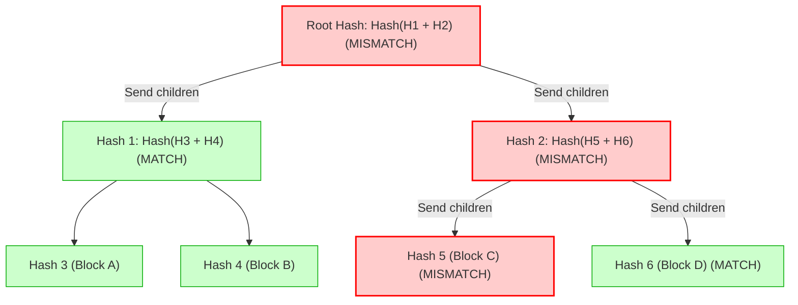
*(Diagram: Node B discovers the root differs. It compares H1 and H2. H1 matches perfectly, so Block A and B are ignored. H2 differs, so it descends to H5 and H6. H6 matches, H5 differs. Only Block C needs to be re-transmitted.)*

---

## 2. Segment Trees (Range Aggregation)

*   **What it does:** Answers math questions over a specific range of an array (e.g., "What is the sum/min/max of elements from index 2 to 8?") in $O(\log N)$ time, while also allowing elements to be updated in $O(\log N)$ time.
*   **How it works:** It is a perfectly balanced binary tree. The leaf nodes contain the raw array values. Every parent node contains the merged aggregate (sum, min, or max) of its children. 
*   **The Query:** When you query a range, the tree doesn't iterate through the raw leaves. Instead, it combines a few pre-calculated internal parent nodes, instantly skipping massive chunks of the array.
*   **Trade-offs:** Requires $O(N)$ build time and takes up exactly `4 * N` space in memory (usually implemented as a flat array where a node at index `i` has children at `2i` and `2i+1`).

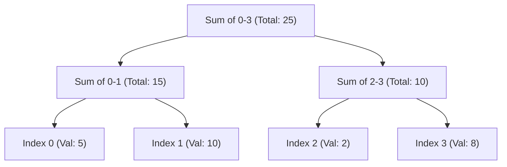

---

## 3. Fenwick Trees / Binary Indexed Trees (BIT)

*   **What it does:** A highly memory-efficient alternative to Segment Trees for calculating prefix sums and updating elements. It achieves the exact same $O(\log N)$ time complexity but is vastly lighter on memory and faster in practice.
*   **How it works:** It is brilliant bitwise wizardry. Instead of a bulky binary tree, a Fenwick Tree uses a single array of the exact same size as the data (`size N`). Each index stores the sum of a specific range of elements, dictated by the lowest set bit of the index's binary representation (extracted using `index & -index`).
*   **The Magic:** To find the sum of the first 13 elements (binary `1101`), the tree instantly breaks the query into:
    *   Sum of the first 8 elements (binary `1000`)
    *   Sum of the next 4 elements (binary `0100`)
    *   Sum of the last 1 element (binary `0001`)
*   **Trade-offs vs Segment Tree:** 
    *   **Pros:** Requires exactly $N$ memory (Segment Trees require $4N$). Incredibly short to code (about 3 lines for an update function). Much smaller constant-time factors (faster in CPU caching).
    *   **Cons:** Extremely difficult to use for non-invertible queries like Range Minimum/Maximum (Segment trees easily handle these).

---

## 4. Square Root (Sqrt) Decomposition

*   **What it does:** An algorithmic technique to break an array of $N$ elements into $\sqrt{N}$ chunks (blocks). It reduces range query time from $O(N)$ down to $O(\sqrt{N})$.
*   **How it works:** 
    1. Divide an array of 10,000 elements into 100 blocks, each containing 100 elements.
    2. Precompute the answer (sum, min, max) for each block.
    3. When querying a range (e.g., from index 150 to 825), you don't iterate through everything.
    4. You iterate through the middle fully-overlapped blocks in $O(1)$ time each. You only do a manual linear scan for the "partial blocks" on the extreme left and right edges.
*   **Trade-offs vs Trees:** 
    *   **Pros:** Incredible flexibility. Trees require the aggregate operation to be strictly associative. Sqrt Decomposition allows you to answer bizarre, complex queries (like finding the most frequent element in a range, commonly paired with **Mo's Algorithm**) because you can manually iterate the partial blocks.
    *   **Cons:** Asymptotically slower than trees ($O(\sqrt{N})$ is much worse than $O(\log N)$ for very large datasets).

</details>

<details>
<summary><b>Authentication and Authorization</b> (Click to expand)</summary>

# Authentication (AuthN) & Authorization (AuthZ)

**Sources:** 
- [7 Authentication Concepts Every Developer Should Know (Hayk Simonyan)](https://www.youtube.com/watch?v=iX8g4LqF8p8)
- [Authorization Explained: When to Use RBAC, ABAC, ACL & More (Hayk Simonyan)](https://www.youtube.com/watch?v=DT6Zy1X3ytM)

**TL;DR:** 
- **Authentication (AuthN)** proves *who you are* (Identity). 
- **Authorization (AuthZ)** determines *what you are allowed to do* (Permissions). 
You must always authenticate a user before you can authorize them.

---

## 1. Authentication (AuthN) Concepts

How do we securely prove the identity of a client, where is the state stored, and what does the network flow look like?

### 1. Session-Based Authentication (Stateful)
The traditional way of handling web application logins. The server maintains active state for every logged-in user.

* **Request Flow:**
  1. Client sends `POST /login` with `{username, password}`.
  2. Server hashes the password and compares it against the Users database table.
  3. If valid, the server generates a cryptographically random, opaque string called a `Session ID`.
  4. The server stores this mapping (`Session ID -> User ID`) in a centralized cache (like Redis) or a database.
  5. The server responds with a `Set-Cookie: session_id=xyz; HttpOnly; Secure` HTTP header.
  6. On subsequent API calls, the browser automatically attaches the `Cookie`.
  7. The server reads the cookie, queries Redis (`GET session:xyz`), retrieves the User ID, and processes the request.
* **Where it is stored:**
  * **Client-side:** In an `HttpOnly` cookie (immune to XSS attacks via JavaScript).
  * **Server-side:** In memory, a database, or a distributed cache (Redis/Memcached).

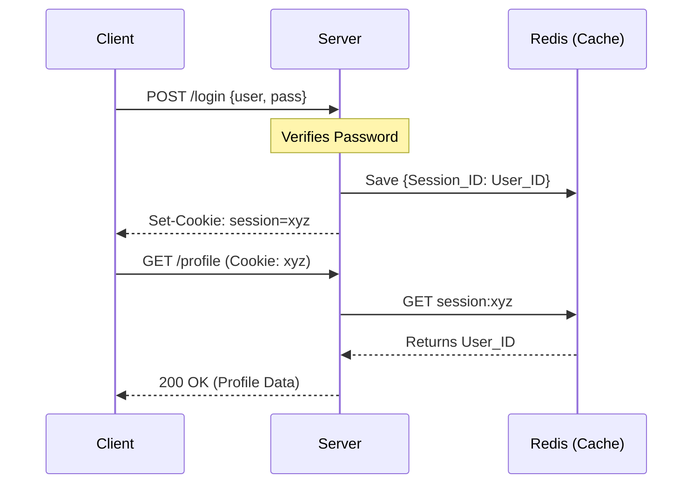

* **Trade-offs:** Secure and allows instant revocation (the server just deletes the key from Redis). However, it requires a database/cache lookup on *every single API request*, which can become a bottleneck at massive scale.

### 2. Token-Based Authentication (Stateless / JWT)
The modern standard for high-scale APIs and microservices, designed to eliminate the database lookup bottleneck.

* **Request Flow:**
  1. Client sends `POST /login` with `{username, password}`.
  2. Server verifies the credentials against the database.
  3. Server generates a JSON Web Token (JWT). It takes a Payload (e.g., `{"user_id": 123}`), and signs it using a cryptographic hashing algorithm (like HMAC SHA-256) and a `SECRET_KEY` that only the server knows.
  4. Server sends the JWT string back to the client. *The server does not save this token anywhere.*
  5. Client stores the token and attaches it to subsequent requests via the `Authorization: Bearer <token>` HTTP header.
  6. Server receives the token, strips the signature, and re-calculates the hash using its own `SECRET_KEY` and the provided Payload. 
  7. If the computed hash matches the token's signature, the server has mathematical proof the token is authentic and hasn't been tampered with. It immediately trusts the `user_id` inside.
* **Where it is stored:**
  * **Client-side:** Either in JavaScript memory (React/Vue state), LocalStorage (vulnerable to XSS), or preferably an `HttpOnly` cookie.
  * **Server-side:** **Nowhere.** It is entirely stateless.

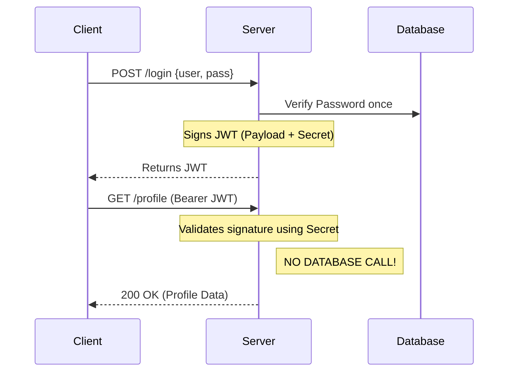

* **Trade-offs:** Immensely scalable and fast, with zero network latency required to verify the user. However, because the server doesn't store the token, it cannot easily revoke it. Once a JWT is issued, it is valid until its expiration time.

### 3. Access Tokens vs Refresh Tokens
To mitigate the inability to revoke stateless JWTs, modern systems use a dual-token architecture.

* **Access Token:** A short-lived JWT (e.g., 15 minutes). Used for all standard API calls.
* **Refresh Token:** A long-lived, opaque string (e.g., valid for 30 days). 
* **Request Flow:**
  1. Upon login, the client receives *both* tokens. 
  2. When the short-lived Access Token expires, API calls return `401 Unauthorized`.
  3. The client hits a specific `/refresh` endpoint, providing the Refresh Token.
  4. The server performs a **stateful database lookup** to verify the Refresh Token hasn't been revoked.
  5. If valid, the server issues a brand new 15-minute Access Token.
* **Where it is stored:**
  * **Client-side:** Refresh tokens *must* be stored securely (e.g., `HttpOnly` cookies or secure mobile enclaves).
  * **Server-side:** Refresh tokens *must* be stored in the database so they can be revoked (e.g., if a user clicks "Log out of all devices", or is banned).

### 4. API Keys (Machine-to-Machine)
If JWTs are so scalable, why do services like AWS or Stripe issue opaque "API Keys"?
* **Use Case:** JWTs are for humans (web/mobile apps). API Keys are for scripts, backend services, or developers.
* **Request Flow:** Client sends the API Key in an `x-api-key` header. The server performs a database or Redis lookup to verify who the key belongs to.
* **Where it is stored:** 
  * **Client-side:** Environment variables (`.env`) or secret managers (AWS Secrets Manager).
  * **Server-side:** Database (often hashed for security) and heavily cached in Redis for speed.
* **Trade-offs:** Machines require strict, instant revocation controls (in case a key is accidentally committed to GitHub). Because machine traffic is generally lower volume and more predictable than millions of human users, the database lookup overhead is an acceptable trade-off for instant revocation.

### 5. OAuth 2.0 vs OpenID Connect (OIDC)
* **OAuth 2.0 (Authorization):** A framework that allows an application to access resources on your behalf (e.g., granting a website access to read your Google Drive files) without giving them your password. It delegates access by issuing an **Access Token**. It does *not* prove your identity.
* **OpenID Connect (Authentication):** An identity layer built on top of OAuth 2.0 (e.g., "Sign in with Google"). During the OAuth flow, OIDC additionally issues an **ID Token** (a JWT containing your user profile, email, etc.), allowing the application to authenticate exactly who you are.

---

## 2. Authorization (AuthZ) Frameworks

Once the server mathematically verifies the JWT (or looks up the Session) and knows *who* you are, how does the codebase and database enforce what you are allowed to access?

### 1. Access Control Lists (ACL)
The most granular approach. A literal database table mapping `User -> Resource -> Permission`.
* **Example:** `User: Alice` has `READ` access to `File: budget.pdf`.
* **Where it is stored:** A many-to-many junction table in an RDBMS (e.g., `user_id`, `file_id`, `permission_type`).
* **Pros:** Extremely precise (file-level or row-level permissions).
* **Cons:** Unmanageable at scale. If you hire 100 new employees, you must insert thousands of rows into the ACL table granting them access to specific files.

### 2. Role-Based Access Control (RBAC)
The industry standard for B2B and SaaS applications. Users are assigned **Roles**, and Roles are assigned **Permissions**.
* **Request Flow:** 
  1. The server extracts the `user_id` from the JWT.
  2. The server queries the DB: `SELECT role FROM users WHERE id = 123` (or the role is simply embedded inside the JWT payload to save a DB call!).
  3. The server checks if the `Manager` role has the `write:financials` permission.
* **Where it is stored:** Usually 3 tables: `Users`, `Roles`, and `Role_Permissions`.

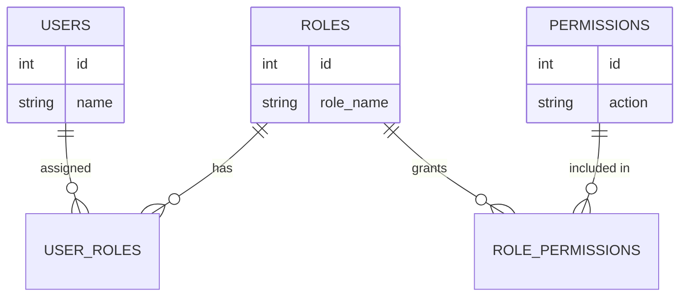

* **Pros:** Highly scalable. When a new employee joins, you just assign them the `Manager` role.
* **Cons:** "Role Explosion." If you need a Manager who can only read financials but not write them, you have to create a new role (`Manager-ReadOnly`). Complex organizations quickly end up with hundreds of hyper-specific roles.

### 3. Attribute-Based Access Control (ABAC)
The most dynamic and complex model. Access is determined by evaluating boolean rules in real-time against the attributes of the User, the Resource, and the Environment.
* **Request Flow:**
  1. User requests access to a file.
  2. A Policy Engine evaluates a rule: `Allow Access IF User.Department == "Finance" AND Resource.Classification == "Confidential" AND Environment.Time < 5:00 PM AND Environment.IP_Address == "Internal_Office"`.
* **Where it is stored:** Policies are often stored as JSON documents or written in specialized policy languages (like Rego for Open Policy Agent / OPA).
* **Pros:** Infinite flexibility. Completely solves the "Role Explosion" problem.
* **Cons:** Complex to engineer, hard to audit (you cannot easily run a SQL query to ask "Who has access to this file?"), and adds latency to every API request because the Policy Engine must dynamically compute multiple rules.

</details>

<details>
<summary><b>Caching Strategies</b> (Click to expand)</summary>

# Caching Strategies & Interview Patterns

**Source:** [Caching in System Design Interviews w/ Meta Staff Engineer (Hello Interview)](https://www.youtube.com/watch?v=1NngTUYPdpI)

**TL;DR:** Caching is the ultimate tool for scaling read-heavy systems and reducing latency. It trades a bit of storage and complexity for speed by keeping recently used data in a faster layer. In a system design interview, caching should be brought up during the deep dive (non-functional requirements) to address scale and performance. You must be able to discuss **Where to Cache**, **Architectures**, **Eviction Policies vs TTL**, and **Common Pitfalls**.

---

## 1. The Physics of Caching (Why we do it)
*   **Disk Access (SSD/DB):** ~1 millisecond.
*   **Memory Access (RAM):** ~100 nanoseconds.
*   **The Gap:** Memory is roughly **10,000x faster** than disk. When serving thousands of requests per second, caching takes advantage of this massive difference.

## 2. Where to Cache (The Layers)

1.  **External Caching (Redis / Memcached):** 
    *   The most common in system design interviews. 
    *   Runs on its own server. Multiple application servers share the same global cache, meaning if one server fetches the data, all other servers instantly benefit.
2.  **In-Process Caching (Guava / Local Memory):** 
    *   Stores data directly inside the application server's RAM. 
    *   **Pros:** The absolute fastest caching possible (zero network hops).
    *   **Cons:** State is isolated per server (can lead to inconsistencies and wasted memory). 
    *   **Use Case:** Static config data or lookup tables requiring ultra-low latency.
3.  **CDNs (Content Delivery Networks):** 
    *   Edge caching geographically close to users.
    *   Optimizes for **network latency** rather than disk vs. memory. Drops a global 300ms round-trip down to 20ms.
    *   **Use Case:** Media delivery (images, videos), static assets, public API responses, and HTML.
4.  **Client-Side Caching:** 
    *   Browser HTTP cache, Local Storage, or mobile on-device disk.
    *   **Use Case:** Offline functionality (e.g., Strava syncing runs when offline). You have the least control over data freshness here.

---

## 3. Caching Architectures (How data is updated)

### Cache-Aside (Lazy Loading)
*   **How it works:** The application logic handles everything. On a read, the app checks the cache. If it's a miss, it fetches from the DB, writes it to the cache, and returns it.
*   **Pros:** Resilient (if cache goes down, the app hits the DB). Lean (only requested data gets cached). **This should be your default choice in an interview.**
*   **Cons:** Cache misses have higher latency (3 trips: check cache, query DB, write to cache). 

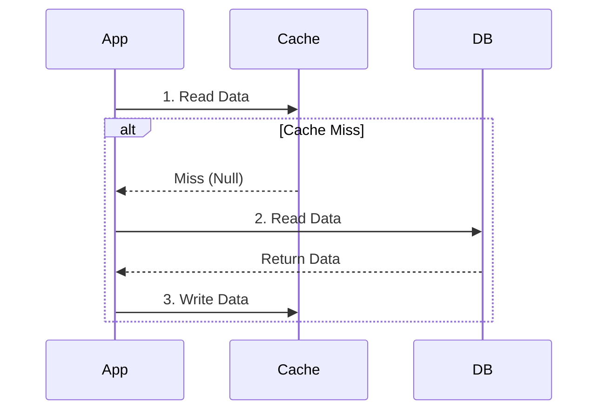

### Write-Through
*   **How it works:** The application only writes to the cache. The caching library then synchronously writes to the database *before* returning success.
*   **Pros:** Strong consistency between Cache and DB.
*   **Cons:** Slower writes. Suffers from the **Dual Write Problem** (if the DB write fails but the cache write succeeds, creating split-brain). Bloats the cache with data that might never be read again.

### Write-Behind (Write-Back)
*   **How it works:** The application writes to the cache and instantly gets a `200 OK`. The cache flushes these updates to the database asynchronously in batches.
*   **Pros:** Blazing fast write throughput (great for metrics/analytics).
*   **Cons:** **Data Loss!** If the cache node crashes before the batch flushes, the data is gone forever. *Interview Tip: Avoid proposing this unless you are highly experienced and can strongly justify the data loss risk.*

### Read-Through
*   **How it works:** Similar to Cache-Aside, but the cache itself transparently orchestrates the DB fallback (the application only ever talks to the Cache). This is exactly how CDNs work.

---

## 4. Cache Eviction vs. Cache Expiration (TTL)

Because memory is expensive and limited, caches must delete old data. There are two entirely different concepts that control data removal: **Eviction** (running out of space) and **Expiration / TTL** (data becoming stale).

### Eviction Policies (When the cache is FULL)
*   **LRU (Least Recently Used):** Evicts the item that hasn't been read or written in the longest time. **This is the most common default in interviews.**
*   **LFU (Least Frequently Used):** Evicts the item with the lowest total access count. Great if access patterns are highly skewed, but can suffer from "historical baggage" (an item was wildly popular a month ago and never gets evicted despite not being read anymore).
*   **FIFO (First In, First Out):** Evicts the oldest item based strictly on insertion time. Rarely the right choice.

### Time To Live (TTL) / Expiration
*   **How it works:** Each cached item has a strict expiration time (e.g., 60 seconds). Once that time passes, the cache automatically deletes it.
*   **When to use it:** Perfect for when **freshness matters more than frequency**. Use it for data that naturally goes stale: user sessions, social media feeds, API responses, or profile images.
*   *Interview Tip:* Be ready to combine these! You can use an LRU cache with a 5-minute TTL, meaning data dies naturally after 5 minutes, but might be evicted sooner if the cache fills up.

---

## 5. The 3 Major Caching Pitfalls (Interview Traps)

There are two hard problems in computer science: naming things, and cache invalidation. Interviewers will drill into these three edge cases:

### Pitfall 1: Cache Consistency (Stale Data)
If a user updates their profile picture in the database, but the old picture is still in the cache, other users will see stale data.
*   **Solution 1 (Invalidate on Write):** Whenever you write to the DB, explicitly send a `DELETE` command to the cache for that key. The next read will force a fresh pull.
*   **Solution 2 (Short TTL / Eventual Consistency):** If it's a social media feed, set a short TTL (e.g., 5 minutes) and explicitly state: *"Some users will see stale data for 5 minutes, and that is an acceptable business trade-off because it's not a critical financial transaction."*

### Pitfall 2: Cache Stampede (Thundering Herd)
A massively popular key (like a homepage feed) has a TTL of 60 seconds. When it expires, 100,000 concurrent user requests suddenly miss the cache and all try to rebuild the cache at the exact same time. This turns 1 query into 100,000 database queries instantly, causing cascading failures and melting down the database.

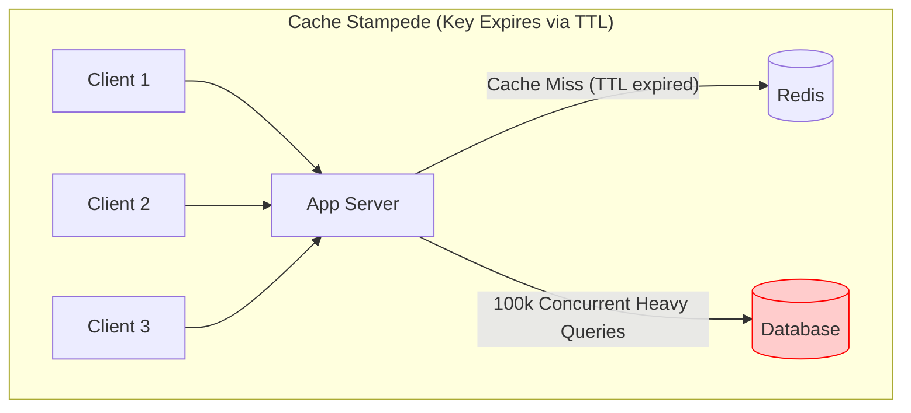

*   **Solution 1: Request Coalescing (Single Flight):** When multiple requests miss the same key, only the *first* request is allowed to go to the database. The other 99,999 requests are forced to wait (usually via a lock or polling mechanism) for the first request to repopulate the cache, and then they all read from the newly refreshed cache.
*   **Solution 2: Cache Warming (Proactive Background Refresh):** Instead of waiting for the popular key to expire at 60 seconds, a background worker proactively refreshes the key at the **55-second mark**. This means the key *never actually expires*, and the cache stampede is physically impossible.

### Pitfall 3: Hot Keys (The Celebrity Problem)
Even if your cache hit rate is perfect, if Taylor Swift's profile gets 99% of the traffic, the single cache shard holding that specific key will be overwhelmed by network bandwidth and crash, leaving the rest of the cluster idle.

*   **Solution 1 (Replication):** Replicate the hot key across *all* cache nodes instead of hashing it to one. The router can then pick any random cache node to serve the data.
*   **Solution 2 (Local In-Memory Cache):** Add a tiny in-process cache (e.g., Guava) directly inside the application servers for the top 10 most popular items to prevent requests from even hitting the Redis cluster.

---

## 6. How to Talk About Caching in Interviews

**Rule #1: NEVER just add a cache for the sake of adding a cache.** 
Dropping a cache into your design without justification is an immediate red flag. Wait for the Deep Dive phase (Non-Functional Requirements) and use this **5-Step Framework**:

1.  **Identify & Quantify the Bottleneck:** Justify the cache. Are you serving 2 billion reads a day? Is computing a newsfeed causing high latency (joins across 5 tables)? Is there a strict 100ms SLA?
2.  **Explicitly Define the Cache Keys:** Do not just say "I'll cache the data." Say exactly what you are caching: *"I will cache the computed newsfeed against the key `feed:{user_id}`."*
3.  **Choose the Architecture:** State your choice (default to Cache-Aside).
4.  **State the Eviction Policy:** Choose LRU or a strict TTL and justify why.
5.  **Address the Downsides:** Proactively bring up how you will handle Consistency, Hot Keys, or Stampedes before the interviewer even asks.

</details>

<details>
<summary><b>Cassandra</b> (Click to expand)</summary>

# Apache Cassandra Deep Dive

**Source:** [Cassandra Deep Dive w/ Ex-Meta Staff Engineer (Hello Interview)](https://www.youtube.com/watch?v=TD3-INhm60Q) | [Hello Interview Written Guide](https://www.hellointerview.com/learn/system-design/deep-dives/cassandra)

**TL;DR:** Apache Cassandra is an open-source, masterless, distributed NoSQL wide-column database engineered for massive write throughput, horizontal elasticity, zero single-point-of-failure (SPOF) availability, and multi-datacenter replication. It blends the decentralized peer-to-peer ring topology and tunable quorum consistency of **Amazon Dynamo** with the Log-Structured Merge-tree (LSM) storage engine and column family model of **Google Bigtable**. In system design interviews, Cassandra is the premier choice for write-heavy (>100k writes/sec), time-series, or messaging applications with predictable, query-driven access patterns.

---

## 1. Lineage & Motivation

### A. Origins at Facebook (2007)
Cassandra was created in 2007 at Facebook by **Avinash Lakshman** (co-inventor of Amazon's Dynamo) and Prashant Malik to solve the **Facebook Inbox Search** problem. 
*   **The Scale Challenge:** Millions of users sending billions of messages per day required an infrastructure capable of absorbing enormous write volume without latency spikes.
*   **The Problem with RDBMS:** Scaling a traditional relational database (MySQL/PostgreSQL) for write loads required manual sharding, complex failover orchestration, master-replica replication lag, and rigid schemas. Adding capacity required painful downtime or complex data migration scripts.
*   **The Solution:** Combine the best distributed system primitives into a single database:
    1.  **Amazon Dynamo Lineage:** Fully peer-to-peer (masterless) ring architecture, consistent hashing with virtual nodes (v-nodes), gossip protocol for decentralized cluster state, and tunable quorum consistency ($R + W > RF$).
    2.  **Google Bigtable Lineage:** Log-Structured Merge-Tree (LSM-tree) storage architecture with sequential write-ahead commit logs, in-memory Memtables, immutable disk-based SSTables, Bloom filters, and sparse wide-column data modeling.

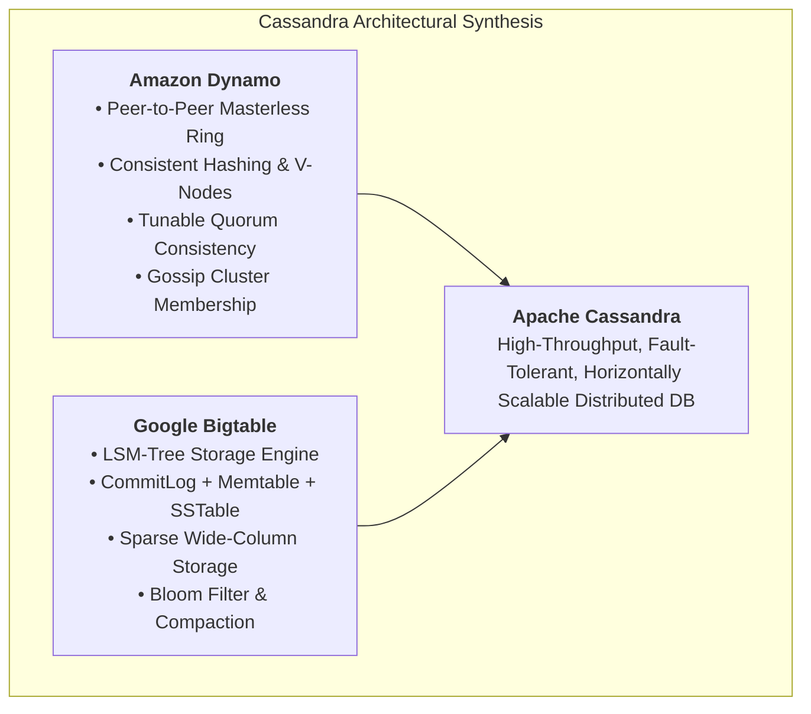

---

## 2. Cassandra Data Model & Hierarchy

Unlike relational databases where storage is normalized across rigid tables, Cassandra uses a sparse, wide-column model that organizes data into a 4-level hierarchy:

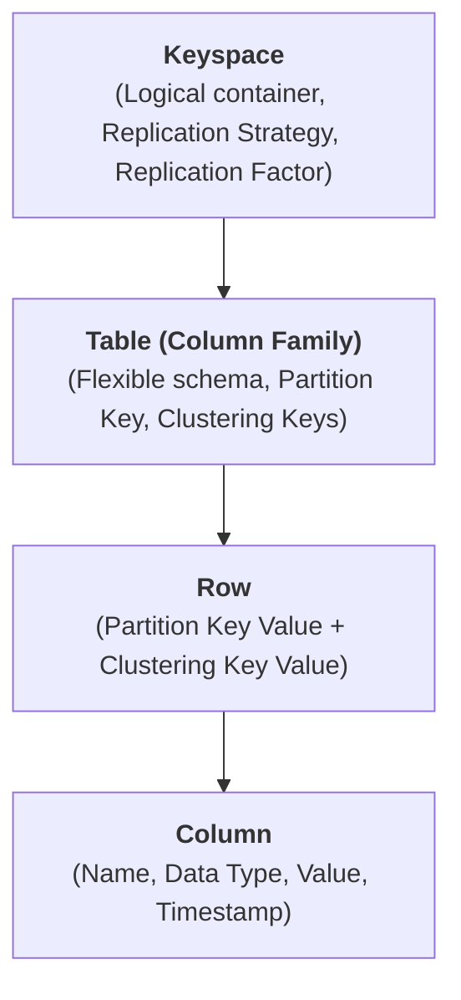

1.  **Keyspace:** The highest-level container (equivalent to an RDBMS `DATABASE` or `SCHEMA`). Defines cluster-wide replication mechanics:
    *   **Replication Strategy:** How copies are placed (e.g., `NetworkTopologyStrategy`).
    *   **Replication Factor ($RF$):** How many physical copies of data exist across the cluster (e.g., $RF = 3$).
2.  **Table:** A collection of partitions defining the primary key and typed columns. Unlike SQL tables, Cassandra tables are **sparse wide-column stores**: rows in the same table do not need to share the same columns, and empty columns take up 0 bytes on disk (no `NULL` storage overhead).
3.  **Row:** A set of columns addressed uniquely by a Primary Key.
4.  **Column:** The atomic unit of storage comprising `(name, value, timestamp)`. The timestamp is supplied by the client or coordinator and is fundamental to Cassandra's Last-Write-Wins (LWW) conflict resolution.

---

## 3. Primary Key Anatomy: Partition Key vs. Clustering Key

In an interview, **data modeling in Cassandra begins and ends with the Primary Key**. Getting the primary key wrong leads to hot nodes, unbounded partitions, or impossible queries.

$$\text{PRIMARY KEY} = (\text{Partition Key}) + [\text{Clustering Key(s)}]$$

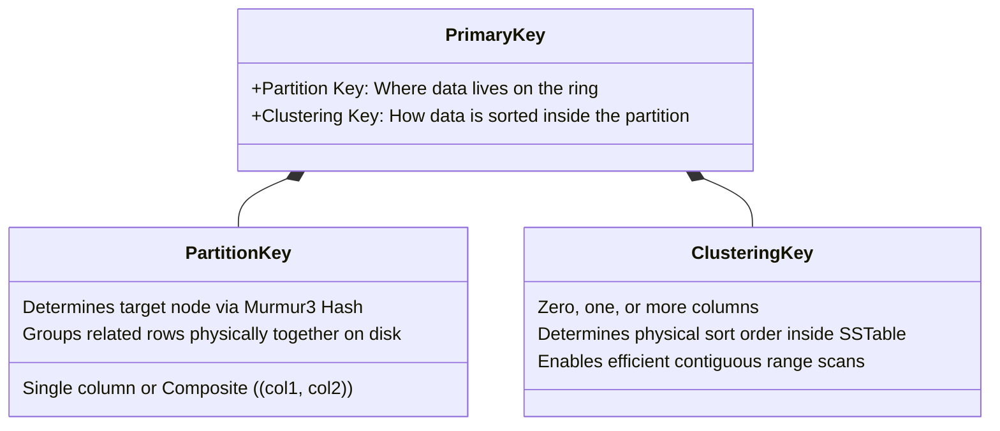

### A. Partition Key (Where it lives)
*   **Role:** Passed through a deterministic hash function (`Murmur3Partitioner`) to produce a 64-bit integer token ($ -2^{63} \text{ to } 2^{63}-1 $). This token dictates which nodes on the consistent hash ring own the partition.
*   **Single vs. Composite Partition Key:**
    *   `PRIMARY KEY (user_id)` $\to$ `user_id` is the partition key.
    *   `PRIMARY KEY ((user_id, bucket_id), message_id)` $\to$ `(user_id, bucket_id)` is a **composite partition key**. Both columns are hashed together to select the partition node.

### B. Clustering Key (How it is sorted)
*   **Role:** Determines the physical on-disk sort order of rows *within* a single partition.
*   **Behavior:** Cassandra stores rows within a partition sorted by the clustering column(s). This makes range queries (e.g., `WHERE message_id > X AND message_id < Y`) blazingly fast because they map to a sequential disk seek rather than random lookups.

```sql
-- Example: User Messages Table
CREATE TABLE user_messages (
    user_id uuid,
    message_id timeuuid,
    sender_id uuid,
    content text,
    PRIMARY KEY (user_id, message_id)
) WITH CLUSTERING ORDER BY (message_id DESC);
```
*   `user_id` is the **Partition Key** (all messages for a user live on the same physical node).
*   `message_id` is the **Clustering Key** (sorted newest first on disk for fast reverse-chronological chat rendering).

---

## 4. Entity-Driven vs. Query-Driven Data Modeling

One of the biggest red flags in a system design interview is modeling Cassandra data as if it were PostgreSQL or MySQL.

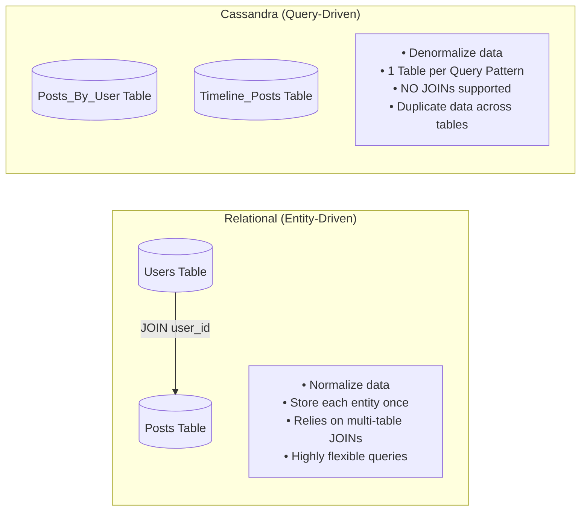

| Dimension | Relational Databases (RDBMS) | Apache Cassandra |
| :--- | :--- | :--- |
| **Philosophy** | **Entity-Driven** (Design around relationships) | **Query-Driven** (Design around queries) |
| **Normalization** | 3NF (Third Normal Form) to eliminate duplication | Deliberate **Denormalization** (duplication is encouraged) |
| **Joins** | Core capability (`INNER`, `LEFT`, `CROSS JOIN`) | **Unsupported**; single-table queries only |
| **Query Flexibility**| Arbitrary `WHERE` filters, `GROUP BY`, dynamic ad-hoc SQL | Queries **must** include the partition key; filtering without it is an anti-pattern (`ALLOW FILTERING`) |
| **Storage vs Compute**| Optimize for minimal disk storage | Optimize for fast, single-node sequential read computation |

> [!IMPORTANT]
> **Interview Rule of Thumb:** In Cassandra, **storage is cheap, but scatter-gather reads across multiple partitions will kill your latency SLAs**. You should happily duplicate data into multiple tables to satisfy distinct query patterns with single-partition reads.

---

## 5. Architecture: The Peer-to-Peer Ring

### A. Masterless Topology (No Single Point of Failure)
Cassandra clusters have **no leader, master, or coordinator node**. Every node is architecturally identical and can accept read/write requests from any client. This eliminates the vulnerability of master failover lag, split-brain elections, and single-point-of-failure dependencies (such as Apache ZooKeeper or etcd).

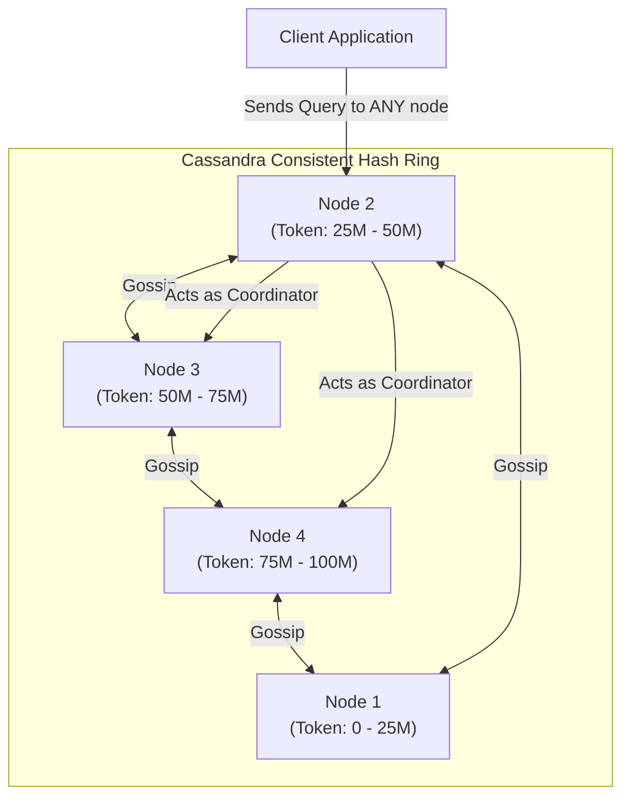

1.  **Request Coordination:** When a client issues a query to any random node, that node acts as the **Coordinator** for that request.
2.  **Route Calculation:** The coordinator hashes the row's partition key (`Murmur3(partition_key)`) to locate the owning token range, identifies the primary node and its replicas, and forwards the request in parallel.
3.  **Client-Aware Routing:** Modern client drivers (e.g., DataStax Java/Go driver) are token-aware; they maintain a local map of cluster tokens and route queries directly to an owning replica, skipping extra network hops.

### B. Consistent Hashing & Virtual Nodes (V-nodes)
*   **The Modulo Problem:** Traditional sharding ($hash(key) \pmod N$) requires redistributing almost 100% of keys whenever a node joins or leaves.
*   **Consistent Hashing:** Arranges tokens in a continuous ring ($0 \text{ to } 2^{64}-1$). A partition key maps to a point on the ring, and the first node encountered moving clockwise owns the data.
*   **Virtual Nodes (V-nodes):** Instead of assigning a physical machine a single contiguous token range, Cassandra assigns each physical machine multiple small tokens (typically 128 or 256 v-nodes) distributed randomly across the ring.
    *   **Even Load Balancing:** Eliminates data skews caused by uneven hash distribution.
    *   **Fast Parallel Recovery:** When a node crashes, all remaining nodes in the cluster participate equally in reading and rebuilding pieces of its data, preventing any single surviving node from bottlenecking.

### C. Replication Strategies
Replication is configured per keyspace. Cassandra scans clockwise from the owning token to assign replicas:
1.  **SimpleStrategy:** Places subsequent replicas on the next physical nodes clockwise on the ring. Used *strictly* for single-datacenter local development.
2.  **NetworkTopologyStrategy (Production Standard):** Datacenter and rack-aware. It ensures replicas are placed in different racks within each datacenter to survive power strip/top-of-rack switch failures, and replicates data across distinct geographical regions (e.g., `{'us-east': 3, 'eu-central': 3}`).

---

## 6. Cluster Coordination & Fault Tolerance

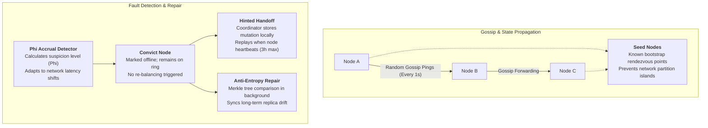

### A. Gossip Protocol
*   Every node executes a background gossip thread every **1 second**.
*   A node randomly selects 1–3 peer nodes, with a probabilistic preference for **Seed Nodes** (designated bootstrap nodes that prevent split-brain cluster partitions).
*   Nodes exchange lightweight state descriptors including:
    *   Heartbeat state (Generation timestamp + Version counter).
    *   Endpoint state (Tokens owned, schema agreement, node IP/status).
*   **Vector Clocks:** Every node uses generation (time of node startup) and version (monotonic counter) to discard outdated gossip information and converge on a single, global cluster view in $O(\log N)$ time without central locking.

### B. Phi ($\Phi$) Accrual Failure Detector
*   Unlike rigid binary heartbeat systems that falsely declare nodes dead during minor network blips, Cassandra computes a continuous suspicion score ($\Phi$).
*   It tracks historical inter-arrival times of heartbeat messages and calculates the probability that an unreceived heartbeat represents a genuine crash versus transient network congestion.
*   When $\Phi$ exceeds a configured threshold (typically 8 to 12), the node is **convicted** (flagged as down).

### C. Self-Healing Mechanics
1.  **Hinted Handoff:**
    *   If a write succeeds on some replicas but one replica is dead/unreachable, the coordinator stores a temporary **hint** (the write payload + timestamp) on its local disk.
    *   When gossip detects the dead node has returned online, the coordinator replays all accumulated hints to bring it up to date immediately.
    *   *Constraint:* Hints expire after a configurable duration (default: 3 hours) to prevent coordinator disks from filling up during extended outages.
2.  **Read Repair:**
    *   When an application issues a read at `QUORUM`, the coordinator queries all participating replicas.
    *   If replica responses differ, the coordinator returns the row with the newest timestamp to the client, and asynchronously fires a background **Read Repair** mutation to update the out-of-date replicas.
3.  **Anti-Entropy Node Repair (Nodetool Repair):**
    *   A periodic maintenance task where nodes construct **Merkle Trees** (cryptographic hash trees) of their token ranges and compare them over the network.
    *   Only mismatched sub-trees ($O(\log N)$ network payload) are exchanged, repairing silent bit rot or nodes offline beyond the hinted handoff window.

---

## 7. Storage Engine Internals: The Write & Read Paths

Cassandra is an implementation of a **Log-Structured Merge-Tree (LSM)**. Understanding why writes are $O(1)$ and how reads are accelerated is essential.

### A. The Write Path (Blazing Fast, Append-Only)

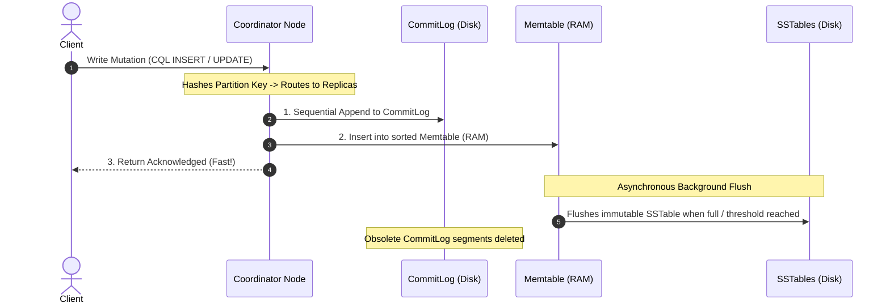

1.  **CommitLog (Disk):** Sequential, append-only write-ahead log stored on disk. It provides crash durability. Because sequential disk writes incur zero random-head seek overhead, appending to the CommitLog takes fractions of a millisecond.
2.  **Memtable (RAM):** The mutation is concurrently inserted into an in-memory sorted skip-list or binary search tree. Rows are sorted by partition key and clustering key.
3.  **Client Acknowledgment:** Once written to both CommitLog and Memtable, the node replies with success. **No on-disk table updates or page splits occur during the write path.**
4.  **Flushing to SSTables (Disk):** When the Memtable reaches capacity (or after a time threshold), it flushes sequentially to disk as an immutable **SSTable (Sorted String Table)**. 
5.  **CommitLog Cleanup:** Once an SSTable is safely written to disk, its corresponding CommitLog segments are truncated.

### B. The Read Path (Multi-Tier Retrieval & Reconciliation)

Because data for a single row may be split across the in-memory Memtable and multiple on-disk SSTables, reading is inherently more complex than writing.

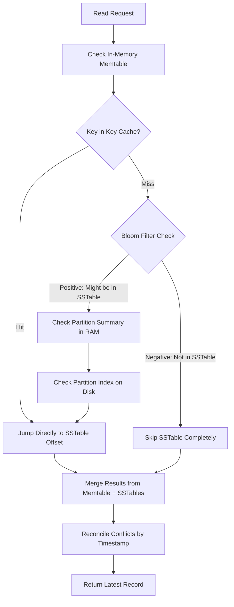

1.  **Memtable Lookup:** Check active memory for the most recent unflushed writes.
2.  **Key Cache (RAM):** An LRU cache mapping partition keys directly to exact byte offsets in SSTables. If hit, skips index lookups entirely.
3.  **Bloom Filter (RAM):** A probabilistic, ultra-fast data structure per SSTable that determines with 100% certainty if a partition key **does not** exist in the SSTable, or if it **might** exist. It eliminates 95%+ of unnecessary disk reads.
4.  **Partition Summary (RAM):** An in-memory index sampling every $N$-th entry of the on-disk Partition Index.
5.  **Partition Index (Disk):** Locates the exact byte offset of the partition within the SSTable data file.
6.  **SSTable Data Read:** Reads the requested columns off disk.
7.  **Timestamp Reconciliation:** The coordinator merges fragments from Memtable and SSTables, picking the newest value for each column based on client timestamp.
8.  **Read Repair:** If any queried replica returned stale data, the coordinator fires an asynchronous background update.

### C. Compaction & Tombstones

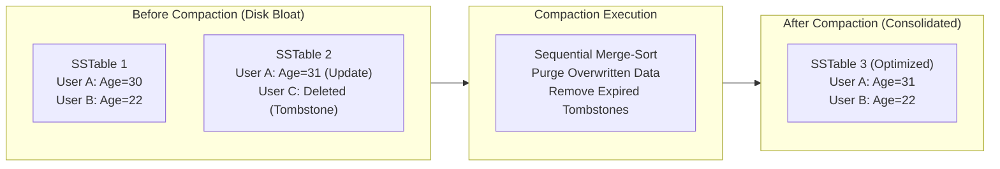

*   **Compaction:** In the background, Cassandra merges multiple immutable SSTables using a sequential merge-sort algorithm into a single consolidated SSTable. It discards superseded values and reclaims disk space.
    *   *Size-Tiered Compaction Strategy (STCS):* Default; optimized for write-heavy workloads.
    *   *Leveled Compaction Strategy (LCS):* Organizes SSTables into fixed-size hierarchical tiers (L0, L1, L2...); optimized for read-heavy workloads (reduces the number of SSTables checked per read to $\sim 1$).
    *   *Time-Window Compaction Strategy (TWCS):* Bins data into time windows; ideal for time-series data with TTLs.
*   **The Tombstone Trap:** In an append-only engine, you cannot "delete" a row in place. Deleting a row writes a **Tombstone** (a record stating "Key X was deleted at Timestamp T"). 
    *   *The Trap:* If an application frequently creates and deletes rows, reading that partition requires scanning through thousands of tombstones. If the tombstone count exceeds 100,000, Cassandra aborts the query with a `ReadFailureException` to protect node memory!

---

## 8. Tunable Consistency & The CAP Theorem

Cassandra is fundamentally an **AP system** (Available and Partition-Tolerant), favoring high availability and low latency over immediate global consistency. However, consistency is **tunable per query**.

### Consistency Levels Cheatsheet
*   `ANY`: Write succeeds if *any* node accepts it, including a hinted handoff. (Weakest; writes only).
*   `ONE` / `TWO` / `THREE`: Satisfied when $N$ replicas acknowledge the read/write.
*   `QUORUM`: Satisfied when a majority of replicas across the cluster acknowledge:
    $$\text{QUORUM} = \left\lfloor \frac{RF}{2} \right\rfloor + 1$$
*   `LOCAL_QUORUM`: Satisfied when a majority of replicas in the **local coordinator's datacenter** acknowledge. **This is the industry standard for multi-datacenter production setups** because it prevents cross-ocean WAN latency from blocking queries.
*   `ALL`: All $RF$ replicas must acknowledge. Turns Cassandra into a strictly consistent **CP system**; if even one replica is down or network-isolated, the query fails.

### Strong Consistency Quorum Formula

$$\text{Read Quorum} + \text{Write Quorum} > \text{Replication Factor} \quad (R + W > RF)$$

If the sum of read and write replicas exceeds the replication factor, the read set and write set are guaranteed to overlap on at least one replica node, guaranteeing **Strong Consistency** (Read-Your-Writes).

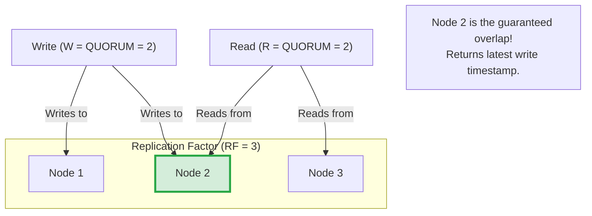

*   **Example ($RF = 3$):**
    *   $W = \text{QUORUM} (2)$
    *   $R = \text{QUORUM} (2)$
    *   $R + W = 4 > 3 \implies$ **Strong Consistency guaranteed.**

---

## 9. Real-World Case Studies & CQL Modeling

### Case Study 1: Discord Message Storage (Snowflake IDs + Time Bucketing)
*   **Context:** Discord migrated from MongoDB to Cassandra to store billions of chat messages across millions of channels.
*   **The Naive Schema:**
    ```sql
    CREATE TABLE messages (
        channel_id bigint,
        message_id bigint,
        author_id bigint,
        content text,
        PRIMARY KEY (channel_id, message_id)
    ) WITH CLUSTERING ORDER BY (message_id DESC);
    ```
*   **The Problem:** Partitions in Cassandra must remain small (<100MB). Active channels run continuously for years, accumulating millions of messages. This causes a **Monotonically Growing Partition** that degrades compaction, increases read latency, and exhausts heap memory.
*   **Discord's Solution:**
    1.  **Snowflake IDs:** 64-bit unique IDs encoding a millisecond timestamp. This guarantees chronological sorting without primary key collision risks inherent in raw timestamps.
    2.  **Time Bucketing:** Introduce a `bucket` integer representing 10 days of elapsed time into the partition key.

```sql
-- Production Discord Schema
CREATE TABLE messages_by_channel (
    channel_id bigint,
    bucket int,
    message_id bigint,
    author_id bigint,
    content text,
    PRIMARY KEY ((channel_id, bucket), message_id)
) WITH CLUSTERING ORDER BY (message_id DESC);
```
*   **Result:** 
    *   A busy channel's messages are physically chopped into distinct 10-day partitions.
    *   Reading recent messages hits only the current bucket partition `((channel_id, current_bucket))`.
    *   Partitions are bounded in size and never grow indefinitely.

---

### Case Study 2: Ticketmaster Seat Browsing UI
*   **Context:** Millions of fans browse seat maps during major concert on-sales. Availability changes dynamically; eventual consistency is acceptable for browsing (the checkout step uses an ACID transaction in a separate SQL DB).
*   **The Naive Schema:**
    ```sql
    CREATE TABLE tickets (
        event_id bigint,
        seat_id bigint,
        price bigint,
        PRIMARY KEY (event_id, seat_id)
    );
    ```
    *   *Problem:* An event with 80,000 seats stores all seats in a single partition. Querying section-level availability or high-level price minimums requires scanning the entire 80,000-seat partition and aggregating in application memory.
*   **The Query-Driven Redesign:**
    *   Observe the UX: Users browse by **Section** first, then zoom in to individual **Seats**.
    *   Split into two complementary, denormalized tables:

```sql
-- 1. Table to render high-level venue overview map
CREATE TABLE event_sections (
    event_id bigint,
    section_id bigint,
    available_tickets int,
    price_floor int,
    PRIMARY KEY (event_id, section_id)
);

-- 2. Table to render detailed seats within a clicked section
CREATE TABLE section_seats (
    event_id bigint,
    section_id bigint,
    seat_id bigint,
    is_available boolean,
    price int,
    PRIMARY KEY ((event_id, section_id), seat_id)
);
```
*   **Result:**
    *   `event_sections` has only $\sim 50\text{--}100$ rows per event (tiny partition, instant venue map rendering).
    *   `section_seats` distributes the 80,000 seats across 100 distinct section partitions across the cluster, eliminating hot nodes and enabling sub-millisecond drill-down queries.

---

## 10. Advanced Cassandra Features

1.  **Storage Attached Indexes (SAI):**
    *   Historically, Cassandra Secondary Indexes were a known anti-pattern because they required scatter-gather queries across every node in the cluster.
    *   SAI is a modern indexing architecture that indexes data column-by-column directly alongside SSTables on disk with minimal memory overhead, making secondary column lookups viable for low-frequency queries without creating a whole new denormalized table.
2.  **Materialized Views:**
    *   Allows Cassandra to automatically maintain secondary tables partitioned by different columns under the hood.
    *   *Caveat for Interviews:* Mention that Materialized Views in Cassandra have known performance pitfalls during node failures because multi-table updates are asynchronous and lack distributed 2PC locking.
3.  **Lightweight Transactions (LWT / Paxos):**
    *   Supports `IF NOT EXISTS` conditional writes (e.g., `INSERT INTO users (username) VALUES ('alice') IF NOT EXISTS;`).
    *   Uses a 4-phase Paxos consensus protocol under the hood.
    *   *Trade-off:* Adds significant round-trip latency; use strictly for unique constraint enforcement, not general transactional flows.

---

## 11. System Design Interview Playbook

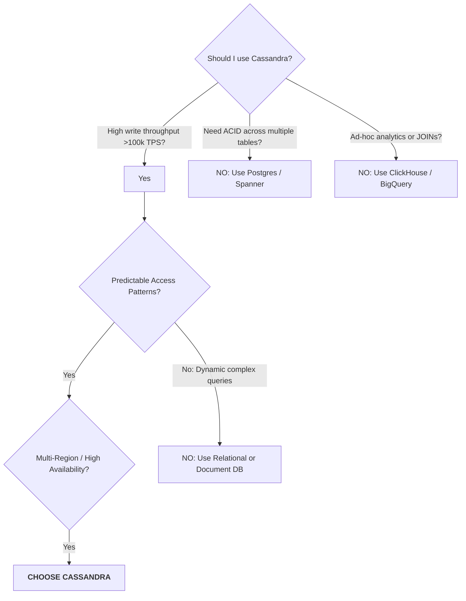

### When to Use Cassandra
1.  **Massive Write Throughput:** Ingestion rates exceeding 50,000–100,000 writes/sec (e.g., IoT sensor telemetry, clickstream logs, chat messages, financial audit trails).
2.  **Predictable Access Patterns:** Applications with a handful of well-defined query paths that can be modeled via specific primary keys.
3.  **Active-Active Multi-Region Deployment:** Seamless global replication where writes must succeed locally in EU, US, and APAC without cross-region locking.
4.  **Zero Downtime SLA:** Systems that cannot tolerate master failover elections or cloud provider maintenance windows.

### When NOT to Use Cassandra (Red Flags)
1.  **Financial Ledger / Atomic Balances:** Transferring money between accounts requires multi-row atomic transactions. Cassandra lacks ACID transactions across partitions.
2.  **Ad-Hoc Business Intelligence & Reporting:** Any workload requiring arbitrary `GROUP BY`, `JOIN`, or variable `WHERE` clauses will fail on Cassandra.
3.  **Small / Low-Scale Systems:** If data fits on a single managed PostgreSQL RDS instance (<1TB, <5k QPS), proposing Cassandra adds unnecessary operational complexity.

### Critical Interview Traps to Avoid
*   **Trap 1: The Monolithic Partition:** Choosing a partition key like `date` or `status` that aggregates millions of rows into a single node. Keep partitions strictly **under 100MB and fewer than 100,000 rows**.
*   **Trap 2: `ALLOW FILTERING` in Production:** Proposing queries with `ALLOW FILTERING` scans all cluster nodes sequentially. Always design primary keys to satisfy queries natively.
*   **Trap 3: Neglecting Multi-DC Quorum:** Saying `QUORUM` in a multi-region design means cross-region latency on every write. Always explicitly specify **`LOCAL_QUORUM`**.
*   **Trap 4: Normalized Relational Tables:** Showing two tables connected by an implied foreign key. If you propose Cassandra, you must show the **denormalized table** tailored to the query.

</details>

<details>
<summary><b>Consistent Hashing</b> (Click to expand)</summary>

# Consistent Hashing

**Sources:**
*   [Consistent Hashing | Algorithms You Should Know #1 (ByteByteGo)](https://www.youtube.com/watch?v=UF9Iqmg94tk)
*   [Consistent Hashing: Easy Explanation for System Design Interviews (Hello Interview)](https://www.youtube.com/watch?v=vccwdhfqIrI)
*   [Consistent Hashing - A Common Mistake in Choosing Partitioning Keys (System Design Fight Club)](https://www.youtube.com/watch?v=sLbOz2QBZgc)

**TL;DR:** When distributing data across multiple servers, traditional modulo hashing (`hash(key) % N`) causes a massive "rehashing storm" whenever a server is added or removed, forcing almost all data to be migrated. Consistent Hashing solves this by placing both servers and data on a circular "Hash Ring" (typically an array in code), ensuring that adding or removing a server only affects a tiny fraction of the data ($1/N$). **Virtual Nodes** are used to keep the distribution perfectly balanced.

---

## 1. Interview Tip: When to Mention Consistent Hashing
According to *Hello Interview*, while many of your favorite services use consistent hashing behind the scenes, you should calibrate how deeply you discuss it:
*   **Standard App Design:** You might give a quick "nod" to consistent hashing if you are simply introducing technologies like Redis, Cassandra, or a CDN.
*   **Deep Dive:** You only need to explain the mechanics of the hash ring algorithm if you are explicitly asked to design a **single scaled backend component** (e.g., "Design a Distributed Cache", "Design a Distributed Database", or "Design a Distributed Message Queue").

---

## 2. Real-World Use Cases
Consistent hashing is ubiquitous in horizontal scaling. Real-world examples include:
*   **NoSQL Databases (DynamoDB, Apache Cassandra):** Used for data partitioning. It minimizes data movement during rebalancing when nodes are added or fail.
*   **Content Delivery Networks (Akamai CDN):** Distributes web content evenly across edge servers.
*   **Load Balancers (Google Load Balancers):** Distributes persistent connections evenly across backend servers. If a server goes down, only the connections to that specific server need to be reestablished.
*   **Messaging Apps (Discord):** Used for routing and session management.

---

## 3. The Problem: Modulo Hashing & The Rehashing Storm

Imagine we host an events website (like TicketMaster) and need to scale from 1 database to 3. We use a simple hash function (like MD5 or MurmurHash) to assign an event to a server:
`server_index = hash("event_1234") % 3` 
Let's say this equals `2`, so the event is stored on Database 2.

**What happens if we add a 4th database?**
Our pool is now 4 servers. The formula changes to `hash("event_1234") % 4`. The math entirely changes, and this might now equal `3`. 

Because the modulo (`N`) changed, almost every single key in the database will hash to a new server. You now have to migrate roughly 75% of your data across the network to its new home. This causes a massive surge in database reads and writes known as a **Rehashing Storm**, which can severely slow down or completely crash your site. The same issue occurs if a database is removed.

---

## 4. The Solution: The Hash Ring

Consistent hashing fixes this by completely abandoning the modulo operation based on the number of servers.

### The Mechanics Under the Hood
1.  **The Hash Space:** The hash function maps inputs to a massive, fixed range of numerical values (e.g., $0$ to $2^{32} - 1$ for a 32-bit hash).
2.  **The Ring:** Imagine connecting both ends of this hash space to form a continuous circle or ring. In code, this is not a literal circle; it is a **mathematical construct**, typically implemented as a **sorted array**.
3.  **Place the Servers:** Hash the server's IP address or name (e.g., `hash("192.168.1.1")`) and place it on the ring.
4.  **Place the Keys:** Hash the data key (e.g., `hash("event_1234")`) using the **exact same hash function** and place it on the ring.
5.  **The Rule (Walking Clockwise):** To find which server a key belongs to, start at the key's position on the ring and walk **clockwise** until you hit a server. In an array implementation, this is a binary search (`O(log N)`) to find the next highest hash value.

### Why It Works (Scaling Up/Down)
If you add a new database to the ring, it simply intercepts keys that would have gone to the next database in the clockwise direction. Only the keys strictly between the new server and the preceding server need to be moved. All other keys stay exactly where they are. Adding or removing a server only requires redistributing a fraction ($1/N$) of the keys!

---

## 5. The Edge Case: Uneven Distribution & Virtual Nodes (V-Nodes)

Consistent hashing has a flaw: **Cascading Failures due to Uneven Distribution**. 

If we pick random points on the ring for our servers, we are very unlikely to get a perfect partition into equally sized segments. Furthermore, if **Server 2** crashes and is removed, all of its data walks clockwise and hits **Server 3**. Server 3 suddenly absorbs 2x the traffic (the segments of Server 2 + its own). If Server 3 gets overwhelmed and crashes, its traffic goes to Server 4, crashing it too. 

### The Fix: Virtual Nodes (V-Nodes)
Instead of placing a physical server on the ring exactly *once*, we place it *multiple times* (e.g., 100 times). 
*   `hash("Server_A_vnode_0")`, `hash("Server_A_vnode_1")`, ..., `hash("Server_A_vnode_99")`

Now, the servers are beautifully interleaved across the ring. If Server A crashes, its 100 virtual nodes disappear. The traffic that was hitting those 100 spots will gracefully fall onto the adjacent virtual nodes belonging to all the other servers evenly. No single physical server takes the full brunt of the failure.

**The Trade-off:** Having more virtual nodes means a perfectly balanced distribution, but it takes more memory space to store the metadata mapping all those virtual nodes back to their physical servers. This is a tunable parameter based on your system requirements.

---

## 6. Pseudocode Implementation

```python
import hashlib
import bisect

class ConsistentHashRing:
    def __init__(self, num_virtual_nodes=100):
        # Trade-off: Higher num_virtual_nodes = better distribution but more memory for metadata
        self.num_virtual_nodes = num_virtual_nodes
        self.ring = []         # Sorted array simulating the "ring"
        self.server_map = {}   # Maps a virtual node hash value back to the physical server IP

    def _hash(self, key):
        # MD5 or MurmurHash provides a massive integer hash space
        return int(hashlib.md5(key.encode('utf-8')).hexdigest(), 16)

    def add_server(self, server_ip):
        # Add multiple virtual nodes to the ring for this physical server
        for i in range(self.num_virtual_nodes):
            vnode_key = f"{server_ip}_vnode_{i}"
            hash_val = self._hash(vnode_key)
            
            self.ring.append(hash_val)
            self.server_map[hash_val] = server_ip
            
        # Keep the array sorted to allow binary search (clockwise walking)
        self.ring.sort()

    def remove_server(self, server_ip):
        # Remove all virtual nodes for this physical server
        for i in range(self.num_virtual_nodes):
            vnode_key = f"{server_ip}_vnode_{i}"
            hash_val = self._hash(vnode_key)
            
            self.ring.remove(hash_val)
            del self.server_map[hash_val]

    def get_server(self, data_key):
        if not self.ring:
            return None
            
        hash_val = self._hash(data_key)
        
        # Binary search: find the first server hash >= the data hash
        # This simulates walking "clockwise" around the ring
        index = bisect.bisect_left(self.ring, hash_val)
        
        # If we reached the end of the array, wrap around to the first server (index 0)
        if index == len(self.ring):
            index = 0
            
        return self.server_map[self.ring[index]]
```

---

## 7. The Scatter-Gather Trap: Hash vs Range Partitioning

A common mistake in system design interviews is blindly applying **Hash Partitioning** (like Consistent Hashing) to solve a **"Hot Partition"** problem without analyzing the query access pattern.

### The Scenario: E-Commerce Inventory (e.g., Amazon)
Imagine a database where the primary key is `Category + Product_ID`, partitioned by `Category`.
You have a hot partition because a "celebrity attribute" (e.g., the "Electronics" category) is queried vastly more than others. 

To "fix" this uneven distribution, you decide to switch the partition key to something evenly distributed (e.g., hashing the `Product_ID`). 
*   **Result:** The electronics are now beautifully scattered across every server in your cluster.

### The Difference: Key-Value vs Key-Range Queries

**1. Key-Value Access Pattern (Hash Partitioning Works!)**
If the application only does point queries (`GET /products/123`), Hash Partitioning solves the hot partition brilliantly. The load is perfectly balanced across all nodes.

**2. Key-Range Access Pattern (The Trap!)**
If the business frequently performs **key-range queries** (e.g., "Get all products in the Electronics category"), Hash Partitioning completely destroys your system. 
*   Because "Electronics" products are now randomly hashed across every server, the request router cannot uniquely identify a single node to query. 
*   It must send the query to **EVERY SINGLE PARTITION** and merge the results. This is called **Scatter-Gather**.
*   You "solved" the hot partition by absolutely hosing every partition with every single range request. As the System Design Fight Club video jokes: *"It's like communism; if everyone is starving together, nobody in particular is starving."*

### The Solution: Dynamic Partitioning
If your application relies on Range Queries, you **must use Range Partitioning**, which preserves data locality (keeping related items on the same server). 

If Range Partitioning creates a hot partition, mitigate it with **Dynamic Partitioning** (where the database detects a hot range and dynamically splits it into two smaller ranges on different servers) rather than destroying locality with Hash Partitioning. While not all databases support dynamic partitioning out of the box, it is the more acceptable solution for range queries.

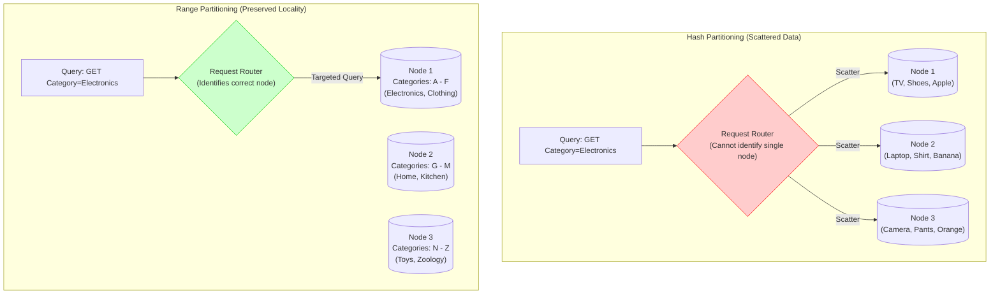

</details>

<details>
<summary><b>DNS and CDN</b> (Click to expand)</summary>

# DNS and CDNs (Content Delivery Networks)

**TL;DR:** 
- **DNS** is the phonebook of the internet; it translates human-readable domain names (like `google.com`) into machine-readable IP addresses.
- **CDNs** are geographically distributed networks of servers that cache static content closer to users, minimizing latency and reducing the load on the origin server. DNS is the mechanism used to route users to the nearest CDN edge server.

---

## 1. Domain Name System (DNS)

Humans remember names (like `amazon.com`), but computers and routers (operating at Layer 3 of the OSI model) only understand IP addresses (like `192.0.2.1`). DNS bridges this gap.

### The Hierarchical Resolution Process
When you type `google.com` into your browser, finding the IP address is not a single database lookup. It is a highly distributed, hierarchical process:

1. **Browser Cache & OS Cache:** The browser checks its own cache. If it misses, it asks the Operating System.
2. **DNS Resolver (ISP):** The OS sends a query to the DNS Resolver (usually provided by your Internet Service Provider, or a public one like Google's `8.8.8.8` or Cloudflare's `1.1.1.1`).
3. **Root Name Server:** If the Resolver doesn't have it cached, it queries the Root Server. The Root Server says, *"I don't know the exact IP, but here is the IP for the `.com` TLD Server."*
4. **TLD (Top-Level Domain) Server:** The Resolver asks the `.com` server. The TLD server says, *"I don't know the exact IP, but here is the Authoritative Server that manages `google.com`."*
5. **Authoritative Name Server:** The Resolver asks the Authoritative Server (often managed by AWS Route53 or Cloudflare). This server holds the actual mapping and returns the exact IP address.
6. **Caching:** The Resolver caches this IP (for a time defined by the TTL - Time To Live) and passes it back to your browser, which also caches it. 

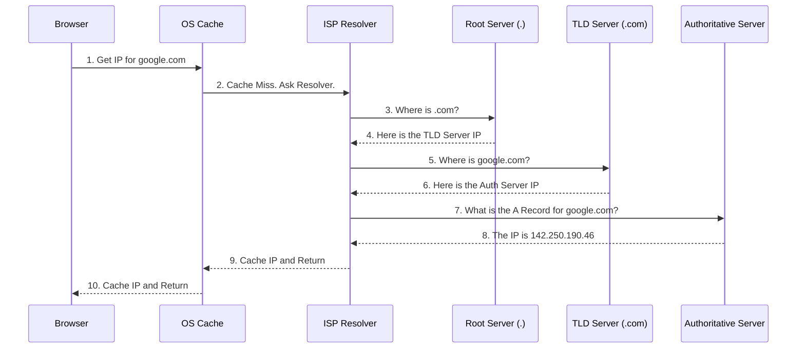

### Common DNS Record Types
*   **A Record:** Maps a domain to an **IPv4** address.
*   **AAAA Record:** Maps a domain to an **IPv6** address.
*   **CNAME (Canonical Name):** Maps a domain to another domain (an alias). For example, mapping `blog.example.com` to `example.wordpress.com`. *Note: You cannot put a CNAME on the root domain (example.com).*
*   **NS (Name Server):** Indicates which Authoritative server manages the domain.
*   **MX (Mail Exchange):** Directs email to a mail server.

### Advanced DNS Routing (Traffic Management)
Authoritative servers don't just return static IPs; they can perform intelligent load balancing:
*   **Weighted Routing:** Send 80% of traffic to Server A, 20% to Server B (great for A/B testing or canary deployments).
*   **Geolocation Routing:** If the user is in Europe, return the IP of the European datacenter.
*   **Latency-Based Routing:** Continuously measure network latency and return the IP of the server that will respond fastest to that specific user.

---

## 2. Content Delivery Networks (CDNs)

If your origin server is in New York, a user in Tokyo will experience high latency (the physical time it takes light to travel through fiber optic cables across the globe). 

### How CDNs Work
A CDN places "Edge Servers" (also called Points of Presence or PoPs) in hundreds of cities worldwide. 
1.  **Caching:** These edge servers cache static assets (HTML, CSS, JavaScript, Images, Videos).
2.  **DNS Routing:** When a user in Tokyo types in your URL, the DNS dynamically resolves to the IP address of the Tokyo Edge Server, not the New York Origin Server.
3.  **Delivery:** The user downloads the image directly from the server in their own city, drastically cutting load times.

```mermaid
flowchart TD
    User([User in Tokyo])
    Edge[CDN Edge Server Tokyo]
    Origin[(Origin Server NY)]

    User -- "1. Request image.jpg" --> Edge
    Edge -- "2. Check Cache" --> Edge
    
    alt Cache Miss
        Edge -- "3. Fetch from Origin" --> Origin
        Origin -- "4. Return image.jpg" --> Edge
        Edge -- "5. Cache it & Serve User" --> User
    else Cache Hit
        Edge -- "3. Serve instantly from Cache" --> User
    end
```

### Push vs. Pull CDNs
*   **Pull CDN (Most Common):** The edge server starts empty. When the first user requests an image, the edge server fetches it from the Origin Server, serves it to the user, and caches it. Subsequent users get the cached version until the TTL expires. *Best for heavy traffic where only a fraction of content is requested frequently.*
*   **Push CDN:** You proactively upload (push) all your content directly to the CDN. The CDN then replicates it to all its edge servers immediately. *Best for smaller datasets where you want 100% cache hits.*

### Why use a CDN?
1.  **Lower Latency:** Physical proximity to the user means faster page loads.
2.  **Reduced Origin Load:** Because the CDN absorbs 90%+ of the traffic for static assets, your application servers and databases don't have to work as hard, saving you compute costs.
3.  **DDoS Protection:** CDN edge networks are massive and can absorb enormous Distributed Denial of Service attacks before they ever reach your origin server. Cloudflare is famous for this capability.
4.  **SSL/TLS Termination:** The edge server handles the expensive cryptographic handshake, freeing up your backend servers.

---

## 3. How DNS and CDNs Work Together
When you set up a CDN (like Cloudflare or AWS CloudFront), you usually change your domain's **Name Servers (NS)** to point to the CDN provider. 

Because the CDN now acts as your Authoritative DNS Server, it can dynamically inspect where a DNS request is coming from and intelligently return the IP address of the CDN Edge Server closest to that specific user.

</details>

<details>
<summary><b>Data Structures for Big Data</b> (Click to expand)</summary>

# Data Structures for Big Data: Probabilistic & Streaming Approximations

**Sources:** [Data Structures for Big Data in Interviews (Hello Interview)](https://www.youtube.com/watch?v=IgyU0iFIoqM) | [Hello Interview Written Guide](https://www.hellointerview.com/learn/system-design/deep-dives/data-structures-for-big-data)

**TL;DR:** When dataset sizes scale into billions or trillions of records, exact deterministic data structures (like HashSets, TreeMaps, or raw arrays) become physically impossible to maintain in memory or synchronize across network boundaries. Probabilistic data structures surrender absolute certainty in exchange for **orders-of-magnitude reduction in space ($O(1)$ constant bounded memory)** and sub-millisecond execution. In system design interviews, these structures solve otherwise intractable bottlenecks in web crawlers, real-time analytics, database storage engines, and latency telemetry.

---

## 1. The Big Data Paradox & Staff Engineer Caveat

In standard applications, standard data structures (`HashSet`, `HashMap`, SQL `B-Trees`) work perfectly. However, at extreme scale, their memory requirements scale linearly with cardinality:

$$\text{Memory Overhead} = O(N \times \text{Item Size})$$

*Example:* Storing 1 billion 64-character URL strings (1 KB each) in a hash set to detect duplicate crawls requires **1 Terabyte of pure RAM** just for a deduplication index.

```mermaid
flowchart LR
    subgraph Exact["Deterministic Data Structures"]
        direction TB
        E1["HashSet / HashMap"]
        E2["100% Exact Precision"]
        E3["Memory scales linearly: O(N)"]
        E4["Fails at Billions of Elements"]
        E1 --- E2 --- E3 --- E4
    end

    subgraph Probabilistic["Probabilistic Data Structures"]
        direction TB
        P1["Bloom Filter / Count-Min / HLL"]
        P2["Configurable Error (1-2%)"]
        P3["Fixed Memory Footprint: O(1)"]
        P4["Scales to Trillions of Elements"]
        P1 --- P2 --- P3 --- P4
    end
```

> [!WARNING]
> ### ⚠️ The Over-Engineering Red Flag in Interviews
> Reaching for a probabilistic data structure when standard RAM fits the data is an **automatic interview red flag**. A candidate who jumps straight to a Bloom filter or Count-Min Sketch without doing back-of-the-envelope calculations shows poor engineering pragmatism.
> 
> **The Golden Rule:** Always start with the simplest exact solution (e.g., in-memory HashMap or Redis Set). Only introduce probabilistic data structures when:
> 1.  **Back-of-the-envelope math proves memory is intractable** (e.g., terabytes required for a simple filter).
> 2.  **Predictable, constant-time performance is non-negotiable** (e.g., embedded devices, network routers, database storage engines).
> 3.  **The problem domain inherently tolerates small approximation errors** (e.g., web crawling, viral trending counters, distinct visitor metrics, caching).

---

## 2. Core Comparison Cheatsheet

| Data Structure | Primary Problem Solved | Return Value / Guarantees | Space Complexity | Error Characteristics | Canonical Production Use Case |
| :--- | :--- | :--- | :--- | :--- | :--- |
| **Bloom Filter** | **Set Membership** (*"Is item $X$ in the set?"*) | "Definitely Not" OR "Probably Yes" | $O(m)$ bits ($\sim 10\text{ bits/item}$ for $1\%$ error) | **Zero False Negatives**; bounded False Positive rate ($\epsilon$) | Cassandra/RocksDB SSTable read bypass; Web crawler URL deduplication |
| **Count-Min Sketch** | **Frequency Estimation** (*"How many times did $X$ occur?"*) | Upper-bound frequency estimate | $O(w \times d)$ integer registers | **Never underestimates**; overestimates due to hash collisions | Heavy Hitters (Top-K trending); Caffeine Cache admission (TinyLFU) |
| **HyperLogLog (HLL)** | **Cardinality Estimation** (*"How many distinct elements exist?"*) | Approximate unique count | $O(m)$ registers (e.g., **12 KB** in Redis for billions of items) | Typical standard error $\approx \pm 0.81\%$; mathematically mergeable | Daily Active Users (DAU); Distinct search queries; Port scan detection |
| **Approximate Quantiles** | **Latency Percentiles** (*"What is p50, p95, p99 latency?"*) | Quantile / Percentile estimate | $O(B)$ histogram buckets | Bounded relative error across long-tail distributions | Prometheus / OpenTelemetry microservice SLO monitoring |

---

## 3. Bloom Filter (Approximate Set Membership)

### A. The Intuition: "The Villager Stamps"
Imagine a town where 1,000 villagers each have a unique rubber stamp with specific geometric grooves. When villagers attend a town meeting, they all stamp the same single piece of paper.
*   **Checking attendance:** To check if Alice attended, look at the paper. If any groove of Alice's stamp is missing ink, **she definitely did not attend** (Zero False Negatives).
*   **The Catch:** If all grooves of Alice's stamp have ink, she *probably* attended. However, it is possible that Bob and Charlie's overlapping stamps coincidentally inked all the spots corresponding to Alice's stamp (**False Positive**).

### B. Mechanics Under the Hood

```mermaid
flowchart TD
    subgraph InsertPath["Write Path: Insert Element X ('albert')"]
        direction TB
        InX["Input: 'albert'"]
        H1["Hash 1: h1('albert') -> Bit 3"]
        H2["Hash 2: h2('albert') -> Bit 7"]
        H3["Hash 3: h3('albert') -> Bit 12"]
        InX --> H1 & H2 & H3
        H1 --> Set1["Set Bit 3 = 1"]
        H2 --> Set2["Set Bit 7 = 1"]
        H3 --> Set3["Set Bit 12 = 1"]
    end

    subgraph QueryPath["Read Path: Query Element Y"]
        direction TB
        InY["Query: 'zed'"]
        QH1["h1('zed') -> Bit 3 (Value = 1)"]
        QH2["h2('zed') -> Bit 5 (Value = 0)"]
        QH3["h3('zed') -> Bit 12 (Value = 1)"]
        InY --> QH1 & QH2 & QH3
        Verdict{"Any Bit == 0?"}
        QH1 & QH2 & QH3 --> Verdict
        Verdict -->|YES: Bit 5 is 0| DefNot["<b>DEFINITELY NOT IN SET</b><br/>(100% Certain - 0% False Negatives)"]
        Verdict -->|NO: All Bits are 1| ProbIn["<b>PROBABLY IN SET</b><br/>(May be a False Positive)"]
    end
```

1.  **Structure:** An array of $m$ bits, all initialized to 0.
2.  **Hash Functions:** $k$ independent, uniform cryptographic or non-cryptographic hash functions (e.g., MurmurHash3, CityHash, xxHash).
3.  **Insert:**
    *   Feed element $x$ into all $k$ hash functions to get $k$ array positions: $h_1(x), h_2(x), \dots, h_k(x) \pmod m$.
    *   Set the bits at all these positions to `1`.
4.  **Query:**
    *   Feed query element $y$ into all $k$ hash functions.
    *   Check the bit values at all positions:
        *   If **at least one bit is 0**: The element was **definitely never added**. (A bit can only become 1, never 0).
        *   If **all bits are 1**: The element is **probably in the set**.

### C. Mathematical Sizing Formulas

The probability of a false positive $\epsilon$ after inserting $n$ elements into an $m$-bit array with $k$ hash functions is:

$$\epsilon \approx \left( 1 - e^{-kn/m} \right)^k$$

For a given number of expected items $n$ and desired false positive probability $\epsilon$:

1.  **Optimal Bit Array Size ($m$):**
    $$m = -\frac{n \ln \epsilon}{(\ln 2)^2} \approx -1.44 \cdot n \cdot \log_2 \epsilon$$
2.  **Optimal Number of Hash Functions ($k$):**
    $$k = \frac{m}{n} \ln 2 \approx 0.693 \cdot \frac{m}{n}$$

> [!TIP]
> **Staff Engineer Rule of Thumb for Interviews:**
> *   Allocating **$10$ bits per item** ($m/n = 10$) with **$k = 7$ hash functions** yields a **$\sim 1\%$ false positive rate**.
> *   $1$ billion items $\times 10\text{ bits} = 10\text{ billion bits} \approx \mathbf{1.19\text{ GB RAM}}$ (compared to 1 TB for a raw HashSet!).

### D. System Design Production Use Cases
1.  **Web Crawlers (URL Deduplication):**
    *   Before downloading a discovered URL, check the Bloom filter. If it returns false, crawl the page and insert the URL. If it returns true (probably crawled), drop it. Occasional false positive skips are harmless compared to saving 99% of crawler RAM.
2.  **Database Storage Engines (Cassandra, RocksDB, Bigtable):**
    *   In LSM-tree engines, each on-disk SSTable has an associated in-memory Bloom filter.
    *   When servicing a read query, the node checks the Bloom filter in RAM before issuing an expensive disk seek. If the Bloom filter says the key is absent, the SSTable disk read is completely avoided.
3.  **Google Chrome Malicious URL Checker:**
    *   Downloading millions of phishing URLs to every browser is infeasible. Instead, Chrome downloads a compact Bloom filter of known malicious URLs. If a visited site hits the Bloom filter, the browser makes a secure API call to Google's backend to verify the exact status.
4.  **Cache Admission (Filtering "One-Hit Wonders"):**
    *   Many web assets are requested only once and never again, thrashing LRU caches. A Bloom filter tracks requested IDs; an asset is only admitted to the expensive Redis cache on its *second* request.

### E. Pitfalls & The Deletion Trap
*   **Deletions are Impossible:** You cannot clear a bit back to 0 because that bit may be shared by other elements.
*   **The Fix (Counting Bloom Filter):** Replace each single bit with a small 4-bit integer counter. Inserts increment the counter; deletes decrement it. *Trade-off:* Consumes $4\times$ the memory of a standard Bloom filter.
*   **Saturation:** As more items are added beyond capacity $n$, the bit array fills with 1s until the false positive rate approaches 100%. Bloom filters cannot be resized dynamically—you must allocate a new larger filter or use a **Scalable Bloom Filter** (a chain of increasing-capacity Bloom filters).

---

## 4. Count-Min Sketch (Frequency Estimation & Heavy Hitters)

### A. The Intuition
A Bloom filter answers a binary question: *"Did we see it?"* A **Count-Min Sketch** answers a quantitative question: *"How many times did we see it?"*
It acts like a 2D matrix of integer counters. Multiple keys may hash to the same bucket and artificially inflate the counter, but by taking the **minimum** across multiple independent hash rows, we eliminate the collision noise.

### B. Mechanics Under the Hood

```mermaid
flowchart TD
    subgraph Update["Increment: Add Event 'User_A'"]
        direction TB
        In["Event: 'User_A'"]
        R1["Row 1: h1('User_A') -> Col 3 | sketch[1][3]++"]
        R2["Row 2: h2('User_A') -> Col 1 | sketch[2][1]++"]
        R3["Row 3: h3('User_A') -> Col 5 | sketch[3][5]++"]
        In --> R1 & R2 & R3
    end

    subgraph Query["Query: Get Count of 'User_A'"]
        direction TB
        QIn["Query: 'User_A'"]
        QR1["sketch[1][3] = 45"]
        QR2["sketch[2][1] = 42"]
        QR3["sketch[3][5] = 48"]
        QIn --> QR1 & QR2 & QR3
        MinOp["Take Minimum: min(45, 42, 48)"]
        QR1 & QR2 & QR3 --> MinOp
        Result["Estimated Count = <b>42</b><br/>(Guaranteed Upper Bound)"]
        MinOp --> Result
    end
```

1.  **Structure:** A 2D array of counters with depth $d$ (rows) and width $w$ (columns).
2.  **Hash Functions:** $d$ distinct pairwise independent hash functions: $h_1, h_2, \dots, h_d$, where each $h_i(x) \in [0, w-1]$.
3.  **Update($x, c$):**
    *   For each row $i$ from $1$ to $d$:
        $$\text{sketch}[i][h_i(x)] \leftarrow \text{sketch}[i][h_i(x)] + c$$
4.  **Query Point Estimate($x$):**
    *   Look up the counter value in every row and return the minimum:
        $$\hat{c}(x) = \min_{1 \le i \le d} \left( \text{sketch}[i][h_i(x)] \right)$$

### C. Mathematical Precision Guarantees
Count-Min Sketch provides rigorous statistical bounds based on dimensions $w$ and $d$:
1.  **Width ($w$):** Controls error factor $\epsilon$.
    $$w = \left\lceil \frac{e}{\epsilon} \right\rceil \approx \left\lceil \frac{2.718}{\epsilon} \right\rceil$$
2.  **Depth ($d$):** Controls confidence probability $1 - \delta$.
    $$d = \left\lceil \ln\left(\frac{1}{\delta}\right) \right\rceil$$

**The Core Guarantee:**
$$\hat{c}(x) \ge c(x) \quad \text{and} \quad \hat{c}(x) \le c(x) + \epsilon N \quad \text{with probability } \ge 1 - \delta$$
*(Where $N$ is the total sum of all increments added to the sketch).*
*   **It NEVER underestimates:** Counters are only incremented, never decremented.
*   **Overestimation is bounded:** Collisions can only make the count larger, but the minimum operation ensures we get closest to the true value.

### D. The Heavy Hitters (Top-K) Architecture Pattern
In streaming interviews (e.g., *"Find the Top 100 trending hashtags on Twitter"* or *"Detect Top 10 IP addresses producing 90% of traffic"*), you cannot use a Count-Min Sketch alone because **the sketch cannot iterate over stored keys** (it only holds numeric counters).

**The Solution:** Pair the Count-Min Sketch with a bounded **Min-Heap (Priority Queue)**.

```mermaid
flowchart LR
    EventStream["Stream of Events (Hashtags)"] --> CMS["Count-Min Sketch<br/>(O(1) Memory Count)"]
    CMS --> Count["Estimated Frequency: c"]
    Count --> Heap{"Is c > Min-Heap Root?"}
    Heap -->|Yes| UpdateHeap["Update Min-Heap<br/>(Capacity = K elements)"]
    Heap -->|No| Drop["Discard Event"]
    UpdateHeap --> API["Query Top-K Instantly in O(1)"]
```

1.  Incoming stream event arrives: `#viral`.
2.  Increment `#viral` in Count-Min Sketch $\to$ retrieve current estimated frequency $\hat{c}$.
3.  Compare $\hat{c}$ against the root of a Min-Heap of size $K$:
    *   If $\hat{c}$ exceeds the root: update or insert `#viral` into the heap.
    *   Otherwise: discard.
4.  **Result:** Bounded $O(K)$ heap memory and $O(1)$ constant sketch memory, servicing live Top-K queries without memory leaks.

### E. Other Production Use Cases
1.  **DDoS & Network Security:** Tracking packets per source IP address in network switches with hardware-limited TCAM memory.
2.  **Caffeine Cache (Window TinyLFU):** Uses a 4-bit Count-Min Sketch to estimate the historical frequency of cache entries, admitting newly requested items only if their frequency exceeds the victim item being evicted.

---

## 5. HyperLogLog (Cardinality & Distinct Counting)

### A. The Intuition: The Coin-Flip Streak
How can you estimate how many unique people visited a website without recording their user IDs?
Imagine someone flips a fair coin repeatedly and records the longest consecutive streak of **Heads** observed:
*   Streak of 1 Head (`H...`): Probability $= 1/2 \implies$ You likely flipped $\sim 2$ times.
*   Streak of 3 Heads (`HHH...`): Probability $= (1/2)^3 = 1/8 \implies$ You likely flipped $\sim 8$ times.
*   Streak of 10 Heads (`HHHHHHHHHH...`): Probability $= (1/2)^{10} = 1/1024 \implies$ You likely flipped $\sim 1,024$ times.

**Translating to Computer Science:**
When we hash an item uniformly, its binary output is functionally equivalent to random coin flips (0 = Tails, 1 = Heads).
By hashing unique elements and tracking the **maximum number of consecutive leading (or trailing) zeros**, we can estimate the total number of unique elements:

$$\text{Estimated Unique Items} \approx 2^{\text{Max Consecutive Zeros}}$$

*Crucial Property:* If the same user visits 1,000 times, their user ID hashes to the **exact same binary value**, producing the exact same streak of zeros. Duplicates have **zero effect** on the maximum!

### B. Mechanics Under the Hood

```mermaid
flowchart TD
    subgraph HashSplit["Step 1: Hash Input & Partition Bits"]
        direction TB
        Input["Input: 'user_98745'"]
        HashVal["64-Bit Hash: 01011 000101100..."]
        P_Bits["First p Bits (e.g., 5 bits: '01011' = Register 11)"]
        W_Bits["Remaining Bits: '000101100...' (Count Leading Zeros = 3)"]
        Input --> HashVal
        HashVal --> P_Bits
        HashVal --> W_Bits
    end

    subgraph RegisterUpdate["Step 2: Update Bounded Register Array"]
        direction TB
        RegArray["Array of m = 2^p Registers (M[0] to M[31])"]
        UpdateReg["Register 11: M[11] = max(M[11], 3 + 1)"]
        P_Bits & W_Bits --> UpdateReg
        UpdateReg --> RegArray
    end

    subgraph Aggregation["Step 3: Query Unique Cardinality"]
        direction TB
        Harmonic["<b>Harmonic Mean</b> across all m Registers<br/>(Neutralizes single lucky outlier streaks)"]
        RegArray --> Harmonic
        Formula["E = alpha * m^2 * (Sum of 2^-M[j])^-1"]
        Harmonic --> Formula
        Estimate["Cardinality Estimate: <b>4,281,000 DAU</b><br/>(Standard Error: +/- 0.81%)"]
        Formula --> Estimate
    end
```

#### 1. Stochastic Averaging (Bucketing)
A single user whose hash happens to end in 25 zeros by sheer chance would wildly distort the estimate ($2^{25} \approx 33\text{ million}$).
To prevent outlier distortion, HyperLogLog partitions the hash into **$m = 2^p$ independent registers**:
*   The first $p$ bits select the register index $j \in [0, m-1]$.
*   The remaining bits are evaluated to count leading zeros $\rho(w)$.
*   Register $M[j]$ is updated:
    $$M[j] \leftarrow \max(M[j], \rho(w))$$

#### 2. Harmonic Mean Estimation
Instead of computing the arithmetic mean (which is vulnerable to extreme outliers), HyperLogLog computes the **Harmonic Mean** of $2^{M[j]}$ across all $m$ registers:

$$E = \alpha_m \cdot m^2 \cdot \left( \sum_{j=0}^{m-1} 2^{-M[j]} \right)^{-1}$$

*(Where $\alpha_m$ is a known bias correction constant).*

### C. Space Efficiency & Redis Implementation
*   In Redis (`PFADD`, `PFCOUNT`), HyperLogLog uses **$m = 16,384$ registers** ($p = 14$ bits).
*   Each register only needs to store numbers from 0 to 64 (the maximum possible leading zeros in a 64-bit hash). Since $2^6 = 64$, **each register requires exactly 6 bits**.
*   **Total Fixed Size:**
    $$\text{Total Memory} = 16,384 \text{ registers} \times 6 \text{ bits} = 98,304 \text{ bits} = \mathbf{12\text{ KB}}$$
*   **Standard Error:**
    $$\text{SE} = \frac{1.04}{\sqrt{m}} = \frac{1.04}{\sqrt{16,384}} \approx \mathbf{0.81\%}$$
*   *Conclusion:* **Redis can count up to billions of unique daily active users with $\pm 0.81\%$ error using only 12 KB of RAM!**

### D. The Distributed Superpower: Lossless Mergeability
Because registers only store the maximum streak of zeros observed, **two HyperLogLog sketches can be merged element-wise with zero loss of accuracy**:

$$M_{\text{merged}}[j] = \max(M_A[j], M_B[j])$$

```mermaid
flowchart TD
    Shard1["HLL Shard 1 (US-East)<br/>M1: [3, 5, 2, 7...]"]
    Shard2["HLL Shard 2 (EU-West)<br/>M2: [4, 5, 1, 9...]"]
    Shard3["HLL Shard 3 (APAC)<br/>M3: [2, 6, 4, 3...]"]

    Merge["<b>Element-wise Parallel Merge: max(M1, M2, M3)</b><br/>Zero Network Shuffle of Raw IDs!"]
    Final["Global HLL: [4, 6, 4, 9...]<br/>Instant Global MAU Query!"]

    Shard1 & Shard2 & Shard3 --> Merge --> Final
```

*   **Interview Application:** In a globally distributed system (e.g., counting global Unique Visitors across 5 data centers), each regional server computes its local 12 KB HLL sketch. At midnight, nodes simply send their 12 KB array to an aggregator that runs an element-wise `max()`. There is **zero cross-datacenter transmission of raw user IDs**!

---

## 6. Approximate Quantiles & Histograms (SLO Telemetry)

### A. The Latency Fallacy: Why You Cannot Average Percentiles
In systems monitoring (Prometheus, Datadog), engineers track percentiles like p50, p95, p99, and p99.9 latency to enforce Service Level Objectives (SLOs).
*   **The Trap:** **You cannot mathematically average percentiles across servers.**
    *   If Server A has a p99 of $10\text{ ms}$ over 1,000 requests, and Server B has a p99 of $100\text{ ms}$ over 10 requests, their true combined p99 is *not* $(10 + 100) / 2 = 55\text{ ms}$. Doing so masks catastrophic tail latency outages.
*   **The Constraint:** Storing every individual raw latency float value across millions of requests per second causes storage explosions.

### B. Histogram Strategies

```mermaid
flowchart TD
    subgraph FixedWidth["1. Fixed-Width Buckets"]
        direction TB
        F1["[0-10ms] | [10-20ms] | [20-30ms]"]
        F2["Poor tail resolution; burns space on empty ranges"]
    end

    subgraph Exponential["2. Exponential Buckets (OpenTelemetry / Prometheus)"]
        direction TB
        E1["[0-1ms] | [1-2ms] | [2-4ms] | [4-8ms] | [8-16ms]..."]
        E2["High resolution at low latency; fixed relative error at tails"]
    end

    subgraph Dynamic["3. Dynamic Sketches (T-Digest / DDSketch)"]
        direction TB
        D1["Adaptive centroids cluster around high-density zones"]
        D2["Extreme accuracy at p99.9 and p99.99 with bounded memory"]
    end
```

1.  **Exponential Buckets (Prometheus / OTel standard):**
    *   Bucket boundaries scale by a multiplier factor $\gamma$ (e.g., $\text{Bucket}_i = [b_0 \cdot 2^{i-1}, b_0 \cdot 2^i]$).
    *   Maintains a constant relative error (e.g., within 5% of actual latency) across both fast paths ($1\text{ ms}$) and catastrophic tail spikes ($10\text{ seconds}$).
    *   *Mergeability:* Histograms with matching bucket boundaries can be summed together across distributed nodes with simple addition: $\text{Bucket}_{\text{total}}[i] = \sum \text{Bucket}_{\text{node}}[i]$.
2.  **T-Digest & DDSketch:**
    *   Advanced streaming algorithms that dynamically maintain a cluster of weighted centroids.
    *   Used in Datadog and Elasticsearch to compute accurate p99.99 latencies on streaming telemetry.

---

## 7. System Design Interview Playbook & Traps

```mermaid
flowchart TD
    Start{What does your system need?}

    Start -->|Set Membership: 'Was X visited/stored?'| Q1{Can you tolerate false positives?}
    Q1 -->|Yes: Memory is constrained| BF[<b>Bloom Filter</b><br/>Web crawler dedup, SSTable check]
    Q1 -->|No: Exact answer required| HS[<b>Standard HashSet / DB Index</b>]

    Start -->|Counting Frequency: 'How often did X occur?'| Q2{Need to find Top-K or Heavy Hitters?}
    Q2 -->|Yes: Streaming stream| CMS[<b>Count-Min Sketch + Min-Heap</b><br/>Trending hashtags, DDoS IPs]
    Q2 -->|No: Exact financial billing| HM[<b>PostgreSQL / Redis Counter</b>]

    Start -->|Unique Count: 'How many distinct visitors?'| Q3{Billions of items & distributed shards?}
    Q3 -->|Yes: Can tolerate ~1% error| HLL[<b>HyperLogLog</b><br/>DAU/MAU analytics, Redis PFADD]
    Q3 -->|No: Exact count required| RD[<b>Bitmap / HyperLogLog + ClickHouse</b>]

    Start -->|Latency Percentiles: 'What is p99 SLO?'| Hist[<b>Exponential Histograms / T-Digest</b><br/>Prometheus / OpenTelemetry]
```

### Critical Interview Traps to Avoid
1.  **The "Raspberry Pi" Gotcha:** If an interviewer asks to design a system under artificial memory constraints (e.g., *"Design a web crawler that runs on a machine with 512MB RAM"*), this is your immediate trigger to introduce Bloom filters and Count-Min Sketches.
2.  **Trying to Delete from a Bloom Filter:** If the design requires removing items, explicitly state: *"Standard Bloom filters do not support deletion because zeroing a bit affects overlapping keys. I will instead use a Counting Bloom Filter or a Cuckoo Filter."*
3.  **Treating Count-Min Sketch as a Key-Value Store:** Candidates often say *"I'll query Count-Min Sketch to get all viral posts."* You cannot! The sketch has no keys. Always explicitly pair it with a **Min-Heap**.
4.  **Using HyperLogLog for Exact Billing:** Never propose HyperLogLog for invoicing or credit card payments where every single penny or view must be accounted for with 100% precision.

</details>

<details>
<summary><b>Database Indexes</b> (Click to expand)</summary>

# Database Indexes & The RUM Conjecture

**Source:** [Absolutely Everything That I Know About Database Indexes (System Design Fight Club)](https://www.youtube.com/watch?v=Qhc8gFF2qS8)  
**Further Reading Mentioned:** *Designing Data-Intensive Applications (Martin Kleppmann)*, *Database Internals (Alex Petrov)*.

**TL;DR:** Adding an index to a database speeds up reads, but fundamentally slows down writes. The foundational concept behind all database tuning is the **RUM Conjecture**, which forces you to trade off between Read speed, Update speed, and Memory overhead. 

---

## 1. The RUM Conjecture

Similar to the CAP theorem for distributed systems, the RUM conjecture governs database indexing. It states that you must balance:
*   **R**ead Overhead (How fast can you retrieve data?)
*   **U**pdate Overhead (How fast can you write/update data?)
*   **M**emory Overhead (How much disk/RAM space does the index consume?)

You cannot optimize all three simultaneously. 
*   *Example:* Systems like Cassandra use LSM Trees, which offer blazing-fast **Updates** (writes are just appended to a file), but suffer from high **Memory** overhead (wasted space from duplicate/stale records at the end of files before compaction) and slightly slower **Reads**.

## 2. A Database is a Write-Ahead Log + A Materialized View

To deeply understand databases, consider this mental model: **A database at its core is just a Write-Ahead Log (WAL).** Everything else (including indexes) is just a materialized view built on top of that log.

*   If you just have a WAL and no indexes, your **writes are instantaneous** ($O(1)$ append), but your **reads are terrible** (full $O(N)$ table scan).
*   Adding a B-Tree index speeds up the read to $O(\log N)$, but ruins the $O(1)$ write, because every time a row is inserted, the CPU must also update the B-Tree data structure.

### When to use "No Index"
Because every index slows down writes, the absolute fastest way to ingest data is to use **no index at all**. 
*   **Message Brokers (Kafka):** Apache Kafka handles millions of writes per second explicitly because it has no secondary indexes. It is purely an append-only log.
*   **Data Warehouses (OLAP):** Analytics databases often forgo traditional secondary indexes. Because OLAP queries require scanning millions of rows anyway, indexing individual rows is useless overhead. Instead, they use **Columnar Storage** to rapidly scan massive amounts of data in a single pass.

---

## 3. Distributed Primary Keys & Partitioning Mechanics

In a standard single-node SQL database, you often use an `AUTO_INCREMENT` integer as your primary key. In a **Distributed Database**, auto-increment fundamentally fails because guaranteeing sequential numbers across multiple machines requires **Total Ordering** (massive coordination/locks between nodes, unless using a linearizable database like Google Spanner which is expensive).

Instead, distributed databases drop auto-increment and use **UUIDs**. A distributed primary key usually consists of:
1.  **Partition Key:** Determines which physical node the record lives on.
2.  **Sort Key (Optional):** Determines how the data is clustered/sorted on disk within that specific node.

### The "Scatter-Gather" Problem (Hash vs Range Partitioning)

Choosing the correct partition key is crucial to avoid the Scatter-Gather problem on key range queries.

```mermaid
flowchart TD
    subgraph Hash Partitioning (Inefficient for Range)
        Q1[Query: Get all posts for User A] --> N1[Node 1]
        Q1 --> N2[Node 2]
        Q1 --> N3[Node 3]
        note1(Requires querying every node and merging results)
    end
    
    subgraph Range Partitioning (Efficient for Range)
        Q2[Query: Get all posts for User A] --> N4[Node 1]
        note2(All posts for User A live on a single node)
    end
```

*   **Hash Partitioning:** If you partition by `PostID`, fetching all posts for a specific user requires a scatter-gather operation across all nodes because the posts are randomly distributed.
*   **Range Partitioning (Composite Key):** If you partition by `UserID` and sort by `PostID`, all posts for a given user land on the same physical node. A key range query (e.g., fetching a user's timeline) can be served entirely from one node.

---

## 4. Hash Indexes (In-Memory KV Stores)

*   **Mechanics:** Hash indices provide $O(1)$ lookups. However, hash tables perform terribly on physical disk hardware. Consequently, they are almost exclusively used in **in-memory caches** (Memcached, Redis). 
*   **Trade-offs:** Caches typically do not support secondary indexes or key range queries—they only support single-record lookups by the full primary key. Because range queries aren't a factor, **Hash Partitioning** is almost always the right strategy for KV caches.

---

## 5. B-Trees vs. LSM Trees (The Default Primary Indexes)

If you don't specify an index type, your database assigns a default based on its storage engine.

| Feature | B-Trees | LSM Trees |
| :--- | :--- | :--- |
| **Optimization** | Read-Optimized | Write-Optimized |
| **Mechanics** | Keeps data sorted in a balanced tree structure. Lookups are fast, but inserts require rebalancing nodes and modifying pages in-place. | Appends writes to an in-memory buffer (MemTable) and flushes them to immutable files on disk (SSTables). Reads may need to scan multiple files. |
| **Common Databases**| PostgreSQL, MySQL, Oracle, DynamoDB | Cassandra, Google Spanner |
| **Advanced Tuning**| BW-Trees (buffers writes, e.g., in some MongoDB configs). | Tuning compaction rates to balance read latency vs memory overhead. |

---

## 6. Secondary Indexes

Secondary indexes do not come for free. If you want to sort a user's posts chronologically, you must explicitly add an index on `timestamp`.

### Local Secondary Indexes (LSI) vs Global Secondary Indexes (GSI)

*   **Local Secondary Index (LSI):** The index only contains data that lives on that specific physical machine. 
*   **Global Secondary Index (GSI):** The index contains data spanning across *all* nodes in the cluster.
    *   **The Trade-off:** While GSIs prevent the scatter-gather problem for read-heavy key range queries, they introduce massive write latency. Updating a single record requires sending index updates to multiple machines across the network.
    *   **Interview Tip / Preference:** Avoid GSIs in practice. Instead of paying the massive write penalty of a GSI, it is often better to create a downstream read-optimized view of the data (partitioned differently) to serve those specific read queries. DynamoDB supports up to 8 GSIs, but use them sparingly.

### Concatenated Indexes
When you index multiple columns (e.g., `UserID`, then `PostID`), the database typically sorts them alphabetically/sequentially using a B-Tree. It narrows down the first attribute, then the second. It does *not* narrow down both simultaneously (unlike Spatial indexes).

---

## 7. Advanced & Specialized Indexes

### 1. Multi-Dimensional / Spatial Indices
*   **Mechanics:** Narrows down searches by multiple attributes simultaneously (e.g., X and Y coordinates) by wrapping them in shapes/bounding boxes. 
*   **Types:** **R-Trees** (supported out-of-the-box by PostgreSQL/PostGIS, can handle higher dimensions), **Quad-Trees** (Elasticsearch, 2D only), **GeoHashes** (Redis).
*   **Interview Tip:** Do *not* try to roll your own Quad-Tree from scratch in an interview (e.g., designing Uber), unless specifically asked. Real-world systems rely on existing databases that natively support them (like OpenSearch/Elasticsearch for high-TPS geography queries).

### 2. Inverted Indexes (Full-Text Search)
*   **Mechanics:** Maps words/content directly to record IDs (e.g., "coffee" -> `[Tweet_4, Tweet_99]`). Tokenizing and indexing every word incurs huge memory and write overhead.
*   **Who uses it:** Elasticsearch is the industry standard. However, **PostgreSQL and Redis** also support inverted indexes. Google Search uses a gigantic, custom-rolled inverted index (they don't use Elasticsearch because they outgrew it).
*   **Design Hack:** Because PostgreSQL supports inverted indices, you can combine an inverted index with manual partitioning and R-trees in a single Postgres instance to solve complex geographical + text search queries.

### 3. Skip Lists
*   **Mechanics:** A layered linked list that allows skipping over chunks of nodes for faster traversal.
*   **Use Case:** Highly niche. Almost exclusively used for **Gaming Leaderboards** (to fetch ranks quickly). Redis supports them; almost no disk-based databases do.

### 4. Vector Indexes
*   **Mechanics:** Stores high-dimensional vector embeddings for similarity search. 
*   **Use Case:** Machine Learning, Personalization, Recommendation Feeds (e.g., YouTube Home Feed). 
*   **Who uses it:** Pinecone, FAISS (Facebook), PlanetScale (MySQL fork), Redis.
*   **Interview Tip:** If you need a vector index, you will know upfront because the core feature is an ML problem. Choose a dedicated vector database early; do not awkwardly tack it onto an existing PostgreSQL architecture later. (Also, avoid using Redis as a vector DB just because it supports it).

---

## 8. Real-Time Analytics & Aggregations

When building features like "YouTube Video View Counts," you need real-time data, but standard OLAP queries are too slow.

*   **Materialized Views:** Precomputes aggregate operations (`COUNT`, `MIN`, `MAX`) that would normally require a full table scan, storing the result on disk for $O(1)$ retrieval.
*   **Count-Min Sketch:** A probabilistic data structure used for real-time analytics. 
    *   **Trade-off:** Trades exact accuracy for extremely fast OLAP-style aggregations and low memory footprint. 
    *   **Who uses it:** Often attached to the end of streaming architectures. (Redis supports it, though its placement in a cache is debatable).

</details>

<details>
<summary><b>DynamoDB</b> (Click to expand)</summary>

# Amazon DynamoDB Deep Dive

**Source:** [DynamoDB Deep Dive w/ Ex-Meta Staff Engineer (Hello Interview)](https://www.youtube.com/watch?v=2X2SO3Y-af8) | [Hello Interview Written Guide](https://www.hellointerview.com/learn/system-design/deep-dives/dynamodb)

**TL;DR:** Amazon DynamoDB is a fully managed, serverless NoSQL key-value and document database engineered for single-digit millisecond latency at any scale. It abstracts away server provisioning, sharding, and cluster management through automatic horizontal partition splitting (triggered at 10 GB storage or 1,000 WCU / 3,000 RCU per partition) and multi-AZ Paxos-based replication. In system design interviews, alongside PostgreSQL, DynamoDB is the premier choice for scalable persistence layers with predictable, query-driven access patterns.

---

## 1. Core Data Model & Hierarchy

DynamoDB organizes data into a 3-level hierarchy:

```mermaid
graph TD
    T["<b>Table</b><br/>(Collection of items, Primary Key definition, Secondary Indexes)"]
    I["<b>Item</b><br/>(Single record, max 400 KB, uniquely identified by Primary Key)"]
    A["<b>Attributes</b><br/>(Key-Value pairs: String, Number, Boolean, Binary, List, Map, Set)"]

    T --> I
    I --> A
```

1.  **Table:** A collection of items. Unlike relational tables, DynamoDB tables are **schema-less** (except for the primary key). Items in the same table can have completely different attributes.
2.  **Item:** A single record (equivalent to a row in SQL). Each item has a mandatory Primary Key and a hard size limit of **400 KB** (including attribute names and values).
3.  **Attributes:** Named data fields (equivalent to columns). Supports:
    *   *Scalar types:* String, Number, Binary, Boolean, Null.
    *   *Document types:* List (ordered arrays), Map (nested JSON objects).
    *   *Set types:* String Set, Number Set, Binary Set.

### Schema-less Flexibility vs. Trade-offs
*   **Pros:** Fast iterations, zero database migrations, no downtime for schema changes, and zero storage overhead for absent fields (no empty `NULL` cells taking space).
*   **Cons / Trade-offs:** The application layer must strictly enforce data integrity, schema validation, and handle missing attributes.

---

## 2. Primary Key Anatomy: Partition Key vs. Sort Key

Every DynamoDB table must have a Primary Key that uniquely identifies each item. There are two types of primary keys:

```mermaid
classDiagram
    class PrimaryKey {
        <<Interface>>
    }
    class SimplePrimaryKey {
        +Partition Key (Hash Key)
        Determines physical partition via Consistent Hashing
        1-to-1 item lookup (O(1))
    }
    class CompositePrimaryKey {
        +Partition Key (Hash Key): Physical partition
        +Sort Key (Range Key): Sorted B-Tree order inside partition
        1-to-Many hierarchical relationship
    }
    PrimaryKey <|-- SimplePrimaryKey
    PrimaryKey <|-- CompositePrimaryKey
```

### A. Simple Primary Key (Partition Key Only)
*   Consists of a single attribute: the **Partition Key (PK)** (also called the *Hash Key*).
*   DynamoDB hashes the PK using an internal hash function to determine the physical storage partition.
*   **Uniqueness:** No two items can have the same Partition Key.
*   *Example:* `users` table with `PK = user_id`.

### B. Composite Primary Key (Partition Key + Sort Key)
*   Consists of two attributes: a **Partition Key (PK)** and a **Sort Key (SK)** (also called the *Range Key*).
*   **Physical Collocation:** All items with the same PK are stored together on the same physical partition.
*   **Logical Ordering:** Within that physical partition, items are ordered in a **B-Tree index** sorted by the Sort Key.
*   **Uniqueness:** The combination of `(PK, SK)` must be globally unique. Multiple items can share the same PK as long as their SKs differ.
*   *Example:* `chat_messages` table with `PK = chat_id` and `SK = message_id`.

```mermaid
flowchart TD
    subgraph Partition_Chat101["Physical Storage Partition (chat_id = 101)"]
        direction TB
        BTree["<b>In-Memory B-Tree Index (Sorted by Sort Key)</b>"]
        Item1["SK: msg_001 | Text: 'Hello!' | Sender: user_A"]
        Item2["SK: msg_002 | Text: 'Hey there' | Sender: user_B"]
        Item3["SK: msg_003 | Text: 'Meeting at 3?' | Sender: user_A"]
        
        BTree --> Item1
        BTree --> Item2
        BTree --> Item3
    end
```

### 💡 Pro Tip: Monotonically Increasing IDs vs. Timestamps
In a chat or order history table, you want items ordered chronologically. A naive instinct is to use `created_at` (a millisecond timestamp) as the Sort Key.
*   **The Trap:** Timestamps are **not guaranteed to be unique**. If two users post in the same chat within the same millisecond, the second write will overwrite the first, causing silent data loss!
*   **The Solution:** Use **Monotonically Increasing IDs** (such as Twitter Snowflake IDs, ULIDs, or KSUIDs). These 64-bit IDs embed a timestamp at the front (guaranteeing chronological sort order) combined with machine/sequence bits at the back (guaranteeing 100% collision-free uniqueness).

---

## 3. Secondary Indexes: GSI vs. LSI (Deep Dive)

When you need to query attributes outside your primary key, DynamoDB provides two types of secondary indexes. Understanding the deep mechanical differences between them is a classic senior/staff interview requirement.

```mermaid
flowchart TD
    subgraph GSI_Flow["Global Secondary Index (GSI)"]
        direction TB
        GSI_Base["Base Table<br/>PK: chat_id | SK: message_id"]
        GSI_Async["Asynchronous Replication (CDC)"]
        GSI_Index["GSI Storage (Separate Partitions)<br/>PK: sender_id | SK: message_id"]
        GSI_Base --> GSI_Async --> GSI_Index
    end

    subgraph LSI_Flow["Local Secondary Index (LSI)"]
        direction TB
        LSI_Base["Base Table<br/>PK: chat_id | SK: message_id"]
        LSI_Local["Synchronous Local Write"]
        LSI_Index["LSI Storage (Same Partition)<br/>PK: chat_id | SK: attachment_count"]
        LSI_Base --> LSI_Local --> LSI_Index
    end
```

### Detailed Mechanical Comparison Matrix

| Feature | Global Secondary Index (GSI) | Local Secondary Index (LSI) |
| :--- | :--- | :--- |
| **Partition Key** | Can be **different** from the base table | **Must be identical** to base table PK |
| **Sort Key** | Can be different or omitted | **Must be different** from base table SK |
| **Physical Storage** | Stored on **completely separate physical partitions** | Stored on the **same physical partition** as base item |
| **Creation Time** | Can be created or deleted **at any time** | **Must be created at table creation time** (never after) |
| **Consistency Mode** | **Eventually Consistent only** (asynchronously updated) | Supports **Strongly Consistent** or Eventually Consistent |
| **Partition Size Limit**| **Unlimited** (auto-scales across partitions) | **Strict 10 GB limit** on all items with the same PK |
| **Capacity Units** | Has its **own dedicated RCU / WCU** pool | Consumes **base table's RCU / WCU** pool |
| **Throttling Impact** | If GSI write capacity is throttled, it **backpressures and stalls base table writes**! | Throttles base table directly |

### Attribute Projections (Storage vs. Compute Trade-off)
When defining an index, you choose which attributes to copy ("project") into the index:
1.  `KEYS_ONLY`: Only copies PK and SK. Minimal storage cost, but reading other attributes requires an expensive follow-up `GetItem` fetch on the base table.
2.  `INCLUDE`: Copies PK, SK, and a specific whitelist of attributes needed by the query. **(Recommended sweet spot for interviews)**.
3.  `ALL`: Copies all attributes from the base table. Highest storage cost, but completely eliminates secondary fetches.

---

## 4. Querying & Access Patterns: Query vs. Scan

DynamoDB does not use arbitrary SQL. It provides two core read operations:

```mermaid
flowchart LR
    subgraph QueryOp["Query Operation (Fast & Targeted)"]
        direction TB
        Q_In["Partition Key = 'chat_101'<br/>Sort Key BETWEEN 'msg_10' AND 'msg_20'"]
        Q_Target["Direct Hash to Single Partition"]
        Q_Seek["Sequential B-Tree Range Seek"]
        Q_Out["Returns Target Slice (Low RCU Cost)"]
        Q_In --> Q_Target --> Q_Seek --> Q_Out
    end

    subgraph ScanOp["Scan Operation (Dangerous Anti-Pattern)"]
        direction TB
        S_In["Filter: sender_id = 'user_A'"]
        S_All["Full Scan of EVERY Partition in Table"]
        S_Filter["In-Memory Post-Filter"]
        S_Out["Returns Matches (Massive RCU Burn)"]
        S_In --> S_All --> S_Filter --> S_Out
    end
```

### A. The Query Operation (Single Partition, $O(\log N)$)
*   **Mandatory:** Must specify an exact match on the **Partition Key** (`PK = :val`).
*   **Optional:** Can apply comparison operators on the **Sort Key** (`=`, `<`, `<=`, `>`, `>=`, `BETWEEN`, `begins_with`).
*   **Sorting Control:** Uses the boolean parameter `ScanIndexForward`:
    *   `ScanIndexForward = true` (default): Ascending sort order.
    *   `ScanIndexForward = false`: Descending sort order (critical for fetching most recent feeds or chats).
*   **Efficiency:** Highly optimized; reads only contiguous items within a single physical partition.

### B. The Scan Operation (Table-Wide, $O(N)$)
*   Examines **every single item across every single partition** in the entire table, and then applies a filter expression to discard non-matching rows.
*   **RCU Impact:** You are billed for reading the entire dataset *before* the filter is applied!
*   **Interview Verdict:** **Never propose a Scan in a system design interview** for user-facing API paths. Scans are reserved strictly for background ETL batch exports.

### C. PartiQL (SQL-Compatible Interface)
DynamoDB supports **PartiQL**, a declarative SQL dialect:
```sql
SELECT * FROM users WHERE user_id = 101;
SELECT * FROM orders WHERE user_id = 101 AND order_date >= '2024-01-01';
```
*Under the hood, PartiQL maps directly to the underlying DynamoDB `Query` or `Scan` API calls. It provides syntactic familiarity, not relational joins.*

---

## 5. Architecture & Scalability (Under the Hood)

```mermaid
flowchart TD
    Client[Client Request] --> RR[Stateless Request Routers]
    
    subgraph HashRing["Consistent Hashing Ring"]
        RR -->|MD5 Hash of PK| P1["Partition 1 (Tokens: 0 - 33M)"]
        RR -->|MD5 Hash of PK| P2["Partition 2 (Tokens: 33M - 66M)"]
        RR -->|MD5 Hash of PK| P3["Partition 3 (Tokens: 66M - 100M)"]
    end

    subgraph ReplicationGroup["Partition 1 Paxos Group (Multi-AZ)"]
        direction LR
        Leader["<b>Leader (AZ-1)</b><br/>Accepts Writes<br/>Replicates via Paxos"]
        Follower1["<b>Follower (AZ-2)</b><br/>Serves Eventual Reads"]
        Follower2["<b>Follower (AZ-3)</b><br/>Serves Eventual Reads"]
        
        Leader <-->|Multi-Paxos Sync| Follower1
        Leader <-->|Multi-Paxos Sync| Follower2
    end

    P1 --- ReplicationGroup
```

### A. The Request Router Layer
*   Stateless fleet of front-end machines.
*   Maintains a cached routing table (partition map). When a query arrives, the router hashes the Partition Key (using MD5), looks up the owning physical storage partition, and forwards the request directly to the storage node.

### B. Storage Partition Hard Limits
Each physical storage partition in DynamoDB is governed by strict physical hardware boundaries:
*   **Storage Capacity:** Max **10 GB** of data per partition.
*   **Write Throughput:** Max **1,000 WCUs** (1 MB/sec) per partition.
*   **Read Throughput:** Max **3,000 RCUs** (12 MB/sec) per partition.

### C. Auto-Partition Splitting
DynamoDB scales horizontally by automatically splitting partitions without downtime when either of two triggers occurs:
1.  **Size-based Split:** The total data stored on a partition approaches 10 GB.
2.  **Throughput-based Split:** Read or write traffic on a partition exceeds 1,000 WCU or 3,000 RCU.

When a split occurs, DynamoDB allocates two new physical partitions, divides the token range in half, and balances items across them.

```mermaid
flowchart TD
    OldP["Partition A<br/>Tokens: 0 - 100M<br/>Size: 10 GB (FULL)"]
    Split["<b>Automatic Partition Split</b><br/>Allocates 2 New Partitions"]
    NewP1["Child Partition A1<br/>Tokens: 0 - 50M<br/>Size: 5 GB | 1,000 WCU / 3,000 RCU"]
    NewP2["Child Partition A2<br/>Tokens: 50M - 100M<br/>Size: 5 GB | 1,000 WCU / 3,000 RCU"]

    OldP --> Split --> NewP1
    Split --> NewP2
```

### D. Multi-AZ Replication & Paxos Consensus
*   Every partition maintains **3 replicas** distributed across **three distinct Availability Zones (AZs)** within an AWS Region.
*   **Multi-Paxos Leader:** A single replica acts as the Paxos **Leader**; the other two act as **Followers**.
*   **Write Flow:**
    1. Writes always route to the Paxos Leader.
    2. The Leader writes to its local Write-Ahead Log (WAL) and synchronously sends the log entry to its followers.
    3. As soon as a **Paxos Quorum (2 out of 3 replicas)** confirms the write, the Leader responds with success to the client.
*   **Read Flow (Consistency Modes):**
    *   **Eventually Consistent Read (Default):** Can be served by *any* of the 3 replicas. Extremely fast and costs half the capacity (0.5 RCU per 4KB), but may return slightly stale data if read from a follower still catching up.
    *   **Strongly Consistent Read:** Always routed to the **Paxos Leader**. Guarantees reading the most up-to-date state. Costs 1 full RCU per 4KB.

---

## 6. Capacity Planning & Cost Mechanics (RCUs & WCUs)

In system design interviews, demonstrating that you can calculate capacity units for back-of-the-envelope estimations separates mid-level from senior/staff candidates.

### Capacity Unit Definitions
*   **1 Read Capacity Unit (RCU):**
    *   **1 Strongly Consistent Read** per second for an item up to **4 KB**.
    *   **2 Eventually Consistent Reads** per second for an item up to **4 KB** (0.5 RCU each).
    *   **0.5 Transactional Reads** per second (2 RCUs per 4 KB).
*   **1 Write Capacity Unit (WCU):**
    *   **1 Write** per second for an item up to **1 KB**.
    *   **0.5 Transactional Writes** per second (2 WCUs per 1 KB).

### Estimation Formulas

$$\text{WCU} = \text{Writes/sec} \times \lceil \text{Item Size in KB} \rceil$$

$$\text{RCU (Strongly Consistent)} = \text{Reads/sec} \times \left\lceil \frac{\text{Item Size in KB}}{4} \right\rceil$$

$$\text{RCU (Eventually Consistent)} = \frac{\text{Reads/sec}}{2} \times \left\lceil \frac{\text{Item Size in KB}}{4} \right\rceil$$

> [!IMPORTANT]
> **Ceiling Rounding Rule:** DynamoDB always rounds item size **up** to the nearest unit boundary:
> * Writing a 200-byte item consumes **1 full WCU**.
> * Writing a 1.2 KB item rounds up to 2 KB $\to$ consumes **2 WCUs**.
> * Reading a 5 KB item with Strong Consistency rounds up to 8 KB $\to$ consumes **2 RCUs**.

---

## 7. Advanced Features

### A. DAX (DynamoDB Accelerator)
*   A purpose-built, fully managed, **in-memory write-through/read-through cache** sitting directly in front of DynamoDB.
*   **Performance:** Drops read latency from single-digit milliseconds ($\sim 3\text{--}8\text{ ms}$) down to **sub-millisecond microseconds ($\sim 200\text{--}400\text{ }\mu\text{s}$)**.
*   **Dual Caches:**
    1.  *Item Cache:* Caches individual items for `GetItem` / `BatchGetItem`.
    2.  *Query Cache:* Caches collections of items and query parameters for `Query` / `Scan`.
*   **Write-Through Invalidation:** Writes made through the DAX client update both the cache and DynamoDB simultaneously.
*   **Interview Nuances:**
    *   *Do NOT propose Redis/Memcached if already using DynamoDB.* Propose DAX instead to avoid introducing a separate external database cluster to manage.
    *   *Strong Consistency Caveat:* DAX **only caches eventually consistent reads**. Strongly consistent read requests pass straight through to DynamoDB without being cached.

```mermaid
flowchart LR
    App[Application] -->|DAX Client SDK| DAX[DAX Cluster (In-Memory)]
    DAX -->|Cache Hit (Microseconds)| App
    DAX -->|Cache Miss / Write-Through| DDB[(DynamoDB Storage)]
```

### B. DynamoDB Streams (Change Data Capture - CDC)
*   Maintains a time-ordered, guaranteed 24-hour log of item-level modifications (inserts, updates, deletes).
*   **Stream Record Views:** Can emit `KEYS_ONLY`, `NEW_IMAGE`, `OLD_IMAGE`, or `NEW_AND_OLD_IMAGES`.
*   **Canonical Interview Pattern:** Pair DynamoDB Streams with **AWS Lambda** for event-driven asynchronous processing:
    1.  *Full-Text Search Sync:* Replicating DynamoDB updates to **Elasticsearch / OpenSearch**.
    2.  *Cache Invalidation:* Purging edge caches on row mutation.
    3.  *Cross-Store Consistency:* Emitting domain events into Kafka or EventBridge.

```mermaid
flowchart LR
    DDB[(DynamoDB Table)] -->|Streams CDC| Stream[DynamoDB Stream]
    Stream -->|Triggers| Lambda[AWS Lambda Consumer]
    Lambda -->|Sync Update| ES[(Elasticsearch / OpenSearch)]
    Lambda -->|Publish Event| Kafka[Kafka / EventBridge]
```

### C. ACID Transactions (`TransactWriteItems`, `TransactGetItems`)
*   Provides all-or-nothing atomicity across **up to 100 items or 4 MB of data** spanning multiple tables within the same AWS account and region.
*   Uses a **Two-Phase Commit (2PC)** protocol under the hood.
*   **Capacity Cost:** Consumes **$2\times$ the WCUs and RCUs** (1 write prep phase + 1 commit phase).
*   *Interview Script:* *"Historically, NoSQL meant giving up transactions. However, DynamoDB supports atomic multi-item transactions via `TransactWriteItems`, making it viable for ledger or financial transfers if item volume is under 100 items."*

### D. Time to Live (TTL)
*   Automatically marks items with an expiration timestamp (`epoch_seconds`) and deletes them in the background.
*   **Zero Cost:** Deletions performed by TTL do **not consume WCUs**.
*   *Use Cases:* Session stores, temporary rate limiter windows, audit log auto-purging.

---

## 8. Single-Table Design: Theory vs. Interview Reality

**Single-Table Design** (popularized by Rick Houlihan) is an advanced DynamoDB pattern where an application stores *all* entity types (Users, Orders, Products, Reviews) in a **single table**, using generic attribute names (`PK`, `SK`).

```mermaid
classDiagram
    class SingleTable {
        +PK : String
        +SK : String
        +Data Attributes...
    }
    note for SingleTable "Row 1: PK=USER#101 | SK=METADATA | Name='Evan'<br/>Row 2: PK=USER#101 | SK=ORDER#901 | Total=$50<br/>Row 3: PK=USER#101 | SK=ORDER#902 | Total=$120"
```

### Why it exists:
By prepending entity prefixes (`USER#<id>`, `ORDER#<id>`), an application can fetch a user *and* their last 10 orders in a **single round-trip `Query` request**:
```text
PK = "USER#101" AND SK begins_with("ORDER#")
```

### ⚠️ Staff Engineer Interview Advice:
> [!CAUTION]
> **Do not force Single-Table Design into an interview whiteboard unless explicitly requested!**
> While single-table design is efficient in production, whiteboard schemas with generic `PK/SK` columns and overloaded GSI keys (`GSI1_PK`, `GSI1_SK`) are notoriously difficult to communicate verbally, consume excessive whiteboard space, and distract from high-level architecture.
> **Interview Strategy:** Propose clean, distinct tables (e.g., `Users`, `Orders`) with explicit primary keys and GSIs. Mention to the interviewer: *"In production, we could optimize round-trip latency using Single-Table Design, but for clarity today, I'll model them as clean, dedicated tables."* Interviewers will appreciate the pragmatism.

---

## 9. The Hot Partition Problem & Key Salting

If an application's access pattern directs traffic disproportionately to a single Partition Key (e.g., a viral celebrity account, a global counter, or a flash sale item), that partition will hit the **1,000 WCU or 3,000 RCU limit**, resulting in a `ProvisionedThroughputExceededException` (throttling).

```mermaid
flowchart TD
    Traffic[10,000 Writes/sec to 'item_999'] --> S1["Partition 2 (item_999)<br/>🔥 THROTTLED! (>1,000 WCU) 🔥"]:::hot
    
    subgraph Salted["The Fix: Key Salting (Write Sharding)"]
        direction TB
        AppWrite[App Random Salt 0-9] --> W0[item_999_0]
        AppWrite --> W1[item_999_1]
        AppWrite --> W9[item_999_9]
        W0 --> PartA[Partition A: 1,000 WCU]
        W1 --> PartB[Partition B: 1,000 WCU]
        W9 --> PartC[Partition C: 1,000 WCU]
    end

    classDef hot fill:#ffcccc,stroke:#ff0000,stroke-width:3px;
```

### Solutions for Hot Partitions
1.  **Write Sharding / Key Salting:** Append a random suffix (salt) to the partition key on write:
    $$\text{PK} = \text{item\_id} + \text{"\_"} + \text{random}(0, N)$$
    Writes are spread across $N$ distinct partitions, multiplying write throughput by $N$. On read, the application queries all $N$ partitions in parallel and aggregates the results.
2.  **Read Hot Spots:** Enable **DAX** in front of the table to absorb viral read spikes directly in RAM.
3.  **Write Buffering / Coalescing:** Place an **Amazon SQS** queue or Kafka topic in front of DynamoDB to smooth out sudden traffic spikes and batch writes.

---

## 10. System Design Interview Playbook: PostgreSQL vs. DynamoDB

```mermaid
flowchart TD
    Decision{Which Database Should I Choose?}
    
    Decision -->|Need arbitrary JOINs or ad-hoc analytics?| RDBMS[<b>PostgreSQL</b><br/>Relational, Normalized, ACID, SQL]
    Decision -->|Massive scale, simple key-value/range queries?| DDB[<b>DynamoDB</b><br/>NoSQL, Serverless, Single-Digit ms]
    
    DDB --> CheckGSI{More than 3-4 GSIs required?}
    CheckGSI -->|Yes: Over-indexing| RDBMS
    CheckGSI -->|No: Clean access patterns| ConfirmDDB[<b>USE DYNAMODB</b>]
```

### When to Choose DynamoDB in an Interview
1.  **High-Scale Key-Value or Range Queries:** User sessions, shopping carts, chat history, social feeds, gaming player states, notification logs.
2.  **Predictable Access Patterns:** Systems where query access paths are known upfront during design and do not require ad-hoc analytical slicing.
3.  **Massive Scale without Operational Overhead:** Serverless automatic scaling with zero EC2/RDS patching or manual shard rebalancing.
4.  **Global Active-Active Requirements:** Using **DynamoDB Global Tables** for multi-region replication.

### When NOT to Choose DynamoDB (Interview Traps)
1.  **Heavy Relational Joins & Reporting:** If you need to join 5 tables to generate a business report, choosing DynamoDB is an automatic fail. Use PostgreSQL, Snowflake, or ClickHouse.
2.  **More than 4–5 GSIs:** If a table requires 5+ global secondary indexes to answer its queries, your data model is relational. Use an RDBMS.
3.  **Massive Multi-Row ACID Batches:** If transactions routinely update hundreds or thousands of rows atomically, DynamoDB's 100-item transaction limit will break.
4.  **Full Table Text Search:** Proposing DynamoDB for regex or fuzzy substring queries is an anti-pattern. Use DynamoDB Streams $\to$ Elasticsearch/OpenSearch.

</details>

<details>
<summary><b>Encryption and TLS</b> (Click to expand)</summary>

# Encryption & Transport Layer Security (TLS)

**Sources:** 
- [Symmetrical vs Asymmetrical Encryption (Hussein Nasser)](https://www.youtube.com/watch?v=Z3FwixsBE94)
- [Transport Layer Security, TLS 1.2 and 1.3 Explained (Hussein Nasser)](https://www.youtube.com/watch?v=AlE5X1NlHgg)

**TL;DR:** Secure web communication (HTTPS) relies on TLS. TLS is a hybrid protocol that uses **Asymmetrical Encryption** to securely establish a connection and exchange a shared key, and then switches to **Symmetrical Encryption** to encrypt the actual data stream for high performance.

---

## 1. The Foundation: Encryption Types

To understand TLS, you must first understand the two primary types of cryptography it relies upon, as each solves the other's weakness.

### Symmetrical Encryption
Both the sender and receiver use the **exact same key** to encrypt and decrypt the message.
*   **How it works:** Alice encrypts a message with "Key A". Bob uses "Key A" to decrypt it.
*   **Common Algorithms:** AES (Advanced Encryption Standard).
*   **Pros:** Extremely fast and computationally cheap. Excellent for encrypting large amounts of data (like streaming video or downloading a file).
*   **Cons:** **The Key Exchange Problem**. How do Alice and Bob agree on "Key A" if they are communicating over the open internet? If a hacker intercepts the key while they are sharing it, the encryption is compromised.

### Asymmetrical Encryption (Public-Key Cryptography)
Every participant generates a **pair of mathematically linked keys**: a Public Key (shared with the world) and a Private Key (kept strictly secret).
*   **How it works:** If Alice wants to send a secure message to Bob, she encrypts it using **Bob's Public Key**. Because of the math involved, that message can now *only* be decrypted by **Bob's Private Key**.
*   **Common Algorithms:** RSA, Elliptic Curve Cryptography (ECC).
*   **Pros:** Solves the key exchange problem. You can openly publish your Public Key on the internet without compromising your security.
*   **Cons:** Extremely slow and computationally expensive. It is not feasible to encrypt a 4GB movie using asymmetrical encryption.

---

## 2. Transport Layer Security (TLS)

TLS (the successor to SSL) is the protocol that secures HTTP (making it HTTPS). It brilliantly combines the strengths of both encryption types.

### The Hybrid Approach
1.  **The Handshake (Asymmetrical):** When your browser connects to a server, they use slow, secure asymmetrical encryption. The server sends its Public Key (embedded in its SSL Certificate). The browser uses this Public Key to securely send a newly generated **"Session Key"** to the server.
2.  **The Data Transfer (Symmetrical):** Because only the server has the Private Key, only the server can decrypt that Session Key. Now, both the browser and server have the exact same Session Key. They discard asymmetrical encryption and use fast, symmetrical encryption (AES) with that Session Key for the rest of the visit. 

---

## 3. The TLS Handshake: 1.2 vs 1.3

Every time you connect to a secure website, a "handshake" must occur before data can be sent. This adds latency (measured in Round Trips or RTT).

### TLS 1.2 (2-RTT Handshake)
In TLS 1.2, establishing a secure connection takes **two full round trips** between the client and server before a single byte of HTTP data is sent.
1.  **Client Hello:** "I want to connect securely. Here are the cipher suites (encryption algorithms) I support."
2.  **Server Hello & Certificate:** "Let's use this cipher suite. Here is my Public Key Certificate."
3.  **Client Key Exchange:** The client generates the symmetrical Session Key, encrypts it with the server's Public Key, and sends it: "Here is the key we will use. I'm finished."
4.  **Server Finished:** The server decrypts the Session Key and acknowledges: "Got it. I'm finished."
5.  *Now HTTP data (like `GET /index.html`) can finally be sent.*

### TLS 1.3 (1-RTT Handshake)
TLS 1.3 was a massive upgrade released in 2018. It optimizes the handshake to just **one round trip**.
1.  **Client Hello + Key Share:** The client essentially *guesses* the encryption algorithm the server will pick (usually a modern one like Elliptic Curve Diffie-Hellman) and sends its part of the mathematical key exchange in the very first message. "I want to connect, I assume we are using this algorithm, so here is my half of the key math."
2.  **Server Hello + Finished:** The server agrees, completes the key math using its own Private Key, and responds: "Agreed, the key is established. I'm finished."
3.  *The client can immediately send HTTP data.*

**Why TLS 1.3 is better:**
*   **Speed:** Halves the connection latency (crucial for mobile networks or high-latency connections).
*   **Security:** Removed support for outdated, vulnerable cryptographic algorithms (like MD5 or SHA-1) that were kept in TLS 1.2 for backwards compatibility.
*   **0-RTT Resumption:** If you have visited a site recently, TLS 1.3 allows the client to use the previous session key to send HTTP data on the very first network packet (Zero Round Trip Time), making reconnections nearly instantaneous.

</details>

<details>
<summary><b>Geospatial Indexes</b> (Click to expand)</summary>

# Geospatial Indexes: Proximity Search & Location Databases

**Sources:** 
- [Proximity Search & Geospatial Indexes Explained (Hello Interview)](https://www.youtube.com/watch?v=dQXdSxn7d1g)
- [Designing a location database: QuadTrees and Hilbert Curves (Gaurav Sen)](https://www.youtube.com/watch?v=OcUKFIjhKu0)

**TL;DR:** When building systems like Uber, Yelp, or Tinder, you must query for items "nearby" a user's `(latitude, longitude)`. Standard database indexes (B-Trees) fail at 2D queries. The industry has converged on two solutions: build a **Custom Spatial Tree** (Quad, KD, R-Tree) or map 2D space into 1D integers using **Encoded Keys** (GeoHash, S2, H3) to drop into a standard B-Tree.

---

## 1. The Core Problem: Why Standard Databases Fail
Imagine a SQL table of taxi cabs with `lat` and `lng` columns. You want to find all cabs within a 2km radius. 
If you put a standard B-Tree index on `lat` and `lng`, the 1D sort order completely rips apart 2D closeness. 

Take two cabs parked just five blocks away from each other in Midtown Manhattan. Physically, they are neighbors. But if your 1D database index sorts on longitude alone, every single other cab in the city with a longitude between them (from the Bronx all the way down to Staten Island) gets crammed into the index between those two neighbors. 

**Any naive flattening of 2D into 1D rips apart the spatial relationship we actually care about.** We need data structures designed for space.

---

## 2. Approach A: Custom Spatial Trees (The Evolution)

To solve this, computer scientists spent decades building custom trees designed specifically for spatial coordinates.

### 1. QuadTrees (1974 - Finkel & Bentley)
*   **What it does:** It divides a square map into 4 smaller squares, and recursively shatters them if an area gets too crowded.
*   **How it works:** The split always happens at the **geometric midpoint** of the cell (North/South, East/West). 
*   **The Flaw (Latency & Disk Thrashing):** Because the split is purely geometric and ignores where the data actually sits, a highly dense area like Manhattan gets sliced in half over and over (dozens of levels deep) just to separate the points. This makes query latency unpredictable (a query in rural Vermont is instantly fast, but Manhattan is painfully slow). Furthermore, it is a pointer-based structure; following arbitrary memory pointers causes massive random disk reads (thrashing) when the tree exceeds RAM.

### 2. KD-Trees (1975 - Bentley)
*   **What it does:** A binary tree that alternates splitting the map vertically (X-axis) and horizontally (Y-axis) at every level.
*   **How it works:** Unlike QuadTrees, KD-Trees are data-driven. They split the space at the **median** point of the data, ensuring the binary tree remains perfectly balanced regardless of density.
*   **The Flaw:** It solved the density latency problem, but it still suffered from the same disk-thrashing pointer problem as QuadTrees. It is great in-memory, but painful off of it.

### 3. BKD-Trees (Block-oriented KD-Trees)
*   **What it does:** The modern fix for KD-Trees, specifically designed to live on a physical hard drive rather than RAM.
*   **How it works:** Instead of storing one point per node (which forces the hard drive to spin wildly reading pointers), BKD-Trees pack thousands of points into large "Blocks" that perfectly match the OS disk page size. 
*   **Usage:** Elasticsearch uses BKD trees for its geo-queries today, making it excellent for searching static data (like restaurants), but terrible for live-tracking moving cars (because it is designed for write-once immutable segments).

### 4. R-Trees (1984 - Antonin Guttman)
*   **What it does:** It was the first spatial index designed to handle **shapes** (lines, polygons), not just points. 
*   **How it works:** You can't meaningfully drop a polygon (like the country of France) into a QuadTree cell. Instead, an R-Tree draws a **Minimum Bounding Rectangle (MBR)** tightly around geometric objects. It then groups those rectangles inside larger parent rectangles, forming a balanced tree similar to a B-Tree. 
*   **Usage:** Used by PostgreSQL (PostGIS) to answer complex geometry questions (e.g., "Does this delivery zone polygon intersect with Highway 66?"). 
*   **The Flaw:** Writes are incredibly expensive. When an object moves, the tree has to recalculate bounding boxes to minimize overlap.

---

## 3. Approach B: Encoded Keys (Space-Filling Curves)
Instead of building complex new trees, this approach translates a 2D `(lat, lng)` coordinate into a single 1D integer. You can then drop that integer into a standard, blazingly fast B-Tree (which databases have spent 50 years optimizing).

The goal is to use a **Space-Filling Curve** (like a Hilbert Curve) to draw a continuous line through a 2D grid so that points that are physically close together in 2D space are numerically close together on the 1D line.

### Hilbert Curves (The Math)
*   **How it works:** It uses a recursive 'U' shape to fill a 2D space. At level 1, you have a simple 'U'. At level 2, the grid is subdivided, and you draw 4 smaller, rotated 'U's connected together. You can do this to infinite depth.
*   **The Magic:** Because it is a continuous line, every point in the 2D plane is mapped to an integer position on the line. If two points are physically close in the real world, their 1D integers are almost guaranteed to be very close. 
*   **The Query:** To find nearby drivers, you calculate the user's 1D Hilbert value (e.g., `29`), and do a simple database range query: `SELECT * FROM drivers WHERE hilbert_id BETWEEN 23 AND 35`.

### 1. GeoHash (Redis)
*   **How it works:** Divides a flat 2D map into a grid of squares. Converts coordinates into a 52-bit integer (often represented as a base32 string like `dr5ru`). Points sharing a prefix are geographically close.
*   **The Flaw:** The Earth is a sphere, not a flat rectangle. A GeoHash square at the equator is huge, but a GeoHash square near the North Pole is a tiny sliver.
*   **Usage:** Redis `GEOADD` and `GEORADIUS` use 52-bit GeoHash integers stored in a Sorted Set (a B-Tree variant).

### 2. Google S2 (MongoDB)
*   **How it works:** Solves the GeoHash pole-distortion problem. S2 wraps the spherical Earth in a 3D cube, then projects the surface onto the 6 flat faces of the cube. It then uses a **Hilbert Curve** to assign a 64-bit integer (`S2 Cell ID`) to every point.
*   **Usage:** Powers MongoDB's `2dsphere` index.

### 3. Uber H3
*   **How it works:** Uses **Hexagons** instead of squares. 
*   **The Problem with Squares:** A square has 4 edge neighbors (close) and 4 corner neighbors (further away). This asymmetry makes radius queries and heat maps messy.
*   **The Hexagon Solution:** A hexagon has exactly 6 neighbors, all at the *exact same distance* from the center. H3 tiles the globe in hexagons, assigning a 64-bit ID to each based on a deterministic walk. 
*   **Usage:** Used internally by Uber for dispatch and surge pricing analytics.

---

## 4. The Edge Case: Boundary Artifacts
All Encoded Key approaches (GeoHash, S2, H3) suffer from the **Boundary Problem**.
Two points can be 5 meters apart, but if they straddle the boundary of a massive parent cell (e.g., the Prime Meridian), their 1D integers will be completely different. A naive B-Tree prefix scan will miss them entirely.

**The Fix (The 3x3 Trick):**
When querying, you don't just query the user's cell. You mathematically calculate the 8 neighboring cells around the user, and query all 9 cells. You then post-filter the results to drop the corners that are technically inside the 9 cells but outside your actual target radius.

---

## 5. Summary: What should you use?

| Scenario | Recommendation | Underlying Tech | Writes |
| :--- | :--- | :--- | :--- |
| **Complex Geometries (Polygons, Lines)** | PostgreSQL (PostGIS) | Custom R-Trees | Slow (Rebalancing) |
| **Text Search + Static Locations** | ElasticSearch | Custom BKD-Trees | Write-Once |
| **Massive Scale Live Tracking (Uber)** | Redis / Custom DB | GeoHash / H3 (B-Tree) | Blazing Fast |

</details>

<details>
<summary><b>Message Brokers and Consistency</b> (Click to expand)</summary>

# Message Brokers & Strong Consistency

**Source:** [When NOT to use a message broker? (System Design Fight Club)](https://www.youtube.com/watch?v=eWpOlIBxB_U)

**TL;DR:** While message brokers (Kafka, Kinesis, SQS, RabbitMQ) are fantastic for decoupling systems and increasing availability, they fundamentally **kill strong consistency**. If your system requires immediate, strong consistency (e.g., Financial Trading, Wallets, Payment Gateways), you should *not* place an asynchronous message broker in the critical path between your API and the database.

---

## 1. The Traditional Setup (Strong Consistency)
In a standard CRUD application without a broker, the flow is completely synchronous:

1. **Write Request:** The client sends a write request to the API.
2. **Synchronous Write:** The API (Write Service) pushes the write operation directly to the Data Store (e.g., PostgreSQL, Spanner).
3. **Acknowledgment:** The Data Store confirms the write has been successfully committed.
4. **Response:** The API returns a `200 OK` to the client.

**Mechanical Detail:** Because the write is strictly synchronous, the moment the client receives the `200 OK`, any subsequent Read request is guaranteed to see the newly written data. As long as the underlying database supports strong consistency (like PostgreSQL or Spanner), there are no stale reads. 

```mermaid
sequenceDiagram
    participant Client
    participant API as Write Service
    participant DB as Data Store (PostgreSQL)
    participant Reader as Read Service
    
    Client->>API: Write Request
    API->>DB: INSERT / UPDATE
    DB-->>API: Acknowledged
    API-->>Client: 200 OK
    Client->>Reader: Read Request
    Reader->>DB: SELECT
    DB-->>Reader: Data
    Reader-->>Client: Data (Strongly Consistent)
```

## 2. The Message Broker Setup (Eventual Consistency)
When you introduce a message broker (Kafka, Kinesis, SQS) to increase availability and handle traffic spikes, the flow changes drastically:

1. **Write Request:** The client sends a write request.
2. **Broker Persistence:** The Write Capture Service writes the event to the Message Broker. 
3. **Immediate Response:** Once the broker acknowledges ("yep, I've got it stored"), the API *immediately* returns `200 OK` to the client.
4. **Asynchronous Processing:** In the background, a Task Runner (or consumer) asynchronously pulls the event from the broker and writes it to the Data Store.

*(Note: As mentioned in Martin Kleppmann's "Designing Data-Intensive Applications" (DDIA), you can think of message brokers as temporary data stores. In fact, under the hood, AWS Kinesis is essentially implemented on top of DynamoDB.)*

### ⚠️ Trap Warnings: Stale Reads and Lost Writes
Because the API returned `200 OK` before the data actually reached the database, a client might immediately issue a Read request and get **stale data** (or a 404 Not Found). The data is safely persisted in the highly-available message queue, but it is not yet visible to readers.

If the database or task runners experience an outage (which could last for hours or even a whole day), the data will simply queue up in the broker. 
- **Stale Reads:** Readers will receive outdated information until the outage is resolved and the broker drains.
- **Lost Writes (Critical Edge Case):** If the broker does not have an adequate **retention policy** configured (e.g., messages expire after 24 hours but the DB outage lasts 36 hours), those queued writes will be permanently lost!

```mermaid
sequenceDiagram
    participant Client
    participant API as Write Capture Service
    participant Broker as Message Broker (Kafka/SQS)
    participant Runner as Task Runner
    participant DB as Data Store
    
    Client->>API: Write Request
    API->>Broker: Publish Event
    Broker-->>API: Ack (Persisted in Queue)
    API-->>Client: 200 OK (Fast!)
    
    Client->>API: Read Request
    API->>DB: SELECT
    DB-->>API: Null / Stale Data
    API-->>Client: Stale Data returned!
    
    Note over Runner, DB: Sometime later (Asynchronous)
    Runner->>Broker: Poll Event
    Runner->>DB: INSERT (Push with Retries)
```

## 3. Why Use a Broker? (Push vs. Pull Mechanism)
Why trade away consistency? **Availability and shielding the database.**

Databases (like a time-series database) often go down or get overwhelmed under massive load. Message brokers are explicitly designed for extreme high availability. 

By placing a broker in front of a database, you transform a **Push** system (which can overload the DB) into a **Pull** system (where the DB or consumers consume at their own safe pace). 

**Mechanical Detail:** You do not want retry logic on the Write Service API itself. If the DB is struggling, executing retries synchronously before returning a `200 OK` will massively inflate API latency and potentially exhaust connection pools. Instead, you write to the highly available broker. The downstream Task Runners can then "pull" from the broker and "push" to the database, executing retry logic safely in the background without affecting user-facing API latency.

## 4. The CAP Theorem Trade-off
You are actively trading Consistency (C) for Availability (A) under the CAP Theorem.

The theorem states "Consistency, Availability, Partition Tolerance — Pick Two." However, in distributed systems, Partition Tolerance (network partitions) is a reality you cannot opt out of. So the real choice is: **Consistency or Availability — Pick One.**

By throwing a message broker in front, your system stays highly available for writes even if the primary datastore is down. The exact cost of this availability is abandoning strong consistency and embracing eventual consistency.

## 5. System Design Interview Tips

### 💡 Tip 1: Do Not Design for Kafka Going Down
In a system design interview, you *can* and *should* expect data stores to go down. You account for this by throwing a message broker in front of it. 
However, **do not account for the message broker itself going down.** Trying to design a fallback for Kafka or Kinesis going down is like trying to design for AWS itself going down. While it happens in the real world, it is typically out of scope for a standard system design interview. Assume the broker is highly available.

### 💡 Tip 2: When NOT to Use a Broker
Do not use an asynchronous message broker in the critical path if you are designing:
*   **Wallet Services:** As referenced in Alex Xu's System Design Interview (Volume 2), a wallet cannot tolerate a user seeing a stale balance after a deposit.
*   **Stock Exchanges:** Financial trading platforms require strict, immediately consistent views of trades and balances.

For these systems, you must stick to synchronous database writes (and potentially Distributed Transactions if crossing microservices). Yes, you will get lower availability (if the DB is down, the system rejects the write), but every single `200 Success` guarantees absolute correctness and zero stale reads.

</details>

<details>
<summary><b>Networking Foundations</b> (Click to expand)</summary>

# Networking Foundations: OSI, NAT, Proxies, and Load Balancing

**Sources (Hussein Nasser Crash Courses):** 
- [The OSI Model - Explained by Example](https://www.youtube.com/watch?v=7IS7gigunyI)
- [Network Address Translation - NAT Explained](https://www.youtube.com/watch?v=RG97rvw1eUo)
- [Proxy vs. Reverse Proxy (Explained by Example)](https://www.youtube.com/watch?v=ozhe__GdWC8)
- [Load balancing in Layer 4 vs Layer 7 with HAPROXY Examples](https://www.youtube.com/watch?v=aKMLgFVxZYk)

---

## 1. The OSI Model (How Data Moves)
The OSI (Open Systems Interconnection) model is a conceptual framework defining how data travels from an application on one computer across a network to an application on another. 

While there are 7 layers, system design heavily focuses on three:
*   **Layer 3 (Network Layer):** Deals with **IP Addresses**. It routes packets of data between different networks. It knows *which machine* the data is going to, but not what to do with it once it gets there.
*   **Layer 4 (Transport Layer):** Deals with **TCP and UDP Ports**. It ensures data arrives reliably (TCP) or quickly (UDP). It routes the packet to a specific *process* (like a web server listening on Port 80) on the destination machine.
*   **Layer 7 (Application Layer):** Deals with the actual content of the message (**HTTP, WebSockets, gRPC**). It understands headers, JSON payloads, and URL paths (like `/api/users`).

---

## 2. NAT (Network Address Translation)
We ran out of IPv4 addresses a long time ago. NAT is the clever hack that saved the internet by allowing multiple devices to share a single Public IP address.

### The Problem
If you have 10 devices in your house, they all have "Private IPs" (e.g., `192.168.1.5`), which are unroutable on the public internet. If your laptop requests a web page from Google, how does Google know where to send the response back?

### How NAT Works (The NAT Table)
1.  Your laptop (`192.168.1.5:4000`) sends an HTTP request to your Router.
2.  The Router intercepts the packet. It strips out your Private IP and replaces it with the Router's **Single Public IP** (e.g., `98.24.12.1`) and assigns a random source port (e.g., `8080`).
3.  The Router records this swap in its **NAT Table**: `[192.168.1.5:4000 <--> 98.24.12.1:8080]`.
4.  The request goes to Google. Google sees the request coming from `98.24.12.1:8080` and sends the response back there.
5.  When the Router receives the response, it looks up `Port 8080` in the NAT Table, finds your laptop's Private IP, rewrites the packet, and forwards it to you. Google never knew your laptop existed.

---

## 3. Forward Proxies vs Reverse Proxies
A proxy is a middleman server that intercepts requests. The difference depends entirely on **who the proxy is protecting**.

### Forward Proxy (Protects the Client)
*   **Use Case:** VPNs, Corporate Firewalls, Tor network.
*   **Mechanism:** Sits in front of the **Client**. When you try to access a website, your request goes to the Forward Proxy first. The proxy fetches the website on your behalf and returns it to you.
*   **Result:** The destination server only sees the IP address of the Proxy. It has no idea who the real Client is.

### Reverse Proxy (Protects the Server)
*   **Use Case:** NGINX, HAProxy, AWS Application Load Balancer.
*   **Mechanism:** Sits in front of the **Backend Servers**. When a client accesses a website, they are actually connecting to the Reverse Proxy. The proxy then forwards the request to the internal servers.
*   **Result:** The Client has no idea how many backend servers exist or what their internal IP addresses are. Used for Load Balancing, SSL Termination, and Caching.

---

## 4. Layer 4 vs Layer 7 Load Balancing
When setting up a Reverse Proxy (like HAProxy) to load balance traffic across your backend servers, you must choose what "Layer" of the OSI model the proxy operates on.

### Layer 4 Load Balancing (Transport)
*   **How it works:** The Load Balancer only looks at the **IP and Port** (e.g., traffic coming to Port 443). It does not decrypt the traffic or look at the HTTP payload. It simply forwards the raw TCP stream to a backend server.
*   **Pros:** **Extremely fast** and consumes very little CPU. It only takes a single TCP connection from the client straight through to the backend.
*   **Cons:** "Dumb" routing. It cannot route traffic based on the URL. If you want `/api/users` to go to Server A, and `/api/payments` to go to Server B, Layer 4 cannot do this because it cannot read the URL.

### Layer 7 Load Balancing (Application)
*   **How it works:** The Load Balancer terminates the TCP connection, decrypts the TLS certificate, and reads the actual **HTTP headers and URL path**. It then establishes a *second, brand new TCP connection* to the chosen backend server.
*   **Pros:** "Smart" routing. Can route based on URL path, HTTP headers, or even cookies (Sticky Sessions).
*   **Cons:** **Slower and CPU intensive**. Maintaining two separate TCP connections (Client <-> Proxy, and Proxy <-> Backend) and decrypting traffic adds latency and server overhead.

</details>

<details>
<summary><b>Partial Failures</b> (Click to expand)</summary>

# Partial Failures & Idempotency

**Source:** [A Crucial Topic for Sr SWE Interviews - Partial Failures (System Design Fight Club)](https://www.youtube.com/watch?v=QHYy5H5LWEQ)

**Interview Tip:** Junior and mid-level engineers design for the "happy path", while senior engineers design for outages and "the end of the world." Handling partial failures—when an operation spanning multiple services fails halfway through—is a critical topic in senior SWE interviews.

In distributed systems, you generally have four scenarios/strategies to handle partial failures:

---

## 1. Scenario 1: Let It Fail (Acceptable Garbage)

Sometimes, a partial failure doesn't break the system, and rolling back is more effort than it's worth.

**Example:** TinyURL Link Generation.
1. The user requests a short link.
2. The API writes the long/short URL mapping to the durable Database.
3. The API attempts to write it to the Redis Cache.
4. **Failure!** The cache node is down, or the network request times out before returning success to the user.

**Result:** The API returns a `500 Error` to the user ("Failed to generate link"). The client simply retries their request. 
The Database now has an orphaned, unused link mapping (garbage). This is perfectly acceptable. The storage cost of a few orphaned strings is negligible compared to the massive engineering complexity of distributed rollbacks.

---

## 2. Scenario 2: Message Brokers & Idempotent Retries

If the task *must* complete, but doesn't need to be instantaneous, you can use a Message Broker and continuous retries. However, your database operations must be **Idempotent** (doing it twice has the exact same result as doing it once).

**Example:**
1. A Write Request comes in. The API immediately dumps it onto a Message Broker (e.g., SQS, Kafka, RabbitMQ) and returns `200 OK` to the client.
2. A Task Runner pulls the message.
3. The Runner successfully writes to the durable Database.
4. The Runner tries to write to the Cache.
5. **Failure!** The Runner crashes before updating the Cache and before marking the message as completed.

**The Recovery:**
Because the message was never marked as complete, the Broker hands it to a *new* Task Runner. 
1. The new runner pulls the message again.
2. It retries the write to the Database. Because the DB write is **idempotent**, the database simply says "I already have this data, no worries," without throwing a duplicate error or creating two records.
3. The runner successfully writes to the Cache.
4. The runner marks the message as successfully processed. 
   - **Mechanical Detail:** For SQS or RabbitMQ, it deletes the message. For Kafka or Kinesis, it updates the stream offset.

*Trade-offs:* This guarantees the operation completes, but it sacrifices Strong Consistency (readers might see stale data while the retries are happening) in favor of Eventual Consistency.

---

## 3. Scenario 3: Distributed Transactions (Two-Phase Commit vs. Consensus)

Sometimes you cannot accept eventual consistency, and you absolutely cannot blindly retry. 

**Example:** A Wallet Service / Payment Gateway (or placing an order).
You need to deduct \$100 from a wallet DB, and place an order in an Order DB. If you deduct the money but the system crashes before placing the order, you cannot just say "Oh well, let it fail." You also can't easily rely on async retries without heavy risk of double-charging. You need an "all-or-nothing" transaction across heterogeneous technologies (e.g., Cassandra and DynamoDB).

### Approach A: The Naive Two-Phase Commit (2PC)

The code for handling 2PC lives inside your service, acting as the coordinator between the databases.

1. **Phase 1 (Prepare):** Your service asks both the Order DB and the Wallet DB to "prepare" the transaction. Both databases place a hard **Lock** on the relevant rows so no other requests can touch them, and reply "Prepared."
2. **Phase 2 (Commit):** If both say "Prepared", your service says "Commit!" and the transaction is finalized on both ends.

**Handling the Partial Failure:**
If the Wallet DB says "Prepared", but the Order DB says "Error" (or times out) during Phase 1, the coordinator immediately sends a rollback/unlock message to the Wallet DB. The transaction never happens.

```mermaid
sequenceDiagram
    participant Coord as Coordinator (Your Service)
    participant WalletDB as Wallet DB
    participant OrderDB as Order DB
    
    Note over Coord, OrderDB: Phase 1: Prepare
    Coord->>WalletDB: Prepare to deduct $100
    WalletDB-->>Coord: Prepared (Locked)
    Coord->>OrderDB: Prepare to place order
    OrderDB-->>Coord: Error / Timeout
    
    Note over Coord, WalletDB: Rollback
    Coord->>WalletDB: Abort! Unlock rows
    WalletDB-->>Coord: Unlocked
```

*Trade-offs:* 2PC is notoriously slow and blocking. If the coordinator crashes mid-transaction, the databases can be left with locked rows indefinitely. Despite this, 2PC is still heavily used in industry (e.g., at Amazon) because it is simpler than the alternative.

### Approach B: Distributed Consensus (Paxos / Raft / ZAB)

**Trap Warning:** Do NOT roll your own Paxos or Raft implementation. It is like rolling your own crypto algorithm—leave it to the experts, or you will completely screw up the implementation.

Instead of your service acting as the 2PC coordinator, you outsource the transaction coordination to specialized software like **ZooKeeper** (which uses the ZAB consensus algorithm).
1. The request comes into your service.
2. Your service makes a call to ZooKeeper.
3. ZooKeeper securely coordinates the distributed transaction across your databases on your behalf.
4. ZooKeeper returns success or failure to your service.

---

## 4. Scenario 4: The "Sandwich" 2PC (Working with External Teams)

**Interview Tip (The "Stunt"):** In the real world, you rarely have direct database access to another team's service. Using a database as a communication channel is an anti-pattern. Furthermore, external teams will rarely do the massive amount of work required to expose dedicated "Prepare" and "Commit" API endpoints for your 2PC coordinator to call.

How do you guarantee an "all-or-nothing" transaction when calling a non-collaborative external team's API? **Sandwich the external call between your own Phase 1 and Phase 2.**

1. **Phase 1 (Prepare):** Your service prepares the transaction on *your* database (e.g., locks the relevant records).
2. **External Call:** You make the standard REST/gRPC API call to the external team's service.
3. **Phase 2 (Commit/Rollback):** 
   - If the external call **succeeds**, you Commit the transaction on your database.
   - If the external call **fails**, you Abort/Rollback on your database (unlocking the records).

```mermaid
sequenceDiagram
    participant YourSvc as Your Service
    participant YourDB as Your DB
    participant ExtSvc as External Service
    
    YourSvc->>YourDB: Phase 1: Prepare (Lock Records)
    YourDB-->>YourSvc: Prepared
    
    YourSvc->>ExtSvc: Make standard API call
    
    alt If External Call Succeeds
        ExtSvc-->>YourSvc: 200 OK
        YourSvc->>YourDB: Phase 2: Commit!
    else If External Call Fails
        ExtSvc-->>YourSvc: 500 Error / Timeout
        YourSvc->>YourDB: Rollback (Unlock Records)
    end
```

This trick allows you to achieve two-phase commit safety without the full cooperation of the other team, completely avoiding the need for them to write custom 2PC API endpoints.

</details>

<details>
<summary><b>Sharding</b> (Click to expand)</summary>

# Database Sharding & Partitioning

**Source:** [Sharding in System Design Interviews w/ Meta Staff Engineer (Hello Interview)](https://www.youtube.com/watch?v=L521gizea4s)

**TL;DR:** When a single database instance (even a massive AWS Aurora instance maxing out at 256 TiB) can no longer handle the storage or throughput, you must physically split the data across multiple machines. This is called **Sharding**. However, sharding introduces massive complexity around hot spots, cross-shard queries, and distributed transactions. In an interview, **never shard prematurely**.

---

## 1. Partitioning vs. Sharding

While often used interchangeably, there is a strict mechanical difference. 

```mermaid
flowchart TD
    subgraph Partitioning (Single Machine)
        DB_P[(Single Database)]
        T1[Table: Orders 2023]
        T2[Table: Orders 2024]
        DB_P --- T1
        DB_P --- T2
    end
    
    subgraph Sharding (Multiple Machines)
        App[Application]
        DB_S1[(Shard 1)]
        DB_S2[(Shard 2)]
        DB_S3[(Shard 3)]
        
        App --> DB_S1
        App --> DB_S2
        App --> DB_S3
    end
```

*   **Partitioning:** Splitting a large table into smaller pieces *inside a single database instance*. It does not add more machines.
*   **Sharding:** Horizontal partitioning *across multiple physical machines*. Each shard is a completely independent, standalone database with its own CPU, Memory, and Disk.

---

## 2. How to Shard (The Two Core Decisions)

When you shard, you must decide exactly **What to shard by (The Shard Key)** and **How to distribute it (The Strategy)**.

### A. Choosing the Shard Key
A bad shard key leads to catastrophic load imbalances. A perfect shard key requires three traits:

```mermaid
graph LR
    subgraph Good Shard Keys
        G1[user_id]:::good
        G2[order_id]:::good
    end
    
    subgraph Bad Shard Keys
        B1[is_premium \n Only 2 values!]:::bad
        B2[created_at \n All writes hit latest shard!]:::bad
    end
    
    classDef good fill:#d4edda,stroke:#28a745,stroke-width:2px;
    classDef bad fill:#f8d7da,stroke:#dc3545,stroke-width:2px;
```

1.  **High Cardinality:** Millions of unique values.
2.  **Even Distribution:** Traffic and storage should spread evenly.
3.  **Aligns with Queries:** The most frequent queries should only need to hit a *single* shard.

### B. Sharding Strategies (Distribution Mechanics)

```mermaid
flowchart TD
    subgraph Range-Based
        R_App[App] --> |"ID: 1 - 1000"| R_S1[(Shard 1)]
        R_App --> |"ID: 1001 - 2000"| R_S2[(Shard 2)]
    end
    
    subgraph Hash-Based
        H_App[App] --> |"hash(ID) % 2 == 0"| H_S1[(Shard 1)]
        H_App --> |"hash(ID) % 2 == 1"| H_S2[(Shard 2)]
    end
    
    subgraph Directory-Based
        D_App[App] --> |"Where is ID 42?"| Dir[(Directory \n SPOF)]
        Dir --> |"Shard 2"| D_App
        D_App --> D_S2[(Shard 2)]
        D_S1[(Shard 1)]
    end
```

#### 1. Range-Based Sharding
Groups records by a continuous range of values.
*   **Pros:** Extremely efficient for range scans.
*   **Cons:** Naturally creates hot spots if data is sequential (like timestamps).

#### 2. Hash-Based Sharding (The Default)
Uses a deterministic hash function to map keys to shards.
*   **Pros:** Perfectly even distribution of records.
*   **Cons:** Resharding is a nightmare (Requires **Consistent Hashing** to fix).

#### 3. Directory-Based Sharding
Uses a central lookup table to map specific records to shards.
*   **Pros:** Infinite flexibility (e.g., dynamically move a celebrity to a dedicated shard).
*   **Cons:** The Directory Service becomes a Single Point of Failure (SPOF) and adds network latency to *every single query*. **Do not propose this in standard interviews without heavy justification.**

---

## 3. The 3 Major Sharding Pitfalls (Interview Traps)

### Pitfall 1: Hot Spots (The Celebrity Problem)

```mermaid
flowchart TD
    Traffic1[Normal User] --> S1[(Shard 1)]
    Traffic2[Justin Bieber \n Millions of followers] --> S2[(Shard 2 \n 🔥 MELTDOWN 🔥)]:::hot
    Traffic3[Normal User] --> S3[(Shard 3)]
    
    classDef hot fill:#ffcccc,stroke:#ff0000,stroke-width:4px;
```

If Justin Bieber is on Shard 2, millions of fans will instantly overwhelm that single shard's CPU and network bandwidth.
*   **The Fix:** Isolate hot keys to dedicated shards, use Compound Shard Keys `hash(user_id + date)`, or use dynamic chunk splitting (e.g., MongoDB).

### Pitfall 2: Fan-Out Reads (Cross-Shard Operations)

```mermaid
flowchart TD
    Client --> |"Get Top 10 Global Posts"| API[API Gateway / Aggregator]
    API --> |Query| S1[(Shard 1)]
    API --> |Query| S2[(Shard 2)]
    API --> |Query| S3[(Shard 3)]
    S1 --> |Wait...| API
    S2 --> |Wait...| API
    S3 --> |Wait...| API
    API --> |Merge & Sort| Client
```

If you shard by `user_id`, a query for "Top 10 Global Posts" forces you to query all shards simultaneously, wait for the slowest one, and merge the results in memory.
*   **The Fix:** 
    1. **Cache it:** Compute the heavy cross-shard query asynchronously and cache it.
    2. **Denormalize:** Duplicate critical data into a separate globally-optimized database (like Elasticsearch).

### Pitfall 3: Distributed Transactions (Cross-Shard Consistency)

```mermaid
sequenceDiagram
    participant S1 as Shard 1 (User A)
    participant Q as Message Queue
    participant S2 as Shard 2 (User B)
    
    Note over S1,S2: The Saga Pattern (Eventual Consistency)
    S1->>S1: 1. Local Commit: Deduct $50
    S1->>Q: 2. Publish "Transfer Initiated"
    Q->>S2: 3. Consume Event
    alt Success
        S2->>S2: 4a. Local Commit: Add $50
    else Failure
        S2->>Q: 4b. Publish "Transfer Failed"
        Q->>S1: 5. Consume Event
        S1->>S1: 6. Compensating Commit: Refund $50
    end
```

You can no longer use standard ACID transactions. 2-Phase Commit (2PC) is fragile and slow.
*   **The Fix:** Avoid cross-shard transactions by picking a better shard key, or use the **Saga Pattern** to break the transaction into independent, local commits with asynchronous compensating actions.

---

## 4. Under the Hood: Sharding in Modern Databases
In an interview, you don't need to reinvent the wheel. Leverage built-in database sharding engines:
*   **Cassandra:** Uses Consistent Hashing natively via virtual nodes (v-nodes).
*   **DynamoDB:** Dynamically splits/merges partitions based on throughput/size under the hood.
*   **MongoDB:** Uses range-based chunks. A background "Balancer" actively migrates chunks between shards.
*   **PostgreSQL / MySQL:** Relational DBs do not natively shard out-of-the-box. You must place a proxy layer like **Vitess** or **Citus** in front of them to route SQL queries.

---

## 5. How to Answer Sharding in an Interview

**Rule #1: NEVER shard prematurely.** 
A well-tuned Postgres database can handle terabytes of data. Prove a bottleneck exists first.

**The 4-Step Framework:**
1.  **Identify the Limit:** *"We expect 50,000 writes per second. A single DB instance will struggle with that IOPS load, so we must shard."*
2.  **Propose the Shard Key:** *"Since queries are user-centric (fetching personal feeds), I will shard by `user_id`."*
3.  **Choose the Strategy:** *"I'll use Hash-Based sharding with Consistent Hashing to ensure an even distribution of users across nodes."*
4.  **Call out the Trade-offs:** *"The downside is that global aggregate queries (like trending posts) become expensive fan-out reads. We will mitigate this by pre-computing trends asynchronously and caching them."*

</details>

<details>
<summary><b>Time Series Databases</b> (Click to expand)</summary>

# Time-Series Databases (TSDB) Architecture & Internals

**Sources:** [How do Time Series Databases Work? (Hello Interview)](https://www.youtube.com/watch?v=Qd76ZmfRs_Q) | [Hello Interview Written Guide](https://www.hellointerview.com/learn/system-design/deep-dives/time-series-databases)

**TL;DR:** Time-Series Databases (TSDBs)—such as Prometheus, InfluxDB, TimescaleDB, VictoriaMetrics, and Facebook Gorilla—are specialized storage engines purpose-built for telemetry, metrics monitoring, and IoT event streams where data is append-only, immutable, timestamped, and queried across temporal ranges. By combining **append-only sequential storage**, **LSM-trees**, **Delta-of-Delta / XOR compression (Gorilla algorithm)**, **block-level zone maps**, and **in-memory inverted tag indexes**, TSDBs achieve **$10\times\text{--}100\times$ higher write throughput** and **$90\%+$ storage reduction** compared to relational databases.

---

## 1. The Motivating Problem: Why Relational Databases Fail

Imagine you are designing the monitoring infrastructure for a large cloud platform or tech company (like AWS, Datadog, or Airbnb):
*   **Scale:** A fleet of **100,000 servers**.
*   **Metrics per server:** 5 core metrics (`cpu_usage`, `memory_utilization`, `disk_read_iops`, `disk_write_iops`, `network_bytes_in`).
*   **Reporting Frequency:** Emitted every **10 seconds**.

### Back-of-the-Envelope Ingestion Load
$$\text{Baseline Write Throughput} = \frac{100,000 \text{ servers} \times 5 \text{ metrics}}{10 \text{ seconds}} = \mathbf{50,000\text{ writes/sec}}$$

*If servers synchronize and report on the same 10-second tick, peak burst load surges to **$500,000\text{ writes/sec}$**.*

```mermaid
flowchart TD
    subgraph Fleet["100,000 Server Fleet"]
        S1[Server 1] -->|5 metrics / 10s| Ingest
        S2[Server 2] -->|5 metrics / 10s| Ingest
        Sn[Server 100k] -->|5 metrics / 10s| Ingest
    end

    subgraph Failure["Why PostgreSQL / MySQL Fails at this Scale"]
        Ingest[Ingestion Layer: 50k - 500k TPS] --> RDBMS[(Relational DB: PostgreSQL)]
        RDBMS --> F1["🔥 B-Tree Lock Contention<br/>Random I/O page splits cap at ~10k TPS"]
        RDBMS --> F2["🔥 Massive Storage Bloat<br/>Uncompressed rows: Terabytes per day"]
        RDBMS --> F3["🔥 Multi-Minute Queries<br/>Scanning billions of scattered rows kills SLAs"]
    end
```

### The Three Fatal Bottlenecks of RDBMS for Time-Series
1.  **Random Disk I/O & B-Tree Page Splits:**
    *   Standard relational databases store rows in B-Tree leaf pages. When indexing by `(host, timestamp)`, new incoming data causes continuous B-Tree balancing, page splits, and random disk writes.
    *   Mechanical disks cap out at **$100\text{--}200$ mechanical head seeks per second**. Even modern NVMe SSDs suffer from severe write amplification and lock contention, capping single-node relational writes at $\sim 10,000\text{ writes/sec}$.
2.  **Inefficient Storage Overhead:**
    *   In a standard table `(timestamp BIGINT, host VARCHAR, metric VARCHAR, value DOUBLE)`, storing each record costs $8 + 16 + 8 + 8 \approx 40\text{ bytes}$ plus tuple header overhead ($\sim 24\text{ bytes}$).
    *   $50,000 \text{ writes/sec} \times 64 \text{ bytes} \times 86,400 \text{ sec/day} \approx \mathbf{276\text{ GB/day}}$ of pure uncompressed data, accumulating billions of rows every week.
3.  **Row-Oriented Query Latency:**
    *   When an on-call engineer asks: *"What is the average CPU utilization of all web servers in us-west over the last 1 hour?"*, a row-oriented database must fetch the entire row for each point, extract the float value, and aggregate in memory. Reading millions of fragmented disk pages causes queries to take minutes instead of milliseconds.

---

## 2. The 7 Core Architectural Building Blocks of a TSDB

Time-series databases achieve extreme performance by exploiting the unique characteristics of time-series data: **writes are strictly sequential in time, data is never updated in-place, and queries always include a time range filter**.

```mermaid
graph TD
    B1["<b>1. Append-Only Sequential Storage</b><br/>Zero random disk I/O; linear disk streaming"]
    B2["<b>2. LSM-Trees (Log-Structured Merge-Trees)</b><br/>In-memory memtables flush to immutable disk segments"]
    B3["<b>3. Delta-of-Delta & XOR Compression</b><br/>Gorilla algorithm shrinks timestamps to ~1.37 bits"]
    B4["<b>4. Time-Based Partitioning</b><br/>Data chunked into 2h/24h blocks; instant retention drops via rm"]
    B5["<b>5. Block-Level Metadata & Zone Maps</b><br/>Min/Max timestamps and values allow 90%+ block pruning"]
    B6["<b>6. In-Memory Inverted Tag Index</b><br/>Tag key-values map to Series IDs for instant set intersection"]
    B7["<b>7. Downsampling & Rollups</b><br/>Background aggregation trades resolution for long-term storage"]

    B1 --> B2 --> B3 --> B4 --> B5 --> B6 --> B7
```

---

### Building Block 1: Append-Only Sequential Storage
*   **The Physics:** Writing contiguously to disk is **$100\times\text{--}1,000\times$ faster** than random writes ($500\text{ MB/s}$ sequential throughput vs. slow random seeks).
*   **Mechanism:** When new telemetry data arrives, it is appended strictly to the tail of an immutable log. Existing data points are **never updated in place**.

---

### Building Block 2: LSM-Trees (Log-Structured Merge-Trees)
A TSDB applies LSM-tree storage primitives tailored for temporal telemetry:

```mermaid
flowchart LR
    Write[Incoming Metric] --> WAL[1. CommitLog / WAL<br/>Append-only on disk]
    Write --> Mem[2. Memtable<br/>Sorted in RAM]
    Mem -->|Full or Time Elapsed| SST[3. Immutable Columnar Segment<br/>Flushed to Disk]
    SST --> Compact["4. Background Compaction<br/>Merges segments & sorts data"]
```

1.  **Write-Ahead Log (WAL / CommitLog):** An append-only log on disk that guarantees durability. If the server crashes, the WAL replays unflushed writes on boot.
2.  **Memtable (RAM):** An in-memory buffer where active metrics are collected and organized by `(Series_ID, timestamp)`. Because data is mutable in RAM, incoming out-of-order points can be sorted cleanly.
3.  **Immutable Segments (Disk):** Once the Memtable reaches capacity (or after a time interval like 2 hours), it is flushed sequentially to disk as an immutable, compressed columnar file.
4.  **Compaction:** An asynchronous background worker merges adjacent immutable segments and purges deleted series without affecting the active write path.

---

### Building Block 3: Delta Encoding & Specialized Compression (Gorilla Algorithm)

Time-series data exhibits high mathematical regularity: adjacent timestamps arrive on predictable schedules, and adjacent float metrics fluctuate marginally. General-purpose compression (like Gzip or Zstandard) is too CPU-heavy for high-velocity streaming ingestion. TSDBs leverage the **Facebook Gorilla** compression algorithms:

#### A. Timestamps: Delta-of-Delta Encoding
Timestamps are stored as Unix epoch integers (e.g., nanoseconds, requiring 64 bits = 8 bytes per point).
*   **Observation:** Metrics are reported at steady intervals (e.g., every 10 seconds).
*   **Delta ($\Delta$):** The difference between current and previous timestamp:
    $$\Delta_i = t_i - t_{i-1} \approx 10\text{ seconds}$$
*   **Delta-of-Delta ($D$):** The difference between consecutive deltas:
    $$D = \Delta_i - \Delta_{i-1}$$

```text
Raw Timestamps:      [1700000000, 1700000010, 1700000020, 1700000030]  (4 x 8 = 32 bytes)
First Deltas (Δ):    [10, 10, 10]
Delta-of-Deltas (D): [0, 0]                                             (Stored as single bits '0'!)
```

*   **Variable-Length Bit Packing:**
    *   If $D = 0$: Stored as a **single bit `0`**.
    *   If $-63 \le D \le 64$: Stored as bits `10` followed by 7 bits of value.
    *   If $-255 \le D \le 256$: Stored as bits `110` followed by 9 bits of value.
    *   If large jitter: Stored as bits `111` followed by 32 bits.
*   **Compression Result:** **96% of timestamps compress to a single bit `0`**, reducing timestamp storage from **64 bits down to an average of $\sim 1.37$ bits per point**!

#### B. Float Values: XOR Floating-Point Compression
Metric values (e.g., CPU load `56.7`, `58.4`) are stored as 64-bit IEEE 754 floating-point numbers.
*   **Observation:** Consecutive float measurements share identical sign, exponent, and high-order mantissa bits.
*   **Mechanism:** XOR the current float bits with the previous float bits:
    $$\text{XOR} = \text{float}_i \oplus \text{float}_{i-1}$$
*   If the value did not change: $\text{XOR} = 0 \implies$ stored as a **single bit `0`**.
*   If the value changed: Stored using a single control bit `1` followed by variable-length bit packing of only the non-zero mantissa bits between the leading and trailing zero bits.
*   **Compression Result:** Shrinks 64-bit float storage down to an average of **$10\text{--}14$ bits per measurement**.

---

### Building Block 4: Time-Based Partitioning & Chunking
*   Data is partitioned into discrete, non-overlapping time blocks on disk (e.g., 2-hour blocks in Prometheus, daily chunks in InfluxDB).
*   **The Zero-Cost Retention Advantage:**
    *   In a relational database, deleting data older than 30 days requires running:
        ```sql
        DELETE FROM metrics WHERE timestamp < NOW() - INTERVAL '30 days';
        ```
        This triggers a massive row-by-row table scan, locks B-Tree pages, generates huge WAL logs, and leaves empty space that requires costly `VACUUM` operations.
    *   In a TSDB, deleting data older than 30 days is a simple **OS file-system call**:
        ```bash
        rm -rf /data/metrics/2023-10-15/
        ```
        It finishes in **$O(1)$ constant time** and instantly reclaims disk space with zero CPU or database overhead!

---

### Building Block 5: Block-Level Metadata & Zone Maps

Every immutable block written to disk embeds a lightweight header containing summary metadata:

```mermaid
classDiagram
    class BlockHeader {
        +Min_Timestamp : 1700000000
        +Max_Timestamp : 1700007200
        +Min_Value : 12.4
        +Max_Value : 89.1
        +Point_Count : 50,000
        +Bloom_Filter : Series_ID Filter
    }
```

*   **Query Pruning:** When executing a query with `WHERE time >= T1 AND time <= T2 AND value > 90`:
    *   The query planner inspects the block headers.
    *   If a block's `Max_Timestamp < T1` or `Max_Value < 90`, the entire multi-megabyte block is **pruned immediately without decompressing a single byte from disk**.

---

### Building Block 6: In-Memory Inverted Tag Index (TSI)

A single metric line in a TSDB contains labels/tags:
```text
cpu_usage,host=server-1,region=us-west,env=prod value=45.2 1700000000
```
*   **Definition of a "Time Series":** A unique combination of **Measurement Name + Key-Value Tags**.
*   **The Inverted Tag Index:** An in-memory data structure (analogous to Lucene / Elasticsearch) that maps each individual tag value to the list of matching internal `Series_ID` integers:

```text
Inverted Tag Index (RAM):
  region=us-west  --> [Series 1, Series 2]
  region=us-east  --> [Series 3, Series 4]
  env=prod        --> [Series 1, Series 2, Series 3]
  env=staging     --> [Series 4]
  host=server-1   --> [Series 1]
  host=server-2   --> [Series 2]
```

*   **Multi-Tag Filtering via Bitwise Set Intersection:**
    Query: `WHERE region='us-west' AND env='prod'`
    $$\text{Target Series} = [\text{Series } 1, \text{Series } 2] \cap [\text{Series } 1, \text{Series } 2, \text{Series } 3] = [\mathbf{Series\ 1, Series\ 2}]$$
    The database locates the exact matching series in microseconds using bitwise intersections, completely bypassing linear table scans.

---

### Building Block 7: Downsampling & Rollups
*   **The Reality of Monitoring:** High-resolution metrics (e.g., 10-second data) are critical for live incident debugging during the first 24–48 hours. After 30 days, nobody needs 10-second resolution—a 5-minute or 1-hour average is more than sufficient.
*   **Rollup Policies:**
    *   *Raw Data (10s resolution):* Retained for **7 days**.
    *   *5-Minute Rollups (Min, Max, Sum, Count):* Retained for **30 days** ($30\times$ space reduction).
    *   *1-Hour Rollups (Min, Max, Sum, Count):* Retained for **1 year** ($360\times$ space reduction).
*   **Query Performance:** A dashboard loading a 6-month historical graph queries the 1-hour rollup table, fetching only $\sim 4,300$ pre-aggregated data points instead of $1.5$ million raw points, rendering the chart instantly.

---

## 3. Putting It Together: End-to-End Query Walkthrough

Let us trace how data flows from ingestion to a multi-tag aggregation query.

### A. Data Ingestion & Storage Layout
Suppose the monitoring engine ingests metrics across 4 unique series:
*   `Series 1: cpu_usage,host=server-1,region=us-west,env=prod` $\to$ Stored in **Block 0**
*   `Series 2: cpu_usage,host=server-2,region=us-west,env=prod` $\to$ Stored in **Block 1**
*   `Series 3: cpu_usage,host=server-3,region=us-east,env=prod` $\to$ Stored in **Block 2**
*   `Series 4: cpu_usage,host=server-4,region=us-east,env=staging` $\to$ Stored in **Block 3**

```text
┌────────────────────────────────────────────────────────────────────────┐
│ On-Disk Chunk File (2-Hour Partition: Nov 15 00:00 - 02:00)           │
├────────────────────────────────────────────────────────────────────────┤
│ Block 0 (Series 1): Timestamps: [Base+Δ-of-Δ], Values: [XOR Compressed]│
│ Block 1 (Series 2): Timestamps: [Base+Δ-of-Δ], Values: [XOR Compressed]│
│ Block 2 (Series 3): Timestamps: [Base+Δ-of-Δ], Values: [XOR Compressed]│
│ Block 3 (Series 4): Timestamps: [Base+Δ-of-Δ], Values: [XOR Compressed]│
└────────────────────────────────────────────────────────────────────────┘
```

### B. Executing a Multi-Tag Query
The user executes:
```sql
SELECT mean(value) FROM cpu_usage 
WHERE region = 'us-west' AND env = 'prod' 
  AND time >= 1700000000 AND time <= 1700007200;
```

```mermaid
sequenceDiagram
    autonumber
    actor Client
    participant Engine as Query Engine
    participant TagIdx as Inverted Tag Index (RAM)
    participant Disk as Columnar Chunk Blocks (Disk)

    Client->>Engine: Run Query (region=us-west, env=prod, time range)
    Engine->>TagIdx: 1. Lookup region='us-west' -> [Series 1, Series 2]
    Engine->>TagIdx: 2. Lookup env='prod' -> [Series 1, Series 2, Series 3]
    Note over Engine: 3. Intersect Sets: [S1, S2] ∩ [S1, S2, S3] = [Series 1, Series 2]
    Engine->>Disk: 4. Check Block Metadata -> Matches time range
    Engine->>Disk: 5. Read Block 0 (Series 1) & Block 1 (Series 2) only!<br/>(SKIPS Blocks 2 & 3 completely)
    Note over Engine: 6. Decompress Gorilla Timestamps & XOR Floats
    Note over Engine: 7. Compute Mean([45.2, 47.1, 62.3, 61.8]) = 54.1
    Engine-->>Client: 8. Return Aggregated Result (Latency: Sub-5ms)
```

---

## 4. Where Things Break: The High-Cardinality Trap

Every distributed system optimization relies on core assumptions. For time-series databases, **the entire architecture relies on the assumption that the total number of distinct series is small to moderate (thousands to hundreds of thousands)**.

### The Cardinality Explosion
The total number of time series created in a TSDB is the Cartesian product of all unique tag values:

$$\text{Total Series} = \text{Metric Names} \times \prod_{i=1}^k |\text{Tag}_i|$$

*   **The Scenario:** You decide to add a `user_id` or `request_id` tag to your metrics:
    *   100 metric names
    *   1,000 servers
    *   **10,000,000 unique users**
*   **The Result:**
    $$100 \times 1,000 \times 10,000,000 = \mathbf{1,000,000,000,000\text{ (1 Trillion Series!)}}$$

```mermaid
flowchart TD
    BadTag["Adding 'user_id' or 'request_id' to Tags"] --> Explosion["💥 1 Trillion Unique Series Generated!"]
    
    Explosion --> C1["1. Tag Index Exhausts RAM<br/>Inverted index requires hundreds of GBs"]
    Explosion --> C2["2. Memtable Thrashing<br/>Each series holds only 1 point before flushing"]
    Explosion --> C3["3. Millions of Tiny SSTables<br/>I/O overhead explodes; compaction crashes"]
    Explosion --> C4["4. Queries Crawl<br/>Query engine must decompress billions of series files"]
```

> [!CAUTION]
> ### 🚨 The Cardinality Rule for Interviews
> *   **Tags / Labels:** Must be reserved strictly for **low-cardinality** categorical dimensions (`region`, `env`, `service_name`, `status_code`, `host_id`).
> *   **High-Cardinality Data:** User IDs, session IDs, request URLs, and UUIDs must **never be indexed as tags**. They should be stored as unstructured **Fields / Payloads** (or routed to a log database like Elasticsearch or ClickHouse).

---

## 5. The Top-K Sorting Gotcha in Interviews

In system design interviews, candidates often propose a TSDB for questions like:
> *"Find the top 10 users generating the most API requests in the last hour."*

### Why a TSDB is the WRONG Choice for Top-K:
1.  **Series Organization:** TSDBs organize data along the time dimension *within* a series. They are designed to query: `Given Series X, give me points over Time [T1, T2]`.
2.  **Cross-Series Sorting Overhead:** To find the Top-K users, a TSDB must scan the inverted index, locate millions of user series, decompress all their blocks on disk, compute the sum for each user, and sort them in application memory.
3.  **The Superior Alternative:**
    *   For streaming Top-K: Use Apache Flink / Spark Streaming with a **Count-Min Sketch + Min-Heap** (see [Data Structures for Big Data](../Data%20Structures%20for%20Big%20Data/)).
    *   For analytical Top-K: Use a columnar OLAP database like **ClickHouse**, **Apache Pinot**, or **Google BigQuery**.

---

## 6. Technology Landscape Comparison

| Technology | Underlying Architecture | Best Used For | Limitations in Interviews |
| :--- | :--- | :--- | :--- |
| **Prometheus** | Custom local on-disk TSDB (2h chunks, Gorilla compression) | Kubernetes cluster monitoring, microservice alerts, pull-based metrics | Single-node by default; requires Cortex / Thanos for long-term multi-cluster storage |
| **TimescaleDB** | PostgreSQL extension (automatic table partitioning into *hypertables*) | When you already use PostgreSQL and need relational joins alongside time-series data | Inherits PostgreSQL write overhead; higher storage footprint than pure TSDBs |
| **InfluxDB (v3/IOx)** | Apache Arrow & DataFusion columnar engine with Parquet on object storage | IoT device metrics, event logging, sensor feeds | Historically suffered from high cardinality in v1/v2 (TSI index crashes) |
| **VictoriaMetrics** | High-performance Go-based TSDB, drop-in replacement for Prometheus | Ultra-low RAM usage, massive scale multi-tenant metrics | Specialized for metrics; lacks general-purpose relational features |
| **ClickHouse** | Columnar OLAP database (MergeTree engine) | Log analytics, high-cardinality telemetry (`user_id`, `url`), ad-hoc aggregations | Requires manual partitioning and schema design; heavier setup than Prometheus |

---

## 7. System Design Interview Playbook

```mermaid
flowchart TD
    Start{What are you designing?}

    Start -->|Metrics & Monitoring (Datadog, CloudWatch)| Q1{Are tags low-cardinality?}
    Q1 -->|Yes: host, region, status_code| PickTSDB[<b>CHOOSE TSDB</b><br/>Prometheus, InfluxDB, VictoriaMetrics]
    Q1 -->|No: user_id, request_id, raw traces| PickOLAP[<b>CHOOSE COLUMNAR OLAP</b><br/>ClickHouse, OpenSearch, BigQuery]

    Start -->|Relational data with temporal history| PickTimescale[<b>CHOOSE TIMESCALEDB</b><br/>PostgreSQL Hypertables + Relational JOINs]

    Start -->|Top-K Viral Items / Heavy Hitters| PickStream[<b>CHOOSE STREAMING + SKETCH</b><br/>Kafka + Flink + Count-Min Sketch]

    Start -->|Transactional eCommerce / Payments| PickSQL[<b>CHOOSE RELATIONAL RDBMS</b><br/>PostgreSQL / Spanner]
```

### When to Propose a TSDB
1.  **System Monitoring & Alerting Platforms:** Designing Datadog, Prometheus, or AWS CloudWatch (tracking CPU, RAM, disk, network, error rates).
2.  **IoT & Sensor Telemetry:** Thousands of smart meters, weather sensors, or vehicle fleets sending periodic status pings.
3.  **Financial Market Tick Feeds:** Stock prices, bid/ask trade ticks arriving sequentially over time.

### The 4 Major Interview Traps
1.  **Trap 1: The Cardinality Blindspot:** Blindly putting `user_id` or `uuid` into metric tags without addressing index blowup. Explicitly tell the interviewer: *"I will keep `user_id` in the field payload, not as an indexed tag, to prevent cardinality explosion in the tag index."*
2.  **Trap 2: Proposing SQL Deletions for Retention:** Recommending `DELETE FROM metrics WHERE timestamp < 30_days_ago`. Highlight that TSDBs drop data in $O(1)$ time by deleting partitioned chunk directories from the file system.
3.  **Trap 3: Averaging Percentiles:** Attempting to compute global p99 by averaging server p99 metrics. Use histogram buckets with exponential boundaries instead.
4.  **Trap 4: Missing Downsampling:** Designing a system that stores raw 10-second data forever. Always specify a 3-tier retention policy (Raw 7d $\to$ 5m rollups 30d $\to$ 1h rollups 1y).

</details>

<details>
<summary><b>WebSockets</b> (Click to expand)</summary>

# WebSockets Crash Course

**Source:** [WebSockets Crash Course - Handshake, Use-cases, Pros & Cons and more](https://www.youtube.com/watch?v=2Nt-ZrNP22A) by *Hussein Nasser*

**TL;DR:** WebSockets provide a persistent, bi-directional, full-duplex communication channel between a client and a server over a single TCP connection, fully compatible with HTTP ports (80/443).

---

## 1. Introduction & Motivation (Why WebSockets?)

Before WebSockets (standardized in 2011), the web operated almost exclusively on the **HTTP protocol**.
HTTP is strictly a **request-response** protocol. The client (browser) must initiate the request, and the server responds. 

### The Problem: Server Push
If a server has new data (like a new chat message or a live sports score), it cannot push it to the client because HTTP doesn't allow the server to initiate communication.

**Historical Workarounds:**
1. **Short Polling:** The client repeatedly asks the server every few seconds: *"Do you have new data?"*.
   - *Problem:* Wastes bandwidth and server CPU (empty responses).
2. **Long Polling:** The client sends a request. The server holds the connection open until it has data to send. Once data is sent, the connection closes, and the client immediately opens a new one.
   - *Problem:* High overhead of establishing new TCP connections constantly, and HTTP headers are heavy.

**The Solution:** A persistent connection where both client and server can send messages to each other at any time (Bi-directional, Full-Duplex).

---

## 2. How WebSockets Work

### The Handshake (HTTP Upgrade)
WebSockets do not re-invent the wheel for connection establishment; they piggyback on HTTP.

1. The client sends a standard HTTP `GET` request to the server.
2. It includes specific headers to request an upgrade:
   ```http
   Connection: Upgrade
   Upgrade: websocket
   Sec-WebSocket-Key: <base64_string>
   ```
3. If the server supports WebSockets, it responds with an `HTTP 101 Switching Protocols` status code.
4. **The Magic:** After the 101 response, the HTTP protocol is discarded. The underlying TCP connection is kept alive, and both parties switch to using the WebSocket binary protocol over that exact same TCP connection.

### Characteristics
* **Stateful:** The server knows exactly which clients are connected at any given time.
* **Low Overhead:** After the handshake, data frames are very lightweight (just a few bytes of overhead), unlike HTTP which sends hundreds of bytes of headers with every request.
* **Ports:** Uses standard HTTP (80) and HTTPS (443) ports, making it firewall-friendly.

---

## 3. Use Cases

You should use WebSockets when your application requires **real-time, low-latency, bi-directional communication**:
* **Chat Applications:** WhatsApp, Slack, Discord.
* **Multiplayer Gaming:** Sending player movements and game state rapidly.
* **Live Feeds / Tickers:** Stock market tickers, live sports updates.
* **Collaborative Editing:** Google Docs (multiple people typing simultaneously).
* **Live Location Tracking:** Uber, food delivery apps.

---

## 4. Pros & Cons

### Pros ✅
* **True Full-Duplex:** Client and server can talk simultaneously.
* **Low Latency & Low Bandwidth:** Eliminates the heavy HTTP headers for subsequent messages.
* **Standardized:** Supported by all modern browsers and load balancers.

### Cons ❌
* **Stateful Architecture:** Scaling WebSockets is hard. If you have 1 million concurrent users, your server must hold 1 million open TCP connections. 
* **Load Balancing is Complex:** Standard HTTP load balancing (Round Robin) doesn't work well because connections are persistent. You must ensure connections aren't dropped and that messages meant for a specific client are routed to the specific backend server holding their TCP connection (often requiring a Pub/Sub system like Redis).
* **Timeouts & Proxies:** Some corporate firewalls, proxies, or older load balancers aggressively kill idle TCP connections, forcing the client to reconnect frequently.

---

## 5. Comparison: WebSockets vs Server-Sent Events (SSE)

| Feature | WebSockets | Server-Sent Events (SSE) | Long Polling |
| :--- | :--- | :--- | :--- |
| **Direction** | Bi-directional (Client ↔ Server) | Uni-directional (Server → Client) | Uni-directional (Server → Client) |
| **Protocol** | WS / WSS (over TCP) | HTTP | HTTP |
| **Data Format** | Binary or Text | Text only (UTF-8) | Any |
| **Best For** | Chat, Gaming, Live Collab | Stock tickers, News feeds, Notifications | Legacy fallbacks |
| **Complexity** | High (Stateful scaling) | Low (Standard HTTP) | Low |

*(Note: If you only need the server to push data to the client—like live score updates—SSE is often a simpler and better choice than WebSockets because it relies on standard HTTP).*

</details>

<details>
<summary><b>gRPC</b> (Click to expand)</summary>

# gRPC (Google Remote Procedure Call)

**Source:** [gRPC Crash Course - Modes, Examples, Pros & Cons](https://www.youtube.com/watch?v=Yw4rkaTc0f8) by *Hussein Nasser*

**TL;DR:** gRPC is a modern, high-performance RPC (Remote Procedure Call) framework created by Google. It replaces standard REST/JSON HTTP APIs by using **HTTP/2** as the transport layer and **Protocol Buffers (Protobuf)** as the data format. It is heavily used for internal microservice-to-microservice communication.

---

## 1. Introduction & Motivation

### What is RPC?
In traditional programming, you execute a function locally (e.g., `calculateSum(a, b)`). A **Remote Procedure Call (RPC)** aims to make executing a function on a *different machine over the network* look exactly like calling a local function.

### The Problem with REST / JSON
While REST over HTTP/1.1 with JSON payloads is the undisputed standard for web APIs, it has limitations at massive scale:
1.  **JSON is slow and bulky:** JSON is a text-based format. Computers must spend CPU cycles parsing text into memory objects. Strings take up a lot of bandwidth.
2.  **HTTP/1.1 is inefficient:** It suffers from Head-of-Line blocking (you have to wait for one request to finish before sending the next on the same TCP connection) and sends bulky, uncompressed text headers with every request.
3.  **Weakly Typed:** In REST, there is no strict contract. A server might expect an `integer` but the client sends a `string`, causing runtime errors.

**The Solution:** gRPC solves these by using **Protocol Buffers** and **HTTP/2**.

---

## 2. Core Technologies Behind gRPC

### Protocol Buffers (Protobuf)
Protobuf is a language-neutral, binary serialization format.
*   **The Contract:** You define your API and data structures in a `.proto` file (a strict schema).
*   **Code Generation:** You compile this `.proto` file. The compiler automatically generates the client and server code in almost any language (Go, Python, Java, Node.js).
*   **Binary format:** Because both the client and server already know the exact schema, the data sent over the wire is purely binary (0s and 1s). No field names (like `"user_id":`) are sent over the network, making the payloads incredibly small and blazingly fast to parse.

### HTTP/2
gRPC forces the use of HTTP/2 under the hood, which brings massive performance wins:
*   **Multiplexing:** You can send thousands of concurrent requests over a **single TCP connection** simultaneously, eliminating the latency of opening new connections.
*   **Header Compression (HPACK):** HTTP/2 compresses headers, saving significant bandwidth.
*   **Binary Framing:** HTTP/2 inherently breaks data down into binary frames rather than plain text.

---

## 3. The 4 Modes of gRPC (Request Flows & Diagrams)

Because gRPC leverages HTTP/2, it isn't restricted to simple Request-Response patterns. It supports four distinct modes of communication. Below are the exact request flows and sequence diagrams for each.

### 1. Unary (Standard)
The traditional model, functionally identical to a standard REST API call.
*   **Request Flow:**
    1. Client initiates a single HTTP/2 request with a binary payload.
    2. Server processes the request.
    3. Server replies with a single binary response.
    4. The stream is closed.

```mermaid
sequenceDiagram
    participant Client
    participant Server
    Client->>Server: 1. Send Request (Message)
    Note right of Server: Server Processes
    Server-->>Client: 2. Send Response (Message)
```

### 2. Server Streaming
The client asks for data once, and the server pushes multiple messages back over time.
*   **Request Flow:**
    1. Client initiates a single HTTP/2 request.
    2. Server processes the request and begins sending multiple binary frames (messages) back to the client over the same connection.
    3. The client reads messages as they arrive.
    4. The server sends a final trailer indicating the stream is finished.
*   **Example Use Case:** You send a request for a large video file, and the server streams the chunks back one by one, or subscribing to a live stock ticker.

```mermaid
sequenceDiagram
    participant Client
    participant Server
    Client->>Server: 1. Send Request (Subscribe)
    Server-->>Client: 2. Stream Response (Chunk 1)
    Server-->>Client: 3. Stream Response (Chunk 2)
    Server-->>Client: 4. Stream Response (Chunk 3)
    Note right of Server: Stream Closes
```

### 3. Client Streaming
The client pushes multiple messages to the server, and the server waits until the client is done before replying.
*   **Request Flow:**
    1. Client opens a stream and sends multiple binary frames to the server over time.
    2. The server receives and processes the chunks as they arrive.
    3. The client signals that it has finished sending data.
    4. The server sends a single response back acknowledging the entire batch.
*   **Example Use Case:** Uploading a large file from a mobile app. The client streams the chunks, and the server replies with `{"status": "upload_complete"}`.

```mermaid
sequenceDiagram
    participant Client
    participant Server
    Client->>Server: 1. Stream Request (Chunk 1)
    Client->>Server: 2. Stream Request (Chunk 2)
    Client->>Server: 3. Stream Request (Chunk 3)
    Note left of Client: Client signals End of Stream
    Note right of Server: Server Processes All Chunks
    Server-->>Client: 4. Send Single Response (Success)
```

### 4. Bidirectional Streaming
Both the client and the server can send a stream of messages to each other simultaneously and independently over the same connection.
*   **Request Flow:**
    1. Client opens an HTTP/2 stream.
    2. Client and Server begin sending binary frames to each other completely asynchronously. The server does not have to wait for the client to finish, and vice-versa.
    3. The connection remains open until either party explicitly closes it.
*   **Example Use Case:** Real-time multiplayer gaming or a chat application where messages are flying in both directions instantly.

```mermaid
sequenceDiagram
    participant Client
    participant Server
    Client->>Server: Stream Request (Msg A)
    Server-->>Client: Stream Response (Msg 1)
    Client->>Server: Stream Request (Msg B)
    Client->>Server: Stream Request (Msg C)
    Server-->>Client: Stream Response (Msg 2)
    Note over Client,Server: Streams remain open and independent
```

---

## 4. Pros & Cons

### Pros ✅
*   **High Performance:** Binary serialization and HTTP/2 make it vastly faster and more CPU/bandwidth efficient than REST/JSON.
*   **Strict Contracts:** The `.proto` file acts as the ultimate source of truth. If the backend changes a data type, the client code will fail to compile, preventing runtime bugs.
*   **Built-in Code Generation:** You never have to manually write HTTP `fetch` requests or parse responses again. The generated SDK handles all networking.
*   **Excellent for Microservices:** Perfect for backend-to-backend communication where speed is critical.

### Cons ❌
*   **Not Browser Friendly:** You cannot natively call a gRPC endpoint from a web browser (JavaScript) because browsers do not expose low-level control over HTTP/2 framing. You must use a translation layer like `gRPC-Web` or an API Gateway (like Envoy) to translate REST to gRPC.
*   **Hard to Debug:** Because the traffic is binary, you cannot just open the Chrome Network Tab or use `curl` to read the payload. You need specialized tools (like `grpcurl` or Postman) that have access to the `.proto` schema to decrypt the binary.
*   **Steep Learning Curve:** Requires managing `.proto` files, compiling them in CI/CD pipelines, and distributing the generated code to different teams.

---

## Summary: When to use it?
*   **Use gRPC:** For backend microservice-to-microservice communication where you control both ends, and latency/bandwidth are top priorities.
*   **Use REST:** For public-facing APIs or communication with web browsers/mobile apps where simplicity and human readability are more important.

</details>
