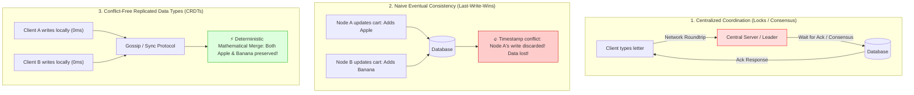
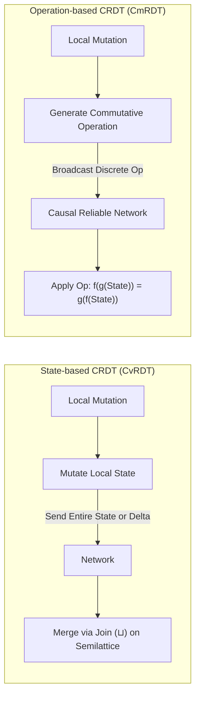
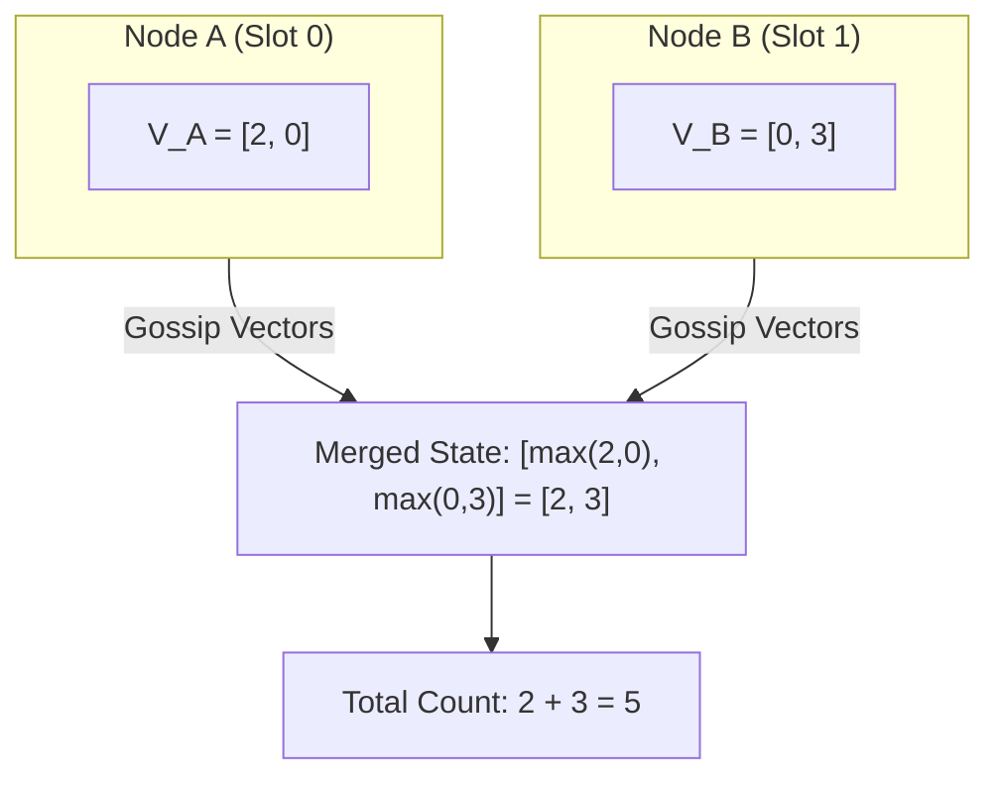
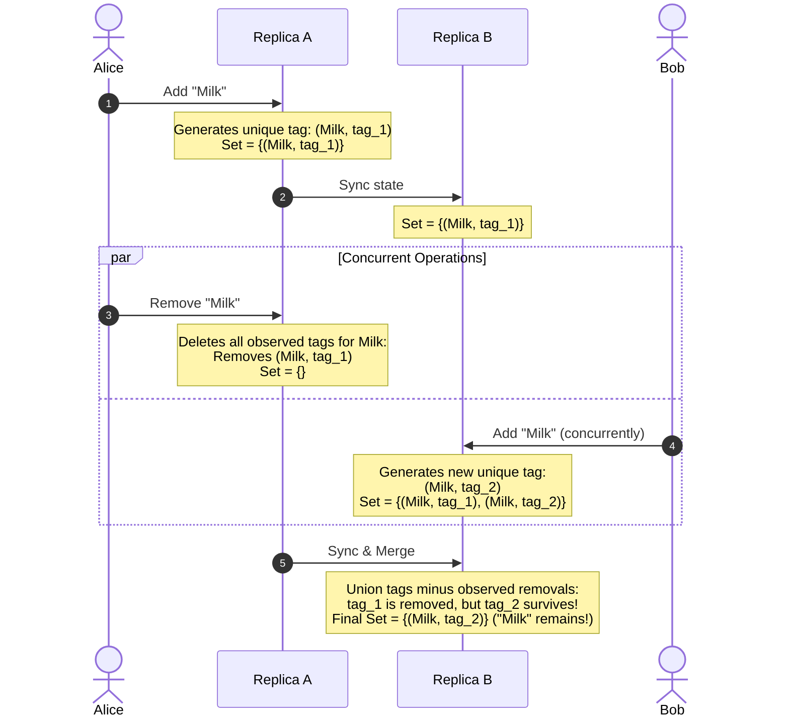
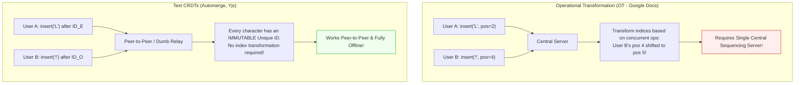
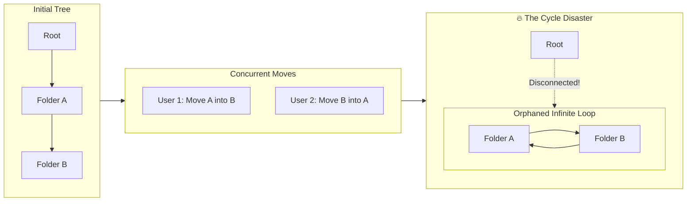
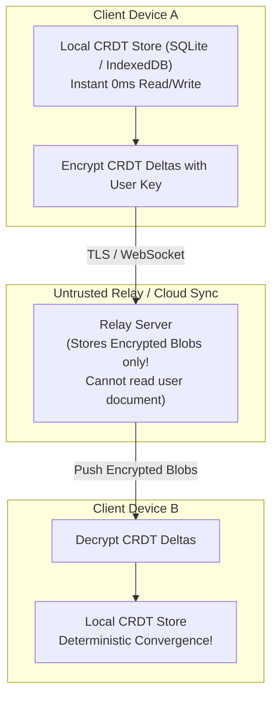
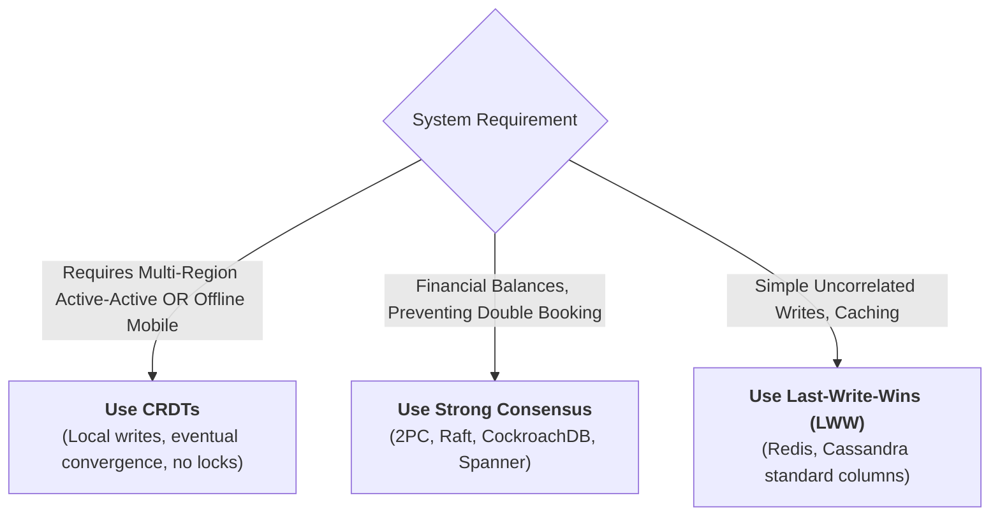

# Conflict-Free Replicated Data Types (CRDTs)

**Sources:**
- [Conflict Resolution for Eventual Consistency • Martin Kleppmann • GOTO 2016](https://www.youtube.com/watch?v=yCcWpzY8dIA)
- [CRDTs and the Quest for Distributed Consistency • Martin Kleppmann • InfoQ](https://www.youtube.com/watch?v=B5NULPSiOGw)
- [CRDTs: The Hard Parts • Martin Kleppmann](https://www.youtube.com/watch?v=x7drE24geUw)

**TL;DR:** Conflict-Free Replicated Data Types (CRDTs) are mathematically grounded data structures that enable multi-user, active-active, and offline-first distributed systems to replicate data across multiple nodes without centralized coordination. Every replica can execute concurrent writes locally with **zero network latency**, and replicas independently converge to the exact same state once messages arrive, regardless of message reordering, duplication, or network delay. CRDTs come in two mathematical flavors: **State-based (CvRDT)** (merging via monotonic join-semilattices) and **Operation-based (CmRDT)** (broadcasting commutative operations). They power real-time collaborative editors (Figma, Apple Notes, Google Docs alternatives like Automerge and Yjs), distributed databases (Redis Enterprise Active-Active, Riak, Cassandra counters), and peer-to-peer networks.

---

## 1. The Core Problem: Centralized Locks vs. Silent Data Loss

### The Collaboration Dilemma
Imagine multiple clients concurrently updating shared state (e.g., editing a text document, adding items to a shopping cart, or incrementing an ad click counter) across flaky mobile connections or multi-region datacenters.



### Why Centralized Locking Fails (The Local-First Imperative)
* **The SSH / Vim Problem:** If every keystroke or local modification requires a synchronous round-trip to a central leader, user latency is tethered to network ping ($100\text{--}300\text{ ms}$). Users on spotty mobile connections or offline on airplanes are blocked completely.
* **The Availability Ceiling:** Under the CAP theorem, systems relying on central consensus (Paxos, Raft, 2PC) sacrifice availability ($A$) during network partitions ($P$). If the leader is unreachable, writes stall.

### Why Last-Write-Wins (LWW) is Dangerous
Many distributed databases (e.g., Apache Cassandra, CouchDB) default to **Last-Write-Wins (LWW)** using wall-clock timestamps:
* If User A adds item $X$ at $t_1$ and User B adds item $Y$ at $t_2$, the database blindly discards User A's update because $t_2 > t_1$.
* **NTP Clock Skew:** Physical server clocks drift by milliseconds. A write that happened physically earlier can overwrite a write that happened physically later simply because of clock skew.
* **Silent Data Loss:** In collaborative workspaces or shopping carts, silently dropping user intent is unacceptable.

### Consensus vs. Convergence: The Fundamental Distinction
Martin Kleppmann outlines the core architectural distinction:
* **Consensus (Raft, Paxos, 2PC, Blockchain):** Needed when you must **prevent double-spending** or pick *one single winner* out of mutually exclusive operations (e.g., spending the same digital dollar, booking the last flight seat). One transaction succeeds, and all conflicting proposals are rejected.
* **Convergence (CRDTs):** Needed when you want **multi-master collaboration**. No user input should be discarded. Every node accepts writes locally and concurrently, and the data structure mathematically merges all concurrent intents without conflicts or central arbiters.

---

## 2. Theoretical Foundations: CvRDT vs. CmRDT

CRDTs are categorized into two primary architectural families based on what information is transmitted over the wire:



---

### A. State-Based CRDTs (CvRDT - Convergent Replicated Data Types)

In a CvRDT, replicas replicate by sending their **entire local state** (or state deltas) to other replicas. When a node receives a remote state, it merges it with its own state using a **merge function** ($\sqcup$, called *join*).

#### The Mathematical Foundation: Join-Semilattices
For a state-based CRDT to guarantee strong eventual consistency, the state space and the merge function $\sqcup$ must form a **Bounded Join-Semilattice** $(S, \sqcup)$, which satisfies three algebraic properties:
1. **Commutativity:** 
   $$A \sqcup B = B \sqcup A$$
   *(The order in which two states are merged does not matter).*
2. **Associativity:** 
   $$(A \sqcup B) \sqcup C = A \sqcup (B \sqcup C)$$
   *(The grouping of merge operations across multiple network packets does not matter).*
3. **Idempotence:** 
   $$A \sqcup A = A$$
   *(Receiving the same state update twice or replaying dropped packets causes zero side effects).*

#### Partial Order & Monotonicity
A semilattice defines a partial order $\le$ where $A \le B$ if and only if $A \sqcup B = B$.
* Every update must be **monotonically increasing** on the lattice:
  $$S_{new} \ge S_{old}$$
* Because state only ever moves "up" the lattice, concurrent updates merge by finding their **Least Upper Bound (LUB)**.

* **Network Requirement:** Extremely relaxed. Tolerates out-of-order delivery, duplicate messages, and packet loss (as long as messages are eventually retried).
* **Downside:** State payload grows over time. Sending entire states over the wire wastes bandwidth (mitigated by *Delta-based CRDTs*).

---

### B. Operation-Based CRDTs (CmRDT - Commutative Replicated Data Types)

In a CmRDT, replicas do **not** transmit full state. Instead, they execute a local operation and broadcast a **discrete mutation operation** (e.g., `insert_after(char_id, 'x')` or `add_tag(item_id, uuid)`).

#### The Mathematical Foundation: Commutativity
All concurrent operations must **commute** with each other:
$$f(g(S)) = g(f(S))$$
Applying concurrent operations in any order on any replica must produce the identical final state.

#### Network Requirements
* **Causally Ordered Delivery:** If operation $B$ was generated after operation $A$ was observed ($A \to B$), then every node must execute $A$ before executing $B$.
* **At-Most-Once / Exactly-Once Delivery:** Because operations are not necessarily idempotent ($count = count + 1$ applied twice doubles the count), the transport layer must prevent duplicate delivery, or operations must be tagged with unique IDs to achieve idempotent application.

---

### CvRDT vs. CmRDT Comparison Matrix

| Property | State-Based (CvRDT) | Operation-Based (CmRDT) |
| :--- | :--- | :--- |
| **Payload Sent** | Full State (or Delta subset) | Discrete Operation |
| **Merge Primitive** | Join operation ($\sqcup$) on Semilattice | Commutative function execution |
| **Algebraic Constraint** | Associative, Commutative, Idempotent | Commutative (for concurrent ops) |
| **Network Delivery** | Any order, duplicate-tolerant (Unreliable) | Causally ordered, deduplicated |
| **Bandwidth Cost** | High (grows with data size) | Low (proportional to mutation rate) |
| **Memory Overhead** | Low (only current state needed) | Requires causal history/dependency buffers |

---

## 3. Core CRDT Primitives & Under-the-Hood Mechanics

---

### 1. Distributed Counters

#### A. G-Counter (Grow-Only Counter)
Standard integers cannot be incremented concurrently because `count = count + 1` is not idempotent, and simply sending `count = 5` overwrites concurrent increments.

* **Mechanics:**
  * For a cluster of $n$ nodes, the counter is an array of size $n$:
    $$V = [c_1, c_2, \dots, c_n]$$
  * Node $i$ is only permitted to increment its own slot: $V[i] = V[i] + 1$.
  * **Merge Rule:** Take the element-wise maximum across all nodes:
    $$V_{merged}[k] = \max(V_A[k], V_B[k]) \quad \forall k \in [1, n]$$
  * **Value Read:** Sum all elements in the vector:
    $$\text{Value} = \sum_{k=1}^n V[k]$$



#### B. PN-Counter (Positive-Negative Counter)
Allows both increments and decrements.
* **Mechanics:** Combines two G-Counters:
  1. $P$: Tracks all increments.
  2. $N$: Tracks all decrements.
* **Value Read:**
  $$\text{Value} = \sum P[k] - \sum N[k]$$
* **Merge Rule:** Merge $P$ and $N$ independently using G-Counter element-wise maximum.

---

### 2. Registers (Single Value Storage)

#### A. LWW-Register (Last-Write-Wins Register)
* **Mechanics:** Stores a tuple $(value, timestamp)$.
* **Merge Rule:** On conflict, the value with the higher timestamp replaces the lower one:
  $$\text{Merge}((v_1, t_1), (v_2, t_2)) = \begin{cases} (v_1, t_1) & \text{if } t_1 > t_2 \\ (v_2, t_2) & \text{if } t_2 > t_1 \\ \text{tie-breaker}(v_1, v_2) & \text{if } t_1 = t_2 \end{cases}$$
* ⚠️ **Trade-off:** High risk of silent data loss due to clock skew or concurrent updates.

#### B. MV-Register (Multi-Value Register)
* **Mechanics:** Uses a Version Vector to track causal history.
* **Merge Rule:** If write $B$ causally supersedes write $A$ ($V_A < V_B$), $B$ overwrites $A$. If writes $A$ and $B$ are **concurrent** (neither version vector dominates), the register **retains both values** as a set: $\{v_1, v_2\}$.
* **Application Resolution:** The conflict is surfaced directly to the user or application logic (e.g., Git merge conflict style or shopping cart item union).

---

### 3. Distributed Sets

#### A. G-Set (Grow-Only Set)
* Elements can only be added, never removed.
* Merge Rule: Mathematical Set Union:
  $$S_{merged} = S_A \cup S_B$$

#### B. 2P-Set (Two-Phase Set)
* **Mechanics:** Uses two G-Sets:
  1. **Add Set ($A$):** Tracks added elements.
  2. **Remove Set ($R$):** Tracks removed elements (tombstones).
* **Membership Rule:** An element $e$ is in the set if $e \in A$ and $e \notin R$.
* ❌ **The Fatal Flaw:** Once an element is removed ($e \in R$), **it can never be added back**. Future adds will see $e \in R$ and consider it deleted forever.

#### C. OR-Set (Observed-Remove Set) — *The Production Standard*
The OR-Set solves the 2P-Set flaw by assigning a **unique tag (UUID or Lamport timestamp)** to every add operation.



* **Add Operation:** Adding element $e$ creates a new pair $(e, u)$ where $u$ is a globally unique tag.
* **Remove Operation:** Removing element $e$ searches the local replica for all existing pairs $(e, u)$ currently present and moves them to a tombstone set.
* **Merge Rule:**
  $$A_{merged} = (A_1 \cup A_2) \setminus (R_1 \cup R_2)$$
* **Add-Wins Semantics:** If Replica A removes "Milk" (deleting `tag_1`) while Replica B concurrently adds "Milk" (creating `tag_2`), the merged state retains `(Milk, tag_2)`. **The concurrent addition naturally wins over removal** without relying on arbitrary clocks!

---

## 4. Collaborative Sequences & Text Editing (CRDTs vs. OT)

When multiple users collaborate on text (like Google Docs or Notion), documents cannot be treated as simple sets or registers. Text is an **ordered sequence of characters**.

```
Initial Document: "HELO"
User A inserts 'L' at index 2 -> "HELLO"
User B concurrently inserts '!' at index 4 -> "HELO!"
```

---

### Operational Transformation (OT) vs. CRDTs



#### Why Operational Transformation (OT) Struggles Without a Central Server:
* OT represents text operations by raw positional indices: `insert(pos, char)` and `delete(pos)`.
* If two users type concurrently, character positions shift. OT requires transformation functions $T(op_1, op_2)$ to rewrite indices.
* **The Centralized Bottleneck:** OT algorithms (like Jupiter, used in Google Docs) require a **single authoritative central server** to linearize all operations into a global total order. Implementing decentralized peer-to-peer OT without a central server has proven notoriously bug-prone and mathematically fragile.

#### The Text CRDT Breakthrough: Immutable Character Identifiers
Instead of identifying characters by transient integer indices ($0, 1, 2 \dots$), a text CRDT assigns **every single character an immutable, globally unique identifier** when it is typed:
$$\text{Char ID} = (\text{Lamport Timestamp}, \text{Client ID})$$

* When inserting a character, the operation specifies the **ID of the preceding character**, not a numerical index:
  $$\text{insert}('L', \text{after}=\text{ID}_E)$$
* Even if thousands of characters are concurrently inserted or deleted elsewhere in the document, the character $\text{ID}_E$ never changes its identity!
* Resolving ties between concurrent insertions at the same position is handled by sorting character IDs by timestamp and client ID deterministically.

---

## 5. "The Hard Parts" of CRDTs (Martin Kleppmann's Breakthroughs)

While basic counters and sets are simple, real-world collaboration software involves complex documents: rich text, nested JSON trees, drag-and-drop lists, and filesystems. Martin Kleppmann highlights the four hardest challenges in production CRDT engineering:

---

### Hard Part 1: The Character Interleaving Problem

When two users insert words at the same location concurrently, naive character-by-character fractional indexing causes words to scramble.

* **The Scenario:**
  * Initial text: `"hello world"`
  * User A types: `"Alice "`
  * User B types: `"dear "`
* **The Scrambling Bug:**
  * If the CRDT interleaves characters based on alternating timestamps or client IDs:
  * Result: `"d e a l i c e a r  world"` (Complete gibberish!)
* **The Solution (Replicated Growable Arrays - RGA):**
  * Modern text CRDTs (RGA, Automerge, Yjs) treat contiguous typing as linked trees/blocks.
  * When a user types a word, each new character points to the immediately preceding character typed by that same user.
  * Sibling branches are ordered deterministically using timestamps, but entire subtrees/words remain intact:
  * Clean Merged Result: `"hello dear Alice world"` (Preserves word boundaries).

---

### Hard Part 2: The Tree Move Problem & Cycle Avoidance

In applications like Notion, Figma (scene graphs), or cloud filesystems (Google Drive), data is organized as a **tree of nodes** (folders, layers, blocks).

#### The Catastrophic Cycle Scenario:
What happens if two users concurrently move folders?
* Initial state: Folder $A$ contains Folder $B$ ($Root \to A \to B$).
* **User 1 (offline):** Moves Folder $A$ inside Folder $B$ ($B \to A$).
* **User 2 (concurrently):** Moves Folder $B$ inside Folder $A$ ($A \to B$).



If both operations are naively merged:
1. $A$ becomes a child of $B$, and $B$ becomes a child of $A$.
2. **A cycle is formed ($A \rightleftharpoons B$).**
3. Both folders detach completely from the Root! The entire directory tree vanishes from the user's screen into an unreachable black hole, causing catastrophic data loss.

#### Martin Kleppmann's Algorithmic Solution for Trees:
1. **Total Order of Operations:** Assign each move operation a Lamport timestamp + Client ID.
2. **Cycle Check on Application:** Before applying a move operation $M(\text{item}, \text{new\_parent})$:
   * Walk up the ancestor tree starting from $\text{new\_parent}$.
   * If $\text{item}$ is encountered in the ancestor chain, applying this move would create a cycle!
   * **Rule:** If a cycle is detected, the operation is **deterministically discarded/ignored**.
3. **Speculative Rewind & Replay (Log Rewind):**
   * If an older operation arrives out of order from the network, the replica rolls back subsequent move operations, applies the missing operation (with cycle checking), and replays subsequent operations forward.

---

### Hard Part 3: Garbage Collection & Tombstone Bloat

When an element or character is deleted in a CRDT, it cannot be immediately purged from memory. If Node A simply deleted the record, and Node B later sent an update referencing that record, Node A wouldn't know how to place it or might re-insert it as new data!

* **Tombstones:** Systems leave an invisible marker (a "tombstone") indicating that the item existed and was deleted.
* **The Memory Explosion (The 300,000 Keystroke Case Study):**
  * Martin Kleppmann captured the full keystroke history of writing an academic paper:
  * Final document size: **$100\text{ KB}$** of LaTeX text.
  * Editing history: **300,000+ individual keystrokes and deletions**.
  * Storing every keystroke and tombstone as a JSON object inflated the file to **over 100 Megabytes in RAM** ($1000\times$ overhead)!

#### Production Solutions:
1. **Columnar Binary Compaction (Automerge 2.0 / Yjs):**
   * Characters typed in sequence are compressed into contiguous byte arrays using Run-Length Encoding (RLE) and LEB128 bit-packing.
   * Compresses 300,000 operations down from $100\text{ MB}$ to under **$300\text{ KB}$**.
2. **Stable Version Vector Pruning:**
   * A tombstone can be physically purged from memory **if and only if** every participating replica node in the cluster has acknowledged that it has seen the deletion.
   * If vector clocks show all active nodes have observed the deletion, the tombstone is safely removed forever.

---

### Hard Part 4: Local-First Software & End-to-End Encryption (E2EE)

Because CRDTs are deterministic and require no central transformation logic, they enable a revolutionary paradigm: **Local-First Software**.



* **Zero Cloud Dependency:** Data lives on the user's local disk (SQLite / IndexedDB). The app starts instantly and works completely offline.
* **Trustless Clouds:** Unlike Google Docs (which must read plaintext on the server to transform OT indices), a CRDT sync server only relays immutable op packets. The client can **encrypt CRDT operations end-to-end (E2EE)** before sending them. The cloud provider cannot read the user's document!

---

## 6. Real-World Production Implementations

| Technology / System | Use Case | CRDT Architecture |
| :--- | :--- | :--- |
| **Figma** | Real-time collaborative design canvas | Custom CRDT for scene graphs, color palettes, and property trees. |
| **Apple Notes** | Offline note-taking synced across iOS/macOS | Uses CRDTs for rich text, checklist merges, and sketch layers. |
| **Redis Enterprise** | Multi-region Active-Active geo-distribution | CRDT-based Redis Hashes, Sets, Sorted Sets, and Counters. |
| **Automerge** | Open-source Local-First JSON / Text library | RGA text sequences, Lamport timestamps, columnar binary encoding. |
| **Yjs** | High-performance shared types for web editors | Struct-based sequence CRDT, powering JupyterLab and Monaco Editor. |
| **Riak KV** | Distributed NoSQL key-value store | Built-in OR-Set, PN-Counter, and LWW-Register data types. |

---

## 7. System Design Interview Playbook & Traps

### When to Propose CRDTs in an Interview



#### Choose CRDTs when:
1. The problem involves **collaborative editing, document synchronization, or live canvas tools** (Google Docs, Figma, Miro, Notion).
2. The system must support **offline mobile clients** that sync changes seamlessly when regaining network connectivity.
3. Multi-datacenter **active-active replication** where cross-region network latency cannot block local write throughput.

---

### The 4 Major Interview Traps

#### 1. The Financial Balance Trap (Counters vs. Bank Accounts)
* **The Candidate Mistake:** *"I will use a PN-Counter CRDT to track a user's bank account balance across multiple regions."*
* **The Failure:** CRDT counters cannot enforce invariants like `balance >= 0`. If Alice has $\$100$ and withdraws $\$80$ in Region 1 while concurrently withdrawing $\$80$ in Region 2, both PN-counters decrement locally. Upon merging, the balance becomes $-\$60$.
* **The Staff Engineer Rule:** CRDTs are for **growth and aggregation**, not constraint enforcement. Financial ledgers and inventory reservations require **Strong Consistency (Consensus / 2PC)** to prevent double-spending.

#### 2. The Clock Skew Trap on LWW Registers
* **The Candidate Mistake:** Proposing wall-clock timestamps (`System.currentTimeMillis()`) to resolve conflicts between concurrent updates in a replicated key-value store.
* **The Staff Engineer Rule:** Explain the risk of physical clock drift (NTP jumps). Recommend **Observed-Remove Sets (OR-Sets)** with unique tags or **Multi-Value Registers (MV-Registers)** with vector clocks.

#### 3. The Tombstone Memory Leak Blindspot
* **The Candidate Mistake:** Storing deletions in a collaborative list without discussing garbage collection.
* **The Staff Engineer Rule:** Mention that CRDT deletions create **tombstones** to preserve causal ordering. Explain how to bound memory using **stable version vectors** or compact run-length encoded columnar formats (Automerge/Yjs).

#### 4. The Tree Move Cycle Trap
* **The Candidate Mistake:** Assuming moving a file/folder in a collaborative filesystem is a simple pointer update.
* **The Staff Engineer Rule:** Explain the **Move Problem**: concurrent moves can introduce circular references ($A \subset B \subset A$), disconnecting subtrees from the root. Explain cycle detection and Lamport total ordering.
