# Apache Cassandra Deep Dive

**Source:** [Cassandra Deep Dive w/ Ex-Meta Staff Engineer (Hello Interview)](https://www.youtube.com/watch?v=TD3-INhm60Q) | [Hello Interview Written Guide](https://www.hellointerview.com/learn/system-design/deep-dives/cassandra)

**TL;DR:** Apache Cassandra is an open-source, masterless, distributed NoSQL wide-column database engineered for massive write throughput, horizontal elasticity, zero single-point-of-failure (SPOF) availability, and multi-datacenter replication. It blends the decentralized peer-to-peer ring topology and tunable quorum consistency of **Amazon Dynamo** with the Log-Structured Merge-tree (LSM) storage engine and column family model of **Google Bigtable**. In system design interviews, Cassandra is the premier choice for write-heavy (>100k writes/sec), time-series, or messaging applications with predictable, query-driven access patterns.

---

## 1. Lineage & Motivation

### A. Origins at Facebook (2007)
Cassandra was created in 2007 at Facebook by **Avinash Lakshman** (co-inventor of Amazon's Dynamo) and Prashant Malik to solve the **Facebook Inbox Search** problem. 
*   **The Scale Challenge:** Millions of users sending billions of messages per day required an infrastructure capable of absorbing enormous write volume without latency spikes.
*   **The Problem with RDBMS:** Scaling a traditional relational database (MySQL/PostgreSQL) for write loads required manual sharding, complex failover orchestration, master-replica replication lag, and rigid schemas. Adding capacity required painful downtime or complex data migration scripts.
*   **The Solution:** Combine the best distributed system primitives into a single database:
    1.  **Amazon Dynamo Lineage:** Fully peer-to-peer (masterless) ring architecture, consistent hashing with virtual nodes (v-nodes), gossip protocol for decentralized cluster state, and tunable quorum consistency ($R + W > RF$).
    2.  **Google Bigtable Lineage:** Log-Structured Merge-Tree (LSM-tree) storage architecture with sequential write-ahead commit logs, in-memory Memtables, immutable disk-based SSTables, Bloom filters, and sparse wide-column data modeling.

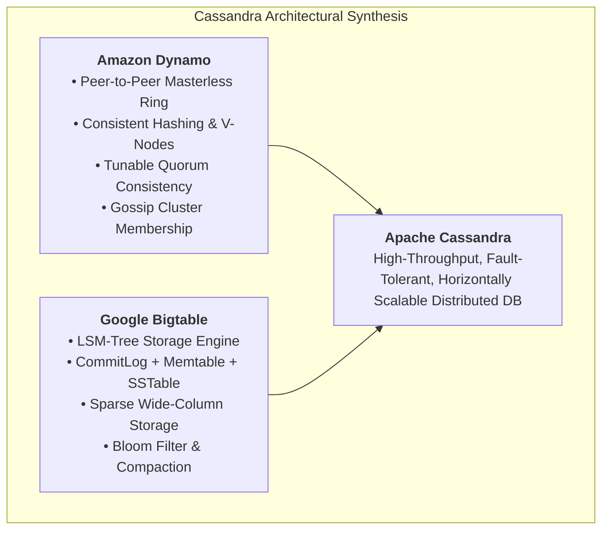

---

## 2. Cassandra Data Model & Hierarchy

Unlike relational databases where storage is normalized across rigid tables, Cassandra uses a sparse, wide-column model that organizes data into a 4-level hierarchy:

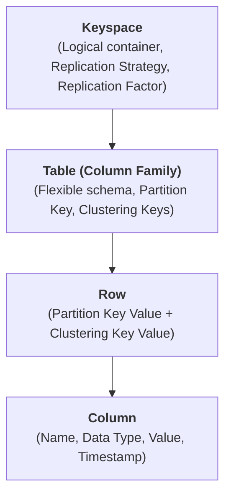

1.  **Keyspace:** The highest-level container (equivalent to an RDBMS `DATABASE` or `SCHEMA`). Defines cluster-wide replication mechanics:
    *   **Replication Strategy:** How copies are placed (e.g., `NetworkTopologyStrategy`).
    *   **Replication Factor ($RF$):** How many physical copies of data exist across the cluster (e.g., $RF = 3$).
2.  **Table:** A collection of partitions defining the primary key and typed columns. Unlike SQL tables, Cassandra tables are **sparse wide-column stores**: rows in the same table do not need to share the same columns, and empty columns take up 0 bytes on disk (no `NULL` storage overhead).
3.  **Row:** A set of columns addressed uniquely by a Primary Key.
4.  **Column:** The atomic unit of storage comprising `(name, value, timestamp)`. The timestamp is supplied by the client or coordinator and is fundamental to Cassandra's Last-Write-Wins (LWW) conflict resolution.

---

## 3. Primary Key Anatomy: Partition Key vs. Clustering Key

In an interview, **data modeling in Cassandra begins and ends with the Primary Key**. Getting the primary key wrong leads to hot nodes, unbounded partitions, or impossible queries.

$$\text{PRIMARY KEY} = (\text{Partition Key}) + [\text{Clustering Key(s)}]$$

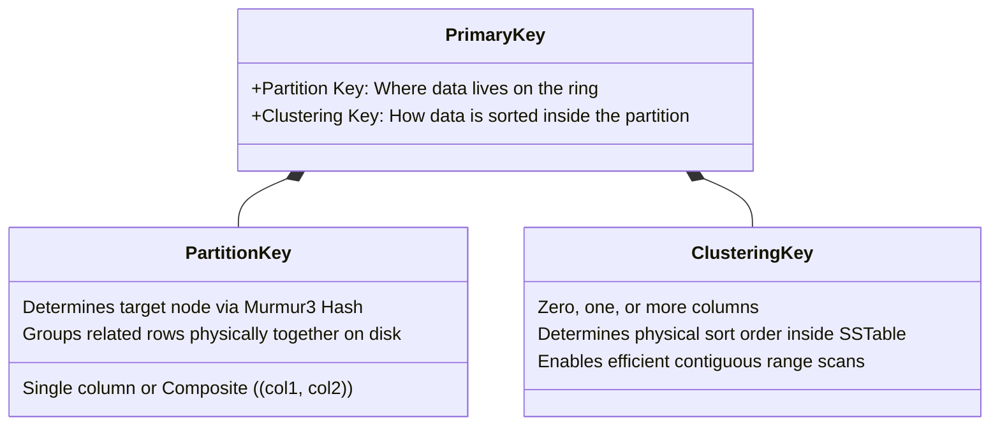

### A. Partition Key (Where it lives)
*   **Role:** Passed through a deterministic hash function (`Murmur3Partitioner`) to produce a 64-bit integer token ($ -2^{63} \text{ to } 2^{63}-1 $). This token dictates which nodes on the consistent hash ring own the partition.
*   **Single vs. Composite Partition Key:**
    *   `PRIMARY KEY (user_id)` $\to$ `user_id` is the partition key.
    *   `PRIMARY KEY ((user_id, bucket_id), message_id)` $\to$ `(user_id, bucket_id)` is a **composite partition key**. Both columns are hashed together to select the partition node.

### B. Clustering Key (How it is sorted)
*   **Role:** Determines the physical on-disk sort order of rows *within* a single partition.
*   **Behavior:** Cassandra stores rows within a partition sorted by the clustering column(s). This makes range queries (e.g., `WHERE message_id > X AND message_id < Y`) blazingly fast because they map to a sequential disk seek rather than random lookups.

```sql
-- Example: User Messages Table
CREATE TABLE user_messages (
    user_id uuid,
    message_id timeuuid,
    sender_id uuid,
    content text,
    PRIMARY KEY (user_id, message_id)
) WITH CLUSTERING ORDER BY (message_id DESC);
```
*   `user_id` is the **Partition Key** (all messages for a user live on the same physical node).
*   `message_id` is the **Clustering Key** (sorted newest first on disk for fast reverse-chronological chat rendering).

### C. Why Cassandra is Fundamentally Bad for Cross-Partition Range Scans (The Murmur3 Dilemma)

A common system design interview trap is attempting to run a range query across partition keys, such as:
```sql
-- DANGEROUS ANTI-PATTERNS IN CASSANDRA:
SELECT * FROM users WHERE user_id >= 100 AND user_id <= 200;
-- OR scanning an entire table without a partition key:
SELECT * FROM users WHERE status = 'ACTIVE' ALLOW FILTERING;
```

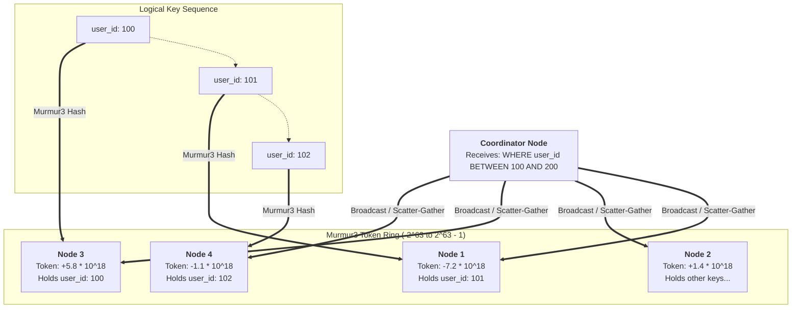

#### 1. The Mechanics: Murmur3 Pseudo-Random Dispersion
Cassandra defaults to the `Murmur3Partitioner`. Murmur3 is an extremely fast, uniform pseudo-random hash function engineered for **maximum entropy and uniform distribution**:
* Logical keys that are numerically or alphabetically adjacent (e.g., `user_id = 100`, `user_id = 101`, `user_id = 102`) produce wildly divergent 64-bit integer tokens.
* As a result, consecutive rows are scattered completely randomly across distinct physical nodes and token ranges across the cluster.

#### 2. The Penalty: Full-Cluster Scatter-Gather
When an application queries a range of partition keys or scans a table without specifying an exact partition key:
1. **Cluster-Wide Broadcast:** The coordinator node cannot perform an indexed seek. It must broadcast the query to **every single replica node in the entire cluster**.
2. **Disk Thrashing & Network Flooding:** Every node scans its local SSTables and streams chunks of data back over the internal network to the coordinator.
3. **Coordinator Bottleneck & OOM:** The coordinator must hold, buffer, deduplicate (via timestamps), and sort all rows in memory before returning them to the client. This frequently triggers Java Garbage Collection (GC) pauses or fatal Out-Of-Memory (`OOMKilled`) crashes.
4. **Tail Latency Explosion ($p99$):** The response time is strictly bound by the single slowest, most overloaded node in the cluster (the straggler effect).

#### 3. Intra-Partition vs. Inter-Partition Range Queries

| Query Type | Example | Execution Path | Performance |
| :--- | :--- | :--- | :--- |
| **Intra-Partition Range Scan** <br/>*(Using Clustering Key)* | `WHERE user_id = 101 AND message_id >= X AND message_id <= Y` | Routes to **one single partition**; executes a sequential forward scan across sorted SSTable blocks. | **Single-digit milliseconds ($<2\text{ ms}$)** |
| **Inter-Partition Range Scan** <br/>*(Across Partition Keys)* | `WHERE user_id >= 100 AND user_id <= 200` | Requires **cluster-wide scatter-gather** across all physical machines. | **Catastrophic (Timeouts / OOM)** |

#### 4. Why Cassandra Abandoned `ByteOrderedPartitioner`
Early versions of Cassandra supported `ByteOrderedPartitioner` (BOP), which preserved lexicographical ordering of partition keys so that range scans across partition keys were possible.

* **Why was it deprecated?** It caused catastrophic **write hot-spotting**.
* If partition keys are sequentially ordered (such as timestamp prefixes, sequential integer IDs, or alphabetic usernames starting with common letters), **all write traffic slams the single node holding that active range**, while the other 99 nodes sit completely idle.
* Cassandra's core design philosophy deliberately sacrificed cross-partition range scans in favor of `Murmur3Partitioner` to guarantee perfect write balancing across massive clusters.

#### 5. Clustering Key vs. DynamoDB Sort Key vs. CockroachDB 64MB Ranges

In system design interviews, candidates are often asked to compare how Cassandra, DynamoDB, and CockroachDB handle range queries:

* **Cassandra & DynamoDB share the same two-tier model:**
  $$\text{Primary Key} = \text{Hash-Based Partition Key (Cluster Placement)} + \text{Range-Based Clustering/Sort Key (Node Placement)}$$
  Both databases reject global range scans across the cluster to avoid write hot-spotting, confining range scans strictly to rows within the same partition key.
* **Where Cassandra Outperforms DynamoDB on Range Modeling:**
  1. **Multi-Column Clustering Keys:** Cassandra natively supports compound clustering keys (e.g., `PRIMARY KEY (tenant_id, year, month, day, event_id)`). You can filter `WHERE tenant_id = 'T1' AND year = 2026 AND month = 10 AND day >= 1 AND day <= 15`. In DynamoDB, you are limited to exactly **one Sort Key**, forcing artificial string concatenation (`2026#10#01`).
  2. **Explicit On-Disk Sort Direction:** Cassandra allows setting physical storage order per column at schema creation:
     `WITH CLUSTERING ORDER BY (created_at DESC)`
     This ensures reverse-chronological queries (e.g., "fetch latest 10 messages") perform a forward sequential disk seek. DynamoDB always stores items in ascending order on disk.
* **Where CockroachDB Differs (Cluster-Wide Range Partitioning):**
  Unlike Cassandra and DynamoDB, CockroachDB uses **Range Partitioning across the entire cluster** (splitting an ordered keyspace into contiguous 64MB ranges). It natively supports global range scans (e.g., `WHERE created_at BETWEEN X AND Y` across all tenants) without full-cluster scatter-gather, at the cost of requiring mitigations (hash-sharded indexes / UUIDs) against sequential write hotspots.

| Architectural Dimension | Apache Cassandra | Amazon DynamoDB | CockroachDB (Distributed SQL) |
| :--- | :--- | :--- | :--- |
| **Cluster Partitioning** | **Hash-Based** (Murmur3 Token Ring) | **Hash-Based** (Consistent Hashing) | **Range-Based** (64MB Contiguous Ranges) |
| **Global Table Range Scans** | ❌ **No** (Dangerous `ALLOW FILTERING`) | ❌ **No** (Dangerous `Scan` API) | ✅ **Yes** (Native SQL multi-range scan) |
| **Single-Partition Range Scans** | ✅ **Yes** (via Clustering Key) | ✅ **Yes** (via Sort Key) | ✅ **Yes** (Standard indexed seek) |
| **Multi-Column Range Keys** | ✅ **Yes** (Compound clustering keys) | ❌ **No** (Only 1 Sort Key allowed) | ✅ **Yes** (Any composite B-Tree index) |
| **On-Disk Sort Direction** | Configurable (`ASC` or `DESC`) | Fixed (ASC only) | Configurable per index column |
| **Write Hotspot on Timestamps** | 🟢 **Low** (Murmur3 scatters writes) | 🟢 **Low** (Hashing spreads writes evenly) | 🔴 **High** (Sequential writes hammer rightmost range) |
| **Cross-Entity Joins & ACID** | ❌ No joins; Row-level LWW | ❌ No joins; Partition-level ACID | ✅ Full relational joins; Serializable ACID |

> **💡 System Design Interview Tip:**
> If an interviewer asks for a query pattern that requires range scans across primary entities (e.g., *"Find all users registered between May 1 and May 10"* or *"Scan orders by price range"*):
> * **DO NOT use Cassandra** with `ALLOW FILTERING` or range scans on partition keys.
> * Use **CockroachDB** or **Google Spanner** (which use Range Partitioning with dynamic 64MB range splitting), or index the ranges into an external search engine (**Elasticsearch**).

---

## 4. Entity-Driven vs. Query-Driven Data Modeling

One of the biggest red flags in a system design interview is modeling Cassandra data as if it were PostgreSQL or MySQL.

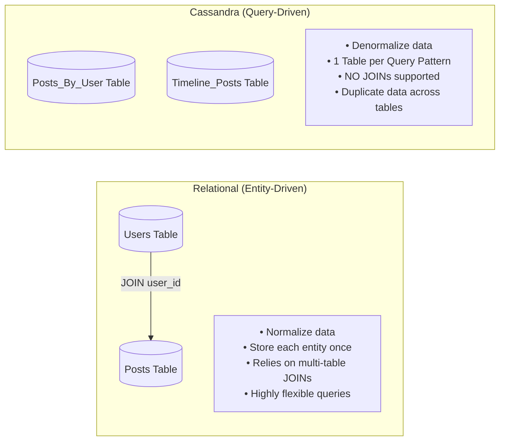

| Dimension | Relational Databases (RDBMS) | Apache Cassandra |
| :--- | :--- | :--- |
| **Philosophy** | **Entity-Driven** (Design around relationships) | **Query-Driven** (Design around queries) |
| **Normalization** | 3NF (Third Normal Form) to eliminate duplication | Deliberate **Denormalization** (duplication is encouraged) |
| **Joins** | Core capability (`INNER`, `LEFT`, `CROSS JOIN`) | **Unsupported**; single-table queries only |
| **Query Flexibility**| Arbitrary `WHERE` filters, `GROUP BY`, dynamic ad-hoc SQL | Queries **must** include the partition key; filtering without it is an anti-pattern (`ALLOW FILTERING`) |
| **Storage vs Compute**| Optimize for minimal disk storage | Optimize for fast, single-node sequential read computation |

> [!IMPORTANT]
> **Interview Rule of Thumb:** In Cassandra, **storage is cheap, but scatter-gather reads across multiple partitions will kill your latency SLAs**. You should happily duplicate data into multiple tables to satisfy distinct query patterns with single-partition reads.

---

## 5. Architecture: The Peer-to-Peer Ring

### A. Masterless Topology (Zero Central Master / Cluster Leader)
Cassandra clusters have **no master, no cluster leader, and no central controller**. Every node is architecturally identical and can accept read/write requests from any client. This eliminates the vulnerability of master failover downtime, split-brain elections, and external consensus dependencies (such as Apache ZooKeeper or etcd).

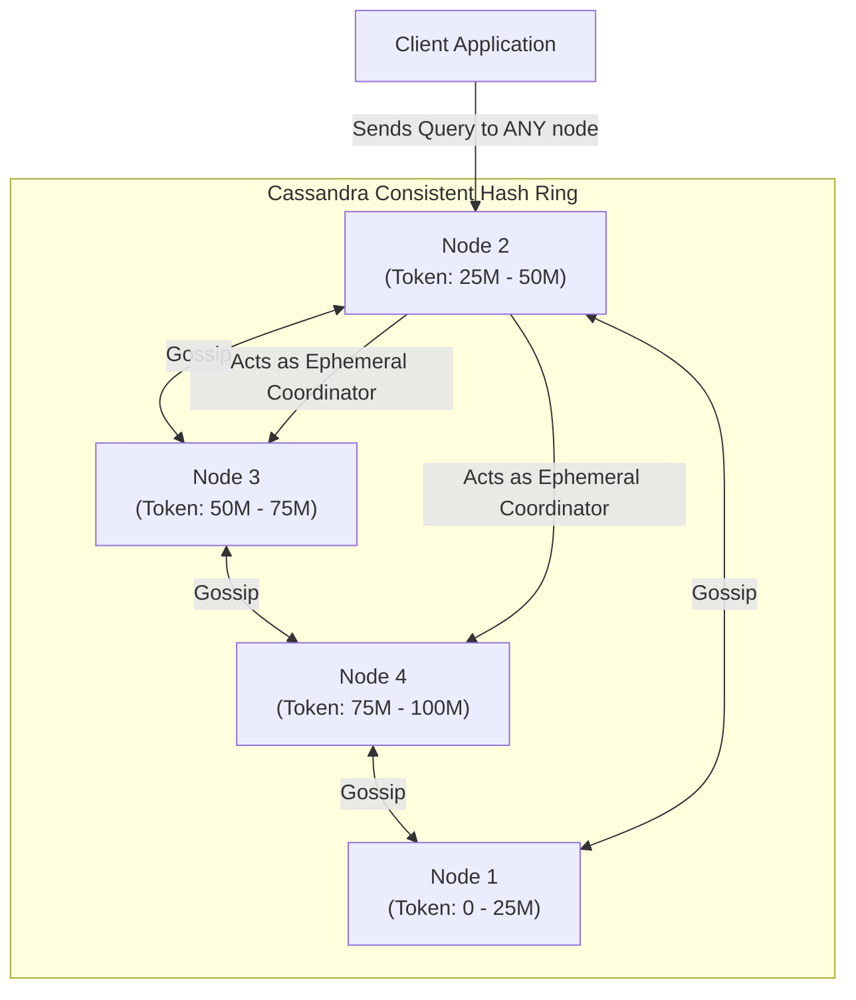

---

### B. Is There a "Leader and Follower" per Key or Partition? (NO!)

A frequent point of confusion in system design interviews is whether Cassandra designates a "leader replica" for each individual partition or key (similar to Kafka partitions, MongoDB replica sets, or Raft consensus groups).

> **In Cassandra, there is NO concept of a leader and follower—neither globally for the cluster, nor locally for any partition or key.** 
> All $N$ replica nodes holding a key (where $N = \text{Replication Factor}$) are **completely equal, active peers**.

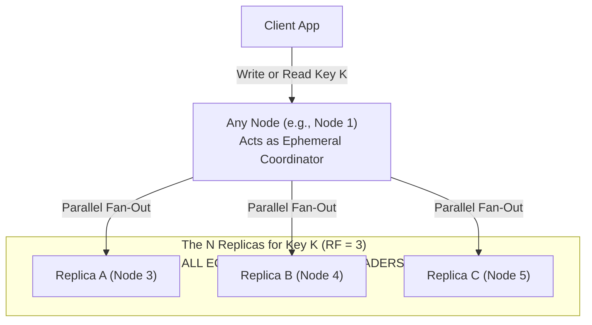

#### 1. The Role of the Coordinator Node (NOT a Leader)
* **Ephemeral Proxy:** When a client sends a read or write request to any node in the cluster, that node temporarily acts as the **Coordinator** for that single query.
* **Any Node Can Coordinate Any Key:** Node 1 can coordinate a write for User Alice, while Node 4 coordinates a write for User Bob, and Node 2 coordinates a read for User Alice concurrently.
* **The Coordinator Does Not "Own" the Key:** It simply hashes the partition key using `Murmur3Partitioner`, identifies the $N$ physical replica nodes that own the token range, forwards the request to them in parallel, waits for enough replies to satisfy the requested `ConsistencyLevel`, and responds to the client.
* **Token-Aware Client Optimization:** Modern client drivers (e.g., DataStax Java/Go driver) are "token-aware." They maintain a local map of cluster token ranges. Instead of connecting to a random node, the client routes the query directly to one of the actual replicas, letting that replica serve as coordinator and eliminating an extra network hop.

#### 2. How Writes Work Without a Leader
* In leader-based systems (Kafka, MySQL master-slave, Raft), all writes must be processed by the leader to establish a single sequential log order.
* In Cassandra, the coordinator sends the write to **all $N$ replicas concurrently**.
* Every replica writes the mutation directly to its local CommitLog and Memtable.
* Once the coordinator receives acknowledgments from a quorum of replicas (e.g., 2 out of 3 for `QUORUM`), it returns success.
* **Conflict Ordering:** Because there is no leader to assign log sequence numbers, Cassandra relies on **client/coordinator timestamps (Last-Write-Wins / LWW)**. If two concurrent writes touch the same column, the cell with the higher microsecond timestamp wins during compaction and read repair.

#### 3. How Reads Work Without a Leader
* The coordinator does not read from a primary copy.
* At `QUORUM` with $RF = 3$, it sends a **Full Data Read** to the fastest replica (lowest latency) and a **Digest Read** (a lightweight SHA-1 hash of the payload) to a second replica.
* If the data hash matches the digest, the coordinator returns the result immediately.
* **Read Repair:** If the hashes mismatch, the coordinator queries all replicas for their full data, compares timestamps to determine the latest value, returns the newest value to the client, and asynchronously writes the newest value back to the out-of-date replica(s).

#### 4. What About Lightweight Transactions (LWT / `IF NOT EXISTS`)?
When executing conditional writes (`INSERT ... IF NOT EXISTS`), Cassandra uses a leaderless variant of **Paxos**:
* The coordinator acts as the transient **Paxos Proposer** for that single statement round.
* The $N$ replicas act as **Paxos Acceptors**.
* Once the condition is checked and accepted by a quorum of acceptors, the mutation commits. There is still **no permanent or standing leader** for the key.

#### 5. Architectural Comparison Matrix

| Architectural Dimension | Leader-Follower Systems <br/>*(Kafka, MongoDB, MySQL, Raft)* | Masterless / Leaderless Systems <br/>*(Apache Cassandra, Amazon Dynamo)* |
| :--- | :--- | :--- |
| **Leader per Key / Partition?** | **YES.** Exactly 1 leader per partition. All writes must route through it. | **NO.** Zero leaders. All $N$ replicas are identical active peers. |
| **Write Failover Latency** | If the partition leader dies, writes for that key **stall** during leader election. | **Zero failover delay.** Any surviving replica immediately accepts writes if quorum is met. |
| **Ordering & Conflicts** | Leader establishes a strict total order (monotonic log sequence). | **Last-Write-Wins (LWW)** timestamps or ephemeral Paxos rounds. |
| **Replica Responsibilities** | Followers passively mirror the leader. | All replicas actively and concurrently process reads and writes. |

---

### C. Consistent Hashing & Virtual Nodes (V-nodes)
*   **The Modulo Problem:** Traditional sharding ($hash(key) \pmod N$) requires redistributing almost 100% of keys whenever a node joins or leaves.
*   **Consistent Hashing:** Arranges tokens in a continuous ring ($0 \text{ to } 2^{64}-1$). A partition key maps to a point on the ring, and the first node encountered moving clockwise owns the data.
*   **Virtual Nodes (V-nodes):** Instead of assigning a physical machine a single contiguous token range, Cassandra assigns each physical machine multiple small tokens (typically 128 or 256 v-nodes) distributed randomly across the ring.
    *   **Even Load Balancing:** Eliminates data skews caused by uneven hash distribution.
    *   **Fast Parallel Recovery:** When a node crashes, all remaining nodes in the cluster participate equally in reading and rebuilding pieces of its data, preventing any single surviving node from bottlenecking.

### C. Replication Strategies
Replication is configured per keyspace. Cassandra scans clockwise from the owning token to assign replicas:
1.  **SimpleStrategy:** Places subsequent replicas on the next physical nodes clockwise on the ring. Used *strictly* for single-datacenter local development.
2.  **NetworkTopologyStrategy (Production Standard):** Datacenter and rack-aware. It ensures replicas are placed in different racks within each datacenter to survive power strip/top-of-rack switch failures, and replicates data across distinct geographical regions (e.g., `{'us-east': 3, 'eu-central': 3}`).

---

## 6. Cluster Coordination & Fault Tolerance

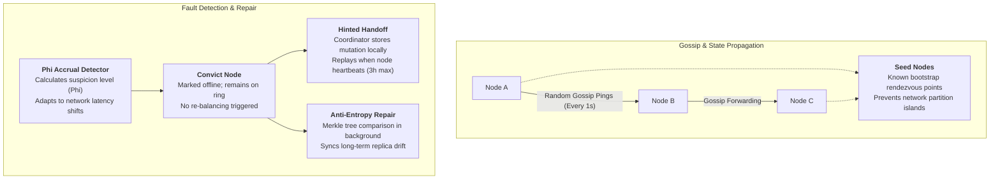

### A. Gossip Protocol
*   Every node executes a background gossip thread every **1 second**.
*   A node randomly selects 1–3 peer nodes, with a probabilistic preference for **Seed Nodes** (designated bootstrap nodes that prevent split-brain cluster partitions).
*   Nodes exchange lightweight state descriptors including:
    *   Heartbeat state (Generation timestamp + Version counter).
    *   Endpoint state (Tokens owned, schema agreement, node IP/status).
*   **Vector Clocks:** Every node uses generation (time of node startup) and version (monotonic counter) to discard outdated gossip information and converge on a single, global cluster view in $O(\log N)$ time without central locking.

### B. Phi ($\Phi$) Accrual Failure Detector
*   Unlike rigid binary heartbeat systems that falsely declare nodes dead during minor network blips, Cassandra computes a continuous suspicion score ($\Phi$).
*   It tracks historical inter-arrival times of heartbeat messages and calculates the probability that an unreceived heartbeat represents a genuine crash versus transient network congestion.
*   When $\Phi$ exceeds a configured threshold (typically 8 to 12), the node is **convicted** (flagged as down).

### C. Self-Healing Mechanics
1.  **Hinted Handoff:**
    *   If a write succeeds on some replicas but one replica is dead/unreachable, the coordinator stores a temporary **hint** (the write payload + timestamp) on its local disk.
    *   When gossip detects the dead node has returned online, the coordinator replays all accumulated hints to bring it up to date immediately.
    *   *Constraint:* Hints expire after a configurable duration (default: 3 hours) to prevent coordinator disks from filling up during extended outages.
2.  **Read Repair:**
    *   When an application issues a read at `QUORUM`, the coordinator queries all participating replicas.
    *   If replica responses differ, the coordinator returns the row with the newest timestamp to the client, and asynchronously fires a background **Read Repair** mutation to update the out-of-date replicas.
3.  **Anti-Entropy Node Repair (Nodetool Repair):**
    *   A periodic maintenance task where nodes construct **Merkle Trees** (cryptographic hash trees) of their token ranges and compare them over the network.
    *   Only mismatched sub-trees ($O(\log N)$ network payload) are exchanged, repairing silent bit rot or nodes offline beyond the hinted handoff window.

---

## 7. Storage Engine Internals: The Write & Read Paths

Cassandra is an implementation of a **Log-Structured Merge-Tree (LSM)**. Understanding why writes are $O(1)$ and how reads are accelerated is essential.

### A. The Write Path (Blazing Fast, Append-Only)

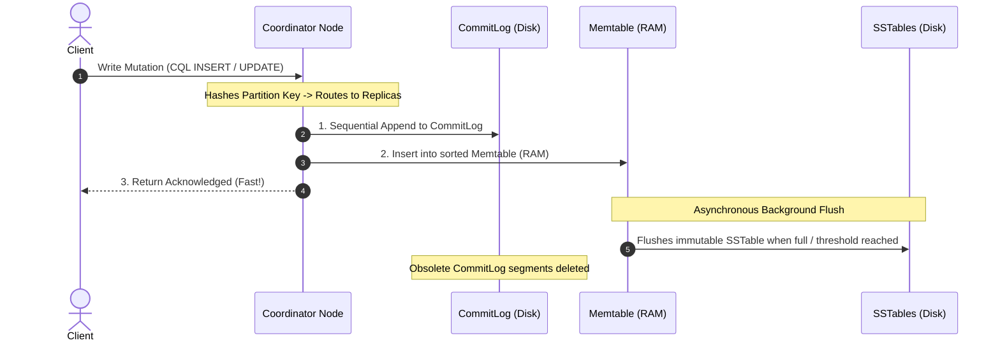

1.  **CommitLog (Disk):** Sequential, append-only write-ahead log stored on disk. It provides crash durability. Because sequential disk writes incur zero random-head seek overhead, appending to the CommitLog takes fractions of a millisecond.
2.  **Memtable (RAM):** The mutation is concurrently inserted into an in-memory sorted skip-list or binary search tree. Rows are sorted by partition key and clustering key.
3.  **Client Acknowledgment:** Once written to both CommitLog and Memtable, the node replies with success. **No on-disk table updates or page splits occur during the write path.**
4.  **Flushing to SSTables (Disk):** When the Memtable reaches capacity (or after a time threshold), it flushes sequentially to disk as an immutable **SSTable (Sorted String Table)**. 
5.  **CommitLog Cleanup:** Once an SSTable is safely written to disk, its corresponding CommitLog segments are truncated.

#### Does the Write Follow Two-Phase Commit (2PC)? (NO!)
A critical question in distributed systems interviews is whether Cassandra writes use Two-Phase Commit (2PC).

> **Standard Cassandra writes do NOT use 2PC. They use a 1-Phase, non-blocking quorum fan-out.**

* **Why Cassandra Rejects 2PC:**
  * **2PC is Blocking:** In 2PC, nodes acquire row/table locks during the "Prepare" phase and hold them until the coordinator sends "Commit". If the coordinator crashes or a network partition occurs, locked data becomes completely inaccessible.
  * **2PC Requires Unanimity:** If even one node votes "No" or times out, the entire transaction aborts (zero fault tolerance).
  * **Destroys Throughput:** Multiple network round-trips and locking barriers would reduce Cassandra's 100k+ writes/sec down to a crawl.
* **How Cassandra's 1-Phase Write Operates:**
  * The coordinator immediately forwards the raw mutation to all $N$ replicas in parallel with a microsecond timestamp ($T$).
  * Replicas acquire **zero locks** and perform **no prepare phase**—they directly append to their CommitLog and insert into their Memtable.
  * As soon as $W$ replicas reply (e.g., 2 out of 3 for `QUORUM`), the coordinator responds `Success` to the client.
* **The "No Rollback" Gotcha on Write Timeouts:**
  * In 2PC, a failure triggers an immediate rollback. **Cassandra NEVER rolls back a partially written write.**
  * *Example Scenario:* A client writes at `QUORUM` ($W=2, RF=3$). Replica 1 writes successfully, but Replicas 2 and 3 time out. The coordinator returns a `WriteTimeoutException` to the client.
  * *The Trap:* **Replica 1 still keeps the data!** If another client subsequently reads from Replica 1 at `CONSISTENCY ONE`, it will observe the new data. Furthermore, the coordinator may store a Hinted Handoff for Replicas 2 and 3, eventually propagating the write to the entire cluster.
  * *Staff Engineer Rule:* A `WriteTimeoutException` in Cassandra does **not** mean the write did not happen; it only means the coordinator could not confirm that the requested quorum acknowledged it before the deadline.
* **What About Conditional Writes (`IF NOT EXISTS`)?**
  * Cassandra uses **Paxos (Lightweight Transactions / LWT)**, NOT 2PC.
  * *Paxos vs. 2PC:* While 2PC requires 100% unanimity and blocks on coordinator failure, Paxos requires only a **majority quorum** (e.g., 2 of 3) and remains completely non-blocking and fault-tolerant even if a node crashes.

| Dimension | Cassandra Standard Write | Two-Phase Commit (2PC) | Cassandra LWT (Paxos) |
| :--- | :--- | :--- | :--- |
| **Protocol Type** | Single-Phase Quorum Fan-Out | 2-Phase Centralized Locking | 4-Phase Consensus |
| **Network Round Trips**| **1 RTT** (Client $\to$ Coord $\to$ Replicas) | **2 RTTs** (Prepare + Commit) | **4 RTTs** (Prepare, Propose, Accept, Commit) |
| **Locks Acquired?** | ❌ No | ✅ Yes (blocking) | ❌ No (optimistic timestamps) |
| **Rollback Behavior?** | ❌ Never rolls back | ✅ Full Rollback | ❌ Returns `applied: false` |
| **Write Latency** | **$1\text{--}3\text{ ms}$** | $50\text{--}200\text{ ms}$ | $10\text{--}30\text{ ms}$ |
| **Primary Use Case** | 99% of normal Cassandra writes | Cross-database ACID transactions | Atomic uniqueness (`IF NOT EXISTS`) |

---

#### The "Failed Write Resurrection" Dilemma: Timeout vs. Failure Semantics

A classic distributed systems interview paradox arises from partial write failures:

> **Scenario:** A client writes with `ConsistencyLevel = QUORUM` ($W=2, RF=3$). Node 1 writes successfully, but Node 2 and Node 3 time out. The client receives a write error. Later, a client reads with `QUORUM`. Will the orphan data on Node 1 ever be cleaned up?

```mermaid
flowchart TD
    subgraph WritePhase["Write Phase: Client Receives WriteTimeoutException"]
        W_Client[Client] -->|Write Key K| W_Coord[Coordinator]
        W_Coord -->|Ack 1ms| N1["Node 1 (Data written at T=100)"]
        W_Coord -.->|Timeout 2000ms| N2["Node 2 (Empty)"]
        W_Coord -.->|Timeout 2000ms| N3["Node 3 (Empty)"]
        W_Coord -->>|Error: Only 1 of 2 Acks| W_Client
    end

    subgraph ReadPhase["Read Phase: Client Reads at QUORUM (R=2)"]
        R_Client[Client] -->|Read Key K| R_Coord[Coordinator]
        R_Coord --> N1_R["Node 1 (Has T=100)"]
        R_Coord --> N2_R["Node 2 (Has T=0)"]
        R_Coord -->>|Returns Data! T=100 > T=0| R_Client
        R_Coord -.->|Read Repair: Writes T=100| N2_R
    end

    WritePhase --> ReadPhase
```

##### 1. Will the Orphan Data Ever Be Cleaned Up?
**NO. Cassandra will NEVER delete or roll back that data on Node 1.**
* Node 1 has no idea the coordinator returned an error to the client. To Node 1, it received a valid mutation, appended it to its CommitLog, and inserted it into its Memtable with timestamp $T = 100$.
* There is no undo log, rollback journal, or uncommitted flag. Cassandra moves state strictly forward in time.

##### 2. What Happens During a Quorum Read?
When an application reads at `QUORUM` ($R = 2$), the coordinator picks 2 replicas:
* **Possibility A (Coordinator picks Node 2 & Node 3):** Both nodes are empty ($T = 0$). The query returns **"Key Not Found"**.
* **Possibility B (Coordinator picks Node 1 & Node 2):** 
  * Node 1 returns the data ($T = 100$). Node 2 returns empty ($T = 0$).
  * Cassandra applies **Last-Write-Wins (LWW)**: $100 > 0$.
  * **The "failed" write is returned as valid data to the client!**
  * **Read Repair is Triggered:** The coordinator asynchronously writes the data with timestamp $T = 100$ to Node 2 to fix the mismatch.
  * **Result:** Now 2 out of 3 replicas have the data—**the failed write has been resurrected to Quorum on the read path!**

##### 3. What Happens During Background Repair (Merkle Trees)?
Even if a read never touches Node 1, background anti-entropy repair will ensure the orphan data survives:
* Periodic **Anti-Entropy Repair (`nodetool repair`)** compares token ranges between replicas using **Merkle Trees**.
* Node 1 compares its hash with Node 2 and Node 3, discovering a mismatch.
* Node 1 presents its row with timestamp $T = 100$, while Nodes 2 and 3 have nothing.
* By LWW rules, **Node 2 and Node 3 adopt the row**. The "failed" write is now permanently stored on 100% of the cluster!
* Furthermore, if the coordinator stored **Hinted Handoffs** for Nodes 2 and 3 during the original write, it will replay those hints the moment Nodes 2 and 3 respond to heartbeats.

##### 4. How Is This Scenario "Valid" in Cassandra?
Why did the architects of Dynamo and Cassandra design the system this way?
1. **Timeout $\neq$ Failure:** In distributed systems, a network timeout is an **indeterminate state (Ambiguous Outcome)**, not a failure.
2. **What the Error Actually Means:** Cassandra's error is explicitly `WriteTimeoutException: Cannot achieve consistency level QUORUM (1 acknowledged, 2 required)`. It does **not** state that the mutation was aborted; it warns the client that the coordinator cannot guarantee quorum within the deadline.
3. **The Two Generals' Problem:** When Node 2 times out, the coordinator cannot distinguish whether Node 2 dropped the packet, or wrote the data and dropped the acknowledgment. Attempting to roll back would require another network round-trip that could also fail or partition.
4. **The Price of Write Scale:** Ensuring a timed-out write never appears requires distributed locking (2PC), which destroys write availability during network partitions and caps throughput. Cassandra deliberately trades this away for $500\text{k}+$ writes/sec append-only performance.

##### 5. Production Mitigation Patterns
* **Idempotent Retries (Standard Policy):** Because Cassandra writes are timestamped upserts, the standard client policy upon receiving `WriteTimeoutException` is to **retry the exact same write**. The retry populates the remaining replicas, turning the partial write into a clean quorum write.
* **Compensating Deletes:** If an application requires a failed write to not persist, it must catch `WriteTimeoutException` and explicitly send a **`DELETE`** (which writes a **Tombstone** with timestamp $T_{delete} > T_{write}$).
* **State Machines:** Write state changes as `status = 'PENDING'`. A background reaper expires pending rows that never transitioned to `'CONFIRMED'`.

---

#### Does Cassandra Have ACID? (BASE vs. ACID)

Cassandra is fundamentally a **BASE system** (*Basically Available, Soft-state, Eventual consistency*), not an ACID database.

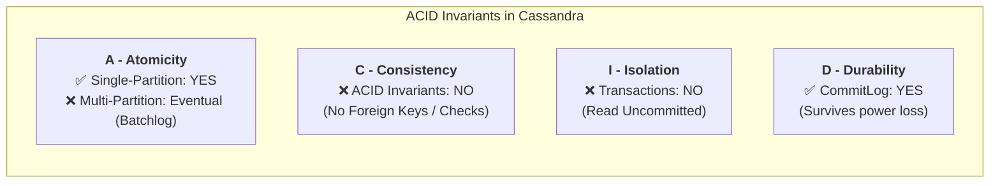

##### 1. Atomicity: Partial (Single Partition Only)
* **Single Partition:** **YES.** Mutations to a single partition (even across multiple columns or multiple rows in that partition) are atomic. Either all columns update or none do.
* **Multi-Partition:** **NO.** Logged batches (`BEGIN BATCH ... APPLY BATCH`) provide **eventual atomicity** via the internal `system.batches` batchlog (retrying forward until all statements apply), but they do not provide instantaneous atomic rollback.

##### 2. Consistency: NO (in the ACID Sense)
* *Note: Do not confuse ACID Consistency with CAP Theorem Consistency!*
* In ACID, Consistency means **application invariants and relational integrity**: foreign keys, `CHECK` constraints, cascade deletes, or enforcing `balance >= 0`.
* Cassandra supports **none of these**. It only validates data types and primary key uniqueness. All application business invariants must be enforced in application code.

##### 3. Isolation: NO (Operates at Read Uncommitted)
* Cassandra has **no row locks** and **no multi-version concurrency control (MVCC) snapshots**.
* Reads operate at **Read Uncommitted**: a concurrent read query can observe intermediate partial column updates of an executing batch.
* There are no SQL transaction isolation levels (`READ COMMITTED`, `REPEATABLE READ`, `SERIALIZABLE`).
* *Exception:* Paxos Lightweight Transactions (LWT) provide linearizability for a single conditional statement, but do not provide multi-statement isolation.

##### 4. Durability: YES
* Writes are appended to an on-disk sequential **CommitLog** before acknowledging the client.
* If a machine loses power a millisecond after acknowledging, it replays the CommitLog on reboot and repopulates the Memtable in memory. Zero committed data is lost.
* Defaults to `commitlog_sync: periodic` (flushed every 10 seconds, buffered in OS page cache) for maximum write throughput, or `commitlog_sync: batch` (`fsync` on every write) for strict hardware durability.

##### Comprehensive ACID vs. BASE Comparison

| Property | Relational Databases <br/>*(PostgreSQL, MySQL)* | Distributed ACID Databases <br/>*(CockroachDB, Google Spanner)* | Apache Cassandra |
| :--- | :--- | :--- | :--- |
| **Atomicity** | Full Multi-Table Atomicity | Full Multi-Node Atomicity (2PC over Raft) | **Single-Partition Only** |
| **Consistency** | Foreign Keys, Triggers, Checks | Foreign Keys, Strict Serializability | ❌ **None** (Application enforced) |
| **Isolation** | Read Committed, Repeatable Read, Serializable | Strict Serializable (MVCC + Locks) | ❌ **None** (Read Uncommitted) |
| **Durability** | WAL on Disk | Distributed Consensus WAL | ✅ **CommitLog on Disk** |
| **Rollback Capability** | ✅ Full `ROLLBACK` support | ✅ Full `ROLLBACK` support | ❌ **NEVER rolls back** |
| **Primary Trade-off** | Vertical scale limit | Higher write latency ($20\text{--}50\text{ ms}$) | **Blazing Writes ($1\text{ ms}$), AP Scale** |

> **🚨 The Golden Staff Engineer Rule:**
> If a system requires that a failed write **must never take effect**, or requires multi-row atomic invariants (like bank account transfers or inventory booking), **NEVER USE CASSANDRA**. Choose a distributed ACID database with rollback support (such as **CockroachDB**, **Google Spanner**, or **PostgreSQL**).

---

### B. The Read Path (Multi-Tier Retrieval & Reconciliation)

Because data for a single row may be split across the in-memory Memtable and multiple on-disk SSTables, reading is inherently more complex than writing.

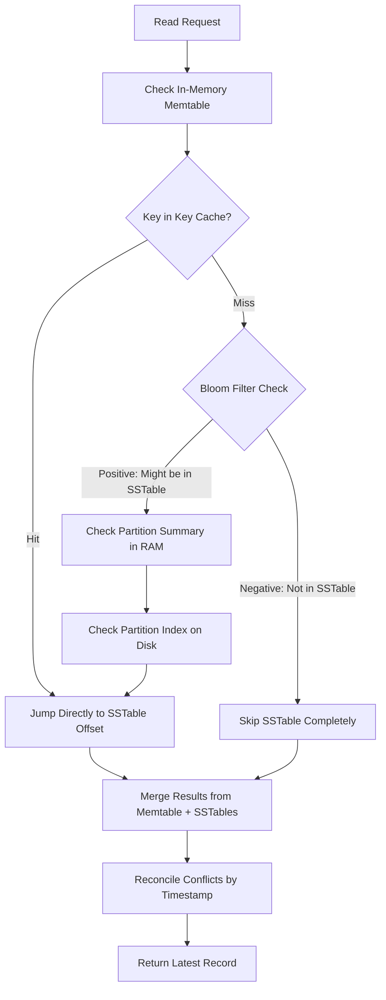

1.  **Memtable Lookup:** Check active memory for the most recent unflushed writes.
2.  **Key Cache (RAM):** An LRU cache mapping partition keys directly to exact byte offsets in SSTables. If hit, skips index lookups entirely.
3.  **Bloom Filter (RAM):** A probabilistic, ultra-fast data structure per SSTable that determines with 100% certainty if a partition key **does not** exist in the SSTable, or if it **might** exist. It eliminates 95%+ of unnecessary disk reads.
4.  **Partition Summary (RAM):** An in-memory index sampling every $N$-th entry of the on-disk Partition Index.
5.  **Partition Index (Disk):** Locates the exact byte offset of the partition within the SSTable data file.
6.  **SSTable Data Read:** Reads the requested columns off disk.
7.  **Timestamp Reconciliation:** The coordinator merges fragments from Memtable and SSTables, picking the newest value for each column based on client timestamp.
8.  **Read Repair:** If any queried replica returned stale data, the coordinator fires an asynchronous background update.

### C. Compaction & Tombstones

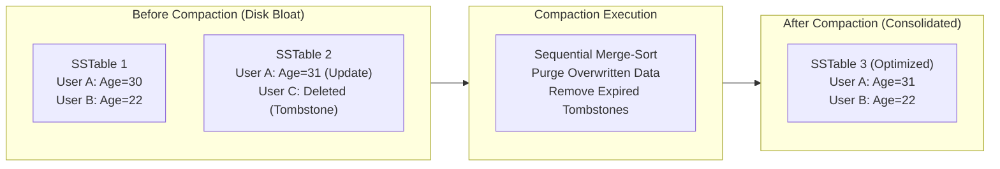

*   **Compaction:** In the background, Cassandra merges multiple immutable SSTables using a sequential merge-sort algorithm into a single consolidated SSTable. It discards superseded values and reclaims disk space.
    *   *Size-Tiered Compaction Strategy (STCS):* Default; optimized for write-heavy workloads.
    *   *Leveled Compaction Strategy (LCS):* Organizes SSTables into fixed-size hierarchical tiers (L0, L1, L2...); optimized for read-heavy workloads (reduces the number of SSTables checked per read to $\sim 1$).
    *   *Time-Window Compaction Strategy (TWCS):* Bins data into time windows; ideal for time-series data with TTLs.
*   **The Tombstone Trap:** In an append-only engine, you cannot "delete" a row in place. Deleting a row writes a **Tombstone** (a record stating "Key X was deleted at Timestamp T"). 
    *   *The Trap:* If an application frequently creates and deletes rows, reading that partition requires scanning through thousands of tombstones. If the tombstone count exceeds 100,000, Cassandra aborts the query with a `ReadFailureException` to protect node memory!

---

## 8. Tunable Consistency & The CAP Theorem

Cassandra is fundamentally an **AP system** (Available and Partition-Tolerant), favoring high availability and low latency over immediate global consistency. However, consistency is **tunable per query**.

### A. Supported Consistency Levels (Can You Use Arbitrary Numbers?)

In Cassandra, **you CANNOT pass an arbitrary number** (such as `CONSISTENCY 4` or `CONSISTENCY 7`). Doing so triggers a syntax error. Cassandra uses a **closed set of predefined keyword constants**:

#### 1. Fixed Numeric Counts (`ONE`, `TWO`, `THREE`)
* The only fixed integer keywords Cassandra supports are literal constants: `ONE`, `TWO`, and `THREE`.
* There is no `FOUR`, `FIVE`, etc. For higher counts, use dynamic quorums or `ALL`.

#### 2. Dynamic Quorum Levels (Relative Majority)
Quorums automatically scale with your keyspace Replication Factor ($RF$):
$$\text{QUORUM} = \left\lfloor \frac{RF}{2} \right\rfloor + 1$$
* `QUORUM`: A strict majority across **all datacenters globally**.
* `LOCAL_QUORUM`: A strict majority within the **coordinator's local datacenter**. (**The de facto production standard** for multi-datacenter deployments).
* `EACH_QUORUM`: A quorum of replicas in **each and every datacenter** independently (Writes only).

#### 3. Full Cluster & Single-Node Levels
* `ALL`: Every replica across all datacenters must acknowledge. (100% consistent, but 0% fault tolerant—fails if a single node is down).
* `LOCAL_ONE`: Exactly 1 replica in the local datacenter must respond.
* `ANY`: Lowest possible write level. Succeeds if any node accepts a Hinted Handoff, even if all actual replicas are down. (Writes only; cannot be read).

#### 4. Serial Consistency (For Paxos LWT)
* `SERIAL`: Global Paxos consensus across all datacenters.
* `LOCAL_SERIAL`: Paxos consensus restricted to the local datacenter.

#### Complete Consistency Level Matrix

| Consistency Level | Valid for Reads? | Valid for Writes? | Replicas Required | Cross-Datacenter WAN Latency? |
| :--- | :---: | :---: | :--- | :---: |
| **`ANY`** | ❌ No | ✅ Yes | 1 (Can be a hinted handoff on a non-replica) | No |
| **`ONE`** | ✅ Yes | ✅ Yes | 1 replica anywhere | Possible (if coordinator picks remote replica) |
| **`LOCAL_ONE`** | ✅ Yes | ✅ Yes | 1 replica in local DC | ❌ Never |
| **`TWO`** | ✅ Yes | ✅ Yes | 2 replicas anywhere | Possible |
| **`THREE`** | ✅ Yes | ✅ Yes | 3 replicas anywhere | Possible |
| **`QUORUM`** | ✅ Yes | ✅ Yes | $\lfloor RF_{Total} / 2 \rfloor + 1$ | ⚠️ Yes (crosses WAN) |
| **`LOCAL_QUORUM`** | ✅ Yes | ✅ Yes | $\lfloor RF_{Local} / 2 \rfloor + 1$ | ❌ Never (**Industry Default**) |
| **`EACH_QUORUM`** | ❌ No | ✅ Yes | Quorum in each DC independently | ⚠️ Yes |
| **`ALL`** | ✅ Yes | ✅ Yes | All $RF$ replicas in all DCs | ⚠️ Yes (0% fault tolerance) |
| **`LOCAL_SERIAL`** | ✅ Yes (LWT) | ✅ Yes (LWT) | Local Paxos Quorum | ❌ Never |
| **`SERIAL`** | ✅ Yes (LWT) | ✅ Yes (LWT) | Global Paxos Quorum | ⚠️ Yes |

---

### B. Datacenter Topology & Quorum in Action: The 5-DC Deep Dive

To understand how datacenter topology and quorums interact, consider an enterprise global deployment with **5 Datacenters (DCs)**:
`us-east` (N. Virginia), `us-west` (Oregon), `eu-west` (Frankfurt), `ap-south` (Mumbai), and `ap-northeast` (Tokyo).

```sql
-- Production Multi-Datacenter Keyspace
CREATE KEYSPACE global_ecommerce WITH replication = {
    'class': 'NetworkTopologyStrategy',
    'us-east': 3,
    'us-west': 3,
    'eu-west': 3,
    'ap-south': 3,
    'ap-northeast': 3
};
```

* **Local Replication Factor ($RF_{Local}$):** **3 replicas** per DC.
* **Total Global Replication Factor ($RF_{Total}$):** 
  $$RF_{Total} = 3 \times 5 = \mathbf{15\text{ physical copies of every row}}$$

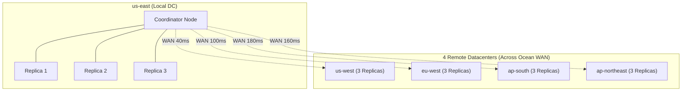

#### What Happens When a Client in `us-east` Executes a Query?

1. **Global `QUORUM` ($\lfloor 15/2 \rfloor + 1 = \mathbf{8\text{ replicas}}$):**
   * Even if all 3 local replicas in `us-east` reply immediately ($<2\text{ ms}$), the coordinator only has 3 acknowledgments.
   * To reach **8**, it **must wait for at least 5 remote replicas** across trans-oceanic WAN links.
   * **Latency:** Bottlenecked at **$120\text{--}180\text{ ms}$**.
   * **Failure Impact:** If undersea cables are cut between the US and Europe/Asia, the query fails completely.
2. **`LOCAL_QUORUM` ($\lfloor 3/2 \rfloor + 1 = \mathbf{2\text{ replicas}}$):**
   * Requires only **2 out of the 3 local `us-east` replicas**.
   * **Latency:** Local gigabit rack latency: **$1\text{--}3\text{ ms}$**.
   * **Cross-DC Write Optimization:** The coordinator does *not* flood the WAN with 12 separate messages. It sends **one single message per remote DC** to an elected "remote coordinator" in that DC, which then fans out locally over its own LAN.
   * **Failure Impact:** Even if **4 out of the 5 datacenters are completely down or isolated**, clients in `us-east` continue reading and writing at full speed!
3. **`EACH_QUORUM` ($2 \times 5 = \mathbf{10\text{ replicas}}$):**
   * Requires 2 acks in `us-east`, 2 in `us-west`, 2 in `eu-west`, 2 in `ap-south`, and 2 in `ap-northeast`. If any single DC degrades, the write fails globally.
4. **`ALL` ($\mathbf{15\text{ replicas}}$):**
   * All 15 replicas worldwide must respond. Zero fault tolerance.

#### 5-DC Quorum Comparison Matrix

| Consistency Level | Replicas Required | Where do they come from? | Typical Latency | Can survive a cross-ocean fiber cut? |
| :--- | :---: | :--- | :---: | :---: |
| **`LOCAL_ONE`** | **1** | Local DC only | $\sim 1\text{ ms}$ | ✅ Yes |
| **`LOCAL_QUORUM`** | **2** | Local DC only ($\lfloor 3/2 \rfloor + 1$) | $\sim 2\text{ ms}$ | ✅ **Yes (Survives 4 dead DCs!)** |
| **`QUORUM`** | **8** | Any 8 out of 15 globally ($\lfloor 15/2 \rfloor + 1$) | $\sim 150\text{ ms}$ | ❌ No |
| **`EACH_QUORUM`** | **10** | 2 in each of the 5 DCs ($2 \times 5$) | $\sim 180\text{ ms}$ | ❌ No |
| **`ALL`** | **15** | Every single replica globally | $\sim 250\text{ ms}$ | ❌ No (0% fault tolerance) |

---

### C. Strong Consistency Quorum Formula

$$\text{Read Quorum} + \text{Write Quorum} > \text{Replication Factor} \quad (R + W > RF)$$

If the sum of read and write replicas exceeds the replication factor, the read set and write set are guaranteed to overlap on at least one replica node, guaranteeing **Strong Consistency** (Read-Your-Writes).

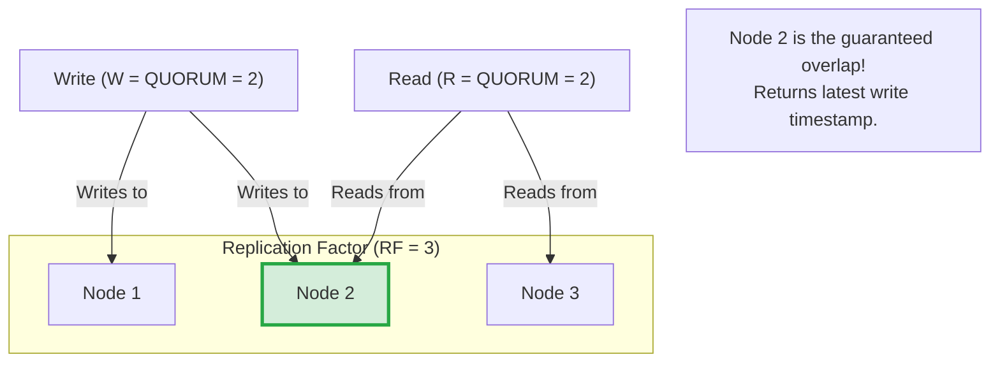

*   **Single-DC Guarantee ($RF = 3$):**
    *   $W = \text{LOCAL\_QUORUM} = 2$
    *   $R = \text{LOCAL\_QUORUM} = 2$
    *   $R + W = 4 > 3 \implies$ **Strong Consistency guaranteed within the region** at $<3\text{ ms}$ latency.
*   **Cross-DC Guarantee:** Updates propagate asynchronously between regions. Cross-region consistency is **eventual**, resolved deterministically via Last-Write-Wins (LWW) timestamps.

---

## 9. Real-World Case Studies & CQL Modeling

### Case Study 1: Discord Message Storage (Snowflake IDs + Time Bucketing)
*   **Context:** Discord migrated from MongoDB to Cassandra to store billions of chat messages across millions of channels.
*   **The Naive Schema:**
    ```sql
    CREATE TABLE messages (
        channel_id bigint,
        message_id bigint,
        author_id bigint,
        content text,
        PRIMARY KEY (channel_id, message_id)
    ) WITH CLUSTERING ORDER BY (message_id DESC);
    ```
*   **The Problem:** Partitions in Cassandra must remain small (<100MB). Active channels run continuously for years, accumulating millions of messages. This causes a **Monotonically Growing Partition** that degrades compaction, increases read latency, and exhausts heap memory.
*   **Discord's Solution:**
    1.  **Snowflake IDs:** 64-bit unique IDs encoding a millisecond timestamp. This guarantees chronological sorting without primary key collision risks inherent in raw timestamps.
    2.  **Time Bucketing:** Introduce a `bucket` integer representing 10 days of elapsed time into the partition key.

```sql
-- Production Discord Schema
CREATE TABLE messages_by_channel (
    channel_id bigint,
    bucket int,
    message_id bigint,
    author_id bigint,
    content text,
    PRIMARY KEY ((channel_id, bucket), message_id)
) WITH CLUSTERING ORDER BY (message_id DESC);
```
*   **Result:** 
    *   A busy channel's messages are physically chopped into distinct 10-day partitions.
    *   Reading recent messages hits only the current bucket partition `((channel_id, current_bucket))`.
    *   Partitions are bounded in size and never grow indefinitely.

---

### Case Study 2: Ticketmaster Seat Browsing UI
*   **Context:** Millions of fans browse seat maps during major concert on-sales. Availability changes dynamically; eventual consistency is acceptable for browsing (the checkout step uses an ACID transaction in a separate SQL DB).
*   **The Naive Schema:**
    ```sql
    CREATE TABLE tickets (
        event_id bigint,
        seat_id bigint,
        price bigint,
        PRIMARY KEY (event_id, seat_id)
    );
    ```
    *   *Problem:* An event with 80,000 seats stores all seats in a single partition. Querying section-level availability or high-level price minimums requires scanning the entire 80,000-seat partition and aggregating in application memory.
*   **The Query-Driven Redesign:**
    *   Observe the UX: Users browse by **Section** first, then zoom in to individual **Seats**.
    *   Split into two complementary, denormalized tables:

```sql
-- 1. Table to render high-level venue overview map
CREATE TABLE event_sections (
    event_id bigint,
    section_id bigint,
    available_tickets int,
    price_floor int,
    PRIMARY KEY (event_id, section_id)
);

-- 2. Table to render detailed seats within a clicked section
CREATE TABLE section_seats (
    event_id bigint,
    section_id bigint,
    seat_id bigint,
    is_available boolean,
    price int,
    PRIMARY KEY ((event_id, section_id), seat_id)
);
```
*   **Result:**
    *   `event_sections` has only $\sim 50\text{--}100$ rows per event (tiny partition, instant venue map rendering).
    *   `section_seats` distributes the 80,000 seats across 100 distinct section partitions across the cluster, eliminating hot nodes and enabling sub-millisecond drill-down queries.

---

## 10. Advanced Cassandra Features

1.  **Storage Attached Indexes (SAI):**
    *   Historically, Cassandra Secondary Indexes were a known anti-pattern because they required scatter-gather queries across every node in the cluster.
    *   SAI is a modern indexing architecture that indexes data column-by-column directly alongside SSTables on disk with minimal memory overhead, making secondary column lookups viable for low-frequency queries without creating a whole new denormalized table.
2.  **Materialized Views:**
    *   Allows Cassandra to automatically maintain secondary tables partitioned by different columns under the hood.
    *   *Caveat for Interviews:* Mention that Materialized Views in Cassandra have known performance pitfalls during node failures because multi-table updates are asynchronous and lack distributed 2PC locking.
3.  **Lightweight Transactions (LWT / Paxos):**
    *   Supports `IF NOT EXISTS` conditional writes (e.g., `INSERT INTO users (username) VALUES ('alice') IF NOT EXISTS;`).
    *   Uses a 4-phase Paxos consensus protocol under the hood.
    *   *Trade-off:* Adds significant round-trip latency; use strictly for unique constraint enforcement, not general transactional flows.

---

## 11. System Design Interview Playbook

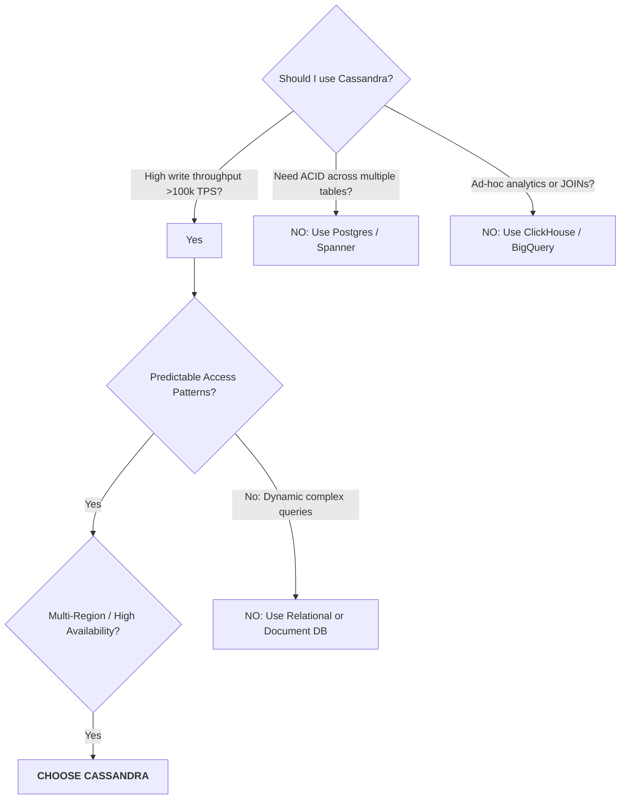

### When to Use Cassandra
1.  **Massive Write Throughput:** Ingestion rates exceeding 50,000–100,000 writes/sec (e.g., IoT sensor telemetry, clickstream logs, chat messages, financial audit trails).
2.  **Predictable Access Patterns:** Applications with a handful of well-defined query paths that can be modeled via specific primary keys.
3.  **Active-Active Multi-Region Deployment:** Seamless global replication where writes must succeed locally in EU, US, and APAC without cross-region locking.
4.  **Zero Downtime SLA:** Systems that cannot tolerate master failover elections or cloud provider maintenance windows.

### When NOT to Use Cassandra (Red Flags)
1.  **Financial Ledger / Atomic Balances:** Transferring money between accounts requires multi-row atomic transactions. Cassandra lacks ACID transactions across partitions.
2.  **Ad-Hoc Business Intelligence & Reporting:** Any workload requiring arbitrary `GROUP BY`, `JOIN`, or variable `WHERE` clauses will fail on Cassandra.
3.  **Small / Low-Scale Systems:** If data fits on a single managed PostgreSQL RDS instance (<1TB, <5k QPS), proposing Cassandra adds unnecessary operational complexity.

### Critical Interview Traps to Avoid
*   **Trap 1: The Monolithic Partition:** Choosing a partition key like `date` or `status` that aggregates millions of rows into a single node. Keep partitions strictly **under 100MB and fewer than 100,000 rows**.
*   **Trap 2: `ALLOW FILTERING` in Production:** Proposing queries with `ALLOW FILTERING` scans all cluster nodes sequentially. Always design primary keys to satisfy queries natively.
*   **Trap 3: Neglecting Multi-DC Quorum:** Saying `QUORUM` in a multi-region design means cross-region latency on every write. Always explicitly specify **`LOCAL_QUORUM`**.
*   **Trap 4: Normalized Relational Tables:** Showing two tables connected by an implied foreign key. If you propose Cassandra, you must show the **denormalized table** tailored to the query.
