# Apache Cassandra Deep Dive

**Source:** [Cassandra Deep Dive w/ Ex-Meta Staff Engineer (Hello Interview)](https://www.youtube.com/watch?v=TD3-INhm60Q) | [Hello Interview Written Guide](https://www.hellointerview.com/learn/system-design/deep-dives/cassandra)

**TL;DR:** Apache Cassandra is an open-source, masterless, distributed NoSQL wide-column database engineered for massive write throughput, horizontal elasticity, zero single-point-of-failure (SPOF) availability, and multi-datacenter replication. It blends the decentralized peer-to-peer ring topology and tunable quorum consistency of **Amazon Dynamo** with the Log-Structured Merge-tree (LSM) storage engine and column family model of **Google Bigtable**. In system design interviews, Cassandra is the premier choice for write-heavy (>100k writes/sec), time-series, or messaging applications with predictable, query-driven access patterns.

---

## 1. Lineage & Motivation

### A. Origins at Facebook (2007)
Cassandra was created in 2007 at Facebook by **Avinash Lakshman** (co-inventor of Amazon's Dynamo) and Prashant Malik to solve the **Facebook Inbox Search** problem. 
*   **The Scale Challenge:** Millions of users sending billions of messages per day required an infrastructure capable of absorbing enormous write volume without latency spikes.
*   **The Problem with RDBMS:** Scaling a traditional relational database (MySQL/PostgreSQL) for write loads required manual sharding, complex failover orchestration, master-replica replication lag, and rigid schemas. Adding capacity required painful downtime or complex data migration scripts.
*   **The Solution:** Combine the best distributed system primitives into a single database:
    1.  **Amazon Dynamo Lineage:** Fully peer-to-peer (masterless) ring architecture, consistent hashing with virtual nodes (v-nodes), gossip protocol for decentralized cluster state, and tunable quorum consistency ($R + W > RF$).
    2.  **Google Bigtable Lineage:** Log-Structured Merge-Tree (LSM-tree) storage architecture with sequential write-ahead commit logs, in-memory Memtables, immutable disk-based SSTables, Bloom filters, and sparse wide-column data modeling.

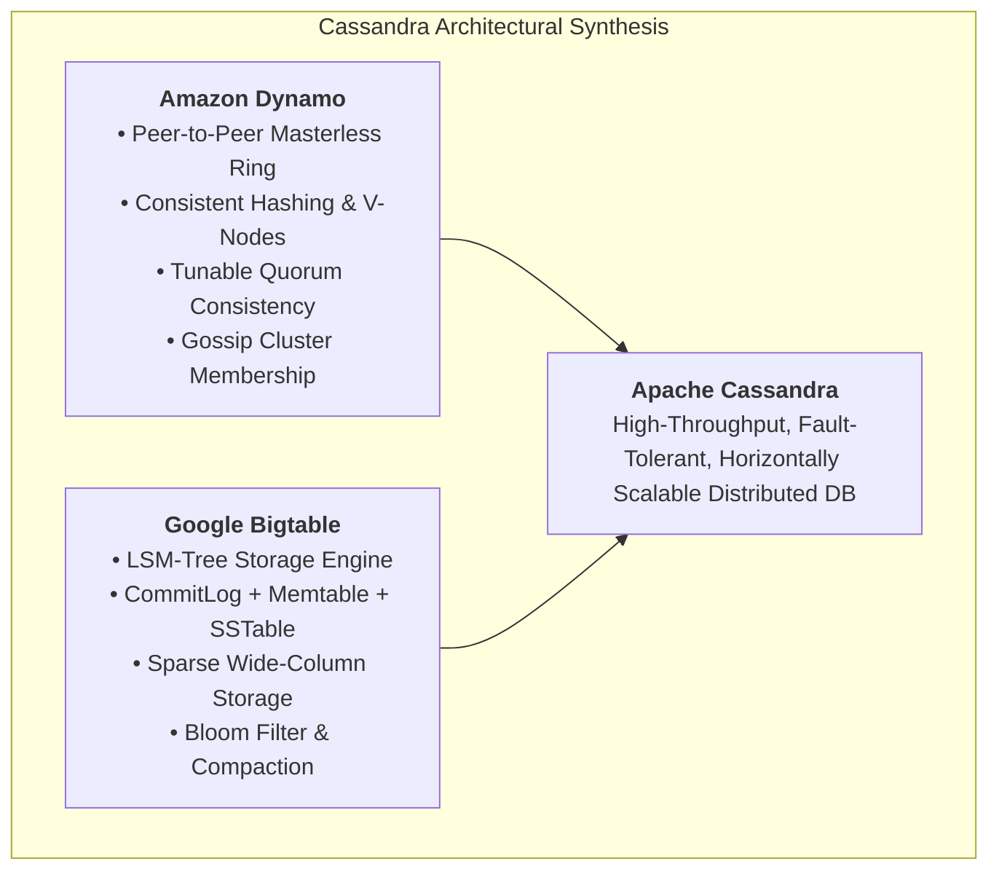

---

## 2. Cassandra Data Model & Hierarchy

Unlike relational databases where storage is normalized across rigid tables, Cassandra uses a sparse, wide-column model that organizes data into a 4-level hierarchy:

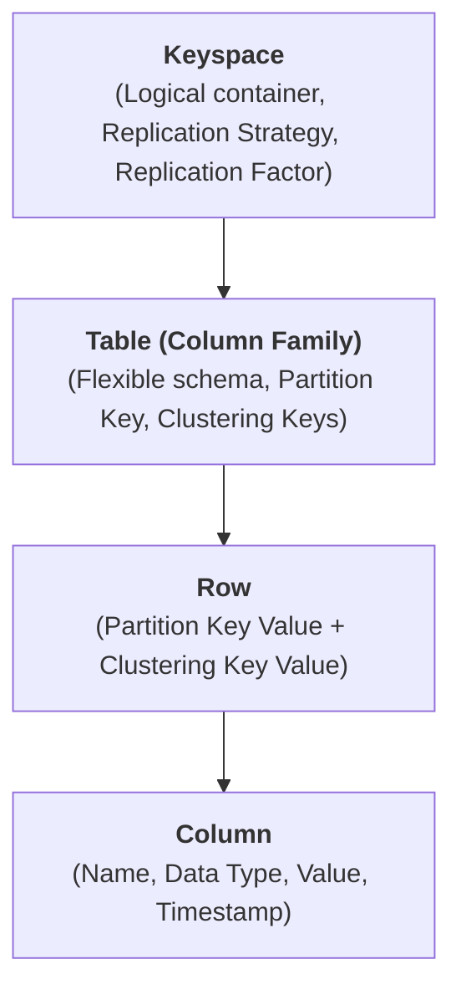

1.  **Keyspace:** The highest-level container (equivalent to an RDBMS `DATABASE` or `SCHEMA`). Defines cluster-wide replication mechanics:
    *   **Replication Strategy:** How copies are placed (e.g., `NetworkTopologyStrategy`).
    *   **Replication Factor ($RF$):** How many physical copies of data exist across the cluster (e.g., $RF = 3$).
2.  **Table:** A collection of partitions defining the primary key and typed columns. Unlike SQL tables, Cassandra tables are **sparse wide-column stores**: rows in the same table do not need to share the same columns, and empty columns take up 0 bytes on disk (no `NULL` storage overhead).
3.  **Row:** A set of columns addressed uniquely by a Primary Key.
4.  **Column:** The atomic unit of storage comprising `(name, value, timestamp)`. The timestamp is supplied by the client or coordinator and is fundamental to Cassandra's Last-Write-Wins (LWW) conflict resolution.

---

## 3. Primary Key Anatomy: Partition Key vs. Clustering Key

In an interview, **data modeling in Cassandra begins and ends with the Primary Key**. Getting the primary key wrong leads to hot nodes, unbounded partitions, or impossible queries.

$$\text{PRIMARY KEY} = (\text{Partition Key}) + [\text{Clustering Key(s)}]$$

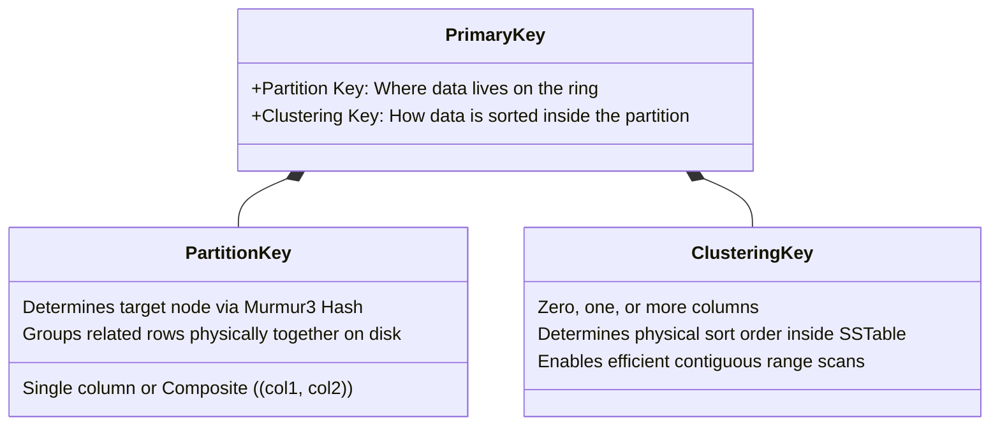

### A. Partition Key (Where it lives)
*   **Role:** Passed through a deterministic hash function (`Murmur3Partitioner`) to produce a 64-bit integer token ($ -2^{63} \text{ to } 2^{63}-1 $). This token dictates which nodes on the consistent hash ring own the partition.
*   **Single vs. Composite Partition Key:**
    *   `PRIMARY KEY (user_id)` $\to$ `user_id` is the partition key.
    *   `PRIMARY KEY ((user_id, bucket_id), message_id)` $\to$ `(user_id, bucket_id)` is a **composite partition key**. Both columns are hashed together to select the partition node.

### B. Clustering Key (How it is sorted)
*   **Role:** Determines the physical on-disk sort order of rows *within* a single partition.
*   **Behavior:** Cassandra stores rows within a partition sorted by the clustering column(s). This makes range queries (e.g., `WHERE message_id > X AND message_id < Y`) blazingly fast because they map to a sequential disk seek rather than random lookups.

```sql
-- Example: User Messages Table
CREATE TABLE user_messages (
    user_id uuid,
    message_id timeuuid,
    sender_id uuid,
    content text,
    PRIMARY KEY (user_id, message_id)
) WITH CLUSTERING ORDER BY (message_id DESC);
```
*   `user_id` is the **Partition Key** (all messages for a user live on the same physical node).
*   `message_id` is the **Clustering Key** (sorted newest first on disk for fast reverse-chronological chat rendering).

---

## 4. Entity-Driven vs. Query-Driven Data Modeling

One of the biggest red flags in a system design interview is modeling Cassandra data as if it were PostgreSQL or MySQL.

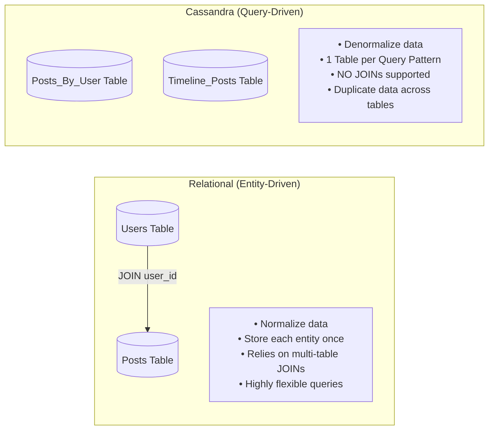

| Dimension | Relational Databases (RDBMS) | Apache Cassandra |
| :--- | :--- | :--- |
| **Philosophy** | **Entity-Driven** (Design around relationships) | **Query-Driven** (Design around queries) |
| **Normalization** | 3NF (Third Normal Form) to eliminate duplication | Deliberate **Denormalization** (duplication is encouraged) |
| **Joins** | Core capability (`INNER`, `LEFT`, `CROSS JOIN`) | **Unsupported**; single-table queries only |
| **Query Flexibility**| Arbitrary `WHERE` filters, `GROUP BY`, dynamic ad-hoc SQL | Queries **must** include the partition key; filtering without it is an anti-pattern (`ALLOW FILTERING`) |
| **Storage vs Compute**| Optimize for minimal disk storage | Optimize for fast, single-node sequential read computation |

> [!IMPORTANT]
> **Interview Rule of Thumb:** In Cassandra, **storage is cheap, but scatter-gather reads across multiple partitions will kill your latency SLAs**. You should happily duplicate data into multiple tables to satisfy distinct query patterns with single-partition reads.

---

## 5. Architecture: The Peer-to-Peer Ring

### A. Masterless Topology (Zero Central Master / Cluster Leader)
Cassandra clusters have **no master, no cluster leader, and no central controller**. Every node is architecturally identical and can accept read/write requests from any client. This eliminates the vulnerability of master failover downtime, split-brain elections, and external consensus dependencies (such as Apache ZooKeeper or etcd).

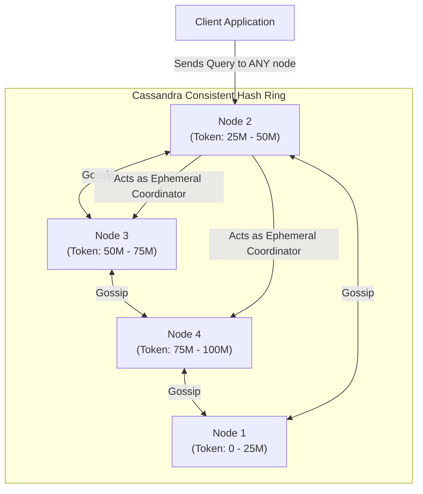

---

### B. Is There a "Leader and Follower" per Key or Partition? (NO!)

A frequent point of confusion in system design interviews is whether Cassandra designates a "leader replica" for each individual partition or key (similar to Kafka partitions, MongoDB replica sets, or Raft consensus groups).

> **In Cassandra, there is NO concept of a leader and follower—neither globally for the cluster, nor locally for any partition or key.** 
> All $N$ replica nodes holding a key (where $N = \text{Replication Factor}$) are **completely equal, active peers**.

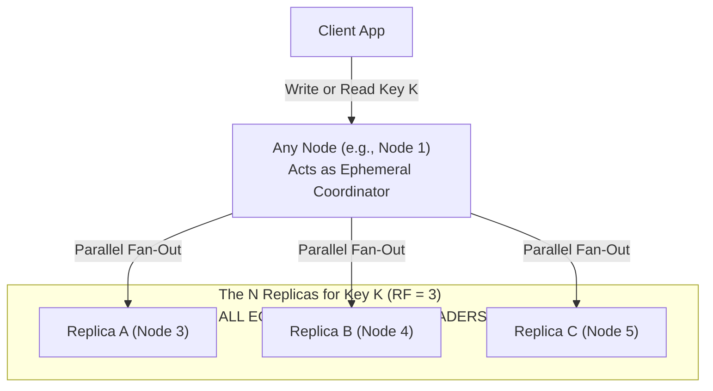

#### 1. The Role of the Coordinator Node (NOT a Leader)
* **Ephemeral Proxy:** When a client sends a read or write request to any node in the cluster, that node temporarily acts as the **Coordinator** for that single query.
* **Any Node Can Coordinate Any Key:** Node 1 can coordinate a write for User Alice, while Node 4 coordinates a write for User Bob, and Node 2 coordinates a read for User Alice concurrently.
* **The Coordinator Does Not "Own" the Key:** It simply hashes the partition key using `Murmur3Partitioner`, identifies the $N$ physical replica nodes that own the token range, forwards the request to them in parallel, waits for enough replies to satisfy the requested `ConsistencyLevel`, and responds to the client.
* **Token-Aware Client Optimization:** Modern client drivers (e.g., DataStax Java/Go driver) are "token-aware." They maintain a local map of cluster token ranges. Instead of connecting to a random node, the client routes the query directly to one of the actual replicas, letting that replica serve as coordinator and eliminating an extra network hop.

#### 2. How Writes Work Without a Leader
* In leader-based systems (Kafka, MySQL master-slave, Raft), all writes must be processed by the leader to establish a single sequential log order.
* In Cassandra, the coordinator sends the write to **all $N$ replicas concurrently**.
* Every replica writes the mutation directly to its local CommitLog and Memtable.
* Once the coordinator receives acknowledgments from a quorum of replicas (e.g., 2 out of 3 for `QUORUM`), it returns success.
* **Conflict Ordering:** Because there is no leader to assign log sequence numbers, Cassandra relies on **client/coordinator timestamps (Last-Write-Wins / LWW)**. If two concurrent writes touch the same column, the cell with the higher microsecond timestamp wins during compaction and read repair.

#### 3. How Reads Work Without a Leader
* The coordinator does not read from a primary copy.
* At `QUORUM` with $RF = 3$, it sends a **Full Data Read** to the fastest replica (lowest latency) and a **Digest Read** (a lightweight SHA-1 hash of the payload) to a second replica.
* If the data hash matches the digest, the coordinator returns the result immediately.
* **Read Repair:** If the hashes mismatch, the coordinator queries all replicas for their full data, compares timestamps to determine the latest value, returns the newest value to the client, and asynchronously writes the newest value back to the out-of-date replica(s).

#### 4. What About Lightweight Transactions (LWT / `IF NOT EXISTS`)?
When executing conditional writes (`INSERT ... IF NOT EXISTS`), Cassandra uses a leaderless variant of **Paxos**:
* The coordinator acts as the transient **Paxos Proposer** for that single statement round.
* The $N$ replicas act as **Paxos Acceptors**.
* Once the condition is checked and accepted by a quorum of acceptors, the mutation commits. There is still **no permanent or standing leader** for the key.

#### 5. Architectural Comparison Matrix

| Architectural Dimension | Leader-Follower Systems <br/>*(Kafka, MongoDB, MySQL, Raft)* | Masterless / Leaderless Systems <br/>*(Apache Cassandra, Amazon Dynamo)* |
| :--- | :--- | :--- |
| **Leader per Key / Partition?** | **YES.** Exactly 1 leader per partition. All writes must route through it. | **NO.** Zero leaders. All $N$ replicas are identical active peers. |
| **Write Failover Latency** | If the partition leader dies, writes for that key **stall** during leader election. | **Zero failover delay.** Any surviving replica immediately accepts writes if quorum is met. |
| **Ordering & Conflicts** | Leader establishes a strict total order (monotonic log sequence). | **Last-Write-Wins (LWW)** timestamps or ephemeral Paxos rounds. |
| **Replica Responsibilities** | Followers passively mirror the leader. | All replicas actively and concurrently process reads and writes. |

---

### C. Consistent Hashing & Virtual Nodes (V-nodes)
*   **The Modulo Problem:** Traditional sharding ($hash(key) \pmod N$) requires redistributing almost 100% of keys whenever a node joins or leaves.
*   **Consistent Hashing:** Arranges tokens in a continuous ring ($0 \text{ to } 2^{64}-1$). A partition key maps to a point on the ring, and the first node encountered moving clockwise owns the data.
*   **Virtual Nodes (V-nodes):** Instead of assigning a physical machine a single contiguous token range, Cassandra assigns each physical machine multiple small tokens (typically 128 or 256 v-nodes) distributed randomly across the ring.
    *   **Even Load Balancing:** Eliminates data skews caused by uneven hash distribution.
    *   **Fast Parallel Recovery:** When a node crashes, all remaining nodes in the cluster participate equally in reading and rebuilding pieces of its data, preventing any single surviving node from bottlenecking.

### C. Replication Strategies
Replication is configured per keyspace. Cassandra scans clockwise from the owning token to assign replicas:
1.  **SimpleStrategy:** Places subsequent replicas on the next physical nodes clockwise on the ring. Used *strictly* for single-datacenter local development.
2.  **NetworkTopologyStrategy (Production Standard):** Datacenter and rack-aware. It ensures replicas are placed in different racks within each datacenter to survive power strip/top-of-rack switch failures, and replicates data across distinct geographical regions (e.g., `{'us-east': 3, 'eu-central': 3}`).

---

## 6. Cluster Coordination & Fault Tolerance

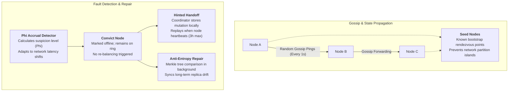

### A. Gossip Protocol
*   Every node executes a background gossip thread every **1 second**.
*   A node randomly selects 1–3 peer nodes, with a probabilistic preference for **Seed Nodes** (designated bootstrap nodes that prevent split-brain cluster partitions).
*   Nodes exchange lightweight state descriptors including:
    *   Heartbeat state (Generation timestamp + Version counter).
    *   Endpoint state (Tokens owned, schema agreement, node IP/status).
*   **Vector Clocks:** Every node uses generation (time of node startup) and version (monotonic counter) to discard outdated gossip information and converge on a single, global cluster view in $O(\log N)$ time without central locking.

### B. Phi ($\Phi$) Accrual Failure Detector
*   Unlike rigid binary heartbeat systems that falsely declare nodes dead during minor network blips, Cassandra computes a continuous suspicion score ($\Phi$).
*   It tracks historical inter-arrival times of heartbeat messages and calculates the probability that an unreceived heartbeat represents a genuine crash versus transient network congestion.
*   When $\Phi$ exceeds a configured threshold (typically 8 to 12), the node is **convicted** (flagged as down).

### C. Self-Healing Mechanics
1.  **Hinted Handoff:**
    *   If a write succeeds on some replicas but one replica is dead/unreachable, the coordinator stores a temporary **hint** (the write payload + timestamp) on its local disk.
    *   When gossip detects the dead node has returned online, the coordinator replays all accumulated hints to bring it up to date immediately.
    *   *Constraint:* Hints expire after a configurable duration (default: 3 hours) to prevent coordinator disks from filling up during extended outages.
2.  **Read Repair:**
    *   When an application issues a read at `QUORUM`, the coordinator queries all participating replicas.
    *   If replica responses differ, the coordinator returns the row with the newest timestamp to the client, and asynchronously fires a background **Read Repair** mutation to update the out-of-date replicas.
3.  **Anti-Entropy Node Repair (Nodetool Repair):**
    *   A periodic maintenance task where nodes construct **Merkle Trees** (cryptographic hash trees) of their token ranges and compare them over the network.
    *   Only mismatched sub-trees ($O(\log N)$ network payload) are exchanged, repairing silent bit rot or nodes offline beyond the hinted handoff window.

---

## 7. Storage Engine Internals: The Write & Read Paths

Cassandra is an implementation of a **Log-Structured Merge-Tree (LSM)**. Understanding why writes are $O(1)$ and how reads are accelerated is essential.

### A. The Write Path (Blazing Fast, Append-Only)

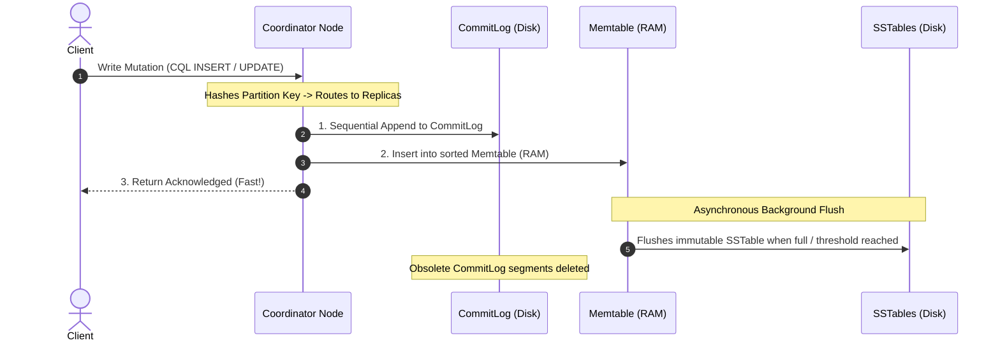

1.  **CommitLog (Disk):** Sequential, append-only write-ahead log stored on disk. It provides crash durability. Because sequential disk writes incur zero random-head seek overhead, appending to the CommitLog takes fractions of a millisecond.
2.  **Memtable (RAM):** The mutation is concurrently inserted into an in-memory sorted skip-list or binary search tree. Rows are sorted by partition key and clustering key.
3.  **Client Acknowledgment:** Once written to both CommitLog and Memtable, the node replies with success. **No on-disk table updates or page splits occur during the write path.**
4.  **Flushing to SSTables (Disk):** When the Memtable reaches capacity (or after a time threshold), it flushes sequentially to disk as an immutable **SSTable (Sorted String Table)**. 
5.  **CommitLog Cleanup:** Once an SSTable is safely written to disk, its corresponding CommitLog segments are truncated.

### B. The Read Path (Multi-Tier Retrieval & Reconciliation)

Because data for a single row may be split across the in-memory Memtable and multiple on-disk SSTables, reading is inherently more complex than writing.

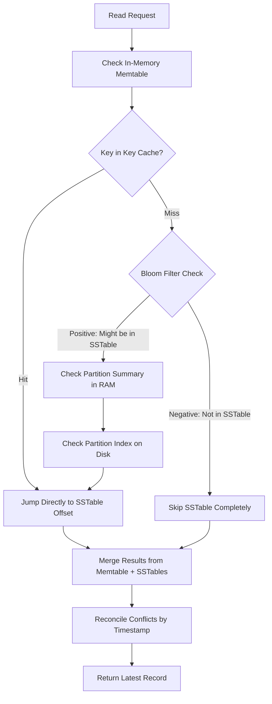

1.  **Memtable Lookup:** Check active memory for the most recent unflushed writes.
2.  **Key Cache (RAM):** An LRU cache mapping partition keys directly to exact byte offsets in SSTables. If hit, skips index lookups entirely.
3.  **Bloom Filter (RAM):** A probabilistic, ultra-fast data structure per SSTable that determines with 100% certainty if a partition key **does not** exist in the SSTable, or if it **might** exist. It eliminates 95%+ of unnecessary disk reads.
4.  **Partition Summary (RAM):** An in-memory index sampling every $N$-th entry of the on-disk Partition Index.
5.  **Partition Index (Disk):** Locates the exact byte offset of the partition within the SSTable data file.
6.  **SSTable Data Read:** Reads the requested columns off disk.
7.  **Timestamp Reconciliation:** The coordinator merges fragments from Memtable and SSTables, picking the newest value for each column based on client timestamp.
8.  **Read Repair:** If any queried replica returned stale data, the coordinator fires an asynchronous background update.

### C. Compaction & Tombstones

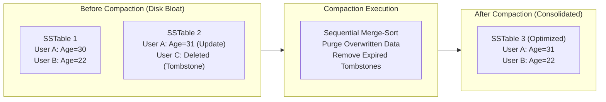

*   **Compaction:** In the background, Cassandra merges multiple immutable SSTables using a sequential merge-sort algorithm into a single consolidated SSTable. It discards superseded values and reclaims disk space.
    *   *Size-Tiered Compaction Strategy (STCS):* Default; optimized for write-heavy workloads.
    *   *Leveled Compaction Strategy (LCS):* Organizes SSTables into fixed-size hierarchical tiers (L0, L1, L2...); optimized for read-heavy workloads (reduces the number of SSTables checked per read to $\sim 1$).
    *   *Time-Window Compaction Strategy (TWCS):* Bins data into time windows; ideal for time-series data with TTLs.
*   **The Tombstone Trap:** In an append-only engine, you cannot "delete" a row in place. Deleting a row writes a **Tombstone** (a record stating "Key X was deleted at Timestamp T"). 
    *   *The Trap:* If an application frequently creates and deletes rows, reading that partition requires scanning through thousands of tombstones. If the tombstone count exceeds 100,000, Cassandra aborts the query with a `ReadFailureException` to protect node memory!

---

## 8. Tunable Consistency & The CAP Theorem

Cassandra is fundamentally an **AP system** (Available and Partition-Tolerant), favoring high availability and low latency over immediate global consistency. However, consistency is **tunable per query**.

### Consistency Levels Cheatsheet
*   `ANY`: Write succeeds if *any* node accepts it, including a hinted handoff. (Weakest; writes only).
*   `ONE` / `TWO` / `THREE`: Satisfied when $N$ replicas acknowledge the read/write.
*   `QUORUM`: Satisfied when a majority of replicas across the cluster acknowledge:
    $$\text{QUORUM} = \left\lfloor \frac{RF}{2} \right\rfloor + 1$$
*   `LOCAL_QUORUM`: Satisfied when a majority of replicas in the **local coordinator's datacenter** acknowledge. **This is the industry standard for multi-datacenter production setups** because it prevents cross-ocean WAN latency from blocking queries.
*   `ALL`: All $RF$ replicas must acknowledge. Turns Cassandra into a strictly consistent **CP system**; if even one replica is down or network-isolated, the query fails.

### Strong Consistency Quorum Formula

$$\text{Read Quorum} + \text{Write Quorum} > \text{Replication Factor} \quad (R + W > RF)$$

If the sum of read and write replicas exceeds the replication factor, the read set and write set are guaranteed to overlap on at least one replica node, guaranteeing **Strong Consistency** (Read-Your-Writes).

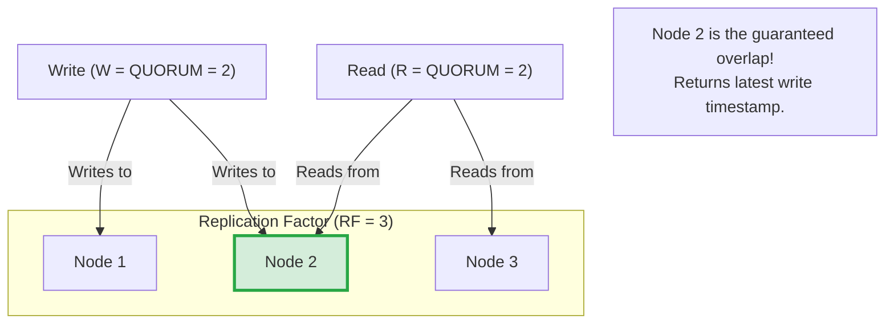

*   **Example ($RF = 3$):**
    *   $W = \text{QUORUM} (2)$
    *   $R = \text{QUORUM} (2)$
    *   $R + W = 4 > 3 \implies$ **Strong Consistency guaranteed.**

---

## 9. Real-World Case Studies & CQL Modeling

### Case Study 1: Discord Message Storage (Snowflake IDs + Time Bucketing)
*   **Context:** Discord migrated from MongoDB to Cassandra to store billions of chat messages across millions of channels.
*   **The Naive Schema:**
    ```sql
    CREATE TABLE messages (
        channel_id bigint,
        message_id bigint,
        author_id bigint,
        content text,
        PRIMARY KEY (channel_id, message_id)
    ) WITH CLUSTERING ORDER BY (message_id DESC);
    ```
*   **The Problem:** Partitions in Cassandra must remain small (<100MB). Active channels run continuously for years, accumulating millions of messages. This causes a **Monotonically Growing Partition** that degrades compaction, increases read latency, and exhausts heap memory.
*   **Discord's Solution:**
    1.  **Snowflake IDs:** 64-bit unique IDs encoding a millisecond timestamp. This guarantees chronological sorting without primary key collision risks inherent in raw timestamps.
    2.  **Time Bucketing:** Introduce a `bucket` integer representing 10 days of elapsed time into the partition key.

```sql
-- Production Discord Schema
CREATE TABLE messages_by_channel (
    channel_id bigint,
    bucket int,
    message_id bigint,
    author_id bigint,
    content text,
    PRIMARY KEY ((channel_id, bucket), message_id)
) WITH CLUSTERING ORDER BY (message_id DESC);
```
*   **Result:** 
    *   A busy channel's messages are physically chopped into distinct 10-day partitions.
    *   Reading recent messages hits only the current bucket partition `((channel_id, current_bucket))`.
    *   Partitions are bounded in size and never grow indefinitely.

---

### Case Study 2: Ticketmaster Seat Browsing UI
*   **Context:** Millions of fans browse seat maps during major concert on-sales. Availability changes dynamically; eventual consistency is acceptable for browsing (the checkout step uses an ACID transaction in a separate SQL DB).
*   **The Naive Schema:**
    ```sql
    CREATE TABLE tickets (
        event_id bigint,
        seat_id bigint,
        price bigint,
        PRIMARY KEY (event_id, seat_id)
    );
    ```
    *   *Problem:* An event with 80,000 seats stores all seats in a single partition. Querying section-level availability or high-level price minimums requires scanning the entire 80,000-seat partition and aggregating in application memory.
*   **The Query-Driven Redesign:**
    *   Observe the UX: Users browse by **Section** first, then zoom in to individual **Seats**.
    *   Split into two complementary, denormalized tables:

```sql
-- 1. Table to render high-level venue overview map
CREATE TABLE event_sections (
    event_id bigint,
    section_id bigint,
    available_tickets int,
    price_floor int,
    PRIMARY KEY (event_id, section_id)
);

-- 2. Table to render detailed seats within a clicked section
CREATE TABLE section_seats (
    event_id bigint,
    section_id bigint,
    seat_id bigint,
    is_available boolean,
    price int,
    PRIMARY KEY ((event_id, section_id), seat_id)
);
```
*   **Result:**
    *   `event_sections` has only $\sim 50\text{--}100$ rows per event (tiny partition, instant venue map rendering).
    *   `section_seats` distributes the 80,000 seats across 100 distinct section partitions across the cluster, eliminating hot nodes and enabling sub-millisecond drill-down queries.

---

## 10. Advanced Cassandra Features

1.  **Storage Attached Indexes (SAI):**
    *   Historically, Cassandra Secondary Indexes were a known anti-pattern because they required scatter-gather queries across every node in the cluster.
    *   SAI is a modern indexing architecture that indexes data column-by-column directly alongside SSTables on disk with minimal memory overhead, making secondary column lookups viable for low-frequency queries without creating a whole new denormalized table.
2.  **Materialized Views:**
    *   Allows Cassandra to automatically maintain secondary tables partitioned by different columns under the hood.
    *   *Caveat for Interviews:* Mention that Materialized Views in Cassandra have known performance pitfalls during node failures because multi-table updates are asynchronous and lack distributed 2PC locking.
3.  **Lightweight Transactions (LWT / Paxos):**
    *   Supports `IF NOT EXISTS` conditional writes (e.g., `INSERT INTO users (username) VALUES ('alice') IF NOT EXISTS;`).
    *   Uses a 4-phase Paxos consensus protocol under the hood.
    *   *Trade-off:* Adds significant round-trip latency; use strictly for unique constraint enforcement, not general transactional flows.

---

## 11. System Design Interview Playbook

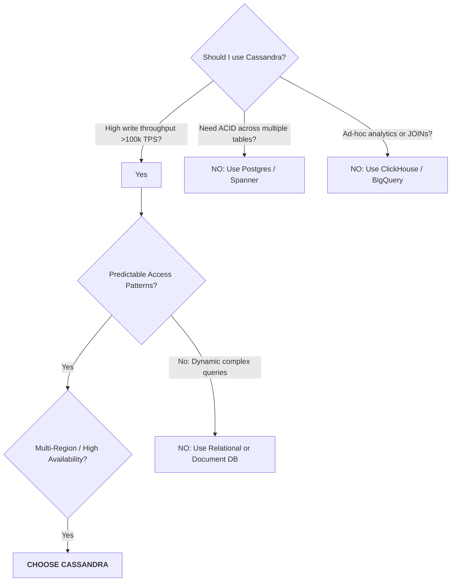

### When to Use Cassandra
1.  **Massive Write Throughput:** Ingestion rates exceeding 50,000–100,000 writes/sec (e.g., IoT sensor telemetry, clickstream logs, chat messages, financial audit trails).
2.  **Predictable Access Patterns:** Applications with a handful of well-defined query paths that can be modeled via specific primary keys.
3.  **Active-Active Multi-Region Deployment:** Seamless global replication where writes must succeed locally in EU, US, and APAC without cross-region locking.
4.  **Zero Downtime SLA:** Systems that cannot tolerate master failover elections or cloud provider maintenance windows.

### When NOT to Use Cassandra (Red Flags)
1.  **Financial Ledger / Atomic Balances:** Transferring money between accounts requires multi-row atomic transactions. Cassandra lacks ACID transactions across partitions.
2.  **Ad-Hoc Business Intelligence & Reporting:** Any workload requiring arbitrary `GROUP BY`, `JOIN`, or variable `WHERE` clauses will fail on Cassandra.
3.  **Small / Low-Scale Systems:** If data fits on a single managed PostgreSQL RDS instance (<1TB, <5k QPS), proposing Cassandra adds unnecessary operational complexity.

### Critical Interview Traps to Avoid
*   **Trap 1: The Monolithic Partition:** Choosing a partition key like `date` or `status` that aggregates millions of rows into a single node. Keep partitions strictly **under 100MB and fewer than 100,000 rows**.
*   **Trap 2: `ALLOW FILTERING` in Production:** Proposing queries with `ALLOW FILTERING` scans all cluster nodes sequentially. Always design primary keys to satisfy queries natively.
*   **Trap 3: Neglecting Multi-DC Quorum:** Saying `QUORUM` in a multi-region design means cross-region latency on every write. Always explicitly specify **`LOCAL_QUORUM`**.
*   **Trap 4: Normalized Relational Tables:** Showing two tables connected by an implied foreign key. If you propose Cassandra, you must show the **denormalized table** tailored to the query.
