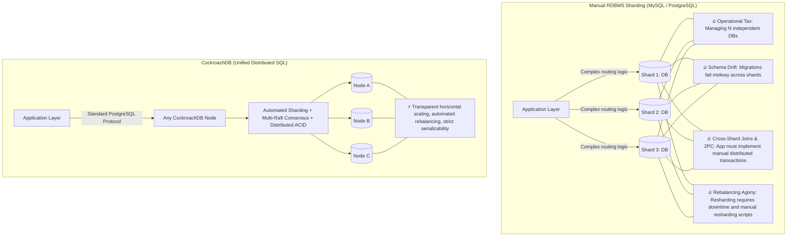
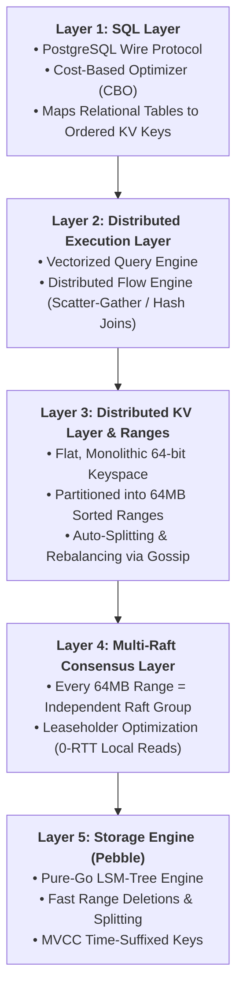
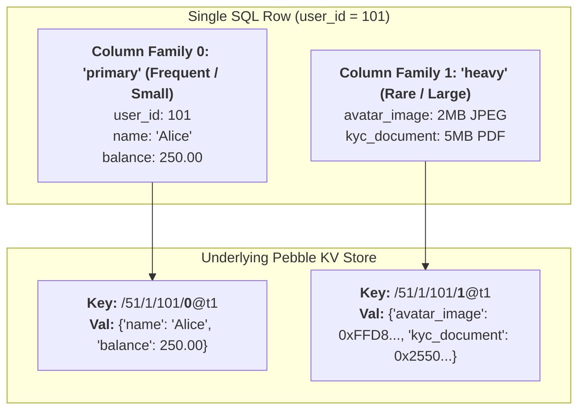
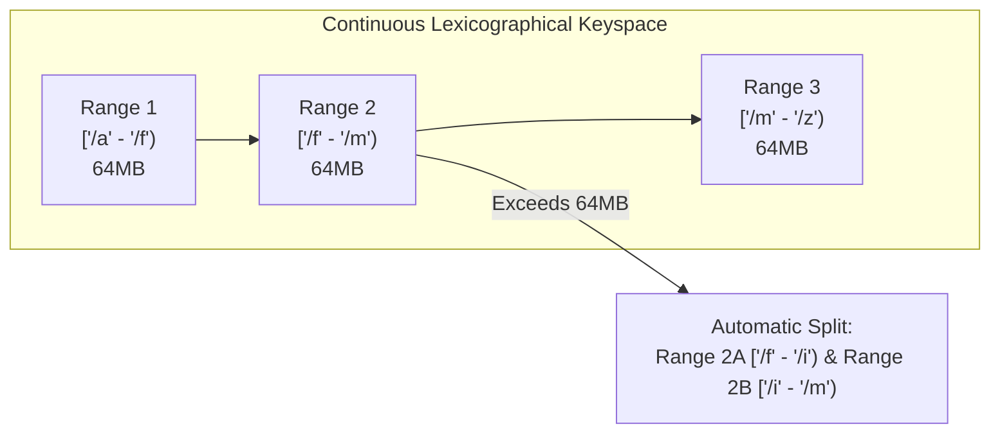
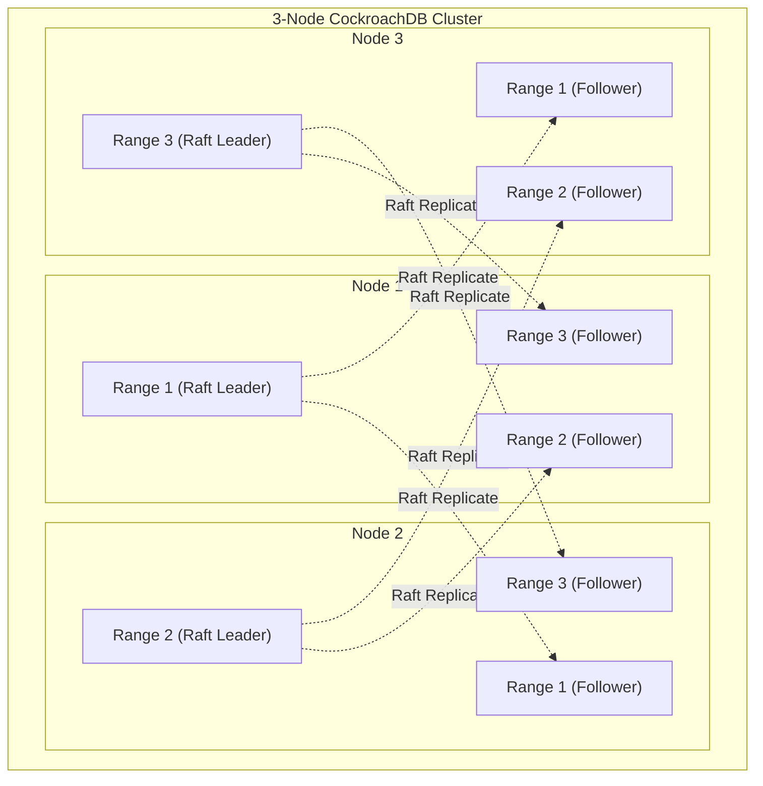
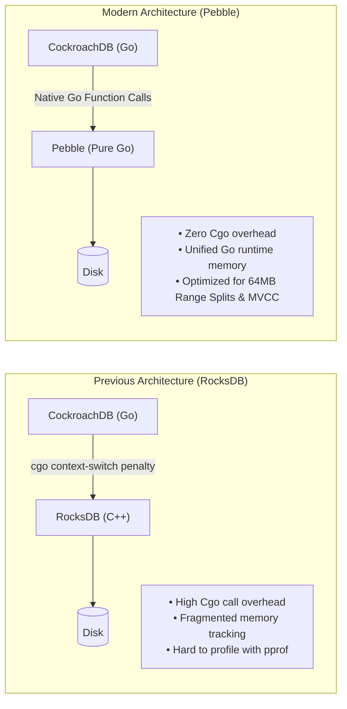
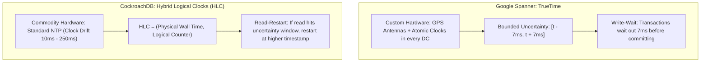
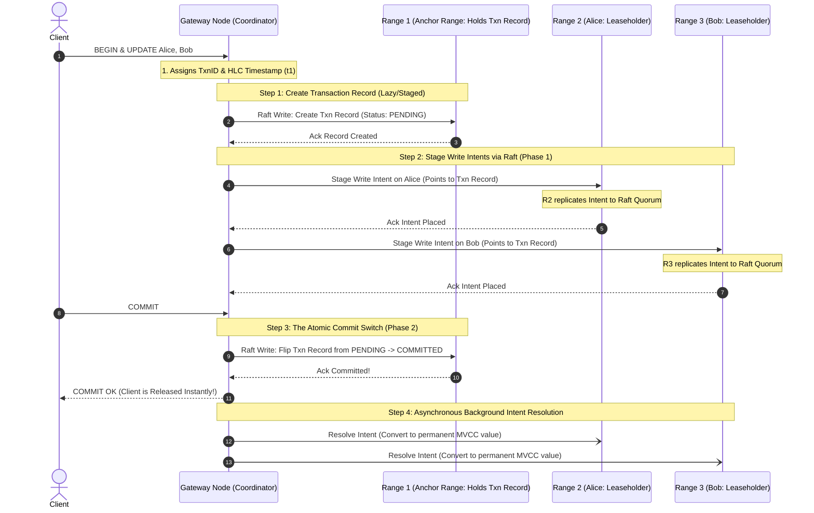
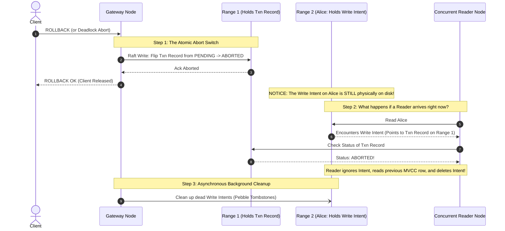

# CockroachDB & Distributed SQL Architecture

**Sources:**
- [Everything you need to know about CockroachDB w/ Ben Darnell (Co-Founder & Chief Architect) \| Ep 6 (Arpit Bhayani)](https://www.youtube.com/watch?v=yhqW82Ka-gw)
- [CockroachDB Architecture & Design Documentation](https://www.cockroachlabs.com/docs/stable/architecture/overview)
- [Google Spanner: Becoming a SQL System (David F. Bacon et al.)](https://research.google/pubs/spanner-becoming-a-sql-system/)

**TL;DR:** CockroachDB is a cloud-native **Distributed SQL** database with PostgreSQL-compatible relational semantics and automatic range distribution/replication. It maps SQL data into an ordered key-value space, replicates ranges using Multi-Raft, and stores local data using Pebble. It defaults to SERIALIZABLE isolation; current releases also support READ COMMITTED.

---

## 1. Motivation: Why Not Just Shard MySQL or PostgreSQL?

In system design interviews, candidates often propose: *"If PostgreSQL or MySQL runs out of capacity, we will just shard it across 10 machines."*

Ben Darnell (Co-Founder & Chief Architect of CockroachDB) highlights why manual sharding becomes an operational nightmare:



### The 4 Fatal Pitfalls of Manual Sharding:
1. **The Operational Tax:** Managing 64 independent MySQL/Postgres instances multiplies operational cost. Each shard requires separate backup configurations, read replicas, connection poolers, and failover automation.
2. **Schema Drift & Migrations:** Running `ALTER TABLE` across 64 shards without downtime is terrifying. If shard 12 locks or fails while shard 13 succeeds, the schema diverges, breaking application queries.
3. **Cross-Shard Transactions & Distributed Joins:** Relational queries like `SELECT * FROM orders JOIN users` become unusable if users and orders sit on different shards. The application layer must execute distributed scatter-gather queries in memory and write fragile custom two-phase commit logic.
4. **Rebalancing Pain:** When a single shard runs hot or exhausts its NVMe SSD, splitting that shard and moving data requires complex custom replication scripts, write-pauses, and high risk of data corruption.

**The Distributed SQL Promise:** Present a single, standard PostgreSQL-compatible SQL interface to the application, while the database engine automatically handles range slicing, consensus replication, distributed transactions, and rebalancing under the hood.

---

## 2. The 5-Layer Architectural Stack

CockroachDB is structured as a 5-layer decoupled system, executing top-to-bottom:



---

## 3. How SQL Maps to an Ordered Key-Value Store

CockroachDB does not store tables as rigid row files on disk. Instead, **the entire database is an Ordered Key-Value Store**.

### A. The Key Encoding Anatomy
Every row in a table is mapped to one or more sorted key-value pairs. Keys are formatted as binary-encoded tuples:

```text
Key = /<TableID>/<IndexID>/<IndexedValues>/<ColumnFamilyID>/<Timestamp>
```

```
Example: A Table 'users' (Table ID: 51) with Primary Key 'user_id'
SQL Schema:
CREATE TABLE users (
    user_id INT PRIMARY KEY,
    name STRING,
    balance DECIMAL
);

Row Insert: (user_id=101, name="Alice", balance=250.00)

Underlying Ordered KV Pair in Pebble:
Key:   /51/1/101/0@1697548800000000000
Value: {"name": "Alice", "balance": 250.00}
```

* **Why an Ordered KV Store?**
  * Because keys are ordered lexicographically, a SQL range query like:
    ```sql
    SELECT * FROM users WHERE user_id BETWEEN 100 AND 200;
    ```
    maps directly to a sequential seek and forward scan in the storage engine from `/51/1/100` to `/51/1/200` without contacting unrelated ranges.
  * **Contrast with DynamoDB & Cassandra (Why NoSQL Chose Hash Partitioning):**
    Unlike CockroachDB, NoSQL databases like DynamoDB and Cassandra partition their clusters via **Consistent Hashing / Murmur3**. While hashing guarantees zero write hotspots by scattering keys uniformly across nodes, it fundamentally destroys global ordering—making global range queries impossible without an expensive full-table scan (`Scan` in DynamoDB, `ALLOW FILTERING` in Cassandra). CockroachDB preserves global ordering to enable native multi-range SQL scans across 64MB Ranges, while mitigating the sequential write hotspot problem via hash-sharded indexes (`USING HASH WITH BUCKETS`) or UUIDs.

---

### B. Column Families: Sub-Row Storage Optimization in Pebble

In CockroachDB, a **Column Family** is a group of columns in a table that are stored together in a **single Key-Value (KV) pair** in the underlying Pebble storage engine.

In the key encoding format:
```text
Key = /<TableID>/<IndexID>/<IndexedValues>/<ColumnFamilyID>/<Timestamp>
```
The `<ColumnFamilyID>` integer indicates which bundle of columns this KV entry contains for that row.

#### 1. The Problem: Naive Storage Pitfalls
How should a distributed SQL engine map a table row with 10 columns into an underlying Key-Value store?
* **Naive Approach 1 (One KV pair per column):** A row with 10 columns creates 10 separate KV entries in Pebble. 
  * *Flaw:* Extreme write amplification, bloated storage metadata, and slow multi-key row reads. *(CockroachDB used this in early pre-v1.0 prototypes).*
* **Naive Approach 2 (One KV pair for the entire row):** Serialize all 10 columns into a single byte blob.
  * *Flaw:* If a row contains frequently updated small fields (`status`, `login_count`) alongside large, rarely modified fields (`profile_photo_blob`, `audit_log_json`), updating the integer forces the database to **re-read and rewrite the entire multi-megabyte payload** on every single update!

#### 2. The Solution: Column Families
CockroachDB allows grouping columns so that hot, frequently updated columns are physically isolated from cold, heavy payloads:



* **Default Behavior:** By default, all columns belong to a single family named `primary` (`ColumnFamilyID = 0`).
* **Custom Families:** Users can declare custom column families in SQL DDL:

```sql
CREATE TABLE accounts (
    account_id INT PRIMARY KEY,
    name STRING,
    balance DECIMAL,
    status STRING,
    profile_photo BYTES,
    audit_history_json JSONB,
    
    -- Fast, frequently modified columns
    FAMILY f_frequent (account_id, name, balance, status),
    
    -- Heavy, rarely modified columns
    FAMILY f_heavy (profile_photo, audit_history_json)
);
```

#### Under the Hood in Pebble:
Inserting row `account_id = 101` writes **two** distinct KV pairs into Pebble:
1. **Family 0 (`f_frequent`):**
   * **Key:** `/51/1/101/0@1697548800000000000`
   * **Value:** `{"name": "Alice", "balance": 250.00, "status": "ACTIVE"}`
2. **Family 1 (`f_heavy`):**
   * **Key:** `/51/1/101/1@1697548800000000000`
   * **Value:** `{"profile_photo": <2MB bytes>, "audit_history_json": {...}}`

#### 3. Key Advantages

1. **Zero Write Amplification on Hot Updates:**
   * Executing `UPDATE accounts SET balance = balance + 50 WHERE account_id = 101` writes a new MVCC entry **only to Key `/51/1/101/0`** (50 bytes).
   * The 7 MB photo and PDF in Family 1 are completely untouched.
2. **Read I/O Pruning (Column Projection):**
   * Executing `SELECT balance FROM accounts WHERE account_id = 101` fetches only the 50-byte KV pair from disk/cache. It never transfers the 7 MB payload over the network or into RAM.
3. **Transaction Conflict Reduction:**
   * Because MVCC latching and lock intents operate at the column family level, concurrent transactions modifying *different* column families of the same row do not trigger serializability conflict aborts.

#### 4. Terminology Distinction: CockroachDB vs. Cassandra

| Concept | Apache Cassandra | CockroachDB |
| :--- | :--- | :--- |
| **What is a "Column Family"?** | A **Table** (historically, a whole keyspace collection). | A **sub-row storage optimization** within a single SQL table. |
| **Scope** | Global schema definition across the cluster. | Grouping of columns into distinct KV pairs in Pebble. |
| **Primary Purpose** | Define tabular data structure. | Minimize LSM-tree write amplification & prune disk I/O. |

---

### C. Secondary Indexes: Ordered Key Inversions
* Stored as additional keys where the indexed column is in the key prefix:
  ```text
  Key = /<TableID>/<SecondaryIndexID>/<email_val>/<PrimaryKeyVal>
  ```
* An index lookup reads the secondary index key, extracts the `<PrimaryKeyVal>`, and fetches the primary row.

---

## 4. Distributed KV Ranges & Multi-Raft

### A. Range Partitioning (64MB Sorted Chunks)
Unlike Apache Cassandra (which hashes keys using Murmur3 to scatter them randomly around a ring, making range scans impossible), CockroachDB uses **Range Partitioning**:
* The entire global keyspace is sorted alphabetically/lexicographically from `[\x00, \xFF...)`.
* It is divided into contiguous, non-overlapping slices called **Ranges** (target size: **64MB**).
* **Automatic Range Splitting:** When a range exceeds 64MB, it dynamically splits at its median key into two adjacent 32MB ranges: $[A, M)$ and $[M, Z)$.



---

### B. Multi-Raft Architecture

Why not run a single Raft consensus group across the entire cluster?
* A single Raft leader would become a catastrophic bottleneck, serializing all writes cluster-wide.
* Instead, CockroachDB runs **Multi-Raft**: **Every single 64MB range is its own independent Raft consensus group!**



* A cluster with 100TB of data contains $\sim 1.5\text{ million}$ independent Raft groups running concurrently across the fleet.
* Leaders are distributed evenly: Node 1 leads Range 1, Node 2 leads Range 2, etc., allowing writes across different ranges to execute completely in parallel with zero lock contention.

---

### C. The Leaseholder Optimization (0-RTT Local Reads)

In standard Raft, reads require contacting a majority of followers to confirm leadership (preventing a partitioned, stale leader from returning outdated data). This introduces a network round-trip on every read.

CockroachDB solves this with **Leases**:
* **The Leaseholder:** For every 64MB range, one replica holds a time-based lease (typically the Raft leader).
* **0-RTT Reads:** The leaseholder is guaranteed that no other node can write to that range during the lease period. Therefore, **the Leaseholder can serve read queries locally from memory with ZERO network consensus round-trips!**
* **Follower Reads:** For multi-region latency optimization, non-leaseholder nodes can serve historical reads (`AS OF SYSTEM TIME`) locally without contacting the leaseholder.

---

## 5. Storage Engine: Why Pebble Replaced RocksDB

CockroachDB originally used **RocksDB** (C++ LSM engine created by Facebook). Over a multi-year engineering effort, Ben Darnell and the team replaced RocksDB with **Pebble**, a custom LSM-tree engine written in 100% pure Go.



### Why Pure-Go Pebble Won:
1. **Elimination of Cgo Overhead:** Crossing the Go-to-C++ boundary (`cgo`) incurs substantial CPU context-switch and stack-alignment overhead on every single read/write. Pure Go eliminates this boundary entirely.
2. **Unified Memory Management:** In the RocksDB era, Go's runtime garbage collector and C++'s `jemalloc` fought over physical RAM. Pebble allows the Go runtime to profile and size heap memory holistically.
3. **Tailored for Range Slicing:** RocksDB is a general-purpose engine with hundreds of tuning knobs. Pebble was purpose-built for CockroachDB's exact primitives:
   * **Fast Range Deletions:** When ranges split or move during rebalancing, Pebble can instantly truncate or delete entire key ranges via SSTable boundary markers rather than writing individual tombstones.

---

## 6. Time Synchronization: Google Spanner (TrueTime) vs. CockroachDB (HLC)

Distributed transactions require knowing whether Transaction A happened before Transaction B.



### A. Google Spanner's TrueTime
* **Hardware:** Google installed GPS receivers and atomic clocks into every datacenter rack.
* **The Guarantee:** TrueTime exposes an API returning $[t_{earliest}, t_{latest}]$ where clock uncertainty $\epsilon \le 7\text{ ms}$.
* **Commit-Wait:** To guarantee external consistency, Spanner deliberately pauses execution and **waits out the $7\text{ ms}$ uncertainty window** before acknowledging a write. Any subsequent transaction is mathematically guaranteed to observe a higher timestamp.

### B. CockroachDB's Hybrid Logical Clocks (HLC)
CockroachDB was designed to run on **commodity infrastructure** (AWS, Azure, GCP, bare metal) where atomic clocks do not exist and NTP clocks can drift by $50\text{--}250\text{ ms}$.
* **HLC Structure:** Every node maintains a clock tuple:
  $$\text{HLC} = (\text{Physical Time } l, \text{Logical Counter } c)$$
* If a node receives a message with an HLC higher than its own physical clock, it advances its logical counter $c$ while keeping physical time bounded.
* **The Uncertainty Window & Read Restart:**
  * When a transaction reads a key, it defines a maximum clock offset uncertainty window: $[t_{read}, t_{read} + \text{max\_offset}]$.
  * If the reader encounters a value written inside this uncertainty window, it cannot determine whether the write occurred before or after the transaction started.
  * **The Fix:** The transaction performs a transparent **Read Restart**: it bumps its read timestamp above the encountered value and restarts its execution. This maintains strict serializability without requiring atomic clock hardware.

---

## 7. Distributed ACID Transactions: Two-Phase Commit over Multi-Raft

Unlike Cassandra (which has no 2PC, no multi-partition atomicity, and no rollback mechanism), CockroachDB provides **full ACID transactions** across arbitrary numbers of tables, keys, and ranges.

It accomplishes this **without global distributed locks**. Instead, it synthesizes three core primitives:
1. **Multi-Raft Consensus:** Independent consensus groups per 64MB range.
2. **Hybrid Logical Clocks (HLC):** Monotonic ordering without atomic clock hardware.
3. **Write Intents & Transaction Records:** Staged MVCC values that point to a central transaction status record.

---

### A. The Write Journey (Distributed 2PC over Multi-Raft)

When a client executes a multi-row or multi-range transaction:
```sql
BEGIN;
UPDATE accounts SET balance = balance - 100 WHERE account_id = 'Alice'; -- Range 2
UPDATE accounts SET balance = balance + 100 WHERE account_id = 'Bob';   -- Range 3
COMMIT;
```



#### Detailed Step-by-Step Write Lifecycle:

1. **SQL Gateway & Range Discovery:**
   * The client connects to **any node** in the cluster (acting as the stateless **SQL Gateway / Coordinator**).
   * The Gateway generates a unique **`TxnID`** (UUID) and assigns an initial timestamp from its local **Hybrid Logical Clock**: $T_{txn} = \text{HLC}_{coord}$.
   * It inspects its local **Range Cache** (a 2-level B-tree index) to locate the leaseholders for Range 2 (`Alice`) and Range 3 (`Bob`).
2. **Transaction Record Creation on the Anchor Range:**
   * CockroachDB designates the range holding the first modified key as the **Anchor Range** (Range 1).
   * It writes a **Transaction Record** via Raft:
     ```text
     Key:    /Local/TxnRecord/<TxnID>
     Status: PENDING
     HLC:    T_txn
     ```
   * The Gateway sends periodic heartbeats to this record. If the Gateway dies, other transactions can detect the stale heartbeat and abort it.
3. **Staging "Write Intents" (Phase 1 of 2PC):**
   * The Gateway sends commands to the **Leaseholders** of Range 2 and Range 3.
   * The Leaseholders acquire local in-memory row latches and propose a Raft log entry: a **Write Intent**.
   * **What is a Write Intent physically in Pebble?**
     * It is written to disk as an MVCC value at timestamp $T_{txn}$:
       ```text
       Key:   /accounts/Alice@T_txn
       Value: {balance: 900, Pointer: "TxnRecord on Range 1"}
       ```
     * It serves a dual purpose: (1) stages the proposed new value, and (2) acts as an inline lock warning readers that a write is in-flight.
   * Each Leaseholder replicates this intent to its **Raft Quorum (2 out of 3 replicas)** and writes it to Pebble.
4. **The Atomic Commit Switch (Phase 2 of 2PC):**
   * When the client sends `COMMIT`, the Gateway sends **one single write** to the Anchor Range:
     * Proposes a Raft write to flip `TxnRecord.Status` from **`PENDING` $\to$ `COMMITTED`**.
   * **THE ATOMIC POINT:** As soon as that single record flip reaches Raft quorum on Range 1, **the entire distributed transaction is permanently committed!**
   * The Gateway immediately returns `COMMIT OK` to the client. The client is unblocked without waiting for Range 2 or Range 3 to be touched.
5. **Asynchronous Write Intent Resolution:**
   * In the background, the Gateway sends asynchronous cleanup RPCs to Range 2 and Range 3:
     * Strips the pointer to the `TxnRecord` from the Pebble keys.
     * Promotes the intents to plain, permanent MVCC rows.
     * Releases in-memory row latches.

---

### B. The Read Journey (0-RTT Leases & MVCC Evaluation)

When a client queries:
```sql
SELECT balance FROM accounts WHERE account_id = 'Alice';
```

```mermaid
flowchart TD
    Client[Client Query] --> GW[SQL Gateway]
    GW -->|Hash / Route| R2[Range 2 Leaseholder]
    
    subgraph Leaseholder["Range 2 Leaseholder (Zero Network Round-Trips)"]
        direction TB
        CheckLease["Is Lease Active?"] -->|Yes (0-RTT)| SeekPebble["Seek Pebble LSM at T <= T_read"]
        
        SeekPebble --> Hit{"Encountered Object?"}
        
        Hit -->|Clean MVCC Row| ReturnFast["Return Row to Gateway"]
        
        Hit -->|Write Intent| CheckIntent{"Inspect Intent's TxnRecord"}
        
        CheckIntent -->|Status: COMMITTED| ReadIntent["Treat Intent as Valid Committed Data!<br/>(Fire Async Read-Repair)"]
        CheckIntent -->|Status: ABORTED| DropIntent["Ignore Intent & Seek Older MVCC Row"]
        CheckIntent -->|Status: PENDING| Conflict["Concurrency Conflict!<br/>Wait in Queue or PushTxn"]
        
        Hit -->|Value written in Uncertainty Window| ReadRestart["Read-Restart:<br/>Bump T_read to T_value and Restart"]
    end

    ReturnFast --> GW --> Client
    ReadIntent --> GW --> Client
    DropIntent --> GW --> Client
    ReadRestart -->|Transparent to Client| GW
```

#### Detailed Step-by-Step Read Lifecycle:

1. **0-RTT Local Reads via the Range Leaseholder:**
   * The query hits the Gateway, which routes the read to the **Range 2 Leaseholder**.
   * **Does the read go through Raft consensus? NO!**
     * Standard Raft requires contacting a quorum of followers on every read to ensure the leader wasn't partitioned.
     * CockroachDB uses **Range Leases**: Only the Leaseholder can serve reads or propose writes for that time window.
     * Therefore, the Leaseholder serves the read **directly out of local memory and Pebble with ZERO network round-trips (0-RTT)!**
2. **MVCC Snapshot Seek in Pebble:**
   * The Leaseholder queries Pebble's MemTable and Block Cache for keys with $T \le T_{read}$.
   * **Clean Read:** If the latest value is a regular MVCC row, the Leaseholder returns it immediately ($<1\text{ ms}$).
3. **Resolving Encountered Write Intents (Concurrency Control):**
   * If a concurrent transaction recently wrote to `Alice`, the reader encounters a Write Intent with a pointer to that writer's `TxnRecord`.
   * The reader inspects the `TxnRecord`:

| TxnRecord Status | Reader Action | Result |
| :--- | :--- | :--- |
| **`COMMITTED`** | The background worker hasn't cleaned the intent yet, but the commit is official. The reader **reads the intent value as valid committed data**, returns it to the client, and fires a background job to convert it to a permanent MVCC key (**Inline Read Repair**). | **Zero dirty reads, zero blocking.** |
| **`ABORTED`** | The writer transaction rolled back. The reader **ignores the intent**, steps backwards in Pebble to read the older MVCC version ($T < T_{intent}$), and triggers background deletion of the dead intent. | **Returns prior valid state instantly.** |
| **`PENDING`** | The writer transaction is actively running. A read/write conflict exists. | Reader enters the **Latch Queue** to wait, or uses **`PushTxn`** to break deadlocks (higher priority pushes lower priority). |

4. **The HLC Uncertainty Window & Read-Restarts:**
   * If a value has timestamp $T_{val}$ within the node's HLC clock uncertainty window ($T_{read} < T_{val} \le T_{read} + \text{max\_offset}$):
   * CockroachDB cannot be sure whether $T_{val}$ was committed before or after this read began in physical real time.
   * **The Fix:** The engine triggers a transparent **Read Restart**: it bumps $T_{read} = T_{val}$ and re-evaluates the query. The application client never sees an error.

---

### C. The Rollback Journey (Atomic Aborts & Intent Garbage Collection)

What happens if a transaction aborts? (e.g. client issues `ROLLBACK`, balance check fails, or deadlock occurs):



#### Detailed Step-by-Step Rollback Lifecycle:

1. **The Trigger:**
   * Can happen due to an explicit client command (`ROLLBACK;`), a serialization conflict/deadlock, or coordinator heartbeat expiration.
2. **The Atomic Abort Switch:**
   * The Gateway sends a single write to the Anchor Range:
     * Flips `TxnRecord.Status` from **`PENDING` $\to$ `ABORTED`**.
   * **THE ATOMIC ABORT POINT:** The moment this single Raft write commits on Range 1, **the entire distributed transaction is 100% rolled back globally and permanently.**
   * The client receives `ROLLBACK OK`.
3. **Why Orphan Write Intents Never Cause Dirty Reads (Contrast with Cassandra):**
   * In Apache Cassandra, a failed/timed-out write leaves orphan data on disk that gets resurrected by quorum reads or read repairs because Cassandra has no rollback mechanism.
   * In CockroachDB, after a rollback, **the Write Intents for Alice and Bob are still physically sitting on disk in Pebble!**
   * **Why does this NOT corrupt data?**
     * An intent is *conditional*: it only has meaning through its pointer to the `TxnRecord`.
     * If a concurrent reader visits `Alice` 1 millisecond after the rollback:
       1. It sees the Write Intent.
       2. It follows the pointer to the `TxnRecord` on Range 1 and sees **`Status: ABORTED`**.
       3. The reader **completely disregards the intent**, steps backward in the LSM-tree to the previous valid MVCC row ($T < T_{aborted}$), and serves the original pre-transaction balance!
     * **Dirty reads are mathematically impossible.**
4. **Asynchronous Cleanup & Compaction:**
   * **Active Cleanup:** The Gateway asynchronously contacts Range 2 and Range 3 to remove the dead intents and write Pebble deletion tombstones.
   * **Passive (Self-Healing) Cleanup:** If the Gateway crashes before it can clean up, the first reader that encounters the aborted intent cleans it up on the spot.
   * **Pebble Compaction:** Pebble's background LSM compaction merges the SSTables and physically reclaims disk space.

---

### D. Summary Matrix: The Three Paths

| Dimension | The Write Path | The Read Path | The Rollback Path |
| :--- | :--- | :--- | :--- |
| **Consensus Incurred** | **Multi-Raft Quorum** (on data intents + 1 on Txn Record) | **ZERO Raft Quorum** (0-RTT via Range Leaseholder) | **1 Raft Quorum** (only on the Txn Record) |
| **Commit/Abort Point**| Flip `TxnRecord` $\to$ `COMMITTED` | N/A (Snapshot at $T \le T_{read}$) | Flip `TxnRecord` $\to$ `ABORTED` |
| **Locking Mechanism** | Write Intents (inline locks in Pebble) | Non-blocking MVCC (Latches for pending intents) | Unlocked immediately when record flips to `ABORTED` |
| **Downstream Cleanup**| Asynchronous intent resolution | Inline read-repair if committed intent met | Asynchronous intent deletion / reader-driven cleanup |
| **Worst-Case Latency**| 2 Raft Round Trips (Phase 1 + Phase 2) | Sub-millisecond ($<1\text{ ms}$) local disk seek | 1 Raft Round Trip (client unblocked immediately) |

---

## 8. Isolation Levels: Serializable by Default, Read Committed Also Supported

In PostgreSQL and MySQL, engineers configure isolation levels (`READ COMMITTED`, `REPEATABLE READ`, or `SERIALIZABLE`).

The original design supported SERIALIZABLE only. **Current releases also support READ COMMITTED**, as documented in the [isolation guide](https://www.cockroachlabs.com/docs/stable/read-committed) (checked 2026-10-27).

1. **Distributed Latency Dominance:**
   * On a single-node database, `Read Committed` is noticeably faster than `Serializable` because single-node memory locks are cheap.
   * Network coordination can dominate, but the percentage and isolation-level cost depend on contention, locality and workload. READ COMMITTED can change retry behavior; measure rather than assuming negligible differences.
2. **Preventing Catastrophic Financial Bugs:**
   * Lower isolation levels suffer from concurrency anomalies: **Write Skew**, **Phantom Reads**, and **Read Skew**.
   * In banking, inventory management, and digital wallets, write skew allows concurrent users to overdraw accounts or double-book resources.
   * SERIALIZABLE prevents anomalies relative to serial execution; the application must still enforce balance/inventory invariants, retry serialization failures correctly and avoid out-of-transaction effects. Choosing READ COMMITTED requires separately reasoning about permitted anomalies.

---

## 9. Comprehensive Architectural Comparison Matrix

| Architectural Dimension | Apache Cassandra | Amazon DynamoDB | CockroachDB | Google Spanner | Sharded PostgreSQL |
| :--- | :--- | :--- | :--- | :--- | :--- |
| **Data Model** | Wide-Column NoSQL | Key-Value / Document | **Relational Distributed SQL** | Relational Distributed SQL | Relational SQL |
| **Partitioning Strategy**| Consistent Hash Ring | Consistent Hash Ring | **Ordered 64MB Ranges** | Ordered 64MB Splits | Manual Hash/Range Sharding |
| **Consensus Engine** | Masterless / Gossip | Paxos per partition | **Multi-Raft per Range** | Multi-Paxos per Split | None (Master-Replica) |
| **Clock Synchronization**| Client Timestamps (LWW) | Server Time / NTP | **Hybrid Logical Clocks (HLC)**| **TrueTime (Atomic + GPS)**| System Wall Clock |
| **Transaction Isolation**| Consistency/LWT/batch scope differs from SQL isolation | Multi-item/table transactions within account/region limits | **SERIALIZABLE default; READ COMMITTED available** | Serializable read-write transactions | Configurable per transaction |
| **Rollback Capability** | No general SQL multi-statement rollback | Atomic TransactWriteItems rejects/aborts the whole transaction | Transaction rollback | Transaction rollback | Transaction rollback within supported scope |
| **Zero-RTT Reads** | ❌ No | ❌ No | ✅ **Via Range Leaseholder** | ✅ Via Leader Leases | N/A |
| **Storage Engine** | LSM (CommitLog/SSTables) | Internal SSD B-Trees | **Pebble (Pure-Go LSM)** | RocksDB-like LSM | Heap Pages + B-Trees |

---

## 10. System Design Interview Playbook & Traps

### When to Choose CockroachDB
* **Financial Ledgers & Banking:** Account transfers requiring strict ACID transactions and absolute prevention of negative balances.
* **Global Multi-Region Relational Workloads:** Systems requiring low-latency local reads in Europe, Asia, and the US with automated regulatory data domiciling (`LOCALITY` rules).
* **Replacing Sharded Relational Databases:** When an existing PostgreSQL cluster is outgrowing vertical scaling and the team refuses to rewrite applications for NoSQL.

### When NOT to Choose CockroachDB
* **High-Velocity Telemetry & Metrics ($>500\text{k}$ writes/sec):** Where Cassandra, ClickHouse, or a TSDB provides $10\times$ higher write density because they skip consensus and ACID coordination.
* **Pure Low-Latency Caching ($<1\text{ ms}$):** Use Redis or Memcached.

### Critical Interview Traps to Avoid

#### 1. The Monotonic Primary Key Hotspot Trap
* **The Candidate Mistake:** Defining a table with an auto-incrementing integer or sequential timestamp primary key:
  ```sql
  CREATE TABLE events (id SERIAL PRIMARY KEY, data text);
  ```
* **The Failure:** Because CockroachDB uses **Range Partitioning**, all sequential IDs `1001, 1002, 1003...` map to the **same 64MB range on a single machine**. That single node absorbs 100% of cluster writes while other nodes sit idle.
* **The Staff Engineer Rule:** Always use **UUIDv4** or **Hash-Sharded Indexes** (`USING HASH WITH BUCKETS = N`) for high-throughput write tables to scatter writes evenly across all ranges.

#### 2. Confusing Multi-Raft with Global Raft
* Do not say *"CockroachDB uses Raft to elect a leader for the database."*
* Say: *"CockroachDB uses **Multi-Raft**, running independent Raft consensus groups per 64MB range. A 100-node cluster runs hundreds of thousands of independent micro-consensus groups concurrently."*

#### 3. Explaining Spanner vs. CockroachDB Time
* When asked how CockroachDB achieves linearizability without Google's atomic clocks, explain **Hybrid Logical Clocks (HLC)** and the **Read-Restart Uncertainty Window**.
