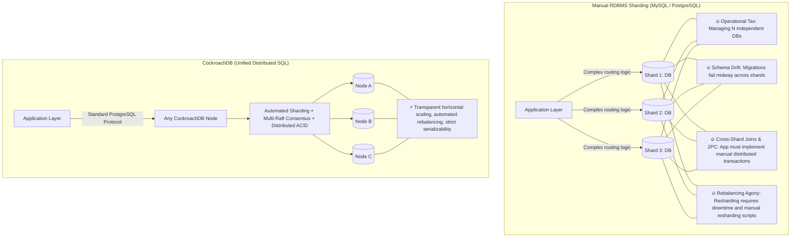
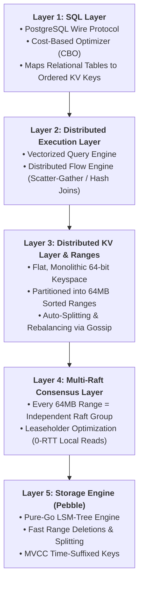
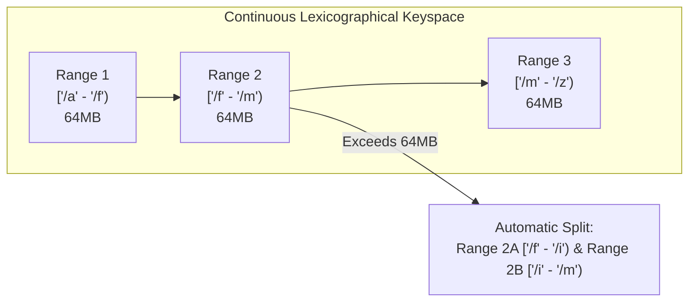
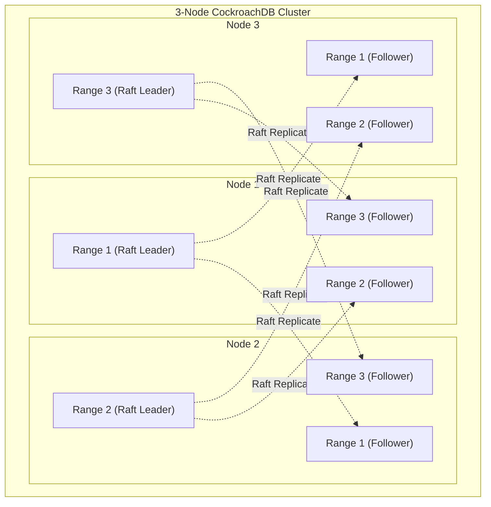
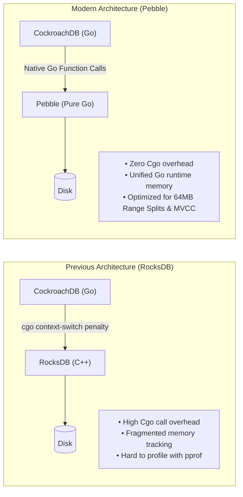
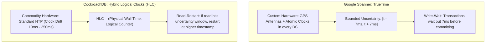

# CockroachDB & Distributed SQL Architecture

**Sources:**
- [Everything you need to know about CockroachDB w/ Ben Darnell (Co-Founder & Chief Architect) \| Ep 6 (Arpit Bhayani)](https://www.youtube.com/watch?v=yhqW82Ka-gw)
- [CockroachDB Architecture & Design Documentation](https://www.cockroachlabs.com/docs/stable/architecture/overview)
- [Google Spanner: Becoming a SQL System (David F. Bacon et al.)](https://research.google/pubs/spanner-becoming-a-sql-system/)

**TL;DR:** CockroachDB is an open-source, cloud-native **Distributed SQL** database designed to combine the familiar relational semantics and strict ACID guarantees of PostgreSQL with the horizontal scalability, multi-region survivability, and zero-downtime elasticity of NoSQL systems. Architecturally, CockroachDB translates high-level SQL tables into an **ordered global key-value keyspace**, partitions the keyspace into contiguous **64MB Ranges**, replicates each range via an independent **Multi-Raft consensus group**, and stores immutable data locally using its custom pure-Go LSM engine, **Pebble**. Unlike traditional RDBMS that require fragile manual sharding, or NoSQL databases like Cassandra that abandon ACID transactions and rollbacks, CockroachDB guarantees **Strict Serializable Isolation** across arbitrary multi-node distributed transactions using **Two-Phase Commit over Multi-Raft** and **Hybrid Logical Clocks (HLC)**.

---

## 1. Motivation: Why Not Just Shard MySQL or PostgreSQL?

In system design interviews, candidates often propose: *"If PostgreSQL or MySQL runs out of capacity, we will just shard it across 10 machines."*

Ben Darnell (Co-Founder & Chief Architect of CockroachDB) highlights why manual sharding becomes an operational nightmare:



### The 4 Fatal Pitfalls of Manual Sharding:
1. **The Operational Tax:** Managing 64 independent MySQL/Postgres instances multiplies operational cost. Each shard requires separate backup configurations, read replicas, connection poolers, and failover automation.
2. **Schema Drift & Migrations:** Running `ALTER TABLE` across 64 shards without downtime is terrifying. If shard 12 locks or fails while shard 13 succeeds, the schema diverges, breaking application queries.
3. **Cross-Shard Transactions & Distributed Joins:** Relational queries like `SELECT * FROM orders JOIN users` become unusable if users and orders sit on different shards. The application layer must execute distributed scatter-gather queries in memory and write fragile custom two-phase commit logic.
4. **Rebalancing Pain:** When a single shard runs hot or exhausts its NVMe SSD, splitting that shard and moving data requires complex custom replication scripts, write-pauses, and high risk of data corruption.

**The Distributed SQL Promise:** Present a single, standard PostgreSQL-compatible SQL interface to the application, while the database engine automatically handles range slicing, consensus replication, distributed transactions, and rebalancing under the hood.

---

## 2. The 5-Layer Architectural Stack

CockroachDB is structured as a 5-layer decoupled system, executing top-to-bottom:



---

## 3. How SQL Maps to an Ordered Key-Value Store

CockroachDB does not store tables as rigid row files on disk. Instead, **the entire database is an Ordered Key-Value Store**.

### A. The Key Encoding Anatomy
Every row in a table is mapped to one or more sorted key-value pairs. Keys are formatted as binary-encoded tuples:

```text
Key = /<TableID>/<IndexID>/<IndexedValues>/<ColumnFamilyID>/<Timestamp>
```

```
Example: A Table 'users' (Table ID: 51) with Primary Key 'user_id'
SQL Schema:
CREATE TABLE users (
    user_id INT PRIMARY KEY,
    name STRING,
    balance DECIMAL
);

Row Insert: (user_id=101, name="Alice", balance=250.00)

Underlying Ordered KV Pair in Pebble:
Key:   /51/1/101/0@1697548800000000000
Value: {"name": "Alice", "balance": 250.00}
```

* **Why an Ordered KV Store?**
  * Because keys are ordered lexicographically, a SQL range query like:
    ```sql
    SELECT * FROM users WHERE user_id BETWEEN 100 AND 200;
    ```
    maps directly to a sequential seek and forward scan in the storage engine from `/51/1/100` to `/51/1/200`.
* **Secondary Indexes:**
  * Stored as additional keys where the indexed column is in the key prefix:
    ```text
    Key = /<TableID>/<SecondaryIndexID>/<email_val>/<PrimaryKeyVal>
    ```
  * An index lookup reads the secondary index key, extracts the `<PrimaryKeyVal>`, and fetches the primary row.

---

## 4. Distributed KV Ranges & Multi-Raft

### A. Range Partitioning (64MB Sorted Chunks)
Unlike Apache Cassandra (which hashes keys using Murmur3 to scatter them randomly around a ring, making range scans impossible), CockroachDB uses **Range Partitioning**:
* The entire global keyspace is sorted alphabetically/lexicographically from `[\x00, \xFF...)`.
* It is divided into contiguous, non-overlapping slices called **Ranges** (target size: **64MB**).
* **Automatic Range Splitting:** When a range exceeds 64MB, it dynamically splits at its median key into two adjacent 32MB ranges: $[A, M)$ and $[M, Z)$.



---

### B. Multi-Raft Architecture

Why not run a single Raft consensus group across the entire cluster?
* A single Raft leader would become a catastrophic bottleneck, serializing all writes cluster-wide.
* Instead, CockroachDB runs **Multi-Raft**: **Every single 64MB range is its own independent Raft consensus group!**



* A cluster with 100TB of data contains $\sim 1.5\text{ million}$ independent Raft groups running concurrently across the fleet.
* Leaders are distributed evenly: Node 1 leads Range 1, Node 2 leads Range 2, etc., allowing writes across different ranges to execute completely in parallel with zero lock contention.

---

### C. The Leaseholder Optimization (0-RTT Local Reads)

In standard Raft, reads require contacting a majority of followers to confirm leadership (preventing a partitioned, stale leader from returning outdated data). This introduces a network round-trip on every read.

CockroachDB solves this with **Leases**:
* **The Leaseholder:** For every 64MB range, one replica holds a time-based lease (typically the Raft leader).
* **0-RTT Reads:** The leaseholder is guaranteed that no other node can write to that range during the lease period. Therefore, **the Leaseholder can serve read queries locally from memory with ZERO network consensus round-trips!**
* **Follower Reads:** For multi-region latency optimization, non-leaseholder nodes can serve historical reads (`AS OF SYSTEM TIME`) locally without contacting the leaseholder.

---

## 5. Storage Engine: Why Pebble Replaced RocksDB

CockroachDB originally used **RocksDB** (C++ LSM engine created by Facebook). Over a multi-year engineering effort, Ben Darnell and the team replaced RocksDB with **Pebble**, a custom LSM-tree engine written in 100% pure Go.



### Why Pure-Go Pebble Won:
1. **Elimination of Cgo Overhead:** Crossing the Go-to-C++ boundary (`cgo`) incurs substantial CPU context-switch and stack-alignment overhead on every single read/write. Pure Go eliminates this boundary entirely.
2. **Unified Memory Management:** In the RocksDB era, Go's runtime garbage collector and C++'s `jemalloc` fought over physical RAM. Pebble allows the Go runtime to profile and size heap memory holistically.
3. **Tailored for Range Slicing:** RocksDB is a general-purpose engine with hundreds of tuning knobs. Pebble was purpose-built for CockroachDB's exact primitives:
   * **Fast Range Deletions:** When ranges split or move during rebalancing, Pebble can instantly truncate or delete entire key ranges via SSTable boundary markers rather than writing individual tombstones.

---

## 6. Time Synchronization: Google Spanner (TrueTime) vs. CockroachDB (HLC)

Distributed transactions require knowing whether Transaction A happened before Transaction B.



### A. Google Spanner's TrueTime
* **Hardware:** Google installed GPS receivers and atomic clocks into every datacenter rack.
* **The Guarantee:** TrueTime exposes an API returning $[t_{earliest}, t_{latest}]$ where clock uncertainty $\epsilon \le 7\text{ ms}$.
* **Commit-Wait:** To guarantee external consistency, Spanner deliberately pauses execution and **waits out the $7\text{ ms}$ uncertainty window** before acknowledging a write. Any subsequent transaction is mathematically guaranteed to observe a higher timestamp.

### B. CockroachDB's Hybrid Logical Clocks (HLC)
CockroachDB was designed to run on **commodity infrastructure** (AWS, Azure, GCP, bare metal) where atomic clocks do not exist and NTP clocks can drift by $50\text{--}250\text{ ms}$.
* **HLC Structure:** Every node maintains a clock tuple:
  $$\text{HLC} = (\text{Physical Time } l, \text{Logical Counter } c)$$
* If a node receives a message with an HLC higher than its own physical clock, it advances its logical counter $c$ while keeping physical time bounded.
* **The Uncertainty Window & Read Restart:**
  * When a transaction reads a key, it defines a maximum clock offset uncertainty window: $[t_{read}, t_{read} + \text{max\_offset}]$.
  * If the reader encounters a value written inside this uncertainty window, it cannot determine whether the write occurred before or after the transaction started.
  * **The Fix:** The transaction performs a transparent **Read Restart**: it bumps its read timestamp above the encountered value and restarts its execution. This maintains strict serializability without requiring atomic clock hardware.

---

## 7. Distributed ACID Transactions: Two-Phase Commit over Multi-Raft

Unlike Cassandra (which has no 2PC, no multi-partition atomicity, and no rollback), CockroachDB provides **full ACID transactions** across arbitrary numbers of tables, keys, and ranges.

### The Mechanics: Write Intents & Transaction Records

```mermaid
sequenceDiagram
    autonumber
    actor Client
    participant Gateway as Gateway Node
    participant TxnRange as Range 1 (Holds Txn Record)
    participant DataRangeA as Range 2 (Key A)
    participant DataRangeB as Range 3 (Key B)

    Client->>Gateway: BEGIN TRANSACTION; UPDATE A; UPDATE B; COMMIT;
    
    Note over Gateway,TxnRange: Phase 1: Write Intent Staging
    Gateway->>TxnRange: Create Transaction Record (Status: PENDING)
    Gateway->>DataRangeA: Write Intent on Key A (Points to Txn Record on Range 1)
    Gateway->>DataRangeB: Write Intent on Key B (Points to Txn Record on Range 1)
    
    Note over Gateway,TxnRange: Phase 2: Atomic Commit
    Gateway->>TxnRange: Flip Txn Record from PENDING -> COMMITTED
    TxnRange-->>Gateway: Ack Commit
    Gateway-->>Client: Transaction Committed! (ACID Complete)
    
    Note over Gateway,DataRangeB: Background Asynchronous Resolution
    Gateway-)DataRangeA: Resolve Intent -> Permanent MVCC Value
    Gateway-)DataRangeB: Resolve Intent -> Permanent MVCC Value
```

1. **Transaction Record Creation:**
   * When a transaction begins, a **Transaction Record** is written to a designated range with status **`PENDING`**.
2. **Writing "Write Intents":**
   * Instead of modifying data directly, the gateway node writes **Write Intents** to the target ranges via Raft consensus.
   * A Write Intent is an in-memory MVCC value containing an inline pointer to the Transaction Record:
     $$\text{Write Intent} = (\text{Value}, \text{Pointer to Txn Record})$$
3. **Atomic Commit Point (Phase 2):**
   * To commit, the coordinator sends a single write to the Transaction Record, changing its status from **`PENDING` $\to$ `COMMITTED`**.
   * **The Atomic Switch:** The moment that single record flips to `COMMITTED`, the entire distributed transaction is committed!
4. **Asynchronous Intent Resolution:**
   * In the background, the coordinator tells the participating ranges to remove the pointers and convert the intents into regular permanent MVCC values.
   * If a concurrent reader encounters an unresolved Write Intent before the background worker cleans it, the reader simply inspects the Transaction Record. If it sees `COMMITTED`, it reads the intent as valid committed data!

### Full Rollback Support
* If a transaction encounters an error, deadlock, or is aborted by the client:
* The coordinator flips the Transaction Record status to **`ABORTED`**.
* **Any subsequent reader that encounters a Write Intent pointing to an `ABORTED` record automatically discards the intent and rolls it back.** Zero dirty reads, 100% rollback capability!

---

## 8. Why CockroachDB ONLY Supports Serializable Isolation

In PostgreSQL and MySQL, engineers configure isolation levels (`READ COMMITTED`, `REPEATABLE READ`, or `SERIALIZABLE`).

Ben Darnell explains why CockroachDB made the radical architectural choice to **exclusively support Strict Serializable Isolation**:

1. **Distributed Latency Dominance:**
   * On a single-node database, `Read Committed` is noticeably faster than `Serializable` because single-node memory locks are cheap.
   * In a distributed database, **network round-trips over Raft dominate $>95\%$ of total latency**. The CPU performance difference between `Read Committed` and `Serializable` is negligible.
2. **Preventing Catastrophic Financial Bugs:**
   * Lower isolation levels suffer from concurrency anomalies: **Write Skew**, **Phantom Reads**, and **Read Skew**.
   * In banking, inventory management, and digital wallets, write skew allows concurrent users to overdraw accounts or double-book resources.
   * CockroachDB eliminates this entire class of bugs by defaulting exclusively to **Serializable Isolation**.

---

## 9. Comprehensive Architectural Comparison Matrix

| Architectural Dimension | Apache Cassandra | Amazon DynamoDB | CockroachDB | Google Spanner | Sharded PostgreSQL |
| :--- | :--- | :--- | :--- | :--- | :--- |
| **Data Model** | Wide-Column NoSQL | Key-Value / Document | **Relational Distributed SQL** | Relational Distributed SQL | Relational SQL |
| **Partitioning Strategy**| Consistent Hash Ring | Consistent Hash Ring | **Ordered 64MB Ranges** | Ordered 64MB Splits | Manual Hash/Range Sharding |
| **Consensus Engine** | Masterless / Gossip | Paxos per partition | **Multi-Raft per Range** | Multi-Paxos per Split | None (Master-Replica) |
| **Clock Synchronization**| Client Timestamps (LWW) | Server Time / NTP | **Hybrid Logical Clocks (HLC)**| **TrueTime (Atomic + GPS)**| System Wall Clock |
| **Transaction Isolation**| None (Read Uncommitted) | None / Single-Partition | **Strict Serializable** | Strict Serializable | Configurable per query |
| **Rollback Capability** | ❌ **Never rolls back** | ❌ No rollback | ✅ **Full Rollback Support** | ✅ Full Rollback Support | ✅ Full Rollback Support |
| **Zero-RTT Reads** | ❌ No | ❌ No | ✅ **Via Range Leaseholder** | ✅ Via Leader Leases | N/A |
| **Storage Engine** | LSM (CommitLog/SSTables) | Internal SSD B-Trees | **Pebble (Pure-Go LSM)** | RocksDB-like LSM | Heap Pages + B-Trees |

---

## 10. System Design Interview Playbook & Traps

### When to Choose CockroachDB
* **Financial Ledgers & Banking:** Account transfers requiring strict ACID transactions and absolute prevention of negative balances.
* **Global Multi-Region Relational Workloads:** Systems requiring low-latency local reads in Europe, Asia, and the US with automated regulatory data domiciling (`LOCALITY` rules).
* **Replacing Sharded Relational Databases:** When an existing PostgreSQL cluster is outgrowing vertical scaling and the team refuses to rewrite applications for NoSQL.

### When NOT to Choose CockroachDB
* **High-Velocity Telemetry & Metrics ($>500\text{k}$ writes/sec):** Where Cassandra, ClickHouse, or a TSDB provides $10\times$ higher write density because they skip consensus and ACID coordination.
* **Pure Low-Latency Caching ($<1\text{ ms}$):** Use Redis or Memcached.

### Critical Interview Traps to Avoid

#### 1. The Monotonic Primary Key Hotspot Trap
* **The Candidate Mistake:** Defining a table with an auto-incrementing integer or sequential timestamp primary key:
  ```sql
  CREATE TABLE events (id SERIAL PRIMARY KEY, data text);
  ```
* **The Failure:** Because CockroachDB uses **Range Partitioning**, all sequential IDs `1001, 1002, 1003...` map to the **same 64MB range on a single machine**. That single node absorbs 100% of cluster writes while other nodes sit idle.
* **The Staff Engineer Rule:** Always use **UUIDv4** or **Hash-Sharded Indexes** (`USING HASH WITH BUCKETS = N`) for high-throughput write tables to scatter writes evenly across all ranges.

#### 2. Confusing Multi-Raft with Global Raft
* Do not say *"CockroachDB uses Raft to elect a leader for the database."*
* Say: *"CockroachDB uses **Multi-Raft**, running independent Raft consensus groups per 64MB range. A 100-node cluster runs hundreds of thousands of independent micro-consensus groups concurrently."*

#### 3. Explaining Spanner vs. CockroachDB Time
* When asked how CockroachDB achieves linearizability without Google's atomic clocks, explain **Hybrid Logical Clocks (HLC)** and the **Read-Restart Uncertainty Window**.
