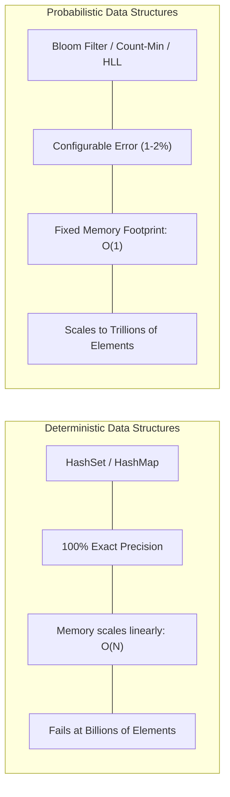
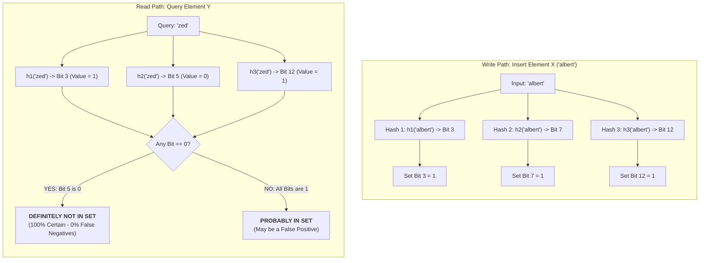
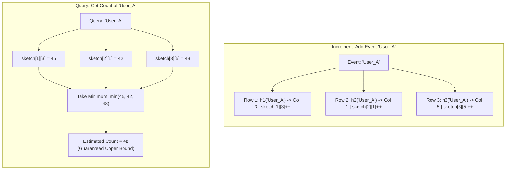
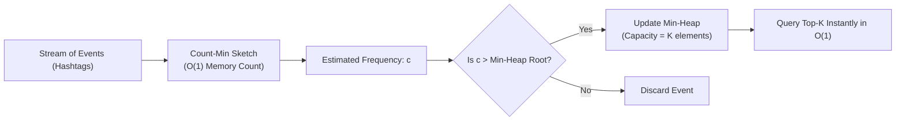
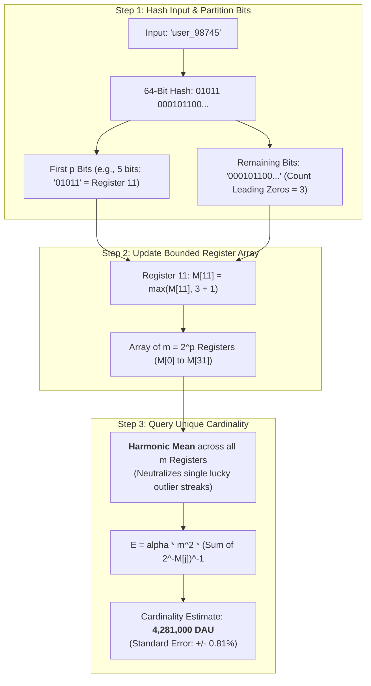
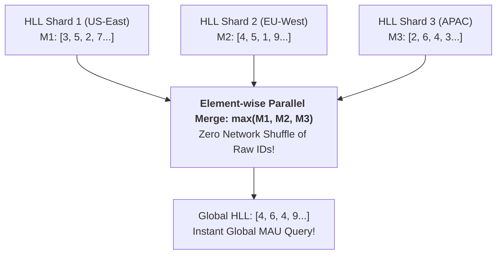
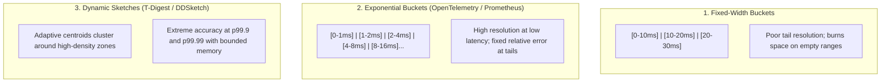
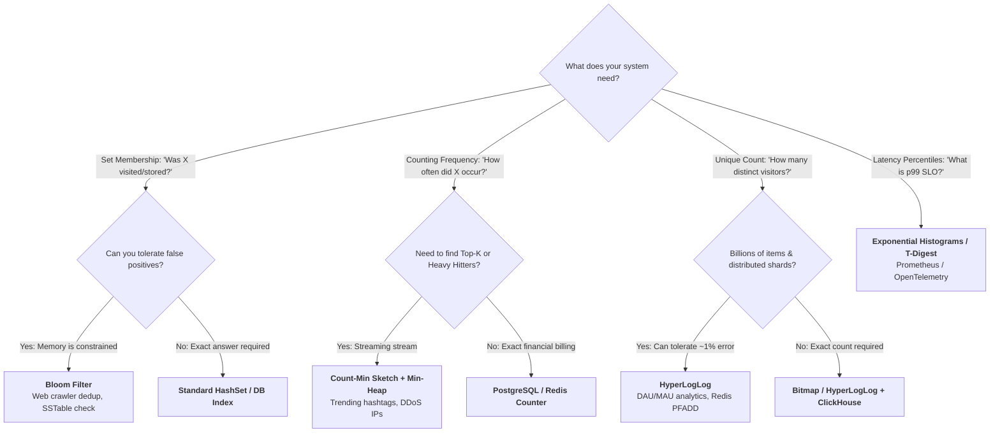

# Data Structures for Big Data: Probabilistic & Streaming Approximations

**Sources:** [Data Structures for Big Data in Interviews (Hello Interview)](https://www.youtube.com/watch?v=IgyU0iFIoqM) | [Hello Interview Written Guide](https://www.hellointerview.com/learn/system-design/deep-dives/data-structures-for-big-data)

**TL;DR:** When dataset sizes scale into billions or trillions of records, exact deterministic data structures (like HashSets, TreeMaps, or raw arrays) become physically impossible to maintain in memory or synchronize across network boundaries. Probabilistic data structures surrender absolute certainty in exchange for **orders-of-magnitude reduction in space ($O(1)$ constant bounded memory)** and sub-millisecond execution. In system design interviews, these structures solve otherwise intractable bottlenecks in web crawlers, real-time analytics, database storage engines, and latency telemetry.

---

## 1. The Big Data Paradox & Staff Engineer Caveat

In standard applications, standard data structures (`HashSet`, `HashMap`, SQL `B-Trees`) work perfectly. However, at extreme scale, their memory requirements scale linearly with cardinality:

$$\text{Memory Overhead} = O(N \times \text{Item Size})$$

*Example:* Storing 1 billion 64-character URL strings (1 KB each) in a hash set to detect duplicate crawls requires **1 Terabyte of pure RAM** just for a deduplication index.



> [!WARNING]
> ### ⚠️ The Over-Engineering Red Flag in Interviews
> Reaching for a probabilistic data structure when standard RAM fits the data is an **automatic interview red flag**. A candidate who jumps straight to a Bloom filter or Count-Min Sketch without doing back-of-the-envelope calculations shows poor engineering pragmatism.
> 
> **The Golden Rule:** Always start with the simplest exact solution (e.g., in-memory HashMap or Redis Set). Only introduce probabilistic data structures when:
> 1.  **Back-of-the-envelope math proves memory is intractable** (e.g., terabytes required for a simple filter).
> 2.  **Predictable, constant-time performance is non-negotiable** (e.g., embedded devices, network routers, database storage engines).
> 3.  **The problem domain inherently tolerates small approximation errors** (e.g., web crawling, viral trending counters, distinct visitor metrics, caching).

---

## 2. Core Comparison Cheatsheet

| Data Structure | Primary Problem Solved | Return Value / Guarantees | Space Complexity | Error Characteristics | Canonical Production Use Case |
| :--- | :--- | :--- | :--- | :--- | :--- |
| **Bloom Filter** | **Set Membership** (*"Is item $X$ in the set?"*) | "Definitely Not" OR "Probably Yes" | $O(m)$ bits ($\sim 10\text{ bits/item}$ for $1\%$ error) | **Zero False Negatives**; bounded False Positive rate ($\epsilon$) | Cassandra/RocksDB SSTable read bypass; Web crawler URL deduplication |
| **Count-Min Sketch** | **Frequency Estimation** (*"How many times did $X$ occur?"*) | Upper-bound frequency estimate | $O(w \times d)$ integer registers | **Never underestimates**; overestimates due to hash collisions | Heavy Hitters (Top-K trending); Caffeine Cache admission (TinyLFU) |
| **HyperLogLog (HLL)** | **Cardinality Estimation** (*"How many distinct elements exist?"*) | Approximate unique count | $O(m)$ registers (e.g., **12 KB** in Redis for billions of items) | Typical standard error $\approx \pm 0.81\%$; mathematically mergeable | Daily Active Users (DAU); Distinct search queries; Port scan detection |
| **Approximate Quantiles** | **Latency Percentiles** (*"What is p50, p95, p99 latency?"*) | Quantile / Percentile estimate | $O(B)$ histogram buckets | Bounded relative error across long-tail distributions | Prometheus / OpenTelemetry microservice SLO monitoring |

---

## 3. Bloom Filter (Approximate Set Membership)

### A. The Intuition: "The Villager Stamps"
Imagine a town where 1,000 villagers each have a unique rubber stamp with specific geometric grooves. When villagers attend a town meeting, they all stamp the same single piece of paper.
*   **Checking attendance:** To check if Alice attended, look at the paper. If any groove of Alice's stamp is missing ink, **she definitely did not attend** (Zero False Negatives).
*   **The Catch:** If all grooves of Alice's stamp have ink, she *probably* attended. However, it is possible that Bob and Charlie's overlapping stamps coincidentally inked all the spots corresponding to Alice's stamp (**False Positive**).

### B. Mechanics Under the Hood



1.  **Structure:** An array of $m$ bits, all initialized to 0.
2.  **Hash Functions:** $k$ independent, uniform cryptographic or non-cryptographic hash functions (e.g., MurmurHash3, CityHash, xxHash).
3.  **Insert:**
    *   Feed element $x$ into all $k$ hash functions to get $k$ array positions: $h_1(x), h_2(x), \dots, h_k(x) \pmod m$.
    *   Set the bits at all these positions to `1`.
4.  **Query:**
    *   Feed query element $y$ into all $k$ hash functions.
    *   Check the bit values at all positions:
        *   If **at least one bit is 0**: The element was **definitely never added**. (A bit can only become 1, never 0).
        *   If **all bits are 1**: The element is **probably in the set**.

### C. Mathematical Sizing Formulas

The probability of a false positive $\epsilon$ after inserting $n$ elements into an $m$-bit array with $k$ hash functions is:

$$\epsilon \approx \left( 1 - e^{-kn/m} \right)^k$$

For a given number of expected items $n$ and desired false positive probability $\epsilon$:

1.  **Optimal Bit Array Size ($m$):**
    $$m = -\frac{n \ln \epsilon}{(\ln 2)^2} \approx -1.44 \cdot n \cdot \log_2 \epsilon$$
2.  **Optimal Number of Hash Functions ($k$):**
    $$k = \frac{m}{n} \ln 2 \approx 0.693 \cdot \frac{m}{n}$$

> [!TIP]
> **Staff Engineer Rule of Thumb for Interviews:**
> *   Allocating **$10$ bits per item** ($m/n = 10$) with **$k = 7$ hash functions** yields a **~1% false positive rate** ($\epsilon \approx 0.01$, or 1 in 120 items).
> *   $1$ billion items $\times 10\text{ bits} = 10\text{ billion bits} \approx \mathbf{1.19\text{ GB RAM}}$ (compared to 1 TB for a raw HashSet!).

### D. System Design Production Use Cases
1.  **Web Crawlers (URL Deduplication):**
    *   Before downloading a discovered URL, check the Bloom filter. If it returns false, crawl the page and insert the URL. If it returns true (probably crawled), drop it. Occasional false positive skips are harmless compared to saving 99% of crawler RAM.
2.  **Database Storage Engines (Cassandra, RocksDB, Bigtable):**
    *   In LSM-tree engines, each on-disk SSTable has an associated in-memory Bloom filter.
    *   When servicing a read query, the node checks the Bloom filter in RAM before issuing an expensive disk seek. If the Bloom filter says the key is absent, the SSTable disk read is completely avoided.
3.  **Google Chrome Malicious URL Checker:**
    *   Downloading millions of phishing URLs to every browser is infeasible. Instead, Chrome downloads a compact Bloom filter of known malicious URLs. If a visited site hits the Bloom filter, the browser makes a secure API call to Google's backend to verify the exact status.
4.  **Cache Admission (Filtering "One-Hit Wonders"):**
    *   Many web assets are requested only once and never again, thrashing LRU caches. A Bloom filter tracks requested IDs; an asset is only admitted to the expensive Redis cache on its *second* request.

### E. Pitfalls & The Deletion Trap
*   **Deletions are Impossible:** You cannot clear a bit back to 0 because that bit may be shared by other elements.
*   **The Fix (Counting Bloom Filter):** Replace each single bit with a small 4-bit integer counter. Inserts increment the counter; deletes decrement it. *Trade-off:* Consumes $4\times$ the memory of a standard Bloom filter.
*   **Saturation:** As more items are added beyond capacity $n$, the bit array fills with 1s until the false positive rate approaches 100%. Bloom filters cannot be resized dynamically—you must allocate a new larger filter or use a **Scalable Bloom Filter** (a chain of increasing-capacity Bloom filters).

---

## 4. Count-Min Sketch (Frequency Estimation & Heavy Hitters)

### A. The Intuition
A Bloom filter answers a binary question: *"Did we see it?"* A **Count-Min Sketch** answers a quantitative question: *"How many times did we see it?"*
It acts like a 2D matrix of integer counters. Multiple keys may hash to the same bucket and artificially inflate the counter, but by taking the **minimum** across multiple independent hash rows, we eliminate the collision noise.

### B. Mechanics Under the Hood



1.  **Structure:** A 2D array of counters with depth $d$ (rows) and width $w$ (columns).
2.  **Hash Functions:** $d$ distinct pairwise independent hash functions: $h_1, h_2, \dots, h_d$, where each $h_i(x) \in [0, w-1]$.
3.  **Update($x, c$):**
    *   For each row $i$ from $1$ to $d$:
        $$\text{sketch}[i][h_i(x)] \leftarrow \text{sketch}[i][h_i(x)] + c$$
4.  **Query Point Estimate($x$):**
    *   Look up the counter value in every row and return the minimum:
        $$\hat{c}(x) = \min_{1 \le i \le d} \left( \text{sketch}[i][h_i(x)] \right)$$

### C. Mathematical Precision Guarantees
Count-Min Sketch provides rigorous statistical bounds based on dimensions $w$ and $d$:
1.  **Width ($w$):** Controls error factor $\epsilon$.
    $$w = \left\lceil \frac{e}{\epsilon} \right\rceil \approx \left\lceil \frac{2.718}{\epsilon} \right\rceil$$
2.  **Depth ($d$):** Controls confidence probability $1 - \delta$.
    $$d = \left\lceil \ln\left(\frac{1}{\delta}\right) \right\rceil$$

**The Core Guarantee:**
$$\hat{c}(x) \ge c(x) \quad \text{and} \quad \hat{c}(x) \le c(x) + \epsilon N \quad \text{with probability } \ge 1 - \delta$$
*(Where $N$ is the total sum of all increments added to the sketch).*
*   **It NEVER underestimates:** Counters are only incremented, never decremented.
*   **Overestimation is bounded:** Collisions can only make the count larger, but the minimum operation ensures we get closest to the true value.

### D. The Heavy Hitters (Top-K) Architecture Pattern
In streaming interviews (e.g., *"Find the Top 100 trending hashtags on Twitter"* or *"Detect Top 10 IP addresses producing 90% of traffic"*), you cannot use a Count-Min Sketch alone because **the sketch cannot iterate over stored keys** (it only holds numeric counters).

**The Solution:** Pair the Count-Min Sketch with a bounded **Min-Heap (Priority Queue)**.



1.  Incoming stream event arrives: `#viral`.
2.  Increment `#viral` in Count-Min Sketch $\to$ retrieve current estimated frequency $\hat{c}$.
3.  Compare $\hat{c}$ against the root of a Min-Heap of size $K$:
    *   If $\hat{c}$ exceeds the root: update or insert `#viral` into the heap.
    *   Otherwise: discard.
4.  **Result:** Bounded $O(K)$ heap memory and $O(1)$ constant sketch memory, servicing live Top-K queries without memory leaks.

### E. Counter Sizing, 4-Bit Packing & The Decay Mechanism (TinyLFU)

In system design interviews, candidates often wonder: *what data type should the counters be, and what happens when counters saturate over time?*

#### 1. Counter Sizing: Standard (32-bit) vs. Packed (4-bit)
* **Standard Count-Min Sketch (32-bit / 64-bit int):**
  * Used for unbounded streaming systems (Apache Flink, DDoS packet logging, Twitter hashtag analytics).
  * Declared as a 2D array of standard integers: `matrix[d][w]` using `uint32` (counts up to **4.29 billion** without overflow).
* **TinyLFU Cache Admission (4-bit counters, max count $= 15$):**
  * Used in high-performance in-memory caches like **Caffeine Cache** (Window TinyLFU).
  * **Why only 4 bits ($2^4 - 1 = 15$)?** An eviction policy only needs **relative recent frequency** (*"Is item A accessed more recently than victim item B?"*). An item accessed 15 times recently is already hot; knowing whether it was accessed 15 times or 50,000 times does not change the cache admission decision.
  * **Memory optimization:** Two 4-bit counters are packed into a single 8-bit `uint8` byte (`byte & 0x0F` for the lower nibble, and `byte >> 4` for the upper nibble), cutting the sketch memory footprint in half.

```
1 Byte (8 bits) in Memory:
┌──────────────────────┬──────────────────────┐
│ Counter 1 (Upper 4b) │ Counter 2 (Lower 4b) │
│ Range: 0 to 15       │ Range: 0 to 15       │
└──────────────────────┴──────────────────────┘
```

#### 2. The Saturation Problem & The Decay (Aging / Halving) Mechanism
* **The Problem:** A standard Count-Min Sketch only increments. Over time, two major failure modes occur:
  1. Counters saturate at their maximum value (especially 4-bit counters stuck at 15).
  2. **The "Stale Viral Post" Problem:** An item that went viral last Monday permanently keeps high counter values, preventing new breaking news items from ever overtaking it.
* **The Solution (The Halving Trick):**
  * Maintain a global counter $S$ tracking the total number of additions since the last reset.
  * When $S$ reaches a threshold sample size $W$ (e.g., $W = 10 \times \text{cache size}$ or every $N$ seconds):
    * Iterate through the entire $d \times w$ matrix and **divide every counter by 2** using a bitwise right-shift:
      $$\text{sketch}[i][j] = \text{sketch}[i][j] \gg 1$$
    * Reset the sample counter: $S \leftarrow S / 2$ (or $0$).
* **The Mechanical Effect:**
  * An item with count 14 drops to 7. An item with count 2 drops to 1. An item with count 1 drops to 0.
  * Historical noise and obsolete traffic spikes decay exponentially ($1/2, 1/4, 1/8 \dots$).
  * Fresh items can now easily accumulate new counts and surpass decaying old favorites!

#### 3. Sample Code Declaration (Decaying Count-Min Sketch)
```python
class DecayingCountMinSketch:
    def __init__(self, depth=5, width=2048, reset_threshold=10000):
        self.d = depth
        self.w = width
        # 2D matrix of counters (e.g. 5 rows x 2048 columns)
        self.table = [[0] * self.w for _ in range(self.d)]
        self.seeds = [10007 * i for i in range(self.d)]
        self.sample_size = 0
        self.reset_threshold = reset_threshold  # Threshold W to trigger decay

    def add(self, key: str, count: int = 1):
        self.sample_size += count
        for i in range(self.d):
            col = hash_function(key, self.seeds[i]) % self.w
            # Cap at 15 if using 4-bit counters, or let it grow if using standard uint32
            self.table[i][col] = min(self.table[i][col] + count, 15)
        
        # Periodic Decay / Halving step
        if self.sample_size >= self.reset_threshold:
            self._decay()

    def _decay(self):
        """Halve all counters in the sketch to age out historical items."""
        for i in range(self.d):
            for j in range(self.w):
                self.table[i][j] >>= 1  # Right shift by 1 = integer divide by 2
        self.sample_size //= 2

    def estimate(self, key: str) -> int:
        return min(self.table[i][hash_function(key, self.seeds[i]) % self.w] for i in range(self.d))
```

---

### F. Other Production Use Cases
1.  **DDoS & Network Security:** Tracking packets per source IP address in network switches with hardware-limited TCAM memory.
2.  **Caffeine Cache (Window TinyLFU):** Uses the decaying 4-bit Count-Min Sketch above to estimate the historical frequency of cache entries, admitting newly requested items only if their frequency exceeds the victim item being evicted.

---

## 5. HyperLogLog (Cardinality & Distinct Counting)

### A. The Intuition: The Coin-Flip Streak
How can you estimate how many unique people visited a website without recording their user IDs?
Imagine someone flips a fair coin repeatedly and records the longest consecutive streak of **Heads** observed:
*   Streak of 1 Head (`H...`): Probability $= 1/2 \implies$ You likely flipped $\sim 2$ times.
*   Streak of 3 Heads (`HHH...`): Probability $= (1/2)^3 = 1/8 \implies$ You likely flipped $\sim 8$ times.
*   Streak of 10 Heads (`HHHHHHHHHH...`): Probability $= (1/2)^{10} = 1/1024 \implies$ You likely flipped $\sim 1,024$ times.

**Translating to Computer Science:**
When we hash an item uniformly, its binary output is functionally equivalent to random coin flips (0 = Tails, 1 = Heads).
By hashing unique elements and tracking the **maximum number of consecutive leading (or trailing) zeros**, we can estimate the total number of unique elements:

$$\text{Estimated Unique Items} \approx 2^{\text{Max Consecutive Zeros}}$$

*Crucial Property:* If the same user visits 1,000 times, their user ID hashes to the **exact same binary value**, producing the exact same streak of zeros. Duplicates have **zero effect** on the maximum!

### B. Mechanics Under the Hood



#### 1. Stochastic Averaging (Bucketing)
A single user whose hash happens to end in 25 zeros by sheer chance would wildly distort the estimate ($2^{25} \approx 33\text{ million}$).
To prevent outlier distortion, HyperLogLog partitions the hash into **$m = 2^p$ independent registers**:
*   The first $p$ bits select the register index $j \in [0, m-1]$.
*   The remaining bits are evaluated to count leading zeros $\rho(w)$.
*   Register $M[j]$ is updated:
    $$M[j] \leftarrow \max(M[j], \rho(w))$$

#### 2. Harmonic Mean Estimation
Instead of computing the arithmetic mean (which is vulnerable to extreme outliers), HyperLogLog computes the **Harmonic Mean** of $2^{M[j]}$ across all $m$ registers:

$$E = \alpha_m \cdot m^2 \cdot \left( \sum_{j=0}^{m-1} 2^{-M[j]} \right)^{-1}$$

*(Where $\alpha_m$ is a known bias correction constant).*

### C. Space Efficiency & Redis Implementation
*   In Redis (`PFADD`, `PFCOUNT`), HyperLogLog uses **$m = 16,384$ registers** ($p = 14$ bits).
*   Each register only needs to store numbers from 0 to 64 (the maximum possible leading zeros in a 64-bit hash). Since $2^6 = 64$, **each register requires exactly 6 bits**.
*   **Total Fixed Size:**
    $$\text{Total Memory} = 16,384 \text{ registers} \times 6 \text{ bits} = 98,304 \text{ bits} = \mathbf{12\text{ KB}}$$
*   **Standard Error:**
    $$\text{SE} = \frac{1.04}{\sqrt{m}} = \frac{1.04}{\sqrt{16,384}} \approx \mathbf{0.81\%}$$
*   *Conclusion:* **Redis can count up to billions of unique daily active users with $\pm 0.81\%$ error using only 12 KB of RAM!**

### D. The Distributed Superpower: Lossless Mergeability
Because registers only store the maximum streak of zeros observed, **two HyperLogLog sketches can be merged element-wise with zero loss of accuracy**:

$$M_{\text{merged}}[j] = \max(M_A[j], M_B[j])$$



*   **Interview Application:** In a globally distributed system (e.g., counting global Unique Visitors across 5 data centers), each regional server computes its local 12 KB HLL sketch. At midnight, nodes simply send their 12 KB array to an aggregator that runs an element-wise `max()`. There is **zero cross-datacenter transmission of raw user IDs**!

---

## 6. Approximate Quantiles & Histograms (SLO Telemetry)

### A. The Latency Fallacy: Why You Cannot Average Percentiles
In systems monitoring (Prometheus, Datadog), engineers track percentiles like p50, p95, p99, and p99.9 latency to enforce Service Level Objectives (SLOs).
*   **The Trap:** **You cannot mathematically average percentiles across servers.**
    *   If Server A has a p99 of $10\text{ ms}$ over 1,000 requests, and Server B has a p99 of $100\text{ ms}$ over 10 requests, their true combined p99 is *not* $(10 + 100) / 2 = 55\text{ ms}$. Doing so masks catastrophic tail latency outages.
*   **The Constraint:** Storing every individual raw latency float value across millions of requests per second causes storage explosions.

### B. Histogram Strategies



1.  **Exponential Buckets (Prometheus / OTel standard):**
    *   Bucket boundaries scale by a multiplier factor $\gamma$ (e.g., $\text{Bucket}_i = [b_0 \cdot 2^{i-1}, b_0 \cdot 2^i]$).
    *   Maintains a constant relative error (e.g., within 5% of actual latency) across both fast paths ($1\text{ ms}$) and catastrophic tail spikes ($10\text{ seconds}$).
    *   *Mergeability:* Histograms with matching bucket boundaries can be summed together across distributed nodes with simple addition: $\text{Bucket}_{\text{total}}[i] = \sum \text{Bucket}_{\text{node}}[i]$.
2.  **T-Digest & DDSketch:**
    *   Advanced streaming algorithms that dynamically maintain a cluster of weighted centroids.
    *   Used in Datadog and Elasticsearch to compute accurate p99.99 latencies on streaming telemetry.

---

## 7. System Design Interview Playbook & Traps



### Critical Interview Traps to Avoid
1.  **The "Raspberry Pi" Gotcha:** If an interviewer asks to design a system under artificial memory constraints (e.g., *"Design a web crawler that runs on a machine with 512MB RAM"*), this is your immediate trigger to introduce Bloom filters and Count-Min Sketches.
2.  **Trying to Delete from a Bloom Filter:** If the design requires removing items, explicitly state: *"Standard Bloom filters do not support deletion because zeroing a bit affects overlapping keys. I will instead use a Counting Bloom Filter or a Cuckoo Filter."*
3.  **Treating Count-Min Sketch as a Key-Value Store:** Candidates often say *"I'll query Count-Min Sketch to get all viral posts."* You cannot! The sketch has no keys. Always explicitly pair it with a **Min-Heap**.
4.  **Using HyperLogLog for Exact Billing:** Never propose HyperLogLog for invoicing or credit card payments where every single penny or view must be accounted for with 100% precision.
