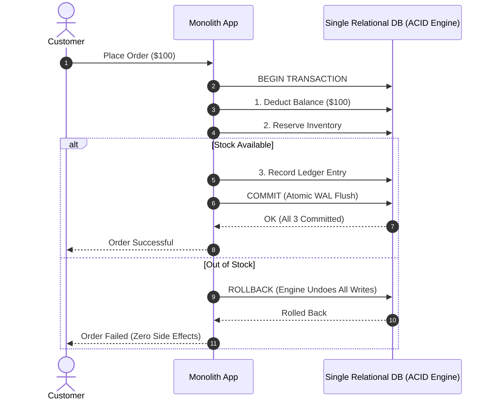
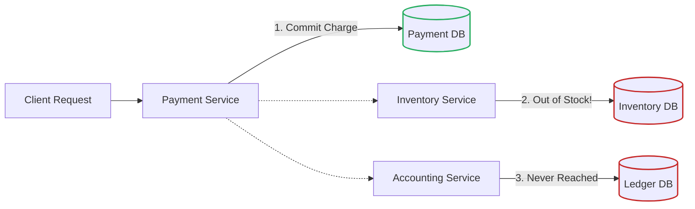
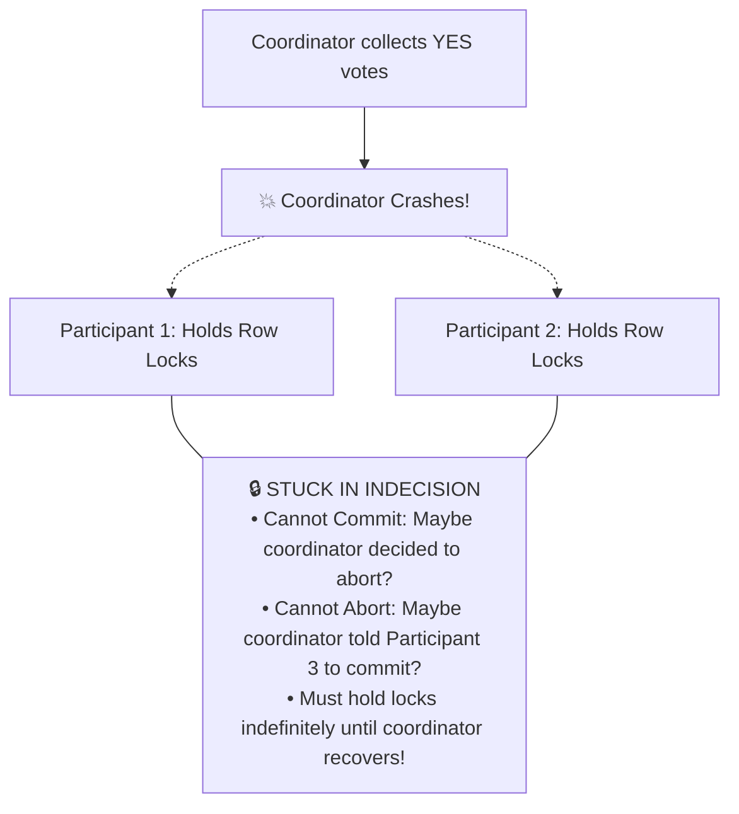
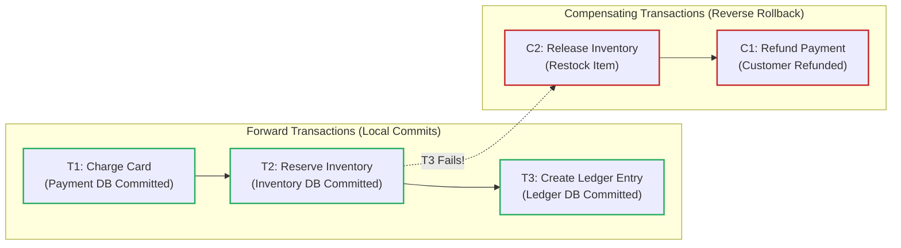
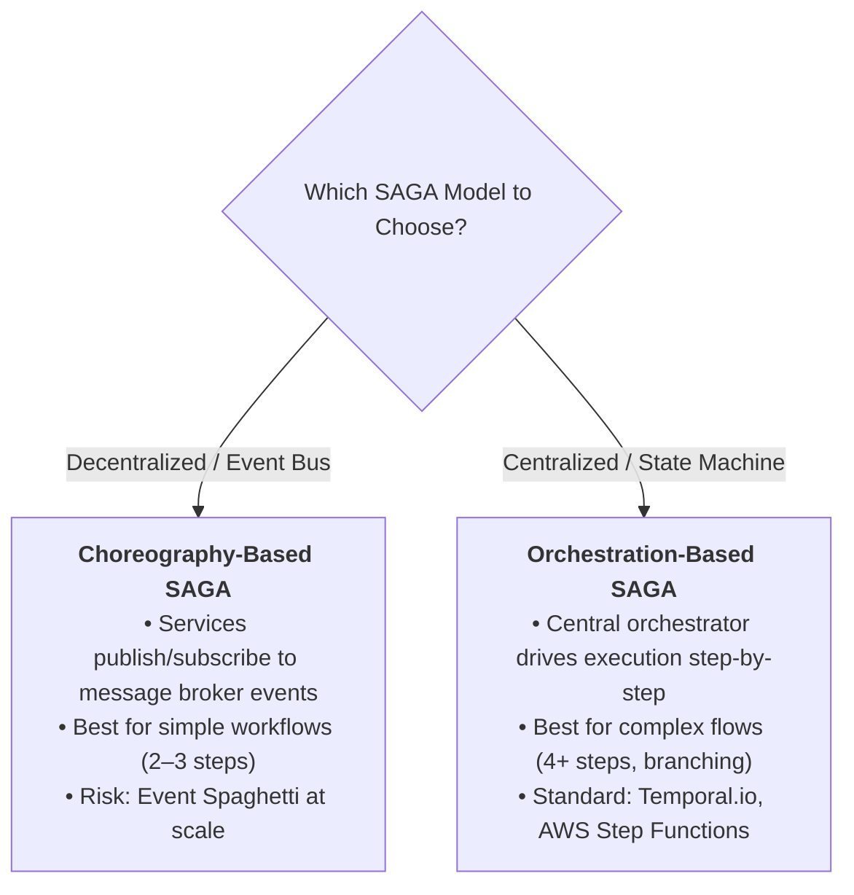
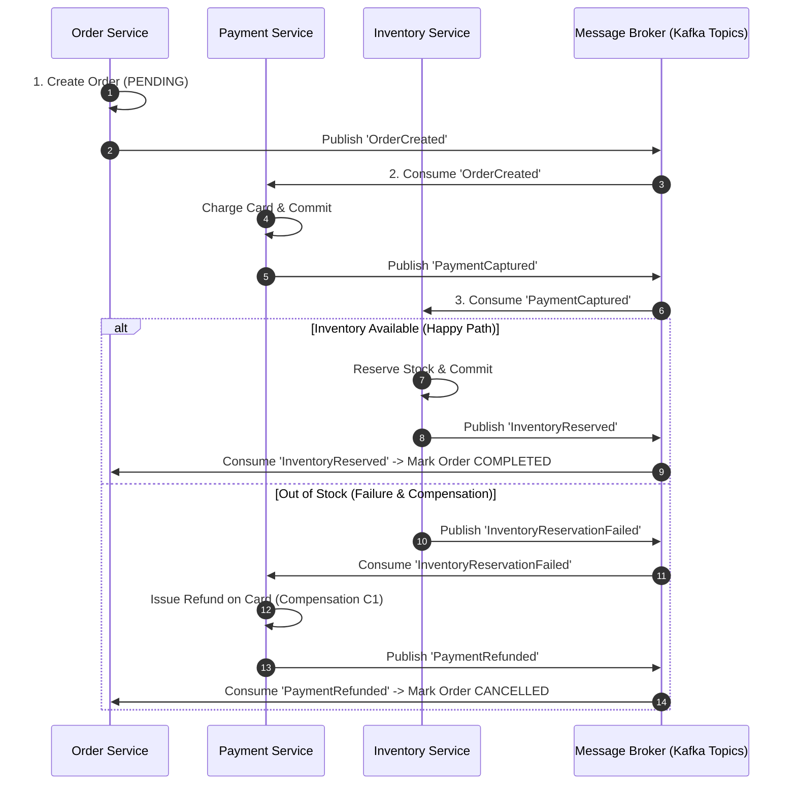
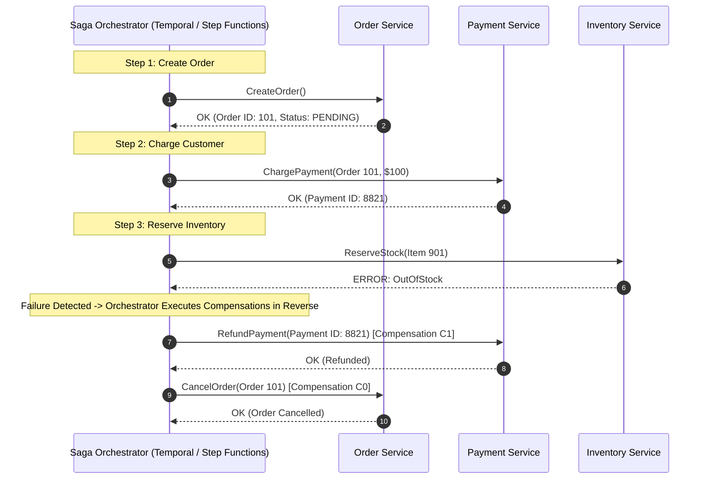
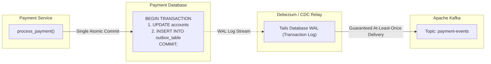
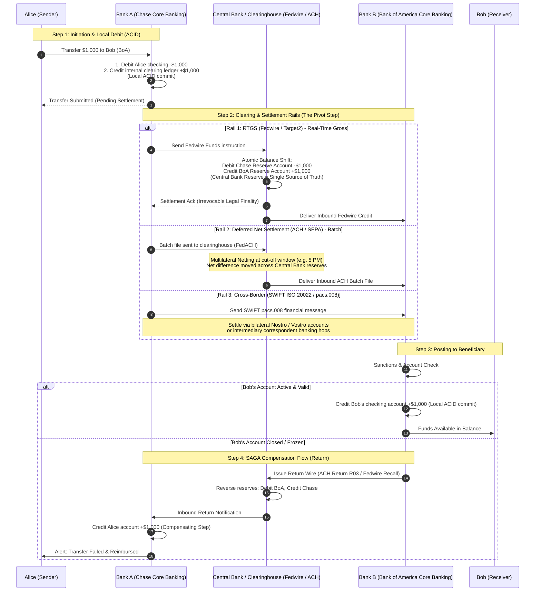
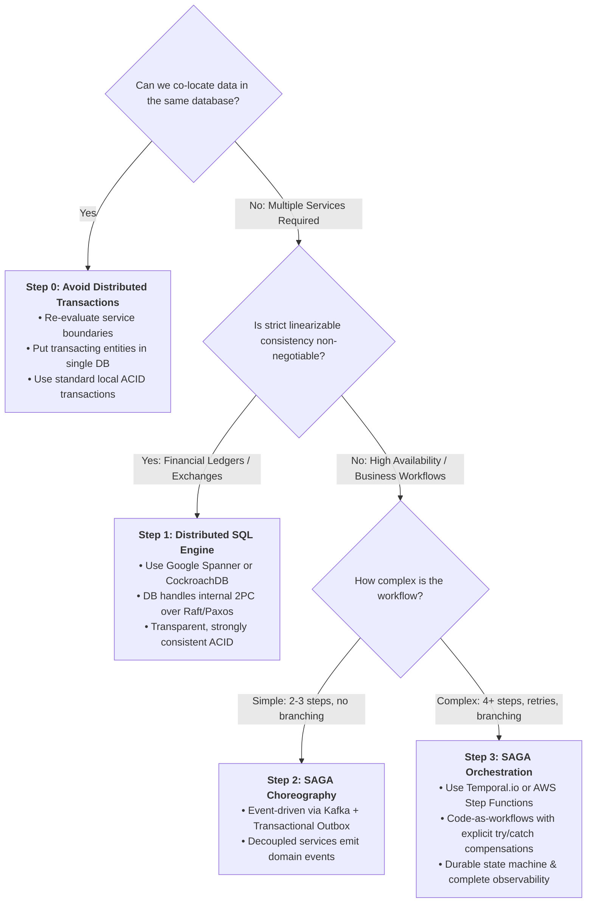

# Distributed Transactions: Two-Phase Commit (2PC) vs. SAGA Pattern

**Sources:**
- [Distributed Transactions Explained: 2 Phase Commit vs Saga Pattern (Hello Interview)](https://www.youtube.com/watch?v=DOFflggE_0Q)
- [Life Beyond Distributed Transactions: An Apostate's Opinion (Pat Helland, Amazon/Salesforce)](https://queue.acm.org/detail.cfm?id=1281891)
- [Sagas (Hector Garcia-Molina & Kenneth Salem, 1987)](https://www.cs.cornell.edu/andru/cs711/2002fa/reading/sagas.pdf)

**TL;DR:** **Two-Phase Commit (2PC)** coordinates atomic commit across supported participants. **Sagas** use local transactions and explicit compensations across autonomous services, exposing intermediate states. Choose based on business invariants and participant support. An outbox commits publication intent with local state; consumers deduplicate relay retries.

> **Recovery:** Persist coordinator decisions and operation IDs. For external APIs, use [durable intent, idempotency and reconciliation](../Partial%20Failures/README.md#4-scenario-4-external-apis-durable-intent-idempotency-and-reconciliation).

---

## 1. The Genesis of Distributed Transactions

### A. The Monolithic Baseline (Single-Database ACID)
In an early-stage application, transactions are straightforward. All business entities live in a single relational database (e.g., PostgreSQL or MySQL). When a customer places an order, the entire business operation is wrapped inside a single database transaction:

```sql
BEGIN TRANSACTION;
  -- 1. Charge the customer's card / update wallet
  UPDATE accounts SET balance = balance - 100 WHERE user_id = 42;
  -- 2. Reserve warehouse inventory
  UPDATE inventory SET stock = stock - 1 WHERE item_id = 901;
  -- 3. Record accounting ledger entry
  INSERT INTO ledger_entries (account_id, amount, type) VALUES (42, 100, 'DEBIT');
COMMIT;
```

The database engine provides **ACID guarantees** out of the box:
1. **Atomicity:** Either all three writes succeed together, or if any statement fails (e.g., negative balance check fails), the database Write-Ahead Log (WAL) rolls back the entire transaction automatically.
2. **Isolation:** Concurrent queries cannot see the half-finished intermediate state (e.g., a query reading the user balance will never see a deduction for an order whose inventory reservation hasn't completed).



---

### B. The Scale-Out Inflection Point: The Partial Failure Dilemma
As traffic, data volume, and engineering teams grow, a single database hits physical CPU, I/O, and connection limits. Systems inevitably split:
* **Database Sharding:** Data is partitioned across multiple distinct database servers to spread write throughput.
* **Microservices Architecture:** The monolith is decomposed into autonomous business services (Payment Service, Inventory Service, Ledger Service), where each service owns its private database (Database-per-Service pattern).

Now, the exact same logical operation spans three physically separate databases on three different servers across the network:
* Payment Service writes to the **Payment DB**.
* Inventory Service writes to the **Inventory DB**.
* Accounting Service writes to the **Ledger DB**.



#### The Fundamental Breakdown:
These databases **do not know about each other**. There is no universal database-level `ROLLBACK` that can cross network boundaries to undo the committed payment charge when the inventory reservation fails. The payment database already flushed the commit to disk; from its perspective, the transaction succeeded.

At high scale (thousands of requests per second), network blips, disk timeouts, process crashes, and business validation errors mean **partial failures are not edge cases—they are guaranteed daily occurrences**.

This establishes the core problem of a **Distributed Transaction**: *How do we coordinate a single logical operation spanning multiple independent databases so that all steps either succeed together or are safely cleaned up when a failure occurs?*

---

## 2. Approach 1: Two-Phase Commit (2PC)

Two-Phase Commit is the classic academic protocol designed to provide atomic, all-or-nothing transactions across multiple independent databases.

### A. How 2PC Works
2PC introduces a central component called the **Transaction Coordinator**. The protocol executes in two distinct phases:

```mermaid
sequenceDiagram
    autonumber
    participant Coord as Transaction Coordinator
    participant P1 as Payment DB (Participant 1)
    participant P2 as Inventory DB (Participant 2)
    participant P3 as Ledger DB (Participant 3)

    Note over Coord,P3: Phase 1: Prepare Phase (Voting & Locking)
    Coord->>P1: PREPARE (Can you commit?)
    Coord->>P2: PREPARE (Can you commit?)
    Coord->>P3: PREPARE (Can you commit?)
    
    Note over P1,P3: Each participant executes work, flushes WAL, and locks rows
    P1-->>Coord: VOTE: YES (Rows Locked)
    P2-->>Coord: VOTE: YES (Rows Locked)
    P3-->>Coord: VOTE: YES (Rows Locked)

    Note over Coord,P3: Phase 2: Commit Phase (Finalization)
    Note over Coord: All voted YES -> Coordinator decides COMMIT
    Coord->>P1: GLOBAL_COMMIT
    Coord->>P2: GLOBAL_COMMIT
    Coord->>P3: GLOBAL_COMMIT

    Note over P1,P3: Changes made permanent; locks released
    P1-->>Coord: ACK
    P2-->>Coord: ACK
    P3-->>Coord: ACK
```

#### Phase 1: The Prepare Phase (Voting)
1. The Coordinator sends a `PREPARE` message to every participating database: *"Can you commit this transaction?"*
2. Each participant performs the actual work locally:
   * Validates constraints and business rules.
   * Durably writes the proposed changes to its local Write-Ahead Log (WAL) so state survives a crash.
   * **Acquires exclusive pessimistic row locks** on all modified rows to prevent concurrent transactions from altering them.
3. Each participant responds to the coordinator with a vote:
   * **`VOTE: YES`** (I am guaranteed able to commit, and my locks are held).
   * **`VOTE: NO`** (Something failed; e.g., constraint violation or deadlock).

#### Phase 2: The Commit / Abort Phase (Decision Execution)
* **Unanimous Agreement (`GLOBAL_COMMIT`):** If **every single participant** voted `YES`, the coordinator flushes a `COMMIT` record to its own log and broadcasts `GLOBAL_COMMIT` to all participants. Participants make the changes permanent, release their row locks, and send an acknowledgment.
* **Any Single Rejection (`GLOBAL_ABORT`):** If **even one participant** votes `NO` (or fails to respond within a timeout), the coordinator flushes an `ABORT` record and broadcasts `GLOBAL_ABORT`. All participants discard their prepared changes and release their row locks.

```mermaid
sequenceDiagram
    autonumber
    participant Coord as Transaction Coordinator
    participant P1 as Payment DB
    participant P2 as Inventory DB (Out of Stock)

    Coord->>P1: PREPARE
    Coord->>P2: PREPARE
    P1-->>Coord: VOTE: YES (Rows Locked)
    P2-->>Coord: VOTE: NO (Out of Stock!)

    Note over Coord: One NO received -> Coordinator decides ABORT
    Coord->>P1: GLOBAL_ABORT
    Coord->>P2: GLOBAL_ABORT
    Note over P1: Rollback prepared changes; release locks
    P1-->>Coord: ACK
    P2-->>Coord: ACK
```

---

### B. Why Two-Phase Commit Fails in Production (The 4 Fatal Flaws)

On paper, 2PC provides the holy grail: strong consistency across independent nodes. In production across microservices, however, 2PC is notoriously fragile.

#### 1. The Blocking Protocol Trap (Coordinator Crash Mid-Transaction)
2PC is fundamentally a **synchronous, blocking protocol**. 
Consider this critical scenario:
1. The Coordinator collects `YES` votes from all participants.
2. The Coordinator writes `COMMIT` to its disk.
3. **The Coordinator crashes immediately before sending the `GLOBAL_COMMIT` messages.**



* **The Participants Are Stranded:** The participants cannot unilaterally commit (what if the coordinator decided to abort?). They cannot unilaterally abort (what if another node received a commit message?).
* **Cascading System Lockup:** The participants must **hold their database locks indefinitely**. Every subsequent transaction in the company that tries to access those locked rows queues up, thread pools exhaust, database connections spike to 100%, and the entire microservices fleet suffers an availability collapse.

#### 2. The Slowest-Participant Bottleneck (Tail Latency Amplification)
Because all participants hold exclusive locks from Phase 1 until Phase 2 finishes, **the entire distributed transaction moves at the speed of the slowest participant**:
$$\text{Latency}_{2\text{PC}} \ge \max(T_{\text{participant}_1}, T_{\text{participant}_2}, \dots, T_{\text{participant}_n}) \times 2$$

If the Ledger DB takes 8 seconds due to a disk I/O spike or GC pause, the Payment DB and Inventory DB hold their locks for the full 8 seconds doing nothing, blocking concurrent buyers.

#### 3. Network Partitions & The Flawed Timeout Fallacy
If a network partition isolates a participant from the coordinator during Phase 2, there is no safe default action for that participant. Timeouts in 2PC can lead to catastrophic split-brain state if an isolated node decides to abort while the rest of the cluster committed.

#### 4. Destruction of Service Autonomy & Heterogeneous Databases
Microservices are built on independent deployment cycles and polyglot persistence. 2PC requires every database to support XA/2PC protocols (many NoSQL databases like Cassandra or MongoDB do not) and forces one team's database availability to depend directly on another team's uptime.

> **Seminal Reference: Pat Helland's *"Life Beyond Distributed Transactions"***
> Pat Helland argues for autonomous entities and asynchronous messaging at very large scale. This approach trades cross-entity atomic transactions for local ownership and asynchronous coordination. Distributed databases offer coordinated transactions with different latency and availability costs.

---

### C. Where 2PC *Does* Exist in Production: Distributed SQL
If 2PC fails across microservices, why do textbooks still teach it? Because 2PC **is** used successfully in production—but **only inside unified Distributed SQL databases (Google Spanner, CockroachDB, YugabyteDB, TiDB)**.

* **Why it works inside Spanner/CockroachDB:**
  1. **Single Administrative Domain:** All nodes run the identical binary and software version.
  2. **Sub-Millisecond RTTs:** Nodes communicate over private, dedicated data center interconnects.
  3. **Multi-Raft / Paxos Integration:** The 2PC coordinator and participant states are themselves replicated via **Raft or Paxos consensus groups**. If the transaction coordinator node crashes, Raft elects a new leader that reads the replicated state and completes the 2PC protocol deterministically without leaving locks stranded.
  4. **Transparent to Developers:** The database engine abstracts the complexity under standard SQL `BEGIN ... COMMIT` statements.

---

## 3. Approach 2: The SAGA Pattern (The Industry Standard)

When coordinating transactions across independent microservices, modern tech giants (Uber, Netflix, Amazon, DoorDash) unanimously choose the **SAGA Pattern**.

### A. Core Philosophy: Eventual Consistency Over Immediate Atomicity
The Saga pattern abandons the requirement for cross-database all-or-nothing atomicity. Instead, it accepts that:
1. Work can be decomposed into an ordered chain of **independent local ACID transactions**.
2. Each service executes its local transaction and **immediately commits to its own database**. Locks are held only for milliseconds within each service.
3. If a step downstream fails, the system executes **Compensating Transactions** to undo the business impact of earlier committed steps in reverse order.



### B. Compensating Transactions: Business Undos vs. Technical Rollbacks
A compensating transaction ($C_i$) is **not** a database-level rollback. Because the original transaction ($T_i$) already committed and released its locks, the database engine cannot roll it back.
Instead, a compensation is a **new business action that semantically reverses the effect of the previous action**:
* An SQL `ROLLBACK` is replaced by an **issued refund**.
* An aborted inventory insert is replaced by a **cancellation restocking entry**.
* An account creation is replaced by a **soft-deletion or account deactivation**.

The trade-off is **Eventual Consistency**: The system may temporarily be in an inconsistent intermediate state while compensations execute (e.g., the customer might briefly see a charge on their mobile app before the refund posts), but the system always converges to a consistent terminal state without blocking concurrent traffic.

---

## 4. SAGA Implementation Models: Choreography vs. Orchestration

There are two primary architectural models for implementing Sagas. The choice dictates who detects failures and coordinates the workflow.



---

### A. Choreography (Decentralized Pub/Sub)

In choreography, there is no central brain. Services communicate asynchronously by publishing domain events to a message broker (e.g., Apache Kafka or RabbitMQ) and reacting to events published by other services.



#### Advantages of Choreography:
* **Simplicity for Small Workflows:** Straightforward to implement when a flow has only 2 or 3 services.
* **Loose Coupling:** Services do not need to know the endpoint addresses of downstream consumers.

#### The "Event Spaghetti" Pitfall:
Once a workflow exceeds 4 or 5 steps, choreography becomes an operational nightmare:
1. **No Central Source of Truth:** Where did Order #98124 fail? Did the refund fire? Why is the inventory still reserved? Answering these questions requires grepping distributed logs across six microservices.
2. **Cyclic Dependencies:** Services end up subscribing to each other's events, creating tightly coupled, circular dependencies masked behind a message bus.
3. **Hard to Reason About Branching:** Adding a new step (e.g., Fraud Screening or Loyalty Points) requires modifying multiple existing services to listen for new event types.

---

### B. Orchestration (Centralized Workflow Engine)

In orchestration, a dedicated service—the **Saga Orchestrator**—acts as the workflow director. The orchestrator explicitly calls each participating service via RPC (gRPC/HTTP) or task queues, waits for the response, and decides the next step.



#### Production Orchestration Standard: Durable Execution (Temporal.io / AWS Step Functions)
Rather than writing custom state machines with fragile database timers, industry standards rely on **Durable Execution Engines** such as **Temporal.io** (open-source engine created by the authors of Uber Cadence) or **AWS Step Functions**:
* **Code-as-Workflows:** Workflows are written in standard programming languages (Go, TypeScript, Python, Java) using natural procedural syntax (`try / catch`):

```typescript
// Example Temporal Workflow in TypeScript
export async function orderFulfillmentWorkflow(order: OrderRequest): Promise<void> {
  const orderId = await activities.createOrder(order);

  try {
    const paymentId = await activities.chargeCard(orderId, order.amount);
    
    try {
      await activities.reserveInventory(order.items);
      await activities.recordLedgerEntry(orderId, order.amount);
      await activities.markOrderComplete(orderId);
    } catch (inventoryError) {
      // Compensate Payment
      await activities.refundCard(paymentId);
      throw inventoryError;
    }
  } catch (error) {
    // Compensate Order
    await activities.cancelOrder(orderId);
    throw new ApplicationFailure("Order processing failed and was compensated.");
  }
}
```

#### The Critical Contrast: What Happens When the Orchestrator Crashes?
A common interview confusion is: *"Isn't the Saga Orchestrator just a single point of failure like the 2PC Coordinator?"*

**No. The failure semantics are fundamentally different:**
* When a **2PC Coordinator** crashes, it leaves **exclusive database row locks dangling** across all participants, paralyzing concurrent traffic.
* When a **Saga Orchestrator (Temporal)** worker crashes, **no locks exist**. The orchestrator persists every state transition into an append-only event history database. When a new orchestrator worker spins up, it replays the event history, reconstructs the in-memory execution state, and **resumes the workflow from the exact line of code where it stopped**.

---

## 5. The Hard Mechanical Realities & Edge Cases of Sagas

While Sagas solve the availability problems of 2PC, they introduce real-world engineering complexities that must be addressed in any senior system design interview.

### Edge Case 1: Compensations are Business-Visible
In a database rollback, aborted modifications are invisible to outside readers. In a Saga, **compensations are publicly visible**:
* The customer's credit card is genuinely charged.
* If inventory fails 5 seconds later, a genuine refund is issued.
* The customer's banking app may generate **two push notifications**: *"Charged \$100 at Store"* followed by *"Refunded \$100 from Store"*.
* If the user checks their bank statement in that 5-second window, they see the temporary charge. The system design must accept this semantic visibility.

### Edge Case 2: Irreversible Actions (The Pivot Step)
Some business operations **cannot be undone**:
* **Cannot "Unsend" an Email:** If Step 2 sends an order confirmation email (*"Your order has shipped!"*), and Step 3 fails, you cannot recall the email. You can only send a follow-up apology email.
* **Third-Party Webhooks:** If you triggered a non-reversible payout via an external API, cancellation may require manual human intervention.
* **The Pivot Step Concept:** In workflow design, the **Pivot Step** is the point of no return. Once the pivot transaction commits, the Saga *never* compensates backward; it must continue forward (via automated retries and alerting) until it succeeds.

### Edge Case 3: Compensation Failures & Mandatory Idempotency
What happens if the compensation itself fails (e.g., the payment gateway API returns `503 Service Unavailable` when attempting to issue a refund)?
* **Rule 1: Compensations MUST Retry Until Success:** The orchestrator cannot give up; giving up strands the customer's money. Compensating actions must be retried with exponential backoff and dead-letter queue (DLQ) alerts.
* **Rule 2: Compensations MUST Be Idempotent:** If a refund call times out over the network, the orchestrator will retry. The payment service must use an **Idempotency Key** (`idempotency_key = "refund_order_101"`) so that 10 retries execute exactly one refund and never credit the user multiple times.

---

### Edge Case 4: The Dual-Write Problem & The Transactional Outbox Pattern

In both choreography and orchestration, services must update their local database AND communicate with the outside world (publish a message or notify the orchestrator).
Performing these two actions in application code creates the classic **Dual-Write Problem**:

```python
# 💥 DANGEROUS DUAL-WRITE ANTI-PATTERN
def process_payment(order_id, amount):
    # Action 1: Write to local database
    db.execute("UPDATE accounts SET balance = balance - %s WHERE id = %s", (amount, order_id))
    
    # Action 2: Publish event to Kafka
    # If the app crashes HERE, the database is updated, but Kafka never gets the event!
    # The saga stalls forever!
    kafka_producer.send("payment-events", {"order_id": order_id, "status": "PAID"})
```

If the database write succeeds but the message publish fails (network drop, broker downtime, pod crash), downstream services never trigger, and the Saga is permanently broken.

#### The Solution: The Transactional Outbox Pattern
Instead of writing to two separate systems, the service writes its business update and an outbox event into the **same database inside a single local ACID transaction**:



1. **Atomic Local Commit:** The application inserts the business record AND an event row into an `outbox` table in one local transaction. Either both persist or neither does.
2. **Asynchronous CDC Tailing:** A Change Data Capture (CDC) engine (such as **Debezium**) tails the database Write-Ahead Log (WAL) or polls the outbox table.
3. **Guaranteed Delivery:** Debezium reads committed outbox events from the WAL and publishes them to Kafka. If Kafka is temporarily down, the WAL tailer pauses and retries once Kafka recovers. No events are ever lost.

---

## 6. Real-World Case Study: SAGA in Banking (Why Banks Never Use 2PC)

A persistent myth in software engineering is that inter-bank transfers (e.g., Alice at Chase transfers \$1,000 to Bob at Bank of America) use Two-Phase Commit to guarantee that Alice's account is debited if and only if Bob's account is credited.

In reality, **no bank on earth will ever run a 2PC protocol with an external bank.** Inter-bank money movement is the world's oldest and largest production implementation of a multi-stage **Asynchronous SAGA**.



### Why Banks Strictly Prohibit Inter-Bank 2PC:
1. **Institutional Sovereignty & Zero Trust:** Chase will never allow Bank of America's transaction coordinator to place exclusive row-level database locks on Chase's core banking ledger. If Bank of America crashes during the `PREPARE` phase, Chase's customer balances would freeze indefinitely.
2. **Statutory Settlement Finality Laws:** In global finance, transactions are finalized not by database locks, but by legal statutes (e.g., US UCC Article 4A, EU Settlement Finality Directive). When the **Central Bank** moves funds between commercial bank reserve accounts, settlement is legally irrevocable. 2PC's tentative "Prepared" state is legally invalid.
3. **Asynchronous Compliance Latency:** Compliance checks (OFAC sanctions, anti-money laundering, fraud detection) take minutes to days. Synchronous 2PC cannot keep database connections open for 48 hours without crashing the database pool.
4. **Failure Recovery via Compensating Returns:** If Bank B finds the account is closed, it does not abort the transaction. It issues an **outbound compensating return** (e.g., NACHA Return Code `R03: No Account / Unable to Locate`, or Fedwire `pacs.004 Payment Return`).
5. **Nightly Reconciliation & "Breaks":** Banks run automated reconciliation engines nightly matching internal ledgers against SWIFT messages and central bank statements. Discrepancies are flagged as **accounting "breaks"** and resolved via automated compensation or back-office settlement teams.

---

## 7. System Design Interview Playbook & Golden Decision Framework

In a system design interview, follow this structured framework when handling data operations across services:



### The 4 Golden Interview Tips:
1. **Always Attempt Step 0 First:** In an interview, the best answer to a distributed transaction question is: *"Before building a distributed transaction, can we redesign our service boundaries so that these tables live in the same database?"* If Inventory and Payments always transact together, co-locating them in a shared relational database eliminates distributed complexity entirely.
2. **Never Propose 2PC Across Microservices:** If asked how to handle transactions across microservices, proposing 2PC is an immediate red flag. Cite Pat Helland's *"Life Beyond Distributed Transactions"* and explain the blocking lock vulnerabilities.
3. **Always Highlight the Transactional Outbox Pattern:** Whenever proposing event-driven Sagas, proactively mention: *"To avoid the dual-write problem between our local database and Kafka, we will implement the Transactional Outbox Pattern with Debezium CDC."*
4. **Compensations Must Have Idempotency Keys:** Explicitly mention that compensating transactions must be designed for at-least-once delivery, requiring idempotency tokens in Redis or the target database to prevent duplicate refunds.

---

## 8. Comprehensive Architectural Comparison Matrix

| Architectural Dimension | Two-Phase Commit (2PC / XA) | SAGA: Choreography | SAGA: Orchestration | Distributed SQL (Spanner / CockroachDB) |
| :--- | :--- | :--- | :--- | :--- |
| **Consistency Model** | **Strong Consistency** (Immediate ACID) | **Eventual Consistency** (BASE) | **Eventual Consistency** (BASE) | **Strict Serializability** (Immediate ACID) |
| **Concurrency Control** | **Pessimistic Locking** (Locks held across network) | **Optimistic / Semantic Locks** (No DB locks held) | **Optimistic / Semantic Locks** (No DB locks held) | **Multi-Version Concurrency (MVCC) + Range Locks** |
| **Availability (CAP)** | **Low (CP)** (System blocks if node or coordinator fails) | **High (AP)** (Services commit independently) | **High (AP)** (Services commit independently) | **High (CP/HA)** (Survives minority node loss via Raft/Paxos) |
| **Latency Profile** | High ($2 \times$ slowest participant RTT) | Asynchronous / Event-driven | Asynchronous / Step-driven | Low (Single-digit ms across data center) |
| **Failure Recovery** | Automatic rollback & release locks | Reverse compensating events | Centralized `try/catch` compensations | Automatic distributed abort via Raft |
| **Observability** | Centralized in Coordinator | **Poor (Distributed logs across services)** | **Excellent (Central workflow UI & history)** | Built-in Database Metrics |
| **Handling Crashes** | **Dangling locks indefinitely** | Events preserved in Kafka log | **Resumes from exact line of code** | Leader re-elected; protocol completes |
| **Ideal Scale Boundary** | $\le 5$ tightly coupled database nodes | 2–3 loosely coupled microservices | Enterprise multi-step workflows (4–20+ services) | Petabyte-scale single logical database |
| **Industry Example** | Legacy Oracle XA / IBM MQ | Simple order $\to$ notification flows | **Uber (Cadence), Temporal, AWS Step Functions** | **Google Spanner, CockroachDB, YugabyteDB** |
