# Amazon DynamoDB Deep Dive

**Source:** [DynamoDB Deep Dive w/ Ex-Meta Staff Engineer (Hello Interview)](https://www.youtube.com/watch?v=2X2SO3Y-af8) | [Hello Interview Written Guide](https://www.hellointerview.com/learn/system-design/deep-dives/dynamodb)

**TL;DR:** Amazon DynamoDB is a fully managed, serverless NoSQL key-value and document database engineered for single-digit millisecond latency at any scale. It abstracts away server provisioning, sharding, and cluster management through automatic horizontal partition splitting (triggered at 10 GB storage or 1,000 WCU / 3,000 RCU per partition) and multi-AZ Paxos-based replication. In system design interviews, alongside PostgreSQL, DynamoDB is the premier choice for scalable persistence layers with predictable, query-driven access patterns.

---

## 1. Core Data Model & Hierarchy

DynamoDB organizes data into a 3-level hierarchy:

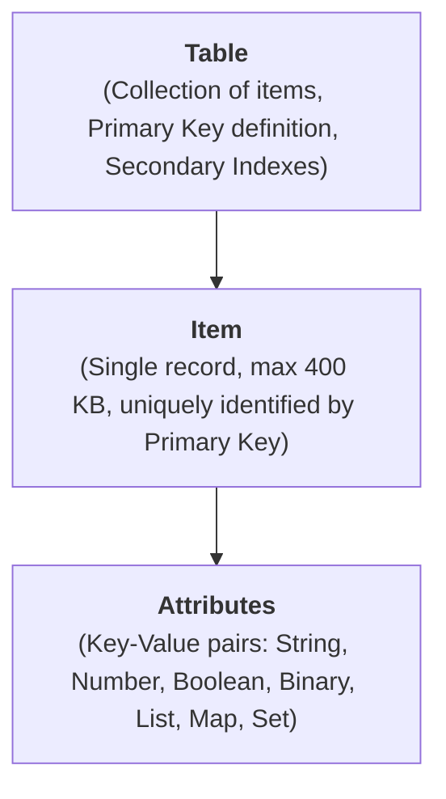

1.  **Table:** A collection of items. Unlike relational tables, DynamoDB tables are **schema-less** (except for the primary key). Items in the same table can have completely different attributes.
2.  **Item:** A single record (equivalent to a row in SQL). Each item has a mandatory Primary Key and a hard size limit of **400 KB** (including attribute names and values).
3.  **Attributes:** Named data fields (equivalent to columns). Supports:
    *   *Scalar types:* String, Number, Binary, Boolean, Null.
    *   *Document types:* List (ordered arrays), Map (nested JSON objects).
    *   *Set types:* String Set, Number Set, Binary Set.

### Schema-less Flexibility vs. Trade-offs
*   **Pros:** Fast iterations, zero database migrations, no downtime for schema changes, and zero storage overhead for absent fields (no empty `NULL` cells taking space).
*   **Cons / Trade-offs:** The application layer must strictly enforce data integrity, schema validation, and handle missing attributes.

---

## 2. Primary Key Anatomy: Partition Key vs. Sort Key

Every DynamoDB table must have a Primary Key that uniquely identifies each item. There are two types of primary keys:

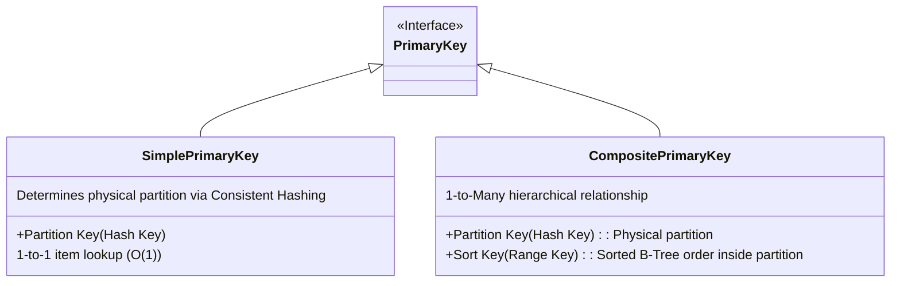

### A. Simple Primary Key (Partition Key Only)
*   Consists of a single attribute: the **Partition Key (PK)** (also called the *Hash Key*).
*   DynamoDB hashes the PK using an internal hash function to determine the physical storage partition.
*   **Uniqueness:** No two items can have the same Partition Key.
*   *Example:* `users` table with `PK = user_id`.

### B. Composite Primary Key (Partition Key + Sort Key)
*   Consists of two attributes: a **Partition Key (PK)** and a **Sort Key (SK)** (also called the *Range Key*).
*   **Physical Collocation:** All items with the same PK are stored together on the same physical partition.
*   **Logical Ordering:** Within that physical partition, items are ordered in a **B-Tree index** sorted by the Sort Key.
*   **Uniqueness:** The combination of `(PK, SK)` must be globally unique. Multiple items can share the same PK as long as their SKs differ.
*   *Example:* `chat_messages` table with `PK = chat_id` and `SK = message_id`.

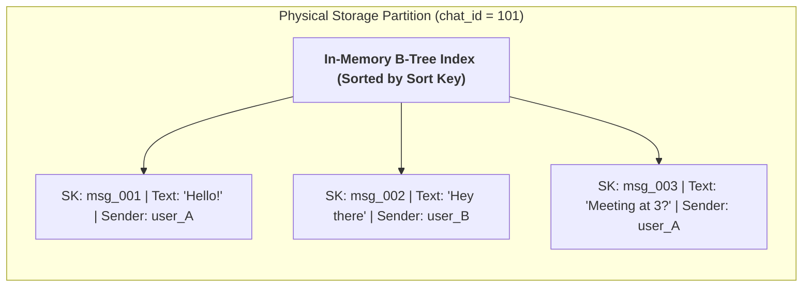

### 💡 Pro Tip: Monotonically Increasing IDs vs. Timestamps
In a chat or order history table, you want items ordered chronologically. A naive instinct is to use `created_at` (a millisecond timestamp) as the Sort Key.
*   **The Trap:** Timestamps are **not guaranteed to be unique**. If two users post in the same chat within the same millisecond, the second write will overwrite the first, causing silent data loss!
*   **The Solution:** Use **Monotonically Increasing IDs** (such as Twitter Snowflake IDs, ULIDs, or KSUIDs). These 64-bit IDs embed a timestamp at the front (guaranteeing chronological sort order) combined with machine/sequence bits at the back (guaranteeing 100% collision-free uniqueness).

---

## 3. Secondary Indexes: GSI vs. LSI (Deep Dive)

When you need to query attributes outside your primary key, DynamoDB provides two types of secondary indexes. Understanding the deep mechanical differences between them is a classic senior/staff interview requirement.

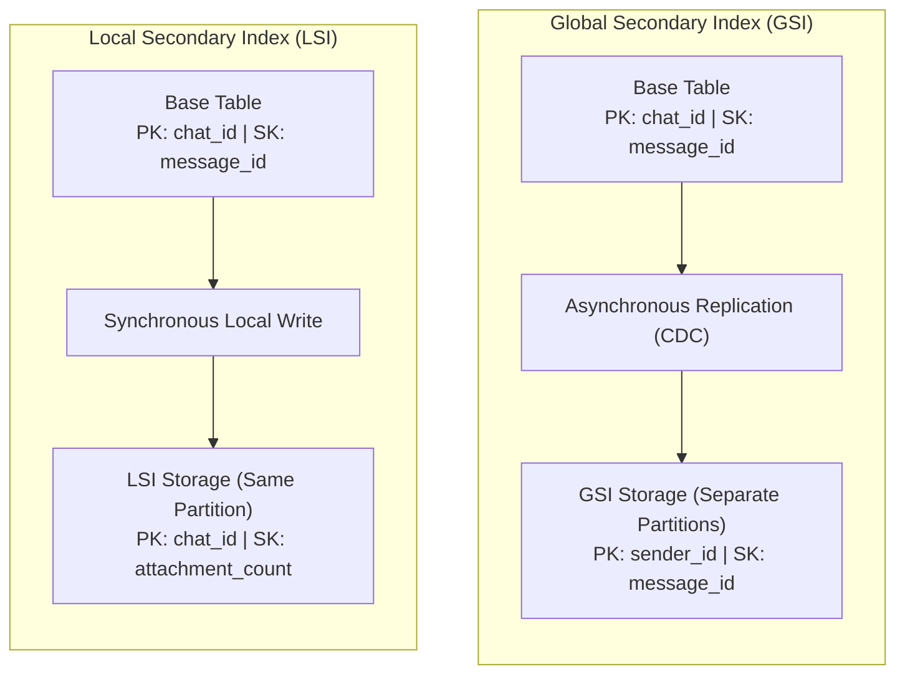

### Detailed Mechanical Comparison Matrix

| Feature | Global Secondary Index (GSI) | Local Secondary Index (LSI) |
| :--- | :--- | :--- |
| **Partition Key** | Can be **different** from the base table | **Must be identical** to base table PK |
| **Sort Key** | Can be different or omitted | **Must be different** from base table SK |
| **Physical Storage** | Stored on **completely separate physical partitions** | Stored on the **same physical partition** as base item |
| **Creation Time** | Can be created or deleted **at any time** | **Must be created at table creation time** (never after) |
| **Consistency Mode** | **Eventually Consistent only** (asynchronously updated) | Supports **Strongly Consistent** or Eventually Consistent |
| **Partition Size Limit**| **Unlimited** (auto-scales across partitions) | **Strict 10 GB limit** on all items with the same PK |
| **Capacity Units** | Has its **own dedicated RCU / WCU** pool | Consumes **base table's RCU / WCU** pool |
| **Throttling Impact** | If GSI write capacity is throttled, it **backpressures and stalls base table writes**! | Throttles base table directly |

### Attribute Projections (Storage vs. Compute Trade-off)
When defining an index, you choose which attributes to copy ("project") into the index:
1.  `KEYS_ONLY`: Only copies PK and SK. Minimal storage cost, but reading other attributes requires an expensive follow-up `GetItem` fetch on the base table.
2.  `INCLUDE`: Copies PK, SK, and a specific whitelist of attributes needed by the query. **(Recommended sweet spot for interviews)**.
3.  `ALL`: Copies all attributes from the base table. Highest storage cost, but completely eliminates secondary fetches.

---

## 4. Querying & Access Patterns: Query vs. Scan

DynamoDB does not use arbitrary SQL. It provides two core read operations:

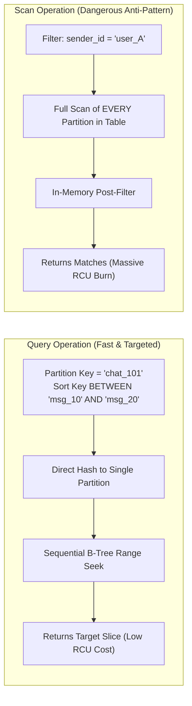

### A. The Query Operation (Single Partition, $O(\log N)$)
*   **Mandatory:** Must specify an exact match on the **Partition Key** (`PK = :val`).
*   **Optional:** Can apply comparison operators on the **Sort Key** (`=`, `<`, `<=`, `>`, `>=`, `BETWEEN`, `begins_with`).
*   **Sorting Control:** Uses the boolean parameter `ScanIndexForward`:
    *   `ScanIndexForward = true` (default): Ascending sort order.
    *   `ScanIndexForward = false`: Descending sort order (critical for fetching most recent feeds or chats).
*   **Efficiency:** Highly optimized; reads only contiguous items within a single physical partition.

### B. The Scan Operation (Table-Wide, $O(N)$)
*   Examines **every single item across every single partition** in the entire table, and then applies a filter expression to discard non-matching rows.
*   **RCU Impact:** You are billed for reading the entire dataset *before* the filter is applied!
*   **Interview Verdict:** **Never propose a Scan in a system design interview** for user-facing API paths. Scans are reserved strictly for background ETL batch exports.

### C. PartiQL (SQL-Compatible Interface)
DynamoDB supports **PartiQL**, a declarative SQL dialect:
```sql
SELECT * FROM users WHERE user_id = 101;
SELECT * FROM orders WHERE user_id = 101 AND order_date >= '2024-01-01';
```
*Under the hood, PartiQL maps directly to the underlying DynamoDB `Query` or `Scan` API calls. It provides syntactic familiarity, not relational joins.*

---

## 5. Architecture & Scalability (Under the Hood)

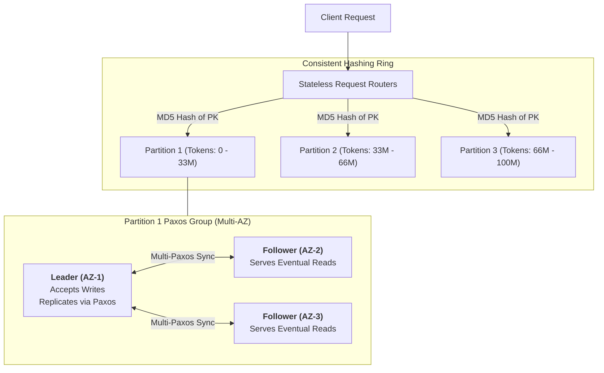

### A. The Request Router Layer
*   Stateless fleet of front-end machines.
*   Maintains a cached routing table (partition map). When a query arrives, the router hashes the Partition Key (using MD5), looks up the owning physical storage partition, and forwards the request directly to the storage node.

### B. Storage Partition Hard Limits
Each physical storage partition in DynamoDB is governed by strict physical hardware boundaries:
*   **Storage Capacity:** Max **10 GB** of data per partition.
*   **Write Throughput:** Max **1,000 WCUs** (1 MB/sec) per partition.
*   **Read Throughput:** Max **3,000 RCUs** (12 MB/sec) per partition.

### C. Auto-Partition Splitting
DynamoDB scales horizontally by automatically splitting partitions without downtime when either of two triggers occurs:
1.  **Size-based Split:** The total data stored on a partition approaches 10 GB.
2.  **Throughput-based Split:** Read or write traffic on a partition exceeds 1,000 WCU or 3,000 RCU.

When a split occurs, DynamoDB allocates two new physical partitions, divides the token range in half, and balances items across them.

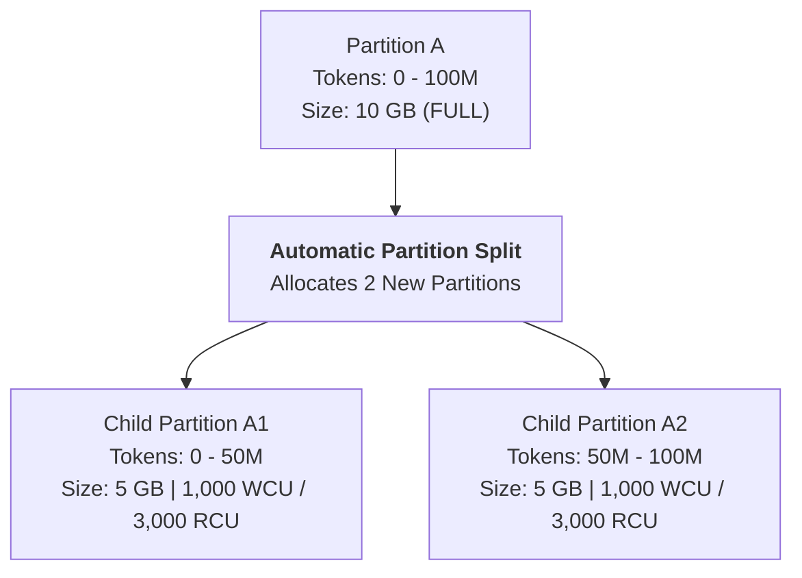

### D. Multi-AZ Replication & Paxos Consensus
*   Every partition maintains **3 replicas** distributed across **three distinct Availability Zones (AZs)** within an AWS Region.
*   **Multi-Paxos Leader:** A single replica acts as the Paxos **Leader**; the other two act as **Followers**.
*   **Write Flow:**
    1. Writes always route to the Paxos Leader.
    2. The Leader writes to its local Write-Ahead Log (WAL) and synchronously sends the log entry to its followers.
    3. As soon as a **Paxos Quorum (2 out of 3 replicas)** confirms the write, the Leader responds with success to the client.
*   **Read Flow (Consistency Modes):**
    *   **Eventually Consistent Read (Default):** Can be served by *any* of the 3 replicas. Extremely fast and costs half the capacity (0.5 RCU per 4KB), but may return slightly stale data if read from a follower still catching up.
    *   **Strongly Consistent Read:** Always routed to the **Paxos Leader**. Guarantees reading the most up-to-date state. Costs 1 full RCU per 4KB.

---

## 6. Capacity Planning & Cost Mechanics (RCUs & WCUs)

In system design interviews, demonstrating that you can calculate capacity units for back-of-the-envelope estimations separates mid-level from senior/staff candidates.

### Capacity Unit Definitions
*   **1 Read Capacity Unit (RCU):**
    *   **1 Strongly Consistent Read** per second for an item up to **4 KB**.
    *   **2 Eventually Consistent Reads** per second for an item up to **4 KB** (0.5 RCU each).
    *   **0.5 Transactional Reads** per second (2 RCUs per 4 KB).
*   **1 Write Capacity Unit (WCU):**
    *   **1 Write** per second for an item up to **1 KB**.
    *   **0.5 Transactional Writes** per second (2 WCUs per 1 KB).

### Estimation Formulas

$$\text{WCU} = \text{Writes/sec} \times \lceil \text{Item Size in KB} \rceil$$

$$\text{RCU (Strongly Consistent)} = \text{Reads/sec} \times \left\lceil \frac{\text{Item Size in KB}}{4} \right\rceil$$

$$\text{RCU (Eventually Consistent)} = \frac{\text{Reads/sec}}{2} \times \left\lceil \frac{\text{Item Size in KB}}{4} \right\rceil$$

> [!IMPORTANT]
> **Ceiling Rounding Rule:** DynamoDB always rounds item size **up** to the nearest unit boundary:
> * Writing a 200-byte item consumes **1 full WCU**.
> * Writing a 1.2 KB item rounds up to 2 KB $\to$ consumes **2 WCUs**.
> * Reading a 5 KB item with Strong Consistency rounds up to 8 KB $\to$ consumes **2 RCUs**.

---

## 7. Advanced Features

### A. DAX (DynamoDB Accelerator)
*   A purpose-built, fully managed, **in-memory write-through/read-through cache** sitting directly in front of DynamoDB.
*   **Performance:** Drops read latency from single-digit milliseconds ($\sim 3\text{--}8\text{ ms}$) down to **sub-millisecond microseconds ($\sim 200\text{--}400\text{ }\mu\text{s}$)**.
*   **Dual Caches:**
    1.  *Item Cache:* Caches individual items for `GetItem` / `BatchGetItem`.
    2.  *Query Cache:* Caches collections of items and query parameters for `Query` / `Scan`.
*   **Write-Through Invalidation:** Writes made through the DAX client update both the cache and DynamoDB simultaneously.
*   **Interview Nuances:**
    *   *Do NOT propose Redis/Memcached if already using DynamoDB.* Propose DAX instead to avoid introducing a separate external database cluster to manage.
    *   *Strong Consistency Caveat:* DAX **only caches eventually consistent reads**. Strongly consistent read requests pass straight through to DynamoDB without being cached.

```mermaid
flowchart LR
    App[Application] -->|DAX Client SDK| DAX[DAX Cluster (In-Memory)]
    DAX -->|Cache Hit (Microseconds)| App
    DAX -->|Cache Miss / Write-Through| DDB[(DynamoDB Storage)]
```

### B. DynamoDB Streams (Change Data Capture - CDC)
*   Maintains a time-ordered, guaranteed 24-hour log of item-level modifications (inserts, updates, deletes).
*   **Stream Record Views:** Can emit `KEYS_ONLY`, `NEW_IMAGE`, `OLD_IMAGE`, or `NEW_AND_OLD_IMAGES`.
*   **Canonical Interview Pattern:** Pair DynamoDB Streams with **AWS Lambda** for event-driven asynchronous processing:
    1.  *Full-Text Search Sync:* Replicating DynamoDB updates to **Elasticsearch / OpenSearch**.
    2.  *Cache Invalidation:* Purging edge caches on row mutation.
    3.  *Cross-Store Consistency:* Emitting domain events into Kafka or EventBridge.

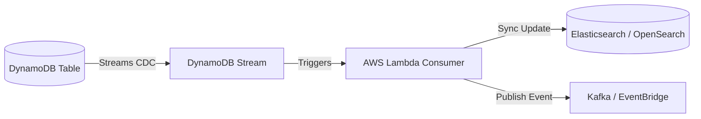

### C. ACID Transactions (`TransactWriteItems`, `TransactGetItems`)
*   Provides all-or-nothing atomicity across **up to 100 items or 4 MB of data** spanning multiple tables within the same AWS account and region.
*   Uses a **Two-Phase Commit (2PC)** protocol under the hood.
*   **Capacity Cost:** Consumes **$2\times$ the WCUs and RCUs** (1 write prep phase + 1 commit phase).
*   *Interview Script:* *"Historically, NoSQL meant giving up transactions. However, DynamoDB supports atomic multi-item transactions via `TransactWriteItems`, making it viable for ledger or financial transfers if item volume is under 100 items."*

### D. Time to Live (TTL)
*   Automatically marks items with an expiration timestamp (`epoch_seconds`) and deletes them in the background.
*   **Zero Cost:** Deletions performed by TTL do **not consume WCUs**.
*   *Use Cases:* Session stores, temporary rate limiter windows, audit log auto-purging.

---

## 8. Single-Table Design: Theory vs. Interview Reality

**Single-Table Design** (popularized by Rick Houlihan) is an advanced DynamoDB pattern where an application stores *all* entity types (Users, Orders, Products, Reviews) in a **single table**, using generic attribute names (`PK`, `SK`).

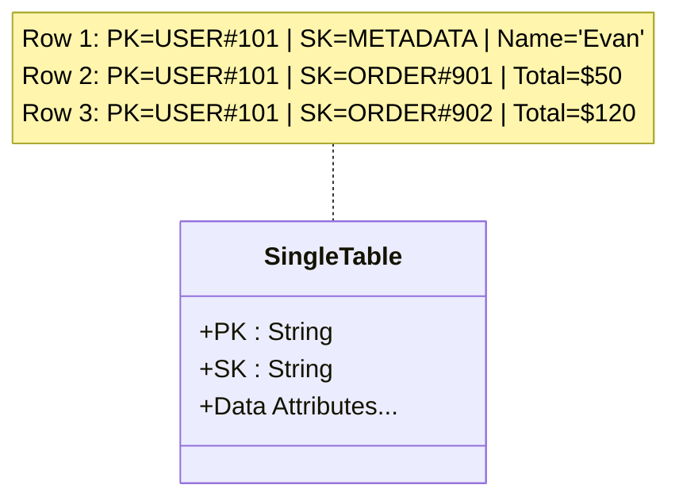

### Why it exists:
By prepending entity prefixes (`USER#<id>`, `ORDER#<id>`), an application can fetch a user *and* their last 10 orders in a **single round-trip `Query` request**:
```text
PK = "USER#101" AND SK begins_with("ORDER#")
```

### ⚠️ Staff Engineer Interview Advice:
> [!CAUTION]
> **Do not force Single-Table Design into an interview whiteboard unless explicitly requested!**
> While single-table design is efficient in production, whiteboard schemas with generic `PK/SK` columns and overloaded GSI keys (`GSI1_PK`, `GSI1_SK`) are notoriously difficult to communicate verbally, consume excessive whiteboard space, and distract from high-level architecture.
> **Interview Strategy:** Propose clean, distinct tables (e.g., `Users`, `Orders`) with explicit primary keys and GSIs. Mention to the interviewer: *"In production, we could optimize round-trip latency using Single-Table Design, but for clarity today, I'll model them as clean, dedicated tables."* Interviewers will appreciate the pragmatism.

---

## 9. The Hot Partition Problem & Key Salting

If an application's access pattern directs traffic disproportionately to a single Partition Key (e.g., a viral celebrity account, a global counter, or a flash sale item), that partition will hit the **1,000 WCU or 3,000 RCU limit**, resulting in a `ProvisionedThroughputExceededException` (throttling).

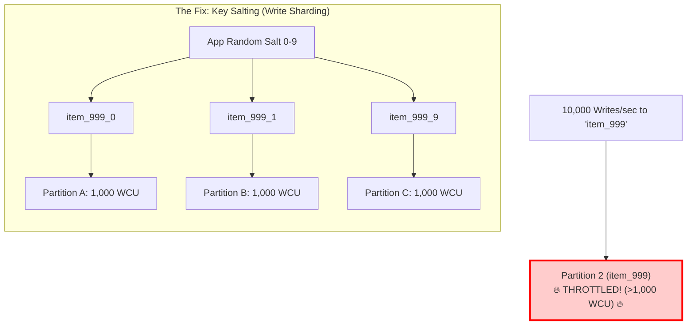

### Solutions for Hot Partitions
1.  **Write Sharding / Key Salting:** Append a random suffix (salt) to the partition key on write:
    $$\text{PK} = \text{item\_id} + \text{"\_"} + \text{random}(0, N)$$
    Writes are spread across $N$ distinct partitions, multiplying write throughput by $N$. On read, the application queries all $N$ partitions in parallel and aggregates the results.
2.  **Read Hot Spots:** Enable **DAX** in front of the table to absorb viral read spikes directly in RAM.
3.  **Write Buffering / Coalescing:** Place an **Amazon SQS** queue or Kafka topic in front of DynamoDB to smooth out sudden traffic spikes and batch writes.

---

## 10. System Design Interview Playbook: PostgreSQL vs. DynamoDB

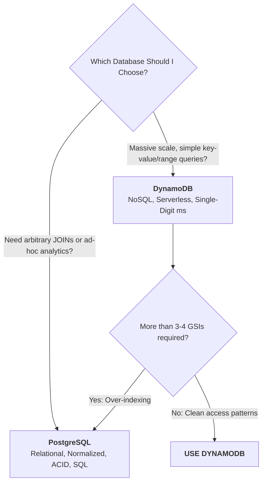

### When to Choose DynamoDB in an Interview
1.  **High-Scale Key-Value or Range Queries:** User sessions, shopping carts, chat history, social feeds, gaming player states, notification logs.
2.  **Predictable Access Patterns:** Systems where query access paths are known upfront during design and do not require ad-hoc analytical slicing.
3.  **Massive Scale without Operational Overhead:** Serverless automatic scaling with zero EC2/RDS patching or manual shard rebalancing.
4.  **Global Active-Active Requirements:** Using **DynamoDB Global Tables** for multi-region replication.

### When NOT to Choose DynamoDB (Interview Traps)
1.  **Heavy Relational Joins & Reporting:** If you need to join 5 tables to generate a business report, choosing DynamoDB is an automatic fail. Use PostgreSQL, Snowflake, or ClickHouse.
2.  **More than 4–5 GSIs:** If a table requires 5+ global secondary indexes to answer its queries, your data model is relational. Use an RDBMS.
3.  **Massive Multi-Row ACID Batches:** If transactions routinely update hundreds or thousands of rows atomically, DynamoDB's 100-item transaction limit will break.
4.  **Full Table Text Search:** Proposing DynamoDB for regex or fuzzy substring queries is an anti-pattern. Use DynamoDB Streams $\to$ Elasticsearch/OpenSearch.
