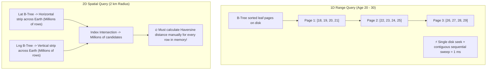
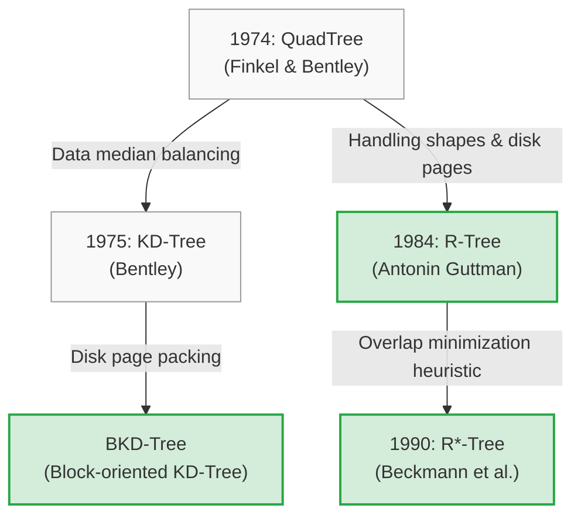
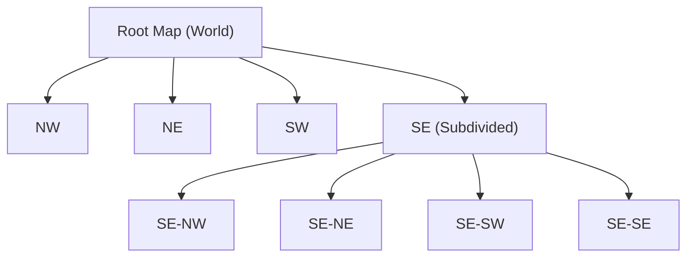
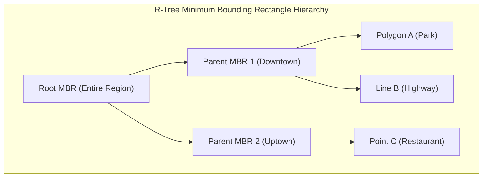
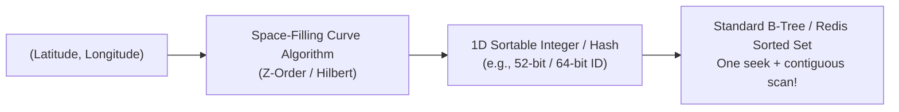
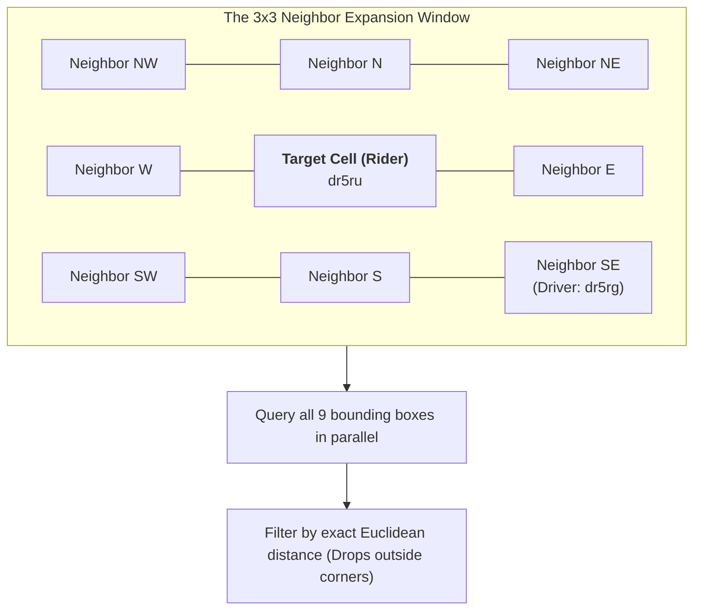
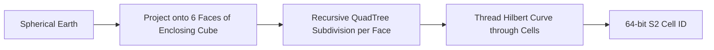
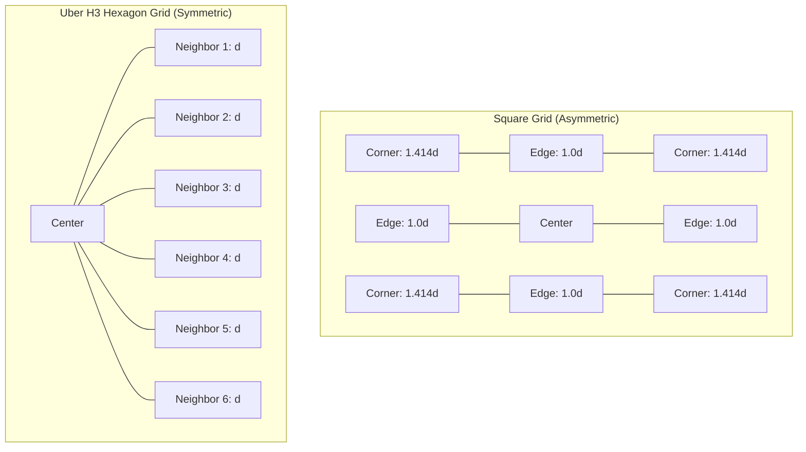
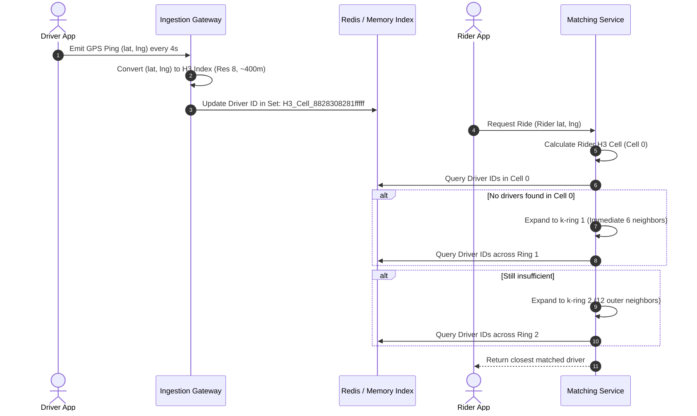
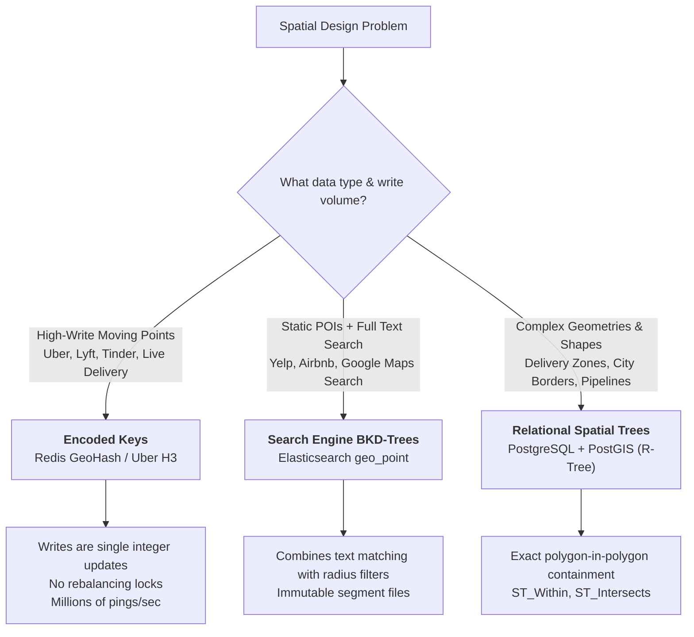

# Geospatial Indexes: Proximity Search & Location Databases

**Sources:** 
- [Proximity Search & Geospatial Indexes Explained (Hello Interview)](https://www.youtube.com/watch?v=dQXdSxn7d1g)
- [Designing a Location Database: QuadTrees and Hilbert Curves (Gaurav Sen)](https://www.youtube.com/watch?v=OcUKFIjhKu0)
- [Spatial Queries in PostgreSQL / PostGIS (Hussein Nasser)](https://www.youtube.com/watch?v=-qNSXK7s7_w)

**TL;DR:** When designing systems like Uber, Yelp, Tinder, or Google Maps, you must query for entities "within $X\text{ km}$" of a user's location $(latitude, longitude)$. Standard database B-Trees fail at multi-dimensional range queries because 1D sort orders destroy 2D spatial locality. Production engineering has converged on two distinct paradigms:
1. **Camp 1: Custom Spatial Trees** (QuadTrees, KD-Trees, BKD-Trees, R-Trees)—purpose-built trees designed for spatial geometry, lines, and polygons (used in PostGIS, Elasticsearch, Google Maps tiles).
2. **Camp 2: Encoded Keys / Space-Filling Curves** (GeoHash, Google S2, Uber H3)—flattening 2D coordinates into 1D hierarchical integers so they can be dropped into ordinary, blazingly fast B-Trees or in-memory Sorted Sets (used in Redis, MongoDB, Uber dispatch).

---

## 1. The Core Problem: Why Standard Databases Fail

### The Age Query vs. The Proximity Query
Consider two queries that look deceptively similar on the surface:
1. *"Find all users between age 20 and 30."*
2. *"Find all drivers within 2 km of a rider."*



* **The 1D Query is Trivial:** A B-Tree keeps sorted numbers packed sequentially on disk pages. Age 20 sits next to 21, which sits next to 22. The database executes **one disk seek** to find age 20, followed by a contiguous sequential read until age 30.
* **The 2D Query Breaks B-Trees:** Location requires two independent numbers: $(latitude, longitude)$, and what we care about is the straight-line (Euclidean / Haversine) distance between points:
  $$d = \sqrt{(\Delta x)^2 + (\Delta y)^2} \quad \text{or} \quad d = 2R \arcsin\left(\sqrt{\sin^2\left(\frac{\Delta \phi}{2}\right) + \cos \phi_1 \cos \phi_2 \sin^2\left(\frac{\Delta \lambda}{2}\right)}\right)$$

### Why Two Separate B-Trees or Composite Indexes Fail
1. **Two Separate B-Trees:**
   * An index on `latitude` creates a horizontal belt around the entire globe.
   * An index on `longitude` creates a vertical band from the North Pole to the South Pole.
   * Intersecting both index results leaves millions of intermediate candidate rows. The database must fetch every row from disk and compute the mathematical distance function in CPU memory by hand.
2. **A Composite B-Tree Index `(lat, lng)`:**
   * A composite index sorts strictly on the first column (`lat`), and only uses `lng` as a tie-breaker.
   * When querying a bounding box `[lat_min, lat_max]` and `[lng_min, lng_max]`, the index can only jump to `lat_min`. It must then scan every single row across that entire latitude band, discarding points whose longitude falls outside the range.

### The Fundamental Mathematical Flaw
**Any naive 1D sort order rips apart 2D spatial closeness.**
Take two yellow cabs parked five blocks apart in Midtown Manhattan. Physically, they are neighbors. But if your 1D index sorts primarily on longitude, every single vehicle in New York with a longitude between them—from the northern tip of the Bronx down to Staten Island—gets crammed into the index between those two neighbors. They are a block apart on the street, but millions of rows apart on disk.

### The Ultimate Prize: Why Database Engines Want a B-Tree
The database industry spent 50+ years hyper-optimizing the **B-Tree**:
* Perfectly balanced as rows are inserted and deleted ($O(\log N)$ depth).
* Knitted to the operating system's disk page cache ($4\text{ KB}\text{--}16\text{ KB}$ blocks).
* Sequential scanning is $100\times$ faster than random pointer lookups.

Every solution to proximity search strives to achieve the same goal: **either build a custom spatial tree tuned to behave like a B-Tree on disk, or map 2D coordinates into a 1D integer that drops into an existing B-Tree.**

---

## 2. Camp 1: Custom Spatial Trees (The 50-Year Evolution)

To handle spatial coordinates, computer scientists spent decades designing tree structures specifically built for geometric spaces.



---

### 1. QuadTrees (1974 - Finkel & Bentley)
* **Core Concept:** Takes a 2D bounding square and recursively divides it into **4 equal quadrants** (NW, NE, SW, SE).
* **Recursion Rule:** If a quadrant contains more than a threshold of points (e.g., $> 100$ pins), it splits into 4 smaller sub-quadrants. If an area is empty, it remains a single coarse node.



#### How Proximity Queries Work
1. Start at the root node.
2. Compare the query coordinate $(lat, lng)$ against the quadrant's geometric midpoint.
3. Descend into the matching child quadrant. Repeat recursively until reaching a leaf node.
4. Check points inside that leaf node, plus adjacent sibling leaf nodes to catch points near the quadrant boundaries.

#### Strengths & Fatal Flaws
* ✅ **Density Adaptation:** Adapts naturally to human geography. The Pacific Ocean remains a single massive leaf node, while urban areas are heavily partitioned.
* ❌ **The Hot-Spot Latency Trap (Geometric Midpoint Splitting):**
  * The split *always* occurs at the geometric midpoint, regardless of where data sits.
  * In dense areas (like Midtown Manhattan), points are clustered tightly. The tree must slice the cell in half dozens of times ($15\text{--}25$ levels deep) just to separate neighboring pins.
  * **Unpredictable Latency:** A query in rural Vermont finishes in 2 hops ($1\text{ ms}$), while a query in Manhattan takes 25 hops ($50\text{ ms}$). The most business-critical, revenue-generating regions suffer the worst latency.
* ❌ **The Disk Page & Pointer Chasing Disaster:**
  * A QuadTree is a memory-pointer structure (`node->children[4]`).
  * If the tree exceeds RAM, traversing pointers causes **random disk seeks** across unbuffered pages. Databases spend $>95\%$ of query time waiting on disk I/O instead of computing coordinates.
* **Modern Production Usage:** QuadTrees are not used as primary database storage engines today. However, they power **Map Tile Pyramids** (e.g., Google Maps / OpenStreetMap zoom levels $Z_0$ to $Z_{20}$) and video game 2D collision detection.

---

### 2. KD-Trees (1975 - Bentley)
* **Core Concept:** A binary tree cousin of the QuadTree that alternates cutting dimensions one level at a time:
  * Level 0: Split on $X$ (Longitude).
  * Level 1: Split on $Y$ (Latitude).
  * Level 2: Split on $X$, Level 3: Split on $Y$, cycling indefinitely.
* **The Balancing Breakthrough:** Unlike QuadTrees, KD-Trees split at the **data median** rather than the geometric midpoint.
  * This guarantees a **perfectly balanced binary tree** of depth $\log_2(N)$ regardless of whether data is clustered in Manhattan or dispersed across Vermont.
* ❌ **The Lingering Flaw:** Still a pointer-based binary tree. Great in RAM, disastrous on disk due to lack of page alignment.

---

### 3. BKD-Trees (Block-oriented KD-Trees)
* **Core Concept:** The modern, disk-native evolution of KD-Trees designed specifically to overcome pointer thrashing on disk storage.
* **How It Works:**
  * Instead of storing a single point per binary node, points are packed into large **Blocks** sized to match physical disk pages ($4\text{ KB}$ or $8\text{ KB}$).
  * Internal nodes represent bounding limits of child blocks.
  * The tree is constructed once from a batch of points, maximizing disk read efficiency.
* **Production Superpower:** **Elasticsearch** uses BKD-Trees under the hood for indexing numeric ranges and all `geo_point` fields.
* ⚠️ **Major Limitation:** BKD-Trees are optimized for **immutable, write-once segments**. Rebalancing or rewriting blocks on live updates is expensive. Therefore, BKD-Trees are ideal for searching **static points of interest** (e.g., restaurants, hotels), but ill-suited for high-frequency streaming updates (e.g., 500,000 live moving Uber drivers).

---

### 4. R-Trees (1984 - Antonin Guttman) & $R^*$-Trees (1990)
* **The Breakthrough:** QuadTrees and KD-Trees can only index zero-dimensional **points**. But real geographic data consists of **lines and polygons**:
  * A store or taxi is a point.
  * A road or highway is a line.
  * A city, county, delivery zone, or national park is a complex polygon.
  * *You cannot drop the country of France into a QuadTree point cell.*
* **How R-Trees Work:**
  * Uses **Minimum Bounding Rectangles (MBR)**: Every geometric object is enclosed in the smallest axis-aligned rectangle $(x_{min}, y_{min}, x_{max}, y_{max})$ that completely contains it.
  * Nearby MBRs are grouped inside larger parent MBRs. Parent MBRs group into grandparent MBRs up to the root.
  * **Balanced like a B-Tree:** All leaf nodes reside at the exact same depth. Every node fits into a standard database disk page.



#### The MBR Overlap Penalty (The Critical Trade-off)
Unlike QuadTree quadrants, **R-Tree bounding boxes can overlap in space**.
* If a query point falls inside two overlapping parent MBRs, the database engine **must traverse down both branches**.
* A poor insertion strategy creates massive overlap, forcing queries to follow dozens of dead-end branches and destroying query performance.
* **The Fix ($R^*$-Trees, 1990):** Beckmann et al. introduced the $R^*$-Tree, featuring sophisticated insertion heuristics that minimize both area expansion and perimeter overlap.
* **Production Standard:** $R^*$-Tree variants are the gold standard powering spatial extensions in relational databases:
  * **PostgreSQL + PostGIS** (`GIST` indexes).
  * **SQLite (SpatiaLite)**.
  * **Oracle Spatial & MySQL Spatial**.
* ⚠️ **Trade-off:** Inserts and updates are compute-intensive because recalculating MBR boundaries and splitting nodes requires re-running packing heuristics.

---

## 3. Camp 2: Encoded Keys & Space-Filling Curves (Flattening 2D to 1D)

Instead of forcing database engines to support complex, pointer-heavy spatial trees, the second architectural paradigm asks:

> *"What if we translate a 2D $(latitude, longitude)$ coordinate into a single 64-bit integer, where numbers that are close on the number line are geographically close in the physical world?"*

If we can do that, we don't need spatial database extensions. We can store the integer in any standard **B-Tree** (Postgres, MySQL, DynamoDB) or an in-memory **Sorted Set** (Redis), inheriting 50 years of caching, page-packing, and range-scan optimizations for free!



---

### 1. GeoHash (2008 - Gustavo Niemeyer)

#### Mechanical Details: Bit-Interleaving & Base32
GeoHash operates by recursively halving latitude and longitude intervals into binary bits, then **interleaving** the bits:

1. **Latitude Interval:** $[-90^\circ, +90^\circ]$. If point is in upper half $[0, 90]$, bit = `1`; else bit = `0`.
2. **Longitude Interval:** $[-180^\circ, +180^\circ]$. If point is in upper half $[0, 180]$, bit = `1`; else bit = `0`.
3. **Interleaving:** Alternate longitude and latitude bits: $Lng_0, Lat_0, Lng_1, Lat_1, Lng_2, Lat_2 \dots$
4. **Base32 Encoding:** Group the resulting bit sequence into 5-bit chunks. Each 5-bit integer ($0\text{--}31$) maps to a character in a 32-character alphabet (`0-9`, `b-z`, omitting `a, i, l, o` to avoid visual confusion).

```
Example: Latitude 40.7128, Longitude -74.0060 (New York City)
Binary Interleaved Bits: 01101 10111 00101 11010 ...
Base32 String:           d     r     5     r     u   ... -> "dr5ru"
```

#### Hierarchical Prefix Property
Because bits are interleaved sequentially, **sharing a prefix means sharing a geographical box**:

| GeoHash Length | Number of Bits | Cell Dimensions (Approx) | Practical Use Case |
| :--- | :--- | :--- | :--- |
| **1 character** | 5 bits | $\approx 5,000\text{ km} \times 5,000\text{ km}$ | Continental regions |
| **3 characters** | 15 bits | $\approx 156\text{ km} \times 156\text{ km}$ | Large metropolitan areas |
| **5 characters** | 25 bits | $\approx 4.9\text{ km} \times 4.9\text{ km}$ | City neighborhoods |
| **6 characters** | 30 bits | $\approx 1.2\text{ km} \times 600\text{ m}$ | Local vicinity |
| **8 characters** | 40 bits | $\approx 38\text{ m} \times 19\text{ m}$ | Street / Building level |
| **9 characters** | 45 bits | $\approx 4.8\text{ m} \times 4.8\text{ m}$ | Doorstep accuracy |

#### Production Implementation: Redis Sorted Sets (`GEOADD` & `GEORADIUS`)
Under the hood, a GeoHash string is just human-readable sugar over a raw integer:
* Redis `GEOADD key lng lat member` converts coordinates into a **52-bit GeoHash integer**.
* It stores this integer as the numerical **`score`** in a standard Redis **Sorted Set (`ZSET`)** (backed by a Skip List + Hash Map).
* Querying nearby points (`GEORADIUS`) executes a `ZRANGEBYSCORE` scan over that integer range. **Zero custom spatial engine needed.**

---

### The Boundary Artifact & The 3×3 Grid Search Trick

Every grid-based encoded key system suffers from the **Boundary Problem**:
* Two people can be standing **1 meter apart**, but if they sit on opposite sides of a parent cell boundary, their coordinates diverge at the very first bit of the hash!
* A rider in cell `dr5ru` and a driver 10 meters away across the street in cell `dr5rg` share no common deep prefix. A naive database prefix scan `WHERE geohash LIKE 'dr5ru%'` **completely misses the closest driver.**



#### The Production Algorithm:
1. Determine the query coordinate's parent cell (e.g., precision level 6).
2. Mathematically calculate the **8 surrounding neighbor cells** (NW, N, NE, W, E, SW, S, SE).
3. Execute range queries across **all 9 cells** in parallel (or a batched `IN` / `UNION` query).
4. **Post-Filter:** Calculate the exact distance for candidates in those 9 cells to eliminate candidates in the corners that fall outside the true radial circle.

---

### 2. Google S2 (2011)

#### The Problem with GeoHash: Earth Distortion
GeoHash projects coordinates onto a flat 2D Mercator plane. But the Earth is an oblate spheroid:
* $1^\circ$ of longitude equals $\sim 111\text{ km}$ at the equator, but shrinks to **0 km at the North and South Poles**.
* A GeoHash cell is a fat square at the equator, but a microscopically thin, tall sliver in Alaska or Greenland.

#### How Google S2 Solves Distortion
1. **Cube Projection:** Wraps the spherical Earth inside an imaginary 3D cube. Points on the sphere are projected outward onto the **6 flat faces** of the cube.
2. **Face QuadTrees:** Each of the 6 flat faces is recursively subdivided using a QuadTree structure.
3. **Hilbert Space-Filling Curve:** S2 threads a continuous 1D **Hilbert Curve** through the sub-cells on each face.



#### Key Properties of S2
* **Equal Area Everywhere:** Cells maintain roughly uniform physical area anywhere on Earth.
* **Continuous Locality:** The Hilbert Curve minimizes distance jumps, ensuring points close in space remain close on the 1D line.
* **The Anti-Meridian Fix:** Flat-earth indexes break when a query crosses the International Date Line / Anti-Meridian ($180^\circ$ longitude), treating it as a leap across the entire globe. S2 treats the spherical cube seamlessly.
* **Production Standard:** Powers **MongoDB's `2dsphere` index** and Google's internal geospatial infrastructure.

---

### 3. Uber H3 (2018)

#### The Problem with Squares: The Asymmetric Neighbor Dilemma
Both GeoHash and S2 use rectangular/square cells. But squares have a fundamental geometric flaw:
* A square has **two distinct types of neighbors**:
  * 4 orthogonal neighbors sharing an **edge** (distance to center = $1.0$).
  * 4 diagonal neighbors sharing only a **corner** (distance to center = $\sqrt{2} \approx 1.414$).
* This 41% distance discrepancy produces messy distortion when computing radial distance bands, dispatch radii, and spatial heatmaps.



#### The Hexagonal Superpower
* A regular hexagon has **exactly 6 neighbors**, and **every neighbor is at the exact same distance** ($d$) from the center!
* Radius expansion is perfectly circular and smooth.

#### Mechanical Structure of H3
1. **Global Discrete Global Grid:** The Earth is partitioned into 120 base icosahedron cells, subdivided into hexagons.
2. **1-to-7 Hierarchical Aperture:** Each hexagon contains 7 smaller sub-hexagons at the next finer resolution level.
3. **16 Discrete Resolutions:**
   * Resolution 0: Continents ($\sim 4.3 \text{ million km}^2$).
   * Resolution 8: Neighborhood dispatch ($\sim 0.73 \text{ km}^2$, $\approx 460\text{ m}$ edge).
   * Resolution 10: Street blocks ($\sim 15,000 \text{ m}^2$, $\approx 65\text{ m}$ edge).
   * Resolution 15: Sub-meter precision ($\sim 0.9 \text{ m}^2$).
4. **64-bit Integer Index:** Every hexagon on Earth maps to a 64-bit integer ID. Truncating the bitfield navigates directly to parent or grandparent cells.

#### Uber Dispatch Flow in Production


---

## 4. Comprehensive Architectural Comparison Matrix

| Dimension | QuadTree | BKD-Tree | R-Tree / $R^*$-Tree | GeoHash | Google S2 | Uber H3 |
| :--- | :--- | :--- | :--- | :--- | :--- | :--- |
| **Category** | Custom Tree | Custom Tree | Custom Tree | Encoded Key | Encoded Key | Encoded Key |
| **Shapes Supported** | Points only | Points & Ranges | Points, Lines, Polygons | Points only | Points & Polygons | Points & Polygons |
| **Underlying Index** | Pointer Tree | Disk Blocks | MBR Tree | Standard B-Tree / ZSET | Standard B-Tree | Standard B-Tree |
| **Disk Locality** | ❌ Horrible | ✅ Excellent | ✅ Excellent | ✅ Native B-Tree | ✅ Native B-Tree | ✅ Native B-Tree |
| **Write Performance** | Moderate | ❌ Write-Once | ❌ Slow (Rebalancing) | ⚡ Blazing Fast | ⚡ Blazing Fast | ⚡ Blazing Fast |
| **Distortion at Poles**| Severe | Moderate | Low | ❌ Severe | ✅ Minimal (Cube) | ✅ Minimal |
| **Neighbor Symmetry** | Asymmetric | Asymmetric | N/A | Asymmetric (4+4) | Asymmetric (4+4) | ✅ Perfectly Symmetric (6) |
| **Primary Production Users** | Google Maps Tiles | Elasticsearch | PostGIS, SQLite, Oracle | Redis, DynamoDB | MongoDB (`2dsphere`) | Uber Dispatch & Surge |

---

## 5. System Design Interview Playbook & Traps

### When to Pick Which Technology



---

### Critical Interview Traps to Avoid

#### 1. The High-Write R-Tree Trap
* **The Candidate Mistake:** *"For Uber, I will store driver coordinates in PostgreSQL with PostGIS and query `ST_DWithin`."*
* **The Failure:** 500,000 drivers emitting GPS pings every 4 seconds = **$125,000\text{ writes/sec}$**. Every write forces PostGIS to recalculate bounding boxes and rebalance the R-Tree index. The database will melt under lock contention within seconds.
* **The Staff Engineer Answer:** Use **Redis with GeoHash** or an **in-memory H3 grid**. Driver location updates are simple in-memory key overwrites ($O(1)$) with zero disk write amplification.

#### 2. The Boundary Problem Blindspot
* **The Candidate Mistake:** *"I will convert the user's location to GeoHash `dr5ru` and query `SELECT * FROM drivers WHERE geohash LIKE 'dr5ru%'`."*
* **The Failure:** Misses nearby drivers standing 5 meters away across cell boundaries.
* **The Staff Engineer Answer:** Always explain the **3×3 neighbor expansion trick** (or H3 $k$-ring expansion) to query the target cell plus its surrounding neighbors, followed by an exact mathematical post-filter.

#### 3. The Flat-Earth Polar Blindspot
* **The Candidate Mistake:** Recommending GeoHash for international flight tracking or maritime navigation near polar regions.
* **The Failure:** GeoHash cells shrink to millimeter widths near the poles, causing massive performance and coordinate distortion.
* **The Staff Engineer Answer:** Use **Google S2** (spherical cube projection) to preserve equal-area cells and handle anti-meridian crossings cleanly.

#### 4. Neglecting Tile Caching for Read-Heavy Maps
* In systems like Google Maps or Yelp, querying millions of static points on every zoom and pan overwhelms the database.
* **The Solution:** Pre-render map tiles at multiple QuadTree zoom levels ($Z_0\text{--}Z_{20}$) and cache them at the **CDN Edge**. Dynamic pins are overlaid on top of static cached vector tiles.
