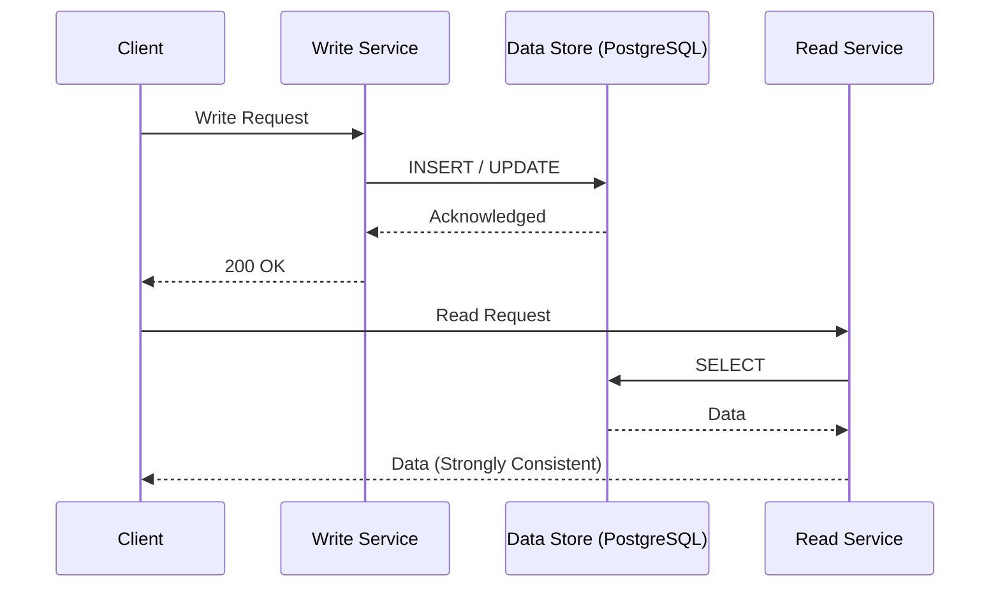
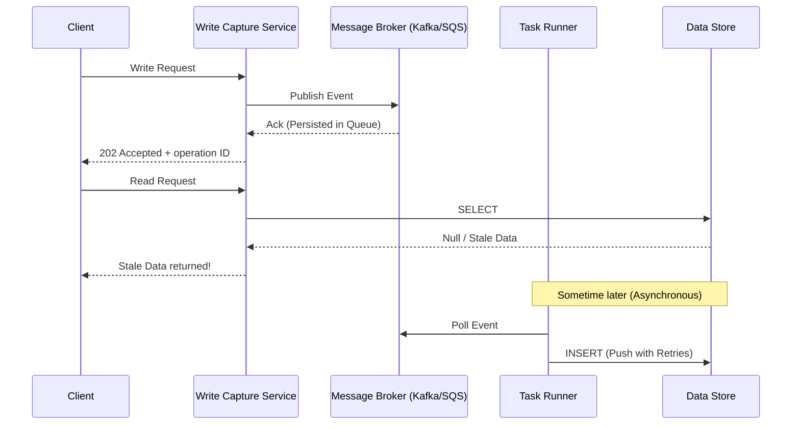
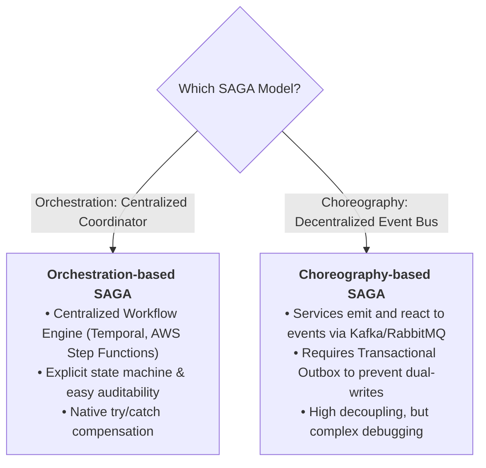
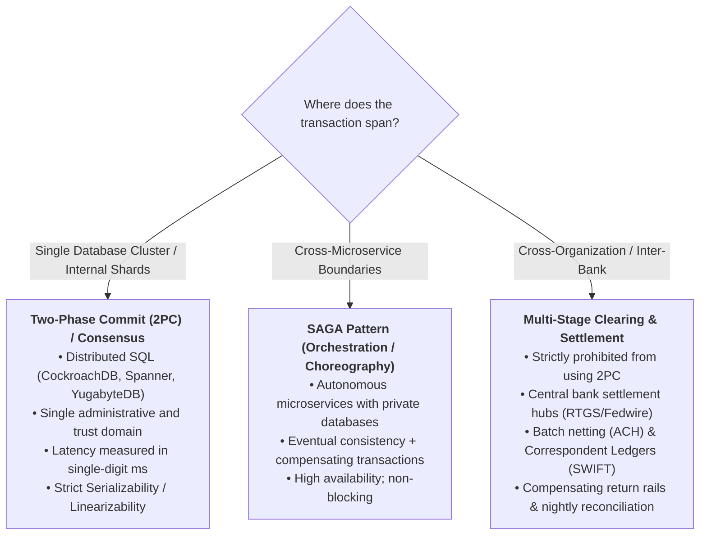
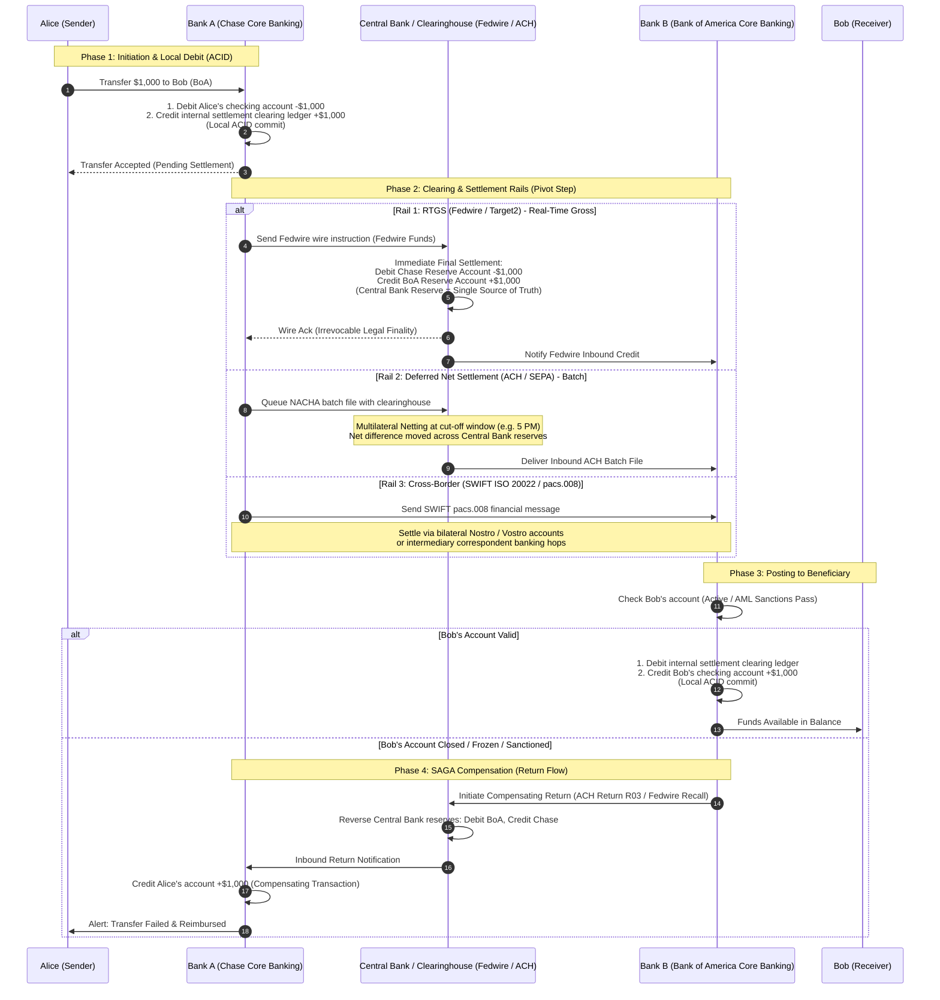

# Message Brokers & Strong Consistency

**Source:** [When NOT to use a message broker? (System Design Fight Club)](https://www.youtube.com/watch?v=eWpOlIBxB_U)

**TL;DR:** Consistency depends on **what the response acknowledges and which state a read observes**. An enqueue ACK can precede database projection updates. Read-your-writes requires waiting for application and reading at or beyond that commit.

> **Delivery contract:** Broker configuration defines ACK durability. Retention covers recovery time; stable event IDs and atomic consumer deduplication handle replay.

---

## 1. The Traditional Setup (Strong Consistency)
In a standard CRUD application without a broker, the flow is completely synchronous:

1. **Write Request:** The client sends a write request to the API.
2. **Synchronous Write:** The API (Write Service) pushes the write operation directly to the Data Store (e.g., PostgreSQL, Spanner).
3. **Acknowledgment:** The Data Store confirms the write has been successfully committed.
4. **Response:** The API returns a `200 OK` to the client.

**Mechanical Detail:** A committed write followed by a fresh primary read can provide read-your-writes under the selected isolation level. Asynchronous replicas, stale transaction snapshots and caches can return older data.



## 2. The Message Broker Setup (Eventual Consistency)
When you introduce a message broker (Kafka, Kinesis, SQS) to increase availability and handle traffic spikes, the flow changes drastically:

1. **Write Request:** The client sends a write request.
2. **Broker Persistence:** The Write Capture Service writes the event to the Message Broker. 
3. **Immediate Response:** After the configured durable broker ACK, return `202 Accepted` and an operation/status ID if the business operation is not yet applied.
4. **Asynchronous Processing:** In the background, a Task Runner (or consumer) asynchronously pulls the event from the broker and writes it to the Data Store.

*A durable log can serve as authoritative state, with databases maintaining projections of that log.*

### ⚠️ Trap Warnings: Stale Reads and Lost Writes
Because the API acknowledges acceptance before database application, an immediate projection read can return **stale data** or 404. Expose operation status, carry an application-position barrier, or wait for the applied result before promising completion.

If the database or task runners experience an outage (which could last for hours or even a whole day), the data will simply queue up in the broker. 
- **Stale Reads:** Readers will receive outdated information until the outage is resolved and the broker drains.
- **Lost Writes (Critical Edge Case):** If the broker does not have an adequate **retention policy** configured (e.g., messages expire after 24 hours but the DB outage lasts 36 hours), those queued writes will be permanently lost!



## 3. Why Use a Broker? (Push vs. Pull Mechanism)
Why accept asynchronous visibility? **Buffering and shielding the database.** The API contract must expose that choice.

Databases (like a time-series database) often go down or get overwhelmed under massive load. Message brokers are explicitly designed for extreme high availability. 

By placing a broker in front of a database, you transform a **Push** system (which can overload the DB) into a **Pull** system (where the DB or consumers consume at their own safe pace). 

**Mechanical Detail:** You do not want retry logic on the Write Service API itself. If the DB is struggling, executing retries synchronously before returning a `200 OK` will massively inflate API latency and potentially exhaust connection pools. Instead, you write to the highly available broker. The downstream Task Runners can then "pull" from the broker and "push" to the database, executing retry logic safely in the background without affecting user-facing API latency.

## 4. The CAP Theorem and the Acknowledgment Boundary
During a partition, preserving linearizability can require rejecting requests whose required quorum is unreachable.

The theorem states "Consistency, Availability, Partition Tolerance — Pick Two." However, in distributed systems, Partition Tolerance (network partitions) is a reality you cannot opt out of. So the real choice is: **Consistency or Availability — Pick One.**

A broker-first API can accept durable intents while its database projection is unavailable and expose their pending status. A log-authoritative design defines success at log commit and uses application/read barriers to serve ordered state.

## 5. System Design Interview Tips

### 💡 Tip 1: Broker Failure and Recovery
Cover durable ACKs, replication, retention, timeouts, backpressure and backlog draining. During broker unavailability, return an error/pending status or retain publication intent in a committed outbox.

### 💡 Tip 2: When NOT to Use a Broker
Wait for the required business-state commit before returning completion for:
*   **Wallet Services:** As referenced in Alex Xu's System Design Interview (Volume 2), a wallet cannot tolerate a user seeing a stale balance after a deposit.
*   **Stock Exchanges:** Financial trading platforms require strict, immediately consistent views of trades and balances.

A synchronous database commit and an authoritative log with application/read barriers are two options. Both enforce business invariants, deduplicate effects and define the read contract.

---

## 6. Distributed Transactions Across Services: The SAGA Pattern

When a business operation spans multiple microservices (e.g., ordering $\to$ payment $\to$ inventory), traditional two-phase commit (2PC) hurts availability by locking databases across the network. Instead, modern systems use the **SAGA Pattern**: a sequence of local transactions where every step has a corresponding **compensating transaction** to undo changes if a downstream step fails.



### A. Choreography with the Transactional Outbox Pattern (Kafka)
In a choreography saga, services communicate via message brokers. However, a microservice must never perform a **dual-write** (writing to its local database and publishing to Kafka in application code), because one write can succeed while the other fails.

* **The Solution: The Transactional Outbox Pattern:**
  1. The microservice inserts its business record and an outbox event into an `outbox` table in a **single local ACID database transaction**.
  2. A Change Data Capture (CDC) engine (such as **Debezium**) tails the database Write-Ahead Log (WAL) and publishes the event to **Apache Kafka**.
  3. Downstream services consume from Kafka and execute their local transactions. If a step fails, a failure event is published back to Kafka to trigger compensating transactions in reverse order.

```mermaid
sequenceDiagram
    participant Order as Order Service
    participant DB as Order DB (with Outbox Table)
    participant CDC as Debezium (CDC)
    participant Kafka as Kafka Topic: 'order-events'
    participant Pay as Payment Service

    Order->>DB: 1. BEGIN TXN: INSERT order + INSERT outbox_event; COMMIT;
    CDC-)DB: 2. Tails Database WAL
    CDC->>Kafka: 3. Streams 'OrderCreated' Event
    Kafka->>Pay: 4. Payment Service Consumes & Charges Card
    alt Payment Successful
        Pay->>Kafka: Publishes 'PaymentSucceeded'
    else Payment Failed
        Pay->>Kafka: Publishes 'PaymentFailed' (Triggers Compensation)
        Kafka->>Order: Order Service Consumes & Marks Order CANCELLED
    end
```

### B. Orchestration: The Modern Standard (Temporal.io / Cadence)
Choreography becomes an unmaintainable "spaghetti architecture" when sagas exceed 3–4 steps or require complex branching. The modern standard is **Orchestration via Durable Execution Engines (Temporal.io / AWS Step Functions)**:
* A central orchestrator executes the workflow as pure code (`try / catch`).
* Every state transition is deterministically recorded in an event log.
* If a worker crashes mid-step, another worker resumes the workflow from the exact line of code without lost state or stranded compensations.

---

### C. 2PC vs. SAGA: Industry Standards & Architectural Boundaries

A common staff-level interview debate is: *"Why can't we just use Two-Phase Commit (2PC) instead of SAGA to get immediate ACID guarantees across all microservices?"*



#### 1. Where Two-Phase Commit (2PC) is Still the Industry Standard
2PC is **not dead**, but its modern production application is strictly confined to low-latency, tightly coupled infrastructure within a single administrative domain:
* **Distributed SQL Engines (Google Spanner, CockroachDB, TiDB, YugabyteDB):**
  These engines use 2PC coordinated across internal range/tablet shards, backed by **Paxos or Raft** consensus. Because all nodes belong to one cluster inside high-speed data center networks, round-trip times are sub-millisecond, node health is actively monitored via heartbeats, and failure recovery algorithms are deterministic.
* **Monolithic Enterprise Applications (XA Transactions):**
  Legacy ERP and banking mainframes updating multiple local relational tables and message queues (e.g., Oracle XA, IBM MQ) under a single hardware chassis or tightly coupled cluster.

#### 2. Why 2PC Fails Across Microservices & Organizations
1. **The Blocking Lock Trap (Availability Collapse):**
   In 2PC, during Phase 1 (`PREPARE`), every participant acquires exclusive row/table locks on its database. If the coordinator crashes, a participant network-partitions, or a participant is slow, **those locks remain held indefinitely**. Other concurrent transactions queue up, pool threads exhaust, and the entire system experiences a cascading freeze.
2. **Violation of Service Autonomy:**
   Microservices are designed so each service encapsulates its data model. A 2PC coordinator forces Service B's database engine to hand over transaction lifecycle control to Service A, destroying independent deployability and polyglot persistence (e.g., MongoDB and Cassandra do not support XA/2PC).
3. **Tail Latency Amplification:**
   In 2PC, transaction duration is bounded by the slowest network round-trip and database commit across all participants:
   $$\text{Latency}_{2\text{PC}} \ge \max(T_{1}, T_{2}, \dots, T_{n}) \times 2$$
   At internet scale across microservices, tail latency p99 blows up dramatically.

---

### D. Real-World Case Study: How Inter-Bank Transfers Actually Work (Why Banks Never Use 2PC Across Institutions)

One of the most persistent misconceptions in software engineering is that inter-bank transfers (e.g., Alice at Chase transfers \$1,000 to Bob at Bank of America) use Two-Phase Commit to guarantee that Alice's account is debited if and only if Bob's account is credited.

In reality, **no bank on earth will ever run a 2PC protocol with an external bank.** Inter-bank movement of money is the world's oldest and largest production implementation of an **Asynchronous SAGA**.



#### 1. The Three Fundamental Reasons Banks Prohibit Inter-Bank 2PC
1. **Institutional Sovereignty & Zero Trust:**
   To participate in a 2PC, Chase would have to allow Bank of America's transaction coordinator to place exclusive row-level database locks on Chase's core banking database. If Bank of America experienced a data center outage, network partition, or bug while holding the locks during the `PREPARE` phase, **Chase's internal accounts would remain locked indefinitely**, preventing other transactions and causing regulatory catastrophe.
2. **Statutory Settlement Finality Laws:**
   In global finance, money is governed by legal jurisdictions (e.g., US Uniform Commercial Code Article 4A, EU Settlement Finality Directive). By law, an inter-bank transfer is not finalized by database locks; it is finalized when the **Central Bank** (Federal Reserve, European Central Bank, Reserve Bank of India) executes a balance transfer between the commercial banks' **central bank reserve accounts**. Once reserves move at the central bank, the transfer is legally irrevocable and protected against bankruptcy. 2PC's tentative "Prepared" state is legally incompatible with central bank finality.
3. **Asynchronous Compliance & Latency Disparity:**
   Every inter-bank transaction must pass anti-money laundering (AML), Office of Foreign Assets Control (OFAC) sanctions screening, and fraud scoring. If a recipient's name partially matches a sanctioned watchlist, the transaction drops into human operational review for 2 to 48 hours. A synchronous 2PC cannot remain open for 48 hours without collapsing database connection pools.

#### 2. Intra-Bank vs. Inter-Bank Architectures
* **Intra-Bank (Internal Transfer):**
  When Alice transfers money to Charlie, and *both* hold accounts at Chase, Chase does **not** route through Fedwire or ACH. Chase handles this entirely within its internal infrastructure using standard ACID database transactions, distributed SQL (e.g., Spanner/CockroachDB), or internal consensus (Paxos/Raft). Both debits and credits occur atomically in milliseconds.
* **Inter-Bank (External Transfer):**
  When crossing institutional boundaries, the transfer transitions from an internal ACID transaction to a **multi-stage distributed SAGA** spanning days, coordinated through financial clearing rails.

#### 3. The 3 Real-World Inter-Bank Settlement Rails

##### Rail 1: Real-Time Gross Settlement (RTGS — Fedwire, CHAPS, Target2)
* **Mechanics:** "Gross" means transactions are settled **one-by-one in real-time** (no batching or netting).
* **Role of Central Bank:** The Central Bank acts as the authoritative ledger. Commercial banks maintain reserve deposits at the central bank.
* **The Pivot Step:** When Bank A initiates a \$50M wire, the Federal Reserve executes an atomic transfer between Bank A's reserve balance and Bank B's reserve balance. Once the Fed confirms this debit/credit, settlement finality is legally sealed. Bank B then credits the customer.

##### Rail 2: Deferred Net Settlement (DNS — ACH, SEPA, BACS)
* **Mechanics:** Transactions are not settled immediately. During the day, banks exchange batch files containing thousands of low-value payment instructions.
* **Multilateral Netting:** At fixed clearing windows (e.g., 5:00 PM), the clearinghouse (such as The Clearing House or FedACH) nets all transactions:
  * Bank A owes Bank B \$10,000,000.
  * Bank B owes Bank A \$8,000,000.
  * Net Settlement: Only **\$2,000,000** moves from Bank A to Bank B across central bank reserve accounts at the end of the cycle.
* **The SAGA Window:** Because settlement is deferred by 1–3 business days, banks display funds to customers as "Pending" or front credit based on internal credit risk limits.

##### Rail 3: Cross-Border Transfers (SWIFT ISO 20022 & Nostro / Vostro Accounts)
* **SWIFT Does Not Move Money:** SWIFT is purely a private, encrypted, tamper-proof financial messaging network (traditionally MT messages like `MT103`, now modern ISO 20022 XML messages like `pacs.008`). SWIFT never holds or transfers money.
* **Nostro and Vostro Ledgers:** International settlement relies on bilateral **correspondent banking accounts**:
  * **Nostro Account** (*"Our money at your bank"*): Bank A's deposit account held inside Bank B in foreign currency.
  * **Vostro Account** (*"Your money at our bank"*): Bank B's record of Bank A's deposit.
* If a US bank transfers EUR to a German bank, the US bank instructs the German bank via SWIFT to debit its EUR Nostro account and credit the German recipient. If no direct bilateral account relationship exists, the SAGA hops through intermediary correspondent banks (e.g., Bank A $\to$ Intermediary Bank X $\to$ Intermediary Bank Y $\to$ Bank B), with each intermediary taking a fee and updating its respective Nostro/Vostro ledger.

#### 4. Handling Failures Without 2PC: Compensating Transactions & Nightly "Breaks"

Because the originating bank already committed its debit hours before the beneficiary bank processes the file, **traditional rollback is impossible**. Instead, the banking ecosystem relies on two core SAGA recovery mechanisms:

1. **Compensating Return Rails (Automated SAGA Compensation):**
   * If Bank B discovers the destination account is closed, frozen, or non-existent, Bank B cannot "abort" Bank A's completed transaction.
   * Instead, Bank B initiates an **outbound Compensating Transaction**:
     * In ACH: Bank B generates an **ACH Return** with standard NACHA exception return codes (e.g., `R01: Insufficient Funds`, `R02: Account Closed`, `R03: No Account / Unable to Locate`, `R16: Account Frozen`).
     * In RTGS/SWIFT: Bank B issues a payment recall or outbound return wire (`pacs.004 Payment Return`).
   * When Bank A consumes the return message, it executes its local compensating step: crediting the customer's account back and notifying them of the failure.
2. **Nightly Batch Reconciliation & Accounting "Breaks":**
   * Even with automated systems, messages can be dropped, sequence numbers can skip, or systems can desynchronize.
   * Every bank runs a massive automated **Reconciliation Engine** at the close of every business day. The engine cross-compares three independent data streams:
     1. The bank's internal General Ledger (GL) postings.
     2. Network messaging acknowledgments (SWIFT MT940 / CAMT.053 statements, Fedwire endpoint logs).
     3. Central Bank end-of-day reserve statements.
   * Any mismatch is flagged as an accounting **"Break"**. Breaks are prioritized by dollar value: automated reconciliation scripts resolve standard timing differences, while high-value breaks trigger investigation by back-office operations teams.

---

### E. Comprehensive Architectural Comparison: 2PC vs. SAGA vs. Inter-Bank Clearing

| Architectural Dimension | Two-Phase Commit (2PC / XA) | Microservice SAGA (Temporal / Kafka) | Inter-Bank Clearing & Settlement (Fedwire / ACH / SWIFT) |
| :--- | :--- | :--- | :--- |
| **Trust Domain** | Single organization, homogeneous network | Single enterprise, autonomous microservices | **Zero trust across competing sovereign institutions** |
| **Concurrency Control** | **Exclusive Pessimistic Locks** (Row/Table locks held across network) | **Optimistic / Semantic Locks** (No DB locks held between steps; state flags like `PENDING`) | **No External Locks** (Independent local accounting ledgers; internal settlement clearing accounts) |
| **Consistency Model** | **Strong Consistency** (Immediate ACID across all nodes) | **Eventual Consistency** (BASE: Basically Available, Soft-state, Eventual consistency) | **Eventual Consistency + Settlement Finality** (Legally binding at Central Bank) |
| **Latency Profile** | Milliseconds ($2 \times$ slow-node round trips) | Milliseconds to Seconds | **Seconds (RTGS) to 1–3 Business Days (ACH / Cross-Border)** |
| **Failure Recovery** | **Automatic Abort & Rollback** (Release held locks) | **Compensating Transactions** ($C_1, C_2 \dots$ run in reverse order) | **Compensating Return Rails (ACH Returns, `pacs.004`) + Nightly Reconciliation Breaks** |
| **Source of Truth** | Distributed Transaction Coordinator | Orchestrator Event History (Temporal) or Kafka Log | **Central Bank Reserve Ledger** (Domestic) / Nostro-Vostro Ledgers (Global) |
| **Typical Scale Boundary** | $\le 10$ nodes within same data center | $10 - 100+$ microservices across clouds | Thousands of independent global financial institutions |
