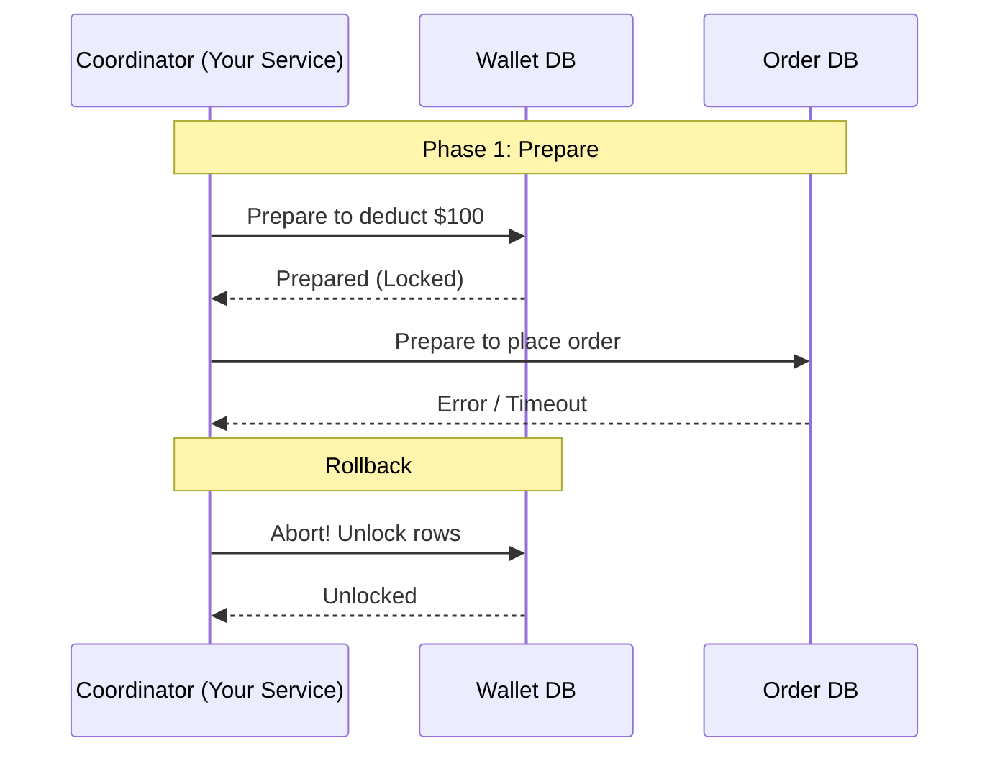
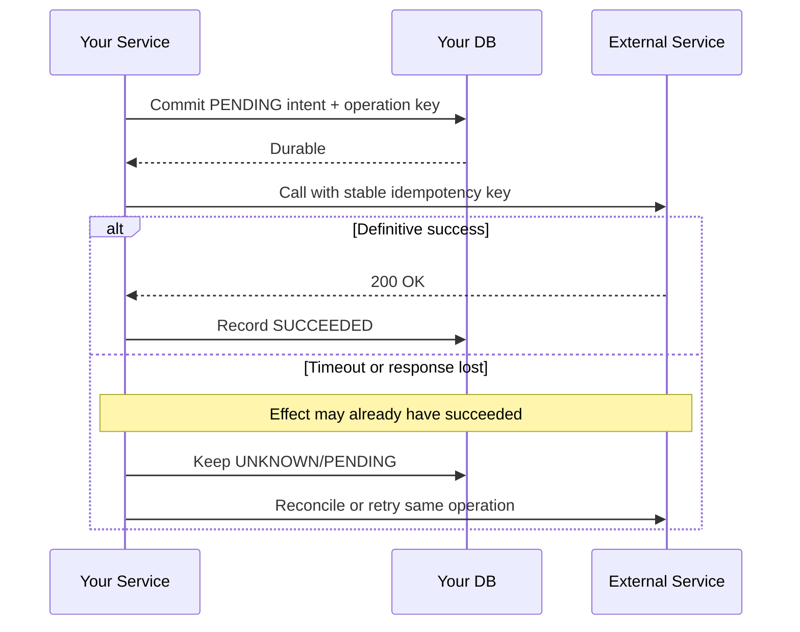

# Partial Failures & Idempotency

**Source:** [A Crucial Topic for Sr SWE Interviews - Partial Failures (System Design Fight Club)](https://www.youtube.com/watch?v=QHYy5H5LWEQ)

**Interview Tip:** Junior and mid-level engineers design for the "happy path", while senior engineers design for outages and "the end of the world." Handling partial failures—when an operation spanning multiple services fails halfway through—is a critical topic in senior SWE interviews.

> **Recovery contract:** Preserve UNKNOWN outcomes after timeouts. Reuse operation IDs, retain deduplication records through the replay window, and assign reconciliation ownership.

In distributed systems, you generally have four scenarios/strategies to handle partial failures:

---

## 1. Scenario 1: Let It Fail (Acceptable Garbage)

Sometimes, a partial failure doesn't break the system, and rolling back is more effort than it's worth.

**Example:** TinyURL Link Generation.
1. The user requests a short link.
2. The API writes the long/short URL mapping to the durable Database.
3. The API attempts to write it to the Redis Cache.
4. **Failure!** The cache node is down, or the network request times out before returning success to the user.

**Result:** Return the committed mapping and refill the cache later. If the response is lost, a stable request ID recovers the same mapping. Designs that allow duplicate unused mappings can reclaim them through garbage collection.

---

## 2. Scenario 2: Message Brokers & Idempotent Retries

If the task *must* complete, but doesn't need to be instantaneous, you can use a Message Broker and continuous retries. However, your database operations must be **Idempotent** (doing it twice has the exact same result as doing it once).

**Example:**
1. A Write Request comes in. The API durably records an operation with a stable ID and returns `202 Accepted` plus a status URL after the chosen durable acknowledgment. If admission also updates a database, use an outbox to avoid a database/broker dual-write gap.
2. A Task Runner pulls the message.
3. The Runner successfully writes to the durable Database.
4. The Runner tries to write to the Cache.
5. **Failure!** The Runner crashes before updating the Cache and before marking the message as completed.

**The Recovery:**
Because the message was never marked as complete, the Broker hands it to a *new* Task Runner. 
1. The new runner pulls the message again.
2. It retries the write to the Database. Because the DB write is **idempotent**, the database simply says "I already have this data, no worries," without throwing a duplicate error or creating two records.
3. The runner successfully writes to the Cache.
4. The runner marks the message as successfully processed. 
   - **Mechanical Detail:** For SQS or RabbitMQ, it deletes the message. For Kafka or Kinesis, it updates the stream offset.

*Trade-offs:* Durable retries support eventual progress only while dependencies recover, retention covers the outage, and an operator handles permanent failures/DLQs. Returning before application means reads of an asynchronous projection can lag; a read barrier or completed-operation response is needed for stronger visibility. See [broker acknowledgment semantics](../Message%20Brokers%20and%20Consistency/README.md).

---

## 3. Scenario 3: Distributed Transactions (Atomic Commit and Consensus)

Sometimes you cannot accept eventual consistency, and you absolutely cannot blindly retry. 

**Example:** A Wallet Service / Payment Gateway (or placing an order).
You need to deduct \$100 from a wallet DB and place an order in an Order DB. A crash between them requires recovery. Retry-safe operation IDs and explicit states are essential regardless of whether the design uses atomic commit or a saga. Cassandra and DynamoDB cannot simply be enrolled in a generic cross-product 2PC transaction; first verify participant capabilities.

### Approach A: The Naive Two-Phase Commit (2PC)

The code for handling 2PC lives inside your service, acting as the coordinator between the databases.

1. **Phase 1 (Prepare):** Each supporting resource manager durably records its prepared state and retains the resources/locks needed to honor the later decision.
2. **Phase 2 (Commit):** After every participant prepares, the coordinator durably records COMMIT before announcing it. Participants recover and retry decision delivery; a timeout after this point must not turn COMMIT into ABORT.

**Handling the Partial Failure:**
If the Wallet DB says "Prepared", but the Order DB says "Error" (or times out) during Phase 1, the coordinator immediately sends a rollback/unlock message to the Wallet DB. The transaction never happens.

*Trade-offs:* Classic 2PC can block prepared participants while the decision is unavailable. Durable logs and coordinator replication support recovery and decision delivery.

### Approach B: Consensus-Replicated Coordination

**Trap Warning:** Do NOT roll your own Paxos or Raft implementation. It is like rolling your own crypto algorithm—leave it to the experts, or you will completely screw up the implementation.

**ZooKeeper** uses ZAB to order replicated coordination state. Consensus can replicate a transaction coordinator's decision; participating resource managers implement prepare, commit and rollback. See [ZooKeeper recipes](https://zookeeper.apache.org/doc/current/recipes.html). Applications can use supported cross-shard transactions or a saga/TCC protocol with explicit intermediate states.

---

## 4. Scenario 4: External APIs (Durable Intent, Idempotency and Reconciliation)

**Interview Tip (The "Stunt"):** In the real world, you rarely have direct database access to another team's service. Using a database as a communication channel is an anti-pattern. Furthermore, external teams will rarely do the massive amount of work required to expose dedicated "Prepare" and "Commit" API endpoints for your 2PC coordinator to call.

**The crash window:** A provider can succeed before its reply is lost or the caller crashes. Local rollback leaves that external effect in place. Persist intent before the network call and reconcile the provider outcome afterward.

1. **Record intent:** Commit a PENDING operation and stable provider idempotency key before dispatch.
2. **Call outside the transaction:** Retry with the same key; query the provider's recorded result where supported.
3. **Record outcome:** Atomically store SUCCEEDED or a definitive failure. Timeouts remain UNKNOWN/PENDING for reconciliation, not automatic rollback.
4. **Recover:** A durable worker queries/retries unresolved operations. If business reversal is required, initiate an explicit, retry-safe compensation with its own status.

| Crash point | Durable evidence | Recovery |
| :--- | :--- | :--- |
| Before intent commits | No accepted operation | Caller retries the same request ID |
| After intent, before dispatch | PENDING operation | Worker sends the persisted key |
| Provider succeeds, reply is lost | Local outcome unknown | Query/retry the same provider operation; never charge with a new key |
| Local success commits, reply is lost | SUCCEEDED result | Return the stored result on retry |
| Compensation reply is lost | Compensation pending | Reconcile/retry its stable identity; alert on unresolved age |

Providers without idempotency or outcome lookup require reconciliation or manual intervention to resolve duplicate and unknown outcomes.
