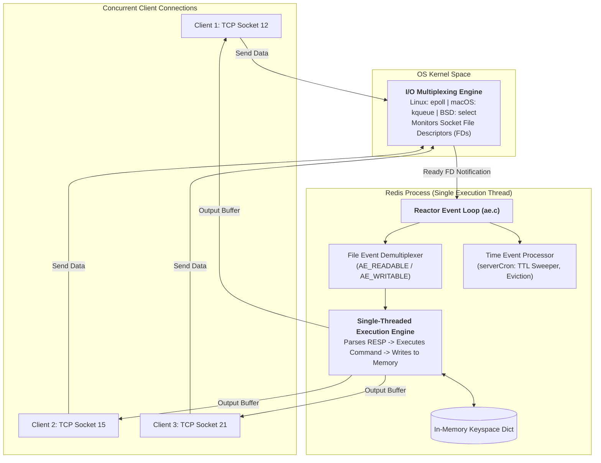
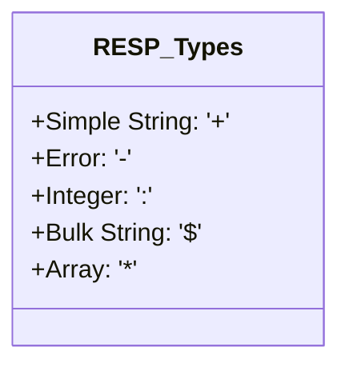
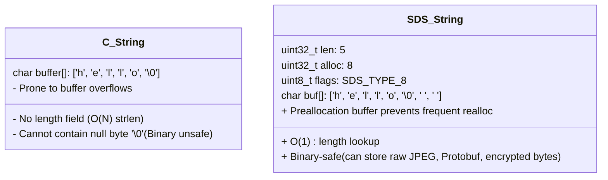
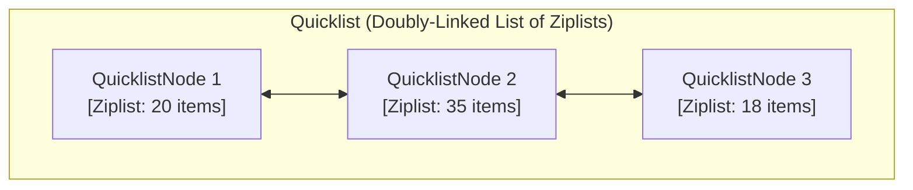
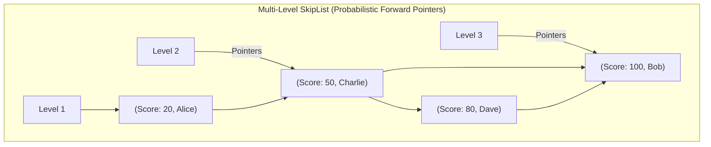
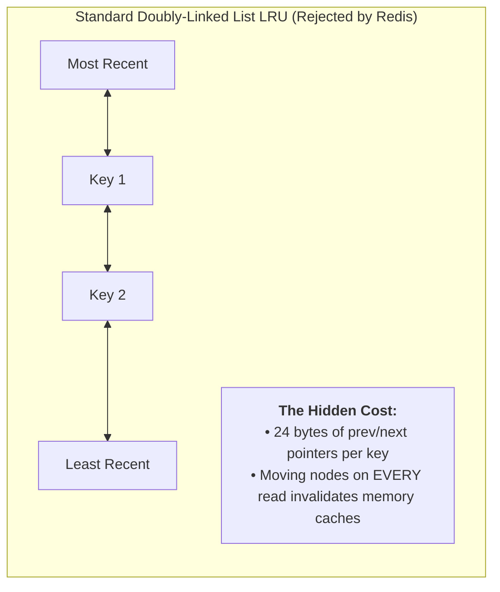
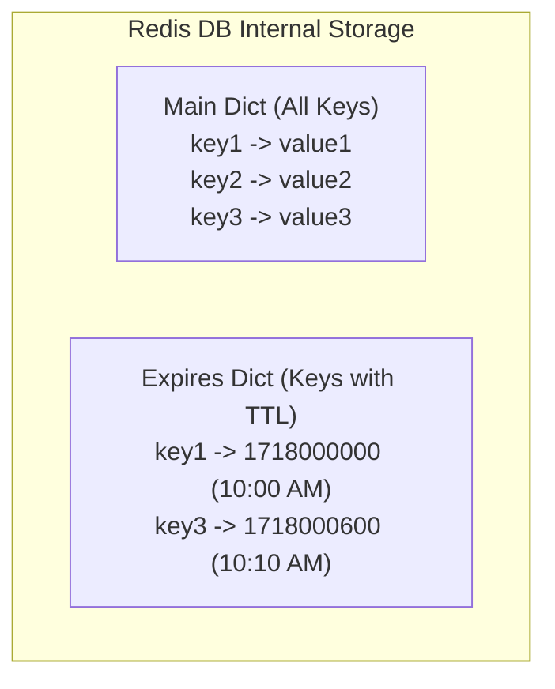
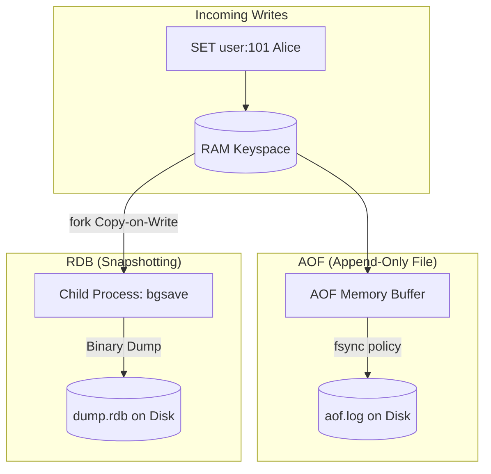
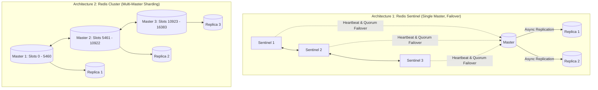

# Redis Internals & System Design Deep Dive

**Source:** [Arpit Bhayani's Redis Internals Masterclass ("Build Your Own Redis")](https://www.youtube.com/playlist?list=PLsdq-3Z1EPT0eElcdOON9fdaeaQjlyXDt)

**TL;DR:** Redis (Remote Dictionary Server) is an open-source, in-memory key-value data structure store engineered for sub-millisecond latency and $100\text{k}+$ QPS. Its speed is driven by an in-memory single-threaded **Reactor Event Loop** using non-blocking OS I/O multiplexing (`epoll`/`kqueue`), paired with highly optimized, byte-packed C data structures (SDS, Quicklist, Intset, SkipList). It solves cache eviction without pointer bloat via **Approximated LRU** and **Morris Counter LFU**, and provides durability via **AOF** and **RDB** snapshots over Copy-on-Write (CoW).

---

## 1. Architecture: Single-Threaded Reactor Event Loop

The most frequent system design question about Redis is: *"Why is Redis single-threaded, and how can a single thread serve 100,000+ concurrent connections?"*



### A. Why Single-Threaded Execution Wins
1. **Zero Thread Synchronization Overhead:** No mutexes, spinlocks, read-write locks, or condition variables. Locking memory across multiple threads destroys throughput due to lock contention.
2. **Zero Context Switching:** Operating system thread context switches flush CPU registers, invalidate CPU instruction pipelines, and cost thousands of CPU cycles. A single thread stays permanently scheduled on its CPU core.
3. **CPU L1/L2/L3 Cache Locality:** Data structures accessed by a single thread remain resident in CPU cache lines rather than being repeatedly invalidated by other CPU cores (avoiding cache thrashing).
4. **Memory Bound, Not CPU Bound:** Redis operations (getting/setting memory addresses) take nanoseconds. The bottleneck in high-throughput caching is almost always **network I/O latency** and **memory bandwidth**, not CPU compute.

### B. The Reactor Pattern & I/O Multiplexing (`epoll` / `kqueue`)
Instead of spawning a thread per client (like Apache HTTP or legacy Java servers), Redis implements the **Reactor Pattern**:
1. All client TCP connections are set to **non-blocking mode** (`O_NONBLOCK`).
2. Redis registers all socket File Descriptors (FDs) with the operating system's I/O multiplexer:
   * **Linux:** `epoll` (Edge-Triggered / Level-Triggered notification).
   * **macOS / FreeBSD:** `kqueue`.
   * **Fallback:** `select` / `poll`.
3. The OS kernel monitors thousands of network sockets. When network packets arrive on any socket, `epoll_wait()` wakes up the Redis event loop with a list of only the **ready FDs**.
4. Redis sequentially reads the bytes, executes the command against memory, writes the response to the socket output buffer, and returns to `epoll_wait()`.

### C. Redis 6.0+ Threaded I/O (Multi-Threaded I/O, Single-Threaded Execution)
In modern $10\text{--}100\text{ Gbps}$ network environments, reading and writing network packets off the wire consumes more CPU cycles than reading from RAM.
* In Redis 6.0+, **Threaded I/O** was introduced: background I/O threads handle socket reading, RESP parsing, and socket response serialization in parallel.
* **Crucial Rule:** The **core command execution remains strictly single-threaded**. Commands are still executed sequentially against the shared in-memory dictionary, maintaining atomic lock-free guarantees.

---

## 2. Wire Protocol: RESP (REdis Serialization Protocol)

Redis communicates over TCP using **RESP** (RESP2 and RESP3). It was designed with three constraints:
1. Simple to implement in any programming language.
2. Fast for computers to parse.
3. Human-readable for debugging via `telnet` or `nc`.



### A. RESP Data Types & Framing
Every message ends with a carriage return and line feed (`\r\n`):

| Data Type | Byte Prefix | Example Wire Format | Parsed Meaning |
| :--- | :--- | :--- | :--- |
| **Simple String** | `+` | `+OK\r\n` | String without binary newlines |
| **Error** | `-` | `-ERR unknown command 'FOO'\r\n` | Error message |
| **Integer** | `:` | `:1000\r\n` | 64-bit signed integer |
| **Bulk String** | `$` | `$6\r\nfoobar\r\n` | Binary-safe string with length prefix ($6$ bytes) |
| **Null Bulk String**| `$` | `$-1\r\n` | Key does not exist (`nil`) |
| **Array** | `*` | `*2\r\n$3\r\nGET\r\n$4\r\nuser\r\n` | Array of 2 Bulk Strings: `GET user` |

### B. Command Pipelining (Amortizing Network RTT)
Under normal request-response semantics:
$$\text{Total Time} = N \times (\text{Network RTT} + \text{Server Execution Time})$$

When an application needs to send 1,000 commands, network RTT ($1\text{ ms} \times 1,000 = 1\text{ second}$) completely dominates server execution time ($10\text{ ns} \times 1,000 = 10\text{ }\mu\text{s}$).

* **Pipelining Solution:** The client writes 1,000 commands into its local TCP buffer without waiting for replies, sending them in a single network packet.
* Redis executes all 1,000 commands sequentially and packs all 1,000 responses into a single reply packet.
* Reduces $1,000$ syscalls (`read()` / `write()`) down to a single syscall, boosting throughput from $20\text{k}$ to $500\text{k}+$ QPS.

---

## 3. In-Memory Data Structures Under the Hood

Redis does not store raw C pointers or raw strings directly. Every entry in the database is wrapped inside a **`redisObject`** header:

```c
typedef struct redisObject {
    unsigned type:4;       // OBJ_STRING, OBJ_LIST, OBJ_SET, OBJ_ZSET, OBJ_HASH
    unsigned encoding:4;   // RAW, EMBSTR, INT, ZIPLIST, HT, SKIPLIST, INTSET...
    unsigned lru:24;       // 24 bits: LRU clock timestamp OR Morris LFU counter
    int refcount;          // Reference counter (memory sharing & GC)
    void *ptr;             // Pointer to the underlying physical data structure
} robj;
```

---

### A. Simple Dynamic Strings (SDS) vs. C Strings

Redis is written in C, but it **never uses standard C null-terminated strings (`char*`)**. It uses custom **SDS (Simple Dynamic Strings)**.



#### Why SDS Replaced C Strings:
1. **$O(1)$ Length Lookup:** Standard C strings require iterating through every byte until finding `\0` ($O(N)$). SDS stores `len` in the header, making `STRLEN` instant ($O(1)$).
2. **Binary Safety:** Standard C strings terminate at the first null byte `\0`. If an application caches a JPEG image, gzip payload, or Protobuf blob containing zero bytes, C truncates it. SDS uses `len` to delimit the string, allowing arbitrary binary storage.
3. **Space Preallocation & Lazy Freeing:** When appending strings, SDS allocates extra buffer space (`alloc > len`) to avoid expensive `realloc()` system calls on subsequent appends.

#### The `embstr` vs. `raw` Encoding Optimization
When storing a string, Redis chooses between two physical memory encodings:
* **`raw` Encoding:** Requires **two separate heap allocations** (`malloc` for `redisObject`, and a second `malloc` for the SDS body).
* **`embstr` Encoding (for strings $\le 44$ bytes):** Allocates the `redisObject` and the SDS struct in a **single contiguous 64-byte memory chunk**!
  * *Why 64 bytes?* Modern CPU L1/L2 cache lines are exactly 64 bytes. The entire object fits in a single CPU cache line, eliminating a pointer dereference and a second `malloc` call!

```text
Memory Layout of embstr (Single 64-Byte Cache Line):
[ redisObject (16 bytes) ][ sdshdr8 (3 bytes) ][ buf (up to 44 bytes) ][ '\0' (1 byte) ]
```

---

### B. Lists & Hashes: Ziplist, Listpack & Quicklist

When a user creates a Redis List (`LPUSH`), Hash (`HSET`), or Sorted Set (`ZADD`) with a small number of elements, a standard linked list or hash table would waste massive amounts of memory on pointers.

#### 1. The Ziplist (Contiguous Compact Memory)
* A standard doubly-linked list node costs: $8\text{ bytes (prev)} + 8\text{ bytes (next)} + 8\text{ bytes (val ptr)} = 24\text{ bytes}$ of pointer overhead per element!
* A **Ziplist** eliminates pointers entirely by serializing elements into a single contiguous block of memory:

```text
Ziplist Memory Layout:
<zlbytes> <zltail> <zllen> <entry 1> <entry 2> ... <entry N> <zlend>
```
Each entry stores:
* `prevlen`: Length of the previous entry (enables backward traversal without a `prev` pointer).
* `encoding`: Type and length of the current entry (integer vs string).
* `content`: The raw binary data.

> [!WARNING]
> **The Cascading Update Problem:** Because each entry stores `prevlen` (encoded in 1 byte if $<254$ bytes, or 5 bytes if $\ge 254$ bytes), inserting an entry can trigger a cascade where every subsequent entry must expand its `prevlen` field, causing $O(N^2)$ memory reallocation. Redis 7+ replaced Ziplists with **Listpacks** to eliminate cascading updates.

#### 2. The Quicklist (Hybrid of Linked Lists and Ziplists)
When a list grows large, a single continuous Ziplist causes severe memory reallocation stalls during writes.
* Redis uses a **Quicklist**: a doubly-linked list where each individual node is a compact **Ziplist** (typically capped at 8 KB).
* **Benefits:** Retains CPU cache friendliness and high compression from Ziplists, while allowing $O(1)$ head/tail insertions without massive memory reallocations.



---

### C. Sets: Intset (Integer Sets)

If a Set contains **only integers** and has few elements (`set-max-intset-entries = 512`), Redis encodes it as an **Intset** instead of a hash table:

```c
typedef struct intset {
    uint32_t encoding; // INTSET_ENC_INT16, INTSET_ENC_INT32, INTSET_ENC_INT64
    uint32_t length;   // Number of elements
    int8_t contents[]; // Sorted array of integers
} intset;
```

#### Dynamic Upcasting (Zero Wasted Space)
* When created with small numbers ($1, 2, 50$), Redis stores them as 16-bit integers (`int16_t`, 2 bytes per element).
* If a value exceeds $32,767$ (e.g., $100,000$), Redis dynamically **upgrades the entire array** to 32-bit integers (`int32_t`, 4 bytes per element) in $O(N)$ time.
* It remains sorted, enabling binary search ($O(\log N)$) lookups with zero hash table overhead.

---

### D. Sorted Sets (`ZSET`): SkipList + Hash Table

A Redis Sorted Set (`ZSET`) provides both $O(1)$ score lookups and $O(\log N)$ range queries (`ZRANGEBYSCORE`).

To accomplish this, Redis combines **two distinct data structures** inside a single object:
1. **Hash Table (`dict`):** Maps `member -> score` in $O(1)$ time.
2. **SkipList (`zskiplist`):** Orders elements by score in $O(\log N)$ time.



#### Why Redis Uses a SkipList Instead of a Red-Black Tree
Salvatore Sanfilippo (Antirez, the creator of Redis) explicitly documented why SkipLists were chosen over self-balancing binary search trees (Red-Black / AVL trees):
1. **Range Scans are Extremely Fast:** In a SkipList, the bottom layer (Level 1) is a simple sorted doubly-linked list. Executing `ZRANGE` is a simple $O(\log N)$ seek followed by contiguous pointer traversal. Tree in-order traversals are much slower and less cache-friendly.
2. **Simpler Rebalancing:** Red-Black trees require complex rotations that lock tree nodes. A SkipList uses a **probabilistic geometric coin-toss** (probability $p = 0.25$) to assign node levels upon insertion, making concurrent reads and memory tracking trivial.
3. **Memory Efficiency:** With $p = 0.25$, each node averages only $1.33$ forward pointers.

---

## 4. Memory Capping & Eviction Algorithms

Redis is an in-memory database; when RAM runs out, new writes fail unless data is evicted.

Redis configures a memory threshold via `maxmemory <bytes>` and an eviction policy via `maxmemory-policy`.

---

### A. The Approximated LRU Algorithm

A traditional LRU cache uses a **Doubly-Linked List + Hash Map**:
* Every time a key is accessed, it is unlinked and moved to the head of the list.
* The tail of the list is evicted when full.



#### Why Redis Avoids True LRU:
1. **Memory Overhead:** Storing two 64-bit pointers (`prev` and `next`) costs **24 bytes per entry**. For 100 million keys, that wastes **2.4 GB of RAM purely on pointers**!
2. **Locking & Write Contention:** In true LRU, every `GET` query is technically a write because it must update pointers in the linked list, destroying read performance.

#### The Redis Solution: Approximated LRU (Sampling Pool)
* Each `redisObject` stores a **24-bit timestamp** (`lru:24`) recording when it was last accessed.
* When memory exceeds `maxmemory`:
  1. Redis does **not** inspect all keys.
  2. It randomly samples $N$ keys (default: `maxmemory-samples = 5`).
  3. It places them into an eviction pool of size 16, sorted by **idle time** ($\text{current\_time} - \text{lru}$).
  4. It evicts the single key with the highest idle time.
* **The Mathematical Reality:** At $N = 5$, Approximated LRU closely tracks true LRU. At $N = 10$, the difference between Approximated LRU and true LRU is mathematically negligible, while using **zero pointer overhead**.

---

### B. LFU (Least Frequently Used) via Morris Counter

While LRU evicts items that haven't been accessed recently, it suffers from **scan thrashing** (a batch job reads 1,000 keys once, flushing the entire cache). **LFU** evicts based on access frequency.

#### The Challenge: Fitting Frequency into 24 Bits
Redis reuses the 24-bit `lru` field in `redisObject` for LFU:
* **High 16 bits:** Last decrement time (in minutes).
* **Low 8 bits:** Logarithmic access counter (Logistic Morris Counter).

#### 1. The 8-bit Morris Counter
An 8-bit unsigned integer can only count up to $255$. How can Redis track keys with millions of accesses?
It uses a **probabilistic logarithmic counter**:
* Instead of incrementing on every hit, the counter increments with a probability that decreases as the counter grows:
  $$P(\text{increment}) = \frac{1}{\text{counter} \times \text{lfu\_log\_factor} + 1}$$
* With `lfu_log_factor = 10`, an 8-bit counter can represent up to **1,000,000 accesses**!

#### 2. The Decay Interval
If a key was accessed 1 million times during a flash sale and is never touched again, pure LFU would keep it in cache forever.
Redis solves this with **decay time**:
* Every time a key is accessed (or sampled during eviction), Redis calculates how many minutes have passed since the last decrement.
* For every `lfu_decay_time` minutes that have elapsed, the counter is decremented by 1.

---

### C. Eviction Policies Matrix

| Policy | Target Keys | Eviction Criteria | Best Use Case |
| :--- | :--- | :--- | :--- |
| **`noeviction`** | None | Returns an error on write when full (`OOM command not allowed`) | Critical datasets where data loss is unacceptable. |
| **`allkeys-lru`** | All keys | Approximated LRU | **Default choice for web caching** with power-law access. |
| **`volatile-lru`** | Keys with TTL | Approximated LRU | When some keys are persistent data and others are ephemeral caches. |
| **`allkeys-lfu`** | All keys | Approximated LFU (Morris Counter) | Protects cache against sudden one-off scan thrashing. |
| **`volatile-lfu`** | Keys with TTL | Approximated LFU (Morris Counter) | Protects TTL cache against scan thrashing. |
| **`allkeys-random`** | All keys | Uniform random key selection | When access patterns are completely flat/uniform. |
| **`volatile-random`**| Keys with TTL | Uniform random key selection | Infrequently used. |
| **`volatile-ttl`** | Keys with TTL | Smallest remaining TTL (closest to expiring) | Prioritizes dropping keys that are about to die anyway. |

---

## 5. TTL & Expiration Mechanics

Where are expiration times stored?
In the Redis database structure, keys are stored in the main keyspace dictionary (`dict *dict`). Keys with a TTL are *also* registered in a second dictionary: the **expires dictionary (`dict *expires`)**, which maps `key_ptr -> absolute_epoch_timestamp`.



### The Two-Pronged Expiration Strategy
Redis never sets individual timers per key (which would waste memory and CPU). It uses two complementary mechanisms:

#### 1. Passive Expiration (Lazy Deletion on Read)
* When a client sends a read command (`GET key1`):
* Redis checks if `key1` exists in the `expires` dictionary.
* If `current_time > expiry_time`, Redis deletes the key immediately, propagates a `DEL` command to AOF and replicas, and returns `nil`.
* *Limitation:* If a key is never accessed again, passive expiration will never free its memory.

#### 2. Active Expiration (Periodic Background Sweeper)
To reclaim memory from keys that are never read, Redis runs a periodic time event (**`serverCron`**, executed 10 times per second):
1. Samples **20 random keys** from the `expires` dictionary.
2. Checks their expiration timestamps and deletes all expired keys.
3. If **more than 25% of the sampled keys (5+ keys) were expired**, it immediately repeats the process on another 20 random keys.
4. **Safety Valve:** The active sweeper has a hard timeout ($25\text{ ms}$) per cycle to prevent the single-threaded event loop from stalling client requests.

---

## 6. Persistence: AOF vs. RDB vs. Hybrid

Redis is in-memory, but it provides three persistence options to survive reboots.



---

### A. AOF (Append-Only File)
Appends every write command in RESP format to a sequential log file on disk.

#### The `fsync` Flush Policies
When Redis writes to the AOF log, bytes first land in the OS page cache. The `appendfsync` configuration controls when the OS flushes to physical disk:
1. **`appendfsync always`:** Executes `fsync()` after every single write. Maximum durability, but destroys write throughput ($1\text{k--}2\text{k}$ QPS).
2. **`appendfsync everysec` (Recommended Standard):** The single thread writes to the OS buffer; a dedicated background thread calls `fsync()` once every second. At most $1\text{ second}$ of data can be lost.
3. **`appendfsync no`:** Lets the operating system decide when to flush (typically every 30 seconds). Highest throughput, lowest durability.

#### Background AOF Rewrite (`BGREWRITEAOF`)
Over time, the AOF file grows massive (`INCR counter` executed 10,000 times creates 10,000 log lines).
* Redis runs `BGREWRITEAOF` to compact the log:
  1. It **`fork()`s a child process**.
  2. The child process iterates through the in-memory keyspace and writes the **current state** to a new temporary file (replacing 10,000 `INCR` commands with a single `SET counter 10000`).
  3. Meanwhile, the parent process buffers any new incoming client writes in an **AOF Rewrite Buffer**.
  4. When the child finishes, the parent appends the buffer and atomically renames the file.

---

### B. RDB (Redis Database Snapshots)
Creates a compact, point-in-time binary dump of the entire keyspace (`dump.rdb`).

* **How it works:** Uses `fork()` to create a child process via Linux **Copy-on-Write (CoW)**:
  * The parent and child process share the exact same physical memory pages.
  * The child writes memory pages to disk.
  * If the parent receives a write command, the OS duplicates only the specific modified 4 KB memory page for the parent, leaving the child's snapshot pristine.
* **Pros:** Compact binary file; ultra-fast server boot times.
* **Cons:** Higher data loss window (e.g., if snapshots run every 15 minutes, up to 15 minutes of data is lost in a crash).

---

### C. Hybrid Persistence (Redis 4.0+)
Combines RDB speed with AOF granularity:
* The beginning of the AOF file is a compact **RDB binary snapshot**.
* Subsequent modifications are appended in standard **RESP text format**.
* Boot time is fast (reads binary RDB snapshot), while data loss is capped to 1 second.

---

## 7. Transactions & Concurrency Control

Redis is single-threaded, but it provides transaction and optimistic concurrency primitives.

### A. `MULTI` / `EXEC` (Sequential Isolation)
* When a client executes `MULTI`, Redis does not execute incoming commands; it appends them to a **command queue** on that connection.
* When the client sends `EXEC`, Redis executes all queued commands sequentially without interleaving commands from other clients.
* **No Rollback:** If a command fails semantically (e.g., executing `INCR` on a string), Redis **does not roll back** previous commands. All valid commands in the batch are committed.

### B. Optimistic Concurrency Control via `WATCH`
To implement atomic Check-and-Set (CAS):
```sql
WATCH balance
val = GET balance
val = val - 100
MULTI
SET balance val
EXEC
```
* If another client modifies `balance` between the `WATCH` and `EXEC` calls, Redis marks the transaction dirty and **`EXEC` returns a null reply (`nil`)**, aborting the write. The client can then retry.

### C. Lua Scripting & Redis Functions
For complex transactional logic, **Lua scripts (`EVAL`)** are superior to `MULTI`/`EXEC`:
* A Lua script runs entirely on the Redis single thread: it executes atomically from start to finish with zero network round-trips between steps.
* Example: Rate-limiting sliding window algorithms are implemented in Lua to guarantee atomicity between checking timestamps and incrementing counters.

---

## 8. High Availability & Clustering: Sentinel vs. Cluster



### A. Redis Sentinel (High Availability)
* **Purpose:** Provides automatic failover for master-replica setups.
* **Mechanism:** A quorum of Sentinel nodes monitor the master using heartbeats (`PING`). If the master is unreachable for `down-after-milliseconds`:
  1. Sentinels run a Raft-like election to pick a leader Sentinel.
  2. The leader promotes the most up-to-date replica to master.
  3. Reconfigures remaining replicas to replicate from the new master.
* **Limitation:** Scale is limited to a **single master's write throughput and physical RAM capacity**.

### B. Redis Cluster (Horizontal Sharding)
* **Purpose:** Shards data across multiple masters without proxy nodes.
* **The 16,384 Hash Slots:**
  * Every key is assigned to one of **16,384 hash slots**:
    $$\text{Slot} = \text{CRC16}(\text{key}) \pmod{16384}$$
  * Slots are divided among master nodes (e.g., Master 1 owns 0–5460, Master 2 owns 5461–10922, Master 3 owns 10923–16383).
* **Smart Client Redirection:**
  * Clients connect directly to any node and cache the slot-to-node routing table.
  * If a client queries Key $K$ on Node 1, but Slot($K$) lives on Node 2, Node 1 replies with:
    `-MOVED 5462 192.168.1.2:6379`
  * The client updates its local routing cache and redirects the query.
* **Hash Tags:** To execute multi-key operations (transactions, MGET) in a cluster, keys must hash to the exact same slot. Prepending a hash tag forces hashing on the substring inside `{}`:
  * `{user_101}:profile` and `{user_101}:orders` will hash to the exact same slot!

---

## 9. Comprehensive Architectural Comparison Matrix

| Architectural Dimension | Redis | Memcached | Dragonfly / KeyDB | Amazon DynamoDB |
| :--- | :--- | :--- | :--- | :--- |
| **Execution Model** | **Single-Threaded Event Loop** | Multi-Threaded (Locks per slab) | Multi-Threaded Shared-Nothing | Stateless Routers + Paxos Storage |
| **Data Types** | Strings, Lists, Sets, ZSets, Hashes, Streams, HLL, Geo | Raw Strings / Blobs only | Full Redis protocol compatible | Tables, Items, Attributes |
| **Persistence** | **AOF, RDB, Hybrid** | ❌ None (Pure In-Memory) | Snapshotting / Replication | Persistent Disk (WAL + Paxos) |
| **Replication** | Asynchronous Master-Replica | ❌ None (Client-side sharding) | Multi-threaded replication | Multi-AZ Paxos Quorum |
| **Max Value Size** | **512 MB** | **1 MB** (default slab size) | 512 MB | **400 KB** |
| **Eviction Mechanics**| Approximated LRU, Morris LFU, Random | True LRU per slab | True LRU / LFU | TTL background sweeper |
| **Transactions** | `MULTI`/`EXEC`, `WATCH`, Lua | `CAS` (Check-And-Set) | Multi-threaded transactions | 2PC `TransactWriteItems` |

---

## 10. System Design Interview Playbook & Traps

### When to Choose Redis
1. **High-Performance Read Caching:** Sub-millisecond latency for hot database queries (Cache-Aside pattern).
2. **Complex In-Memory Primitives:** Leaderboards (`ZSET`), Rate limiters (Lua + Sliding Window), Session stores, Geo queries (`GEOADD`).
3. **Transient Messaging:** Pub/Sub or message buffering (Redis Streams with Consumer Groups).
4. **Fast Counters & Deduplication:** `INCR`, HyperLogLog for unique DAU tracking, Bloom Filters.

### Critical Interview Traps to Avoid

#### 1. The Linux `fork()` Copy-on-Write Memory Spike
* **The Trap:** If Redis is running on a 64 GB machine using 50 GB of RAM, triggering an RDB snapshot or AOF rewrite forks a child process.
* **The Failure:** If write traffic is heavy, the OS duplicates memory pages. Memory usage spikes above 64 GB, triggering the Linux **OOM Killer** (`killed process redis-server`).
* **The Staff Engineer Rule:** In production, never allocate more than **50–60% of physical host RAM** to Redis if background persistence (`bgsave`/`aof`) is enabled, and set `sysctl vm.overcommit_memory = 1`.

#### 2. The $O(N)$ Blocking Commands Trap
* Because Redis is single-threaded, running an $O(N)$ command blocks **all other clients** cluster-wide!
* **Forbidden Commands on Production Whiteboards:**
  * `KEYS *` $\implies$ Use `SCAN` (cursor-based iteration) instead.
  * `HGETALL` on massive hashes $\implies$ Use `HSCAN` or `HMGET`.
  * `FLUSHALL` $\implies$ Use `FLUSHALL ASYNC` (unlinks memory in background).

#### 3. The "Redis is an ACID Database" Trap
* Redis does not support full ACID transactions (no rollback on execution errors).
* AOF persistence with `appendfsync everysec` can lose up to 1 second of writes during a power failure.
* Replication to read-replicas is **asynchronous**; failover via Sentinel can result in data loss for writes that hadn't reached replicas.
* **Rule:** Use Redis as an in-memory cache, transient message buffer, or non-critical state engine. Never use it as the source of truth for financial balances without backing it with a durable ACID store (PostgreSQL / CockroachDB).
