# Redis Internals & System Design Deep Dive

**Source:** [Arpit Bhayani's Redis Internals Masterclass ("Build Your Own Redis")](https://www.youtube.com/playlist?list=PLsdq-3Z1EPT0eElcdOON9fdaeaQjlyXDt)

**TL;DR:** Redis (Remote Dictionary Server) is an open-source, in-memory key-value data structure store engineered for sub-millisecond latency and $100\text{k}+$ QPS. Its speed is driven by an in-memory single-threaded **Reactor Event Loop** using non-blocking OS I/O multiplexing (`epoll`/`kqueue`), paired with highly optimized, byte-packed C data structures (SDS, Quicklist, Intset, SkipList). It solves cache eviction without pointer bloat via **Approximated LRU** and **Morris Counter LFU**, and provides durability via **AOF** and **RDB** snapshots over Copy-on-Write (CoW).

> 🚀 **Quick Reference:** Looking for concrete interview commands, time complexities, and design pattern mappings? Jump directly to [Section 12: Master Cheat Sheet: Redis Commands & Primitives](#12-master-cheat-sheet-redis-commands--primitives-for-system-design-interviews).

---

## 1. Architecture: Single-Threaded Reactor Event Loop

The most frequent system design question about Redis is: *"Why is Redis single-threaded, and how can a single thread serve 100,000+ concurrent connections?"*

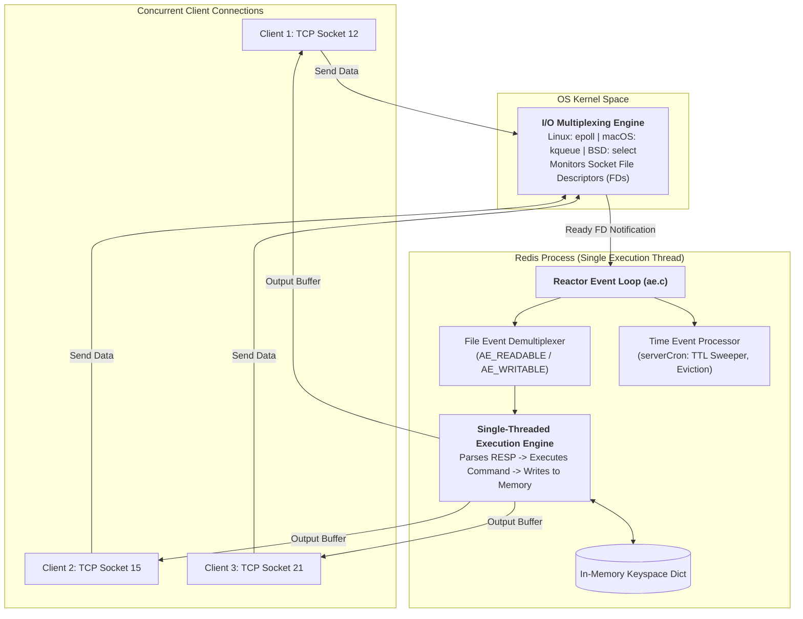

### A. Why Single-Threaded Execution Wins
1. **Zero Thread Synchronization Overhead:** No mutexes, spinlocks, read-write locks, or condition variables. Locking memory across multiple threads destroys throughput due to lock contention.
2. **Zero Context Switching:** Operating system thread context switches flush CPU registers, invalidate CPU instruction pipelines, and cost thousands of CPU cycles. A single thread stays permanently scheduled on its CPU core.
3. **CPU L1/L2/L3 Cache Locality:** Data structures accessed by a single thread remain resident in CPU cache lines rather than being repeatedly invalidated by other CPU cores (avoiding cache thrashing).
4. **Memory Bound, Not CPU Bound:** Redis operations (getting/setting memory addresses) take nanoseconds. The bottleneck in high-throughput caching is almost always **network I/O latency** and **memory bandwidth**, not CPU compute.

### B. The Reactor Pattern & I/O Multiplexing (`epoll` / `kqueue`)
Instead of spawning a thread per client (like Apache HTTP or legacy Java servers), Redis implements the **Reactor Pattern**:
1. All client TCP connections are set to **non-blocking mode** (`O_NONBLOCK`).
2. Redis registers all socket File Descriptors (FDs) with the operating system's I/O multiplexer:
   * **Linux:** `epoll` (Edge-Triggered / Level-Triggered notification).
   * **macOS / FreeBSD:** `kqueue`.
   * **Fallback:** `select` / `poll`.
3. The OS kernel monitors thousands of network sockets. When network packets arrive on any socket, `epoll_wait()` wakes up the Redis event loop with a list of only the **ready FDs**.
4. Redis sequentially reads the bytes, executes the command against memory, writes the response to the socket output buffer, and returns to `epoll_wait()`.

### C. Redis 6.0+ Threaded I/O (Multi-Threaded I/O, Single-Threaded Execution)
In modern $10\text{--}100\text{ Gbps}$ network environments, reading and writing network packets off the wire consumes more CPU cycles than reading from RAM.
* In Redis 6.0+, **Threaded I/O** was introduced: background I/O threads handle socket reading, RESP parsing, and socket response serialization in parallel.
* **Crucial Rule:** The **core command execution remains strictly single-threaded**. Commands are still executed sequentially against the shared in-memory dictionary, maintaining atomic lock-free guarantees.

---

## 2. Wire Protocol: RESP (REdis Serialization Protocol)

Redis communicates over TCP using **RESP** (RESP2 and RESP3). It was designed with three constraints:
1. Simple to implement in any programming language.
2. Fast for computers to parse.
3. Human-readable for debugging via `telnet` or `nc`.

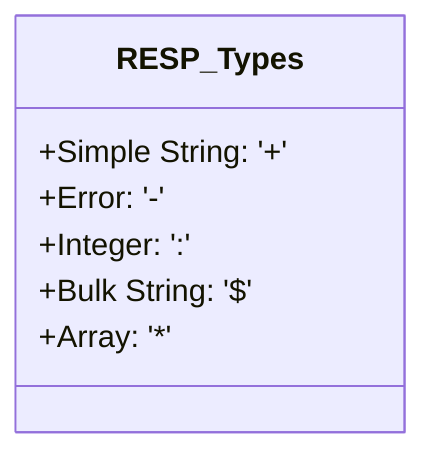

### A. RESP Data Types & Framing
Every message ends with a carriage return and line feed (`\r\n`):

| Data Type | Byte Prefix | Example Wire Format | Parsed Meaning |
| :--- | :--- | :--- | :--- |
| **Simple String** | `+` | `+OK\r\n` | String without binary newlines |
| **Error** | `-` | `-ERR unknown command 'FOO'\r\n` | Error message |
| **Integer** | `:` | `:1000\r\n` | 64-bit signed integer |
| **Bulk String** | `$` | `$6\r\nfoobar\r\n` | Binary-safe string with length prefix ($6$ bytes) |
| **Null Bulk String**| `$` | `$-1\r\n` | Key does not exist (`nil`) |
| **Array** | `*` | `*2\r\n$3\r\nGET\r\n$4\r\nuser\r\n` | Array of 2 Bulk Strings: `GET user` |

### B. Command Pipelining (Amortizing Network RTT)
Under normal request-response semantics:
$$\text{Total Time} = N \times (\text{Network RTT} + \text{Server Execution Time})$$

When an application needs to send 1,000 commands, network RTT ($1\text{ ms} \times 1,000 = 1\text{ second}$) completely dominates server execution time ($10\text{ ns} \times 1,000 = 10\text{ }\mu\text{s}$).

* **Pipelining Solution:** The client writes 1,000 commands into its local TCP buffer without waiting for replies, sending them in a single network packet.
* Redis executes all 1,000 commands sequentially and packs all 1,000 responses into a single reply packet.
* Reduces $1,000$ syscalls (`read()` / `write()`) down to a single syscall, boosting throughput from $20\text{k}$ to $500\text{k}+$ QPS.

---

## 3. In-Memory Data Structures Under the Hood

Redis does not store raw C pointers or raw strings directly. Every entry in the database is wrapped inside a **`redisObject`** header:

```c
typedef struct redisObject {
    unsigned type:4;       // OBJ_STRING, OBJ_LIST, OBJ_SET, OBJ_ZSET, OBJ_HASH
    unsigned encoding:4;   // RAW, EMBSTR, INT, ZIPLIST, HT, SKIPLIST, INTSET...
    unsigned lru:24;       // 24 bits: LRU clock timestamp OR Morris LFU counter
    int refcount;          // Reference counter (memory sharing & GC)
    void *ptr;             // Pointer to the underlying physical data structure
} robj;
```

---

### A. Simple Dynamic Strings (SDS) vs. C Strings

Redis is written in C, but it **never uses standard C null-terminated strings (`char*`)**. It uses custom **SDS (Simple Dynamic Strings)**.

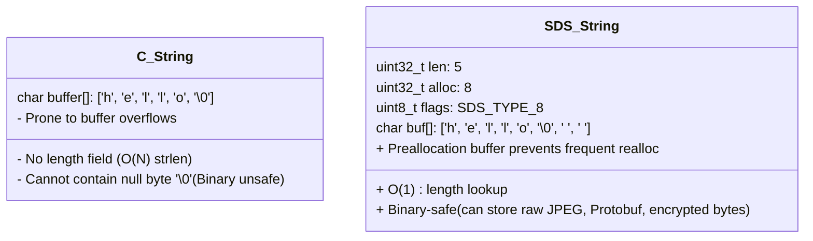

#### Why SDS Replaced C Strings:
1. **$O(1)$ Length Lookup:** Standard C strings require iterating through every byte until finding `\0` ($O(N)$). SDS stores `len` in the header, making `STRLEN` instant ($O(1)$).
2. **Binary Safety:** Standard C strings terminate at the first null byte `\0`. If an application caches a JPEG image, gzip payload, or Protobuf blob containing zero bytes, C truncates it. SDS uses `len` to delimit the string, allowing arbitrary binary storage.
3. **Space Preallocation & Lazy Freeing:** When appending strings, SDS allocates extra buffer space (`alloc > len`) to avoid expensive `realloc()` system calls on subsequent appends.

#### The `embstr` vs. `raw` Encoding Optimization
When storing a string, Redis chooses between two physical memory encodings:
* **`raw` Encoding:** Requires **two separate heap allocations** (`malloc` for `redisObject`, and a second `malloc` for the SDS body).
* **`embstr` Encoding (for strings $\le 44$ bytes):** Allocates the `redisObject` and the SDS struct in a **single contiguous 64-byte memory chunk**!
  * *Why 64 bytes?* Modern CPU L1/L2 cache lines are exactly 64 bytes. The entire object fits in a single CPU cache line, eliminating a pointer dereference and a second `malloc` call!

```text
Memory Layout of embstr (Single 64-Byte Cache Line):
[ redisObject (16 bytes) ][ sdshdr8 (3 bytes) ][ buf (up to 44 bytes) ][ '\0' (1 byte) ]
```

---

### B. Compact Sequential Memory: Ziplist vs. Listpack vs. Quicklist

When a user creates a Redis List (`LPUSH`), Hash (`HSET`), or Sorted Set (`ZADD`) with a small number of elements, a standard linked list or hash table would waste massive amounts of memory on pointers.

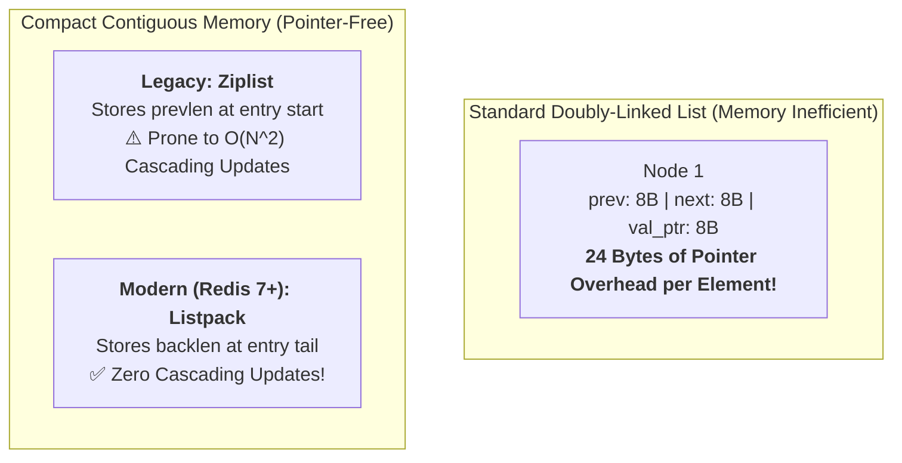

#### 1. The Ziplist (Legacy Compact Structure)
A standard doubly-linked list node costs $8\text{ bytes (prev)} + 8\text{ bytes (next)} + 8\text{ bytes (val ptr)} = 24\text{ bytes}$ of pointer overhead per element!
A **Ziplist** eliminates pointers entirely by serializing elements into a single contiguous block of memory:

```text
Ziplist Memory Layout:
<zlbytes> <zltail> <zllen> <entry 1> <entry 2> ... <entry N> <zlend>
```
Each entry stores:
* `prevlen`: Length of the previous entry (enables backward traversal without a `prev` pointer).
* `encoding`: Type and length of the current entry (integer vs string).
* `content`: The raw binary data.

#### 2. The Cascading Update Problem (Why Ziplist Failed)
In a Ziplist, `prevlen` uses a variable-length encoding:
* If the previous entry is $< 254$ bytes: `prevlen` occupies **1 byte**.
* If the previous entry is $\ge 254$ bytes: `prevlen` occupies **5 bytes** (`0xFE` flag followed by a 4-byte unsigned integer).

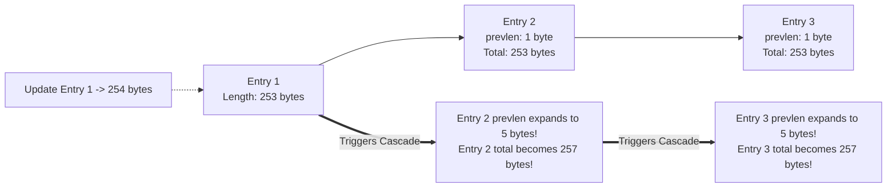

* **The Disaster Scenario:** Imagine 1,000 contiguous entries each having a length of exactly $253$ bytes. Their `prevlen` fields all take 1 byte.
* If Entry 1 is updated to $254$ bytes:
  1. Entry 2's `prevlen` must expand from 1 byte to 5 bytes ($+4$ bytes).
  2. Because Entry 2 grew by 4 bytes, its total size is now $253 + 4 = 257$ bytes!
  3. Because Entry 2 is now $> 254$ bytes, Entry 3's `prevlen` must also expand from 1 byte to 5 bytes ($+4$ bytes)!
  4. This chain reaction cascades across all $1,000$ entries, forcing Redis to reallocate, shift memory, and copy bytes $1,000$ times.
* **Worst-Case Cost:** Updating or inserting a single element escalates to **$O(N^2)$ time complexity**, causing the single-threaded event loop to freeze!

---

#### 3. The Modern Solution: Listpack (Redis 7+ Standard)
To eradicate cascading updates forever, Salvatore Sanfilippo (Antirez) designed **Listpack** ("a lists-of-strings serialization format"). Starting in Redis 5.0 (for Streams) and fully replacing Ziplist in **Redis 7.0**, Listpack is the default internal encoding for Hashes, Sorted Sets, and Quicklists.

##### The Core Architectural Rule of Listpack:
> **An entry must NEVER store information about the previous entry!**

Instead, each entry stores **its own total length at the very tail of the entry** (`backlen` / `element-tot-len`).

```text
Listpack Overall Memory Layout:
+----------------+----------------+----------------+----------------+-----+----------------+----------+
|  <tot-bytes>   |  <num-elements>|    <entry 1>   |    <entry 2>   | ... |    <entry N>   |  <end>   |
|   (4 bytes)    |   (2 bytes)    |                |                |     |                |  (0xFF)  |
+----------------+----------------+----------------+----------------+-----+----------------+----------+
```

##### Inside a Single Listpack Entry:
```text
Listpack Entry Structure:
+--------------------------+------------------------------+---------------------------+
|        <encoding>        |            <data>            |         <backlen>         |
|  (Type & payload length) | (Raw integer or string bytes)|  (Total entry length)     |
+--------------------------+------------------------------+---------------------------+
```

##### The `backlen` Variable-Length Integer Encoding:
* `backlen` stores the total number of bytes in this entry (`len(encoding) + len(data)`).
* It is encoded from right to left using **7 bits per byte** (with the highest bit, bit 7, used as a continuation indicator):
  * If bit 7 is `1`, more bytes of `backlen` precede it (reading backward).
  * If bit 7 is `0`, this is the most significant byte of `backlen`.
* It can occupy between **1 and 5 bytes**, supporting entry lengths up to $34\text{ GB}$ (though Redis entries are typically under a few KB).

##### How Backward Traversal Works Without `prevlen`:
How can Redis traverse backward if an entry doesn't know where the previous entry started?
1. The read pointer sits at the start of Entry $i$.
2. It steps backward by **1 byte** into the tail of Entry $i-1$.
3. It reads the variable-length `backlen` by scanning backward until finding a byte with bit 7 equal to `0`.
4. It decodes the integer $L = \text{backlen}$.
5. It jumps backward by $L$ bytes. **It is now positioned exactly at the start (`encoding`) of Entry $i-1$!**

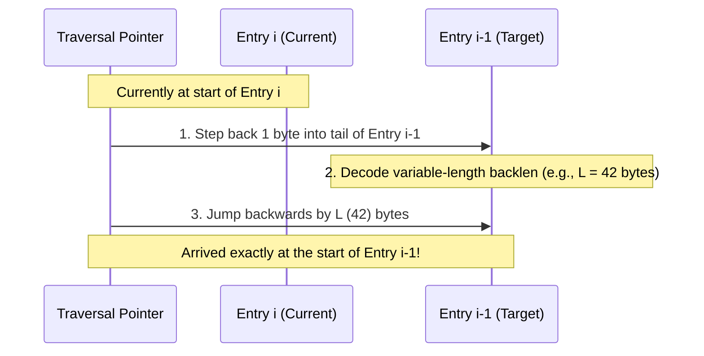

##### Why Cascading Updates are Impossible in Listpack:
Because Entry $i$'s `backlen` records **only Entry $i$'s own size**, changing Entry $i-1$ has **zero effect on Entry $i$**. Modifying an entry is strictly local:
$$\text{Worst-Case Insertion / Update Time} = O(N) \text{ memory shift (strictly linear, never } O(N^2)\text{)}$$

---

#### 4. The Quicklist Evolution (Quicklist + Listpack)
When a list grows beyond small element counts, maintaining a single massive Listpack would still cause noticeable `realloc()` overhead.
* Redis uses a **Quicklist**: a doubly-linked list where each individual node wraps a compact **Listpack** (default: capped at 8 KB via `list-max-listpack-size -2`).
* In Redis 7+, `quicklistNode` replaced its legacy internal Ziplist pointer with a modern Listpack pointer.
* **Result:** Blazing $O(1)$ push/pop at list extremities, zero pointer bloat for stored items, and zero risk of cascading update freezes.

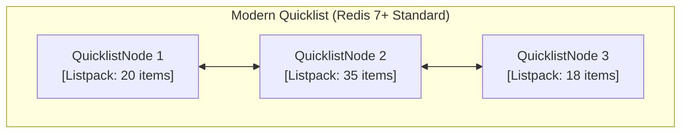

---

#### 5. Comprehensive Comparison: Ziplist vs. Listpack

| Architectural Dimension | Ziplist (Legacy, Redis 2.6 – 6.2) | Listpack (Modern Standard, Redis 7.0+) |
| :--- | :--- | :--- |
| **Backward Traversal Metadata** | `prevlen` stored at the **start** of each entry | `backlen` stored at the **tail** of each entry |
| **Cascading Updates** | ❌ **YES ($O(N^2)$ worst-case risk)** | ✅ **NEVER ($O(1)$ local guarantee)** |
| **Entry Framing** | `<prevlen> <encoding> <data>` | `<encoding> <data> <backlen>` |
| **Max Entry Length** | $4\text{ GB}$ ($5\text{ bytes}$) | $34\text{ GB}$ ($5\text{ bytes}$, 7-bit variable encoding) |
| **Memory Efficiency** | Extremely compact (zero pointers) | Equal or slightly more compact than Ziplist |
| **Usage in Hashes (`HSET`)** | Used when `hash-max-ziplist-entries` | Modern: `hash-max-listpack-entries` |
| **Usage in Sorted Sets (`ZADD`)** | Used when `zset-max-ziplist-entries` | Modern: `zset-max-listpack-entries` |
| **Usage in Quicklist** | Quicklist nodes wrapped Ziplists | Quicklist nodes wrap **Listpacks** |

---

### C. Sets: Intset (Integer Sets)

If a Set contains **only integers** and has few elements (`set-max-intset-entries = 512`), Redis encodes it as an **Intset** instead of a hash table:

```c
typedef struct intset {
    uint32_t encoding; // INTSET_ENC_INT16, INTSET_ENC_INT32, INTSET_ENC_INT64
    uint32_t length;   // Number of elements
    int8_t contents[]; // Sorted array of integers
} intset;
```

#### Dynamic Upcasting (Zero Wasted Space)
* When created with small numbers ($1, 2, 50$), Redis stores them as 16-bit integers (`int16_t`, 2 bytes per element).
* If a value exceeds $32,767$ (e.g., $100,000$), Redis dynamically **upgrades the entire array** to 32-bit integers (`int32_t`, 4 bytes per element) in $O(N)$ time.
* It remains sorted, enabling binary search ($O(\log N)$) lookups with zero hash table overhead.

---

### D. Sorted Sets (`ZSET`): SkipList + Hash Table

A Redis Sorted Set (`ZSET`) provides both $O(1)$ score lookups and $O(\log N)$ range queries (`ZRANGEBYSCORE`).

To accomplish this, Redis combines **two distinct data structures** inside a single object:
1. **Hash Table (`dict`):** Maps `member -> score` in $O(1)$ time.
2. **SkipList (`zskiplist`):** Orders elements by score in $O(\log N)$ time.

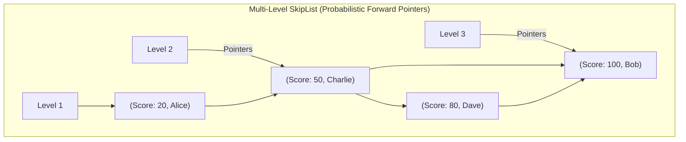

#### Why Redis Uses a SkipList Instead of a Red-Black Tree
Salvatore Sanfilippo (Antirez, the creator of Redis) explicitly documented why SkipLists were chosen over self-balancing binary search trees (Red-Black / AVL trees):
1. **Range Scans are Extremely Fast:** In a SkipList, the bottom layer (Level 1) is a simple sorted doubly-linked list. Executing `ZRANGE` is a simple $O(\log N)$ seek followed by contiguous pointer traversal. Tree in-order traversals are much slower and less cache-friendly.
2. **Simpler Rebalancing:** Red-Black trees require complex rotations that lock tree nodes. A SkipList uses a **probabilistic geometric coin-toss** (probability $p = 0.25$) to assign node levels upon insertion, making concurrent reads and memory tracking trivial.
3. **Memory Efficiency:** With $p = 0.25$, each node averages only $1.33$ forward pointers.

---

## 4. Memory Capping & Eviction Algorithms

Redis is an in-memory database; when RAM runs out, new writes fail unless data is evicted.

Redis configures a memory threshold via `maxmemory <bytes>` and an eviction policy via `maxmemory-policy`.

---

### A. The Approximated LRU Algorithm

A traditional LRU cache uses a **Doubly-Linked List + Hash Map**:
* Every time a key is accessed, it is unlinked and moved to the head of the list.
* The tail of the list is evicted when full.

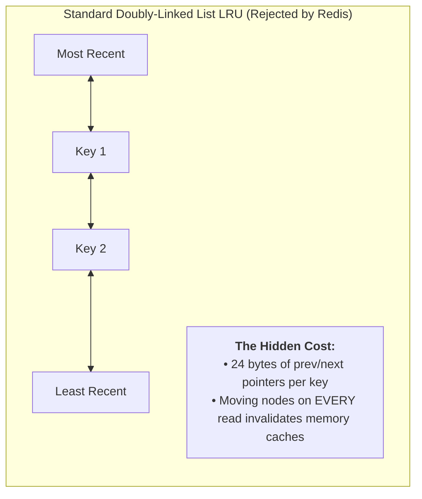

#### Why Redis Avoids True LRU:
1. **Memory Overhead:** Storing two 64-bit pointers (`prev` and `next`) costs **24 bytes per entry**. For 100 million keys, that wastes **2.4 GB of RAM purely on pointers**!
2. **Locking & Write Contention:** In true LRU, every `GET` query is technically a write because it must update pointers in the linked list, destroying read performance.

#### The Redis Solution: Approximated LRU (Sampling Pool)
* Each `redisObject` stores a **24-bit timestamp** (`lru:24`) recording when it was last accessed.
* When memory exceeds `maxmemory`:
  1. Redis does **not** inspect all keys.
  2. It randomly samples $N$ keys (default: `maxmemory-samples = 5`).
  3. It places them into an eviction pool of size 16, sorted by **idle time** ($\text{current\_time} - \text{lru}$).
  4. It evicts the single key with the highest idle time.
* **The Mathematical Reality:** At $N = 5$, Approximated LRU closely tracks true LRU. At $N = 10$, the difference between Approximated LRU and true LRU is mathematically negligible, while using **zero pointer overhead**.

---

### B. LFU (Least Frequently Used) via Morris Counter

While LRU evicts items that haven't been accessed recently, it suffers from **scan thrashing** (a batch job reads 1,000 keys once, flushing the entire cache). **LFU** evicts based on access frequency.

#### The Challenge: Fitting Frequency into 24 Bits
Redis reuses the 24-bit `lru` field in `redisObject` for LFU:
* **High 16 bits:** Last decrement time (in minutes).
* **Low 8 bits:** Logarithmic access counter (Logistic Morris Counter).

#### 1. The 8-bit Morris Counter
An 8-bit unsigned integer can only count up to $255$. How can Redis track keys with millions of accesses?
It uses a **probabilistic logarithmic counter**:
* Instead of incrementing on every hit, the counter increments with a probability that decreases as the counter grows:
  $$P(\text{increment}) = \frac{1}{\text{counter} \times \text{lfu\_log\_factor} + 1}$$
* With `lfu_log_factor = 10`, an 8-bit counter can represent up to **1,000,000 accesses**!

#### 2. The Decay Interval
If a key was accessed 1 million times during a flash sale and is never touched again, pure LFU would keep it in cache forever.
Redis solves this with **decay time**:
* Every time a key is accessed (or sampled during eviction), Redis calculates how many minutes have passed since the last decrement.
* For every `lfu_decay_time` minutes that have elapsed, the counter is decremented by 1.

---

### C. Eviction Policies Matrix

| Policy | Target Keys | Eviction Criteria | Best Use Case |
| :--- | :--- | :--- | :--- |
| **`noeviction`** | None | Returns an error on write when full (`OOM command not allowed`) | Critical datasets where data loss is unacceptable. |
| **`allkeys-lru`** | All keys | Approximated LRU | **Default choice for web caching** with power-law access. |
| **`volatile-lru`** | Keys with TTL | Approximated LRU | When some keys are persistent data and others are ephemeral caches. |
| **`allkeys-lfu`** | All keys | Approximated LFU (Morris Counter) | Protects cache against sudden one-off scan thrashing. |
| **`volatile-lfu`** | Keys with TTL | Approximated LFU (Morris Counter) | Protects TTL cache against scan thrashing. |
| **`allkeys-random`** | All keys | Uniform random key selection | When access patterns are completely flat/uniform. |
| **`volatile-random`**| Keys with TTL | Uniform random key selection | Infrequently used. |
| **`volatile-ttl`** | Keys with TTL | Smallest remaining TTL (closest to expiring) | Prioritizes dropping keys that are about to die anyway. |

---

## 5. TTL & Expiration Mechanics

Where are expiration times stored?
In the Redis database structure, keys are stored in the main keyspace dictionary (`dict *dict`). Keys with a TTL are *also* registered in a second dictionary: the **expires dictionary (`dict *expires`)**, which maps `key_ptr -> absolute_epoch_timestamp`.

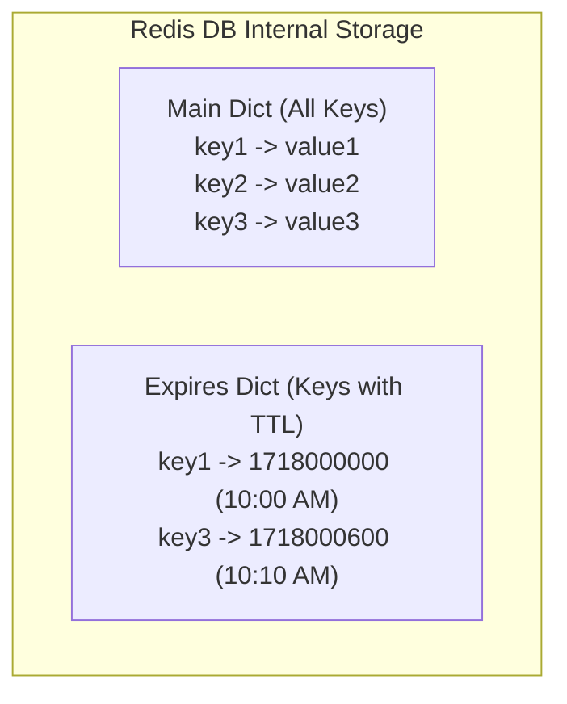

### A. The Two-Pronged Expiration Strategy
Redis never sets individual timers per key (which would waste memory and CPU). It uses two complementary mechanisms:

#### 1. Passive Expiration (Lazy Deletion on Read)
* When a client sends a read command (`GET key1`):
* Redis checks if `key1` exists in the `expires` dictionary.
* If `current_time > expiry_time`, Redis deletes the key immediately, propagates a `DEL` command to AOF and replicas, and returns `nil`.
* *Limitation:* If a key is never accessed again, passive expiration will never free its memory.

#### 2. Active Expiration (Periodic Background Sweeper)
To reclaim memory from keys that are never read, Redis runs a periodic time event (**`serverCron`**, executed 10 times per second):
1. Samples **20 random keys** from the `expires` dictionary.
2. Checks their expiration timestamps and deletes all expired keys.
3. If **more than 25% of the sampled keys (5+ keys) were expired**, it immediately repeats the process on another 20 random keys.
4. **Safety Valve:** The active sweeper has a hard timeout ($25\text{ ms}$) per cycle to prevent the single-threaded event loop from stalling client requests.

---

### B. TTL Expiration Notifications (Keyspace Notifications & Pub/Sub)

Redis can notify clients when a key expires via **Keyspace Notifications**, which publish events over **Redis Pub/Sub**.

#### 1. Configuration & Mechanics
By default, keyspace notifications are disabled to conserve CPU. You enable them via the `notify-keyspace-events` config string:
```bash
CONFIG SET notify-keyspace-events Ex
```
* `E` = Keyevent events (published with `__keyevent@<db>__` prefix).
* `x` = Expired events (generated whenever a key with an expiration is deleted).

Subscribers listen to one of two channel formats:
* **Keyevent Channel (`__keyevent@<db>__:expired`):** The channel name specifies the event; the message payload is the **key name** (e.g. `"order:901"`).
* **Keyspace Channel (`__keyspace@<db>__:<key>`):** The channel name specifies the key; the message payload is `"expired"`.

```bash
# Listen for all expired keys across all databases
redis-cli PSUBSCRIBE "__keyevent@*__:expired"
```

#### 2. Under the Hood: When Does Redis Actually Fire the Notification?
A common misconception is that Redis runs a background timer per key that fires at the exact millisecond the TTL reaches zero.
In reality, the internal C function `notifyKeyspaceEvent()` is triggered **only when the key is physically deleted from memory** inside `deleteExpiredKeyAndPropagate()`.

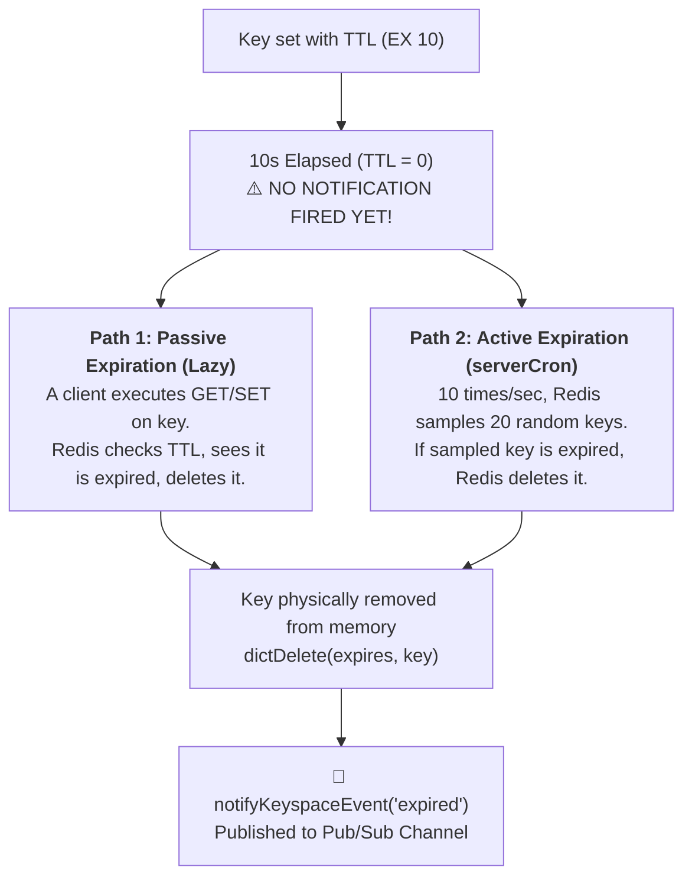

#### 3. The Two Fatal Production Traps

1. **The Timing Delay Trap (Non-Realtime Expiration):**
   * If a key expires, but **no client reads it**, the key remains in memory until `serverCron` randomly samples it.
   * If Redis holds hundreds of thousands or millions of keys with TTLs, **it can take seconds, minutes, or even hours** before the active sweeper randomly picks that key.
   * **Result:** A 15-minute order timeout notification might actually fire at 18 or 25 minutes!
2. **The Fire-and-Forget Zero Durability Trap:**
   * Redis Pub/Sub provides **no buffering, no acknowledgments, and no message history**.
   * If your subscriber worker restarts, crashes, or drops connection for 200 milliseconds, **every single expiration event published during that gap is permanently lost**.

#### 4. The Production Alternative: Sorted Set (`ZSET`) Delayed Queue
For reliable, exact-second delayed task execution, production architectures use a **Redis Sorted Set (`ZSET`)** instead of TTL keyspace notifications:

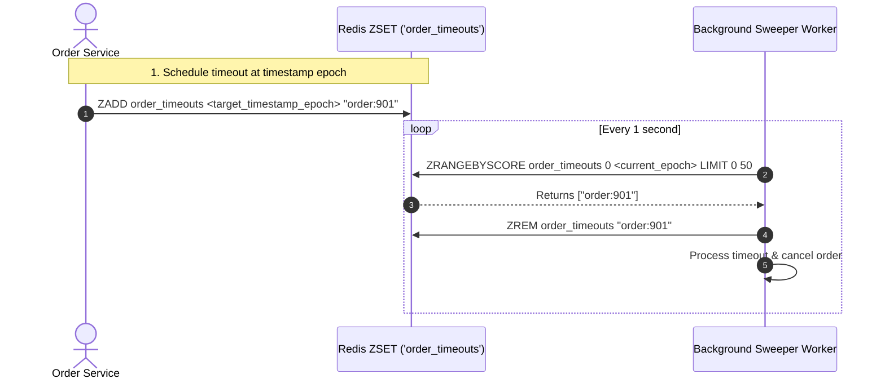
* **Why ZSET is Superior:**
  * **Deterministic Timing:** `ZRANGEBYSCORE 0 now` executes against exact epoch timestamps.
  * **Crash Resilient:** If workers die, items remain safely in the `ZSET` and are processed immediately upon worker recovery.
  * **Atomic Dequeue via Lua:** Multiple worker pods can pull and lock tasks using an atomic Lua script (`ZRANGEBYSCORE` + `ZREM`) without race conditions.

---

## 6. Persistence: AOF vs. RDB vs. Hybrid

Redis is in-memory, but it provides three persistence options to survive reboots.

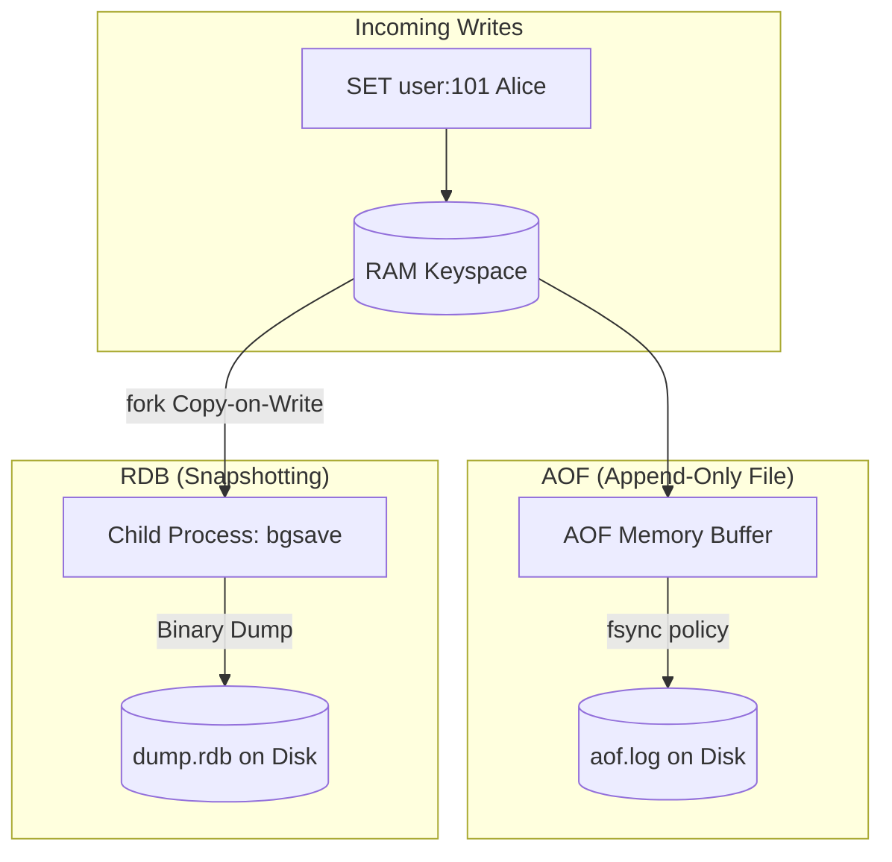

---

### A. AOF (Append-Only File)
Appends every write command in RESP format to a sequential log file on disk.

#### The `fsync` Flush Policies
When Redis writes to the AOF log, bytes first land in the OS page cache. The `appendfsync` configuration controls when the OS flushes to physical disk:
1. **`appendfsync always`:** Executes `fsync()` after every single write. Maximum durability, but destroys write throughput ($1\text{k--}2\text{k}$ QPS).
2. **`appendfsync everysec` (Recommended Standard):** The single thread writes to the OS buffer; a dedicated background thread calls `fsync()` once every second. At most $1\text{ second}$ of data can be lost.
3. **`appendfsync no`:** Lets the operating system decide when to flush (typically every 30 seconds). Highest throughput, lowest durability.

#### Background AOF Rewrite (`BGREWRITEAOF`)
Over time, the AOF file grows massive (`INCR counter` executed 10,000 times creates 10,000 log lines).
* Redis runs `BGREWRITEAOF` to compact the log:
  1. It **`fork()`s a child process**.
  2. The child process iterates through the in-memory keyspace and writes the **current state** to a new temporary file (replacing 10,000 `INCR` commands with a single `SET counter 10000`).
  3. Meanwhile, the parent process buffers any new incoming client writes in an **AOF Rewrite Buffer**.
  4. When the child finishes, the parent appends the buffer and atomically renames the file.

---

### B. RDB (Redis Database Snapshots)
Creates a compact, point-in-time binary dump of the entire keyspace (`dump.rdb`).

* **How it works:** Uses `fork()` to create a child process via Linux **Copy-on-Write (CoW)**:
  * The parent and child process share the exact same physical memory pages.
  * The child writes memory pages to disk.
  * If the parent receives a write command, the OS duplicates only the specific modified 4 KB memory page for the parent, leaving the child's snapshot pristine.
* **Pros:** Compact binary file; ultra-fast server boot times.
* **Cons:** Higher data loss window (e.g., if snapshots run every 15 minutes, up to 15 minutes of data is lost in a crash).

---

### C. Hybrid Persistence (Redis 4.0+)
Combines RDB speed with AOF granularity:
* The beginning of the AOF file is a compact **RDB binary snapshot**.
* Subsequent modifications are appended in standard **RESP text format**.
* Boot time is fast (reads binary RDB snapshot), while data loss is capped to 1 second.

---

## 7. Transactions & Concurrency Control

Redis is single-threaded, but it provides transaction and optimistic concurrency primitives.

### A. `MULTI` / `EXEC` (Sequential Isolation)
* When a client executes `MULTI`, Redis does not execute incoming commands; it appends them to a **command queue** on that connection.
* When the client sends `EXEC`, Redis executes all queued commands sequentially without interleaving commands from other clients.
* **No Rollback:** If a command fails semantically (e.g., executing `INCR` on a string), Redis **does not roll back** previous commands. All valid commands in the batch are committed.

### B. Optimistic Concurrency Control via `WATCH`
To implement atomic Check-and-Set (CAS):
```sql
WATCH balance
val = GET balance
val = val - 100
MULTI
SET balance val
EXEC
```
* If another client modifies `balance` between the `WATCH` and `EXEC` calls, Redis marks the transaction dirty and **`EXEC` returns a null reply (`nil`)**, aborting the write. The client can then retry.

### C. Lua Scripting & Redis Functions
For complex transactional logic, **Lua scripts (`EVAL`)** are superior to `MULTI`/`EXEC`:
* A Lua script runs entirely on the Redis single thread: it executes atomically from start to finish with zero network round-trips between steps.
* Example: Rate-limiting sliding window algorithms are implemented in Lua to guarantee atomicity between checking timestamps and incrementing counters.

---

## 8. High Availability & Clustering: Sentinel vs. Cluster

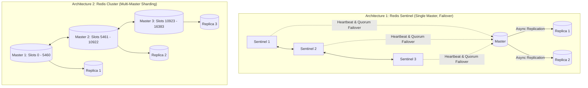

### A. Redis Sentinel (High Availability)
* **Purpose:** Provides automatic failover for master-replica setups.
* **Mechanism:** A quorum of Sentinel nodes monitor the master using heartbeats (`PING`). If the master is unreachable for `down-after-milliseconds`:
  1. Sentinels run a Raft-like election to pick a leader Sentinel.
  2. The leader promotes the most up-to-date replica to master.
  3. Reconfigures remaining replicas to replicate from the new master.
* **Limitation:** Scale is limited to a **single master's write throughput and physical RAM capacity**.

### B. Redis Cluster (Horizontal Sharding)
* **Purpose:** Shards data across multiple masters without proxy nodes.
* **The 16,384 Hash Slots:**
  * Every key is assigned to one of **16,384 hash slots**:
    $$\text{Slot} = \text{CRC16}(\text{key}) \pmod{16384}$$
  * Slots are divided among master nodes (e.g., Master 1 owns 0–5460, Master 2 owns 5461–10922, Master 3 owns 10923–16383).
* **Smart Client Redirection:**
  * Clients connect directly to any node and cache the slot-to-node routing table.
  * If a client queries Key $K$ on Node 1, but Slot($K$) lives on Node 2, Node 1 replies with:
    `-MOVED 5462 192.168.1.2:6379`
  * The client updates its local routing cache and redirects the query.
* **Hash Tags:** To execute multi-key operations (transactions, MGET) in a cluster, keys must hash to the exact same slot. Prepending a hash tag forces hashing on the substring inside `{}`:
  * `{user_101}:profile` and `{user_101}:orders` will hash to the exact same slot!

---

## 9. Comprehensive Architectural Comparison Matrix

| Architectural Dimension | Redis | Memcached | Dragonfly / KeyDB | Amazon DynamoDB |
| :--- | :--- | :--- | :--- | :--- |
| **Execution Model** | **Single-Threaded Event Loop** | Multi-Threaded (Locks per slab) | Multi-Threaded Shared-Nothing | Stateless Routers + Paxos Storage |
| **Data Types** | Strings, Lists, Sets, ZSets, Hashes, Streams, HLL, Geo | Raw Strings / Blobs only | Full Redis protocol compatible | Tables, Items, Attributes |
| **Persistence** | **AOF, RDB, Hybrid** | ❌ None (Pure In-Memory) | Snapshotting / Replication | Persistent Disk (WAL + Paxos) |
| **Replication** | Asynchronous Master-Replica | ❌ None (Client-side sharding) | Multi-threaded replication | Multi-AZ Paxos Quorum |
| **Max Value Size** | **512 MB** | **1 MB** (default slab size) | 512 MB | **400 KB** |
| **Eviction Mechanics**| Approximated LRU, Morris LFU, Random | True LRU per slab | True LRU / LFU | TTL background sweeper |
| **Transactions** | `MULTI`/`EXEC`, `WATCH`, Lua | `CAS` (Check-And-Set) | Multi-threaded transactions | 2PC `TransactWriteItems` |

---

## 10. System Design Interview Playbook & Traps

### A. When to Choose Redis
1. **High-Performance Read Caching:** Sub-millisecond latency for hot database queries (Cache-Aside pattern).
2. **Complex In-Memory Primitives:** Leaderboards (`ZSET`), Rate limiters (Lua + Sliding Window), Session stores, Geo queries (`GEOADD`).
3. **Transient Messaging:** Pub/Sub or message buffering (Redis Streams with Consumer Groups).
4. **Fast Counters & Deduplication:** `INCR`, HyperLogLog for unique DAU tracking, Bloom Filters.

### B. Critical Interview Traps to Avoid

#### 1. The Linux `fork()` Copy-on-Write Memory Spike
* **The Trap:** If Redis is running on a 64 GB machine using 50 GB of RAM, triggering an RDB snapshot or AOF rewrite forks a child process.
* **The Failure:** If write traffic is heavy, the OS duplicates memory pages. Memory usage spikes above 64 GB, triggering the Linux **OOM Killer** (`killed process redis-server`).
* **The Staff Engineer Rule:** In production, never allocate more than **50–60% of physical host RAM** to Redis if background persistence (`bgsave`/`aof`) is enabled, and set `sysctl vm.overcommit_memory = 1`.

#### 2. The $O(N)$ Blocking Commands Trap
* Because Redis is single-threaded, running an $O(N)$ command blocks **all other clients** cluster-wide!
* **Forbidden Commands on Production Whiteboards:**
  * `KEYS *` $\implies$ Use `SCAN` (cursor-based iteration) instead.
  * `HGETALL` on massive hashes $\implies$ Use `HSCAN` or `HMGET`.
  * `FLUSHALL` $\implies$ Use `FLUSHALL ASYNC` (unlinks memory in background).

#### 3. The "Redis is an ACID Database" Trap
* Redis does not support full ACID transactions (no rollback on execution errors).
* AOF persistence with `appendfsync everysec` can lose up to 1 second of writes during a power failure.
* Replication to read-replicas is **asynchronous**; failover via Sentinel can result in data loss for writes that hadn't reached replicas.
* **Rule:** Use Redis as an in-memory cache, transient message buffer, or non-critical state engine. Never use it as the source of truth for financial balances without backing it with a durable ACID store (PostgreSQL / CockroachDB).

---

### C. The Redis Usage Spectrum: Advisable vs. NOT Advisable (Anti-Patterns)

Because Redis is so versatile, teams frequently fall into the trap of using it as a "hammer for every nail." The following matrix delineates where Redis is best-in-class, where it is situational with strict guardrails, and where it is a dangerous anti-pattern.

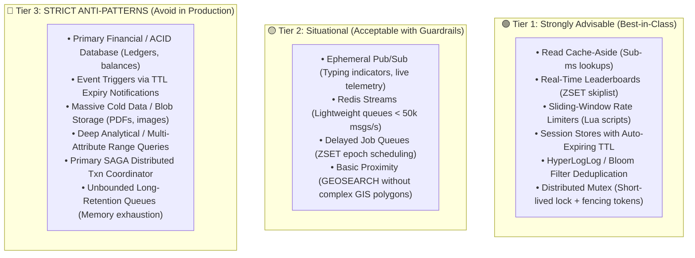

#### Detailed Breakdown of Anti-Patterns: Why They Fail & What to Use Instead

| Use Case | Status | Why Redis Fails / Risks | Better Purpose-Built Alternative |
| :--- | :--- | :--- | :--- |
| **Primary Financial / ACID Store** | 🔴 **Anti-Pattern** | Asynchronous replication (loss on failover), weak AOF durability (1s data loss window), no multi-table relational rollbacks. | **PostgreSQL, MySQL, CockroachDB** |
| **TTL Expiration Event Triggers** | 🔴 **Anti-Pattern** | Non-realtime delays (lazy/probabilistic active sweeper), Pub/Sub fire-and-forget drops events on network blips. | **Redis ZSET delayed queue, AWS SQS, Temporal.io** |
| **Large Blob / Cold Data Storage** | 🔴 **Anti-Pattern** | RAM is 5–10x more expensive than SSDs. Storing large JSON, images, or cold history wastes expensive memory bandwidth. | **Amazon S3, Cloudflare R2, MongoDB** |
| **Multi-Attribute / Complex Range Queries** | 🔴 **Anti-Pattern** | No cost-based query optimizer, no secondary indexes on arbitrary attributes, no joins. Requires full cluster scans or brittle manual sets. | **Elasticsearch, OpenSearch, ClickHouse, PostgreSQL** |
| **Primary SAGA Distributed Coordinator** | 🔴 **Anti-Pattern** | Failover during node crash causes "Ghost Transactions" (coordinator drops in-flight state and forgets rollbacks); idle sagas waste RAM. | **Temporal.io, Cadence, AWS Step Functions** |
| **Unbounded Long-Term Message Queue** | 🔴 **Anti-Pattern** | Slow consumers cause memory buildup. When `maxmemory` is reached, Redis either evicts cache keys, crashes with OOM, or rejects all writes. | **Apache Kafka, AWS SQS, RabbitMQ** |
| **High-Volume Ephemeral Caching** | 🟢 **Advisable** | Single-digit millisecond latency, rich eviction policies (`allkeys-lru`, `volatile-lru`), pipeline batching. | **Redis (Best-in-Class)** |
| **Real-Time Leaderboards & Ranking** | 🟢 **Advisable** | Skiplist-backed `ZSET` provides $O(\log N)$ updates and $O(\log N + M)$ range retrieval. | **Redis (Best-in-Class)** |
| **High-Throughput Rate Limiting** | 🟢 **Advisable** | Atomic execution via Lua scripts eliminates race conditions with constant memory overhead. | **Redis (Best-in-Class)** |

---

## 11. Real-World Application Scenarios & Architectural Design Patterns

Across large-scale system designs, Redis is employed far beyond simple key-value caching. The following battle-tested patterns appear repeatedly in modern production architectures and system design interviews.

---

### Pattern 1: Distributed Locking with Fencing Tokens (`SET NX PX` + Redlock)

When multiple application workers need mutual exclusion over a shared resource (e.g., generating an invoice or processing a single order payout), Redis provides high-performance distributed locking.

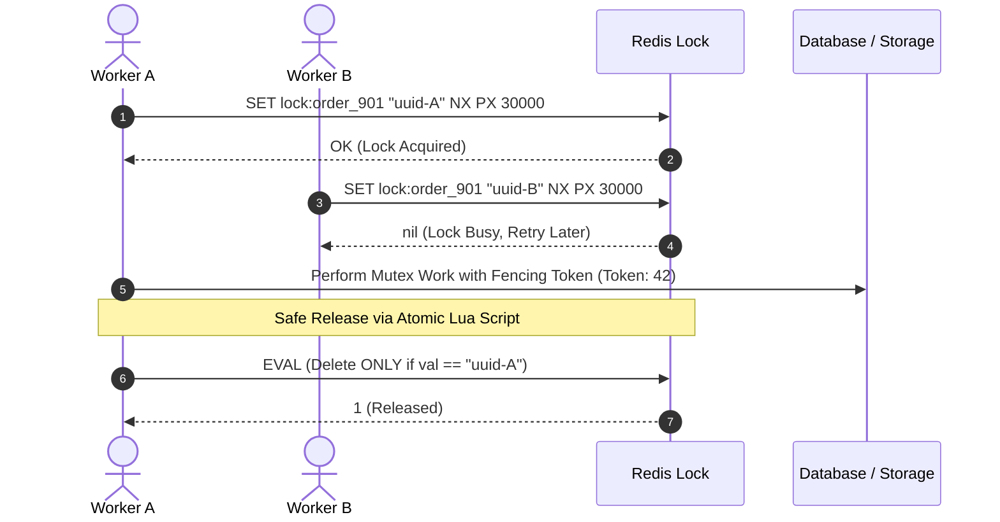

#### 1. Safe Lock Acquisition:
```text
SET lock:order_901 <unique_client_uuid> NX PX 30000
```
* `NX`: Only set if key does not exist (atomically guarantees mutual exclusion).
* `PX 30000`: Sets a 30-second TTL (prevents permanent deadlocks if the worker crashes).
* `<unique_client_uuid>`: Crucial random value preventing clients from deleting other clients' locks.

#### 2. Safe Atomic Lock Release (Lua Script):
A naive `DEL lock:order_901` causes **silent lock corruption**:
* *The Bug:* Worker A takes the lock. Worker A encounters a 35-second Stop-The-World GC pause or network stall. The 30-second lock expires. Worker B acquires the lock. Worker A wakes up and calls `DEL lock:order_901`, deleting Worker B's lock!
* *The Fix:* Workers must release the lock only if the value matches their unique UUID:
```lua
if redis.call("get", KEYS[1]) == ARGV[1] then
    return redis.call("del", KEYS[1])
else
    return 0
end
```

#### 3. Martin Kleppmann's Fencing Token Critique
Even with safe release, if Worker A pauses while holding the lock and writes to storage *after* its lock expired, it can overwrite Worker B's valid work.
* **The Solution:** Use **Fencing Tokens** (monotonically increasing numbers like `INCR lock_epoch:order_901`). Storage rejects any write with a token lower than the latest committed token.

---

### Pattern 2: Rate Limiting & Traffic Shaping (3 Production Approaches)

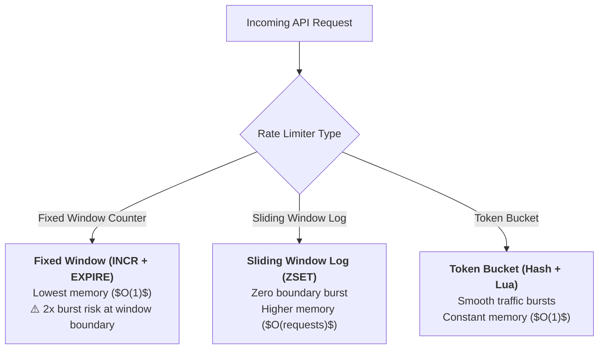

#### Approach A: Fixed Window Counter (Simple & Fast)
```lua
local current = redis.call('INCR', KEYS[1])
if current == 1 then
    redis.call('EXPIRE', KEYS[1], ARGV[1])
end
if current > tonumber(ARGV[2]) then
    return 0 -- Throttled
else
    return 1 -- Allowed
end
```

#### Approach B: Sliding Window Log via Sorted Sets (`ZSET`)
Eliminates boundary bursts by recording timestamps of every individual request:
```lua
local key = KEYS[1]
local now = tonumber(ARGV[1])
local window = tonumber(ARGV[2])
local limit = tonumber(ARGV[3])
local clearBefore = now - window

-- 1. Evict requests older than the sliding window
redis.call('ZREMRANGEBYSCORE', key, 0, clearBefore)

-- 2. Count current requests in window
local currentRequests = redis.call('ZCARD', key)

if currentRequests < limit then
    -- 3. Add current request with timestamp as score and unique member
    redis.call('ZADD', key, now, now .. '-' .. math.random())
    redis.call('EXPIRE', key, math.ceil(window / 1000))
    return 1 -- Allowed
else
    return 0 -- Rate Limited
end
```

---

### Pattern 3: Real-Time Leaderboards & High-Score Rankings (`ZSET`)

Gaming leaderboards and competitive ranking systems require updating scores for millions of users and rendering Top-100 lists in real time.

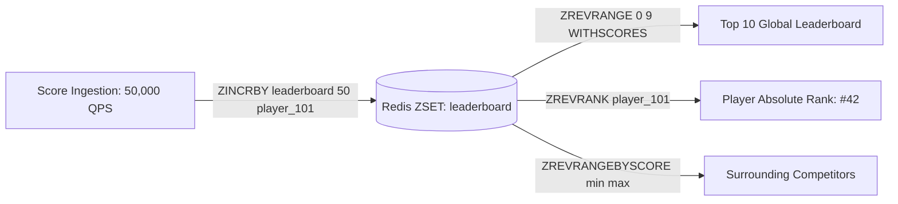

#### Key Operations:
1. **Update Score:** `ZINCRBY leaderboard 50 "player_101"` ($O(\log N)$).
2. **Fetch Top-10 Players:** `ZREVRANGE leaderboard 0 9 WITHSCORES` ($O(\log N + K)$).
3. **Fetch Player's Exact Rank:** `ZREVRANK leaderboard "player_101"` ($O(\log N)$).

#### The Tie-Breaking Sub-Pattern:
In competitive gaming, if Player A and Player B have the same score, the player who reached it **earlier** must rank higher.
* Append a fractional inverted timestamp to the score:
  $$\text{Final Score} = \text{Game Score} + \left(1 - \frac{\text{Timestamp}}{10^{13}}\right)$$
* Both players have score $1000$, but Player A (timestamp $T_1$) gets $1000.83$, while Player B (timestamp $T_2 > T_1$) gets $1000.81$. Redis sorts Player A first natively!

---

### Pattern 4: Distributed Delayed Task Scheduler (`ZSET` + List)

Used for executing future asynchronous tasks (e.g., auto-canceling an unpaid order after 15 minutes, or sending reminder notifications).

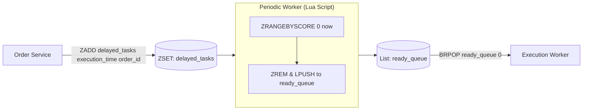

#### Atomic Poller Script (Lua):
Prevents duplicate task pickup among competing workers:
```lua
local tasks = redis.call('ZRANGEBYSCORE', KEYS[1], 0, ARGV[1], 'LIMIT', 0, ARGV[2])
if #tasks > 0 then
    redis.call('ZREM', KEYS[1], unpack(tasks))
    redis.call('LPUSH', KEYS[2], unpack(tasks))
end
return tasks
```
Workers run `BRPOP ready_queue 0`, blocking until a task is ready with zero busy-waiting.

---

### Pattern 5: Geospatial Proximity & Ride-Sharing Matching (`GEOADD` + `GEORADIUS`)

In ride-sharing (Uber/Lyft) and food delivery, driver locations are updated every 3–5 seconds ($100\text{k}+$ writes/sec).

* **Location Ingestion:**
  ```text
  GEOADD active_drivers -122.4194 37.7749 "driver_42"
  ```
  * Redis converts `(lat, long)` into a 52-bit integer **GeoHash** and stores it as the `score` in a standard **Sorted Set (`ZSET`)**.
* **Proximity Query (Find nearest 10 drivers within 5 km):**
  ```text
  GEORADIUS active_drivers -122.4194 37.7749 5 km WITHDIST WITHCOORD ASC LIMIT 10
  ```
  * Runs in $O(N + \log M)$ where $N$ is the number of elements in the bounding box, returning in sub-2ms.

---

### Pattern 6: WebSocket Fan-Out & User Online Presence

In chat and notification architectures, millions of clients maintain persistent WebSocket connections across hundreds of stateless gateway servers.

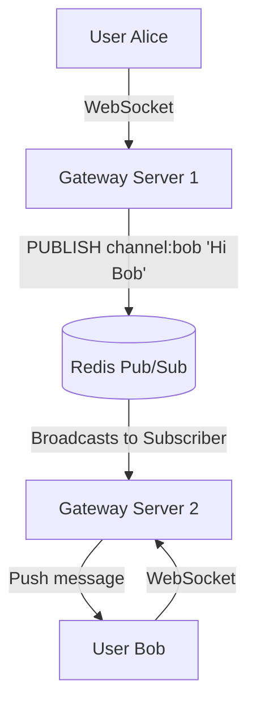

#### 1. Cross-Server Message Routing (Redis Pub/Sub):
* Gateway Server 2 subscribes to `channel:bob`.
* When Alice sends a message to Bob on Gateway Server 1, Gateway 1 issues `PUBLISH channel:bob <json>`.
* Redis instantly routes the message to Gateway 2, which pushes it down Bob's open WebSocket.

#### 2. User Online Presence (Heartbeat TTL):
* Client sends a heartbeat ping every 15 seconds:
  ```text
  SET presence:user_101 "online" EX 30
  ```
* To check if a user is online: `EXISTS presence:user_101`.
* If the user loses network or crashes, the key expires after 30 seconds, automatically flipping their status to offline with zero ghost connections.

---

### Pattern 7: Massive Deduplication & User Retention (Bitmaps & HyperLogLog)

#### A. 365-Day User Login Streak (Bitmaps):
* Instead of storing login dates in SQL tables or arrays, use a single Redis key per user:
  ```text
  SETBIT user:login:101:2026 107 1 -- User 101 logged in on Day 107
  ```
* **Storage Cost:** 365 bits = **46 bytes per user per year!**
* **Total Days Logged In:** `BITCOUNT user:login:101:2026` ($O(N)$ CPU popcount instruction).
* **Multi-Day Cohort Analysis:** Use `BITOP AND result key1 key2` to find users active on both Day A and Day B.

#### B. Unique Daily/Monthly Active Users (HyperLogLog):
* Record unique user visits: `PFADD dau:2026-10-17 "user_101" "user_102"`.
* Count unique visitors: `PFCOUNT dau:2026-10-17`.
* Merge daily counts into monthly: `PFMERGE mau:2026-10 dau:2026-10-01 dau:2026-10-02 ...`
* **Scale:** Tracks **billions of unique users with 0.81% standard error using only 12 KB of RAM!**

---

### Pattern 8: Atomic Inventory Allocation & Flash Sale Checkouts (Lua)

In flash sales or ticket booking, thousands of requests per second hit a single product with limited stock. Relational database `SELECT ... FOR UPDATE` causes connection pool exhaustion and deadlocks.

```mermaid
sequenceDiagram
    actor User as Buyer Request
    participant App as Checkout Service
    participant Redis as Redis Inventory
    participant DB as Postgres / CockroachDB

    User->>App: Buy 2 Tickets
    App->>Redis: EVAL Stock-Check Script
    alt Stock Available
        Redis-->>App: 1 (Stock decremented in RAM)
        App->>DB: Asynchronously create Order & Payment
        App-->>User: Order Reserved!
    else Stock Depleted
        Redis-->>App: 0 (Out of stock)
        App-->>User: Sold Out!
    end
```

#### Atomic Stock Decrement Script:
```lua
local stock = tonumber(redis.call('GET', KEYS[1]) or 0)
local requested = tonumber(ARGV[1])

if stock >= requested then
    redis.call('DECRBY', KEYS[1], requested)
    return 1 -- Success
else
    return 0 -- Sold out / Insufficient stock
end
```
* **Guarantee:** Executes entirely on Redis's single execution thread; **zero possibility of race conditions or double-selling**, processing over 80,000 reservation checks per second.

---

### Pattern 9: Idempotency Keys & Request Deduplication

To prevent duplicate charges when network retries occur:
1. Client generates a unique UUID: `Idempotency-Key: pay_abc123`.
2. The payment service checks Redis before hitting payment gateways:
   ```text
   SET idempotency:pay_abc123 "PROCESSING" NX EX 120
   ```
3. If the command returns `nil`, another request is already processing $\implies$ return `409 Conflict` or poll for completion.
4. When finished, update: `SET idempotency:pay_abc123 <response_json> XX EX 86400`.
5. Retries return the cached `<response_json>` without charging the customer twice.

---

### Pattern 10: One-Hit-Wonder Cache Filter (RedisBloom)

In large content networks, **up to 80% of cached web assets are requested only once** and never again ("One-Hit Wonders"), thrashing expensive RAM caches.

```mermaid
flowchart TD
    Req[GET Asset /image_99] --> CheckBloom{Exists in Bloom Filter?}
    
    CheckBloom -->|No (First Access)| AddBloom["Add to Bloom Filter<br/>Fetch from DB / S3<br/><b>DO NOT CACHE IN REDIS</b>"]
    CheckBloom -->|Yes (Second Access)| CacheInRedis["Admit to Redis Cache!<br/>(Asset is genuinely popular)"]
```
* **Mechanism:** When a request misses the cache, check an in-memory Bloom filter.
  * If absent $\implies$ record it in the Bloom filter, return asset, but **do not write to Redis cache**.
  * If present $\implies$ this is at least the second request! Write it to Redis cache.
* **Result:** Slashes cache churn by **60–70%**, preserving memory exclusively for multi-access data.

---

### Pattern 11: SAGA Distributed Transactions — Supporting Role vs. Production Alternatives

A classic senior/staff system design interview question is: *"Can we use Redis to implement a SAGA distributed transaction across microservices?"*

```mermaid
flowchart TD
    subgraph SagaCoordinator["Saga Execution Coordinator (SEC)"]
        Orchestrator[Workflow Engine]
    end

    subgraph RedisRoles["Redis Supporting Roles in Sagas"]
        L["<b>1. Distributed Mutex</b><br/>SET lock:order_901 saga_id NX PX<br/>Prevents concurrent sagas from modifying same entity"]
        T["<b>2. Step Timeout Watchdog</b><br/>ZADD saga_timeouts epoch saga_id<br/>Triggers compensation if service hangs"]
        I["<b>3. Compensation Idempotency</b><br/>SET idempotency:compensate:order_901 1 NX<br/>Ensures compensation never runs twice"]
        S["<b>4. Ephemeral Event Bus</b><br/>Redis Streams / PubSub<br/>Fast lightweight choreography for non-critical pipelines"]
    end

    Orchestrator --> L & T & I & S
```

#### 1. Where Redis Excels in SAGA Support
* **Distributed Locking (Isolation Defense):** Because Sagas lack ACID isolation (intermediate states are visible), concurrent sagas can cause dirty writes. Redis prevents this via entity locks:
  ```text
  SET lock:account_101 <saga_id> NX PX 30000
  ```
* **Step Timeout Watchdogs:** If an external service hangs, a Redis Sorted Set (`ZSET`) acts as an active timeout tracker:
  ```text
  ZADD saga_deadlines <current_timestamp + 30s> <saga_id>
  ```
  A background reaper pulls expired entries via `ZRANGEBYSCORE 0 now` to trigger compensations.
* **Idempotency Guard for Compensations:** Compensating transactions ($C_1, C_2$) **must be idempotent** under network retries. Redis stores tokens to ensure a refund or cancellation never executes twice:
  ```text
  SET idempotency:compensate:<step_id> "DONE" NX EX 86400
  ```

#### 2. Why Redis is NOT the Primary SAGA Engine (The Failure Modes)
* **The "Ghost Transaction" Risk:** Redis replication is asynchronous. If the master dies before persisting an in-flight saga state, a failover drops that state. **The coordinator forgets to trigger compensating rollbacks**, permanently stranding financial ledgers or external bookings.
* **Dormant Workflows Waste RAM:** Sagas can take hours or days (e.g., waiting for human KYC approval or bank wire clearance). Holding idle state machines in expensive RAM is uneconomical.
* **No Built-in Durable Execution:** Redis has no built-in state-machine runtime. Developers must hand-roll retry backoffs, step reconciliations, and audit histories.

#### 3. Production Alternatives for SAGA

| Dimension | Redis | Temporal.io / Cadence | AWS Step Functions | Apache Kafka + Debezium | PostgreSQL / MySQL |
| :--- | :--- | :--- | :--- | :--- | :--- |
| **Primary SAGA Style** | Supporting Cache / Lock | **Orchestration** | **Orchestration** | **Choreography** | **Orchestration** |
| **Durability** | Weak (Async AOF/Replication) | **Strictly Durable** (Event Sourcing) | **Strictly Durable** (AWS Managed) | **Strictly Durable** (Replicated Log) | **Strictly Durable** (ACID WAL) |
| **Max Lifespan** | Seconds to Minutes | **Years (Infinite)** | **1 Year** | Days to Weeks | Months |
| **Developer Ergonomics**| High manual boilerplate | **Code-as-Workflows (Pure Go/TS)** | Visual / JSON ASL | Event-driven listeners | Custom SQL State Engine |
| **Compensation Logic** | Hand-rolled scripts | Built-in `try/catch` | Built-in `Catch` blocks | Reverse event triggers | Custom rollback loop |
| **Best Used For** | Fast locks, timeouts, & dedup | **Core business workflows & payments** | AWS Serverless pipelines | High-scale event streaming | Simple monolithic transitions |

> **💡 Staff Engineer Interview Rule:**
> * For **Orchestration**, propose **Temporal.io** (or AWS Step Functions) for durable code execution and native compensation handling.
> * For **Choreography**, propose **Apache Kafka with the Transactional Outbox Pattern (Debezium)** to guarantee atomic event publication from local microservice databases.
> * Use **Redis** strictly as a helper for **distributed locking, step timeouts, and idempotency deduplication**.
> * For the full architectural breakdown of **Two-Phase Commit (2PC) vs. SAGA** and why financial rails (Fedwire, ACH, SWIFT) strictly prohibit 2PC across banks in favor of multi-stage SAGAs with settlement finality and compensating returns, see [Message Brokers and Consistency: 2PC vs. SAGA & Banking Case Study](../Message%20Brokers%20and%20Consistency/README.md#c-2pc-vs-saga-industry-standards--architectural-boundaries).

---

## 12. Master Cheat Sheet: Redis Commands & Primitives for System Design Interviews

When designing systems in interviews, using imprecise phrases like *"store it in Redis"* raises doubts about your production depth. Staff and Principal engineers specify the **exact Redis data structure, atomic commands, time complexity ($O$), and failure modes**.

---

### A. The System Design Pattern $\leftrightarrow$ Redis Primitive Quick-Lookup Matrix

| System Design Use Case | Best Redis Primitive | Core Commands Used | Time Complexity | Why This Primitive? | Chapter / Pattern Reference |
| :--- | :--- | :--- | :--- | :--- | :--- |
| **Distributed Lock** | String (`NX`, `PX`) | `SET key token NX PX 30000`<br>`EVAL` (safe release script) | $O(1)$ | Guarantees mutual exclusion atomically without separate `SET` + `EXPIRE` race condition. | [04. Rate Limiter](../../04.%20Rate%20Limiter/Readme.md), [Ch 26](../../26.%20Payment%20System/README.md) |
| **Idempotency Guard** | String (`NX`, `EX`) | `SET idemp:key "PROCESSING" NX EX 120`<br>`SET idemp:key resp XX EX 86400` | $O(1)$ | Prevents duplicate processing of payments/orders under network retries. | [08. URL Shortener](../../08.%20URL%20Shortener/Readme.md), [Ch 26](../../26.%20Payment%20System/README.md) |
| **Rate Limiter (Fixed Window)** | String (Atomic Counter) | `INCR key`<br>`EXPIRE key 60 NX` | $O(1)$ | Ultra-low memory ($O(\text{users})$); ideal for coarse perimeter rate limiting. | [04. Rate Limiter](../../04.%20Rate%20Limiter/Readme.md), [Ch 30](../../30.%20Distributed%20Rate%20Limiter/README.md) |
| **Rate Limiter (Sliding Log)** | Sorted Set (`ZSET`) | `ZREMRANGEBYSCORE key 0 (now-60)`<br>`ZCARD key`<br>`ZADD key now uuid` | $O(\log N + M)$ | Exact rolling window without boundary burst leakage. Memory is $O(\text{requests})$. | [04. Rate Limiter](../../04.%20Rate%20Limiter/Readme.md), [Ch 30](../../30.%20Distributed%20Rate%20Limiter/README.md) |
| **Real-time Leaderboard** | Sorted Set (`ZSET`) | `ZADD lb score player`<br>`ZINCRBY lb delta player`<br>`ZREVRANK lb player`<br>`ZREVRANGE lb 0 9` | $O(\log N)$ insert<br>$O(\log N)$ rank<br>$O(\log N + K)$ range | SkipList maintains elements in sorted order dynamically; $O(\log N)$ rank queries. | [25. Gaming Leaderboard](../../25.%20Real-time%20Gaming%20Leaderboard/README.md) |
| **Delayed Task Scheduler** | Sorted Set (`ZSET`) | `ZADD delay_queue run_epoch task_id`<br>`ZRANGEBYSCORE delay_queue 0 now LIMIT 0 100`<br>`ZREM delay_queue task_id` | $O(\log N + M)$ | Score is Unix timestamp. Poller pulls eligible tasks due for execution atomically. | [31. Job Scheduler](../../31.%20Distributed%20Job%20Scheduler/README.md) |
| **Capped Activity Feed / Timeline** | List or Sorted Set | `LPUSH feed:user item`<br>`LTRIM feed:user 0 799`<br>OR `ZADD` + `ZREMRANGEBYRANK` | $O(1)$ push<br>$O(K)$ trim | Caps memory usage per user; prevents feeds from growing unbounded in RAM. | [11. News Feed](../../11.%20News%20Feed%20System/Readme.md) |
| **FIFO Task Queue** | List (Blocking Pop) | `RPUSH work_queue task`<br>`BLPOP work_queue 5`<br>`LMOVE q1 q2 RIGHT LEFT` | $O(1)$ | Eliminates busy polling; workers sleep until new jobs arrive. | [10. Notification](../../10.%20Notification%20System/Readme.md), [Ch 31](../../31.%20Distributed%20Job%20Scheduler/README.md) |
| **User Entity Profile Cache** | Hash | `HSET user:101 name "Alice" plan "pro"`<br>`HGETALL user:101`<br>`HINCRBY user:101 logins 1` | $O(1)$ per field<br>$O(N)$ for all fields | Allows partial field updates without re-serializing entire JSON blob. | [01. Scaling](../../01.%20Scaling/Readme.md) |
| **Faceted Search / Tag Filter** | Set | `SADD tag:bug item_1`<br>`SINTER tag:bug tag:p0`<br>`SINTERSTORE dest tag1 tag2` | $O(1)$ add<br>$O(N \times M)$ intersection | Eliminates multi-join relational query explosions for multi-tag filtering. | [29. Tagging Service](../../29.%20Tagging%20Service/README.md) |
| **Daily Active Users (DAU/MAU)** | Bitmap (Bitset) | `SETBIT active:YYYY-MM-DD user_id 1`<br>`BITCOUNT active:YYYY-MM-DD`<br>`BITOP AND dest key1 key2` | $O(1)$ bit set<br>$O(N)$ bit count | 100M users tracked in just $12.5\text{ MB}$ RAM! Bitwise AND gives multi-day retention. | [20. Metrics](../../20.%20Metrics%20Monitoring%20and%20Alerting%20System/README.md) |
| **Unique Visitors / Cardinality** | HyperLogLog (HLL) | `PFADD visitors:url ip_or_uid`<br>`PFCOUNT visitors:url`<br>`PFMERGE dest k1 k2` | $O(1)$ | Standard error $0.81\%$, but caps memory at **max 12 KB** regardless of billions of elements. | [08. URL Shortener](../../08.%20URL%20Shortener/Readme.md), [Ch 21](../../21.%20Ad%20Click%20Event%20Aggregation/README.md) |
| **Nearby Drivers / POI Search** | Geospatial (Geo) | `GEOADD drivers lon lat driver_1`<br>`GEOSEARCH drivers FROMLONLAT lon lat BYRADIUS 5 km WITHDIST` | $O(N + \log M)$ | Encodes coordinates into 52-bit Geohash on top of a Sorted Set. | [16. Proximity](../../16.%20Proximity%20Service/Readme.md), [Ch 17](../../17.%20Nearby%20Friends/README.md) |
| **Ephemeral Real-Time Chat** | Pub/Sub | `PUBLISH chat:room_99 msg`<br>`SUBSCRIBE chat:room_99` | $O(N + M)$ | Fire-and-forget message distribution across connected WebSocket server gateways. | [12. Chat System](../../12.%20Chat%20System/Readme.md), [Ch 17](../../17.%20Nearby%20Friends/README.md) |
| **Durable Event Log with Groups** | Redis Streams | `XADD stream * user 101 event click`<br>`XREADGROUP GROUP g1 c1 STREAMS s >`<br>`XACK stream g1 msg_id` | $O(1)$ append<br>$O(M)$ read | Kafka-like append-only log with consumer offsets, acknowledgments, and pending lists. | [19. Message Queue](../../19.%20Distributed%20Message%20Queue/README.md) |
| **User Presence / Heartbeat** | String with TTL | `SET user:101:online 1 EX 30`<br>`GET user:101:online` | $O(1)$ | Heartbeat resets TTL every 10s. If client disconnects, key expires automatically. | [12. Chat System](../../12.%20Chat%20System/Readme.md), [Ch 17](../../17.%20Nearby%20Friends/README.md) |

---

### B. Core Command Reference by Primitive

#### 1. Strings & Numerics (Binary-Safe Blobs up to 512 MB)
The foundation of caching, distributed locks, counters, and idempotency.

```bash
# 1. Advanced SET flags (Crucial for Locks & Idempotency)
SET key value [EX seconds] [PX milliseconds] [NX|XX] [KEEPTTL] [GET]
# NX: Only set if NOT exists (used for locks/idempotency)
# XX: Only set if ALREADY exists (used for updates)
# EX / PX: Expiration in seconds / milliseconds
# KEEPTTL: Retain existing TTL when updating value (Redis 6.0+)
# GET: Return previous value atomically (Redis 6.2+)

# 2. Atomic Counters (Zero race conditions)
INCR key                      # Increment integer by 1 (O(1))
INCRBY key 50                 # Increment integer by 50 (O(1))
DECRBY key 10                 # Decrement integer by 10 (O(1))
INCRBYFLOAT key 1.25          # Increment float value (O(1))

# 3. Batch Retrieval (Saves network round-trip latency)
MSET k1 v1 k2 v2              # Set multiple keys atomically (O(N))
MGET k1 k2 k3                 # Fetch multiple keys in one network packet (O(N))
```

---

#### 2. Hashes (Field-Value Dictionaries)
Maps field names to string values. Ideal for representing domain entities (User, Product, Session).

```bash
# Set & Get individual or multiple fields
HSET user:1001 name "Alice" email "alice@example.com" role "admin"   # O(K)
HGET user:1001 email                                                # O(1)
HMGET user:1001 name role                                           # O(K)
HGETALL user:1001                                                   # O(N) - CAUTION on huge hashes!

# Increment specific numerical field
HINCRBY user:1001 login_count 1                                     # O(1)
HINCRBYFLOAT user:1001 balance 14.50                                # O(1)

# Inspection & Deletion
HEXISTS user:1001 email                                             # O(1)
HDEL user:1001 role                                                 # O(K)
HLEN user:1001                                                      # O(1) - Number of fields
HSCAN user:1001 0 MATCH user:* COUNT 100                            # Safe cursor iteration
```
> **💡 Staff Tip:** Use Hashes instead of JSON strings when you need to update one field frequently (e.g. `login_count`) without fetching, re-serializing, and overwriting a 2 KB JSON payload.

---

#### 3. Lists (Linked Lists / Quicklists)
Ordered collections of strings. Elements can be pushed and popped from both ends.

```bash
# Queue & Stack operations
LPUSH queue task_1 task_2     # Push to head/left (O(K))
RPUSH queue task_3            # Push to tail/right (O(K))
LPOP queue [count]            # Pop from head (O(K))
RPOP queue [count]            # Pop from tail (O(K))

# Blocking Operations (Worker Consumer Pools - Zero Busy-Waiting)
BLPOP queue 5                 # Pop left; block up to 5s if empty (O(1))
BRPOP queue 0                 # Block indefinitely until a task arrives (O(1))

# Safe Reliable Worker Queue Pattern (Worker takes job, moves to processing)
LMOVE work_queue processing_queue RIGHT LEFT                        # O(1) Atomic transfer
BLMOVE work_queue processing_queue RIGHT LEFT 10                    # Blocking variant

# Bounded / Capped Collections (Feed Timelines)
LPUSH timeline:user_123 post_99
LTRIM timeline:user_123 0 799 # Retain only top 800 items; trims old posts (O(N))
LRANGE timeline:user_123 0 19 # Fetch page 1 (items 0 to 19) (O(S+N))
```

---

#### 4. Sets (Unordered Unique String Collections)
Guarantees uniqueness. Extremely efficient for relationship modeling, permissions, and tag intersections.

```bash
# Add, remove, and check membership
SADD tag:system-design item_1 item_2 item_3  # O(K)
SREM tag:system-design item_2                # O(K)
SISMEMBER tag:system-design item_1           # O(1) - True/False check
SMISMEMBER tag:system-design item_1 item_9   # O(K) - Multi-check (Redis 6.2+)
SCARD tag:system-design                      # O(1) - Total member count

# Set Operations (Faceted Search & Social Graph)
SINTER tag:system-design tag:database        # Intersection (AND query) - O(N*M)
SUNION group:engineering group:managers      # Union (OR query) - O(N)
SDIFF user:1001:friends user:1002:friends    # Difference (Friends of A not B) - O(N)
SINTERSTORE result_key tag:bug tag:p0        # Intersect and store in new key (O(N*M))

# Random Sampling (Giveaways / Recommendation seeds)
SRANDMEMBER pool 3                           # Return 3 random members without removing (O(N))
SPOP pool 1                                  # Atomically pop 1 random member (O(1))
```

---

#### 5. Sorted Sets (ZSET - The Crown Jewel of Real-Time Systems)
Every member is associated with a 64-bit floating point **score**. Members are unique; scores can be duplicated. Backed by a **SkipList + Hash Table**.

```bash
# 1. Add / Update Members (Score is float)
ZADD leaderboard 1500 "player_alice" 2100 "player_bob"  # O(log N)
# Flags:
# NX: Only add new elements; don't update existing
# XX: Only update existing elements; don't add new
# GT: Only update score if NEW score is GREATER than current score
# LT: Only update score if NEW score is LESS than current score
# CH: Return count of changed elements
# INCR: Behaves like ZINCRBY

# 2. Increment score
ZINCRBY leaderboard 50 "player_alice"                   # O(log N)

# 3. Retrieve Rank & Score (0-indexed)
ZSCORE leaderboard "player_alice"                       # O(1)
ZMSCORE leaderboard "player_alice" "player_bob"         # O(K)
ZRANK leaderboard "player_alice"                        # Low-to-High rank (O(log N))
ZREVRANK leaderboard "player_alice"                     # High-to-Low rank (O(log N)) - 0 is #1!

# 4. Fetch Ranked Ranges (Pagination)
ZREVRANGE leaderboard 0 9 WITHSCORES                   # Top 10 players (Legacy syntax)
ZRANGE leaderboard 0 9 REV WITHSCORES                  # Top 10 players (Redis 6.2+ syntax) - O(log N + M)

# 5. Range by Score (Delayed Jobs & Time Windows)
ZRANGEBYSCORE delay_queue 0 1774345200 LIMIT 0 50       # Fetch jobs where timestamp <= now (O(log N + M))
ZCOUNT delay_queue 0 1774345200                         # Count elements in score range (O(log N))

# 6. Eviction & Trimming
ZREMRANGEBYSCORE delay_queue 0 1774345200               # Delete processed tasks (O(log N + M))
ZREMRANGEBYRANK leaderboard 0 -101                      # Keep only top 100; delete rank 101+ (O(log N + M))
ZPOPMIN delay_queue 1                                   # Pop element with lowest score (O(log N))
ZPOPMAX leaderboard 1                                  # Pop element with highest score (O(log N))
```

---

#### 6. Bitmaps (Bitsets - High-Density Flags)
Strings treated as an array of bits (up to $2^{32}$ bits $\approx 4\text{ Gb} \approx 512\text{ MB}$).

```bash
# Track User Activity on 2026-10-25 (User ID = 18402)
SETBIT users:active:2026-10-25 18402 1        # O(1)
GETBIT users:active:2026-10-25 18402          # O(1) - Returns 1 or 0

# Count Total Active Users Today (DAU)
BITCOUNT users:active:2026-10-25              # O(N) - Fast SIMD bit counting

# Multi-Day Retention (Users active BOTH today AND yesterday)
BITOP AND users:retention:2day \
    users:active:2026-10-25 \
    users:active:2026-10-24                   # O(N) Hardware-level bitwise AND
BITCOUNT users:retention:2day                 # Count retained users
```
> **Math Reality:** $100,000,000$ users $\div 8\text{ bits/byte} \approx \mathbf{12.5\text{ MB}}$ RAM to store an entire day of global user activity!

---

#### 7. HyperLogLog (Probabilistic Cardinality Counter)
Estimates the number of unique elements with a standard error of $\mathbf{0.81\%}$. Uses at most **12 KB of memory** regardless of whether you add 1,000 or 1,000,000,000 items.

```bash
PFADD visitors:homepage "user_ip_1" "user_ip_2" "user_ip_3"   # O(1)
PFCOUNT visitors:homepage                                     # O(1) - Returns approximate unique count
PFMERGE visitors:weekly visitors:day1 visitors:day2           # O(N) - Merges multiple days
```
> **Staff Distinction:** If an interviewer asks to count unique visitors for 1,000,000 URL shortener links, using a Redis Set would take gigabytes of RAM ($O(N)$). HyperLogLog uses $\le 12\text{ KB}$ per URL.

---

#### 8. Geospatial (Geo - Proximity Indexing)
Stores coordinates (longitude, latitude) by internally encoding them into a **52-bit Geohash stored in a Sorted Set**.

```bash
# Add location (Longitude first, Latitude second!)
GEOADD drivers -122.4194 37.7749 "driver_alice" -122.4080 37.7830 "driver_bob"

# Distance between two members
GEODIST drivers "driver_alice" "driver_bob" km                # O(1)

# Proximity Search (Modern Redis 6.2+ GEOSEARCH)
GEOSEARCH drivers FROMLONLAT -122.4194 37.7749 BYRADIUS 5 km WITHDIST WITHCOORD ASC COUNT 10
# Returns closest 10 drivers within 5km of coordinate, sorted by distance
```

---

#### 9. Redis Streams (Durable Distributed Commit Log)
Modeled on Apache Kafka: append-only log with persistent consumer groups, acknowledgment tracking, and replayability.

```bash
# 1. Producer appends event (* means auto-generate timestamp-sequence ID)
XADD order_stream MAXLEN ~ 100000 * order_id 9928 user_id 101 amount 49.99

# 2. Create Consumer Group (0 means read from beginning, $ means read newly arriving events)
XGROUP CREATE order_stream payment_workers $ MKSTREAM

# 3. Consumer pulls new unconsumed events (> means only messages never delivered to others)
XREADGROUP GROUP payment_workers worker_1 COUNT 10 BLOCK 2000 STREAMS order_stream >

# 4. Consumer acknowledges successful processing
XACK order_stream payment_workers 1774345200000-0

# 5. Fault Tolerance: Inspect Pending Entries List (PEL) for crashed workers
XPENDING order_stream payment_workers - + 10

# 6. Reclaim orphaned message from dead worker
XCLAIM order_stream payment_workers worker_2 60000 1774345200000-0
```

---

#### 10. Pub/Sub (Fire-and-Forget Ephemeral Broadcasting)
Publishers send messages to channels without knowing who is listening. Messages are **never saved or persisted**; if a subscriber is disconnected, the message is permanently lost.

```bash
PUBLISH room:42 "Hello, World!"              # O(N+M) - Emits message to all connected subscribers
SUBSCRIBE room:42                            # Subscribes current connection
PSUBSCRIBE room:*                            # Pattern matching subscription
```
> **Staff Distinction:** Use Pub/Sub for **ephemeral presence and live WebSocket broadcast** where packet loss is acceptable. Use **Redis Streams or Kafka** when messages must never be dropped.

---

### C. Atomic Execution & Scripting Mechanics

Because Redis is single-threaded, scripts execute as **one uninterrupted atomic transaction**. No other client command can interleave.

#### 1. Safe Distributed Lock Release (Lua Script)
```lua
-- KEYS[1]: lock_key, ARGV[1]: lock_token
if redis.call("GET", KEYS[1]) == ARGV[1] then
    return redis.call("DEL", KEYS[1])
else
    return 0
end
```
Executed via:
```bash
EVAL "if redis.call('GET', KEYS[1]) == ARGV[1] then return redis.call('DEL', KEYS[1]) else return 0 end" 1 lock:order_99 uuid_token
```

#### 2. Sliding Window Rate Limiter (Atomic Lua Script)
```lua
-- KEYS[1]: rate_limit_key
-- ARGV[1]: current_epoch_ms, ARGV[2]: window_size_ms, ARGV[3]: max_limit
local key = KEYS[1]
local now = tonumber(ARGV[1])
local window = tonumber(ARGV[2])
local limit = tonumber(ARGV[3])
local clear_before = now - window

-- 1. Remove timestamps older than the sliding window
redis.call('ZREMRANGEBYSCORE', key, 0, clear_before)

-- 2. Count requests in current window
local current_requests = redis.call('ZCARD', key)

-- 3. Check quota
if current_requests < limit then
    redis.call('ZADD', key, now, now .. '-' .. redis.call('INCR', key .. ':counter'))
    redis.call('PEXPIRE', key, window)
    return 1 -- ALLOW
else
    return 0 -- REJECT (HTTP 429)
end
```

#### 3. Optimistic Locking: `WATCH` / `MULTI` / `EXEC`
```bash
WATCH user:balance
# Client checks balance in application memory...
MULTI
DECRBY user:balance 50
INCRBY merchant:balance 50
EXEC
# If another client modified user:balance before EXEC, the transaction aborts (returns nil).
```

---

### D. Key Lifecycles, Expiration & Operational Traps

#### 1. Modern TTL Flags (Redis 7.0+)
```bash
EXPIRE key 60 NX     # Set TTL ONLY IF the key does NOT have an existing expiration
EXPIRE key 60 XX     # Set TTL ONLY IF the key ALREADY has an existing expiration
EXPIRE key 60 GT     # Set TTL ONLY IF new expiration is GREATER than current expiration
EXPIRE key 60 LT     # Set TTL ONLY IF new expiration is LESS than current expiration
TTL key              # Returns remaining seconds (-1: no TTL, -2: key does not exist)
PERSIST key          # Removes TTL, making key permanent
```

#### 2. `DEL` vs. `UNLINK` (The Memory Reclamation Trap)
* **`DEL key` (Synchronous):** Frees memory immediately on the main thread. If `key` is a Hash or Set containing $5,000,000$ elements, `DEL` blocks the entire Redis engine for **2–4 seconds**, stalling all other connections!
* **`UNLINK key` (Asynchronous - Redis 4.0+):** Unlinks the key from the keyspace dictionary in $O(1)$ time, and hands the actual memory deallocation to a **background worker thread**.
* **Interview Rule:** Always propose **`UNLINK`** for deleting unknown or large keys in production.

#### 3. `KEYS *` vs. `SCAN` (The Interview Dealbreaker)
* **`KEYS pattern`:** Iterates through the entire dictionary synchronously. At 20M keys, it freezes Redis for 10 seconds. **Instant fail in senior/staff interviews.**
* **`SCAN cursor [MATCH pattern] [COUNT count]`:** Cursor-based stateless iterator. Returns a small batch of keys and a new cursor without blocking the server.

---

### E. The 7 Deadly Redis Sins in System Design Interviews

| Mistake / Anti-Pattern | Why It Breaks in Production | Staff / Principal Remediation |
| :--- | :--- | :--- |
| **1. Unbounded Collections** | Running `LPUSH` or `HSET` forever until the machine OOMs. | Enforce caps via `LTRIM` or `ZREMRANGEBYRANK`, or attach explicit TTLs. |
| **2. Unbounded `HGETALL` / `SMEMBERS`** | Reading a 100k-element hash in one call saturates network bandwidth and blocks the event loop. | Use `HSCAN` / `SSCAN` or fetch specific fields with `HMGET`. |
| **3. Synchronous `DEL` on BigKeys** | Deleting a 50MB key blocks the single thread for seconds. | Use non-blocking **`UNLINK`**. |
| **4. `SET` + `EXPIRE` Race Condition** | Setting a lock with `SET`, then crashing before `EXPIRE`, leaves a permanent deadlock. | Use atomic `SET key val NX PX 30000`. |
| **5. Running `KEYS *`** | Performs a full-keyspace linear scan, causing complete cluster unavailability. | Use **`SCAN`** with cursor iteration. |
| **6. Massive Lua Scripts** | Long-running Lua loops (>5ms) block all other requests, triggering client timeouts. | Keep Lua scripts under 10 operations; offload computation to application workers. |
| **7. Redis as Primary SAGA / ACID DB** | Assuming Redis transactions are durable across master crashes. | Redis replication is asynchronous; use **Temporal.io** or **Kafka + Outbox** for durable transactional workflows. |


