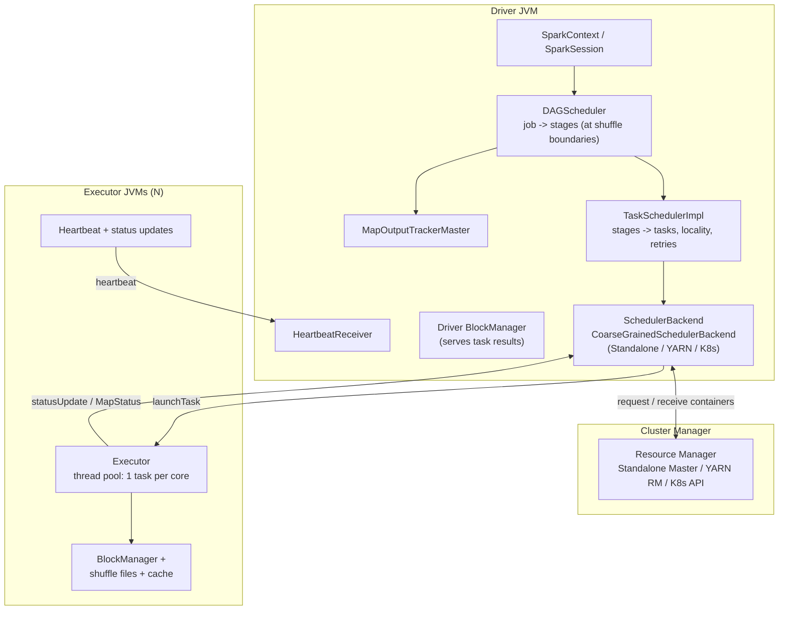

# 01 - Execution Architecture & Scheduling

**Priority:** P0
**Versions:** Apache Spark **3.5.0**.
**Sources:** [SOURCES.md](SOURCES.md) - full list at the end of this chapter.
**See also:** [04 - Shuffle, Partitioning & Network Transfer](04%20-%20Shuffle,%20Partitioning%20&%20Network%20Transfer.md), [06 - Query Planning (Catalyst & AQE)](06%20-%20Query%20Planning%20%28Catalyst%20&%20AQE%29.md).

**TL;DR:** Spark is one **driver** that makes decisions and many **executors** that do work. A user action (or query) becomes a job; the DAGScheduler cuts the job's DAG into stages at shuffle boundaries; the TaskScheduler + SchedulerBackend place tasks on executors; executors run tasks in threads and report status back. Everything is **event-driven and asynchronous** - no global plan, just a stream of events (job submitted, stage finished, task failed, executor lost) that the scheduler reacts to. Interview skill: narrate `count()` from action to task completion, name who decides what at each hop, and explain locality, retries, and speculation.

---

## 1. Why The Split Exists (The One Idea)

An RDD lineage is a **recipe**, not data. Execution needs two roles:

- **Driver** - holds the recipe (DAG), decides *what* to run, *when*, and *where* (roughly). Single JVM, single point of failure.
- **Executors** - hold *data* (partitions, cached blocks, shuffle files) and run *tasks*. Many JVMs, replaceable, disposable.

The founding paper's insight [S1, NSDI '12]: because lineage is a recipe, Spark can **recompute** lost partitions instead of replicating them - so executors can be stateless and cheap, and that division is the whole architecture.

> Driver = brain (lives on the schedule of events), executors = muscles (live on the schedule of tasks). Cluster managers just rent muscle.

**Memory hook:** *"Jobs are cut into stages at shuffles, stages are cut into tasks by partitions, tasks are placed by locality."* That single sentence is this entire chapter.

---

## 2. The Cast of Characters

Spark's runtime is not one program; it is a small set of long-lived components with one-way responsibilities. The driver plans and decides, executors store and compute, and the cluster manager only rents machines. Once you can place a behavior on this map, the rest of the chapter is just detail.



| Component | Where | One-liner job |
|-----------|-------|---------------|
| `SparkSession` / `SparkContext` | Driver | Entry point; turns an action/query into a job |
| `DAGScheduler` | Driver | **Stage-level**: computes stage DAG, submits stages in dependency order, handles stage failures |
| `TaskSchedulerImpl` | Driver | **Task-level**: task sets, locality levels, speculation, retries/fault tolerance at the task level |
| `SchedulerBackend` | Driver (pluggable) | Talks to the cluster manager; acquires executors; launches tasks |
| `Executor` | Worker JVM | Runs tasks in threads, one task per core; reports heartbeats/results |
| `HeartbeatReceiver` | Driver | Liveness of executors; notifies schedulers when an executor is lost |
| `MapOutputTrackerMaster` | Driver | Registry of map outputs: which partition lives where (the shuffle phone book) |
| Cluster manager | Outside Spark | Standalone / YARN / Kubernetes (Mesos support removed in 3.2) |

**Key design choice (say this in interviews):** scheduling is **event-driven**. The `DAGSchedulerEventProcessLoop` consumes events (`JobSubmitted`, `StageCompleted`, `TaskCompletion`, executor/locality events) rather than running one big orchestration loop. This is why Spark scales to huge DAGs: work is done by reactive state machines, not a monolithic planner.

---

## 3. Job -> Stage -> Task (The DAG Cut)

### A. From action to job

Every action (`count`, `collect`, `save`, a DataFrame write) goes through `sc.runJob`: the DAGScheduler snapshots the RDD lineage, finds the target partitions, and creates an `ActiveJob`. **One action = one job** (plus internal jobs, e.g. sampling for `RangePartitioner` or AQE re-planning steps).

### B. Cutting at shuffles

The DAGScheduler walks the lineage backwards [S1]:

- **Narrow dependency** -> parent and child partitions can pipeline -> same stage.
- **ShuffleDependency** -> boundary -> the parent becomes a `ShuffleMapStage`, the child starts a new stage.

The last stage of a job is a **`ResultStage`** (its tasks compute requested results). All earlier stages are `ShuffleMapStage`s (their tasks produce shuffle output + a `MapStatus`).

### C. Submission order (recursion, not a queue)

`submitStage(finalStage)` recursively calls itself for any missing parent stages. Only stages whose parents are complete are submitted via `submitMissingTasks`. Two flavors of "missing":

| Stage type | What's missing | Notes |
|------------|---------------|-------|
| `ShuffleMapStage` | Only partitions with no completed map output | Re-runs **just the lost partitions**, not the whole stage |
| `ResultStage` | All partitions (they produce user-visible output) | Can reuse cached/computed partitions of the target RDD |

"Missing tasks" is computed by comparing the RDD's computed-partition set for the stage against `MapOutputTracker` - this is also how Spark avoids recomputing what survived a failure.

**Concrete example: one job, two stages.** The DAG is the full dependency graph; the stage cut is where a shuffle forces materialization. Take `orders` with 4 input partitions and run:

```text
orders.filter(amount > 100).groupBy("region").count()
```

`filter` is narrow, so the four scan/filter partitions stay in **stage 0** (a `ShuffleMapStage`). `groupBy` needs every region co-located, so Spark inserts a shuffle and starts **stage 1** (a `ResultStage`). Stage 0 runs **4 tasks** (one per input partition). With `spark.sql.shuffle.partitions=2`, each `ShuffleMapTask` returns a `MapStatus` such as `{reducePartition 0: 64 MB, reducePartition 1: 12 MB}` to `MapOutputTracker`, and stage 1 runs **2 tasks**, each fetching its region's bytes from all four map outputs.

**Memory hook:** *"One action -> one job; one shuffle -> one boundary; one partition -> one task. Nothing is scheduled before its parents' outputs exist."*

---

## 4. Execution Trace: `rdd.count()` End To End

The best way to internalize the architecture is to narrate one action from start to finish. The sequence below is the canonical `count()`: follow the recursion into parent stages and the two different result handoffs, because every performance symptom later in this module shows up somewhere on this path.

```mermaid
sequenceDiagram
    participant U as User
    participant DS as DAGScheduler
    participant TS as TaskSchedulerImpl
    participant SB as CoarseGrainedSchedulerBackend
    participant E as Executor

    U->>DS: action -> runJob(finalRDD)
    DS->>DS: Build stage DAG; find final ResultStage
    DS->>DS: submitStage: recursively submit missing parents first
    DS->>TS: submitTasks(TaskSet of stage 1)
    TS->>SB: reviveOffers / launchTasks
    SB->>E: launchTask(task, serialized)
    E->>E: Deserialize task; run in thread (1 per core)
    E-->>SB: StatusUpdate: map task FINISHED + MapStatus
    SB-->>DS: task completion event
    DS->>DS: Stage 1 complete -> now stage 2 parents available
    DS->>TS: submitTasks(TaskSet of ResultStage)
    TS->>SB: launchTasks
    SB->>E: launch result tasks
    E-->>SB: StatusUpdate carrying result (small) or BlockId (large)
    SB-->>DS: Job complete
    DS-->>U: count() returns
```

Two result handoffs worth knowing:

| Task type | What it sends back | Where it goes |
|-----------|-------------------|---------------|
| `ShuffleMapTask` | `MapStatus` (block location + size per partition) | Driver -> stored in `MapOutputTrackerMaster` |
| `ResultTask` | The result bytes (if small, inline in the status update; if large, via the driver's BlockManager) | Driver, bounded by `spark.driver.maxResultSize` (default 1 GB) |

If a user's `collect()` on a huge dataset blows `spark.driver.maxResultSize`, that is *this* path failing - a classic interview gotcha.

---

## 5. Task Scheduling: Locality, Speculation, Pools

### A. Locality levels (in priority order)

TaskSchedulerImpl prefers to send a task where its input data already is:

| Level | Meaning |
|-------|---------|
| `PROCESS_LOCAL` | Same JVM (cached block in this executor) |
| `NODE_LOCAL` | Same host (disk/HDFS block, or same-host executor) |
| `NO_PREF` | No locality preference (e.g. input from cloud object store) |
| `RACK_LOCAL` | Same rack |
| `ANY` | Anywhere |

To avoid waiting forever for a perfect host, Spark **delays scheduling** by escalating level over time: each level waits `spark.locality.wait` (default 3 s, with per-level overrides) before falling back. That tension - wait for locality vs. keep cores busy - is **delay scheduling**, and it's a favorite interview question.

### B. Throughput vs. fairness: FIFO and FAIR pools

`spark.scheduler.mode` (default `FIFO`) or `FAIR`: FIFO gives earlier jobs priority; later jobs can use remaining slots, for example while an earlier job has one running straggler. FAIR pools share resources between concurrently submitted jobs.

### C. Speculation: fighting stragglers

If `spark.speculation=true`, the TaskScheduler tracks task durations per stage and, when a task is much slower than its peers (speculation quantile 0.75, rhythm 1.5x), **launches a speculative copy** on another executor and takes whichever finishes first. This is the duplicate-execution answer to "the cluster is idle but one task is stuck" (contrast: AQE skew join fixes *data* skew; speculation just races it).

### D. Barrier scheduling (2.4)

`rdd.barrier().mapPartitions(...)` forces **all tasks of a stage to run simultaneously** (all-or-nothing start) - required by ML libraries where every worker must join a collective (e.g. MPI-style training). Anything that breaks simultaneous execution (a task finishing late, a job needing a new stage) throws a `SparkException`; that rigidity is the price of synchronization.

---

## 6. Implementation Details That Explain Behavior

Most scheduling behavior that surprises people is a direct consequence of a small set of implementation choices. The table below pairs each mechanism with why it matters in practice; read it again after chapters 02-04, because memory pressure, shuffle decisions, and decommissioning all trace back to these rows.

| Mechanism | Class / config | Why you care |
|-----------|----------------|--------------|
| Event loop | `DAGSchedulerEventProcessLoop` | All scheduling decisions are events processed in order; explains log lines like "Submitting 2 missing tasks from Stage 5" |
| Coarse-grained executors | `CoarseGrainedSchedulerBackend` | Executors hold containers for the whole app (cluster-manager-agnostic); tasks come to them |
| 1 task = 1 core = 1 thread | `Executor` thread pool | Concurrency = `spark.executor.cores`; explains "one core per task" task-count math |
| Task launch is serialized | `launchTask` sends serialized `TaskDescription` | Closure serialization cost lands here (big closures = slow launch) |
| Heartbeats | `HeartbeatReceiver`, `spark.executor.heartbeatInterval` (10 s) | Detects dead executors; hung JVM = lost executor after timeout |
| Driver result cap | `spark.driver.maxResultSize` (1 GB) | Guards the driver from OOM in `collect`/`toPandas` |
| Task failure limit | `spark.task.maxFailures` (4) | Per-task attempts before the task set fails |
| Stage retry limit | `spark.stage.maxConsecutiveAttempts` (4) | Consecutive stage attempts before aborting |
| Dynamic allocation | `spark.dynamicAllocation.enabled` | Adds/removes executors at runtime; needs shuffle data to survive removals (ESS - see chapter 04) |
| Decommissioning | Executor decommission framework (3.1+, shuffle migration default on 3.4) | Graceful drain of spot/preempted nodes instead of recompute |

---

## 7. Failure Behavior (Who Re-Runs What)

Because scheduling is event-driven, failures are not exceptions thrown up a stack; they are events that trigger recovery rules. The table below is the playbook the scheduler follows, from a single bad record up to a dead driver.

| Failure | Immediate detector | Reaction |
|---------|--------------------|----------|
| Task throws / crashes | Status update | Counted failures retry within the task set; exhausting `spark.task.maxFailures` (4 by default) normally aborts the task set/job |
| Shuffle fetch fails | FetchFailed event | DAGScheduler may resubmit affected stages / missing map outputs; consecutive stage attempts are bounded separately |
| Task result too large | Driver | `spark.driver.maxResultSize` error in the job |
| Executor dies with completed map tasks (no ESS) | Heartbeat timeout / node manager | Missing map outputs -> DAGScheduler resubmits just those map partitions; reduce tasks for them wait |
| Executor dies with cached blocks | Heartbeat timeout | Cached partitions lost -> recompute from lineage if needed (this is why cache-only faults don't change answers, only speed) |
| Straggler (alive but slow) | Speculation tracker | Optional speculative duplicate; first finisher wins; loser's output discarded |
| Driver dies | - | Whole app fails. No driver failover in open-source Spark (YARN can retry in cluster mode, but in-memory state is lost) |
| Stage's parent output corrupted | 4.0 checksums / 4.1 checksum retry | Detect + rerun map stage (see chapter 04) |

Framing for interviews: **tasks are the retry unit, stages are the recompute unit, jobs are the atomicity unit for an action.** Also: retrying is *safe* because shuffle outputs are content-addressed by (stage, partition) and completed attempts are immutable - a failed re-attempt just replaces the old MapStatus.

---

## 8. Observability (Where Scheduling Problems Show Up)

Most scheduling problems are visible before you open a log file, but only if you know where to look. Each UI signal below maps to a specific failure mode from the previous section.

| Symptom | Where | Likely cause |
|---------|-------|--------------|
| Long gaps between tasks starting, cluster idle | Jobs/Stages timeline, event timeline | Locality wait (`locality.wait` too high), driver CPU bound (see below) |
| Task launch latency grows with tasks | Event log | Driver-side `submitMissingTasks`/serialization overhead; too many tasks per stage (tiny partitions) |
| Same task `(retry N)` repeatedly | Stage detail | Bad record/partition (poison pill) or flaky executor |
| Orange/blue duplicate tasks in timeline | Stage timeline | Speculation racing |
| Executor churn / repeated "Lost executor" | Executors tab + event log | Heartbeat/GC issues, node preemption, driver overload |
| One job starves others | Jobs tab | FIFO mode - switch to FAIR pools |

The **event timeline** on the Jobs page (task colors: succeeded, failed, speculated, killed) is the single most underrated scheduling debugging tool; the **DAG visualization** on the Stage page shows where the shuffle boundaries were actually cut.

---

## 9. Version Notes

Scheduling changed less than shuffle or planning, but the changes that did happen reshaped the operational model - from static clusters to elastic, graceful ones. Skim the lineage once so you can place whatever version you are asked about.

| Version | Change | Scheduling impact |
|---------|--------|------------------|
| 1.2 | Elastic scaling improvements; dynamic allocation groundwork [RN 1.2] | Executors become elastic |
| 1.6 | Netty-based shuffle/network; per-executor heartbeats consolidated | More robust liveness detection |
| 2.0 | Akka replaced by Netty RPC; driver/executor messaging modernized | Stability under high task churn |
| 2.4 | Barrier execution mode | All-tasks-at-once stages for ML collectives |
| 3.1 | Executor decommissioning | Graceful node drain instead of task loss |
| 3.2 | Mesos support removed; AQE on by default | Cluster-manager story narrows to Standalone/YARN/K8s |
| 3.4 | Decommission shuffle-migration on by default; Spark Connect client (Python) | Spot instances survive; thin clients decouple from driver JVM |
| 3.5 | Spark Connect GA (Scala, Go clients) | The driver can be a service, not your process |
| 4.0 | `spark.api.mode` (client/server API selector); ANSI default | Mode-selected client/server execution surface |

---

## 10. The One-Page Recap (memorize this)

If you are asked to summarize this chapter in an interview, say the following points in this order:

1. Driver decides (DAGScheduler -> TaskScheduler -> backend); executors execute (1 task per core).
2. Action -> job -> DAG cut at shuffles -> stage -> tasks = partitions.
3. `submitStage` recursion + missing-task computation = minimal recompute.
4. `ShuffleMapTask` -> `MapStatus` to MapOutputTracker; `ResultTask` -> result to driver (cap 1 GB).
5. Scheduling is event-driven; locality is preference + `locality.wait` delay, not a requirement.
6. Counted task failures exhaust the task-set/job budget (default 4); fetch failures can resubmit stages under separate limits.
7. Driver is a single point of failure; executors are disposable by design (lineage > replication).

---

## 11. Drills (Cover The Answer Column)

| # | Question | Answer |
|---|----------|--------|
| 1 | What splits a job into stages? | `ShuffleDependency` boundaries; narrow deps stay in one stage |
| 2 | Who decides where a task runs? | `TaskSchedulerImpl` + `SchedulerBackend`, honoring locality levels with delay scheduling |
| 3 | Difference between DAGScheduler and TaskScheduler? | Stage-level graph + failures vs task-level placement, locality, speculation, retries |
| 4 | What does a ShuffleMapTask report? | A `MapStatus`: where its shuffle blocks are + sizes (into MapOutputTracker) |
| 5 | What happens when a map output is missing after executor loss? | Only those partitions are recomputed; reduce tasks wait; with ESS, refetch instead |
| 6 | How are tasks counted per executor? | One thread per core; concurrency = executor cores |
| 7 | What is delay scheduling? | Waiting up to `locality.wait` (3 s default) for a better locality level before falling back |
| 8 | FIFO vs FAIR? | FIFO: earlier-job priority, later jobs can use spare slots; FAIR: weighted resource sharing |
| 9 | How does Spark handle stragglers? | Speculation: duplicate on another executor, first finisher wins |
| 10 | What is a barrier stage? | All tasks must run simultaneously (2.4+), used by ML collectives; failure = whole stage retries |
| 11 | Why is the driver a SPOF and why is that "fine"? | All scheduling state lives there; acceptable because recomputation only needs the driver to restart the job (state is lost, data is derivable) |
| 12 | Where does `collect()` fail on big data? | `spark.driver.maxResultSize` (1 GB) - results ride the status-update path to the driver |
| 13 | Task failure vs stage recovery? | Counted task failures exhaust maxFailures then normally abort the job; fetch failures can resubmit affected stages under stage-attempt limits |
| 14 | Why does task launch latency grow in huge stages? | Driver serializes/plans all task descriptions per stage (see "delay scheduling"/driver bottleneck symptoms) |
| 15 | Which change made spot instances cheap for Spark? | Executor decommissioning (3.1) + shuffle block migration (default 3.4) |

---

## 12. Key Source Classes (pin refs to a tag, e.g. `apache/spark@v3.5.0`)

| Class | Module | Role |
|-------|--------|------|
| `DAGScheduler`, `DAGSchedulerEventProcessLoop` | `core/.../scheduler/` | Job -> stage DAG, submission, stage retries |
| `TaskSchedulerImpl`, `TaskSetManager` | `core/.../scheduler/` | Task placement, locality, speculation, task retries |
| `SchedulerBackend`, `CoarseGrainedSchedulerBackend` | `core/.../scheduler/` + `core/.../executor/` | Cluster handshake + `launchTask` |
| `StandaloneSchedulerBackend`, `YarnSchedulerBackend`, `KubernetesClusterSchedulerBackend` | `core/.../deploy/` | Per-cluster-manager backends |
| `Executor`, `ExecutorBackend` | `core/.../executor/` | Task threads, heartbeats, status updates |
| `Task`, `ShuffleMapTask`, `ResultTask` | `core/.../scheduler/` | The two task flavors |
| `Stage`, `ShuffleMapStage`, `ResultStage`, `ActiveJob` | `core/.../scheduler/` | Scheduler data model |
| `HeartbeatReceiver` | `core/.../` | Liveness |
| `MapOutputTrackerMaster` | `core/.../scheduler/` | Map output registry |
| `BarrierCoordinator` | `core/.../barrier/` | Barrier stage sync |

---

## 13. Sources Used

- [S1](SOURCES.md) RDD paper (NSDI '12) - lineage, stage model, recovery semantics
- [S2](SOURCES.md) Spark: Cluster Computing with Working Sets (HotCloud '10) - original driver/executor design intent
- [S6](SOURCES.md) *The Internals of Apache Spark* (Jacek Laskowski) - event loop, submission semantics, class roles
- [V4](SOURCES.md) "Spark Internals" (Jacek Laskowski) - architecture walkthrough
- [RN 1.2 / 2.4 / 3.1 / 3.2 / 3.4](SOURCES.md) - dynamic allocation, barrier mode, decommissioning, Mesos removal, Connect
- Official configuration documentation (apache.org) - defaults: `spark.locality.wait`, `spark.task.maxFailures`, `spark.speculation`, `spark.driver.maxResultSize`, `spark.scheduler.mode`
