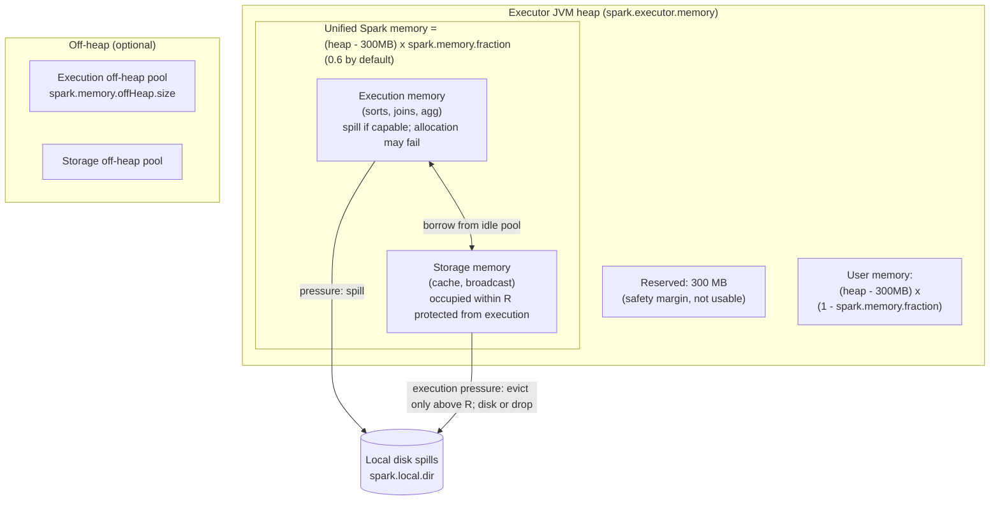
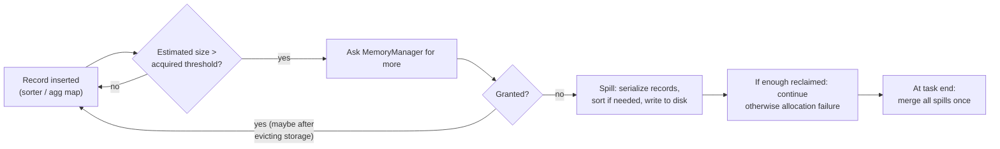

# 02 - Memory Management & Disk Spilling

**Priority:** P0
**Versions:** Apache Spark **3.5.0**.
**Sources:** [SOURCES.md](SOURCES.md) - full list at the end of this chapter.
**See also:** [03 - Tungsten, Serialization & Data Representation](03%20-%20Tungsten,%20Serialization%20&%20Data%20Representation.md), [04 - Shuffle, Partitioning & Network Transfer](04%20-%20Shuffle,%20Partitioning%20&%20Network%20Transfer.md).

**TL;DR:** Executors share managed memory between execution and storage. Both borrow unused memory; execution can evict cached storage **above protected R**, while active execution structures release or spill their own data. Draw reserved / user / unified / off-heap regions and use the spillability matrix to diagnose memory pressure.

---

## 1. Why It Exists (The One Idea)

Two workloads use memory in opposite ways:

- **Execution** (sorts, joins, aggregations): bursty, short-lived, must not lose a single page mid-computation.
- **Storage** (cached partitions, broadcast data): long-lived, can be recomputed or re-read, so it is *evictable*.

The pre-1.6 design gave each region a **fixed fraction** of the heap. The problem: a sort-heavy stage starves while unused cache sits nearby (and vice versa). Unified memory (1.6) [S14, RN 1.6] replaced the split with:

> One shared pool. Both sides borrow idle memory. Execution can evict occupied storage above R, but not within R; active execution must release/spill its own structures, or allocation may fail.

**Memory hook:** *"Borrow idle memory both ways; execution can evict storage above R, never the occupied protected region."*

---

## 2. Where Did This Evolve From? (Static -> Unified)

The static-versus-unified story is a favorite interview probe because it tests whether you learned current Spark or an old blog post. The key is not the fractions themselves but the failure mode of fixed regions: a shuffle-heavy stage spills while unused cache sits right next door.

| Era | Model | Pain |
|-----|-------|------|
| Pre-1.6 | Static regions: execution fraction (`spark.shuffle.memoryFraction`, 0.2) + storage fraction (`spark.storage.memoryFraction`, 0.6) of a 0.8-of-heap budget | Rigid: a single shuffle-heavy stage spills while cache sits unused; users hand-tuned fractions forever |
| 1.6+ | **UnifiedMemoryManager**: one pool, dynamic borrowing [RN 1.6] | The "why" question answered: one knob (`spark.memory.fraction`) instead of four |
| 1.6+ | Off-heap execution memory (experimental) [RN 1.6] | Escape the JVM heap/GC entirely for supported consumers |
| 2.x-4.x | Unified model retained; spill machinery hardened (external sort/append-only structures), tungsten memory pages | Same policy, better byte-level implementations |

**Interview framing:** static memory is the pre-1.6 answer; if a candidate describes `shuffle.memoryFraction`, they are describing a museum piece. Current code runs `UnifiedMemoryManager` unless legacy mode is requested.

---

## 3. Architecture: The Executor Memory Map

This map is worth being able to draw from memory, because every memory-related symptom later maps back to one region of it. Notice what the JVM itself owns (reserved and user memory), what Spark explicitly manages (the unified pool), and what lives outside the heap entirely (off-heap).

| Config | Default | Meaning |
|--------|---------|---------|
| `spark.memory.fraction` | 0.6 | Share of `(heap - 300 MB)` for the unified Spark pool |
| `spark.memory.storageFraction` | 0.5 | Defines R = M × storageFraction: occupied storage within R is protected from execution-induced eviction |
| `spark.memory.offHeap.enabled` / `.size` | false / 0 | Explicit off-heap pool (not sized automatically - you must set it) |
| `spark.executor.memoryOverhead` | max(10% of executor memory, 384 MB) | Container overhead outside the JVM, for YARN/K8s physical limits |
| `spark.local.dir` | temp dir | Where spills (and shuffle files) physically land |

**Why only 0.6 by default?** The remaining heap absorbs application objects, Spark internals, and, most importantly, keeps **GC pressure** manageable - the pool is not the only heap tenant.

---

## 4. The Borrowing Rules (The Exam Question)

`UnifiedMemoryManager` arbitrates with two pools (`StorageMemoryPool`, `ExecutionMemoryPool`) over one backing pool:

| Direction | Allowed? | Mechanism |
|-----------|----------|-----------|
| Execution borrows free storage | Yes | Execution grabs memory not backing any block, up to the available pool |
| Execution evicts *used* storage | Only usage above R = M × storageFraction | Evicted block -> disk (MEMORY_AND_DISK) or dropped (MEMORY_ONLY -> recompute); occupied usage within R is protected |
| Storage borrows free execution | Yes | Idle execution memory can back cache blocks |
| Storage expands toward R | Only if that execution memory is free | Active execution retains its allocation; R protects occupied cached blocks |
| Execution gives back memory to storage | **Never while in use** | Execution instead spills its own data; shrinking active execution memory is impossible for a running sorter |

The memory manager reclaims space through free-memory borrowing, cache eviction above R and spill-capable consumers. Allocation fails if these reclaim too little; the table below identifies which structures can spill.

Also note: execution memory is divided **per task** dynamically (`ExecutionMemoryPool` tracks consumers; when a task asks for more memory, others may spill). Talk: "N concurrent tasks share execution memory, so `spark.executor.cores` interacts with memory sizing - more cores per executor = more simultaneous sorters competing for the same pool."

**Example: a 16 GiB executor under pressure (3.5.0 defaults).** Reserved memory is 300 MiB, M = `(16,384 - 300) × 0.6 = 9,650.4 MiB`, and R = `4,825.2 MiB`. A 4 GiB cache occupies 4,096 MiB, entirely below R and protected from execution eviction. This leaves `M - 4,096 = 5,554.4 MiB` (~5.42 GiB) for two sorters, ignoring other consumers. A 6 GiB demand exceeds capacity by ~590 MiB; a 10 GiB demand exceeds it by ~4.58 GiB. The sorters must spill or release enough memory to continue.

---

## 5. Spilling: The Safety Valve Mechanics

Managed page consumers use `MemoryConsumer`/`TaskMemoryManager`. Spill behavior depends on the structure:

| Structure / allocation | Spillability in the 3.5.0 baseline | If memory remains unavailable |
|------------------------|------------------------------------|-------------------------------|
| External sorters, external aggregation maps | Spill runs and merge; hash aggregation may fall back to sort | Disk errors or allocation failures can still fail a task |
| BHJ/SHJ build hash relations | No general external spill fallback for the build hash table | Build can OOM; change strategy/size/partitioning |
| Giant single record or growing aggregate buffer (`collect_list`, etc.) | Spilling other records may not bound one value | Single-value allocation can fail |
| Python objects, user heap, direct/native allocations | Outside this managed callback contract (native plugins have their own policies) | JVM/Python/native OOM or container kill |

A consumer can return **zero reclaimed bytes**, causing the task memory manager to try other eligible consumers or fail the allocation. The following loop shows the **spill-capable sorter path**.

### A. The Trigger Loop

On the object path, the trigger is a sampled loop rather than a per-record decision. Every 32 inserted elements, `Spillable` compares an estimate of the structure's size against a threshold it has *earned* from the memory manager. The threshold starts at 5 MB (`spark.shuffle.spill.initialMemoryThreshold`); when the structure runs past it, the consumer asks for `2 * currentMemory - myMemoryThreshold` bytes, and any grant raises the threshold in place so a growing sort can continue without spilling. Only a refusal forces the spill. Checking every record would be too expensive, which is why the loop samples every 32nd insert - cheap enough to sit inside a tight insertion loop.

| Trigger rule | Value / behavior |
|--------------|------------------|
| Check frequency | Every 32 inserted elements |
| Initial threshold | 5 MB (`spark.shuffle.spill.initialMemoryThreshold`) |
| Growth request | `2 * currentMemory - myMemoryThreshold`; granted bytes raise the threshold |
| Hard safety stop | `spark.shuffle.spill.numElementsForceSpillThreshold` (default off) |
| Spill action | Sort if order is required, write to a local file, release memory, increment spill count |

Four structures implement this machinery:

| Consumer | Used by | Structure |
|----------|---------|-----------|
| `ExternalSorter` | Shuffle writer, sort-based operators | Sorted runs spilled + merged |
| `ExternalAppendOnlyMap` | Map-side combine / aggregation fallbacks | Aggregation map spilled + merge-combined on read |
| `ShuffleExternalSorter` | Tungsten shuffle writer | Raw serialized pages (see chapter 04) |
| `UnsafeExternalSorter` | Sort/aggregate on `UnsafeRow` | Binary sort with pointer arrays |

### B. What Actually Lands on Disk

The spill file is not a self-describing table. On the object path, `ExternalSorter` writes a **serialized stream of records grouped by partition**, and within each partition those records are in key order (an aggregation writes one combined key/value per group). The layout is remembered *in memory*, not in a header: each spill is tracked as a `SpilledFile` holding the file and block id, the byte size of every serializer batch (`spark.shuffle.spill.batchSize`, default 10,000 objects, flushes a batch), and the number of elements written for each partition. Those per-partition counts tell the reader where one partition ends and the next begins; the batch offsets let it jump there without parsing from the start.

On the binary path, `UnsafeExternalSorter` and `ShuffleExternalSorter` hold `UnsafeRow` bytes in memory pages plus an 8-byte pointer per record. Spilling first **sorts the current run in place** - TimSort over the pointer array by key for the sort sorter, a radix sort by partition id for the shuffle sorter. From there the two formats diverge, and the difference explains their merge strategies. The sort sorter writes a **self-describing spill file**: a 4-byte record count, then for every record a 4-byte length, an 8-byte sort-key prefix, and the record bytes (`[count][len][prefix][data]...`). Readers replay it sequentially, and the prefix lets a merge compare keys without deserializing. The shuffle sorter writes only **raw record bytes, partition after partition**, keeping each partition's byte length in memory (`SpillInfo.partitionLengths`) as it commits every range. That is not an accident - its merge concatenates bytes, so it never needs record boundaries. One file per run, named and tracked through the block manager, living under `spark.local.dir`.

Compression follows the block type, not a single global spill switch. Shuffle spills (`ExternalSorter`, `ShuffleExternalSorter`) are temporary shuffle blocks and use `spark.shuffle.compress`, because their bytes may be served as shuffle output. Sort/aggregate spills are temporary local blocks and use `spark.shuffle.spill.compress` (default true). Either way it is the same trade: CPU and codec overhead in exchange for less disk I/O.

| Property | Object path (`ExternalSorter`) | Binary path (`UnsafeExternalSorter`) |
|----------|-------------------------------|--------------------------------------|
| What is written | Serialized objects, partition-major, key-sorted | Sort spills: `[count][len][prefix][data]...`; shuffle spills: raw bytes per partition |
| Metadata kept in memory | `SpilledFile`: serializer batch sizes, elements per partition | Sort spills: none beyond the file's own headers; shuffle spills: per-partition byte lengths (`SpillInfo`) |
| Read-back style | Partition-at-a-time stream using batch offsets | Sort spills: sequential iterator with prefix comparisons; shuffle spills: byte-range concatenation |
| Merge work | k-way merge by (partition, key); equal keys combined | Sort path: k-way merge by key; shuffle path: per-partition concatenation |
| Compression | Shuffle codec for shuffle spills; `spark.shuffle.spill.compress` otherwise | Sort path: `spark.shuffle.spill.compress`; shuffle path: `spark.shuffle.compress` |

### C. Read-Back and the Final Merge

For the sort-based shuffle writer, the merge is streaming and happens while the shuffle output is written. `ExternalSorter` exposes a partitioned iterator: for each partition, it k-way merges that partition's spilled runs with whatever is still in memory, ordered by key, combining equal keys as it goes for map-side aggregation. Records are emitted and written to the single shuffle data file partition by partition, so merge memory is one current record per run - not the dataset. The shuffle index file records where each partition's region starts. For an external aggregation map, the read path is the same idea: spill iterators are merged with the in-memory map state, and values with equal keys are combined on the fly. That is why an aggregation can spill repeatedly and still be correct: every spill is a *complete* partial aggregate.

On the binary path the merge story splits in two, and this is the detail worth memorizing. `UnsafeExternalSorter` spills key-sorted runs, so its final output is a k-way merge of those runs through a priority queue - comparisons happen only *across* runs, never within one, because each run is already sorted. `ShuffleExternalSorter` never sorts by key at all; it sorts only by **partition id** (a stable radix sort), so each spill's per-partition records are contiguous and already ordered for output. That enables the fast path in `UnsafeShuffleWriter.mergeSpills`: when a single spill exists and the codec supports concatenated streams, the file is transferred directly; with multiple spills, NIO `transferTo` concatenates each partition's byte ranges into the final output, falling back to a streaming copy only when concatenation is unsafe. The punchline: **the tungsten shuffle merge performs no key comparisons whatsoever** - all sorting was done in memory before each spill.

The cost model follows directly. Each spill writes its run once and reads it back once at merge time; k-way merging adds O(n log k) comparisons across runs. More, smaller spills therefore hurt at read-back more than their byte count suggests - which is why "number of spilled runs" is a better early warning than spill bytes alone, and why increasing the memory threshold or reducing concurrent sorters often buys more than faster disks.

Behavioral facts to memorize:

1. **Spill is per-record structure growth, not a timer**: structures check estimated size against an acquired threshold and *request permission* to grow - the MemoryManager, not the consumer, decides pressure.
2. **Spills are files read back and merged**, adding disk I/O and merge work without changing the intended result. Completion still requires sufficient disk, merge resources, and valid records.
3. **Since 2.0 spilling is always on** for the sort/aggregate path (the old `spark.shuffle.spill=false` escape hatch is gone). There is no "don't spill" mode - only "spill less."
4. **Compression applies to spills** - shuffle-path spills follow `spark.shuffle.compress`, other spills use `spark.shuffle.spill.compress` (default true) - trading CPU for disk bandwidth.
5. **Merge at the end is the expensive part**: k spilled runs = O(n log k) merges; the tungsten shuffle path is the exception, where partition-sorted runs are concatenated without comparing keys.

**Memory hook:** *"Execution asks, the manager grants or refuses, refused consumers spill. Storage asks, and gets evicted if lucky."*

---

## 6. Storage Side: Eviction, Not Spill

Cached blocks (`MEMORY_ONLY`, `MEMORY_AND_DISK`, broadcast) live in `MemoryStore` and are **evictable**:

- LRU block eviction under storage pressure; execution-induced eviction is limited to storage usage above R.
- `MEMORY_AND_DISK`: evict to disk, read back later (or in `MEMORY_AND_DISK_DESER` variants, keep serialized on disk).
- `MEMORY_ONLY`: eviction means **loss** - the block is recomputed on next access (lineage saves us again, chapter 01).
- **Columnar caching** (1.6) [S14]: caching `UnsafeRow` batches instead of objects made cached scans cheaper and cut memory footprint, especially for complex types (Databricks reported up to 14x faster on complex-type queries with the columnar cache, 1.6 announcement).
- Cache and spill compete for the same disks: `spark.local.dir` filesystems carry both shuffle/spill files (and, if configured, cached partitions on disk).

The MEMORY_ONLY vs MEMORY_AND_DISK choice in interviews: **"evict -> recompute" vs "evict -> disk I/O + read-back"** - a recompute-vs-IO trade that depends on how expensive the lineage is.

---

## 7. Failure Behavior

Memory failures are often described loosely as "OOM", but the recovery and the fix depend entirely on which failure actually occurred. Distinguish the rows below by asking two questions: did the task fail or did the JVM die, and was the limit the heap or the container?

| Failure | Trigger | Signature |
|---------|---------|-----------|
| Task spill disk full | Spill writes fail | Task fails with IO error; job retries task (`spark.task.maxFailures`) - usually a capacity/cleanup problem, not a code bug |
| Executor OOM (heap) | JVM heap exhausted (pool + non-pool exceeds heap) | `java.lang.OutOfMemoryError`; **executor dies**, all its cached blocks and map outputs lost (chapter 01 recovery path) |
| Container kill (physical) | Physical memory (JVM + off-heap + overhead) exceeds container limit | YARN/K8s kills the container ("physical memory limit exceeded" / OOMKilled) - fix with `spark.memory.offHeap.size` + `spark.executor.memoryOverhead`, not just heap |
| Driver OOM | `collect()` / broadcast / large results | `spark.driver.maxResultSize` (1 GB) guards the result path; beyond that the driver itself can die |
| Too many spills -> very slow task | Execution memory starved (cores/executor too high, fraction too low, tiny skew partition) | Long task with repeated spill+merge; the "spilled (memory/disk)" stage columns tell the story |

Capacity planning rule of thumb: **size `spark.executor.memory` from the pool needs (0.6 x heap = execution + storage), then check cores/executor** - every extra concurrent task divides execution memory further. There is no "correct" executor size, only a consistent story.

---

## 8. Observability (Reading Memory Symptoms)

| Signal | Where | Interpretation |
|--------|-------|----------------|
| Spill (Memory) / Spill (Disk) per stage | Stage detail page | Execution pressure: sort/aggregate exceeding the pool; "Memory" = bytes written out of memory estimates, "Disk" = actual bytes on disk |
| Storage Memory used / max | Executors tab (Storage Memory column) | Cache footprint vs pool; watch for maxed-out storage with execution spills - classic imbalance |
| Cached blocks + fraction cached | Storage tab | % cached < 100% on MEMORY_ONLY means eviction is dropping blocks |
| GC Time | Executors tab | High GC + no spills = non-pool heap churn (objects outside execution), not pool pressure |
| "memory used"/"spilling" task logs | Executor/worker logs | `ExternalSorter`-level detail: "Spilling map output", run counts |
| Executor removed | Event log | Distinguish heap OOM vs container kill (both look like "lost executor" to schedulers) |

Diagnosis tree to say out loud: **"Spill to disk"** -> execution memory pressure (fix: more memory pool, fewer cores per executor, better partitioning/combine). **"Executor OOM"** -> either pool growth not absorbed by heap, or non-pool allocations (closures, PySpark, off-heap) - check `memoryOverhead` and GC. **"Cached blocks evicted"** -> storage pressure from execution (fix: bigger pool or `MEMORY_AND_DISK`, or stop caching so much).

---

## 9. Version Notes

The memory model has been stable since 1.6, which makes the version history short and easy to remember. The interesting evolution after 1.6 is not the pool itself but what lives inside it and which operators are able to spill.

| Version | Change | Impact |
|---------|--------|--------|
| 1.6 | **UnifiedMemoryManager**, experimental off-heap execution memory, columnar cache up to 14x on complex types [RN 1.6, S14] | One pool + borrowing replaces four static fractions |
| 2.0 | Second-gen Tungsten default; spilling always enabled on sort/agg paths | Spill is no longer optional, only tunable |
| 2.3+ | Spill read-ahead for faster spill read-back [RN 2.3] | Cuts merge-read latency when spills exist |
| 4.x | JDK 17/21/25 support; same unified model | Memory *policy* is now stable - optimizations happen in representations and operators |

The memory model has been remarkably stable since 1.6: the interesting evolution after that is **what lives inside the pool** (objects -> UnsafeRows -> Arrow batches) and **which operators spill** - not the pool itself.

---

## 10. The One-Page Recap (memorize this)

The compressed version to say out loud:

1. Unified pool = heap x 0.6 (default), storage floor = 0.5 of that; 300 MB reserved; off-heap is opt-in.
2. Both borrow idle memory; execution evicts storage only above R; storage cannot evict active execution.
3. Spill = serialize + write + read + merge for spill-capable consumers. Partition-sorted shuffle runs can merge by concatenation.
4. Cached MEMORY_ONLY blocks are dropped (recompute), MEMORY_AND_DISK blocks go to disk.
5. Executor OOM != spill: spill is normal behavior, OOM is a sizing/modeling bug. Container kill includes off-heap + overhead.
6. More cores per executor = more concurrent sorters in the same pool - memory sizing and parallelism are one decision.
7. Observability: Spill columns = execution pressure; Storage Memory column = storage pressure; GC = non-pool pressure.

---

## 11. Drills (Cover The Answer Column)

| # | Question | Answer |
|---|----------|--------|
| 1 | What did 1.6 change about memory? | Unified pool with borrowing replaced fixed execution/storage fractions |
| 2 | Why can't execution memory be evicted? | Intermediate sort/aggregate state is not recomputable as a cached block; consumers must spill instead |
| 3 | Walk the pressure order. | Borrow free memory / evict storage above R -> try capable spill consumers -> allocation/task failure if insufficient |
| 4 | What does `spark.memory.storageFraction` guarantee? | Occupied storage within R is protected from execution eviction; it cannot reclaim active execution |
| 5 | When is a MEMORY_ONLY block lost? | On eviction - it's dropped and recomputed from lineage |
| 6 | Difference between Spill (Memory) and Spill (Disk)? | Memory = estimated bytes released from structures; Disk = bytes actually written - compare to see compression/overhead |
| 7 | How do cores/executor interact with memory? | Each concurrent task competes for execution memory; more cores = less per sorter = earlier spills |
| 8 | What can fail after spilling starts? | Non-spillable values can exceed memory, disk space can run out, or remaining consumers can fail to reclaim enough memory |
| 9 | Container OOMKilled but heap fine? | Off-heap + JVM overhead exceeded physical limit - raise `memoryOverhead`/size off-heap explicitly |
| 10 | Where do spills land? | `spark.local.dir` (same family as shuffle files) |
| 11 | What's the columnar cache win? | Cached `UnsafeRow` batches (1.6): less object overhead, faster scans; up to 14x on complex-type workloads (Databricks, 1.6) |
| 12 | Two cures for "stage spills too much"? | Reduce bytes (combine earlier, better partitioning) or reduce contention (fewer cores/executor, bigger pool) |
| 13 | Why is `spark.memory.fraction` not 1.0? | Non-pool heap needs room; keeping the pool bounded limits GC pause exposure |
| 14 | Execute-memory vs storage-memory ratio changes since 1.6? | None - the pool *policy* is stable; evolution moved into representation (UnsafeRow/Arrow) and operator coverage |
| 15 | What does a spill file contain on the object path? | Serialized records grouped by partition and key-sorted; layout metadata (serializer batch sizes, elements per partition) is kept in memory in `SpilledFile`, not in the file |
| 16 | Why does the tungsten shuffle merge compare no keys? | Each spill is radix-sorted by partition id, so per-partition runs are contiguous and ordered; `mergeSpills` concatenates byte ranges with `transferTo` instead of merging |
| 17 | Why is the number of spilled runs a better warning than spill bytes? | Each run must be read back and merged; k-way merging adds O(n log k) comparisons, so many small spills cost more read-side work than their size suggests |

---

## 12. Key Source Classes (pin refs to a tag, e.g. `apache/spark@v3.5.0`)

| Class | Module | Role |
|-------|--------|------|
| `MemoryManager`, `UnifiedMemoryManager` | `core/.../memory/` | Pool arbitration, borrowing, eviction/reclaim rules |
| `MemoryConsumer`, `TaskMemoryManager` | `core/.../memory/` | Per-task acquisition + forced spill callbacks |
| `StorageMemoryPool`, `ExecutionMemoryPool` | `core/.../memory/` | The two ledgers over one pool |
| `MemoryStore`, `BlockEvictionHandler` | `core/.../storage/memory/` | Cached blocks, eviction path |
| `ExternalSorter`, `ExternalAppendOnlyMap` | `core/.../util/collection/` + `core/.../util/` | Spill-capable sort/aggregate structures (object path) |
| `ShuffleExternalSorter`, `UnsafeExternalSorter` | `core/.../shuffle/sort/`, `core/.../memory/` | Tungsten spill paths (byte path) |
| `DiskBlockManager` | `core/.../storage/disk/` | Local disk files for spills/blocks |
| `UnsafeRow`/`MemoryBlock` | `core/.../memory/`, `core/.../unsafe/` | Pages and binary rows (chapter 03) |

---

## 13. Sources Used

- [S6](SOURCES.md) *The Internals of Apache Spark* (Jacek Laskowski) - memory pool arbitration, spill machinery, classes
- [S14](SOURCES.md) Announcing Apache Spark 1.6 (Databricks, 2016) - unified memory, off-heap execution, columnar cache 14x
- [RN 1.6](SOURCES.md) - unified memory management and off-heap execution sections
- [RN 2.3](SOURCES.md) - spill read-ahead
- Official configuration documentation (apache.org) - defaults: `spark.memory.fraction` 0.6, `spark.memory.storageFraction` 0.5, `spark.memory.offHeap.*`, `spark.executor.memoryOverhead`, `spark.shuffle.spill.compress`, `spark.shuffle.spill.initialMemoryThreshold` 5 MB
- `apache/spark@v3.5.0` source - `Spillable`, `ExternalSorter`, `UnsafeExternalSorter`, `ShuffleExternalSorter`, `UnsafeShuffleWriter` (trigger loop, spill file layout, merge fast paths)
