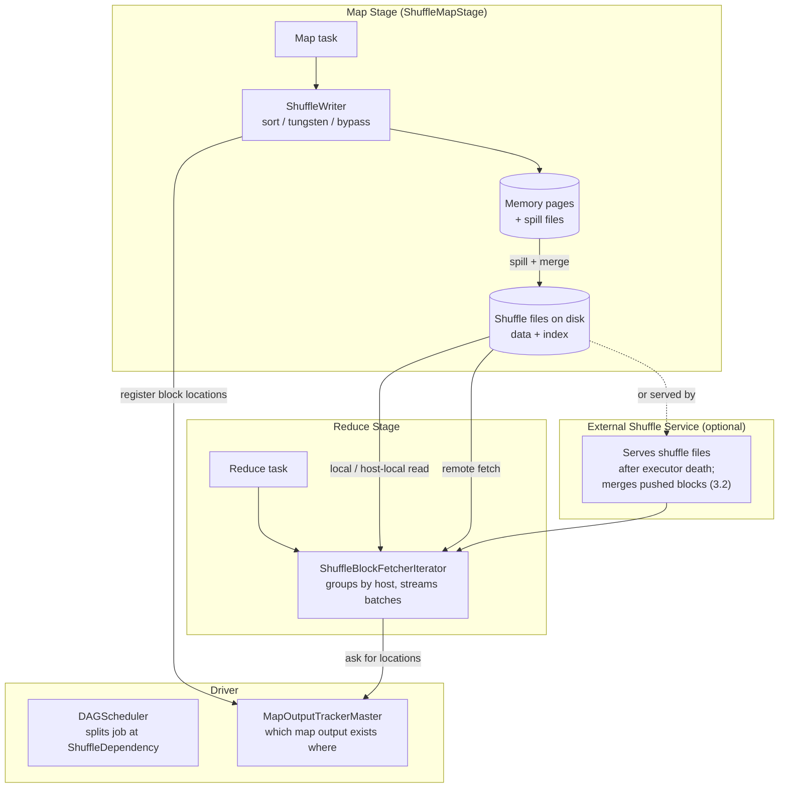
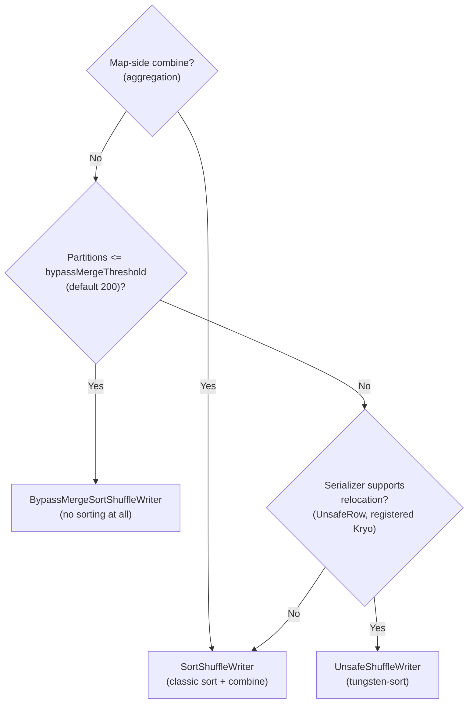

# 04 - Shuffle, Partitioning & Network Transfer

**Priority:** P0
**Versions:** 1.2 -> 4.2
**Sources:** [SOURCES.md](SOURCES.md) - full list at the end of this chapter.
**See also:** [Appendix B - The Story of Spark Performance](Appendix%20B%20-%20Optimization%20Evolution%20Map.md) (Campaign 1).

**TL;DR:** A shuffle is the all-to-all redistribution of data between stages: every reduce partition needs records from every map partition. It is Spark's correctness mechanism (you cannot aggregate by key until records with that key are co-located), its resilience boundary (stages are the recomputation unit), and its biggest cost center (disk, network, serialization, skew). Spark has evolved the shuffle through four generations - **Sort (1.2) -> Serialized bytes (1.4) -> Local reads (3.0/3.1) -> Shuffle-service merge (3.2)** - and the interview skill is being able to sketch: (a) why each generation exists, (b) which writer runs for a given query, and (c) where a real job actually spends its time.

---

## 1. Why Shuffle Exists (The One Idea)

Rewind to first principles. An RDD/DataFrame has two kinds of dependencies between partitions:

| | Narrow dependency | Wide dependency (shuffle) |
|---|---|---|
| Example | `map`, `filter`, `union` | `groupByKey`, `join` on unpartitioned data, `repartition` |
| Data movement | One output partition needs one input partition | One output partition needs data from **all** input partitions |
| Stages | Pipelines inside one stage | Forces a **stage boundary** |
| Failure recovery | Just recompute the missing partition chain | Missing map output must be regenerated (or refetched) |

Records land in a reduce partition based on their **key**, not their origin. That is the entire reason shuffle exists:

> To aggregate `sales` by `productId`, every record with the same `productId` must physically sit in the same partition. Input partitions don't know about keys, so the data must be regrouped - all-to-all.

Three consequences follow, and they organize this whole chapter:

1. **Materialization:** a stage cannot start until the previous stage's map outputs exist. This is why Spark needs shuffle files, a shuffle service, and why AQE has natural "re-plan here" points at exchanges.
2. **Cost:** every record is written once, (compressed), spilled/merged, fetched over the network, and deserialized. The optimization history is a war against each of those steps.
3. **Skew:** key distribution is arbitrary. One hot key = one giant partition = one straggler while the cluster idles. No amount of cluster capacity fixes a skew problem.

**Memory hook:** *"Shuffle is the price of wide dependencies: regroup by key, materialize across hosts, and pay disk + network + serialization + skew."*

---

## 2. The Four Generations At A Glance

The four generations are best remembered as answers to specific pains, not as a list of features. If you can state the pain each generation fixed, you can reconstruct the table below in an interview without memorizing it.

| Generation | Era | The pain it fixed | Mental model |
|-----------|-----|-------------------|--------------|
| **Hash shuffle** | ~1.0 | - | One file per (map task x reduce partition) = M x R files |
| **Sort shuffle** (default 1.2) | 1.2+ | File-handle explosion, unbounded memory | "Sort once, write one data file + one index file per map task" |
| **Tungsten/serialized shuffle** | 1.4+ | Deserialize-sort-reserialize CPU cost | "Sort pointers, never objects; spill bytes" |
| **Local reads** | 3.0/3.1 | Network fetches that didn't need to happen | "Read locally: AQE plan rewrite + host-local disk" |
| **Push-based merge** | 3.2 | Many small random fetches | "Mappers push, service merges, reducers fetch few large blocks" |

Details of each generation follow in sections 4 and 5. This table is your revision spine.

---

## 3. Architecture: Components & Data Flow



Key components:

| Component | Lives where | Job |
|-----------|-------------|-----|
| `SortShuffleManager` | Every executor (pluggable) | Decides which writer to use, per shuffle, once |
| `DAGScheduler` | Driver | Sees the `ShuffleDependency`, cuts the DAG into stages, submits map stage first |
| `MapOutputTracker` | Driver (master) + executors (worker cache) | Registry of map outputs and their locations/sizes; reducers cannot fetch without it |
| Shuffle writer | Map task | Partition, optionally combine, sort/spill/merge, produce `data` + `index` files |
| `BlockManager` | Executor | Stores and serves blocks; registers with driver |
| External Shuffle Service (ESS) | Per node (separate process) | Serves shuffle files after the executor that wrote them is gone; prerequisite for dynamic allocation |
| `ShuffleBlockFetcherIterator` | Reduce task | Turns "I need partition 7 from 500 mappers" into batched, parallel, retried fetches |

**File layout (memorize this):** per map task, `SortShuffleManager` writes one **data file** (records grouped by reduce partition, blocks in partition order) and one **index file** (offset+length per reduce partition). A reduce task's "shuffle block" is therefore a byte range in each mapper's data file. This layout is why contiguous-range fetches (3.0) are possible at all.

**Concrete example: 100 map tasks, 200 reduce partitions.** Each map task writes one data file containing 200 contiguous blocks (one per reduce partition) plus one index file with 200 `(offset, length)` entries. The shuffle therefore has `100 x 200 = 20,000` logical blocks but only **100 data files + 100 index files** - the fix that ended the old `M x R` file explosion. Reduce task 7 fetches one byte range from each of the 100 data files (100 ranges), not 20,000 separate files; contiguous fetch can merge adjacent ranges when AQE coalesces partitions. Each map task's `MapStatus` records those 200 block sizes so reducers and AQE can schedule the fetches, and the 24-bit partition-id field has room for 16.7M partitions - this job uses only 8 bits of it.

---

## 4. The Map Side: How Writers Work

`SortShuffleManager` picks a writer **once per shuffle** (at `registerShuffle` time). This is the decision tree:



### A. Classic sort writer - the default workhorse

1. Each record is tagged with its reduce partition id.
2. If `mapSideCombine` is on (e.g. `reduceByKey`, SQL aggregation), partial results are combined in memory keyed by (partition, key).
3. When a memory threshold is hit, the tagged/combined records are sorted by (partition, key) and spilled to disk as a sorted run.
4. At the end, spilled runs are merge-sorted and each partition's records are written contiguously into the single data file; the index is written.

Why it won over hash shuffle [Spark 1.2 release notes]: bounded memory (spill instead of holding per-reducer buffers), O(1) open files per task instead of M x R, and it enables map-side combine.

### B. Bypass writer - "don't sort what you don't need to sort"

When there is **no aggregation** and the partition count is small (<= `spark.shuffle.sort.bypassMergeThreshold`, default 200), sorting buys nothing. The bypass writer opens one output stream per reduce partition, writes records straight to their stream, then concatenates the files into the final data file. No sort, no merge.

### C. Tungsten writer (`UnsafeShuffleWriter`) - serialized bytes, sorted pointers

The CPU win of Tungsten applied to shuffle [Databricks, "Project Tungsten", 2015]:

1. Records are **already serialized** (this writer is only enabled when the serializer supports *relocation*, e.g. SQL's `UnsafeRowSerializer` or registered Kryo). They are copied as raw bytes into memory pages - no Java objects for data.
2. Each record gets one 8-byte **packed pointer**: partition id + page number + offset inside the page (24 bits are reserved for partition id, which is why the writer caps out at 2^24 - 1 = 16,777,215 partitions).
3. Sorting is a **radix sort on partition id only** - the pointer array is sorted, not the records and not the keys. No comparisons touch the data, no deserialization happens.
4. When pages fill, the sorted run is spilled as raw bytes. At the end, spills are merged by partition ranges and written to the single data file. (Spill-file layout and the concatenation merge: chapter 02, §5B-5C.)

Because it never compares keys, this path **cannot do map-side combine** - that is the trade. Tungsten is fast for "route and write", and falls back to the classic writer when aggregation is needed.

### D. Compression and serialization knobs that matter

| Config | Default | What it does |
|--------|---------|--------------|
| `spark.shuffle.compress` | true | Compresses map output files (codec from `spark.io.compression.codec`, lz4 by default) |
| `spark.shuffle.spill.compress` | true | Compresses intermediate spills |
| `spark.serializer` | Java serialization | RDD path serializer; **Kryo** with registration is faster and unlocks tungsten-sort for RDD shuffles |
| `spark.shuffle.accurateBlockThreshold` | 100 MB | Above this, block sizes are tracked accurately for fetch scheduling |
| `spark.shuffle.file.buffer` | 32 KB | Per-partition output buffer size on the map side |

**Memory hook:** *"No combine -> maybe bypass (<=200) -> maybe tungsten (relocatable serializer) -> otherwise classic sort. Aggregation always means the classic sort writer."*

---

## 5. The Reduce Side: How Fetch Works

### A. MapOutputTracker - the phone book

Before a reduce task can fetch anything, `MapOutputTracker` (driver-side master, worker-side cache) tells it **which map outputs exist, at which blocks, how big**. Sizes matter: they drive fetch scheduling and (in AQE) plan re-optimization.

### B. ShuffleBlockFetcherIterator - the fetch engine

A reduce task starts with a wish list: "partition 7 from all map outputs." The iterator:

1. Splits requests into **local** (same executor), **host-local** (same host, different executor), and **remote** (other hosts).
2. Groups remote requests **by host** and orders them **largest first**, so big reads don't wait behind a queue of small ones.
3. Streams responses with back-pressure limits (`spark.reducer.maxSizeInFlight`, default 48 MB in flight per reduce task), decompressing/decrypting on arrival.
4. Batch fetches: since 3.0, blocks from the same map output that belong to **consecutive reduce partitions** can be fetched as one streamed range ("contiguous shuffle block batch"). This matters most when AQE coalesces adjacent partitions - a coalesced partition spans consecutive block ranges, so one mapper's contribution arrives in a single request instead of one RPC per block.
5. Retries with backoff (`spark.shuffle.io.maxRetries` = 3, `spark.shuffle.io.retryWait` = 5 s) before declaring a `FetchFailed`.

### C. The three ways data avoids the network (super important distinction)

| Mechanism | Version | What actually happens | How it differs |
|-----------|---------|----------------------|----------------|
| **Host-local read** | 3.1 (config `spark.shuffle.readHostLocalDisk`, default true) | Block is on the same host but not the same executor -> read the file directly from local disk instead of fetching over the network | Pure **fetch-path** optimization; no plan change |
| **Local shuffle reader** (AQE) | 3.0 | AQE proves the exchange's partitioning already satisfies the consumer (e.g. two joins on the same key) -> rewrites the plan to read map outputs locally (`AQEShuffleReadExec` with a local reader) | **Plan rewrite**; can eliminate entire stages worth of network read cost |
| **Push-based shuffle** | 3.2 | Map tasks push outputs to the shuffle service, which **merges** blocks per partition; reducers then fetch fewer, larger merged blocks | Changes the **data layout** at the service |

### D. Push-based shuffle in one paragraph

With `spark.shuffle.push.enabled` (client side) and `RemoteBlockPushResolver` (shuffle-service side), each map task's blocks are pushed to remote shuffle services and merged into per-partition files. The effect: "small random disk reads by the shuffle service become large sequential reads," and reduce tasks fetch a mix of merged and original blocks (push is best-effort - reducers still fall back to original blocks) [Spark configuration docs; Spark 3.2 release notes]. It targets long-running jobs with heavy shuffle I/O and is not designed for small/quick queries; originally YARN + external shuffle service only [Spark docs, 3.2-4.x].

### E. External Shuffle Service - why it exists

`spark.shuffle.service.enabled` (since 1.2): a node-level service that keeps serving shuffle files after executors die. Without it, executor removal = lost map outputs = recompute; with it, executors can be safely deallocated, which is what makes **dynamic allocation** viable. On modern Spark the service's block index uses RocksDB by default (4.0; LEVELDB on 3.x) [Spark configuration docs].

---

## 6. Partitioning: The Other Half of Shuffle

Shuffle moves bytes; **partitioning decides where they go.** The two are inseparable in interviews.

| Partitioner (RDD API) | How it works | Good for | Danger |
|-----------------------|--------------|----------|--------|
| `HashPartitioner` | `key.hashCode % numPartitions` | Grouping/joining by key | Skewed keys (few hot keys -> giant partitions) |
| `RangePartitioner` | Sample the data, split into key ranges | Sorted output, range joins | Sampling luck; hot ranges |

Spark SQL additionally uses `HashPartitioning`, `RangePartitioning`, and `RoundRobinPartitioning`, driven by `spark.sql.shuffle.partitions` (default 200 - the most famous tuning knob in Spark history).

The goldilocks problem, in one line: **too few partitions -> stragglers and OOM/spill; too many -> task scheduling overhead and tiny fetches.** Pre-AQE you tuned by hand; AQE coalesces adjacent small partitions at runtime (target `spark.sql.adaptive.advisoryPartitionSizeInBytes`, default 64 MB), which is why 3.2 shipping AQE on by default "retired" that knob.

Avoiding shuffles structurally:

- `coalesce(n)` narrows partitions **without** a shuffle; `repartition(n)` / `repartitionByRange` always shuffle. (Classic trap.)
- Pre-partitioned/bucketed tables let joins skip the shuffle when both sides are clustered the same way.
- AQE local shuffle reader and DPP/runtime filters remove or shrink shuffles at runtime (see chapter 06).

**Memory hook:** *"Partitioning is a routing decision; partitioning wrong = skew = one task doing the cluster's work."*

---

## 7. Execution Trace: One Shuffle End To End

Trace a `df.groupBy("productId").count()` (a wide aggregation) with Spark 3.x + AQE:

```mermaid
sequenceDiagram
    participant D as Driver (DAGScheduler)
    participant M as Map Executors
    participant T as MapOutputTracker
    participant E as Shuffle Service
    participant R as Reduce Executors

    D->>D: Job submitted; ShuffleDependency found
    D->>D: Split into ShuffleMapStage + ResultStage
    D->>M: Run map tasks
    M->>M: Partition by productId; combine partial counts (sort writer)
    M->>M: Spill + merge; write data + index files
    M->>T: Register map output locations & sizes
    D->>D: Map stage complete = AQE materialization point
    D->>D: Re-plan with measured sizes (coalesce partitions, pick join strategy)
    D->>R: Run reduce tasks
    R->>T: "Where is partition 7 from all mappers?"
    T-->>R: Locations + sizes
    R->>E: Fetch batches (remote/host-local/local paths)
    E-->>R: Streamed blocks (merged if push-based)
    R->>R: Merge partial aggregates by key
    R-->>D: Results (or next stage)
```

The same flow with failure or skew spins off the behaviors in the next two sections. For interview purposes, be able to narrate **three checkpoints**: (1) before map stage - the DAG cut; (2) between stages - MapOutputTracker + AQE; (3) reduce fetch - local/host-local/remote/merged decision.

---

## 8. Failure Behavior (What Breaks, What Recovers)

Shuffle failure handling is where Spark's recovery model is at its most visible. Read the table with one question in mind: is the data that was lost recomputable, refetchable, or neither?

| Failure | What happens | Recovery |
|---------|--------------|----------|
| Map task crashes | Its partial output is discarded | Task retried; new output registered (old attempt ignored) |
| Executor dies, **no** ESS | Map outputs on that executor are gone | Map tasks re-run ("missing shuffle output" path); reducers wait |
| Executor dies, **with** ESS | Shuffle files still served by the service | No recompute; executor can be deallocated (enables dynamic allocation) |
| Fetch keeps failing | Retries (3x) exhaust -> `FetchFailed` -> may recompute map stage; too many consecutive fetch failures abort the job (`spark.stage.maxConsecutiveAttempts`, default 4) | Cluster-level blacklisting of bad nodes |
| Decommissioning (spot loss) | 3.4+: shuffle blocks are **migrated** off the node by default before it goes (`spark.storage.decommission.shuffleBlocks.enabled`), and fetch failures from decommissioned executors are ignored | Graceful scale-down without recompute |
| Corrupted shuffle data | 4.0: CRC32C checksums on shuffle streams; 4.1: can rerun the entire map stage when checksums mismatch instead of failing the job or returning bad answers | Integrity-first recovery |

**Memory hook:** *"ESS turns 'executor lost' from a recompute event into a fetch event."*

---

## 9. Observability: Where The Time Goes

Shuffle problems are diagnosed in the **Stage detail page** and the **SQL tab**, not by guessing:

| Signal | Where | If it's high, suspect |
|--------|-------|-----------------------|
| Shuffle Write Time | Stage page | Serializer, compression, record size, too many tiny shuffle files |
| Shuffle Spill (Memory / Disk) | Stage page | Map-side memory pressure: map-side combine missing, partition count, executor memory |
| Shuffle Read Size / Records | Stage page | Actual data movement |
| Fetch Wait Time | Stage page | Network, ESS saturation, too many small fetches, straggler hosts |
| Remote vs Local reads | Stage page (per host) | Locality opportunities (host-local, AQE local reader) |
| Exchange node stats (rows, size) | SQL tab | Partition sizes -> skew; compare initial vs final (AQE) plan |

Rule of thumb: **write-side problems are CPU/memory problems; read-side problems are network/locality problems; "one task takes 10x longer" is a skew problem.**

---

## 10. Version Notes (the shuffle lineage in one table)

This lineage is the one to know cold, because shuffle questions in interviews are almost always version questions in disguise. Note how every change attacks a different cost: files, CPU, network, or data integrity.

| Version | Change | Why it mattered |
|---------|--------|-----------------|
| 1.2 | Sort-based shuffle becomes default; External Shuffle Service | Killed the M x R file explosion; enabled dynamic allocation |
| 1.4 | Tungsten phase 1: serialized shuffle outputs + cache-aware binary sort shuffle | First big CPU win on the map side ("sort pointers, not objects") |
| 2.3 | Faster ESS registration (timeouts/retries); spill-reader read-ahead | Stability + spill I/O cost |
| 3.0 | Contiguous block batch fetch; AQE local shuffle reader; `spark.shuffle.readHostLocalDisk` | Attack the fetch path: fewer RPCs, skip network when local |
| 3.1 | Host-local shuffle reads without ESS | Same-host reads stop needing the service |
| 3.2 | Push-based shuffle (`spark.shuffle.push.enabled` + `RemoteBlockPushResolver`) | Merge small blocks into large sequential reads |
| 3.4 | Decommission-aware shuffle migration on by default | Spot/preemptible nodes stop costing recomputes |
| 4.0 | CRC32C shuffle checksums; ESS index on RocksDB by default | Corruption detectable; service state more robust |
| 4.1 | Checksum-based full map-stage retry on corrupt shuffle | Recover integrity, not just detect it |

---

## 11. The One-Page Recap (memorize this)

1. Shuffle = wide dependency = all-to-all by key = stage boundary = recovery unit.
2. Map side: **aggregation -> classic writer; no combine + few partitions (<=200) -> bypass; relocatable serializer -> tungsten** (pointer sort, no combine, 2^24 partitions max).
3. One data file + one index file per map task; blocks in partition order -> contiguous batch fetches (3.0).
4. Reduce side: MapOutputTracker -> ShuffleBlockFetcherIterator -> local / host-local / remote(merged) fetches; maxSizeInFlight back-pressure; retries then FetchFailed.
5. Skips: host-local disk (fetch path), AQE local reader (plan rewrite), push-based merge (service-side layout).
6. Skew: hash keys + hot key = straggler; observe partition sizes in the SQL tab; AQE skew join splits it.
7. ESS is the reason dynamic allocation is safe.
8. Four generations: **Sort (1.2), Serialized (1.4), Skip network (3.0/3.1), Service merge (3.2)** - that sentence is the whole lineage.

---

## 12. Drills (Cover The Answer Column)

| # | Question | Answer |
|---|----------|--------|
| 1 | Why does a shuffle force a stage boundary? | All-to-all dependency: reducers need every mapper's output; the boundary is also the recomputation unit |
| 2 | Which writer runs for `reduceByKey`? Why not tungsten? | Classic sort writer - it aggregates, and the tungsten writer sorts only by partition id, so it cannot combine keys |
| 3 | When does the bypass writer run? | No map-side combine and <= 200 reduce partitions (`bypassMergeThreshold`) |
| 4 | What's clever about the tungsten sort? | 8-byte packed pointers (partition id + page + offset); radix sort on pointers, no object/key comparisons; spills raw bytes |
| 5 | What does the index file contain? | Per reduce partition: offset and length into the data file |
| 6 | Host-local read vs AQE local reader? | Host-local: fetch path reads local disk when the block is on the same host. AQE local reader: plan rewrite that reads map outputs locally because partitioning already satisfies the consumer |
| 7 | When can AQE skip network reads entirely? | When the exchange's output partitioning already matches the consumer's requirement (e.g. two joins by the same key) |
| 8 | Why does push-based shuffle exist and when is it a bad idea? | Small random reads become large sequential reads via service-side merge; bad for small/quick queries, best for heavy long-running shuffle I/O |
| 9 | Why is the External Shuffle Service required for dynamic allocation? | Executors get deallocated; shuffle files must outlive them to avoid recomputing map stages |
| 10 | How does Spark avoid recomputing all maps when one reducer fetch fails? | FetchFailed -> only affected map outputs are recomputed (or refetched from ESS); consecutive failure limits abort the job |
| 11 | `coalesce(10)` vs `repartition(10)`? | Coalesce narrows existing partitions without a shuffle; repartition shuffles for an even key distribution |
| 12 | Why was 200 partitions (`spark.sql.shuffle.partitions`) such a notorious knob? | One number cannot serve all data sizes; too few -> stragglers, too many -> overhead; AQE coalescing at 64 MB targets made it mostly obsolete |
| 13 | How do you spot skew in the UI? | Max vs median task duration/shuffle read in the stage page; partition sizes in the SQL tab's Exchange node |
| 14 | What changed about shuffle integrity in 4.x? | 4.0 CRC32C checksums; 4.1 can rerun the full map stage on checksum mismatch instead of failing or returning wrong results |
| 15 | Which config caps bytes in flight per reduce task? | `spark.reducer.maxSizeInFlight`, default 48 MB |

---

## 13. Key Source Classes (pin refs to a tag, e.g. `apache/spark@v3.5.0`)

| Class | Module | Role |
|-------|--------|------|
| `SortShuffleManager` | `core/.../shuffle/sort/` | Writer selection; the pluggable `ShuffleManager` |
| `SortShuffleWriter` | `core/.../shuffle/sort/` | Classic sort + combine + spill + merge |
| `UnsafeShuffleWriter`, `ShuffleExternalSorter`, `ShuffleInMemorySorter`, `PackedRecordPointer` | `core/.../shuffle/sort/` | Tungsten path: pages, packed pointers, radix sort |
| `BypassMergeSortShuffleWriter` | `core/.../shuffle/sort/` | Per-partition files, concatenated |
| `IndexShuffleBlockResolver` | `core/.../shuffle/` | data/index file layout |
| `MapOutputTrackerMaster` / `MapOutputTrackerWorker` | `core/.../scheduler/` | Map output registry (locations + sizes) |
| `ShuffleBlockFetcherIterator` | `core/.../storage/` | Batched, retried, locality-aware fetch |
| `BlockManager` | `core/.../storage/` | Block storage + serving |
| `RemoteBlockPushResolver` | `common/network-shuffle/.../shuffle/` | Push-based merge (service side) |
| `ShuffleBlockPusher` | `core/.../shuffle/push/` | Push-based client side |
| `AQEShuffleReadExec`, `LocalShuffleReader` | `sql/core/.../execution/adaptive/` | AQE local read rewrite |
| `ShuffleExchangeExec` | `sql/core/.../execution/exchange/` | SQL-level shuffle operator (the `Exchange` node) |

---

## 14. Sources Used

- [S1](SOURCES.md) RDD paper (NSDI '12) - dependency/stage/recovery semantics
- [S6](SOURCES.md) *The Internals of Apache Spark* (Jacek Laskowski) - writer/handle mechanics, `PackedRecordPointer` details
- [S7](SOURCES.md) *The Internals of Spark SQL* - `ShuffleExchangeExec`, AQE read paths
- [S10](SOURCES.md) "Project Tungsten" (Databricks, 2015) - cache-aware sort (3x), serialized shuffle direction
- [V1](SOURCES.md) "Shuffle Deep Dive" (Aaron Davidson) - end-to-end shuffle walkthrough
- [RN 1.2 / 1.4 / 3.0 / 3.1 / 3.2 / 3.4 / 4.0 / 4.1](SOURCES.md) - version facts in section 10
- Official configuration documentation (apache.org) - defaults: `bypassMergeThreshold` 200, `maxSizeInFlight` 48m, `io.maxRetries` 3, `sql.shuffle.partitions` 200, `advisoryPartitionSizeInBytes` 64m, `readHostLocalDisk`, `shuffle.push.*`, `service.db.backend`
