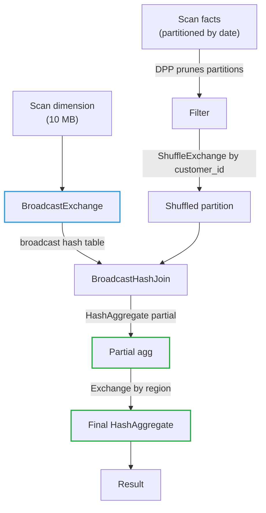

# 05 - Physical Operators: Joins, Aggregations, Sorting & Windows

**Priority:** P0
**Versions:** Apache Spark **3.5.0**.
**Sources:** [SOURCES.md](SOURCES.md) - full list at the end of this chapter.
**See also:** [04 - Shuffle, Partitioning & Network Transfer](04%20-%20Shuffle,%20Partitioning%20&%20Network%20Transfer.md), [06 - Query Planning (Catalyst & AQE)](06%20-%20Query%20Planning%20%28Catalyst%20&%20AQE%29.md).

**TL;DR:** The planner chooses *which* physical operator runs; this chapter is about how those operators actually work. The decision that dominates everything is **how each join gets its data co-located** (broadcast vs shuffle vs nested loop), followed by **how aggregations split into partial/final phases**, and **how sorts and windows force ordering**. Interview skill: read a physical plan, name the operator and its exchange strategy, predict where it will spill/OOM/skew, and explain which 3.x runtime feature (DPP, runtime filters, AQE skew join, SHJ) would change it.

---

## 1. Why It Exists (The One Idea)

A logical plan says *what*: join orders to customers, group by region. A physical plan says *how*: broadcast the 10 MB dimension and hash-join it, or shuffle both sides and sort-merge, or nested-loop because the predicate isn't equi. The "how" can be a 10x-100x difference at the same data size.

> Every physical operator answers one question: **what does it cost to bring the inputs together?** Broadcast = replicate small data, avoid shuffle. Shuffle join = pay the shuffle, keep memory bounded. Nested loop = no co-location requirement, multiplied work. Aggregation = shuffle to co-locate keys, or aggregate locally first. Window/sort = shuffle + order.

**Memory hook:** *"Joins choose how to co-locate; aggregations choose how to combine early; sorts choose how much to move before ordering."*

---

## 2. The Operator Menu (What `EXPLAIN` Can Show)

A physical plan is a menu of data-movement decisions, and the operator names tell you which decision was made. Learn to read this menu as costs rather than as vocabulary.

| Family | Operators | Exchange behavior |
|--------|-----------|-------------------|
| Joins (equi) | `BroadcastHashJoinExec`, `ShuffledHashJoinExec`, `SortMergeJoinExec` | None (broadcast) / shuffle both sides |
| Joins (non-equi/fallback) | `BroadcastNestedLoopJoinExec`, `CartesianProductExec` | Broadcast or per-partition product |
| Aggregation | `HashAggregateExec` (partial/final), `ObjectHashAggregateExec`, `SortAggregateExec` | Partial before shuffle, final after |
| Sorting | `SortExec`, `TakeOrderedAndProjectExec` (top-K) | Global sort needs range shuffle |
| Windows | `WindowExec` | Shuffle by partition keys + sort by order keys |
| Scans | `FileSourceScanExec`, `BatchScanExec` (V2), `InMemoryTableScanExec` | Pruning/pushdown happens here |
| Exchanges | `BroadcastExchangeExec`, `ShuffleExchangeExec`, `AQEShuffleReadExec` | The glue; AQE rewrites these at runtime |

The plan executes bottom-up. `SortExec` blocks for input and implements `BlockingOperatorWithCodegen`, allowing it to participate in generated stages. Exchanges materialize query stages and form AQE boundaries. See chapter 03's `EXPLAIN CODEGEN` comparison.

---

## 3. Joins: The Decision That Dominates

A join plan makes two independent decisions, and interviews routinely blur them. The **join type** - inner, outer, semi, anti, cross - is semantics: it decides which rows must appear in the output, including null-padded rows for unmatched inputs. The **join strategy** - broadcast hash, shuffled hash, sort-merge, nested loop - is mechanics: it decides how the inputs are co-located and compared. Choose the type from the question the query asks; Spark chooses the strategy from sizes and predicates, and the type constrains which strategies are even legal.

### A. Join types: what the result must contain

| Join type | Result contract | How Spark executes it | When to use |
|-----------|-----------------|-----------------------|-------------|
| **Inner** | Only matching pairs | Hash or sort-merge on the key; nested loop when no equi predicate | Default for analysis joins where unmatched rows are noise |
| **Left outer** | Every left row; nulls on the right when unmatched | Build-side hash or merge; tracks whether each probe row matched, emits a null-padded row if not | Enrichment: facts plus an optional dimension |
| **Right outer** | Mirror of left outer | Often rewritten/executed as left outer with sides swapped | Rare; rewrite as left outer if you can, for readability |
| **Full outer** | All rows from both sides, null-padded where unmatched | Historically SMJ only; SHJ has supported it since 3.1, with codegen added in 3.3 [RN 3.1, RN 3.3]; both sides carry matched flags | Reconciliation and diffing two snapshots |
| **Left semi** | Left rows with at least one match; right columns dropped | Existence check - can stop at the first match; never multiplies rows | `WHERE EXISTS` / `IN` filters, especially when deduplication matters |
| **Left anti** | Left rows with no match | Existence check with negation; `NOT IN` becomes a null-aware anti join (3.1+) | `NOT EXISTS` / `NOT IN`, orphan detection |
| **Cross** | Every pair, n x m | `CartesianProductExec` / BNLJ; no key to hash | Deliberate small parameter grids; almost always an accident otherwise |

Two mechanics separate these types in execution. Outer joins carry **match state**: a hash join marks build rows as matched (needed for full outer), and probe-side misses are padded with nulls; sort-merge join tracks matches per key group and flushes unmatched rows when the key group ends. Semi and anti joins are **existence tests, not projections**: the right side contributes no columns, evaluation can short-circuit on the first hit, and each left row appears at most once. That last property is why swapping an inner join for a semi join can both speed up a query and fix row multiplication. The null trap is semantic rather than mechanical: `NOT IN` over nullable columns does not behave like `NOT EXISTS`, so Spark compiles the former into a null-aware anti join instead of a plain anti join - a favorite interview follow-up.

### B. The three equi-join strategies

| Strategy | How it works | When chosen | Cost profile | Danger |
|----------|--------------|-------------|--------------|--------|
| **BroadcastHashJoin (BHJ)** | Small side broadcast to every executor; each task builds a hash map and streams the big side | Small side under `spark.sql.autoBroadcastJoinThreshold` (default 10 MB, `-1` disables) | No shuffle; near-linear | Driver/executor memory spike; broadcast timeout (`spark.sql.broadcastTimeout`, 300 s); stale stats can make it explode |
| **ShuffledHashJoin (SHJ)** | Both sides shuffled by key; each partition builds a hash table for its key range and probes the other | AQE (or hints) when build side is small enough to fit per partition; 3.1 hardened/optimized it | Shuffle both sides; no sort | Build-side OOM if the estimate is wrong; skew amplifies |
| **SortMergeJoin (SMJ)** | Both sides shuffled by key, sorted, then merged; equal keys stream together | Default for large-large joins since 1.5 (sort-merge preferred over shuffle hash for shuffle joins [RN 1.5, S13]) | Shuffle + sort (spill-friendly) | Sort cost; skew; but memory-safe by design |

**Why SMJ became the default:** a shuffle hash join must hold one side's partition in memory; sort-merge can spill and streams. Spark's choice was explicitly a robustness trade: pay sorting to avoid OOM [RN 1.5 / S13].

**Concrete example: broadcast hash join.** `customers` has 3 rows - `(1, "EU"), (2, "US"), (3, "APAC")` - and `orders` has 8 rows with `customer_id` values 1, 2, 4, and NULL. For `orders LEFT JOIN customers`, Spark broadcasts `customers`, and every executor builds the same hash table keyed by `customer_id`. It then streams `orders` as the probe side: customers 1 and 2 match; customer 4 and NULL find no build row, so an inner join drops them while the left outer join emits them with null customer columns. **Build side** = the side turned into the hash table; **probe side** = the streamed side. That is why the build side must fit in memory, and why the broadcast side is constrained in outer joins.

Support is a code-level constraint, not a preference - which is why some joins "refuse" the cheap strategy:

| Join type | BroadcastHashJoin | ShuffledHashJoin | SortMergeJoin | Nested loop |
|-----------|--------------------|------------------|---------------|-------------|
| Inner | yes | yes | yes | yes |
| Left outer | yes, if the build side is the right | yes | yes | yes |
| Right outer | yes, if the build side is the left | yes | yes | yes |
| Full outer | **no** | yes (3.1+) | yes | yes |
| Left semi / anti | yes | yes | yes | yes |
| Cross | no | no | no | yes (`CartesianProductExec`) |

BHJ cannot do full outer because it never tracks unmatched build rows, and hash/sort strategies cannot express a cross join because they require an equi key. Left/right outer also pin which side may be broadcast: the streamed side must be the outer side, otherwise an unmatched probe row has no executor that could emit it.

Choosing in practice: start from the type the query needs, then let size pick the strategy - broadcast when one side fits the threshold and the type permits, sort-merge when both sides are large and memory safety matters, shuffled hash when per-partition build sides fit and skipping the sort is worth it, nested loop only when no equi key exists. Reach for semi/anti instead of inner-plus-distinct when you need existence, and avoid cross joins unless the input is small by construction.

### C. The non-equi fallback

`BroadcastNestedLoopJoinExec` (BNLJ) compares every row of one side against every row of the other, per partition: O(n*m). It exists because non-equi predicates (`<`, `>`, `OR`, `!=`) cannot be hashed. A plan showing BNLJ on two large tables is almost always an accident (miswritten predicate, type mismatch, missing equi condition). **CartesianProductExec** is the degenerate case with no condition.

### D. Join hints (escape hatches you should know)

`BROADCAST(t)`, `MERGE(t)`, `SHUFFLE_HASH(t)`, `SHUFFLE_REPLICATE_NL(t)` let you override the planner. Hints are requests, not commands: an impossible broadcast (too large) can still explode, and `MERGE` can be overridden by AQE.

### E. Runtime tricks that change the game (3.x)

- **Dynamic Partition Pruning (DPP, 3.0)** [S17]: when joining a partitioned fact to a broadcastable dimension, Spark derives the matching partition values at runtime and prunes fact-table scans. Databricks reported 2-18x on 60 of 102 TPC-DS queries [S17, Spark 3.0 blog].
- **Runtime filters / Bloom joins (3.3)** [S18]: build a Bloom filter from the small side and push it into the big-side scan, skipping non-matching rows before the join; reported up to 10x for affected queries [S18, Databricks 3.3].
- **AQE skew join (3.0)**: at a shuffle boundary, detects partitions much larger than the median (default: 5x median and > 256 MB) and splits them into sub-partitions joined separately. This is the fix for "one hot key stalls the join."
- **AQE strategy switching (3.0)**: after seeing real shuffle sizes, can demote a sort-merge join to broadcast or shuffled hash. This is the answer to "my plan shows SMJ but the build side was tiny" - stats lied; AQE didn't.

### F. Join edge cases worth memorizing

The rows below are where "the strategy was right but the result was still wrong or slow". Each one is a common interview follow-up, so have a one-sentence answer for each.

| Situation | Behavior |
|-----------|----------|
| Full outer join | Traditionally SMJ-only; SHJ has supported full outer since 3.1, and 3.3 added codegen plus 20-30% (SMJ) / 10-20% (SHJ) improvements [RN 3.1, RN 3.3] |
| Skewed join key | AQE splits the skewed side; without AQE, one task does the hot key |
| Null join keys | SQL nulls never match in equi-joins (three-valued logic) - a classic wrong-results bug from `null` keys in "anti-join" logic |
| One side tiny but not broadcast-eligible | Raise threshold deliberately or use a hint - and verify size from stats |
| Both sides huge, no equi predicate | BNLJ/Cartesian: a correctness-preserving performance disaster |

---

## 4. Aggregations: Combine Early, Shuffle Less

Aggregation performance is decided by how much data still has to move after the local combine. Spark expresses that with a two-phase plan: combine on the map side, merge after the exchange. The canonical plan looks like this:

```text
HashAggregate(partial, map-side)   <- combine locally, fewer rows
        |
   Exchange (shuffle by group keys)
        |
HashAggregate(final, reduce-side)  <- merge partial states
```

| Operator | Use case | Notes |
|----------|----------|-------|
| `HashAggregateExec` | Default, codegen-able types | SQL partial aggregation reduces rows upstream of exchange; shuffle writer selection follows dependency flags (chapter 04) |
| `ObjectHashAggregateExec` | Types the binary path doesn't support (e.g. decimals/arrays/maps in older versions) [RN 2.2] | Object overhead; added in 2.2 to keep such aggregations off the sort-based fallback |
| `SortAggregateExec` | Fallback when hashing isn't possible | Requires sorted input; why some plans show Sort before Aggregate |

Key behaviors:

- **Partial aggregation is the biggest win** when group cardinality is much smaller than row count (`count`, `sum`). Concretely, 1M orders with 50k distinct customers become 50k partial rows before the shuffle; the final aggregate merges only those. If every row is a unique group (`group by user_id` on a huge table), partial aggregation saves little and the shuffle dominates.
- **Distinct aggregations** (`count(distinct x)`) are rewritten into grouped sub-aggregations (multiple shuffles in some plans) - a classic "why does my plan have two exchanges?" question.
- **AQE** can coalesce aggregation shuffle partitions. For hot GROUP BY keys, use partial/pre-aggregation or a salted two-phase aggregate with a correct merge: combine partial sums and counts to calculate averages. Skew-join splitting handles joins; REBALANCE splitting handles output sizing.
- **Window functions without partitioning** force all data into a single partition: an accidental single-task stage. Watch for `Exchange SinglePartition` in plans.

---

## 5. Sorting

Sorting appears in two very different roles: as a user request (`ORDER BY`) and as an internal cost of other operators (merge joins, windows). The patterns below separate the two cases so you can tell which kind of sort you are paying for.

| Pattern | Operator | Notes |
|---------|----------|-------|
| Global `ORDER BY` | `SortExec` after `RangePartitioner` exchange | Range shuffle samples keys; whole dataset sorted, one range per partition |
| Local sort inside partition | `SortExec(global=false)` | Cheap; used by windows/aggregations |
| `ORDER BY ... LIMIT k` / `take(k)` | `TakeOrderedAndProjectExec` | Bounded top-K heap per partition, then merge - avoids full sort |
| Sort-merge join | Sort as part of `SortMergeJoinExec` | Sorting is the join's co-location cost |
| `repartition` sort removal | 3.4 removed a redundant `Sort` under `RepartitionByExpression` [RN 3.4] | Less wasted sorting in repartition plans |

Sorts spill through `UnsafeExternalSorter` (chapter 03): pointer sort, prefix comparison, byte spills - so a sort that doesn't fit is slow, not fatal.

The habit to build: when a plan is slow because of sorting, ask whether the sort is the goal or a side effect of how the join or window was chosen. The fix is usually to change the operator choice, not to optimize the sort.

---

## 6. Windows

`WindowExec` requires each window's `PARTITION BY` keys to be co-located and its `ORDER BY` keys sorted within the partition:

```text
Exchange(hash partition by window partition keys)
        |
   Sort(partition keys, order keys)
        |
     WindowExec
```

Performance rules that interviewers probe:

1. **Every distinct window spec can force extra sorts.** Multiple `OVER` clauses with different partitioning/ordering often mean multiple sort passes (or expensive buffering).
2. **No `PARTITION BY` = single-partition window** = one task for the whole dataset; a correctness-preserving scalability cliff.
3. **Unbounded frames** (`rows between unbounded preceding and current row`) require buffering/streaming state per partition; huge partitions still hurt.
4. **Window + aggregation** on the same keys can sometimes share the exchange/sort; different keys cannot.
5. Sort-based windows spill via the sort buffer; but the window itself may hold frame state in memory depending on frame type.

---

## 7. Execution Trace: Join + Aggregate In One Plan



Read this plan bottom-up: DPP prunes eligible fact partitions; a dimension can be broadcast when its estimated size meets the configured threshold. The fact shuffle can remain from an earlier adaptive plan. Partial aggregation precedes the regional exchange, then final aggregation merges groups. AQE coalesces small partitions; hot region keys can use a two-phase aggregate.

---

## 8. Failure Behavior & Anti-Patterns

Join and aggregation failures are usually memory failures or skew in disguise. The table below maps symptoms to root causes so you can stop guessing at the wrong layer.

| Symptom | Root cause | Fix |
|---------|-----------|-----|
| Driver OOM / broadcast timeout | Broadcast side actually huge (bad/stale stats or hint) | Raise threshold only deliberately; fix stats; remove bad hint; disable broadcast for that join |
| Executor OOM during join | SHJ build side too big per partition; broadcast replication | Let AQE choose SMJ; lower broadcast size; salt/split skew |
| One join task 10x slower | Skewed key | AQE skew join; salt the hot key; isolate the hot key |
| BNLJ on large tables | Non-equi predicate / type mismatch | Rewrite predicate to equi form; cast keys consistently; accept nested loop only for small sides |
| Two shuffles for `count(distinct)` | Rewrite into grouped distinct aggregations | Expected; consider approximate distinct (HyperLogLog) if exactness allows |
| Single-partition window/sort | Missing `PARTITION BY` | Add partitioning; or accept a single task knowingly |
| Stale plan after data grows 100x | CBO stats stale | `ANALYZE TABLE`; AQE helps mid-query but better stats help planning |

---

## 9. Observability

Physical-plan debugging happens in two places at once: the SQL tab explains what the engine chose, and the stage page shows what it cost. The signals below connect the two.

| Signal | Where | Meaning |
|--------|-------|---------|
| Operator node timings/rows/size | SQL tab plan | Which join/aggregate/scans dominate |
| Exchange size + partition count | SQL tab / Stage page | Shuffle cost; AQE coalescing visible in final plan |
| Build side + join type | SQL tab (BHJ/SHJ/SMJ labels) | Verify the intended strategy, not the hoped-for one |
| Spill per operator | SQL tab metrics + Stage spill columns | SMJ/aggregate/sort memory pressure |
| "WholeStageCodegen" boundaries | SQL tab | Where operators stop fusing (join build side, exchanges) |
| Skew (max vs median task) | Stage page | Skew join / salting needed |
| Broadcast size | SQL tab `BroadcastExchange` | Approaching threshold = danger for growing dimensions |

---

## 10. Version Notes

Operator-level evolution is a series of robustness fixes followed by runtime intelligence: memory-safe defaults first (1.5), then binary/vectorized operators (2.0-2.3), then AQE and runtime pruning (3.x). Read the table with that arc in mind.

| Version | Change | Impact |
|---------|--------|--------|
| 1.5 | Sort-merge join preferred over shuffle hash join for shuffle joins; operator-level Tungsten wins (aggregations/sorts) [RN 1.5, S13] | Memory-safe join default |
| 2.0 | Whole-stage codegen; vectorized Parquet reader [S15] | Operators fuse; scans faster |
| 2.2 | Object-hash aggregation for unsupported types; CBO join reordering [RN 2.2] | Fewer sort-based fallbacks; better join order |
| 3.0 | AQE (coalesce, strategy switch, skew join), DPP [S17, RN 3.0] | Runtime fixes to bad plans; 2-18x DPP wins on 60/102 TPC-DS queries |
| 3.1 | Shuffled hash join improvements, including full-outer join support [RN 3.1] | SHJ becomes a viable AQE choice |
| 3.3 | Runtime filters/Bloom joins (up to 10x), full-outer SHJ codegen + 20-30%/10-20% join improvements [S18, RN 3.3] | Big-side scans skip rows; full outer gets generated code |
| 3.4 | Redundant sort removal under repartition; AQE plan cache [RN 3.4] | Less wasted sorting; stable re-planning |
| 4.2 | Whole-stage codegen for `MERGE` [RN 4.2] | DML joins get the generated pipeline |

---

## 11. The One-Page Recap (memorize this)

1. Join strategy = co-location strategy: broadcast (small), shuffle-hash (fit), sort-merge (safe), nested-loop (no equi predicate).
2. Thresholds: broadcast 10 MB default, broadcast timeout 300 s; SMJ default for large-large.
3. Aggregations: partial before shuffle, final after; distinct rewrites add exchanges.
4. Global sort = range exchange + sort; top-K avoids full sort; windows need partition co-location + ordering.
5. 3.x runtime fixes: DPP (prune scans), runtime filters (skip rows), AQE skew splitting, AQE join switching, local shuffle reader.
6. Read plans as data movement: every `Exchange` is a price, every `Broadcast` is a memory bet.
7. Failures: broadcast OOM/timeout, SHJ build OOM, skew, accidental BNLJ/cartesian, single-partition windows.
8. Join type is semantics, strategy is mechanics: outer joins track matches and pad nulls, semi/anti are existence filters (no row multiplication), cross is a deliberate n x m.

---

## 12. Drills (Cover The Answer Column)

| # | Question | Answer |
|---|----------|--------|
| 1 | Name the three equi-join strategies. | BroadcastHashJoin, ShuffledHashJoin, SortMergeJoin |
| 2 | When is BHJ chosen? | Small side under `spark.sql.autoBroadcastJoinThreshold` (10 MB default), or a broadcast hint |
| 3 | Why did SMJ become the large-join default? | It spills/sorts instead of holding a partition hash table - memory-safe |
| 4 | When does AQE pick SHJ? | After shuffle, when the build side per partition is small enough to hash; AQE can switch strategies |
| 5 | What is DPP? | Runtime pruning of partitioned fact scans using values from a broadcast dimension (3.0), 2-18x on 60/102 TPC-DS queries |
| 6 | What are runtime filters (3.3)? | Bloom filters built from the small join side and pushed into big-side scans; up to 10x on affected queries |
| 7 | Why two HashAggregates, and which shuffle writer? | SQL partial + final around exchange; the exchange selects its writer independently using dependency flags |
| 8 | When does partial aggregation not help? | When group cardinality ~ row count (almost every row is its own group) |
| 9 | What does a missing `PARTITION BY` in a window cause? | Single-partition exchange + one task for the whole dataset |
| 10 | How does top-K avoid a full sort? | Bounded heap per partition + merge (`TakeOrderedAndProjectExec`) |
| 11 | Why would a plan show BroadcastNestedLoopJoin? | Non-equi predicate or no equi condition; O(n*m) per partition |
| 12 | How do hot joins and hot GROUP BY keys differ? | AQE splits eligible skewed join partitions (5x median and >256 MiB defaults); hot aggregate keys use partial aggregation or salting with a correct second merge |
| 13 | Where do full-outer joins stand post-3.3? | SHJ has supported full outer since 3.1; 3.3 added codegen; SMJ full outer is 20-30% faster and SHJ 10-20% (Databricks 3.3) |
| 14 | Why can a join with the right strategy still be slow? | Data skew, stale stats, tiny files, or an unnecessary second shuffle - operator choice is not the whole story |
| 15 | What does "one exchange per shuffle" imply for joins? | Each shuffle side pays an exchange; avoiding it means broadcast or pre-partitioned/bucketed data |
| 16 | Name the join types and one use for each. | Inner (matches only), left/right/full outer (preserve unmatched rows, null-pad), left semi (`EXISTS`/`IN` filter), left anti (`NOT EXISTS`, orphans), cross (all pairs; rare) |
| 17 | Why prefer a semi join over an inner join for an `EXISTS` filter? | Semi is an existence check: no right-side columns, short-circuits on first match, and each left row appears once - an inner join can multiply rows |
| 18 | Which strategies support full outer joins? | SMJ always; SHJ since 3.1; BHJ never (no unmatched-build tracking); nested loop with a non-equi condition |
| 19 | Why is `NOT IN` risky with nulls? | Null comparisons are unknown, so the predicate can match nothing; Spark uses a null-aware anti join (3.1+) rather than a plain anti join, unlike `NOT EXISTS` |

---

## 13. Key Source Classes (pin refs to a tag, e.g. `apache/spark@v3.5.0`)

| Class | Module | Role |
|-------|--------|------|
| `BroadcastHashJoinExec`, `ShuffledHashJoinExec`, `SortMergeJoinExec` | `sql/core/.../execution/joins/` | Equi-join strategies |
| `BroadcastNestedLoopJoinExec`, `CartesianProductExec` | `sql/core/.../execution/joins/` | Non-equi/fallback joins |
| `HashAggregateExec`, `ObjectHashAggregateExec`, `SortAggregateExec` | `sql/core/.../execution/aggregate/` | Aggregation variants |
| `SortExec`, `TakeOrderedAndProjectExec` | `sql/core/.../execution/` | Full sort / top-K |
| `WindowExec` | `sql/core/.../execution/window/` | Window frames |
| `BroadcastExchangeExec`, `ShuffleExchangeExec`, `AQEShuffleReadExec` | `sql/core/.../execution/exchange/`, `.../adaptive/` | Exchange strategies and AQE reads |
| `ReusedExchangeExec` | `sql/core/.../execution/` | Exchange reuse (CTE/self-join) |
| `FileSourceScanExec`, `BatchScanExec` | `sql/core/.../execution/`, `sql/core/.../datasources/v2/` | Scan + pruning/pushdown |

---

## 14. Sources Used

- [S7](SOURCES.md) *The Internals of Spark SQL* (Jacek Laskowski) - operator mechanics, exchange strategies
- [S13](SOURCES.md) Announcing Apache Spark 1.5 (Databricks, 2015) - sort-merge join preference, operator Tungsten wins
- [S18](SOURCES.md) Introducing Apache Spark 3.3 (Databricks, 2022) - Bloom/runtime filters, full-outer join improvements
- [S17](SOURCES.md) Introducing Apache Spark 3.0 (Databricks, 2020) - DPP 2-18x on 60/102 TPC-DS queries
- [S15](SOURCES.md) 2.0 announcement; [RN 2.2 / 3.0 / 3.1 / 3.3 / 3.4 / 4.2](SOURCES.md) - version facts
- Official configuration documentation (apache.org) - `spark.sql.autoBroadcastJoinThreshold` 10 MB, `spark.sql.broadcastTimeout` 300 s, AQE skew thresholds
- `apache/spark@v3.5.0` source - join-type support in `BroadcastHashJoinExec`, `ShuffledHashJoinExec`, `SortMergeJoinExec`, `BroadcastNestedLoopJoinExec` (build-side and match-tracking constraints)
- [Appendix B](Appendix%20B%20-%20Optimization%20Evolution%20Map.md) - Campaign 5 (operators) for the story spine
