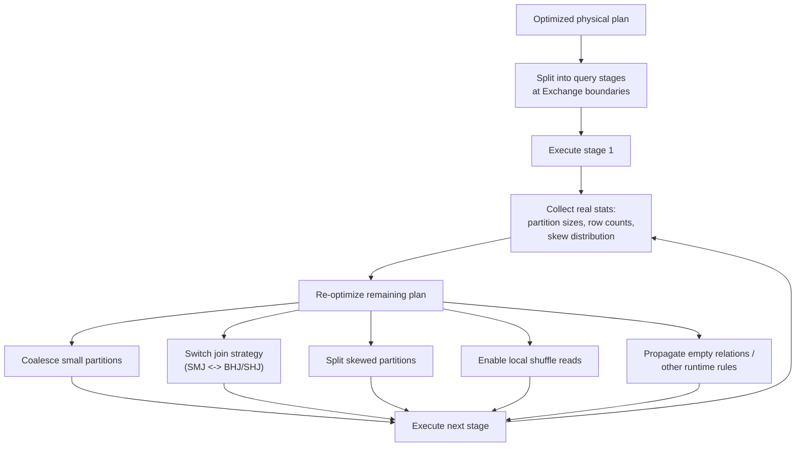
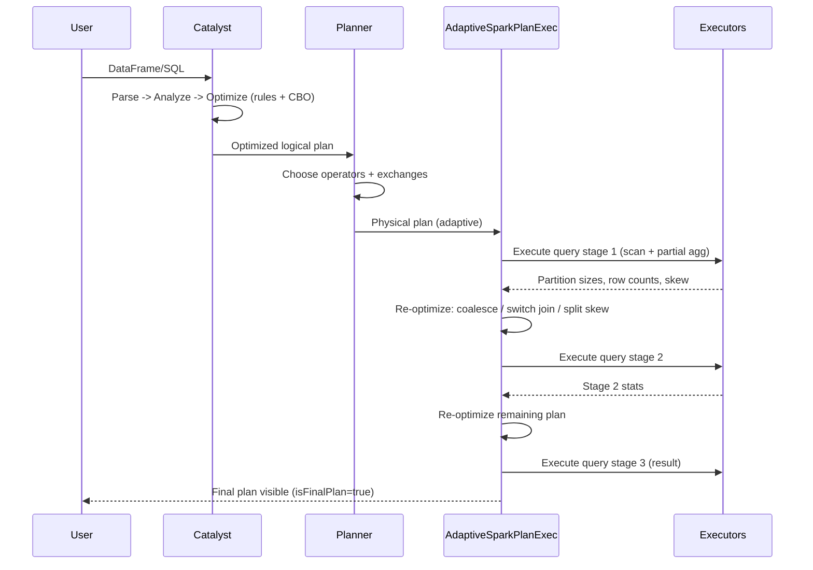

# 06 - Query Planning: Catalyst & Adaptive Query Execution (AQE)

**Priority:** P0
**Versions:** 1.x (Catalyst) -> 2.2 (CBO) -> 3.0/3.2 (AQE) -> 4.2
**Sources:** [SOURCES.md](SOURCES.md) - full list at the end of this chapter.
**See also:** [05 - Physical Operators](05%20-%20Physical%20Operators%20%28Joins,%20Aggregations,%20Sorting%20&%20Windows%29.md), [04 - Shuffle, Partitioning & Network Transfer](04%20-%20Shuffle,%20Partitioning%20&%20Network%20Transfer.md), [Appendix C - The Spark Acceleration Landscape](Appendix%20C%20-%20The%20Spark%20Acceleration%20Landscape.md) (planner vs execution-engine responsibilities).

**TL;DR:** Spark planning is a three-act play: **Catalyst** turns your SQL/DataFrame into an optimized logical plan using tree-rewrite rules; the **planner** turns that into a physical plan choosing operators; and since 3.0 **AQE** re-plans *during* execution, after each shuffle reveals the real data sizes. The interview arc is: rules (predicate pushdown, column pruning) -> cost-based stats and join reordering (2.2) -> runtime re-optimization (coalesce partitions, switch joins, split skew, prune scans). Remember the division of labor: **Catalyst is compile-time and stats-blind when stats are missing; AQE is runtime and stats-rich.**

---

## 1. Why It Exists (The One Idea)

A declarative query says nothing about execution. A naive execution (scan everything, nested-loop every join, sort at the end) is rarely acceptable. So Spark needs a **planning pipeline** that:

1. Resolves names and types (is this column a string? does this table exist?).
2. Applies semantics-preserving rewrites (push filters down, prune columns, fold constants).
3. Chooses among physical alternatives using **cost estimates**.
4. Adapts when the estimates were wrong - because they usually are.

> Planning = "rewrite with rules, decide with stats, and re-decide with reality."

The last clause is the modern one. Older Spark planned once and lived with its mistakes; AQE turned the stage boundary into a feedback loop.

**Memory hook:** *"Catalyst knows the query; CBO knows the table; AQE knows the data."*

---

## 2. The Catalyst Pipeline

One query passes through five representations before it runs: text, unresolved tree, analyzed tree, optimized tree, and physical plan. Keeping those stages distinct is what lets you say *where* a fix belongs.

```mermaid
flowchart LR
    SQL["SQL text /<br/>DataFrame API"] --> P["Parser<br/>-> Unresolved LogicalPlan"]
    P --> A["Analyzer<br/>(catalog, types,<br/>column resolution)"]
    A --> AL["Analyzed LogicalPlan"]
    AL --> O["Optimizer<br/>(rule batches + CBO)"]
    O --> OL["Optimized LogicalPlan"]
    OL --> PL["Planner / Strategies<br/>(logical -> physical)"]
    PL --> PP["Physical Plan"]
    PP --> PREP["Prepare/prepareForExecution<br/>(exchange insertion,<br/>AQE or static)"]
    PREP --> CODEGEN["Whole-stage codegen<br/>(chapter 03)"]
    CODEGEN --> RDD["RDD execution<br/>(chapter 01)"]
```



| Phase | What happens | Key classes |
|-------|--------------|-------------|
| Parse | SQL -> unresolved `LogicalPlan` (AST-like tree) | `SparkSqlParser`, `AstBuilder` |
| Analyze | Resolve tables/columns/functions, coerce types | `Analyzer`, `Catalog` |
| Optimize | Fixed-point batches of rewrite rules; CBO for joins | `Optimizer` (`SparkOptimizer`), `RuleExecutor`, `CostBasedJoinReorder` |
| Plan | Apply physical strategies to each logical operator | `SparkPlanner`, `SparkStrategies` |
| Prepare | Ensure partitioning/sorting requirements; insert exchanges; choose AQE vs static | `QueryExecution`, `AdaptiveSparkPlanExec` vs `SparkPlan.prepareForExecution` |
| Codegen | Fuse executable subtrees into generated Java | `WholeStageCodegenExec` (chapter 03) |

**Why "Catalyst" is fast to extend:** plans and expressions are immutable trees, and an optimization is just a `Rule[TreeType]` transforming one tree into another. `RuleExecutor` runs batches to a fixed point (with `maxIterations`), so new rules compose without hand-written ordering logic. Spark SQL's DataSource V2, AQE, and decades of optimizer rules all plug into this framework [S3, S9].

---

## 3. Rule-Based Optimization: The High-Yield Rewrites

These rules are the reason even stat-blind Spark gets faster when you write declarative SQL instead of manual RDD code. They are semantics-preserving by construction, which is why they always run and never need table statistics.

| Rule (conceptual) | What it does | Why it matters |
|-------------------|--------------|----------------|
| **Predicate pushdown** | Move filters closer to scans (through joins, projections, aggregations) | Less data read, shuffled, and processed |
| **Column pruning** | Remove unused columns from scans/projections | Less I/O, narrower rows, less shuffle |
| **Constant folding** | Evaluate `1 + 1`, `lit(5) > 3` at plan time | Shrinks expressions and enables further rules |
| **Null propagation / boolean simplification** | `x AND true -> x`, fold null-safe comparisons | Fewer runtime checks; enables pushdown |
| **Join condition pushdown** | Push join-key filters into both sides | Smaller join inputs |
| **Distinct -> aggregate rewrite** | `DISTINCT` becomes `GROUP BY` | Reuses aggregation machinery |
| **Eliminate sorts / redundant aliases / subqueries** | Remove no-op plan nodes | Avoids pointless blocking operators |
| **Decimal precision / cast simplification** | Normalize arithmetic and casts | Prevents precision bugs and extra conversions |
| **Partition pruning (static)** | Prune partition directories from filters | Huge I/O savings on partitioned tables |

These are semantics-preserving and **stats-free** - they work even with zero table statistics. That is why Catalyst's rule stage is the reliable baseline, and why "why is my query scanning fewer columns than I selected?" is answered here.

Also part of this stage: **Dataset encoder resolution** (typed API -> `UnsafeRow` conversion), `ReplaceExpressions` for Python/Java UDFs, and `ResolveHints`. Hints (`BROADCAST`, `MERGE`, `SHUFFLE_HASH`) enter the analyzed/optimized plan and constrain the physical planner [S7].

---

## 4. Cost-Based Optimization (CBO, 2.2+)

Rules don't know sizes, so they can't answer "join A to B or B to A first?" CBO does, using table/column statistics:

| Statistic | Source | Used for |
|-----------|--------|----------|
| Row count, total size | `ANALYZE TABLE ... COMPUTE STATISTICS` | Join order, join strategy, gather-vs-broadcast decisions |
| Column NDV (distinct values), null count, avg length | `... FOR COLUMNS` | Filter selectivity, join cardinality |
| Min/max (+ histograms in 2.3) | `... FOR COLUMNS` [RN 2.3] | Range predicate selectivity, skew hints |
| Table-level size for partitioned tables | Metastore | Partition pruning + cost |

What CBO actually does:

- **Join reordering** (`CostBasedJoinReorder`, 2.2): enumerates/ranks join orders for multi-way joins using cardinality estimates [RN 2.2].
- **Star-schema heuristic** (2.2): recognizes fact + dimension joins and orders them sensibly [RN 2.2].
- **Build-side selection**: chooses which side to broadcast/hash based on estimated size.
- **Join strategy cost comparison**: broadcast vs shuffled hash vs sort-merge.

Where it breaks: **stale or missing stats**. Without `ANALYZE`, the optimizer falls back to defaults and guesses; a "10 MB" table may actually be 100 GB, producing a broadcast OOM, or a small build side may be treated as huge, producing a needless shuffle. In interviews, always pair "CBO" with "statistics freshness" - that's what AQE exists to compensate for.

Note the division: **CBO decides join order**; the physical planner decides the operator; **AQE can override both at runtime**.

---

## 5. Adaptive Query Execution (AQE)

### A. Why it exists

Static planning has three unanswerable questions:

1. How many shuffle partitions should this stage have? (Set `spark.sql.shuffle.partitions=200` and pray.)
2. Which join strategy is right? (Stats said 10 MB; it's 10 GB.)
3. Is a partition skewed? (Stats rarely capture hot keys.)

AQE answers them **after materializing a shuffle or broadcast**, when real sizes are known [S16, V2].

### B. How it works



Key mechanics:

- `AdaptiveSparkPlanExec` wraps the plan; each `QueryStageExec` (shuffle/broadcast) is a **materialization + re-plan checkpoint**.
- `spark.sql.adaptive.enabled` is true by default since 3.2 [RN 3.2]; before that it was opt-in (3.0).
- Re-optimization happens **between stages**, not mid-task; that's why the Exchange boundaries from chapter 04 are also planning boundaries.
- With `isFinalPlan=false`, the SQL tab shows the *current* adaptive plan; when execution ends, `isFinalPlan=true` shows the final one. Compare them to see what AQE changed.

### C. The core AQE rules

Every AQE rule follows the same shape: observe a materialized exchange, then rewrite the remaining plan using what was observed. The table below is the rule set you should be able to list from memory, along with the defaults that decide when each fires.

| Rule | Effect | Defaults to know |
|------|--------|------------------|
| **Coalesce shuffle partitions** | Merge adjacent small post-shuffle partitions | Target `spark.sql.adaptive.advisoryPartitionSizeInBytes` = 64 MB |
| **Switch join strategies** | Convert SMJ -> BHJ/SHJ when real sizes allow | Broadcast threshold still applies (`autoBroadcastJoinThreshold`) |
| **Optimize skewed join** | Split partitions much larger than median; join sub-partitions separately | Skew factor 5x median and size > 256 MB |
| **Local shuffle reader** | Skip network reads when the exchange's partitioning already satisfies the consumer | Plan rewrite; no data movement |
| **Propagate empty relations** | Remove joins/aggregations that can't produce rows | Cheap but big wins |
| **Coalesce/rebalance handling** | Adapt partition counts for `rebalance` hints | Extended in 3.2+ |

### D. The numbers (with context)

- Databricks' AQE announcement: **up to 8x** on TPC-DS workloads, driven mainly by partition coalescing and skew handling [S16, 2020].
- The VLDB 2024 production paper: **up to 25x per query** and **1.7x total** improvement from AQE in a large lakehouse deployment [S19].
- DPP (a related runtime optimization, 3.0): **2-18x** on 60 of 102 TPC-DS queries [S17].
- Runtime/Bloom filters (3.3): **up to 10x** on affected join queries [S18].

State the benchmark and who measured it - "up to 8x TPC-DS (Databricks, 2020)" - never a bare multiplier.

### E. What AQE cannot fix

- **Bad data layout**: tiny files, no partition pruning, wrong bucket/sort clustering - AQE doesn't rewrite storage.
- **Expensive UDFs / Python boundaries**: no rule makes user code cheaper; some plan nodes can't be re-optimized across a UDF boundary.
- **Cardinality explosion inside a task**: AQE sees sizes at stage boundaries, not mid-task.
- **Stale broadcast decisions made before a stage**: broadcast strategy switching is bounded by the threshold and available stats.

---

## 6. Runtime Pruning: DPP & Runtime Filters

Two optimizations blur the line between planning and execution:

| Feature | Version | Mechanism | Reported win |
|---------|---------|-----------|--------------|
| **Dynamic Partition Pruning (DPP)** | 3.0 | Broadcast the dimension side, collect its join-key values at runtime, use them to prune partitioned fact-table scans | 2-18x on 60/102 TPC-DS queries [S17] |
| **Runtime (Bloom) filters** | 3.3 | Build a Bloom filter from the small join side, push it down into the big-side scan | Up to 10x on affected queries [S18] |

Both exist because filter pushdown is strongest at the **scan**, but join values aren't known until runtime. DPP prunes whole partitions; Bloom filters skip rows within partitions.

---

## 7. Execution Trace: One Query, Planned Then Re-Planned



Narrate the interview version with the three checkpoints: **(1) analyzed** (correct names/types), **(2) optimized** (rules + stats), **(3) adaptive** (runtime facts). If asked "where would you fix a bad plan?", the answer maps to the checkpoint: rewrite the query (analyzer/optimizer), fix stats (CBO), or enable/adjust AQE.

**Concrete example: one query, before and after AQE.** The logical plan is the same query as `Join -> Filter -> Aggregate`; the tree below is the physical plan with operator choices and exchanges:

```sql
SELECT customer_id, count(*)
FROM orders JOIN customers USING (customer_id)
WHERE amount > 100
GROUP BY customer_id
```

```text
HashAggregate(final, customer_id)
  Exchange(hashpartitioning(customer_id, 200))
    HashAggregate(partial, customer_id)
      BroadcastHashJoin(customer_id)
        Filter(amount > 100)
          FileScan orders (1M rows, 20 files)
        BroadcastExchange
          FileScan customers (50k rows, 2 files)
```

The `Exchange` is the AQE checkpoint. After the partial aggregate, AQE sees the real post-shuffle sizes: if the 200 partitions are mostly small, it coalesces them toward the 64 MB target (say 8); if the join had started as SMJ and the build side is actually small, it can switch to BHJ/SHJ. CBO's statistics explain the choices before runtime: `customer_id` has NDV 50k, so 1M orders collapse to ~50k groups; a filter with 10% selectivity is estimated at 100k rows. Those estimates decide join order and build side before execution.

---

## 8. Failure Behavior & Traps

Most frustrating planning behavior is actually a predictable interaction between stale statistics, hints, and runtime re-planning. The table below is a debugging map for those interactions.

| Symptom | Root cause | Where to look / fix |
|---------|-----------|---------------------|
| Plan flips between runs | AQE re-planning + changing data; adaptive plan shown pre-execution | Compare `isFinalPlan` plans and `spark.sql.planChangeLog` |
| Broadcast OOM despite AQE | CBO/stale stats chose broadcast before the first stage; or hint forced it | Lower broadcast threshold; remove hint; analyze tables |
| AQE "does nothing" | Disabled (`spark.sql.adaptive.enabled=false`), or plan has no exchange boundaries (single-stage query) | Check config and plan shape |
| Coalescing not happening | Post-shuffle partitions already near/above advisory size | Expected; target size is advisory |
| Skew persists | Skew key inside a single partition within advisory size, or no exchange before the skewed operator | Salt/isolate hot key; verify skew thresholds |
| Local shuffle reader not used | The exchange output partitioning doesn't satisfy the consumer (different keys/ordering) | That's correct behavior - the rewrite is proof-based |
| Plan change overhead | Frequent re-planning of very large plans | AQE 3.4+ caches; keep logical plans lean |
| Inconsistent benchmark numbers | Adaptive plan not final / stats warming | Compare final plans and repeat runs |

---

## 9. Observability

Planning is uniquely observable because Spark can show you its own reasoning. Learn these views and you will rarely need to guess why a plan changed.

| Signal | Where | Meaning |
|--------|-------|---------|
| `EXPLAIN`, `EXPLAIN EXTENDED`, `EXPLAIN FORMATTED`, `EXPLAIN COST` | Spark shell/SQL | Logical/physical/cost views; `EXTENDED` shows analyzed + optimized |
| `EXPLAIN CODEGEN` | Spark shell | Generated Java (chapter 03) |
| SQL tab plan: initial vs final | Spark UI | AQE changes; `isFinalPlan` |
| Query stage durations/sizes | SQL tab (`QueryStage` nodes) | Where the time went, per materialization |
| Plan change logs | Driver logs (`spark.sql.planChangeLog.level`) | Which rules fired after each re-plan |
| `AdaptiveSparkPlan isFinalPlan=false` | SQL tab | You're looking at a provisional plan |
| Join strategy labels | SQL tab | Verify AQE switched/kept SMJ/BHJ/SHJ |
| Scan metrics (files/partitions pruned) | SQL tab | DPP / static pruning effectiveness |

---

## 10. Version Notes

The planning lineage is a story of adding intelligence in layers: rules, then costs, then runtime feedback. Version questions almost always target one of those three moments.

| Version | Change | Impact |
|---------|--------|--------|
| 1.x | Catalyst optimizer ships with Spark SQL [S3] | Rule-based planning + codegen architecture |
| 2.0 | Whole-stage codegen consumes optimized plans [S15] | Planning output becomes generated Java |
| 2.2 | Cost-based optimizer: cardinality estimation, join reordering, star-schema heuristic [RN 2.2] | First stats-aware decisions |
| 2.3 | CBO histograms + faster stats collection [RN 2.3] | Better selectivity for range predicates |
| 3.0 | AQE (opt-in), DPP [S17] | Runtime re-optimization + scan pruning |
| 3.1 | AQE improvements (join strategy switching maturity) [RN 3.1] | More reliable runtime decisions |
| 3.2 | **AQE on by default**; skew handling extended [RN 3.2] | The "200 partitions" era ends |
| 3.3 | Runtime/Bloom filters for joins; AQE join improvements [S18] | Big-side scans skip rows |
| 3.4 | AQE plan cache; stats reuse from completed stages [RN 3.4] | Cheaper, more stable re-planning |
| 4.1+ | Real-Time Mode / declarative pipelines (SDP) add new planning front ends [RN 4.1] | Planning story extends beyond batch SQL |

---

## 11. The One-Page Recap (memorize this)

1. Catalyst = immutable trees + rule batches to fixed point; parse -> analyze -> optimize -> plan.
2. Rule wins: predicate pushdown, column pruning, constant folding, join-condition pushdown, static partition pruning.
3. CBO (2.2) adds stats: row counts, NDV, sizes, histograms (2.3) -> join order + build side + strategy.
4. Stats lie -> AQE (3.0, default 3.2) re-plans at Exchange boundaries: coalesce partitions, switch joins, split skew, local reads.
5. AQE numbers: up to 8x TPC-DS (Databricks 2020); up to 25x/query, 1.7x total (VLDB 2024).
6. Runtime pruning: DPP (3.0, 2-18x on 60/102 TPC-DS) prunes partitions; Bloom filters (3.3, up to 10x) prune rows.
7. Division of labor: **rules know semantics, CBO knows statistics, AQE knows reality**. Fix bad plans at the right layer.

---

## 12. Drills (Cover The Answer Column)

| # | Question | Answer |
|---|----------|--------|
| 1 | Name Catalyst's four phases. | Parse -> Analyze -> Optimize -> Plan (then prepare/codegen) |
| 2 | What is a `Rule`? | A tree transformation executed in batches to a fixed point by `RuleExecutor` |
| 3 | Which rule cuts I/O the most? | Predicate pushdown (+ static partition pruning) and column pruning |
| 4 | What can rules do without stats? | Semantics-preserving rewrites: pushdown, pruning, folding - they don't need sizes |
| 5 | What did CBO add in 2.2? | Cardinality estimation, join reordering, star-schema heuristic |
| 6 | What stats does CBO need and how do you get them? | Row counts, NDV, min/max, histograms via `ANALYZE TABLE ... COMPUTE STATISTICS [FOR COLUMNS]` |
| 7 | Why did AQE exist? | Static stats are stale/missing; real sizes only appear after each shuffle |
| 8 | Where does AQE re-optimize? | At query stage boundaries (shuffle/broadcast materializations), never mid-task |
| 9 | Name four AQE rules. | Coalesce shuffle partitions, switch join strategy, split skew, local shuffle reader |
| 10 | What's the target partition size for coalescing? | 64 MB (`advisoryPartitionSizeInBytes`) |
| 11 | What are the skew thresholds? | 5x median partition size and > 256 MB |
| 12 | How do DPP and Bloom filters differ? | DPP prunes whole partitions using dimension values; Bloom filters skip non-matching rows inside scans |
| 13 | Why might AQE be invisible in the SQL tab? | You're seeing a non-final plan, or AQE is disabled/no exchanges exist |
| 14 | Two reasons a broadcast OOM survives AQE. | Bad stats/hint chose broadcast pre-stage; or the real build side genuinely exceeds memory |
| 15 | What does "local shuffle reader" require? | Proof that the exchange output partitioning already satisfies the consumer's requirements |
| 16 | Where do you look to see which optimizer rules fired at runtime? | Plan change logs (`spark.sql.planChangeLog`) and initial-vs-final SQL tab plans |
| 17 | When is AQE *not* the fix? | Bad storage layout, expensive UDFs, intra-task cardinality explosions |

---

## 13. Key Source Classes (pin refs to a tag, e.g. `apache/spark@v3.5.0`)

| Class | Module | Role |
|-------|--------|------|
| `QueryExecution` | `sql/core/.../execution/` | Owns the planning pipeline (analyzed/optimized/physical) |
| `Analyzer`, `Optimizer`, `SparkOptimizer` | `sql/catalyst/.../analysis/`, `.../optimizer/` | Resolution + rule batches |
| `RuleExecutor`, `Rule`, `Batch` | `sql/catalyst/.../rules/` | Fixed-point rule engine |
| `CostBasedJoinReorder` | `sql/catalyst/.../optimizer/` | CBO join ordering |
| `SparkPlanner`, `SparkStrategies` | `sql/core/.../execution/` | Logical -> physical strategies |
| `AdaptiveSparkPlanExec` | `sql/core/.../execution/adaptive/` | AQE driver/re-plan loop |
| `QueryStageExec`, `ShuffleQueryStageExec`, `BroadcastQueryStageExec` | `sql/core/.../execution/adaptive/` | Materialization checkpoints |
| `CoalesceShufflePartitions`, `OptimizeSkewedJoin`, `OptimizeLocalShuffleReader`, `AQEPropagateEmptyRelation` | `sql/core/.../execution/adaptive/` | Core AQE rules |
| `DynamicPartitionPruning` | `sql/catalyst/.../optimizer/` | DPP planning rule |
| `PlanChangeLogger` | `sql/core/.../util/` | Runtime plan-change logs |

---

## 14. Sources Used

- [S3](SOURCES.md) "Spark SQL: Relational Data Processing in Spark" (SIGMOD '15) - Catalyst architecture, rule-based optimization
- [S9](SOURCES.md) "Deep Dive into Spark SQL's Catalyst Optimizer" (Databricks, 2015) - phases, tree transformations
- [S16](SOURCES.md) "Adaptive Query Execution" (Databricks, 2020) - AQE mechanics, up to 8x TPC-DS
- [S19](SOURCES.md) "Adaptive and Robust Query Execution for Lakehouses at Scale" (VLDB 2024) - up to 25x/query, 1.7x total
- [S17](SOURCES.md), [S18](SOURCES.md) - DPP 2-18x on 60/102 TPC-DS; runtime filters up to 10x
- [V2](SOURCES.md), [V5](SOURCES.md) - AQE internals talks
- [RN 2.2 / 2.3 / 3.0 / 3.1 / 3.2 / 3.3 / 3.4 / 4.1](SOURCES.md) - CBO, histograms, AQE default, runtime filters, AQE cache
- Official configuration documentation (apache.org) - `spark.sql.adaptive.*` defaults (enabled, advisory size 64 MB, skew factor 5x/256 MB), plan change logs
