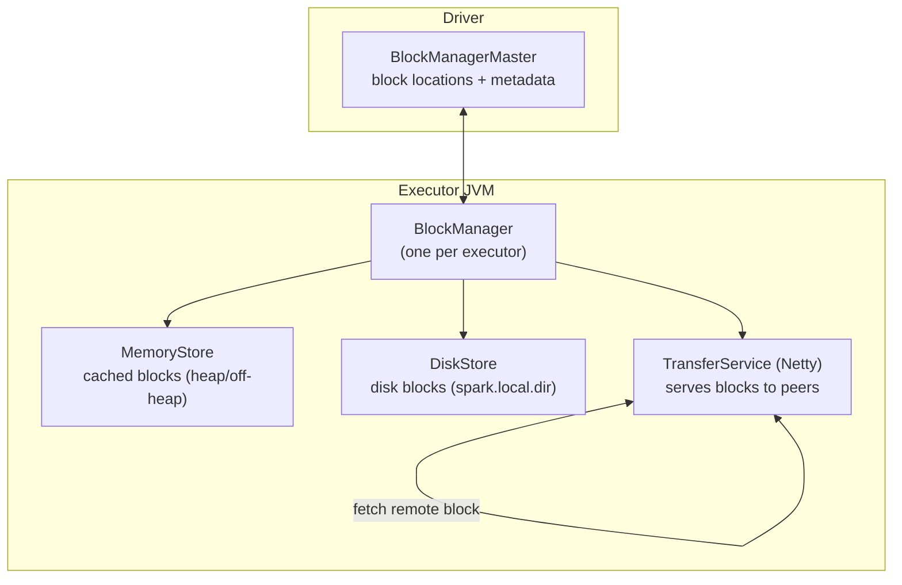
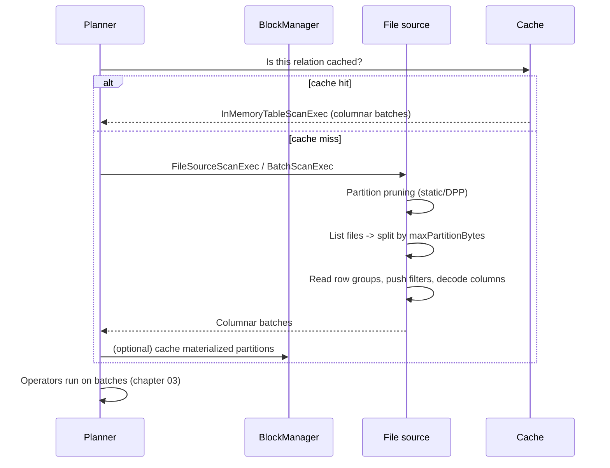

# 07 - Storage, Caching & File Formats

**Priority:** P1
**Versions:** Apache Spark **3.5.0**.
**Sources:** [SOURCES.md](SOURCES.md) - full list at the end of this chapter.
**See also:** [02 - Memory Management & Disk Spilling](02%20-%20Memory%20Management%20&%20Disk%20Spilling.md), [04 - Shuffle, Partitioning & Network Transfer](04%20-%20Shuffle,%20Partitioning%20&%20Network%20Transfer.md), [11 - Delta Lake & Connector Internals](11%20-%20Delta%20Lake%20&%20Connector%20Internals.md).

**TL;DR:** Spark's compute is fast; its I/O path decides whether that matters. Three layers: **BlockManager** (where cached/shuffle/broadcast blocks live and how they're replicated), **caching policy** (`StorageLevel` - what to keep, where, and what happens on eviction), and **file formats/organization** (columnar Parquet/ORC with pruning + partitioning vs row formats with none). Interview skill: choose a storage level and defend it, explain why a Parquet scan reads less than a CSV scan, and explain why "small files + no partitioning" beats every optimizer trick.

---

## 1. Why It Exists (The One Idea)

Spark computes in memory but cannot store the world there. So every dataset has a lifecycle: **land in files -> get scanned -> maybe cached -> get shuffled -> get written**. Each transition has a cost model:

> Caching trades memory for repeat-compute; columnar formats trade CPU/compression for I/O; partitioning/bucketing trades write-time organization for scan-time skipping.

The interview version: *"Spark doesn't make I/O disappear - it gives you knobs to read less, read in columns, and avoid re-reading at all."*

---

## 2. BlockManager: The Storage Subsystem

The BlockManager is the piece that makes caching, shuffle, and broadcast feel like one system. Every block in Spark - cached, shuffled, broadcast, or intermediate - is registered and served from here, which is why storage questions in interviews usually start with "where does that block live?"

| Piece | Role |
|-------|------|
| `BlockManager` | Per-JVM registry of blocks: get/put, replicate, evict, serve |
| `BlockManagerMaster` (driver) | Tracks which block lives where; answers "who has block X?" |
| `MemoryStore` | Cached blocks in the unified storage pool (chapter 02) |
| `DiskStore` / `DiskBlockManager` | Blocks on local disk (`spark.local.dir`); shuffle and spill files share this land |
| `TransferService` | Netty-based block transfer between executors |
| External Shuffle Service | Serves shuffle blocks after executor death (chapter 04) |

Block types: RDD/cached partitions, shuffle blocks, broadcast blocks, task results, and stream blocks. Storage levels with `_2`/`_3` suffixes replicate blocks to other executors - replication costs memory/disk but survives a single executor loss without recompute.

---

## 3. Storage Levels: What `cache()` Actually Means

Choosing a storage level is really choosing what happens when memory runs out. The table below is the decision surface; the facts after it are the parts people get wrong in production.

| Level | Memory | Disk | Serialized | Recompute on eviction | Use when |
|-------|--------|------|-----------|------------------------|----------|
| `MEMORY_ONLY` (`RDD.cache()`) | Yes | No | No | **Yes** (block dropped) | Recompute is cheap; dataset fits |
| `MEMORY_AND_DISK` (`Dataset.cache()`) | Yes | Yes | No | No (evicts to disk) | Default safe choice for reused data |
| `MEMORY_ONLY_SER` / `MEMORY_AND_DISK_SER` | Yes | No / Yes | Yes | Recompute / disk fallback respectively | Memory-constrained; CPU available (JVM RDD names) |
| `DISK_ONLY` | No | Yes | Yes | No | Huge data reused a few times |
| `OFF_HEAP` | Off-heap | Yes | Yes | Disk fallback on eviction; recompute if all copies lost | Reduce cached-byte GC; explicitly enable/size managed off-heap memory |
| `_2` / `_3` variants | Replicated | Replicated | - | No (peer copy) | Fault tolerance without recompute |

Facts that show up in interviews:

1. **`persist()` is lazy** - nothing is cached until the next action touches the partitions.
2. **Caching does not survive executor loss** unless replicated (or persisted to disk and the executor's disk survives - usually not after decommission). Lineage is still the ultimate safety net.
3. **Cache is a materialized view of a plan**: DataFrames cache columnar batches (`InMemoryRelation` + `InMemoryTableScanExec`), not Java objects. Two different DataFrames over the same logical data do **not** share a cache unless the analyzed plans match (or you use `CACHE TABLE` / the same DataFrame object).
4. **Unpersist** (`unpersist()`, `CLEAR CACHE`) when the reuse window closes - otherwise eviction pressure slowly squeezes execution memory (chapter 02).
5. **Cached columnar batches** matter: `spark.sql.inMemoryColumnarStorage.compressed` (default true) and `batchSize` (default 10,000 rows) control footprint vs decode cost. 1.6's columnar cache delivered up to 14x on complex-type queries [S14].

**Memory hook:** *"MEMORY_ONLY = evict and recompute; MEMORY_AND_DISK = evict and read back; replication = survive the executor."*

In Spark 3.5.0, `StorageLevel.OFF_HEAP` has `useDisk=true`, `useMemory=true`, `useOffHeap=true`, `deserialized=false`, replication 1. Losing the node loses its local disk copy; lineage or another replica supplies recovery.

---

## 4. Broadcast Variables & Broadcast Joins (Storage's Other Job)

Broadcast data is a block too, but its distribution is special:

- **TorrentBroadcast**: the driver chunks the value (`spark.broadcast.blockSize`, 4 MB default) and executors share chunks peer-to-peer (BitTorrent-like), reducing driver upload pressure.
- Broadcast blocks live in `BlockManager` and are **not evicted casually** - a missing broadcast block can stall a task and force re-fetch.
- Broadcast joins reuse this machinery (`BroadcastExchangeExec` -> `BroadcastExchange` -> collect + broadcast) - the memory risk from chapter 05 *is* this storage path.

---

## 5. File Formats: Read Less, Read Columns

File format choice is a lever on every downstream cost: I/O, decode CPU, memory footprint, and shuffle size. The comparison below is about how much work the engine can skip before it even reads a value.

| Format | Layout | Pruning | Typical use |
|--------|--------|---------|-------------|
| Parquet | Columnar, row groups + column chunks + pages | Column pruning, row-group min/max skipping, predicate pushdown | Analytics (default choice) |
| ORC | Columnar, stripes + row indexes | Column pruning, stripe/index skipping | Hive ecosystem |
| Avro | Row-based | None (schema evolution strengths) | Ingestion/write-heavy pipelines |
| JSON / CSV | Row text | None (parsing every field) | Landing/exchange, not analytics |

What makes Parquet fast:

- **Column pruning**: selecting 3 of 200 columns reads only those column chunks.
- **Predicate pushdown/row-group skipping**: min/max stats per row group let the reader skip groups that can't match a filter.
- **Encoding/compression**: dictionary/run-length/delta encodings + splittable compression (Snappy default; zstd added in 2.3 [RN 2.3]).
- **Vectorized reads**: batches of column values decoded into tight buffers instead of row objects; Spark enables vectorized Parquet reading by default, with `spark.sql.parquet.columnarReaderBatchSize` (default 4,096 rows) tuning the batch.
- **Nested-type handling got better over time**: 3.3's nested/complex-type vectorization reported ~15x for struct-field reads [S18].

**Concrete example: pruning a 1M-row table.** A Parquet table has 200 columns and 100 row groups. A query selects 3 of those columns and filters `amount > 900`; column pruning reads only 3 column chunks, and row-group min/max stats skip 98 of 100 row groups - about 2% of the rows and 1.5% of the columns. If `event_date` is a partition column, a date filter prunes whole directories before row-group stats are even consulted. Bucketing goes one step further for joins: 100 buckets on `customer_id` put all rows for a customer in one bucket file, so a join on `customer_id` can skip the shuffle when both sides use the same bucketing.

Reader milestones to cite:

| Version | Reader improvement | Number |
|---------|--------------------|--------|
| 1.6 | New Parquet reader | ~2.9M -> 4.5M rows/s (~50%) [S14] |
| 2.3 | Vectorized ORC reader | 2-5x [RN 2.3] |
| 3.3 | Vectorized nested Parquet (struct fields) | ~15x [S18, Databricks] |

**Memory hook:** *"Row formats read records; columnar formats read values. Analytics reads values."*

---

## 6. File Organization: Partitioning, Bucketing, Files

Physical layout is half the query performance:

| Technique | What it does | Win | Trap |
|-----------|--------------|-----|------|
| **Partitioning** (`PARTITION BY date`) | One directory per value; static + dynamic pruning | Skip irrelevant files/partitions | Over-partitioning -> millions of tiny files |
| **Bucketing** (`CLUSTERED BY id INTO N BUCKETS`) | Hash-distributes files by key | Joins on the same keys can skip a shuffle | Wrong bucket count/columns = no win; stale buckets after writes |
| **Compaction** | Merge small files | Sequential I/O, fewer tasks, less listing | Rewrite cost; coordinate with readers |
| **File sizing** | Target ~`maxPartitionBytes` (128 MB default) per task split | Full cores, fewer task overheads | Smaller = overhead; larger = less parallelism |

Two small-file costs people forget:

1. **Planning/listing cost**: the driver lists and plans every file; thousands of files turn planning into a bottleneck.
2. **Per-task overhead**: `spark.sql.files.openCostInBytes` (default 4 MB) tells the planner how "expensive" opening a file is, so it packs small files together - but it cannot fix a bad layout.

Compression choice: **splittable** codecs (Snappy, LZ4, zstd) let one large file be read by many tasks; **gzip is not splittable**, so a huge `.csv.gz` is effectively one task - a favorite trick question.

---

## 7. Execution Trace: A Cached, Partitioned Parquet Query

The key checkpoints: **what got pruned** (partition/file/row-group), **what got decoded** (columns/batches), and **whether a cache removed the scan entirely**.

---

## 8. Failure Behavior

Storage failures are mostly quiet: blocks disappear, caches go stale, and files multiply. The table maps each symptom to the mechanism responsible, so you can tell a capacity problem from a layout problem.

| Failure | Effect | Recovery/mitigation |
|---------|--------|---------------------|
| Executor loss with cached data | Cached blocks gone (no replication) | Recompute from lineage; `_2` levels or accept recompute |
| Eviction of cached blocks | No error; silent recompute | MEMORY_AND_DISK keeps blocks on disk; unpersist unused caches |
| Corrupt/missing input file | Task fails; job fails without tolerance | `spark.sql.files.ignoreCorruptFiles` / `ignoreMissingFiles` for best-effort jobs |
| Small-file explosion | Planning + task overhead; slow scans | Compaction, `OPTIMIZE` (Delta), fewer partitions |
| Too many partitions/dirs | Metastore/listing pressure | Bound partition cardinality; use partition pruning |
| Disk full (`spark.local.dir`) | Spills/shuffle/cache writes fail | Capacity planning; separate disks; cleanup |
| Stale cache after overwrite | Old data returned from cache | Invalidate/refresh cache (`REFRESH TABLE`, unpersist) |

---

## 9. Observability

Storage health is observable at three levels: what is cached, what a scan actually read, and what the physical layout looks like. The signals below cover all three.

| Signal | Where | Interpretation |
|--------|-------|----------------|
| Storage tab (size, fraction cached) | Spark UI | How much cached; eviction/drop behavior |
| `Input Size / Records`, `Files/Partitions read vs pruned` | SQL tab scan node | Effectiveness of pruning and layout |
| Task locality (`PROCESS_LOCAL` = cached) | Stage detail | Cache hits vs remote reads |
| Scan duration vs rows decoded | SQL tab | Column pruning/vectorization working? |
| Broadcast block size | SQL tab / logs | Approaching memory/limits |
| File counts per table/partition | Metadata / `DESCRIBE DETAIL` | Small-file diagnosis |

Diagnostic rule: **if the SQL plan says "scan" and you expected "cache", check plan identity and unpersist/refresh; if it says "cache" but still reads, check whether the cached relation covers your filters/columns.**

---

## 10. Version Notes

The storage lineage is short and worth remembering because layout choices age slowly. Reader and cache improvements arrived first, layout awareness second, and representation (VARIANT) most recently.

| Version | Change | Impact |
|---------|--------|--------|
| 1.6 | Columnar cache; new Parquet reader (2.9M -> 4.5M rows/s) [S14, RN 1.6] | Caching becomes columnar; Parquet ~50% faster |
| 2.3 | Vectorized ORC (2-5x); zstd; spill read-ahead [RN 2.3] | More formats on the fast path; better compression |
| 3.0 | Bucketing/join improvements; AQE shrinks scan cost indirectly [RN 3.0] | Layout-aware planning matures |
| 3.3 | Vectorized nested Parquet (~15x struct fields) [S18] | Complex schemas stop being a penalty |
| 3.4 | Limit pushdown through UDFs [RN 3.4] | Scans can stop earlier in more plans |
| 4.0 | VARIANT type for semi-structured data [RN 4.0] | JSON-like data gets a binary columnar representation |

---

## 11. The One-Page Recap (memorize this)

1. BlockManager = block registry; MemoryStore + DiskStore; ESS extends shuffle serving past executor death.
2. `RDD.cache()` = MEMORY_ONLY (recompute on eviction); `Dataset.cache()` = MEMORY_AND_DISK; `_2` = replication.
3. Cache is lazy, per-plan, and lost with executors; unpersist when done.
4. Columnar formats read columns + skip row groups; vectorization batches values.
5. Partitioning/bucketing/files decide how much Spark even looks at; compaction and ~128 MB splits are the defaults to defend.
6. Numbers: Parquet 1.6 +50%; ORC 2.3 2-5x; nested Parquet 3.3 ~15x; columnar cache up to 14x (complex types).
7. Small files and no partitioning beat any optimizer - fix layout first.

---

## 12. Drills (Cover The Answer Column)

| # | Question | Answer |
|---|----------|--------|
| 1 | What does `RDD.cache()` use? `Dataset.cache()`? | MEMORY_ONLY; MEMORY_AND_DISK |
| 2 | Why does MEMORY_ONLY recompute? | Eviction drops the block; lineage regenerates it |
| 3 | Does caching survive executor loss? | Only with replication (`_2`) or if data/disk survives; otherwise recompute |
| 4 | Where do cached blocks and spills live? | MemoryStore (heap/off-heap) and `spark.local.dir` disk |
| 5 | What is TorrentBroadcast? | Chunked peer-to-peer broadcast distribution to avoid driver upload bottleneck |
| 6 | Why is Parquet faster than CSV for analytics? | Column pruning, row-group stats/predicate pushdown, encodings, vectorized columnar decode |
| 7 | What does the Parquet vectorized reader do? | Decodes column batches (4,096 rows default) instead of row objects |
| 8 | Which codec choice can kill parallelism? | gzip (not splittable) - one large file becomes one task |
| 9 | What is the small-file problem? | Planning/listing overhead + per-file task overhead; fix via compaction and fewer, larger files |
| 10 | Partitioning vs bucketing? | Partitioning = directory-based value pruning; bucketing = hash files by key to skip join shuffles |
| 11 | Why did columnar caching matter? | Cached `UnsafeRow` batches avoid object overhead; up to 14x on complex types (Databricks, 1.6) |
| 12 | How do you invalidate a stale cache? | `unpersist()` / `CLEAR CACHE` / `REFRESH TABLE` (as appropriate) |
| 13 | How do you verify pruning worked? | SQL tab scan metrics: files/partitions read vs total, input size |
| 14 | What do `maxPartitionBytes` and `openCostInBytes` control? | Target split size (~128 MB) and small-file packing cost (4 MB) during scan planning |
| 15 | Name the two ways a filter avoids reading data. | Partition pruning (skip files/dirs) and row-group/page skipping via stats |

---

## 13. Key Source Classes (pin refs to a tag, e.g. `apache/spark@v3.5.0`)

| Class | Module | Role |
|-------|--------|------|
| `BlockManager`, `BlockManagerMaster` | `core/.../storage/` | Block registry, locations, replication |
| `MemoryStore`, `DiskStore`, `DiskBlockManager` | `core/.../storage/` | Physical block storage |
| `StorageLevel` | `core/.../storage/` | Cache policies |
| `TorrentBroadcast` | `core/.../broadcast/` | Chunked broadcast distribution |
| `InMemoryRelation`, `InMemoryTableScanExec`, `CachedBatch` | `sql/core/.../execution/columnar/` | SQL columnar cache |
| `FileSourceScanExec` | `sql/core/.../execution/` | V1 file scans + pruning |
| `BatchScanExec`, `FileScan` | `sql/core/.../datasources/v2/` | V2 scans |
| `FilePartition`, `FileScanRDD` | `sql/core/.../execution/datasources/` | Splitting/reading files |
| `ParquetFileFormat`, `VectorizedParquetRecordReader` | `sql/core/.../execution/datasources/parquet/` | Parquet read path |
| `OrcFileFormat` | `sql/core/.../execution/datasources/orc/` | ORC read path |

---

## 14. Sources Used

- [S14](SOURCES.md) Announcing Apache Spark 1.6 (Databricks, 2016) - Parquet 2.9M -> 4.5M rows/s, columnar cache up to 14x
- [S18](SOURCES.md) Introducing Apache Spark 3.3 (Databricks, 2022) - nested Parquet vectorization ~15x
- [S6](SOURCES.md), [S7](SOURCES.md) - BlockManager/caching and scan implementations
- [RN 1.6 / 2.3 / 3.0 / 3.4 / 4.0](SOURCES.md) - reader milestones, zstd, limit pushdown, VARIANT
- Official configuration documentation (apache.org) - defaults: `spark.sql.inMemoryColumnarStorage.*`, `spark.sql.files.maxPartitionBytes` 128 MB, `openCostInBytes` 4 MB, `parquet.compression.codec` snappy, `broadcast.blockSize` 4 MB, `ignoreCorruptFiles`
