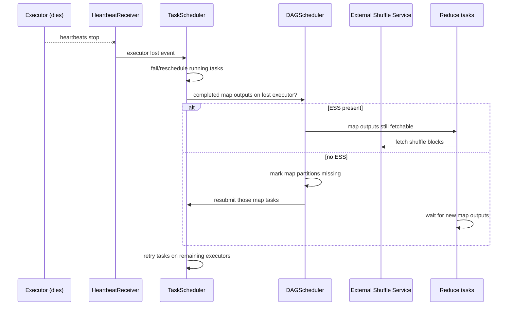

# 08 - Fault Tolerance, Resource Scheduling & Multi-Tenancy

**Priority:** P1
**Versions:** 1.2 (ESS/dynamic allocation) -> 4.2
**Sources:** [SOURCES.md](SOURCES.md) - full list at the end of this chapter.
**See also:** [01 - Execution Architecture & Scheduling](01%20-%20Execution%20Architecture%20&%20Scheduling.md), [04 - Shuffle, Partitioning & Network Transfer](04%20-%20Shuffle,%20Partitioning%20&%20Network%20Transfer.md), [07 - Storage, Caching & File Formats](07%20-%20Storage,%20Caching%20&%20File%20Formats.md).

**TL;DR:** Spark assumes machines die and clusters are shared. Correctness under failure comes from **lineage recomputation** (plus checkpointing to cut lineage); efficiency under failure comes from **shuffle data outliving executors** (External Shuffle Service) and **graceful decommissioning**. Resource scheduling decides *who gets executors* (static vs dynamic allocation, YARN/K8s/Standalone), and multi-tenancy decides *who gets them first* (FIFO vs FAIR pools, YARN queues/K8s namespaces). Interview skill: trace one executor-loss event end to end, then explain dynamic allocation's prerequisites and the difference between failure recovery and isolation.

---

## 1. Why It Exists (The One Idea)

Two independent problems get lumped together as "fault tolerance":

1. **Correctness**: the answer must be right even if tasks/executors/nodes fail. Spark's answer is **lineage**: recompute lost partitions from the recipe [S1].
2. **Availability of work**: the cluster must keep running and keep using resources well. Spark's answers are **retries**, **speculation**, **dynamic allocation**, and **cluster managers**.

And a third, organizational problem: **multi-tenancy** - many jobs/users sharing the same cluster without one starving or corrupting another.

> Fault tolerance = "recompute what was lost"; resource scheduling = "get and release the right muscles"; multi-tenancy = "don't let one tenant eat the cluster."

---

## 2. The Failure Model (What Can Die)

The failure model is easier to remember as a hierarchy than as a list: tasks fail often, stages fail rarely, drivers fail catastrophically. Each level has exactly one recovery mechanism, and the skill is knowing which level you are at before proposing a fix.

| Component | Can fail? | Consequence | Spark's mitigation |
|-----------|-----------|-------------|--------------------|
| Task | Yes (exceptions, OOM, poison record) | Retry within the stage | `spark.task.maxFailures` (4) + task retry |
| Stage | Yes (all task attempts exhausted, fetch failure) | Stage resubmitted | `spark.stage.maxConsecutiveAttempts` (4) |
| Executor | Yes (crash, OOM, preemption) | Lost cached blocks, map outputs, running tasks | Reschedule tasks; recompute missing shuffle; ESS for shuffle data |
| Node | Yes (hardware, spot reclaim) | All executors on it die | Same as executor loss + decommission path |
| Driver | Yes (single point) | Application fails | Restart app; streaming recovers from checkpoint |
| External system | Yes (HDFS/S3/Kafka) | Input/output errors, retries | Source/sink retries; commit protocols |

**Lineage is the correctness backbone** [S1]: a lost partition is regenerated by replaying the narrow transformations that produced it. But replay cost grows with lineage length and shuffle boundaries - which is why Spark gives you **checkpointing** (cut lineage) and **caching** (avoid recompute, chapter 07). Chapter 01's four-partition stage example shows the partition-level version: a lost map partition is replayed from its narrow input chain, not by rerunning the whole job.

---

## 3. Checkpointing: Trading Storage for Recovery Time

Checkpointing is the explicit trade Spark offers when lineage replay is too expensive. The distinctions below - reliable vs local, RDD vs streaming - are the ones that change behavior, so learn the table by the trade each row makes rather than by the API names.

| Type | What it writes | Use |
|------|----------------|-----|
| **RDD checkpoint** (reliable) | Materialized RDD to a reliable filesystem | Cut a long lineage that is expensive to replay |
| **Local checkpoint** | Materialized RDD to executor disks | Cut lineage cheaply when losing the checkpoint is acceptable |
| **Structured Streaming checkpoint** | Offsets + state + commit log | Exactly-once progress and state recovery (chapter 10) |
| **Shuffle files** | Already-materialized map outputs | Stage boundaries are implicit "checkpoints" that ESS makes durable |

Checkpoint usage rules that interviewers like:

- **Checkpoint before/after wide dependencies** where replay is expensive; truncate absurdly long lineages.
- **Caching is not checkpointing**: cache survives within the app and can be recomputed; checkpoint persists beyond lineage/executor lifetime (and enables lineage truncation).
- For streaming, the checkpoint directory is the **source of truth** for progress - losing it means starting over (or worse, duplicates if the sink isn't idempotent).

---

## 4. Executor Loss: The Canonical End-To-End Trace

The decisive line: **does the shuffle output outlive the executor?** With ESS it does; without it, the map stage (or just the lost partitions) must be recomputed. This is why ESS is a prerequisite for aggressive dynamic allocation.

### Decommissioning (3.1, shuffle migration default 3.4)

Cloud spot instances and cluster scale-down are *planned* failures. Spark's decommission framework:

1. Marks the executor as decommissioning.
2. Stops accepting new tasks.
3. **Migrates shuffle blocks** off the node (default on since 3.4) and lets in-flight tasks finish or reschedule.
4. Then removes the executor.

This converts "node vanished -> recompute" into "node left gracefully -> no data lost", which is what makes spot-heavy clusters viable. Fetch failures from decommissioned executors can be ignored rather than triggering stage retries [RN 3.4].

---

## 5. Resource Scheduling

### A. Cluster managers

The cluster manager choice is mostly an operational decision, not a performance one. What matters technically is how each manager hands out and reclaims executors, because that determines how failures and scaling look to Spark.

| Manager | Model | Notes |
|---------|-------|-------|
| Standalone | Spark's own master/worker daemons | Simple; good for dedicated clusters |
| YARN | Containers from ResourceManager; queues | Classic Hadoop multi-tenancy |
| Kubernetes | Driver + executor pods | Cloud-native; dynamic allocation common |
| Local | Threads in one JVM | Development only |
| Mesos | Removed in 3.2 [RN 3.2] | Historical |

### B. Static vs dynamic allocation

Static and dynamic allocation trade predictability against utilization, and dynamic allocation has one non-obvious prerequisite. Understand that prerequisite and you understand most dynamic-allocation incidents.

| | Static | Dynamic (`spark.dynamicAllocation.enabled`) |
|---|--------|----------------------------------------------|
| Executors | Requested up front, held for app lifetime | Added/removed based on pending tasks |
| Cost | Simple, predictable | Better cluster utilization |
| Prerequisite | None | **Shuffle data must survive executor removal** -> External Shuffle Service (or equivalent) |
| Knobs | `spark.executor.instances`, cores, memory | min/max/initial executors, idle timeout, allocation ratio |

Dynamic allocation's hidden dependency is the exam point: removing an executor loses its shuffle outputs and cached blocks. ESS protects shuffle; caches are simply lost (and recomputed if needed). That's also why aggressive scale-down can quietly increase runtime.

### C. Within-app scheduling: FIFO vs FAIR

- **FIFO** (default): jobs run in submission order; one giant job monopolizes the cluster.
- **FAIR**: pools share resources by weight/minShare; the right choice for shared notebooks/services.
- Pools can be nested; `fairscheduler.xml` defines weights and minimum shares. In YARN, the queue (capacity/fair scheduler) provides *cross-app* isolation; inside an app, Spark's pools provide *intra-app* fairness.
- Stage-level scheduling considerations: a job with one straggler stage holds resources even if other jobs are waiting under FIFO.

### D. Resources beyond CPU/memory

Spark 3.x+ supports **resource profiles** (e.g., GPUs) via `spark.executor.resource.*` and task resource requirements; the scheduler matches tasks to executors that expose the resource (`ResourceProfile`). Useful for ML pipelines where only some stages need GPUs.

---

## 6. Multi-Tenancy: Isolation Layers

Multi-tenancy is not one feature; it is a stack of isolation layers, each answering a different question. The table below orders them from "between teams" down to "between tasks", which is also the order to check when a shared cluster misbehaves.

| Layer | Mechanism | Isolates |
|-------|-----------|----------|
| Cluster | YARN queues / K8s namespaces + quotas | Between applications/teams |
| Application | Spark **FAIR pools** | Between concurrent jobs in one app |
| Executor | Container sizes, cgroups, `memoryOverhead` | Memory/CPU between executors |
| Data | Catalog permissions, table ACLs, view/row filters (engine/table-format dependent) | Data access (not a Spark core scheduler feature) |
| Client | **Spark Connect** (3.4+/3.5 GA): remote thin clients, server-side sessions | Client upgrades/isolation from the driver JVM [RN 3.5] |

Practical multi-tenancy guidance:

- Set **minShare/weight** for interactive pools; don't let an ETL job's FIFO queue starve dashboards.
- Use **dynamic allocation** cautiously with interactive clusters: scale-down can evict caches that dashboards depend on.
- Bound **broadcast sizes** and driver result caps - a tenant that broadcasts a huge table or `collect()`s is a cluster-wide incident (chapters 01/05).
- In Kubernetes, set pod resource requests/limits and `spark.executor.memoryOverhead` consistently or the kubelet will kill pods (chapter 02).

---

## 7. Output Commit & Speculation (The Subtle Correctness Traps)

- **Speculative tasks can duplicate side effects.** Spark assumes tasks are idempotent or that the sink handles duplicate attempts. Writing to a plain filesystem uses the Hadoop **output committer**: task attempts write to temporary/task-attempt directories, and only the successful attempt is committed at job commit. Non-transactional sinks (e.g., a naive HTTP call or a database insert without a key) can double-write under speculation or retries.
- **Job commit is the atomicity boundary** for file output: `FileOutputCommitter` v1 vs v2 algorithm changes performance and duplicate-window behavior; object stores (S3) historically needed special committers for correctness/performance.
- **Kafka sinks** achieve exactly-once only if the producer is transactional + idempotent and offsets are committed atomically with output (chapter 10 discusses offsets/checkpointing).

**Concrete example: two speculative attempts write the same partition.** Attempt 1 writes `_temporary/attempt_001/part-00000`; the speculative attempt 2 writes `_temporary/attempt_002/part-00000`. When attempt 1 finishes first, the job committer renames only its directory to `part-00000` and discards attempt 2. If the sink were a plain database insert without a key, both attempts could insert the same row - the committer protects file output, not arbitrary side effects.

The interview sentence: *"Spark retries tasks, so side effects must be idempotent or committed transactionally; otherwise exactly-once is a property of the sink, not the engine."*

---

## 8. Observability

Failures and resource problems leave distinct fingerprints across three consoles: the Spark UI, the cluster manager, and the event log. The signals below tell you which console to open first.

| Signal | Where | Meaning |
|--------|-------|---------|
| Executors added/removed over time | Executors tab / event timeline | Dynamic allocation churn; cache loss |
| Failed tasks with retry counts | Stage page | Poison records vs infrastructure flakiness |
| "Lost executor" events + reason | Event log / cluster manager | OOM vs preemption vs node failure |
| Blacklisted executors | Spark UI (older versions) / logs | Repeated bad nodes |
| Resource usage (cores/memory) per app | YARN RM / K8s metrics / Spark REST | Right-sizing static allocation |
| Job wait time | Jobs tab / event log | FIFO starvation, queue delays |
| Decommission events | Event log | Spot-node drains; shuffle migration activity |
| Driver/heartbeat errors | Driver logs | Cluster connectivity vs app bugs |

---

## 9. Version Notes

The operational model changed more than the failure semantics. Decommissioning and Connect moved the interesting version facts into how executors and clients are managed, so read this table as "what changed about how Spark hands out and recovers work".

| Version | Change | Impact |
|---------|--------|--------|
| 1.2 | External Shuffle Service; elastic scaling groundwork [RN 1.2] | Dynamic allocation becomes practical |
| 1.6 | Netty RPC/heartbeats consolidation | Robust liveness at scale |
| 3.1 | Executor decommissioning [RN 3.1] | Graceful node drain for cloud spot |
| 3.2 | Mesos support removed [RN 3.2] | Standalone/YARN/K8s are the supported managers |
| 3.4 | Shuffle migration on decommission by default; Spark Connect Python client [RN 3.4] | Spot instances cheaper; thin clients |
| 3.5 | Spark Connect GA (Scala/Go) [RN 3.5] | Server-side sessions; client decoupled from driver |
| 4.x | Connect/API-mode evolution; JDK 17+ | Isolation boundary moves to client/server |

---

## 10. The One-Page Recap (memorize this)

1. Correctness = lineage; expedience = checkpoint/cache; durability of shuffle = ESS.
2. Executor loss: tasks rescheduled; shuffle outputs survive only with ESS (or recompute).
3. Decommission (3.1, default shuffle migration 3.4) makes node loss graceful.
4. Static vs dynamic allocation: dynamic needs durable shuffle data; caches die with executors.
5. FIFO vs FAIR: cross-app isolation via YARN queues/K8s namespaces; intra-app via FAIR pools.
6. Retries/speculation duplicate side effects - idempotent/transactional sinks, output committers.
7. Driver is a SPOF; streaming's checkpoint is the progress source of truth.

---

## 11. Drills (Cover The Answer Column)

| # | Question | Answer |
|---|----------|--------|
| 1 | How does Spark recover a lost partition? | Recompute it from lineage (narrow chain); shuffle stages materialize boundaries |
| 2 | When do you checkpoint instead? | Long/expensive lineage, or repeated failure replay; checkpoint truncates lineage |
| 3 | What is the key prerequisite for dynamic allocation? | Durable shuffle outputs (External Shuffle Service) so removed executors don't force map recomputation |
| 4 | What happens to cached blocks when an executor is removed? | They're lost; recomputed if still needed (unless replicated) |
| 5 | ESS vs decommissioning? | ESS serves shuffle data after death; decommission migrates data/state before planned removal |
| 6 | FIFO vs FAIR? | Submission-order monopolization vs weighted sharing across pools |
| 7 | Where do YARN queues fit? | Cross-application resource isolation; Spark FAIR pools are intra-application |
| 8 | Which failure unit retries first? | Task (up to `spark.task.maxFailures`), then stage (`maxConsecutiveAttempts`), then job |
| 9 | Why can speculation corrupt output? | Duplicate task attempts with non-idempotent side effects; committers/transactions must handle it |
| 10 | What does the output committer do? | Writes task attempts to temp locations and commits only successful output atomically |
| 11 | Driver failure recovery? | None for the app's in-memory state; restart; streaming recovers from checkpoint |
| 12 | Which manager was removed in 3.2? | Mesos |
| 13 | What does decommission do to running tasks? | Stops new task assignment; lets tasks finish or reschedules; migrates shuffle blocks |
| 14 | Why does dynamic allocation sometimes hurt latency? | Scale-down removes executors and their caches; re-acquisition/recompute costs spike |
| 15 | How does Spark Connect change multi-tenancy? | Thin clients + server-side sessions decouple users from the driver JVM; isolation/upgrade boundary moves |

---

## 12. Key Source Classes (pin refs to a tag, e.g. `apache/spark@v3.5.0`)

| Class | Module | Role |
|-------|--------|------|
| `DAGScheduler` | `core/.../scheduler/` | Stage retries, missing-output recovery |
| `TaskSchedulerImpl`, `TaskSetManager` | `core/.../scheduler/` | Task retries, speculation, blacklisting |
| `ExecutorAllocationManager` | `core/.../executor/` | Dynamic allocation decisions |
| `CoarseGrainedSchedulerBackend` | `core/.../executor/` | Executor lifecycle requests |
| `HeartbeatReceiver` | `core/.../` | Liveness detection |
| `ExternalShuffleService` | `common/network-shuffle/.../shuffle/` | Serves shuffle blocks after executor death |
| `ExecutorDecommissionInfo` | `core/.../executor/` | Decommission state machine |
| `FairSchedulableBuilder`, `Pool` | `core/.../scheduler/` | FAIR pools config/runtime |
| `FileOutputCommitter` (Hadoop) | Hadoop MapReduce | Output atomicity/commit protocol |
| `SparkConnectService` | `connector/connect/` | Server-side session boundary (3.4+) |

---

## 13. Sources Used

- [S1](SOURCES.md) RDD paper (NSDI '12) - lineage-based recovery, checkpointing motivation
- [S6](SOURCES.md) *The Internals of Apache Spark* - scheduler retries, executor/allocation internals
- [S7](SOURCES.md) *The Internals of Spark SQL* - Spark Connect and connector boundaries (context)
- [RN 1.2 / 3.1 / 3.2 / 3.4 / 3.5](SOURCES.md) - ESS/elastic scaling, decommissioning, Mesos removal, shuffle migration default, Connect GA
- Official configuration documentation (apache.org) - dynamic allocation, `spark.task.maxFailures`, `spark.stage.maxConsecutiveAttempts`, `spark.scheduler.mode`, memory overhead
- [Appendix B](Appendix%20B%20-%20Optimization%20Evolution%20Map.md) - Campaign 6 (engine/platform) for the story spine
